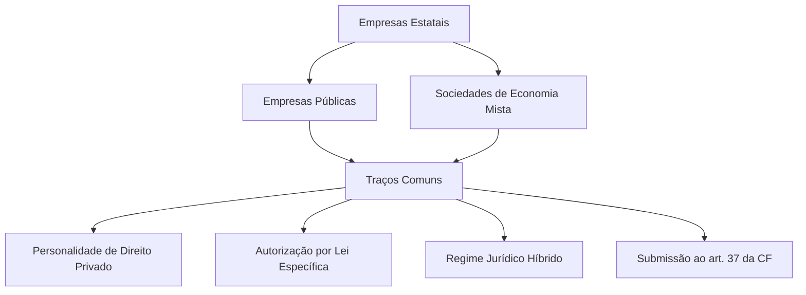
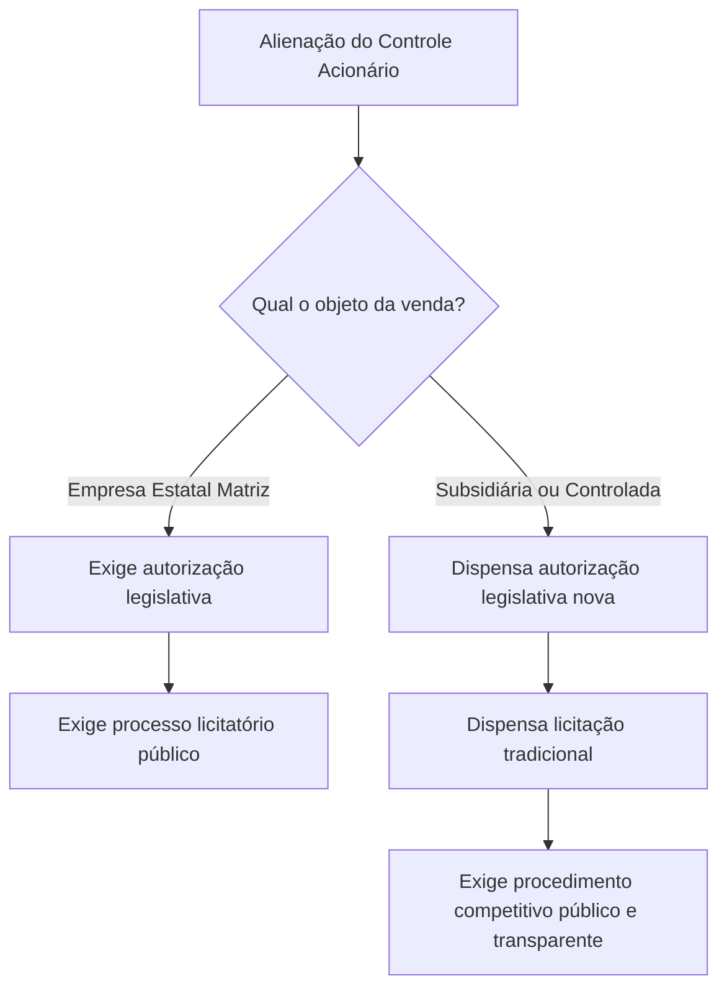
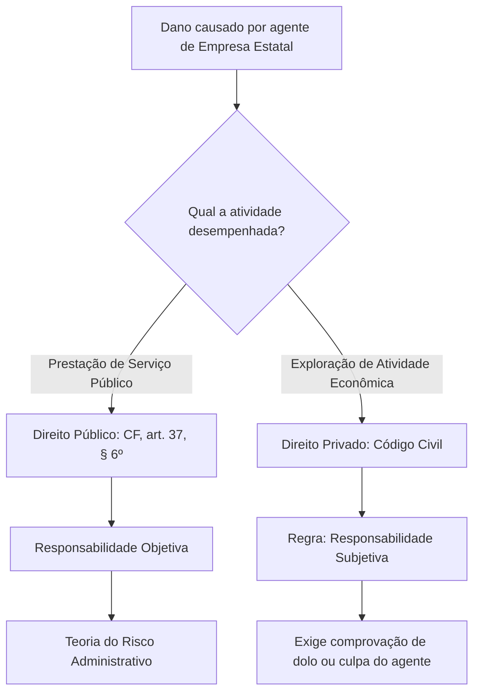

As empresas estatais formam o braço empresarial do Poder Público na economia e nos serviços públicos. Ao lado de autarquias e fundações, elas integram a Administração Indireta, mas ostentam personalidade jurídica de direito privado. Esse arranjo permite ao Estado produzir bens, gerir infraestruturas ou fornecer utilidades com maior dinamismo operacional. Em concursos de segurança pública e oficiais militares, as bancas cobram com frequência as hipóteses de atuação estatal, as exigências de criação e extinção, a supervisão ministerial e as regras de responsabilidade civil. Este capítulo inaugura o estudo da organização administrativa empresarial, estabelecendo as bases conceituais para dominar os temas seguintes do volume.

> [!objetivos]
> - Identificar as hipóteses constitucionais que autorizam a intervenção direta do Estado no domínio econômico.
> - Distinguir os requisitos legais de criação, extinção e alienação do controle de estatais e de suas subsidiárias.
> - Caracterizar o regime jurídico híbrido das empresas públicas e sociedades de economia mista.
> - Diferenciar a responsabilidade civil das estatais prestadoras de serviços públicos daquelas exploradoras de atividade econômica.

## Fundamentos constitucionais da atuação estatal na economia

A ordem econômica brasileira assenta-se no primado da livre iniciativa e na livre concorrência. Por essa razão, a exploração direta da atividade econômica pelo Estado não constitui a regra geral do sistema. O Poder Público atua preferencialmente como agente normativo e regulador da economia, exercendo funções de fiscalização, incentivo e planejamento.

A intervenção direta do Estado na condição de empresário produtor de bens ou prestador de serviços no mercado depende de autorização constitucional expressa. O artigo 173 da Constituição Federal estabelece os limites e pressupostos materiais para essa atuação excepcional.

> [!lei] CF, art. 173, caput
> Ressalvados os casos previstos nesta Constituição, a exploração direta de atividade econômica pelo Estado só será permitida quando necessária aos imperativos da segurança nacional ou a relevante interesse coletivo, conforme definidos em lei.

A leitura do dispositivo revela três hipóteses constitucionais taxativas para a exploração econômica direta pelo Estado:

1. **Casos expressamente previstos na Constituição Federal**: hipóteses pontuais estabelecidas pelo próprio constituinte originário, como os monopólios econômicos da União previstos no artigo 177 da Carta Magna para pesquisa, lavra, refinação e transporte de petróleo, gás natural e minérios nucleares.
2. **Imperativos da segurança nacional**: situações nas quais a soberania e a defesa do país exigem a produção direta de insumos bélicos ou estratégicos pelo Estado. Um exemplo notório é a Indústria de Material Bélico do Brasil (Imbel), vinculada ao Comando do Exército.
3. **Relevante interesse coletivo**: circunstâncias socioeconômicas em que a iniciativa privada não atende adequadamente às demandas da população ou nas quais a presença pública fomenta o desenvolvimento nacional e a cidadania, a exemplo da Caixa Econômica Federal na operacionalização de políticas habitacionais e sociais.

A Lei 13.303/2016, conhecida como o Estatuto Jurídico das Empresas Estatais, reforçou esse fundamento material. O seu artigo 27 estabelece expressamente que o escopo social de tais corporações governamentais reside em concretizar o interesse coletivo ou resguardar a segurança da nação que justificou a respectiva autorização parlamentar.

> [!exemplo]
> Em Pernambuco, imagine que o Governo do Estado identifique a necessidade de assegurar o abastecimento emergencial de gêneros alimentícios básicos e sementes para pequenos agricultores do Sertão durante estiagens severas. Como o setor privado local não atende à demanda em condições acessíveis, o Estado obtém autorização legislativa para instituir uma empresa pública agrícola voltada a esse relevante interesse coletivo regional.

A tabela seguinte compara as duas modalidades de intervenção do Estado na ordem econômica.

| Modalidade de intervenção | Papel do Estado | Base constitucional | Instrumentos típicos |
| --- | --- | --- | --- |
| Intervenção indireta (reguladora) | Agente normativo, fiscalizador e incentivador | CF, art. 174 | Agências reguladoras, normas técnicas e poder de polícia |
| Exploração direta em monopólio | Titular exclusivo da atividade econômica | CF, art. 177 | Empresas estatais monopolistas federais |
| Exploração direta em concorrência | Agente de mercado em igualdade com privados | CF, art. 173 | Empresas estatais em regime concorrencial |

> [!atencao] Proibição de privilégios fiscais
> A estatal exploradora de atividade econômica em regime de concorrência não pode gozar de privilégios fiscais que não sejam extensivos às empresas privadas do mesmo setor (CF, art. 173, § 2º). Essa restrição visa resguardar a isonomia de mercado.

## Conceito e traços comuns das empresas estatais

As empresas estatais são pessoas jurídicas de direito privado instituídas pelo Poder Público para a consecução de objetivos públicos específicos. Elas se dividem em duas espécies: **empresas públicas** (EP) e **sociedades de economia mista** (SEM).

Embora tenham diferenças operacionais de capital e formato societário, ambas compartilham um núcleo comum de características que as define na teoria administrativa:

- **Personalidade jurídica de direito privado**: nascem a partir do registro dos seus atos constitutivos nos órgãos competentes, aplicando-se-lhes primordialmente a legislação civil e comercial comum.
- **Integração na Administração Indireta**: vinculam-se aos órgãos da Administração Direta para fins de controle finalístico e tutela ministerial.
- **Autorização legislativa prévia**: nenhuma estatal surge por iniciativa isolada do Poder Executivo, sendo indispensável lei específica autorizativa.
- **Patrimônio formado com recursos públicos**: a integralidade do capital (na empresa pública) ou a sua parcela controladora majoritária (na sociedade de economia mista) provém dos cofres públicos.
- **Sujeição aos princípios republicanos**: o artigo 37 da Constituição incide integralmente sobre elas, exigindo probidade, impessoalidade, moralidade, publicidade, eficiência e realização de concurso público para contratação de seus empregados permanentes.

Essa convivência entre normas civis e imperativos republicanos dá origem ao chamado **regime jurídico híbrido**. As estatais não desfrutam de liberdade privada irrestrita nem se submetem ao regime puramente estatutário e de direito público das autarquias. O direito público derroga parcialmente o direito privado para resguardar a indisponibilidade do interesse público.

> [!bizu] Derrogação parcial
> Grave para a prova: em empresas estatais, o regime privado é **parcialmente derrogado** por normas de direito público. Dizer que o regime é "puramente privado" ou "puramente público" é incorreto.

A doutrina administrativista clássica destaca que essa derrogação atinge a admissão de empregados por concurso público (CF, art. 37, II), a celebração de contratos subordinada à Lei 13.303/2016 e a submissão aos limites de remuneração pública quando a corporação receber recursos orçamentários.

> [!pegadinha] Criação imediata por lei
> Questões de concurso adoram afirmar que "a empresa pública é criada por lei específica". Isso é uma armadilha. A lei específica **apenas autoriza** a criação. A existência legal da entidade só tem início com a inscrição de seus atos constitutivos no registro competente.

## Criação, extinção, subsidiárias e alienação de controle

O processo formativo e extintivo das empresas estatais exige rigorosa observância das competências legislativas e executivas. O constituinte desenhou um modelo de freios e contrapesos para impedir a criação desordenada de empresas pelo governante de plantão.

O artigo 37, XIX, da Constituição Federal estabelece a exigência formal de lei específica para autorizar a instituição de empresa pública, sociedade de economia mista e fundação.

> [!lei] CF, art. 37, XIX e XX
> XIX - somente por lei específica poderá ser criada autarquia e autorizada a instituição de empresa pública, de sociedade de economia mista e de fundação, cabendo à lei complementar, neste último caso, definir as áreas de sua atuação;
> XX - depende de autorização legislativa, em cada caso, a criação de subsidiárias das entidades mencionadas no inciso anterior, assim como a participação de qualquer delas em empresa privada;

Examinemos o procedimento passo a passo. A lei específica editada pelo ente federativo correspondente (União, Estado, Distrito Federal ou Município) concede a autorização básica. Em seguida, o Poder Executivo edita um decreto contendo a aprovação do estatuto social da entidade. Contudo, o decreto não faz a empresa nascer no mundo jurídico. O nascimento formal da personalidade jurídica ocorre exclusivamente com o **registro dos atos constitutivos** na Junta Comercial (para sociedades mercantis e anônimas) ou no Cartório de Registro Civil de Pessoas Jurídicas.

Em contrapartida, como funciona a **extinção** de uma empresa estatal? O Supremo Tribunal Federal fixou diretriz pacífica: a extinção de empresa pública e de sociedade de economia mista dispensa lei específica individualizada. Admite-se a **autorização legislativa genérica**, veiculada em leis que instituem programas de desestatização ou parcerias de investimentos, como a Lei 9.491/1997 e a Lei 13.334/2016. O Poder Executivo não pode extinguir a estatal de forma monocrática sem respaldo de prévia lei autorizadora, mas não é obrigatório editar uma lei exclusiva para cada extinção.

A criação de **subsidiárias** e a **participação em empresas privadas** também exigem autorização em lei, nos termos do inciso XX do artigo 37 da Constituição Federal. O Supremo Tribunal Federal consolidou a tese de que essa autorização não precisa constar de uma lei nova para cada subsidiária criada. A autorização pode vir de forma expressa no próprio texto da lei que autorizou a criação da empresa-matriz.

A questão ganha especial relevância no tocante à **alienação do controle acionário** e processos de privatização, conforme assentado pelo Supremo Tribunal Federal no julgamento histórico da ADI 5.624.

> [!jurisprudencia] STF, ADI 5.624
> A transferência do controle societário de empresa pública e de sociedade de economia mista depende de autorização por lei e de processo licitatório. Por sua vez, a alienação do controle de subsidiárias e empresas sob controle indireto não carece de autorização legislativa individual nem de licitação estrita, exigindo-se disputa competitiva pública, impessoal e com ampla transparência.

A distinção decorre da proteção ao patrimônio originário criado pelo legislador. Enquanto a venda da empresa-matriz desfaz o desígnio direto do parlamento, as subsidiárias representam desdobramentos operacionais de gestão empresarial da holding estatal.

> [!exemplo]
> Caso a União decida privatizar e transferir o controle acionário de uma grande instituição financeira pública federal, será indispensável prévia lei autorizativa e realização de leilão licitatório. No entanto, se essa mesma estatal decidir vender o controle de uma subsidiária que administra cartões de crédito e seguros, a operação independe de nova lei autorizativa e de licitação formal, bastando procedimento competitivo aberto com oferta pública de ações no mercado de capitais.

## Atividades desenvolvidas: economia e serviços públicos

As empresas estatais desempenham duas modalidades materiais de tarefas:
1. **Exploração de atividade econômica em sentido estrito** (produção e comercialização de bens ou serviços no mercado concorrencial).
2. **Prestação de serviços públicos** (fornecimento de utilidades comodais à coletividade sob regime público).

A identificação precisa da atividade desempenhada pela empresa estatal é crucial para a solução das questões de prova, pois essa natureza dita as regras aplicáveis aos bens, ao regime processual e à responsabilidade extracontratual.

As estatais que exploram atividade econômica em sentido estrito submetem-se ao regime jurídico próprio das empresas privadas no que tange a direitos e obrigações civis, comerciais, trabalhistas e tributárias (CF, art. 173, § 1º, II). Elas disputam o mercado em igualdade de condições com empresas particulares. Por isso, a ordem jurídica veda a concessão de privilégios fiscais não extensivos ao setor privado (art. 173, § 2º). Se uma empresa estatal distribuidora de combustíveis recebesse isenção de impostos negada às redes concorrentes privadas, ocorreria desleal concorrência e quebra do equilíbrio econômico.

Por outro lado, as estatais prestadoras de serviços públicos atuam sob a égide do artigo 175 da Constituição. Nessas entidades, a prevalência do direito público é muito mais expressiva. O serviço público destina-se a atender às necessidades essenciais dos cidadãos, incidindo sobre ele os princípios da continuidade, da modicidade tarifária, da universalidade e da cortesia.

A tabela a seguir compara o regime jurídico de acordo com o objeto social da empresa estatal.

| Critério de distinção | Estatal exploradora de atividade econômica | Estatal prestadora de serviços públicos |
| --- | --- | --- |
| Finalidade principal | Produção/comercialização concorrencial de bens | Fornecimento contínuo de utilidade pública |
| Fundamento normativo | CF, art. 173, caput e § 1º | CF, art. 175 |
| Privilégios tributários | Expressamente vedados (CF, art. 173, § 2º) | Possibilidade de imunidade recíproca sob requisitos |
| Natureza dos bens afetados | Bens privados alienáveis e penhoráveis | Bens afetados ao serviço com proteção especial |
| Regime da responsabilidade civil | Subjetiva em regra (direito privado comum) | Objetiva pelo risco administrativo (CF, art. 37, § 6º) |

Cumpre analisar a evolução jurisprudencial sobre o exercício de **atividades típicas de Estado**. Tradicionalmente, a doutrina sustentava que pessoas jurídicas de direito privado jamais poderiam desempenhar funções típicas estatais, privativas dos entes políticos e das autarquias.

Entretanto, o Supremo Tribunal Federal refinou esse posicionamento no julgamento do RE 633.782 (Tema 532 da Repercussão Geral), autorizando o exercício inclusive do poder de polícia sancionatório por estatais sob condições estritas.

> [!jurisprudencia] STF, RE 633.782 (Tema 532)
> É válida a atribuição legal de poder de polícia, inclusive na esfera de sanções, a pessoas privadas da Administração Indireta com controle societário estatal majoritário, contanto que se dediquem apenas a serviço público próprio do Estado, fora de qualquer regime de concorrência.

O caso julgado envolvia uma empresa municipal de trânsito: a decisão permite que estatais desse tipo fiscalizem e apliquem multas, desde que tenham capital majoritariamente público, prestem só o serviço público próprio do Estado e não atuem em regime de concorrência. A delegação alcança o consentimento, a fiscalização e a sanção; a ordem de polícia (a edição da norma) continua indelegável.

> [!atencao] Atividades sociais
> Nem toda estatal atua no comércio comum ou em serviços públicos econômicos tradicionais. Há estatais com perfil social evidente, a exemplo da Empresa Brasileira de Serviços Hospitalares (Ebserh), constituída para gerir hospitais universitários federais. Mesmo atuando na área de saúde social gratuita, a sua natureza permanece como empresa pública de direito privado.

## Controle, supervisão ministerial e responsabilidade civil

As corporações estatais descentralizadas não gozam de soberania nem de autonomia orgânica absoluta. Como entes integrantes da Administração Indireta, elas sujeitam-se a múltiplos mecanismos de controle institucional: controle administrativo interno, tutela ministerial, fiscalização financeira pelos Tribunais de Contas e controle jurisdicional.

O controle exercido pelo ente federativo instituidor denomina-se **supervisão ministerial** ou **tutela administrativa**. Ele se expressa pela vinculação da estatal ao ministério ou secretaria de Estado correspondente à sua área de atuação (por exemplo, uma estatal de energia vincula-se ao Ministério de Minas e Energia ou à respectiva secretaria estadual).

É fundamental reiterar a regra basilar da organização pública: **não existe hierarquia nem subordinação** entre a Administração Direta e a Administração Indireta. A relação jurídica existente é de mera **vinculação finalística**. A tutela ministerial destina-se a fiscalizar o cumprimento dos objetivos fixados na lei autorizativa, verificar a harmonia com as diretrizes governamentais e zelar pela higidez da gestão.

A Lei 13.303/2016 fixou balizas protetivas da autonomia gerencial das estatais:

- A fiscalização exercida pelos órgãos de controle interno e externo não pode anular a autonomia de gestão da empresa nem configurar intervenção indevida na tomada de decisões negociais (Lei 13.303/2016, arts. 89 e 90).
- Os órgãos de controle externo e interno fiscalizam as empresas públicas e sociedades de economia mista, inclusive as domiciliadas no exterior, quanto à legitimidade, economicidade e eficácia da aplicação dos recursos, sob a ótica contábil, financeira, operacional e patrimonial (Lei 13.303/2016, art. 85).
- A fiscalização de despesas decorrentes de contratos cabe ao controle interno e ao respectivo Tribunal de Contas, devendo a estatal comprovar a regularidade dos gastos efetuados (Lei 13.303/2016, art. 87).

> [!jurisprudencia] STF, MS 25.092
> As empresas estatais sujeitam-se obrigatoriamente ao controle externo do Tribunal de Contas da União, subsistindo o dever de prestação de contas ordinárias e de submissão a tomadas de contas especiais diante de eventual lesão ao erário.

Antigamente, cogitava-se que o regime privado das estatais impediria a atuação dos Tribunais de Contas. Essa tese foi superada pelo STF. Como o capital de controle é integral ou majoritariamente público, a gestão desses valores sujeita-se diretamente ao dever republicano de prestar contas (CF, art. 70, parágrafo único, e art. 71, II).

No que concerne ao **controle jurisdicional**, os dirigentes de empresas estatais são considerados agentes públicos. Eles podem figurar no polo passivo de mandado de segurança quando praticarem atos de autoridade delegada (por exemplo, homologar licitação ou indeferir recurso em concurso público). Todavia, não cabe mandado de segurança contra meros atos de gestão comercial e operacional (como a negativa de um empréstimo bancário rotineiro).

Por fim, o regime de **responsabilidade civil extracontratual** das estatais segue a dicotomia material das suas atividades:

1. **Estatais prestadoras de serviços públicos**: aplicam diretamente o artigo 37, § 6º, da Constituição Federal. Respondem civilmente de forma **objetiva**, sob a modalidade do risco administrativo. A vítima do dano não precisa comprovar culpa ou dolo da estatal, bastando demonstrar a conduta do agente público, o dano suportado e o nexo de causalidade entre ambos. A responsabilidade só é excluída em caso de culpa exclusiva da vítima, caso fortuito ou força maior.
2. **Estatais exploradoras de atividade econômica**: subordinam-se ao regime do direito privado comum. A regra geral do Código Civil é a **responsabilidade subjetiva**, que demanda a comprovação cabal de dolo ou culpa (negligência, imprudência ou imperícia) na conduta do preposto. Ressalva-se que, nas relações consumeristas de varejo, a responsabilidade poderá ser objetiva por força específica do Código de Defesa do Consumidor, e não por aplicação do artigo 37, § 6º, da Carta Constitucional.

> [!pegadinha] Responsabilidade subsidiária do ente instituidor
> Se uma estatal prestadora de serviços públicos for condenada a indenizar terceiro por danos provocados por seus prepostos e os seus ativos se revelarem insuficientes para quitar o precatório ou a dívida, o ente federativo instituidor responde de maneira **subsidiária**, nunca solidária. A banca costuma trocar "subsidiária" por "solidária".

## Mapa do capítulo

O quadro sinótico consolida as bases institucionais das empresas estatais.

| Dimensão analítica | Empresas públicas e sociedades de economia mista |
| --- | --- |
| Natureza e personalidade | Pessoas jurídicas de direito privado da Administração Indireta |
| Criação jurídica | Autorização por lei específica + registro dos atos constitutivos |
| Extinção da entidade | Autorização legislativa (pode ser genérica, como leis de desestatização) |
| Criação de subsidiárias | Autorização legislativa (pode ser genérica, na lei de criação da matriz) |
| Alienação do controle da matriz | Exige autorização legislativa prévia e procedimento de licitação pública |
| Alienação do controle de subsidiária | Dispensa lei e licitação, mas exige procedimento competitivo público |
| Atividades autorizadas | Exploração de atividade econômica em sentido estrito ou prestação de serviços |
| Função social das estatais | Realização do interesse coletivo ou segurança nacional que justificou a criação |
| Tutela ministerial | Controle finalístico sem subordinação e sem hierarquia funcional |
| Tribunal de Contas | Fiscalização obrigatória sobre economicidade, legitimidade e prestação de contas |
| Poder de polícia | Delegável a estatais de serviço público próprio em regime não concorrencial |
| Responsabilidade civil | Objetiva para prestadoras de serviço; subjetiva em regra para atividade econômica |

### Para fixar
- A exploração direta da atividade econômica pelo Estado só é admitida por imperativo de segurança nacional, relevante interesse coletivo ou previsão constitucional expressa.
- Ambas as espécies de estatais ostentam personalidade de direito privado e compõem a Administração Indireta.
- O regime jurídico das estatais é híbrido, com derrogação parcial das normas privadas pelo direito público.
- A criação de estatal depende de autorização por lei específica, nascendo formalmente com o registro dos atos constitutivos.
- A extinção de estatal aceita autorização legislativa genérica, mas não pode ocorrer por ato privativo do Executivo.
- A alienação do controle acionário da estatal matriz exige lei e licitação; a de subsidiárias dispensa ambas, mas exige disputa competitiva impessoal.
- O controle ministerial é exercido por vinculação finalística, inexistindo subordinação ou hierarquia entre a Administração Direta e as estatais.
- As empresas estatais sujeitam-se ao dever de prestar contas e à fiscalização operacional e contábil dos Tribunais de Contas.
- O poder de polícia pode ser delegado por lei a estatal de capital majoritariamente público que preste serviço exclusivo em regime não concorrencial.
- A responsabilidade civil da estatal é objetiva quando presta serviço público e subjetiva, em regra, quando explora atividade econômica.
