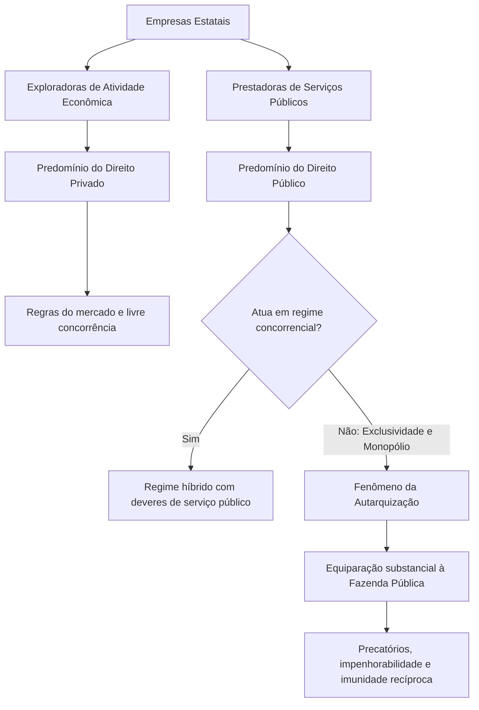
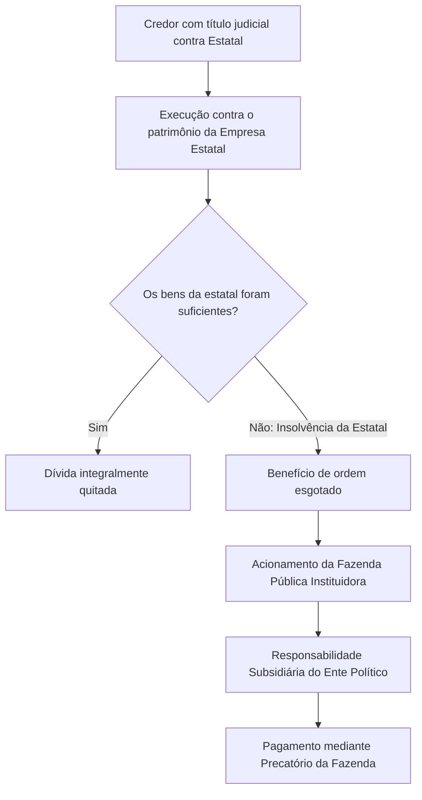

O regime jurídico das empresas estatais constitui um dos temas mais sofisticados do Direito Administrativo contemporâneo. Por possuírem personalidade de direito privado, essas entidades sujeitam-se ordinariamente às regras civis e comerciais. Contudo, quando o Estado lhes confia a execução de serviços públicos essenciais em regime de monopólio, a incidência do direito público se intensifica a ponto de aproximá-las da própria Fazenda Pública. Em concursos públicos, as bancas examinam com rigor as prerrogativas de bens, a imunidade tributária, a vedação à falência e os prazos de prescrição. Este capítulo aprofunda o estatuto material das estatais, revelando as distinções práticas fundamentadas na jurisprudência dos tribunais superiores.

> [!objetivos]
> - Compreender a gradação do regime híbrido entre estatais econômicas e prestadoras de serviços públicos.
> - Analisar a proteção jurídica dispensada aos bens das estatais diretamente afetados à prestação de serviços.
> - Explicar a exclusão das empresas públicas e sociedades de economia mista do regime de falência e recuperação.
> - Dominar os parâmetros do Supremo Tribunal Federal para a extensão da imunidade tributária recíproca.

## Regime jurídico e o fenômeno da autarquização

As entidades estatais empresariais nascem dotadas de personalidade jurídica sob as regras do direito privado. Essa formatação decorre da inscrição de seus atos constitutivos nos órgãos de registro civil ou mercantil. Todavia, a sua disciplina não coincide com a das empresas particulares comuns. O ordenamento jurídico confere-lhes um **regime jurídico híbrido**, em que preceitos de direito público modulam as regras do direito privado.

A intensidade dessa modulação depende fundamentalmente do objeto material desempenhado pela entidade governamental:

1. **Estatais exploradoras de atividade econômica em sentido estrito**: atuam na produção e comercialização de bens ou na prestação de serviços em ambiente de mercado. Submetem-se prioritariamente ao regime das empresas privadas (CF, art. 173, § 1º, II). As derrogações públicas limitam-se às exigências constitucionais inafastáveis, como o concurso público para seus colaboradores, a licitação e a fiscalização pelos Tribunais de Contas.
2. **Estatais prestadoras de serviços públicos**: desempenham atividades voltadas ao atendimento direto da coletividade, nos termos do artigo 175 da Constituição Federal. Nessas corporações, o regime de direito público assume papel preponderante, impondo princípios como a continuidade do serviço, a mutabilidade do regime e a modicidade tarifária.

Quando a estatal presta serviço público de atuação própria do Estado em regime de exclusividade, isto é, sem concorrência de mercado, o influxo de normas públicas atinge grau máximo. A doutrina e a jurisprudência denominam esse movimento de **autarquização das empresas estatais**. A corporação privada é tratada pelo sistema constitucional como se fora a própria Fazenda Pública.

As consequências práticas da autarquização são expressivas. As empresas estatais nessa condição passam a gozar do regime de pagamento por **precatórios** (CF, art. 100), tornando inconstitucional qualquer bloqueio, penhora ou sequestro judicial de seus recursos financeiros para quitação de verbas trabalhistas ou cíveis comuns.

> [!jurisprudencia] STF, ADPF 387
> É aplicável o regime de precatórios às sociedades de economia mista e empresas públicas prestadoras de serviço público próprio do Estado em regime não concorrencial, revelando-se inconstitucionais decisões judiciais que determinem bloqueio, penhora ou arresto de suas contas e rendas.

O Supremo Tribunal Federal reiterou essa diretriz protetiva nos julgamentos da ADPF 275 e da ADPF 890. A Corte Suprema enfatizou que a penhora de receitas operacionais de estatais monopolistas desrespeita o princípio da legalidade orçamentária e compromete a continuidade material dos serviços essenciais entregues à sociedade.

> [!atencao] Atuação concorrencial
> Se uma estatal prestadora de serviço público passar a oferecer seus serviços concomitantemente em livre mercado concorrencial com empresas particulares, ela perde a equiparação à Fazenda Pública. A proteção excepcional existe apenas para o serviço não concorrencial.

## Regime patrimonial e a proteção dos bens afetados

Para o Direito Administrativo, o regime dos bens patrimoniais guarda estrita correlação com a personalidade jurídica do titular e com a destinação material da coisa. O artigo 98 do Código Civil estabelece que são públicos os bens pertencentes às pessoas jurídicas de direito público interno, sendo privados todos os demais, qualquer que seja a pessoa a que pertençam.

Em razão de ostentarem personalidade jurídica de direito privado, os bens pertencentes ao patrimônio de empresas públicas e sociedades de economia mista qualificam-se formalmente como **bens privados**.

A partir dessa premissa, incide a regra geral sobre o patrimônio das empresas estatais:
- Os bens são plenamente alienáveis de acordo com os procedimentos internos da entidade.
- Podem ser onerados e dados em garantia real de obrigações civis e bancárias.
- Sujeitam-se ordinariamente à constrição judicial, penhora, arresto e execução comum.
- Podem ser adquiridos por particulares mediante usucapião, caso abandonados ou não utilizados.

Todavia, a jurisprudência consolidada dos tribunais superiores introduziu uma relevantíssima exceção no tocante às estatais prestadoras de serviços públicos. Trata-se do regime dos **bens diretamente afetados à prestação do serviço público**.

Quando determinado maquinário, imóvel, veículo ou dotação financeira for indispensável para assegurar a prestação ininterrupta do serviço público, a proteção da continuidade prevalece sobre o interesse creditício individual. O bem não pode sofrer alienação compulsória nem penhora judicial.

> [!exemplo]
> Suponha que uma sociedade de economia mista estadual responsável pelo fornecimento de água tratada contraia uma dívida bancária inadimplida. O credor ingressa com execução forçada e requer a penhora das bombas hidráulicas da estação central de tratamento. O juiz deve indeferir a constrição, pois as bombas são bens diretamente afetados à continuidade do serviço de saneamento básico, gozando de impenhorabilidade.

A proteção jurisprudencial outorgada a esses ativos afetados abrange:
1. **Impenhorabilidade**: vedação a qualquer medida coercitiva que subtraia o bem da atividade-fim do serviço público.
2. **Imprescritibilidade**: impossibilidade de perda da posse para particulares via usucapião enquanto perdurar a afetação ao serviço público.
3. **Alienabilidade condicionada**: alienação subordinada a prévio procedimento de desafetação e formalidades administrativas.

O quadro a seguir compara o tratamento conferido aos bens das empresas estatais.

| Dimensão patrimonial | Estatal exploradora de atividade econômica | Bens afetados de estatal prestadora de serviço |
| --- | --- | --- |
| Natureza formal | Bem privado de titularidade da estatal | Bem privado gravado com regime protetivo especial |
| Penhorabilidade | Penhorável em processos de execução civil e trabalhista | Impenhorável para assegurar a continuidade do serviço |
| Usucapião por particulares | Possível, obedecidos os requisitos do Código Civil | Impossível enquanto subsistir a afetação ao serviço |
| Alienação e oneração | Livre alienabilidade segundo deliberação societária | Alienação condicionada e restrita à prévia desafetação |
| Execução de dívidas | Execução comum via expropriação de patrimônio | Regime constitucional de precatórios (CF, art. 100) |

> [!pegadinha] Titularidade dos bens afetados
> As bancas costumam afirmar que os bens afetados de uma estatal prestadora de serviço público "transformam-se em bens públicos". Isso é incorreto. Os bens continuam sendo privados quanto à sua titularidade societária, mas recebem temporariamente as prerrogativas de impenhorabilidade e imprescritibilidade típicas dos bens públicos em virtude de sua afetação finalística.

## Inaplicabilidade da falência e responsabilidade subsidiária

No âmbito da iniciativa privada, o fracasso empresarial conduz ordinariamente à decretação da falência ou ao processamento da recuperação judicial. Nas empresas estatais, o legislador federal adotou solução diametralmente oposta.

O artigo 2º, inciso I, da Lei 11.101/2005 (Lei de Recuperação Judicial e Falência) veda peremptoriamente a aplicação de seus institutos às empresas públicas e sociedades de economia mista.

> [!lei] Lei 11.101/2005, art. 2º, I
> Esta Lei não se aplica a:
> I - empresa pública e sociedade de economia mista;

A vedação legal tem caráter **absoluto e incondicional**. A proibição incide de modo uniforme sobre qualquer modalidade societária de controle estatal, sendo irrelevante se a corporação atua prestando serviço ou disputando o mercado econômico concorrencial. Nenhuma estatal brasileira pode ser submetida ao processo de falência, recuperação judicial ou recuperação extrajudicial.

Caso uma empresa estatal apresente quadro crônico de endividamento e insolvência econômico-financeira, o seu encerramento dá-se pelas vias ordinárias da dissolução societária e liquidação extrajudicial, com base na Lei das Sociedades por Ações (Lei 6.404/1976), no Código Civil e na legislação de desestatização.

A impossibilidade de decretação de falência gera uma indagação imediata: como ficam os credores caso o patrimônio da estatal não seja suficiente para honrar todas as obrigações contraídas?

A resposta reside no princípio da **responsabilidade subsidiária do ente instituidor**. Como o Poder Público optou por decentralizar a gestão por meio de uma pessoa jurídica de sua criação, a Fazenda Pública instituidora (seja a União, o Estado, o Distrito Federal ou o Município) figura como garantidora última das dívidas da corporação.

> [!bizu] Ordem de cobrança
> O ente federativo instituidor responde sempre de forma **subsidiária**, jamais de forma solidária. O credor deve primeiro esgotar todos os meios executórios contra o patrimônio da estatal antes de redirecionar a pretensão executiva contra a Fazenda Pública instituidora.

## Privilégios fiscais, imunidade tributária e prescrição

A concessão de vantagens financeiras e tributárias a corporações estatais exige cuidadoso balizamento para evitar desequilíbrios artificiais no mercado.

O artigo 173, § 2º, da Constituição Federal proíbe expressamente a outorga de privilégios fiscais a corporações empresariais sob controle público quando não forem igualmente franqueados às companhias privadas. Essa restrição constitucional visa resguardar a isonomia material e a livre concorrência no mercado produtivo. Se um banco público contasse com isenções de tributos municipais ou federais que fossem negadas aos bancos privados, ocorreria nítido favorecimento indevido.

Por sua vez, o instituto da **imunidade tributária recíproca** (CF, art. 150, VI, a, e § 2º) impede que a União, os Estados, o Distrito Federal e os Municípios cobrem impostos sobre patrimônio, renda ou serviços uns dos outros. A norma constitucional expressamente estende essa imunidade às autarquias e fundações públicas mantidas pelo Poder Público.

O texto literal da Carta Magna não contemplou as empresas estatais. Diante dessa omissão originária, a regra geral é que as estatais **não desfrutam** de imunidade recíproca.

Contudo, por meio de construção jurisprudencial histórica iniciada no julgamento do RE 407.099 (caso da Empresa Brasileira de Correios e Telégrafos), o Supremo Tribunal Federal estendeu a imunidade tributária recíproca a determinadas empresas públicas e sociedades de economia mista.

Nos autos da ACO 1.460 e da ACO 3.410, o Supremo Tribunal Federal assentou que a concessão da imunidade a estatais depende do preenchimento cumulativo de **três requisitos indispensáveis**:
1. Prestação de serviço público de relevância social (como saneamento básico, infraestrutura postal ou saúde).
2. Ausência de finalidade lucrativa primária em proveito de capital privado.
3. Atuação em regime de exclusividade, monopólio ou ausência de livre concorrência.

Em contrapartida, caso a corporação estatal atue voltada à remuneração de capital e distribua dividendos a acionistas privados, o benefício da imunidade resta prontamente rechaçado.

> [!jurisprudencia] STF, RE 600.867 (Tema 508)
> A sociedade com capital misto cujas ações circulam abertamente no mercado de capitais para remunerar seus acionistas privados não usufrui da imunidade recíproca prevista no artigo 150, VI, alínea a, da Constituição.

Essa tese de repercussão geral consolidou a linha divisória do Pretório Excelso: empresas como Petrobras e Banco do Brasil, dotadas de capital aberto com negociação de títulos no mercado financeiro, sujeitam-se à tributação integral de todos os seus tributos municipais, estaduais e federais.

No tocante aos **prazos prescricionais**, deve-se atentar para as diferenças entre a Fazenda Pública e as estatais:

- As dívidas e ações contra as autarquias e entes políticos prescrevem no prazo quinquenal (cinco anos), conforme o Decreto 20.910/1932.
- Em regra, esse prazo especial de cinco anos **não se aplica** às empresas estatais. As pretensões patrimoniais e cobranças de dívidas envolvendo empresas públicas e sociedades de economia mista seguem a disciplina geral do Código Civil (artigos 205 e 206). O prazo geral é de dez anos, aplicando-se prazos especiais trienais ou quinquenais estritamente nas hipóteses descritas na legislação civil.

Contudo, existem duas notáveis exceções jurisprudenciais e legais:

1. **Ações indenizatórias movidas por particulares contra estatais prestadoras de serviço público**: prescrevem em **cinco anos**, por força expressa do artigo 1º-C da Lei 9.494/1997. Trata-se do prazo específico para obter reparação civil por danos provocados por agentes de prestadoras de serviços públicos.
2. **Ações ajuizadas pelos Correios contra terceiros**: o Superior Tribunal de Justiça reconhece a aplicação do prazo de cinco anos previsto no Decreto 20.910/1932 às ações ajuizadas pela Empresa Brasileira de Correios e Telégrafos em razão de sua equiparação postal à Fazenda Pública.

A tabela seguinte sistematiza as regras de prescrição aplicáveis às empresas estatais.

| Relação jurídica processual | Regra geral aplicável | Base legal ou jurisprudencial | Exceção aplicável |
| --- | --- | --- | --- |
| Particular cobra dívida comum contra estatal | Código Civil (10 anos ou prazos do art. 206) | CC, arts. 205 e 206 | Não incide o Decreto 20.910/1932 |
| Ação de reparação civil de dano contra estatal de serviço | Prazo de 5 anos para pedir indenização | Lei 9.494/1997, art. 1º-C | Não se aplica às estatais econômicas |
| Estatal cobra dívida civil contra terceiro | Código Civil (prazos civis comuns) | CC, arts. 205 e 206 | Correios: prazo de 5 anos (STJ) |

## Mapa do capítulo

A tabela resume as prerrogativas e restrições materiais das empresas estatais.

| Dimensão normativa | Estatal exploradora de atividade econômica | Estatal prestadora de serviços públicos |
| --- | --- | --- |
| Disciplina jurídica central | Regime predominantemente de direito privado | Regime predominantemente de direito público |
| Fenômeno da autarquização | Inaplicável (regras plenas de mercado) | Aplicável quando atua em monopólio e sem concorrência |
| Execução de sentenças | Execução por penhora e expropriação comum | Regime de precatórios do art. 100 da Constituição |
| Regime dos bens corporativos | Bens privados comuns com livre constrição | Bens afetados com impenhorabilidade e imprescritibilidade |
| Falência e recuperação judicial | Inaplicável em absoluto (Lei 11.101/2005, art. 2º, I) | Inaplicável em absoluto (Lei 11.101/2005, art. 2º, I) |
| Responsabilidade do ente instituidor | Subsidiária após exaurimento dos ativos | Subsidiária após exaurimento dos ativos |
| Privilégios tributários | Vedados expressamente (CF, art. 173, § 2º) | Permitidos em monopólio sem distorção concorrencial |
| Imunidade recíproca (art. 150, VI) | Inaplicável em qualquer circunstância | Aplicável sem fins lucrativos e sem concorrência |
| Prescrição em ações indenizatórias | Prazos ordinários do Código Civil | Prazo especial de 5 anos (Lei 9.494/1997, art. 1º-C) |

### Para fixar
- As estatais possuem personalidade de direito privado e regime híbrido, predominando o direito público nas prestadoras de serviços.
- A autarquização equipara a estatal monopolista de serviço público à Fazenda Pública para fins de precatórios e proteção patrimonial.
- Os bens das estatais são privados, mas os bens afetados à prestação de serviços públicos são impenhoráveis e imprescritíveis.
- Nenhuma empresa pública ou sociedade de economia mista se submete à falência ou recuperação judicial (Lei 11.101/2005, art. 2º, I).
- O ente federativo instituidor responde sempre de maneira subsidiária pelas obrigações insolúveis da corporação estatal.
- A concessão de privilégios fiscais exclusivos a estatais econômicas é vedada pelo artigo 173, § 2º, da Constituição.
- A imunidade recíproca alcança estatais que prestem serviços públicos obrigatórios sem concorrência e sem distribuição de lucros.
- Sociedades de economia mista com ações negociadas em bolsa que remuneram investidores não gozam de imunidade tributária recíproca.
- As ações de reparação por dano causado por preposto de estatal prestadora de serviço prescrevem em cinco anos (Lei 9.494/1997, art. 1º-C).
