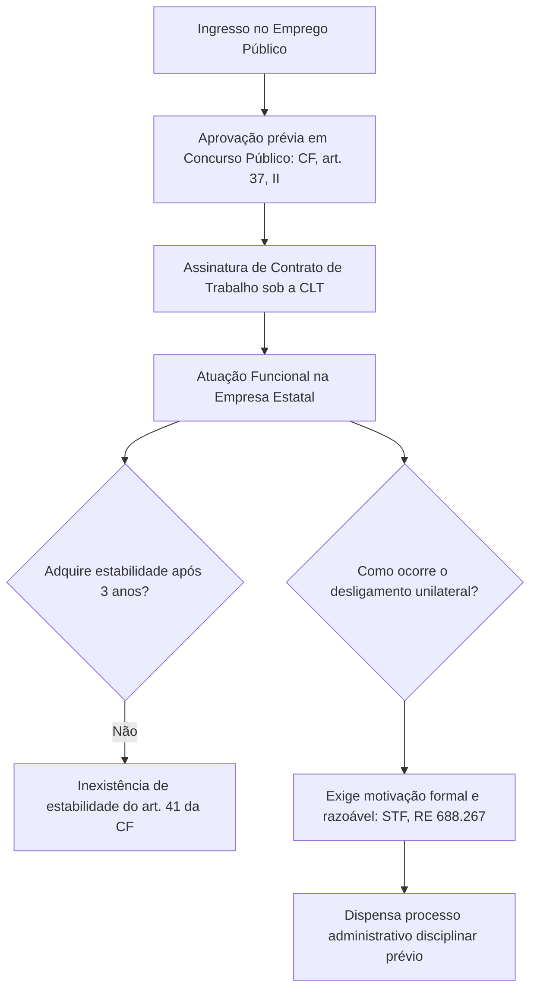
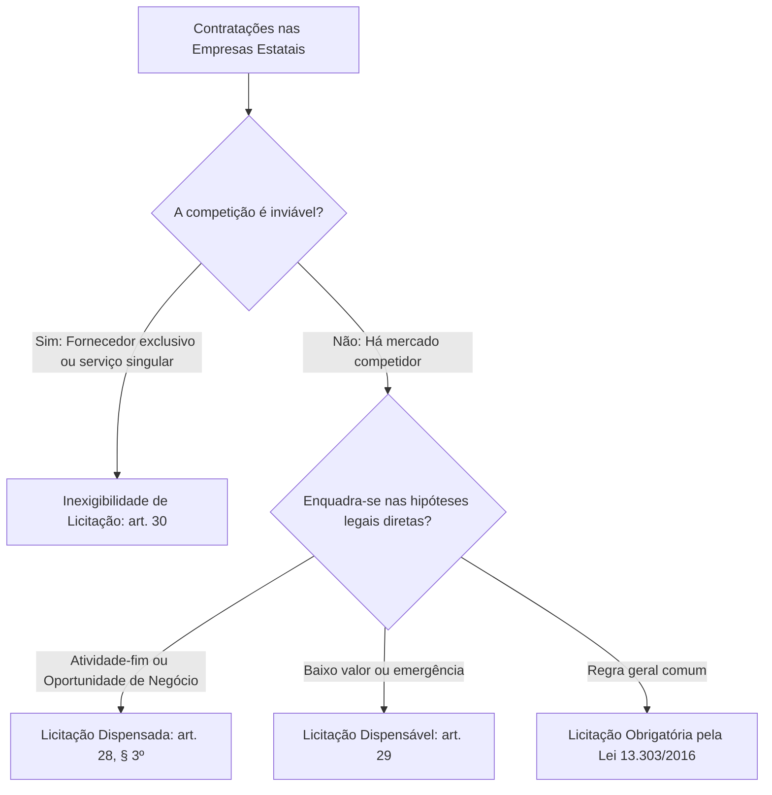

O funcionamento diário das empresas estatais combina técnicas do direito corporativo com garantias protetivas republicanas. Para além do regime de seus bens e prerrogativas processuais, o estudante precisa compreender como essas entidades admitem colaboradores, selecionam administradores e celebram contratos no mercado. Além disso, a diferenciação técnica entre empresa pública e sociedade de economia mista desponta como um dos tópicos de maior frequência em provas de concurso. Este capítulo disseca as regras constitucionais e infraconstitucionais que disciplinam o trabalho nas estatais, o estatuto licitatório da Lei 13.303/2016 e as três divergências estruturais entre as duas espécies de empresas públicas em sentido amplo.

> [!objetivos]
> - Identificar as características do emprego público celetista e as diretrizes do Supremo Tribunal Federal sobre a demissão motivada.
> - Detalhar os requisitos de integridade, experiência e as vedações políticas impostas aos dirigentes das estatais pela Lei 13.303/2016.
> - Distinguir as hipóteses de licitação dispensada, dispensável e inexigível aplicáveis às empresas públicas e sociedades de economia mista.
> - Contrastar a empresa pública e a sociedade de economia mista quanto à forma societária, composição acionária e foro processual competente.

## Regime de quadro funcional: o emprego público nas estatais

O quadro funcional efetivo das entidades empresariais estatais não ocupa cargos públicos estatutários. O vínculo jurídico firmado entre a entidade estatal e o trabalhador possui natureza contratual, disciplinada pela Consolidação das Leis do Trabalho (CLT). Por esse motivo, esses profissionais qualificam-se tecnicamente como **empregados públicos**, e não como servidores estatutários.

Apesar da aplicação da legislação trabalhista comum, o regime do emprego público nas estatais sofre influxos severos do direito constitucional administrativo:

1. **Aprovação prévia em concurso público**: o artigo 37, inciso II, da Constituição Federal impõe a realização de certame de provas ou de provas e títulos para a investidura originária em emprego público. A contratação direta sem concurso é nula, gerando sanções por ato de improbidade administrativa aos gestores responsáveis.
2. **Inexistência de estabilidade constitucional**: os empregados celetistas das empresas estatais não adquirem a estabilidade do artigo 41 da Carta Magna, mesmo após completarem três anos de efetivo exercício. A garantia de estabilidade no serviço público é direito privativo dos ocupantes de cargo de provimento efetivo em pessoas jurídicas de direito público (Administração Direta, autarquias e fundações autárquicas).
3. **Exigência de dispensa motivada**: durante anos debateu-se se as estatais poderiam despedir seus empregados sem justificativa, como ocorre na iniciativa privada. O Supremo Tribunal Federal pacificou a matéria no julgamento do RE 688.267 (Tema 1022), estabelecendo que a demissão de empregado público concursado exige indispensável motivação formal.

> [!jurisprudencia] STF, RE 688.267 (Tema 1022)
> As corporações estatais, quer atuem no fornecimento de utilidades à população, quer disputem o mercado produtivo, devem fundamentar formalmente a dispensa de empregados admitidos por concurso, indicando justificativa legítima e verossímil, sem exigir rito processual disciplinar prévio.

A tese firmada pela Suprema Corte equilibra os valores em disputa. Por um lado, protege o empregado concursado contra arbitrariedades políticas ou perseguições pessoais de gestores temporários. Por outro lado, preserva a agilidade de gestão das estatais, permitindo o desligamento com base em reestruturações setoriais, desempenho insatisfatório apurado em avaliações internas ou insuficiência orçamentária, sem exigir a instauração de complexo processo administrativo disciplinar.

Outras regras constitucionais incidem de forma direta sobre os empregados das estatais:

- **Proibição de acumulação remunerada**: a vedação constitucional à acumulação de cargos, funções e empregos públicos (CF, art. 37, XVI e XVII) alcança expressamente as empresas estatais, suas subsidiárias e pessoas jurídicas sob controle público direto ou indireto. As únicas ressalvas são aquelas autorizadas na própria Constituição (dois cargos privativos de magistério; um de magistério com outro de qualquer natureza, pela EC 138/2025; dois cargos privativos de profissionais de saúde com profissões regulamentadas), desde que haja compatibilidade de horários.
- **Regime Geral de Previdência Social**: os empregados públicos vinculam-se compulsoriamente ao INSS (CF, art. 40, § 13), não fazendo jus ao Regime Próprio de Previdência Social (RPPS).
- **Competência da Justiça do Trabalho**: litígios decorrentes do contrato de emprego público, inclusive controvérsias sobre verbas rescisórias e adicionais, são processados e julgados na Justiça do Trabalho (CF, art. 114, I).
- **Equiparação a funcionário público**: para fins de responsabilização penal, os empregados de estatais equiparam-se a funcionários públicos nos crimes contra a Administração Pública, conforme tipificação do Código Penal para agentes de entidades paraestatais. Na esfera da probidade, submetem-se inteiramente à Lei de Improbidade Administrativa (Lei 8.429/1992, art. 2º).

> [!atencao] Incidência do teto remuneratório
> O teto constitucional de remuneração (CF, art. 37, XI e § 9º) só se aplica às empresas públicas, às sociedades de economia mista e a suas subsidiárias que **receberem recursos** financeiros do tesouro governamental instituidor para pagamento de despesas de quadro funcional ou de custeio em geral. Se a empresa estatal for economicamente autossuficiente (como a Petrobras ou o Banco do Brasil), seus empregados e executivos não se submetem ao teto dos ministros do STF.

## Administradores das empresas estatais e a Lei 13.303/2016

Os órgãos de deliberação superior das empresas estatais são formados pelo **Conselho de Administração** e pela **Diretoria Executiva**. Ao contrário do quadro de empregados permanentes, os administradores das estatais não ingressam por concurso público e não mantêm vínculo estritamente regido pela CLT.

Eles exercem mandato corporativo temporário mediante nomeação política institucional. Trata-se de um vínculo especial de natureza societária e administrativa, subordinado à Lei das Estatais (Lei 13.303/2016), à Lei das Sociedades por Ações (Lei 6.404/1976) e ao estatuto social de cada entidade.

A investidura dos administradores das estatais compete ao Chefe do Poder Executivo (Presidente da República, Governador ou Prefeito) ou decorre de deliberação societária controlada pelo Poder Público. O Supremo Tribunal Federal consolidou o entendimento de que leis locais ou estaduais não podem condicionar a nomeação ou a exoneração de dirigentes de empresas estatais à prévia aprovação da Assembleia Legislativa ou da Câmara de Vereadores. A exigência de crivo parlamentar para cargos de estatais viola o princípio da separação dos poderes e a prerrogativa privativa do Chefe do Executivo.

Para profissionalizar a gestão pública e blindar as corporações estatais contra o aparelhamento político partidário, o artigo 17 da Lei 13.303/2016 instituiu parâmetros técnicos rigorosos para a escolha de membros do Conselho de Administração e da Diretoria Executiva.

O quadro a seguir sistematiza as condições de qualificação para administradores de estatais.

| Requisito legal | Especificação normativa (Lei 13.303/2016, art. 17) | Possibilidade de dispensa |
| --- | --- | --- |
| Idoneidade e capacidade | Reputação ilibada e notório conhecimento técnico compatível | Indispensável em qualquer circunstância |
| Formação acadêmica | Nível superior em curso compatível com a área da estatal | Indispensável em qualquer circunstância |
| Inelegibilidade | Não incidir em nenhuma hipótese de inelegibilidade eleitoral | Indispensável em qualquer circunstância |
| Experiência profissional (Opção 1) | 10 anos no setor público ou privado na área da estatal ou afim | Dispensável sob requisitos cumulativos do § 5º |
| Experiência profissional (Opção 2) | 4 anos em chefia superior, cargo DAS-4 ou docência/pesquisa na área | Dispensável sob requisitos cumulativos do § 5º |
| Experiência profissional (Opção 3) | 4 anos como profissional liberal em atividade correlata à empresa | Dispensável sob requisitos cumulativos do § 5º |

A comprovação dos anos de experiência profissional poderá ser dispensada com base no artigo 17, § 5º, da Lei 13.303/2016 caso o indicado seja empregado do quadro próprio da empresa estatal e preencha simultaneamente três condições:
- Ter ingressado por concurso público de provas ou de provas e títulos.
- Contar com mais de dez anos de serviço efetivo na corporação.
- Ter exercido cargo de gestão superior na entidade, comprovando aptidão para o encargo.

Em contrapartida, o legislador estabeleceu um rol taxativo de **vedações à indicação** nos parágrafos 2º e 3º do artigo 17 da Lei das Estatais. O objetivo é conter interferências que possam comprometer a governança e a higidez contábil da companhia.

Não podem ser nomeados para cargos de administrador ou de membro de comitês estatutários:
1. Representantes do órgão regulador ao qual a empresa estatal está vinculada.
2. Ministros de Estado, Secretários estaduais e municipais.
3. Titulares de cargo de natureza especial ou de direção e assessoramento superior sem vínculo permanente na administração.
4. Dirigentes de partidos políticos e titulares de mandato no Poder Legislativo de qualquer ente federativo, ainda que licenciados do mandato parlamentar.
5. Pessoas que tenham exercido, nos últimos 36 meses, encargos em diretórios partidários ou funções estratégicas em campanhas eleitorais.
6. Dirigentes de organizações sindicais.
7. Pessoas físicas que tenham firmado contrato ou parceria comercial como fornecedor, prestador ou cliente com a estatal ou seu controlador em prazo inferior a três anos antes da posse.
8. Cidadãos que apresentem conflito de interesses formal com o ente controlador ou com a própria empresa.
9. Cônjuge, companheiro ou parentes consanguíneos ou afins até o terceiro grau de quaisquer das autoridades impedidas.

> [!jurisprudencia] STF, ADI 7.331
> O Supremo Tribunal Federal confirmou a plena constitucionalidade das vedações do artigo 17, § 2º, incisos I e II, da Lei 13.303/2016, reafirmando que a quarentena para indicados com atuação partidária, mandatos legislativos ou cargos de cúpula no Executivo prestigia os princípios constitucionais da moralidade, impessoalidade e eficiência na gestão do patrimônio público empresarial.

Na esfera jurisdicional, cumpre distinguir os atos praticados pelos diretores de empresas estatais. Quando o administrador atua investido de delegação estatal (por exemplo, na presidência de comissão de licitação ou na aprovação de edital de concurso), seus atos são considerados atos de autoridade pública, sujeitos a mandado de segurança. Todavia, atos puramente negociais, como a recusa de abertura de linha de crédito bancário ou a rescisão de contrato mercantil comum, qualificam-se como atos de gestão empresarial privada, contra os quais não cabe mandado de segurança.

## Licitações e contratações nas empresas estatais

O regime licitatório das empresas estatais assenta-se em determinação constitucional expressa. O artigo 173, § 1º, inciso III, da Constituição Federal ordenou que a lei estabelecesse estatuto jurídico próprio para as empresas públicas e sociedades de economia mista, regulamentando a licitação e a contratação de obras, serviços, compras e alienações com observância dos princípios republicanos.

Essa missão constitucional foi desempenhada com a promulgação da **Lei 13.303/2016**. Por conseguinte, as estatais brasileiras submetem-se a um microssistema normativo próprio para licitar e contratar.

Como regra basilar de prova, **as entidades empresariais sob controle público não se submetem à Nova Lei de Licitações (Lei 14.133/2021)**. A Lei 14.133/2021 aplica-se aos órgãos da Administração Direta, às autarquias e às fundações públicas, mas não alcança as empresas estatais em suas rotinas operacionais cotidianas.

A incidência de diplomas gerais sobre as estatais restringe-se a situações pontuais:
- Aplicação das figuras penais de crimes em licitações e contratos administrativos (Código Penal, arts. 337-E a 337-P, inseridos pela Lei 14.133/2021).
- Utilização da modalidade pregão para aquisição de bens e serviços comuns, permitida nos termos da legislação federal.
- Observância subsidiária de critérios legais de desempate estabelecidos no artigo 60 da Lei 14.133/2021.

A Lei 13.303/2016 confere agilidade aos negócios públicos por meio de três figuras de contratação direta: **licitação dispensada**, **licitação dispensável** e **inexigibilidade de licitação**.

A **licitação dispensada** (Lei 13.303/2016, art. 28, § 3º) é a modalidade em que a própria lei afasta o procedimento licitatório e suas formalidades rígidas para viabilizar o cumprimento da finalidade empresarial da estatal. Ela alcança duas situações cruciais:
1. Comercialização, prestação ou execução direta de produtos, serviços ou obras especificamente vinculados ao **objeto social** da companhia (por exemplo, a Petrobras vendendo derivados de petróleo ou a Caixa celebrando operações de crédito imobiliário).
2. Escolha de parceiro estratégico vinculada a **oportunidades de negócio** específicas, quando se comprovar a inviabilidade de procedimento competitivo ordinário no mercado de capitais ou na formação de consórcios.

> [!exemplo]
> Caso uma sociedade de economia mista estadual fornecedora de gás canalizado decida comercializar insumos energéticos com indústrias instaladas em um polo fabril, o negócio enquadra-se como licitação dispensada, pois decorre do cumprimento direto de seu objeto social comercial. Exigir licitação para cada venda no balcão paralisaria a operação mercantil da empresa.

A **licitação dispensável** (art. 29 da Lei 13.303/2016) engloba situações em que a realização do certame seria faticamente possível, mas a lei autoriza a contratação direta por razões de economia processual, celeridade ou emergência.

Os casos mais frequentes em provas envolvem a **dispensa em razão do valor** da contratação:

A tabela seguinte confronta os limites de dispensa por valor entre a Lei das Estatais e a Lei Geral de Licitações.

| Objeto da contratação | Limite na Lei 13.303/2016 (Estatais) | Limite na Lei 14.133/2021 (Regra Geral) | Particularidades da Lei 13.303/2016 |
| --- | --- | --- | --- |
| Obras e serviços de engenharia | Até 100 mil reais (Lei 13.303/2016, art. 29, I) | Inferior a 100 mil reais (Lei 14.133/2021, art. 75, I) | O Conselho de Administração pode atualizar os valores |
| Compras e demais serviços | Até 50 mil reais (Lei 13.303/2016, art. 29, II) | Inferior a 50 mil reais (Lei 14.133/2021, art. 75, II) | Valores nominais fixados em lei sem decreto anual |

Três distinções práticas merecem atenção:
- A Lei 13.303/2016 adota a expressão "**até**" o valor, enquanto a Lei 14.133/2021 utiliza a expressão "**inferior a**".
- Na Lei 14.133/2021, o teto superior de engenharia abrange também serviços de manutenção de veículos automotores; na Lei 13.303/2016, o limite maior aplica-se estritamente a obras e engenharia.
- Na Lei 14.133/2021, os valores são atualizados todo ano por decreto do Poder Executivo federal (art. 182); a prova costuma cobrar os valores escritos na lei.
- Os limites da Lei 13.303/2016 podem ser modificados pelo **Conselho de Administração** da respectiva empresa estatal para refletir a variação dos custos operacionais, admitindo-se tetos diferenciados entre corporações (Lei 13.303/2016, art. 29, § 3º).

Por fim, a **inexigibilidade de licitação** (Lei 13.303/2016, art. 30) verifica-se sempre que houver inviabilidade fática ou jurídica de competição, como na contratação de fornecedor exclusivo devidamente comprovado ou na prestação de serviços técnicos de natureza singular com profissionais de notória especialização.

Mesmo nos casos de dispensa e de inexigibilidade, a estatal permanece vinculada aos deveres de impessoalidade e moralidade, sendo imperativo demonstrar a justificativa do preço contratado e a razoabilidade da escolha do fornecedor.

## Diferenças entre Empresa Pública e Sociedade de Economia Mista

Apesar de pertencerem ao mesmo gênero das entidades descentralizadas empresariais, as empresas públicas e as sociedades de economia mista guardam peculiaridades estruturais nítidas. A doutrina e a jurisprudência consagram **três critérios essenciais de diferenciação**: a forma jurídica societária, a composição do capital social e a fixação do foro jurisdicional.

O artigo 3º e o artigo 4º da Lei 13.303/2016 trazem as definições legais que alicerçam essa distinção.

> [!lei] Lei 13.303/2016, arts. 3º e 4º
> Art. 3º Empresa pública é a entidade dotada de personalidade jurídica de direito privado, com criação autorizada por lei e com patrimônio próprio, cujo capital social é integralmente detido pela União, pelos Estados, pelo Distrito Federal ou pelos Municípios.
> Art. 4º Sociedade de economia mista é a entidade dotada de personalidade jurídica de direito privado, com criação autorizada por lei, sob a forma de sociedade anônima, cujas ações com direito a voto pertençam em sua maioria à União, aos Estados, ao Distrito Federal, aos Municípios ou a entidade da administração indireta.

Examinemos minuciosamente cada uma das três diferenças marcantes.

### Primeira diferença: forma jurídica societária

A Lei 13.303/2016 não impõe forma societária à empresa pública (art. 3º); a fórmula clássica vem do Decreto-Lei 200/1967 (art. 5º, II), segundo o qual ela pode revestir-se de **qualquer das formas admitidas em direito**. Ela pode ser estruturada como sociedade de responsabilidade limitada (LTDA), sociedade anônima (S/A), sociedade em comandita ou qualquer outra modalidade societária válida. A doutrina majoritária admite, inclusive, que a União crie uma empresa pública federal sob formato societário inédito (*sui generis*), haja vista a competência privativa federal para editar normas de direito civil e comercial (CF, art. 22, I).

Em contrapartida, a sociedade de economia mista está obrigada a constituir-se **exclusivamente sob a forma de sociedade anônima (S/A)** (Lei 13.303/2016, arts. 4º e 5º). Essa exigência é taxativa e cogente. Ressalvado o disposto na Lei 13.303/2016, ela se submete ao regime da Lei 6.404/1976 (artigos 235 a 240).

> [!pegadinha] SEM sob a forma de sociedade limitada
> É recorrente a banca formular assertivas afirmando que a sociedade de economia mista pode adotar a forma de sociedade anônima ou de sociedade limitada. A assertiva é redondamente falsa. Sociedade de economia mista jamais pode ser LTDA. Ela é sempre e unicamente Sociedade Anônima (S/A).

### Segunda diferença: composição do capital social

Na empresa pública, o capital social é **totalmente público** (100% estatal). Não se admite a participação de capital financeiro de pessoas físicas ou jurídicas de direito privado em sua composição societária originária.

Entretanto, "capital integralmente público" não significa capital pertencente a um único ente da Federação. A empresa pública pode ser pluripessoal. O artigo 3º, parágrafo único, da Lei 13.303/2016 admite a participação de outras pessoas estatais de direito público (como outros Estados ou Municípios) e de entidades da Administração Indireta (como autarquias, fundações e até mesmo sociedades de economia mista), contanto que o controle votante majoritário permaneça com o ente instituidor.

Já na sociedade de economia mista, o capital social é **misto**, combinando aportes financeiros de entes governamentais e de particulares investidores da iniciativa privada. Contudo, para assegurar o comando administrativo do Estado, a **maioria das ações com direito a voto** deve obrigatoriamente pertencer à pessoa política instituidora ou a entes de sua Administração Indireta.

### Terceira diferença: foro jurisdicional competente

A fixação do foro jurisdicional das empresas estatais demanda atenção redobrada quanto à esfera federativa da entidade envolvida.

Para as **empresas públicas federais** (como a Caixa Econômica Federal e a Empresa Brasileira de Correios e Telégrafos), a competência jurisdicional pertence à **Justiça Federal** (CF, art. 109, I), ao passo que as entidades criadas por Estados ou Municípios demandam perante a Justiça Estadual.

Para as **sociedades de economia mista**, independentemente da esfera federativa (seja federal, como o Banco do Brasil e a Petrobras, estadual ou municipal), as demandas cíveis e comerciais comuns tramitam, como regra geral, perante a **Justiça Estadual comum**, na forma da Súmula 556 do STF.

> [!jurisprudencia] STF, Súmula 556
> Quando uma sociedade de economia mista figura como parte, a causa tramita na justiça comum (estadual), e não na federal.

A regra geral da Súmula 556 comporta uma ressalva processual relevantíssima. Se a **União intervir** voluntariamente na causa envolvendo sociedade de economia mista federal, na qualidade de assistente simples, assistente litisconsorcial ou oponente, a competência se deslocará para a Justiça Federal, por incidência da Súmula 517 do STF.

> [!jurisprudencia] STF, Súmula 517
> As demandas envolvendo sociedade de economia mista somente são atraídas para a jurisdição da Justiça Federal quando a União figurar formalmente na lide como assistente ou opoente.

Por fim, cabe reiterar a regra sobre conflitos laborais: quaisquer dissídios trabalhistas envolvendo empregados públicos de empresas públicas ou de sociedades de economia mista (federais, estaduais ou municipais) são de competência exclusiva da **Justiça do Trabalho** (CF, art. 114, I).

> [!bizu] O trio de ouro das diferenças
> Memorize para gabaritar a prova:
> 1. **Forma**: EP adota qualquer uma; SEM só aceita S/A.
> 2. **Capital**: EP tem 100% público; SEM tem capital misto com controle votante estatal.
> 3. **Foro federal**: EP vai para a Justiça Federal; SEM vai para a Justiça Estadual (salvo intervenção da União).

## Mapa do capítulo

O quadro sinótico sistematiza a comparação definitiva entre Empresa Pública e Sociedade de Economia Mista.

| Aspecto de comparação | Empresa Pública (EP) | Sociedade de Economia Mista (SEM) |
| --- | --- | --- |
| Personalidade jurídica | Direito privado da Administração Indireta | Direito privado da Administração Indireta |
| Forma jurídica societária | Qualquer forma admitida em direito | Exclusivamente Sociedade Anônima (S/A) |
| Composição acionária | 100% pública (admite múltiplos entes públicos) | Mista (recursos públicos e privados) |
| Titularidade do controle | Maioria do capital votante com o ente instituidor | Maioria das ações com direito a voto com o Poder Público |
| Foro (âmbito federal) | Justiça Federal comum (CF, art. 109, I) | Justiça Estadual comum (STF, Súmula 556) |
| Deslocamento de foro | Mantém-se na Justiça Federal | Vai para a Justiça Federal se a União intervier (Súmula 517) |
| Relações de trabalho | Justiça do Trabalho (CF, art. 114, I) | Justiça do Trabalho (CF, art. 114, I) |
| Regime funcional | Empregados celetistas com concurso público | Empregados celetistas com concurso público |
| Dispensa funcional | Exige motivação formal razoável (STF, RE 688.267) | Exige motivação formal razoável (STF, RE 688.267) |
| Estatuto licitatório | Lei 13.303/2016 (afasta a regra da Lei 14.133/2021) | Lei 13.303/2016 (afasta a regra da Lei 14.133/2021) |
| Administradores | Vínculo societário especial com requisitos do art. 17 | Vínculo societário especial com requisitos do art. 17 |

### Para fixar
- Os colaboradores das estatais são empregados celetistas admitidos por concurso público obrigatório, sem estabilidade do artigo 41 da Constituição.
- O ato de demissão de empregado público concursado exige fundamentação formal e razoável, sem necessidade de PAD (STF, RE 688.267).
- A proibição de acumulação de cargos e empregos públicos alcança expressamente as empresas estatais e suas subsidiárias.
- O teto remuneratório só atinge estatais que recebam recursos do tesouro para gastos de quadro funcional ou custeio.
- Os administradores das estatais ocupam mandatos de livre escolha do Executivo, sendo inconstitucional a exigência de aprovação pelo Legislativo.
- O artigo 17 da Lei 13.303/2016 impõe critérios técnicos e quarentenas de 36 meses para indicados com atuação partidária e eleitoral.
- As empresas estatais não adotam a Lei 14.133/2021 em suas rotinas operacionais, seguindo o estatuto próprio da Lei 13.303/2016.
- A licitação é dispensada na comercialização direta ligada ao objeto social e na seleção de parceiros em oportunidades de negócio.
- A empresa pública admite qualquer forma societária, enquanto a sociedade de economia mista só pode ser constituída como sociedade anônima.
- A empresa pública federal responde perante a Justiça Federal, enquanto a sociedade de economia mista responde ordinariamente perante a Justiça Estadual.
