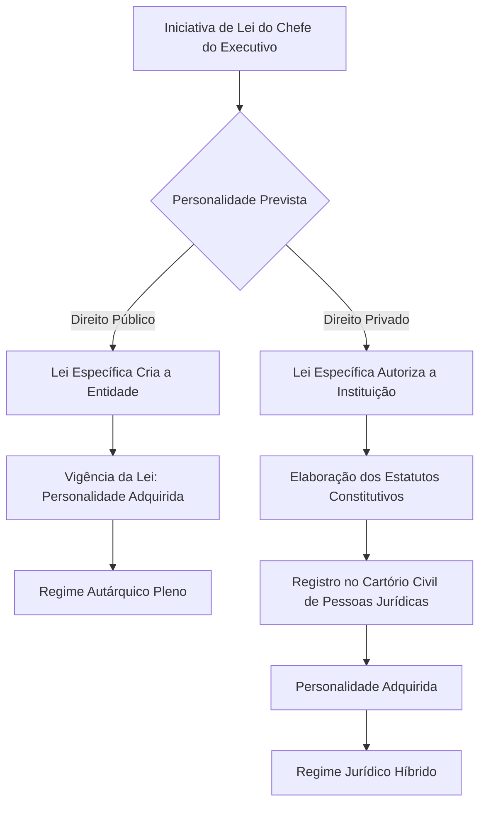
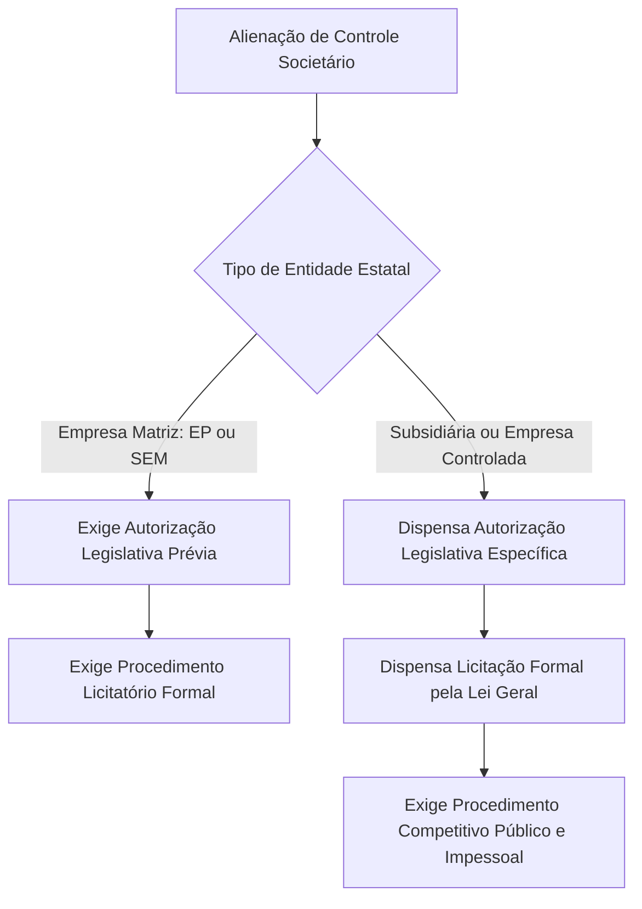

As fundações públicas ocupam papel de destaque na Administração Indireta. Elas personificam parcelas de patrimônio público vinculadas a finalidades sociais de relevante interesse coletivo. Essas entidades atuam sem intuito de lucro em áreas como saúde, ensino, pesquisa e assistência. Compreender a distinção entre fundações de direito público e de direito privado é essencial para a sua prova. Além da estrutura fundacional, este capítulo consolida os entendimentos jurisprudenciais mais expressivos do Supremo Tribunal Federal e do Superior Tribunal de Justiça sobre a organização administrativa. Estudaremos temas cruciais: as restrições a dirigentes partidários em empresas estatais, a motivação na dispensa de empregados públicos e os limites da alienação de subsidiárias.

> [!objetivos]
> - Definir o conceito de fundação pública e identificar as suas características essenciais na teoria administrativa.
> - Distinguir as fundações públicas de direito público das de direito privado quanto à criação, ao regime de bens e aos colaboradores.
> - Examinar as regras constitucionais de imunidade tributária, precatórios, prerrogativas processuais e foro competente.
> - Dominar a jurisprudência consolidada dos tribunais superiores sobre motivação de demissão nas estatais, desestatização e vedações a indicações políticas.

## Conceito, traços fundamentais e natureza jurídica das fundações públicas

No direito civil, a fundação nasce quando um particular separa parte de seus bens para uma finalidade de interesse coletivo. Criada a entidade, ela ganha vida própria. O instituidor perde a gestão direta sobre os bens, desde que mantida a finalidade legal.

A fundação pública transpõe essa ideia para a esfera governamental. O Poder Público reserva uma dotação de bens e recursos orçamentários. Em seguida, outorga personalidade jurídica própria a esse patrimônio para desempenhar atividades estatais de natureza social. Três marcas fundamentais definem a fundação pública:

1. **A figura do instituidor público**: o Estado cria a entidade mediante reserva de bens e receitas orçamentárias.
2. **O fim social de interesse coletivo**: a instituição volta-se a atividades não lucrativas de apoio à população, como educação, cultura, saúde e tecnologia.
3. **A ausência de fins lucrativos**: eventuais sobras orçamentárias retornam integralmente para a manutenção e expansão das próprias atividades institucionais.

O Decreto-Lei 200/1967 definia a fundação pública apenas como pessoa jurídica de direito privado. Essa visão antiga foi superada pela jurisprudência constitucional do Supremo Tribunal Federal. O ordenamento jurídico atual admite duas espécies de fundações instituídas pelo Estado:

- **Fundações públicas de direito público**: são criadas diretamente por lei específica. Elas possuem regime jurídico idêntico ao das autarquias. A doutrina e a jurisprudência as chamam de **fundações autárquicas** ou **autarquias fundacionais**.
- **Fundações públicas de direito privado**: têm sua criação autorizada por lei específica. Elas ganham personalidade jurídica civil com o registro de seus atos constitutivos no cartório competente. Submetem-se a um **regime jurídico híbrido**. Nele, as normas de direito privado sofrem derrogação parcial por regras de direito público.

> [!exemplo]
> O Estado de Pernambuco decide criar um centro de apoio científico para perícias de incêndio do Corpo de Bombeiros Militar. O Poder Público pode instituir uma fundação pública de direito público com regime autárquico pleno. Também pode autorizar uma fundação de direito privado para gerir bolsas e convênios técnicos com agilidade. Em ambos os casos, a finalidade é pública e sem objetivo de lucro.

A diferença entre autarquias e fundações públicas de direito público é puramente conceitual. A autarquia é um serviço público personalizado. A fundação de direito público é um patrimônio personalizado afetado a um fim social. Quanto ao regime de direitos, deveres e prerrogativas, ambas são idênticas.

## Criação, extinção e delimitação das áreas de atuação

A criação das fundações públicas obedece ao modelo traçado no artigo 37, inciso XIX, da Constituição Federal. O texto constitucional exige a participação do Poder Legislativo na descentralização administrativa.

> [!lei] CF, art. 37, XIX
> Somente por lei específica poderá ser criada autarquia e autorizada a instituição de empresa pública, de sociedade de economia mista e de fundação, cabendo à lei complementar, neste último caso, definir as áreas de sua atuação.

O mandamento constitucional diferencia a origem de cada espécie fundacional:

1. **Fundações públicas de direito público**: nascem diretamente de **lei ordinária específica**. A personalidade jurídica surge com a entrada em vigor da lei instituidora. Não há qualquer registro em cartório civil de pessoas jurídicas. O procedimento é idêntico ao de uma autarquia.
2. **Fundações públicas de direito privado**: a lei ordinária específica apenas **autoriza a instituição**. A personalidade jurídica só nasce após o registro formal de seus estatutos no Cartório de Registro Civil de Pessoas Jurídicas. A sua extinção também exige lei autorizadora.

O fluxograma a seguir ilustra as etapas de nascimento de cada modalidade de fundação.

A redação do artigo 37, inciso XIX, da Carta Magna gerou um debate clássico sobre a exigência de **lei complementar** para definir as áreas de atuação das fundações.

> [!atencao] Omissão quanto à lei complementar de áreas
> O Congresso Nacional ainda não aprovou a lei complementar nacional exigida pelo artigo 37, inciso XIX, da Constituição Federal. Mesmo sem essa norma geral, as fundações funcionam normalmente. As fundações de direito público atuam nas áreas previstas em sua própria lei de criação. Para as fundações de direito privado, a ausência da lei complementar permite a atuação em setores sociais não exclusivos do Estado, como saúde e educação.

Fundações públicas não podem explorar atividade econômica com fim lucrativo. A atuação mercantil no mercado cabe exclusivamente às empresas estatais, na forma do artigo 173 da Constituição. As fundações desempenham atividades de relevo comunitário, tais como:

- Assistência social e hospitalar;
- Atendimento médico e hospitalar;
- Ensino fundamental, médio e superior;
- Pesquisa científica e suporte tecnológico;
- Preservação do meio ambiente e cultura;
- Gestão de previdência complementar pública.

No julgamento da Ação Direta de Inconstitucionalidade 4.197, o STF confirmou a validade de fundações públicas de direito privado para gerir serviços públicos de saúde. O tribunal fixou que a saúde possui relevância pública e admite gestão por entidade estatal sob regime de direito privado, mantida a gratuidade aos usuários.

## Regime jurídico de bens, agentes, prerrogativas e foro judicial

As regras aplicáveis ao patrimônio, aos colaboradores e à defesa judicial variam conforme a natureza jurídica da entidade. As fundações de direito público contam com prerrogativas típicas de Fazenda Pública. As fundações de direito privado submetem-se a um modelo híbrido.

### Regime de bens e patrimônio

Os bens pertencentes às **fundações públicas de direito público** qualificam-se formalmente como bens públicos. Por isso, recebem proteção jurídica integral:

1. **Impenhorabilidade**: não podem sofrer penhora, sequestro ou qualquer medida judicial de arresto para pagar dívidas.
2. **Imprescritibilidade**: são imunes à usucapião, independentemente do tempo de posse exercido por terceiros.
3. **Restrições de alienação**: não podem ser dados em hipoteca ou penhor. A venda exige interesse público, avaliação prévia, autorização legislativa e licitação formal pela Lei 14.133/2021.

Nas **fundações públicas de direito privado**, os bens integrantes do acervo são privados. Porém, a jurisprudência confere proteção aos bens afetados à prestação direta de serviços públicos. Com base no **princípio da continuidade do serviço público**, tais bens tornam-se impenhoráveis. Essa garantia impede que decisões judiciais paralisem hospitais, clínicas e escolas mantidas pela fundação.

### Agentes públicos e regras de estabilidade

O regime de trabalho dos colaboradores segue a divisão da personalidade jurídica:

- **Fundações públicas de direito público**: adotam prioritariamente o regime estatutário, com cargos públicos efetivos. Seus servidores titulares de cargo adquirem a estabilidade do artigo 41 da Constituição Federal após três anos de estágio probatório.
- **Fundações públicas de direito privado**: contratam pelo regime celetista da Consolidação das Leis do Trabalho (CLT). Os colaboradores ocupam empregos públicos e vinculam-se ao regime geral de previdência.

> [!pegadinha] Inaplicabilidade da estabilidade do artigo 19 do ADCT
> Os empregados de fundações públicas de direito privado não possuem estabilidade no emprego. O STF pacificou esse tema no Recurso Extraordinário 716.378 (Tema 545). A corte decidiu que a estabilidade do artigo 41 da Constituição e a estabilidade excepcional do artigo 19 do ADCT beneficiam apenas servidores de pessoas jurídicas de direito público. Questões de prova costumam afirmar falsamente que todo empregado de fundação pública adquire estabilidade após três anos.

Apesar das diferenças de regime, todas as fundações públicas cumprem os postulados constitucionais universais do artigo 37 da Constituição:

- Ingresso mediante aprovação prévia em **concurso público** de provas ou provas e títulos (CF, art. 37, II);
- Cumprimento rigoroso do **teto remuneratório constitucional** (CF, art. 37, XI);
- Obediência à **vedação de acumulação remunerada** de cargos, empregos e funções públicas (CF, art. 37, XVII);
- Sujeição dos agentes à Lei de Improbidade Administrativa (Lei 8.429/1992) e aos crimes contra a administração pública.

### Prerrogativas em juízo, precatórios e imunidade tributária

O tratamento processual e tributário revela distinções fundamentais entre as espécies fundacionais:

- **Prerrogativas processuais**: as fundações públicas de direito público desfrutam das prerrogativas da Fazenda Pública. Têm prazo em dobro para manifestações (CPC, art. 183) e submetem-se ao reexame necessário em decisões contrárias (CPC, art. 496). As fundações de direito privado não possuem essas prerrogativas, sujeitando-se aos prazos normais do processo civil.
- **Precatórios**: o pagamento de condenações judiciais das fundações de direito público processa-se pelo rito de precatórios (CF, art. 100). As fundações de direito privado sofrem execução civil comum.
- **Custas judiciais**: o Superior Tribunal de Justiça firmou entendimento de que a isenção de custas da Fazenda Pública não alcança as fundações públicas de direito privado (STJ, REsp 1.409.199/SC).
- **Imunidade tributária recíproca**: o artigo 150, inciso VI, alínea "a" e § 2º, da Constituição Federal veda a cobrança de impostos sobre o patrimônio, a renda e os serviços das fundações mantidas pelo Poder Público. Essa imunidade alcança **tanto as fundações de direito público quanto as de direito privado**, desde que ligadas às suas finalidades essenciais.

> [!bizu] O alcance da imunidade tributária
> Atenção para não confundir: o regime de precatórios e os prazos processuais em dobro são exclusivos das fundações de direito público. Por outro lado, a **imunidade recíproca sobre impostos abrange ambas as fundações públicas**, sejam de direito público ou privado.

### Licitações e contratações

As duas espécies de fundações públicas aplicam integralmente a Lei 14.133/2021. Ao contrário das empresas estatais, que possuem regime próprio na Lei 13.303/2016, as fundações públicas celebram contratos administrativos formais. Elas realizam procedimentos de compra, obra e alienação segundo as regras gerais de licitação do Poder Público.

### Foro judicial competente

A definição do tribunal competente varia de acordo com a personalidade e o ente instituidor:

- **Fundações públicas federais de direito público**: competência da **Justiça Federal**, nos termos do artigo 109, inciso I, da Constituição Federal.
- **Fundações públicas estaduais e municipais**: ações julgadas pela **Justiça Comum Estadual**, independentemente de serem de direito público ou privado.
- **Fundações públicas federais de direito privado**: a doutrina costuma apontar a Justiça Estadual, por ausência de menção no artigo 109, inciso I, da Constituição. Contudo, o Superior Tribunal de Justiça consolidou tese equiparando essas fundações às empresas públicas federais para fins de competência (STJ, CC 16.397/RJ). Assim, prevalece na jurisprudência a competência da **Justiça Federal**.

A tabela compara os regimes jurídicos das duas espécies de fundações públicas.

| Dimensão de regime | Fundação de direito público | Fundação de direito privado |
| --- | --- | --- |
| Forma de instituição | Criada diretamente por lei ordinária específica | Autorizada por lei; registro em cartório civil |
| Natureza jurídica | Pessoa jurídica de direito público (autárquica) | Pessoa jurídica de direito privado híbrida |
| Vínculo de pessoal | Predominantemente estatutário (cargos públicos) | Celetista pela CLT (empregados públicos) |
| Estabilidade no cargo | Concedida após três anos de exercício (CF, art. 41) | Inaplicável aos empregados (STF, Tema 545) |
| Proteção patrimonial | Bens públicos com impenhorabilidade absoluta | Bens privados com impenhorabilidade por afetação |
| Execução de dívidas | Regime constitucional de precatórios (CF, art. 100) | Execução judicial comum do Código de Processo Civil |
| Prazos processuais | Prazo em dobro e duplo grau obrigatório | Prazos comuns da legislação processual civil |
| Imunidade tributária | Assegurada para finalidades essenciais (art. 150) | Assegurada para finalidades essenciais (art. 150) |
| Lei de licitações | Lei 14.133/2021 em sua totalidade | Lei 14.133/2021 em sua totalidade |
| Foro de entidade federal | Justiça Federal expressa (CF, art. 109, I) | Justiça Federal por equiparação do STJ |

## Jurisprudência vinculante: estatais e fundações nos tribunais superiores

A atuação da Administração Indireta depende diretamente dos precedentes vinculantes do Supremo Tribunal Federal e do Superior Tribunal de Justiça.

### Motivação na demissão de empregados públicos de empresas estatais

No julgamento do **Recurso Extraordinário 688.267/CE (Tema 1022)**, o Supremo Tribunal Federal pacificou uma disputa histórica sobre a dispensa de empregados públicos celetistas.

> [!jurisprudencia] STF, RE 688.267 (Tema 1022): Motivação formal na dispensa de empregados
> As corporações estatais não podem dispensar de modo imotivado os seus trabalhadores admitidos por concurso público. A demissão unilateral exige motivação expressa e congruente, com base em justificativa idônea de ordem disciplinar, financeira ou operacional. Não há obrigação de instaurar processo administrativo disciplinar prévio, tampouco enquadramento estrito nas hipóteses de justa causa celetista. A regra vale tanto para prestadoras de serviços públicos quanto para estatais que operam em regime de concorrência.

Essa tese prestigia os princípios constitucionais da impessoalidade e moralidade administrativa. O tribunal impede perseguições políticas no desligamento de empregados governamentais.

### Vedações a indicações políticas na Lei das Estatais e a decisão na ADI 7.331

A Lei 13.303/2016 fixou parâmetros modernos de governança corporativa. O artigo 17, § 2º, incisos I e II, da norma proibiu a indicação de dirigentes com vínculo político direto para diretorias e conselhos de administração das estatais:

- Titulares de mandato legislativo em qualquer esfera governamental;
- Dirigentes partidários ou cidadãos atuantes em estruturas eleitorais nos últimos 36 meses;
- Ministros de Estado, secretários estaduais e municipais;
- Integrantes de conselhos ou diretorias de órgãos reguladores vinculados ao setor.

Em maio de 2024, o Plenário do STF julgou o mérito da **ADI 7.331/DF** e validou plenamente o estatuto legal.

> [!atencao] Julgamento da ADI 7.331 pelo STF e a vigência das restrições políticas
> O Plenário do STF julgou improcedente o pedido e declarou **constitucionais** as vedações do artigo 17, § 2º, incisos I e II, da Lei 13.303/2016. Portanto, continuam plenamente vigentes as restrições que impedem a nomeação de dirigentes partidários, ministros, secretários e participantes de campanhas eleitorais para cargos de comando em empresas estatais. O tribunal apenas preservou os atos de investidura realizados durante a liminar que havia suspendido temporariamente a eficácia da norma.

### Desestatização e venda de controle societário

O STF disciplinou as exigências para privatizações nos julgamentos da **ADI 5.624** e da **ADI 6.241**:

1. **Alienação de controle da empresa estatal matriz**: requer indispensável **autorização legislativa prévia** e **licitação pública formal**. Essa autorização legislativa pode constar de programa geral de desestatização veiculado em lei.
2. **Alienação de controle de subsidiárias e controladas**: dispensa autorização legislativa específica e dispensa licitação formal pela lei geral. Contudo, a negociação exige procedimento competitivo público e pautado pela impessoalidade, respeitando o artigo 37 da Constituição.

O diagrama a seguir sintetiza os requisitos de venda societária fixados pelo tribunal.

### Inaplicabilidade da Lei das Estatais a empresas supranacionais

No julgamento do **Recurso Ordinário 275-PR (julgado em 04/02/2025)**, a Segunda Turma do Superior Tribunal de Justiça firmou uma importante distinção. A corte decidiu que a Lei 13.303/2016 não alcança as empresas supranacionais criadas por tratados bilaterais, como a **Itaipu Binacional**. A entidade pertence conjuntamente ao Brasil e ao Paraguai, regendo-se pelo tratado internacional celebrado entre os dois Estados soberanos. Ela não se submete unilateralmente às leis brasileiras internas de licitações ou governança estatal.

### Extensão do regime de Fazenda Pública a estatais exclusivas

O STF estendeu garantias públicas a empresas estatais que prestam serviços públicos próprios do Estado sob regime de exclusividade e sem objetivo lucrativo:

1. **Regime de precatórios**: estatais prestadoras de serviços públicos próprios em monopólio pagam débitos exclusivamente por precatório judicial (CF, art. 100). Bloqueios judiciais sobre suas contas são inconstitucionais (STF, ADPF 387/PI e ADPF 275/PB).
2. **Imunidade tributária recíproca**: sociedades de economia mista que prestam serviço público exclusivo de saneamento e água gozam de imunidade tributária de impostos (STF, ACO 3.410/SE).
3. **Prescrição quinquenal**: as dívidas e pretensões contra estatais de serviços essenciais prescrevem em cinco anos, conforme o Decreto 20.910/1932 (STJ, REsp 1.635.716/DF).

### Poder de polícia e competência judicial das estatais

Outros julgados essenciais completam o panorama da matéria:

- **Delegação de poder de polícia (STF, Tema 532 / RE 633.782)**: é constitucional delegar atos de polícia administrativa, inclusive sanções pecuniárias de trânsito, a entidades descentralizadas de direito privado com controle acionário estatal majoritário, desde que prestem exclusivamente serviço público próprio em regime não concorrencial.
- **Foro de sociedades de economia mista (STF, Súmulas 517 e 556)**: ações contra sociedades de economia mista tramitam na **Justiça Comum Estadual**, mesmo tratando-se de entidade federal como a Petrobras. A demanda só migra para a Justiça Federal se a União ingressar na lide como assistente ou opoente.
- **Litígios em fase pré-contratual de concurso (STF, Tema 992 / RE 960.429)**: compete à **Justiça Comum**, e não à Justiça do Trabalho, processar e julgar causas relativas à fase de concurso público em empresas estatais.

## Mapa do capítulo

A tabela resume as diretrizes conceituais e jurisprudenciais do capítulo.

| Instituto ou tema | Regra aplicável | Fundamento legal ou precedente |
| --- | --- | --- |
| Fundação de direito público | Criada por lei; personalidade autárquica; servidores estáveis | CF, art. 37, XIX; STF, RE 101.126 |
| Fundação de direito privado | Autorizada por lei; registro em cartório; regime celetista | CF, art. 37, XIX; ADI 4.197 |
| Bens de fundação de direito público | Bens públicos com impenhorabilidade e imprescritibilidade integrais | Regime autárquico de direito público |
| Bens de fundação de direito privado | Bens privados; impenhoráveis se afetados a serviços públicos | Princípio da continuidade do serviço |
| Imunidade tributária recíproca | Aplicável a ambas as fundações e a estatais de serviço exclusivo | CF, art. 150, § 2º; STF, ACO 3.410 |
| Precatórios judiciais | Obrigatórios para fundações de direito público e estatais exclusivas | CF, art. 100; STF, ADPF 387 |
| Prerrogativas de prazo em dobro | Privilégio exclusivo das fundações de direito público | CPC, arts. 183 e 496 |
| Dispensa de empregado de estatal | Exige motivação formal com fundamento idôneo; dispensa PAD | STF, RE 688.267 (Tema 1022) |
| Indicações políticas na Lei das Estatais | Vedações a dirigentes partidários e secretários consideradas válidas | STF, ADI 7.331/DF; Lei 13.303/2016 |
| Venda de controle societário | Matriz exige lei e licitação; subsidiária dispensa ambas | STF, ADI 5.624 e ADI 6.241 |
| Empresas supranacionais | Fora do alcance da Lei 13.303/2016 e da Lei 14.133/2021 | STJ, RO 275-PR (Itaipu Binacional) |
| Foro de SEM federal | Justiça Estadual comum, salvo intervenção formal da União | STF, Súmulas 517 e 556 |
| Fase de concurso de estatal | Julgada perante a Justiça Comum, não na Justiça do Trabalho | STF, RE 960.429 (Tema 992) |

### Para fixar
- A fundação pública é um patrimônio personificado destinado pelo Estado a uma finalidade social sem lucro.
- A fundação pública de direito público é criada diretamente por lei específica e atua como autarquia fundacional.
- A fundação pública de direito privado depende de autorização em lei e ganha vida jurídica com o registro em cartório.
- A ausência de lei complementar definidora de áreas não impede o funcionamento das fundações em saúde, ensino e assistência.
- A imunidade tributária recíproca de impostos alcança ambas as espécies de fundações instituídas e mantidas pelo Estado.
- O regime de precatórios e os prazos processuais em dobro aplicam-se exclusivamente às fundações públicas de direito público.
- A dispensa de empregado público concursado de empresa estatal exige motivação formal com justificativa razoável.
- O STF validou as regras da Lei 13.303/2016 que vedam a indicação de dirigentes partidários para diretorias de empresas estatais.
- A venda do controle de subsidiárias de estatais dispensa lei e licitação formal, mas exige disputa competitiva impessoal.
- A Justiça Estadual julga ações contra sociedades de economia mista federais, exceto se a União intervir como assistente.
