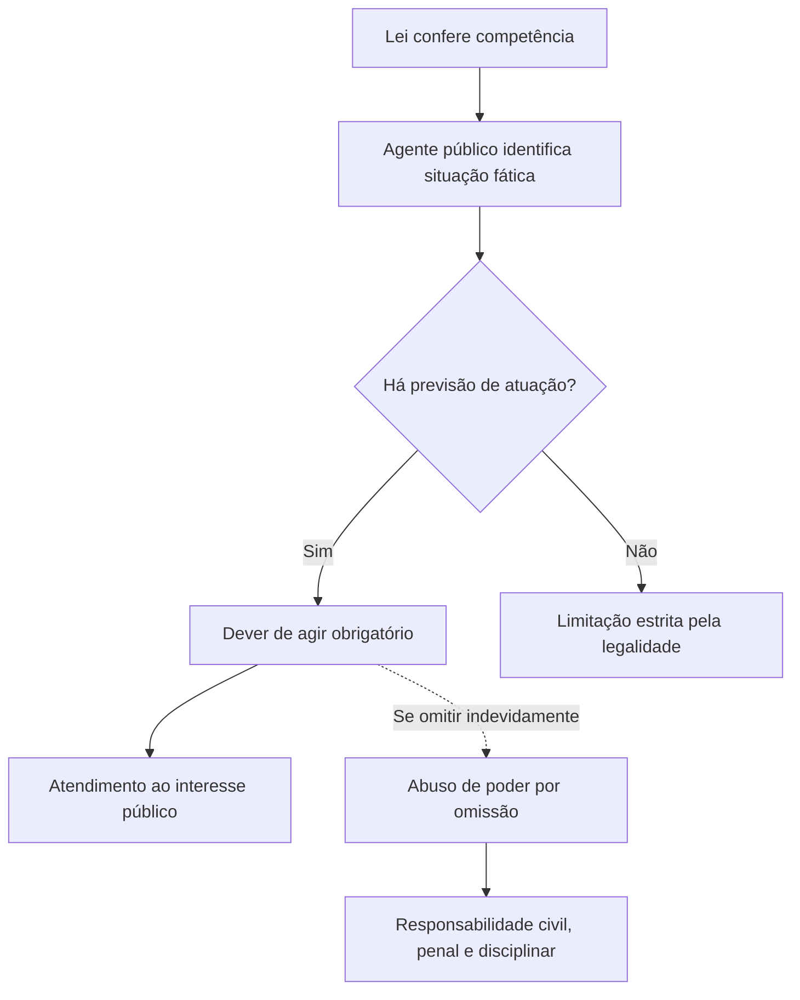
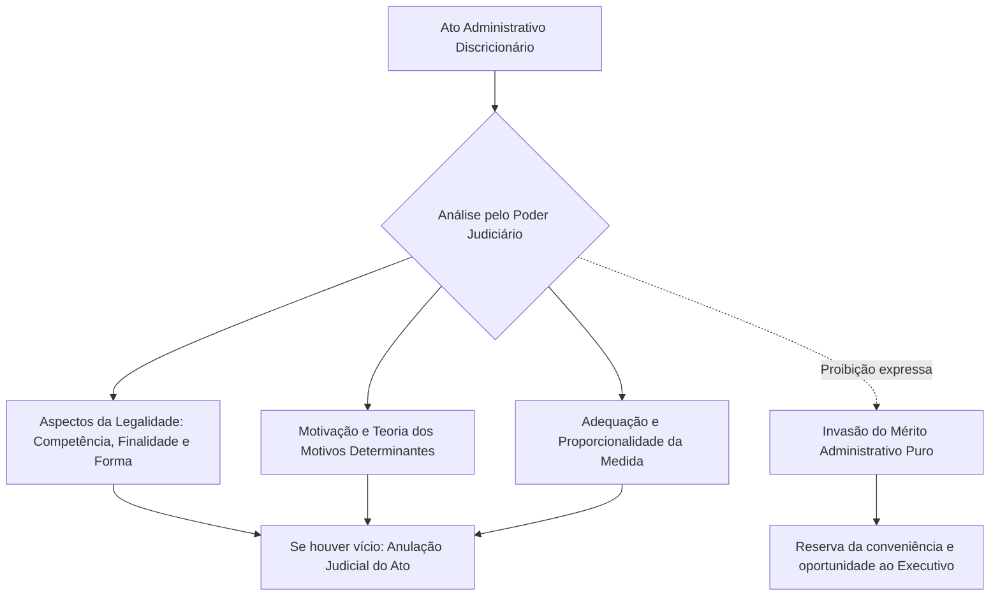

Os poderes administrativos são ferramentas que a lei entrega aos agentes públicos para defender os interesses da coletividade. Eles não existem para dar privilégios pessoais a quem governa, mas para viabilizar a prestação dos serviços públicos e a ordem social. Por essa razão, a doutrina moderna os define como verdadeiros poderes-deveres. Quem recebe uma competência pública tem a obrigação de agir no momento certo. Neste capítulo inicial do volume, você vai compreender os quatro deveres essenciais da administração e a distinção clássica entre a atuação vinculada e a discricionária.

> [!objetivos]
> - Diferenciar poderes administrativos instrumentais dos poderes políticos estruturais do Estado.
> - Caracterizar o poder-dever de agir e as consequências da omissão administrativa indevida.
> - Explicar os quatro deveres administrativos: agir, eficiência, probidade e prestar contas.
> - Distinguir atos vinculados e discricionários a partir da análise dos seus cinco elementos de validade.
> - Identificar os limites legítimos do controle judicial sobre o mérito do ato administrativo.

## Conceito e natureza dos poderes administrativos

O Estado existe para alcançar o bem comum e proteger os direitos fundamentais. Para atingir essas finalidades públicas, o ordenamento jurídico confere prerrogativas especiais aos órgãos e agentes estatais. Essas prerrogativas compõem os **poderes administrativos**.

Não se deve confundir poderes administrativos com os poderes políticos do Estado. Os poderes políticos, previstos no art. 2º da Constituição Federal, são os Poderes Executivo, Legislativo e Judiciário. Eles representam a divisão estrutural das funções soberanas da República. Já os poderes administrativos são instrumentais. Eles funcionam como instrumentos de trabalho que existem no interior da administração pública para que ela cumpra as suas atribuições cotidianas.

Todo poder administrativo nasce subordinado à lei. Ele só pode ser exercido na medida exata necessária para atingir a finalidade pública fixada pelo legislador. Quando um agente usa o poder para satisfazer interesses pessoais, ele comete abuso de poder e seu ato torna-se nulo.

A doutrina brasileira destaca que os poderes públicos possuem a natureza de **poder-dever** ou dever-poder. Essa expressão significa que a prerrogativa conferida ao agente não é uma faculdade de mera conveniência pessoal. Ela representa um encargo irrenunciável. Se o particular pode decidir se exerce ou não um direito privado, o agente público tem a obrigação jurídica de atuar sempre que os requisitos da lei estiverem presentes.

A competência administrativa é fixada em lei para a defesa do interesse público. Em razão disso, o art. 11 da Lei 9.784/1999 determina de forma expressa que a competência é irrenunciável. O agente titular não pode abrir mão dela nem negociá-la com terceiros, admitindo-se apenas a delegação e a avocação temporárias nas hipóteses legalmente permitidas.

> [!atencao] Competência irrenunciável
> A competência pública é um poder-dever irrenunciável (Lei 9.784/1999, art. 11). O administrador não pode renunciar a atribuições que a lei lhe confiou para proteger o interesse coletivo.

O diagrama a seguir sintetiza a dinâmica instrumental do poder-dever na rotina administrativa.

## O poder-dever de agir e os deveres administrativos

A autoridade pública não tem o direito de permanecer inerte diante de situações em que a ordem jurídica exige uma intervenção. O **dever de agir** é o primeiro e mais abrangente dever do administrador público. A inércia injustificada da administração quando ela deveria emitir uma licença, fiscalizar uma obra ou prestar um socorro gera danos à sociedade e aos cidadãos.

A omissão administrativa indevida configura abuso de poder na modalidade omissiva. Ela autoriza o particular prejudicado a recorrer ao Poder Judiciário por meio de instrumentos como o mandado de segurança, quando houver prazo legal descumprido, ou a requerer indenização pelos prejuízos causados com base na responsabilidade civil do Estado.

> [!exemplo]
> O Corpo de Bombeiros Militar recebe uma denúncia formal de que uma casa de shows no centro de Caruaru está funcionando com saídas de emergência trancadas. O oficial responsável pela fiscalização tem o poder-dever de inspecionar o imóvel de imediato. Ele não pode engavetar a denúncia por amizade com o proprietário nem adiar a vistoria sem motivo razoável, sob pena de cometer infração disciplinar grave e responder por omissão.

Além do dever genérico de agir, a doutrina e o direito positivo consagram três outros deveres essenciais: o dever de eficiência, o dever de probidade e o dever de prestar contas.

### O dever de eficiência

O **dever de eficiência** exige do administrador a busca pelo melhor resultado prático com o menor custo financeiro e no menor tempo possível. Ele impõe qualidade, rapidez e rendimento funcional a todos os órgãos e agentes do Estado.

Esse dever ganhou assento constitucional expresso com a Emenda Constitucional 19/1998, que inseriu o princípio da eficiência no caput do art. 37 da Constituição Federal. A eficiência deve ser compreendida sob dois aspectos complementares:
1. **Aspecto qualitativo**: prestação de serviços com presteza, perfeição técnica e adequação às necessidades reais do cidadão usuário.
2. **Aspecto quantitativo e econômico**: otimização dos recursos orçamentários, evitando desperdícios e buscando a melhor relação de custo-benefício para a sociedade.

Para garantir a efetividade desse dever, a Constituição previu mecanismos concretos de gestão. Entre eles, destacam-se a avaliação especial de desempenho para a aquisição da estabilidade pelo servidor (CF, art. 41, § 4º), a avaliação periódica de desempenho que pode levar à perda do cargo (CF, art. 41, § 1º, III) e a celebração de contratos de gestão com a ampliação da autonomia dos órgãos em troca de metas de desempenho (CF, art. 37, § 8º).

### O dever de probidade

O **dever de probidade** exige que o agente público atue com honestidade, integridade moral, lealdade às instituições e estrita boa-fé. A moralidade administrativa é mais exigente do que a mera legalidade estrita. Nem tudo o que parece legal é moralmente aceitável na condução da coisa pública.

O descumprimento do dever de probidade atrai as sanções da Lei 8.429/1992, amplamente reformada pela Lei 14.230/2021. Com a reforma legislativa, a caracterização de qualquer ato de improbidade passou a exigir a comprovação de dolo específico. Isso significa que a conduta negligente, culposa ou desastrada, desprovida da intenção deliberada de lesar o erário ou obter benefício ilícito, não configura ato de improbidade administrativa, sujeitando-se apenas a sanções disciplinares ou civis comuns.

A Lei 8.429/1992 divide os atos de improbidade em três categorias estruturais:
- **Atos que importam enriquecimento ilícito** (Lei 8.429/1992, art. 9º): auferir qualquer vantagem patrimonial indevida em razão do exercício de cargo ou função, como receber propina ou utilizar bens públicos em proveito próprio.
- **Atos que causam prejuízo ao erário** (Lei 8.429/1992, art. 10): ação ou omissão dolosa que resulte em perda patrimonial, desvio ou apropriação de recursos públicos.
- **Atos que atentam contra os princípios da administração pública** (Lei 8.429/1992, art. 11): ações ou omissões dolosas que violem os deveres de honestidade, imparcialidade e legalidade, como frustrar concurso público ou nomear parentes em situação de nepotismo.

A Constituição Federal, no art. 37, § 4º, estipula as sanções aplicáveis aos atos de improbidade. Essas sanções possuem natureza política, civil e administrativa, sem prejuízo da responsabilidade penal cabível.

> [!bizu] Sanções constitucionais de improbidade
> Guarde o mnemônico **M-U-S-P-I-R**: **M**ulta civil, **S**uspensão dos direitos políticos, **P**erda da função pública, **I**ndisponibilidade de bens e **R**essarcimento ao erário. Lembre que a perda dos direitos políticos é vedada na Constituição: a sanção é apenas a sua suspensão temporária.

Para a fiscalização direta da probidade e da moralidade pelos cidadãos, o art. 5º, inciso LXXIII, da Constituição Federal prevê a ação popular. Qualquer cidadão no gozo dos direitos políticos tem legitimidade para propor ação popular com o objetivo de anular ato lesivo ao patrimônio público, à moralidade administrativa e a bens protegidos como o meio ambiente e o patrimônio histórico.

### O dever de prestar contas

O **dever de prestar contas** é decorrência direta do princípio republicano. Em uma república, os governantes gerenciam recursos que pertencem ao povo. Por isso, têm a obrigação indisponível de demonstrar publicamente como, onde e por que gastaram o dinheiro público.

A amplitude desse dever está fixada no parágrafo único do art. 70 da Constituição Federal, cuja leitura é frequentemente exigida em provas de concurso.

> [!lei] CF, art. 70, parágrafo único
> Prestará contas qualquer pessoa física ou jurídica, pública ou privada, que utilize, arrecade, guarde, gerencie ou administre dinheiros, bens e valores públicos ou pelos quais a União responda, ou que, em nome desta, assuma obrigações de natureza pecuniária.

Perceba que a obrigação de prestar contas recai sobre pessoas públicas e privadas. Uma organização social sem fins lucrativos que recebe recursos de convênio estadual em Recife para gerir uma creche comunitária tem o dever de prestar contas aos órgãos de controle interno e ao Tribunal de Contas.

Ligado ao dever de prestar contas está o dever de publicidade e transparência, regulamentado pela Lei 12.527/2011 (Lei de Acesso à Informação). A transparência é a regra geral no Estado democrático, enquanto o sigilo é exceção restrita a matérias imprescindíveis à segurança da sociedade e do Estado.

A tabela seguinte resume os quatro deveres fundamentais do administrador público.

| Dever administrativo | Núcleo da obrigação | Base normativa | Consequência da violação |
| --- | --- | --- | --- |
| Dever de agir | Obrigatoriedade de atuar diante da competência legal | Princípio republicano e Lei 9.784/1999, art. 11 | Abuso por omissão, mandado de segurança e indenização civil |
| Dever de eficiência | Busca por presteza, rendimento funcional e economia | CF, art. 37, caput, e art. 41, § 1º, III | Baixo desempenho, perda do cargo e rescisão de acordos |
| Dever de probidade | Conduta honesta, leal e de boa-fé no serviço | CF, art. 37, § 4º, e Lei 8.429/1992 | Sanções de improbidade, ação popular e perda do cargo |
| Dever de prestar contas | Comprovação do uso legítimo de bens e valores públicos | CF, art. 70, parágrafo único, e Lei 12.527/2011 | Tomada de contas especial, rejeição e crime de responsabilidade |

## Poder vinculado e poder discricionário

Ao editar atos administrativos, a autoridade pública pode encontrar duas situações distintas em relação à lei: ou a lei determina com exatidão tudo o que deve ser feito, ou a lei confere uma margem razoável de avaliação diante do caso prático. Disso decorre a divisão entre poder vinculado e poder discricionário.

O **poder vinculado** (também denominado poder regrado) ocorre quando o ordenamento jurídico estabelece os requisitos e o único comportamento possível a ser adotado pelo agente. Não há qualquer margem de liberdade, preferência ou valoração subjetiva. Diante da comprovação dos requisitos previstos em lei, a autoridade tem o dever de praticar o ato exatamente nos termos definidos pelo legislador.

Exemplo típico de ato vinculado é a concessão de licença para dirigir veículos ou a expedição de certificado de conclusão de curso para aluno que obteve nota e frequência suficientes. Comprovado o preenchimento das exigências legais, a administração não pode negar o documento com base em juízo de conveniência pessoal.

Por sua vez, o **poder discricionário** ocorre quando a lei confere ao administrador uma margem legítima de liberdade para decidir entre duas ou mais alternativas válidas. Essa oportunidade de valoração deve ser exercida mediante um juízo de **conveniência e oportunidade**, que constitui o chamado **mérito administrativo**.

A discricionariedade não representa uma autorização para agir com arbitrariedade. O agente público permanece amarrado aos limites da lei, à finalidade do interesse público e aos princípios da razoabilidade e da proporcionalidade. A decisão deve recair sobre a solução que melhor atenda ao bem comum na situação concreta.

> [!pegadinha] Vinculação e discricionariedade como atributos
> Embora editais e provas tragam habitualmente "poder vinculado" e "poder discricionário" no rol dos poderes autônomos, autores conceituados como Maria Sylvia Zanella Di Pietro esclarecem que eles não constituem espécies autônomas de poder. Trata-se, tecnicamente, de formas de manifestação da competência e de características dos atos administrativos. Na prova, responda conforme a abordagem da questão: se pedir o rol tradicional, aceite-os como poderes; se questionar a natureza técnica estrita, lembre que são atributos da atuação administrativa.

### Os elementos do ato administrativo e a margem de atuação

Para entender com precisão onde reside a discricionariedade, é indispensável examinar os cinco elementos (ou requisitos) de validade do ato administrativo, extraídos do art. 2º da Lei 4.717/1965: **competência**, **finalidade**, **forma**, **motivo** e **objeto**.

1. **Competência (sujeito)**: atribuição legal conferida ao agente para a prática do ato. A lei define quem pode agir. É elemento **sempre vinculado**. O agente não pode criar novas competências nem agir fora dos limites fixados em lei.
2. **Finalidade**: o objetivo público pretendido com a prática do ato. É elemento **sempre vinculado**. Todo ato administrativo busca satisfazer o interesse público geral e a finalidade específica descrita na norma.
3. **Forma**: o modo de exteriorização do ato, geralmente escrito, motivado e com observância do procedimento legal. É elemento **sempre vinculado**. A administração não pode inovar na forma quando a lei prescreve um rito solene.
4. **Motivo**: as razões de fato e de direito que justificam a edição do ato. Pode ser vinculado ou discricionário. Quando a lei descreve minuciosamente o fato gerador, o motivo é vinculado. Quando a lei utiliza conceitos jurídicos indeterminados (como "interesse público", "urgência"), a autoridade aprecia o fato com margem de valoração.
5. **Objeto (conteúdo)**: o efeito jurídico imediato produzido pelo ato, como a concessão de uma autorização, a aplicação de uma penalidade ou a interdição de um prédio. Pode ser vinculado ou discricionário. Se a lei prescreve um único resultado possível, o objeto é vinculado. Se a norma permite escolher a sanção ou a medida adequada, o objeto é discricionário.

Portanto, em um ato discricionário, a margem de liberdade do administrador situa-se exclusivamente no **motivo** e no **objeto**. Os outros três elementos (competência, finalidade e forma) continuam rigorosamente vinculados aos comandos da lei.

A tabela abaixo compara o comportamento dos cinco elementos em cada categoria de ato.

| Elemento do ato | No ato vinculado | No ato discricionário | Possibilidade de mérito administrativo |
| --- | --- | --- | --- |
| Competência | Vinculado à previsão legal | Sempre vinculado à previsão legal | Não admite juízo de conveniência |
| Finalidade | Vinculado ao interesse público | Sempre vinculado ao interesse público | Não admite juízo de conveniência |
| Forma | Vinculado ao rito legal | Sempre vinculado ao rito legal | Não admite juízo de conveniência |
| Motivo | Vinculado pela descrição estrita | Discricionário com margem de valoração | Admite juízo de oportunidade |
| Objeto | Vinculado ao conteúdo único | Discricionário entre opções legais válidas | Admite juízo de conveniência |

### Conceitos jurídicos indeterminados

A discricionariedade manifesta-se com frequência na aplicação de conceitos jurídicos indeterminados. O legislador utiliza expressões abertas como "conduta escandalosa", "notória especialização", "falta grave" ou "valor expressivo", porque não consegue prever todas as situações do mundo real no texto da lei.

Diante do conceito indeterminado, cabe ao administrador público interpretar a situação concreta e verificar se ela se enquadra na hipótese legal. Uma parcela da doutrina sustenta que a interpretação do conceito indeterminado busca a única solução correta perante o direito. No entanto, a posição majoritária adotada em concursos reconhece que, em muitos casos, o conceito indeterminado abre margem para valoração discricionária do administrador, desde que pautada pela razoabilidade e motivada nos autos.

### Limites e controle judicial da discricionariedade

A liberdade de decisão do administrador nunca é ilimitada. A fronteira que separa a discricionariedade da arbitrariedade é a legalidade e a razoabilidade. O ato discricionário praticado fora dos padrões legais ou desprovido de proporção razoável torna-se ilegal e viciado.

O Poder Judiciário não pode substituir a escolha discricionária do administrador por sua própria preferência pessoal. O juiz não pode invadir o mérito administrativo para dizer qual praça deveria ser reformada primeiro ou qual viatura deveria ser comprada para o batalhão. No entanto, o Judiciário pode e deve exercer o controle de legalidade sobre o ato discricionário.

Esse controle jurisdicional alcança:
- A verificação da competência, da finalidade e da forma do ato.
- A conferência da existência material dos motivos invocados pelo administrador (Teoria dos Motivos Determinantes).
- O exame da adequação e da necessidade da medida à luz dos princípios da razoabilidade e da proporcionalidade.

> [!jurisprudencia] STJ, RMS 28.243/SP
> O controle jurisdicional do ato administrativo discricionário não configura invasão indevida do mérito quando se limita a verificar a conformidade do ato com os princípios da legalidade, moralidade, razoabilidade e proporcionalidade. O Judiciário pode anular o ato desproporcional ou arbitrário, restabelecendo a juridicidade da atuação estatal.

## Mapa do capítulo

A tabela abaixo sintetiza os pontos centrais estudados sobre os deveres dos agentes e os contornos da vinculação e da discricionariedade.

| Aspecto de estudo | Poder vinculado | Poder discricionário | Ponto de atenção na prova |
| --- | --- | --- | --- |
| Margem de decisão | Nenhuma: única conduta legalmente prevista | Existente: opção entre soluções válidas na lei | A discricionariedade deve vir autorizada expressa ou implicitamente pela norma |
| Elementos afetados | Todos os cinco requisitos são vinculados | Motivo e objeto comportam liberdade de mérito | Competência, finalidade e forma são sempre vinculados em qualquer espécie de ato |
| Mérito administrativo | Inexistente no ato puramente regrado | Presente no juízo de conveniência e oportunidade | O mérito é campo exclusivo da administração, imune à substituição pelo juiz |
| Controle judicial | Amplo sobre todos os requisitos do ato | Amplo sobre a legalidade, razoabilidade e limites | O Judiciário pode anular ato desarrazoado, mas não pode decidir no lugar do gestor |
| Deveres correlatos | Dever de agir imediato diante dos fatos | Dever de agir motivado na melhor escolha pública | O dever de probidade exige dolo específico nos termos da Lei 14.230/2021 |

### Para fixar
- Poderes administrativos são instrumentos jurídicos conferidos aos agentes estatais para a satisfação do interesse público.
- A competência administrativa possui natureza de poder-dever e é legalmente irrenunciável (Lei 9.784/1999, art. 11).
- A inércia indevida do poder público configura abuso de poder por omissão e gera dever de indenizar prejuízos causados.
- O princípio da eficiência foi introduzido no art. 37 da Constituição pela Emenda 19/1998 e exige rendimento funcional com menor custo.
- A improbidade administrativa depende obrigatoriamente da demonstração de dolo específico após a reforma da Lei 14.230/2021.
- Prestar contas é dever de toda pessoa física ou jurídica, pública ou privada, que gerencie dinheiros e bens públicos (CF, art. 70, parágrafo único).
- No ato discricionário, a margem de decisão limita-se exclusivamente ao motivo e ao objeto, permanecendo vinculados os demais elementos.
- O mérito administrativo compreende o juízo de conveniência e oportunidade conferido pela lei à autoridade competente.
- O controle judicial sobre atos discricionários restringe-se à legalidade, à moralidade e à proporcionalidade, sendo vedada a invasão do mérito.
- A ação popular pode ser ajuizada por qualquer cidadão para anular ato lesivo ao patrimônio público e à moralidade administrativa (CF, art. 5º, LXXIII).
