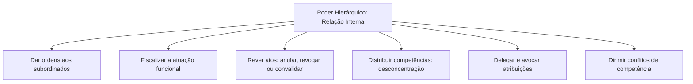
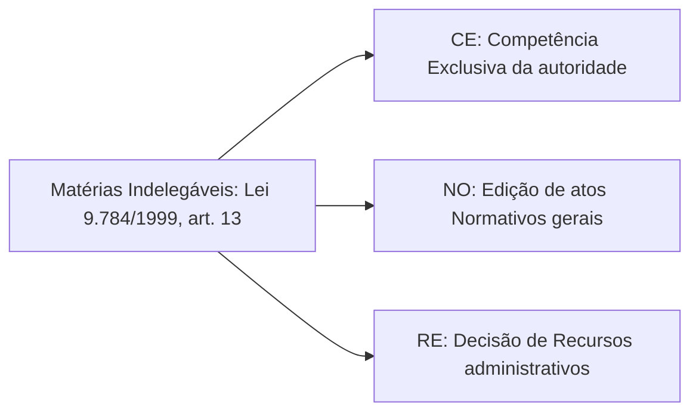
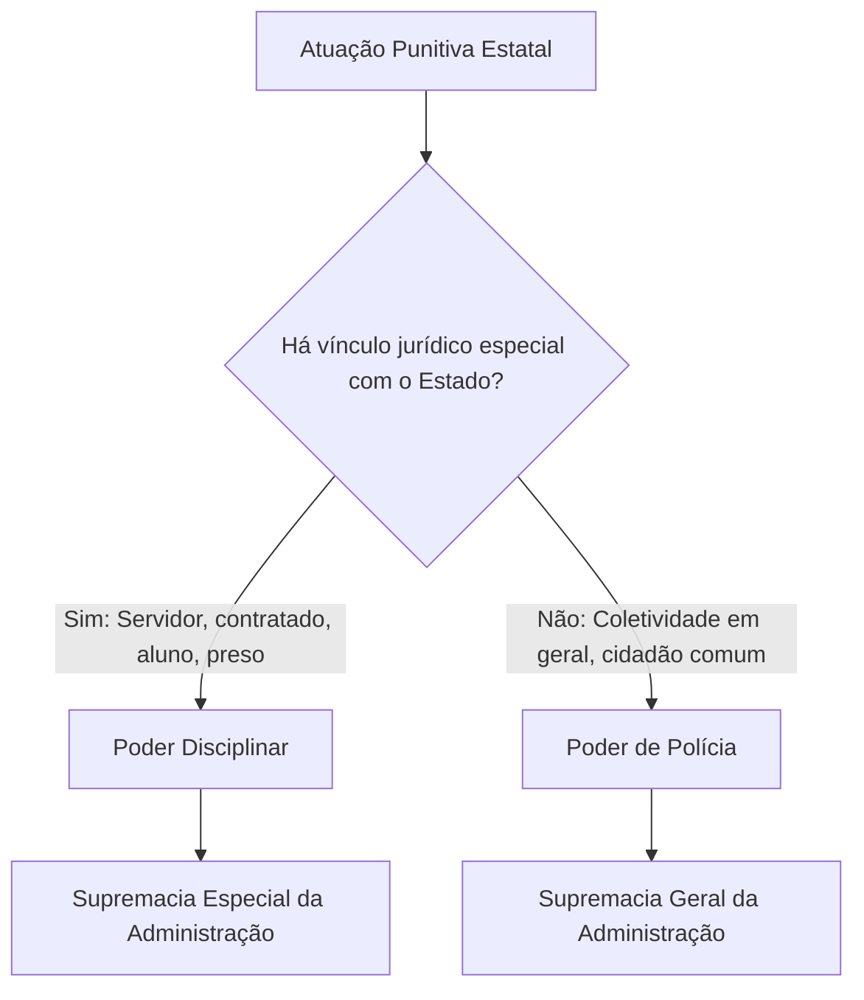

A organização interna do Estado depende de coordenação e controle rigorosos para funcionar com harmonia. Enquanto o poder hierárquico distribui atribuições e estabelece relações de subordinação entre órgãos e agentes públicos, o poder disciplinar assegura a responsabilização de quem comete infrações no serviço. Embora atuem de forma combinada no dia a dia da administração pública, esses dois poderes possuem fundamentos, alcances e limites jurídicos bem diferentes. Neste capítulo, você vai estudar a estrutura das ordens superiores, a dinâmica da delegação e da avocação, e as garantias processuais do regime disciplinar.

> [!objetivos]
> - Definir o poder hierárquico e identificar suas prerrogativas de ordenação, fiscalização e revisão.
> - Compreender os limites legais da delegação e da avocação de competências.
> - Caracterizar o poder disciplinar e sua incidência sobre servidores e particulares com vínculo especial.
> - Diferenciar a atuação punitiva do poder disciplinar das sanções decorrentes do poder de polícia.
> - Analisar as garantias do devido processo legal, do contraditório e da ampla defesa no processo administrativo disciplinar.

## O poder hierárquico na administração pública

O **poder hierárquico** é a prerrogativa conferida à administração pública para estruturar, organizar, escalonar e distribuir as funções de seus órgãos e agentes. Ele cria uma relação jurídica permanente de coordenação e de subordinação interna, em que as autoridades superiores exercem comando e controle sobre as atividades dos agentes subordinados.

A hierarquia é um fenômeno estritamente interno da organização administrativa. Ela se manifesta exclusivamente no interior de uma mesma pessoa jurídica de direito público. Quando o Estado descentraliza atividades e cria autarquias, fundações públicas ou empresas estatais, não surge relação de hierarquia entre a administração direta e a entidade criada. Entre o Ministério supervisor e a autarquia existe apenas controle finalístico, tutela administrativa ou supervisão ministerial, que visa assegurar o cumprimento dos objetivos previstos em lei, sem subordinação hierárquica.

Da mesma forma, não existe poder hierárquico entre os Poderes da República (Executivo, Legislativo e Judiciário), que são independentes e harmônicos entre si. Também não há hierarquia entre a administração pública e o cidadão comum, nem entre juízes no exercício da função jurisdicional ou membros do Ministério Público no desempenho de suas funções institucionais.

### Prerrogativas decorrentes da hierarquia

Do poder hierárquico decorrem competências administrativas indispensáveis à continuidade dos serviços públicos:

1. **Dar ordens**: a chefia tem a prerrogativa de emitir determinações funcionais de cumprimento obrigatório para os agentes subordinados. Essas determinações costumam ser veiculadas por meio de atos ordinatórios, como instruções de serviço, circulares, portarias e memorandos.
2. **Fiscalizar e vigiar**: o superior hierárquico tem o poder-dever de acompanhar o cumprimento das leis e das normas internas por parte de sua equipe, prevenindo desvios e cobrando produtividade.
3. **Rever atos administrativos**: em virtude da autotutela, a autoridade superior pode reexaminar a atuação dos subordinados para **anular** atos ilegais, **revogar** atos inoportunos ou inconvenientes, ou **convalidar** atos com vícios sanáveis.
4. **Delegar e avocar competências**: mecanismos de flexibilização da gestão que permitem transferir temporariamente o exercício de funções ou puxar para si atribuições de instâncias inferiores.
5. **Solucionar conflitos de competência**: quando dois órgãos subordinados entram em divergência sobre quem deve atuar diante de um caso concreto, o superior comum decide a controvérsia.

> [!atencao] Limite do dever de obediência
> O servidor público é obrigado a cumprir as ordens de seus superiores hierárquicos, **exceto quando forem manifestamente ilegais** (Lei 8.112/1990, art. 116, IV). Diante de uma ordem flagrantemente criminosa ou contrária à lei, o subordinado tem o dever funcional de recusar o cumprimento e representar formalmente contra a ilegalidade perante a autoridade competente.

## Delegação e avocação de competência

A **delegação** é o ato administrativo discricionário e revogável pelo qual uma autoridade transfere temporariamente a outra autoridade ou órgão o exercício de parte de suas competências.

A Lei 9.784/1999 estabelece diretrizes essenciais sobre a matéria em seus arts. 11 a 14:
- A delegação transfere apenas o **exercício** da competência, nunca a sua titularidade. O titular originário continua responsável pela matéria e pode reassumir a atribuição quando julgar oportuno.
- Não é obrigatório haver subordinação hierárquica entre delegante e delegado. O art. 12 da Lei 9.784/1999 autoriza a delegação a órgãos ou agentes subordinados (delegação vertical) e também a órgãos sem relação hierárquica (delegação horizontal), desde que conveniente por motivos técnicos, sociais, econômicos, jurídicos ou territoriais.
- O ato de delegação e a sua revogação devem ser publicados no diário oficial. O ato delegatório deve definir com clareza a matéria, os limites da atuação, os prazos, os objetivos e o cabimento de recurso.
- A autoridade que delega pode revogar a delegação a qualquer tempo (art. 14, § 2º).
- Os atos praticados por competência delegada são juridicamente considerados como editados pela própria autoridade delegada (art. 14, § 3º). Em consequência disso, se houver ilegalidade na decisão tomada, eventual mandado de segurança deve apontar como autoridade coatora o delegado, e não quem delegou.

> [!jurisprudencia] STF, Súmula 510
> Praticado o ato por autoridade, no exercício de competência delegada, contra ela cabe o mandado de segurança ou a medida judicial.

O art. 13 da Lei 9.784/1999 enumera as matérias que **jamais podem ser objeto de delegação**. Essa regra é cobrada com altíssima frequência em concursos públicos.

> [!bizu] Atos indelegáveis: CENO-RE-EX
> Guarde o mnemônico **CENO-RE-EX** para lembrar as vedações do art. 13 da Lei 9.784/1999: edição de atos de caráter **NO**rmativo, decisão de **RE**cursos administrativos e matérias de competência **EX**clusiva.

### Avocação de competência

A **avocação** é a medida pela qual um órgão superior atrai para si, de modo excepcional e temporário, o exercício de uma atribuição conferida originalmente a um subordinado (Lei 9.784/1999, art. 15).

Diferente da delegação, a avocação possui requisitos bem mais rígidos:
1. **Exige subordinação hierárquica**: só é possível avocar competência de órgão ou agente hierarquicamente inferior. Não existe avocação horizontal.
2. **Caráter excepcional**: a regra é o respeito às competências naturais de cada órgão; a avocação é medida de exceção.
3. **Motivos relevantes devidamente justificados**: a autoridade superior é obrigada a fundamentar por escrito a necessidade concreta da medida nos autos do processo.
4. **Caráter temporário**: a avocação cessa assim que for decidida a questão extraordinária que a motivou.
5. **Impossibilidade diante de competência exclusiva**: se a lei reservou com exclusividade determinada atribuição ao agente subordinado, o superior não pode avocar a matéria.

A tabela a seguir destaca as diferenças fundamentais entre delegação e avocação de competência.

| Critério comparativo | Delegação de competência | Avocação de competência |
| --- | --- | --- |
| Relação hierárquica | Pode ocorrer com ou sem hierarquia (vertical ou horizontal) | Exige obrigatoriamente relação de subordinação hierárquica |
| Natureza do ato | Ato de conveniência administrativa | Medida extraordinária e excepcional |
| Justificativa formal | Conveniência técnica, jurídica, econômica ou territorial | Motivos relevantes e devidamente justificados na decisão |
| Objeto transferido | Transfere apenas o exercício temporário da função | Atrai o exercício temporário de competência do subordinado |
| Vedações expressas | Atos normativos, decisão de recursos e competência exclusiva | Competência legalmente atribuída com caráter de exclusividade |

## O poder disciplinar e o regime de sanções

O **poder disciplinar** é a prerrogativa conferida à administração pública para apurar infrações funcionais e aplicar as penalidades cabíveis aos servidores públicos e a particulares que mantenham um vínculo jurídico diferenciado com o Estado.

A finalidade central do poder disciplinar é resguardar a ordem interna, a probidade e a eficiência da máquina administrativa, garantindo que os agentes cumpram os seus deveres e respeitem as proibições legais.

Uma distinção fundamental para a resolução de questões de concurso envolve a origem do vínculo do administrado com o poder público:
- **Poder disciplinar**: incide sobre indivíduos sujeitos à supremacia especial da administração pública. Alcança servidores públicos estatutários, empregados públicos e particulares que possuem uma relação jurídica específica com o Estado, a exemplo de uma empresa contratada para prestar serviços, um aluno matriculado em colégio público ou um cidadão recolhido a estabelecimento prisional.
- **Poder de polícia**: incide sobre a coletividade em geral, com fundamento na supremacia geral do Estado. Atinge particulares que não possuem qualquer vínculo jurídico especial com a administração, como o motorista multado na via pública ou o comerciante que tem seu estabelecimento interditado por falta de alvará.

> [!pegadinha] Aplicação de multa a empresa contratada
> A aplicação de penalidade contratual a uma empreiteira vencedora de licitação que descumpre o cronograma de obras decorre do **poder disciplinar**, e não do poder de polícia. A sanção funda-se no vínculo jurídico especial derivado do contrato administrativo firmado entre as partes.

### Relação entre poder hierárquico e poder disciplinar

A doutrina ressalta que o poder hierárquico e o poder disciplinar não se confundem. Eles são poderes autônomos, embora operem de maneira coordenada.

Quando um superior hierárquico pune um subordinado por infração funcional, a sanção decorre **diretamente do poder disciplinar** e apenas **mediatamente do poder hierárquico**. A hierarquia fornece a estrutura de subordinação que permite a supervisão da conduta; a disciplina fornece a base punitiva material para responsabilizar o faltoso.

Além disso, a autonomia dos institutos fica evidente quando lembramos que o poder disciplinar pode ser exercido mesmo em situações nas quais inexiste hierarquia. O particular que firma contrato administrativo com a administração pública não é subordinado hierárquico do gestor público, mas está submetido ao poder disciplinar contratual do ente estatal.

### Vinculação e discricionariedade na atuação disciplinar

O exercício do poder disciplinar apresenta uma composição mista entre vinculação e discricionariedade:

1. **Aspecto vinculado**: a autoridade pública que toma conhecimento de uma irregularidade praticada no serviço público não possui a faculdade de ignorar o fato. A apuração imediata da falta e a posterior aplicação da penalidade cabível constituem um **poder-dever vinculado**. Se o superior hierárquico tolerar a falta funcional do subordinado por compaixão ou amizade, ele comete a infração disciplinar de condescendência e pratica o crime de condescendência criminosa tipificado no Código Penal.
2. **Aspecto discricionário**: a discricionariedade reside na dosimetria e na gradação da penalidade, quando a lei fixa faixas variáveis de sanção (como a suspensão de até 90 dias na Lei 8.112/1990). O julgador avalia a gravidade do fato, os danos provocados ao erário, os antecedentes funcionais e a presença de atenuantes ou agravantes para determinar a dosagem proporcional da pena.

> [!lei] Lei 8.112/1990, art. 143
> A autoridade que tiver ciência de irregularidade no serviço público é obrigada a promover a sua apuração imediata, mediante sindicância ou processo administrativo disciplinar, assegurada ao acusado ampla defesa.

A tabela seguinte ilustra as penalidades disciplinares clássicas previstas no art. 127 da Lei 8.112/1990 e suas características gerais de aplicação.

| Penalidade | Hipótese típica | Duração ou efeito | Margem de discricionariedade |
| --- | --- | --- | --- |
| Advertência | Faltas leves, inobservância de dever funcional | Registro formal nos assentamentos | Vinculada na capitulação, dosada na forma |
| Suspensão | Reincidência de faltas leves ou violação grave | Até 90 dias, com perda da remuneração | Discricionária na contagem do prazo proporcional |
| Demissão | Faltas gravíssimas (improbidade, corrupção) | Rompimento definitivo do vínculo funcional | Vinculada: comprovada a falta, a demissão é obrigatória |
| Cassação | Servidor inativo que cometeu falta demissível na ativa | Perda dos proventos de aposentadoria | Vinculada diante da caracterização legal da falta |
| Destituição | Ocupante de cargo em comissão que comete infração grave | Exoneração punitiva com anotação formal | Vinculada nas hipóteses demissíveis da legislação |

## O processo disciplinar e as garantias constitucionais

Nenhuma punição disciplinar pode ser aplicada com base na chamada verdade sabida, costume antigo e superado pelo qual o chefe aplicava sanção sumária ao presenciar a infração. O art. 5º, incisos LIV e LV, da Constituição Federal assegura a todos os acusados em processos administrativos o **devido processo legal**, o **contraditório** e a **ampla defesa**.

Para aplicar uma sanção disciplinar a um servidor, a administração pública é obrigada a instaurar o procedimento adequado, que pode ser uma sindicância investigativa ou um processo administrativo disciplinar formal (PAD).

A jurisprudência dos tribunais superiores consolidou importantes teses sobre o processo disciplinar que costumam ser exigidas em provas:

- **Defesa técnica por advogado**: a presença de advogado constituído ou de defensor dativo não é obrigatória durante a instrução do PAD. Conforme a Súmula Vinculante 5 do Supremo Tribunal Federal, o servidor pode exercer pessoalmente a sua defesa, desde que lhe sejam facultados todos os meios e recursos inerentes ao contraditório.
- **Prova emprestada**: o Superior Tribunal de Justiça consagrou na Súmula 591 que é permitida a prova emprestada no PAD, desde que autorizada pelo juízo competente e respeitados o contraditório e a ampla defesa. O caso típico é a interceptação telefônica feita no processo penal.
- **Excesso de prazo**: nos termos da Súmula 592 do STJ, a extrapolação do prazo legal fixado para a conclusão dos trabalhos da comissão processante não gera, por si só, a nulidade do processo disciplinar. A anulação só ocorre se a defesa demonstrar a ocorrência de prejuízo concreto.
- **Capitulação jurídica**: o servidor defende-se dos fatos narrados na acusação, e não da capitulação técnica indicada. Pela Lei 8.112/1990 (art. 168), o julgamento acata o relatório da comissão, salvo quando contrário às provas; nesse caso, a autoridade pode, motivadamente, agravar, abrandar ou isentar a penalidade.
- **Controle jurisdicional**: o Poder Judiciário exerce controle sobre a regularidade formal do procedimento, o respeito às garantias constitucionais e a proporcionalidade da pena aplicada, sendo-lhe vedado substituir o mérito administrativo da decisão sancionatória.

> [!jurisprudencia] STF, Súmula Vinculante 5
> A falta de defesa técnica por advogado no processo administrativo disciplinar não ofende a Constituição.

## Mapa do capítulo

A tabela a seguir consolida as diretrizes fundamentais do poder hierárquico e do poder disciplinar para consulta rápida.

| Ponto comparativo | Poder hierárquico | Poder disciplinar | Regra prática de memorização |
| --- | --- | --- | --- |
| Finalidade principal | Ordenação, coordenação e revisão interna de atos | Apuração e punição de faltas funcionais | Hierarquia estrutura a gestão; disciplina reprime a infração |
| Relação de base | Relação de subordinação na mesma pessoa jurídica | Relação de supremacia especial (vínculo prévio) | Inexiste hierarquia entre entes políticos ou com o cidadão |
| Instrumentos típicos | Ordens de serviço, delegação, avocação e autotutela | Sindicância, PAD e aplicação de penalidades funcionais | Ordem manifestamente ilegal nunca deve ser cumprida |
| Margem de atuação | Discricionário na gestão; vinculado na legalidade | Vinculado no dever de apurar; discricionário na dosagem | Omissão punitiva voluntária gera crime de condescendência |
| Controle judicial | Amplo sobre competência e validade dos atos | Amplo sobre o devido processo legal e a proporcionalidade | O Judiciário afere o rito formal, sem substituir o mérito |

### Para fixar
- O poder hierárquico opera exclusivamente no âmbito interno de uma mesma pessoa jurídica de direito público.
- Entre a administração direta e a administração indireta inexiste hierarquia, operando apenas o controle finalístico de tutela.
- O dever de obediência do servidor cessa diante de ordem manifestamente ilegal (Lei 8.112/1990, art. 116, IV).
- A delegação transfere apenas o exercício da competência e independe de subordinação hierárquica prévia.
- Não podem ser objeto de delegação os atos normativos, a decisão de recursos e as competências exclusivas (CENO-RE-EX).
- O mandado de segurança contra ato praticado por competência delegada deve ser impetrado contra a autoridade delegada (STF, Súmula 510).
- A avocação de competência é medida excepcional, justificada, temporária e exige obrigatoriamente relação de subordinação hierárquica.
- O poder disciplinar pune apenas servidores e particulares com vínculo jurídico especial, diferindo do poder de polícia geral.
- A apuração e a punição de falta funcional constituem dever vinculado, cuja omissão injustificada configura o crime de condescendência criminosa.
- A falta de defesa técnica por advogado no processo administrativo disciplinar não ofende a Constituição (STF, Súmula Vinculante 5).
