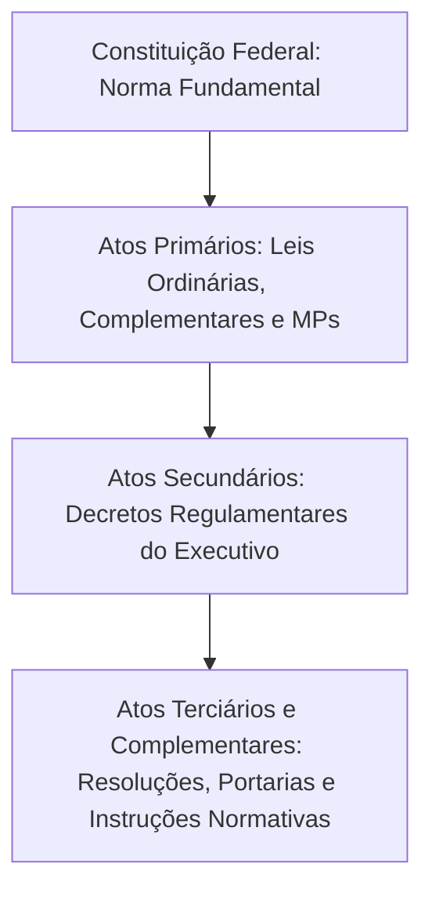
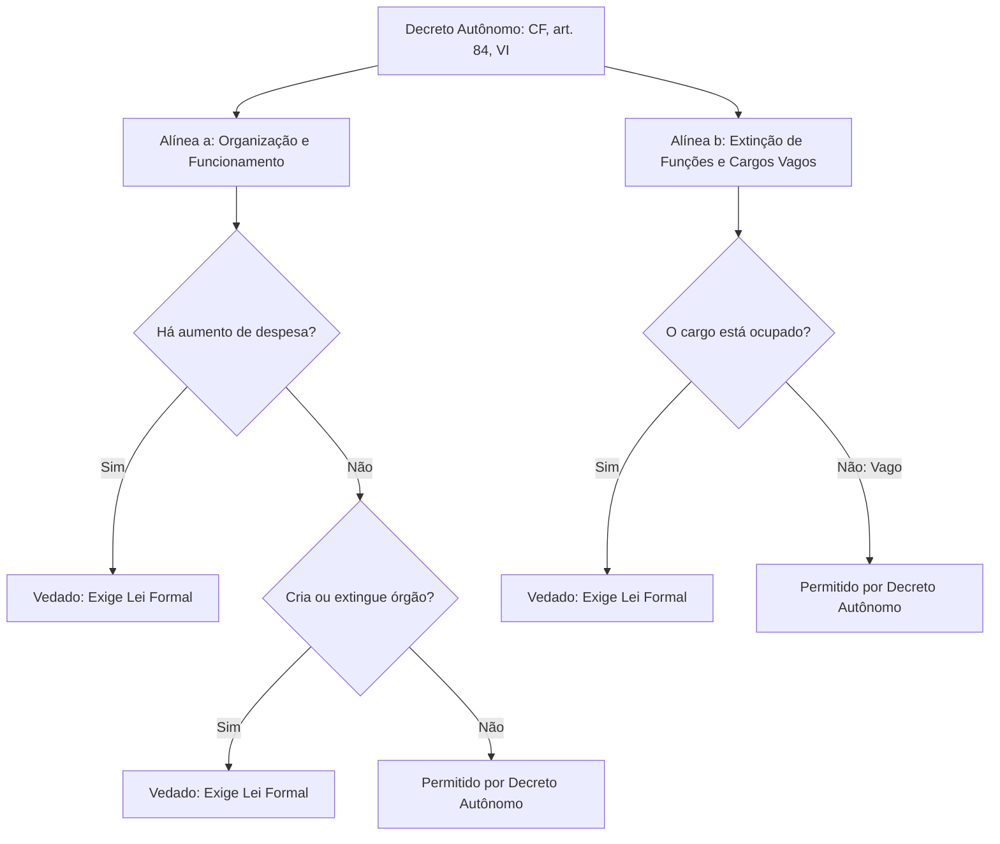
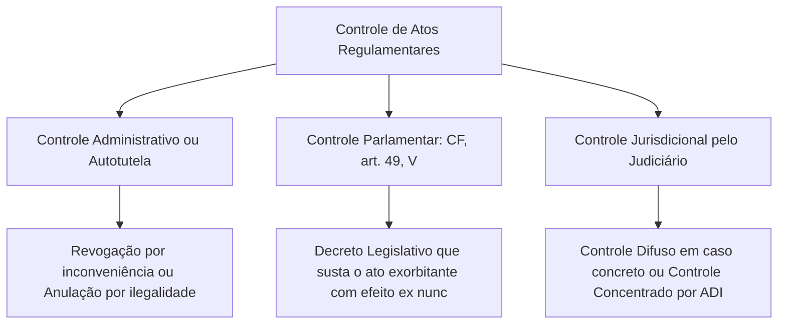

A produção de regras gerais e abstratas não é monopólio da atividade parlamentar. Para que as leis aprovadas pelo Poder Legislativo alcancem aplicação prática nos órgãos e serviços públicos, a administração necessita detalhar procedimentos, unificar orientações técnicas e definir rotinas operacionais. Essa atividade decorre do poder regulamentar e do poder normativo. Neste capítulo, você vai estudar a diferença entre decretos regulamentares e decretos autônomos, o fenômeno da deslegalização por meio de regulamentos autorizados e os instrumentos de controle parlamentar e jurisdicional sobre os atos normativos do Executivo.

> [!objetivos]
> - Diferenciar poder normativo em sentido amplo de poder regulamentar em sentido estrito.
> - Compreender a função dos decretos regulamentares de fiel execução e os limites da inovação jurídica.
> - Dominar as hipóteses constitucionais e as vedações dos decretos autônomos (CF, art. 84, VI).
> - Caracterizar os regulamentos autorizados e sua distinção técnica em relação às leis delegadas.
> - Analisar os mecanismos de controle legislativo (CF, art. 49, V) e jurisdicional sobre os regulamentos.

## Conceito e extensão do poder regulamentar e normativo

O ordenamento jurídico brasileiro divide os atos jurídicos em duas categorias estruturais: atos normativos primários e atos normativos secundários.

Os **atos primários** retiram seu fundamento de validade diretamente da Constituição Federal. São as espécies normativas arroladas no art. 59 da Carta Magna, como as leis ordinárias, leis complementares, emendas constitucionais e medidas provisórias. Esses atos inovam originariamente no ordenamento, criando novos direitos e obrigações para os cidadãos com base no princípio da legalidade (CF, art. 5º, II).

Por outro lado, os **atos secundários** são atos administrativos infralegais. Eles não retiram sua força diretamente do texto constitucional, mas da lei formal que visam regulamentar. Por serem subordinados à legislação, os atos secundários não podem criar obrigações originárias, proibições inéditas ou sanções não previstas pelo legislador. Sua função restringe-se a viabilizar a execução da lei existente.

A doutrina estabelece uma sutil distinção conceitual entre poder normativo e poder regulamentar:
- **Poder normativo (sentido amplo)**: é a prerrogativa geral conferida aos órgãos e autoridades administrativas para expedir atos gerais e abstratos dotados de eficácia interna ou externa. Abrange portarias de ministros e secretários, resoluções de conselhos, regimentos de tribunais e deliberações de agências reguladoras.
- **Poder regulamentar (sentido estrito)**: é a prerrogativa privativa do Chefe do Poder Executivo (Presidente da República, governadores e prefeitos) para expedir **decretos e regulamentos** que assegurem a fiel execução das leis ou organizem a administração pública nos limites constitucionais.

## Decretos regulamentares ou de execução

O instrumento clássico do poder regulamentar é o **decreto regulamentar** ou decreto de execução, expressamente previsto no art. 84, inciso IV, da Constituição Federal. Compete privativamente ao Presidente da República sancionar, promulgar e fazer publicar as leis, bem como expedir decretos e regulamentos para a sua fiel execução. Por força do princípio da simetria constitucional, essa atribuição estende-se aos governadores de Estado e aos prefeitos municipais no âmbito de suas respectivas esferas federativas.

A finalidade central do decreto regulamentar é conferir operabilidade prática à lei. O legislador estabelece as diretrizes gerais, mas não detalha formulários, prazos procedimentais, repartições competentes ou rotinas técnicas. O regulamento supre essas lacunas práticas, esclarecendo termos genéricos da lei e padronizando a atuação administrativa para garantir a isonomia no tratamento dos administrados.

> [!atencao] Vedação à inovação primária
> O decreto regulamentar não pode contrariar a lei (*contra legem*), não pode ir além da lei (*ultra legem*) e não pode inovar originariamente criando direitos, deveres ou punições novos. Toda obrigação administrativa secundária deve possuir amparo na obrigação primária fixada pelo legislador.

Se o chefe do Executivo editar um decreto que crie uma taxa nova, estabeleça uma proibição inexistente ou amplie uma sanção legal, o ato padecerá de vício de ilegalidade por exorbitância do poder regulamentar.

A competência para editar decretos regulamentares de fiel execução é **indelegável**. O parágrafo único do art. 84 da Constituição enumera de forma taxativa as atribuições presidenciais que podem ser delegadas, e o inciso IV não figura entre elas.

## Decretos autônomos na ordem constitucional brasileira

O **decreto autônomo** (ou independente) é aquele que retira seu fundamento de validade diretamente da Constituição Federal, sem a necessidade de uma lei prévia intermediária. Ele atua diretamente na ordem jurídica primária, inovando em matérias reservadas pela própria Constituição ao Poder Executivo.

Antes da Emenda Constitucional 32/2001, a doutrina e a jurisprudência majoritárias rejeitavam a existência de decretos autônomos no Brasil, admitindo apenas os decretos de execução vinculados à lei. Com a promulgação da Emenda 32/2001, a Constituição Federal passou a prever expressamente duas hipóteses taxativas de decreto autônomo no art. 84, inciso VI.

> [!lei] CF, art. 84, VI
> VI - dispor, mediante decreto, sobre:
> a) organização e funcionamento da administração federal, quando não implicar aumento de despesa nem criação ou extinção de órgãos públicos;
> b) extinção de funções ou cargos públicos, quando vagos;

A análise atenta das duas alíneas revela restrições rigorosas que são sistematicamente exploradas em provas de concurso:

1. **Alínea "a" (organização e funcionamento da administração)**:
   - Permite ao Executivo remodelar rotinas internas, transferir atribuições entre órgãos existentes e redefinir procedimentos de gestão.
   - Apresenta duas vedações expressas e absolutas: **não pode implicar aumento de despesa** e **não pode criar nem extinguir órgãos públicos**. A criação e a extinção de órgãos públicos continuam submetidas à reserva legal absoluta (CF, art. 48, XI e art. 88), dependendo de lei formal aprovada pelo Parlamento.
2. **Alínea "b" (extinção de funções ou cargos públicos)**:
   - Permite a extinção de cargos e funções públicas mediante decreto, **desde que estejam vagos**.
   - Se o cargo público estiver ocupado, a sua extinção exige obrigatoriamente a edição de lei formal (CF, art. 48, X). O decreto autônomo não pode extinguir cargo ocupado, pois isso violaria as garantias constitucionais do servidor público titular.

> [!pegadinha] Criação de órgãos e extinção de cargos
> Fique atento às pegadinhas clássicas da banca:
> 1. Extinção de órgão público: **somente por lei**, nunca por decreto.
> 2. Criação de órgão público: **somente por lei**, nunca por decreto.
> 3. Extinção de cargo vago: **por decreto autônomo** ou por lei.
> 4. Extinção de cargo ocupado: **somente por lei**, nunca por decreto.

> [!exemplo]
> O Governador de Pernambuco decide reorganizar a estrutura interna da Secretaria de Defesa Social, remanejando setores administrativos sem criar novos órgãos e sem gerar qualquer acréscimo de despesa orçamentária. Essa medida pode ser legitimamente implementada por meio de decreto autônomo, com base no art. 84, VI, da Constituição Federal. No entanto, se o Governador pretendesse criar uma nova divisão operacional ou elevar os gastos com remunerações e subsídios, a medida dependeria obrigatoriamente de projeto de lei formal aprovado pela Assembleia Legislativa.

### Delegação das atribuições do art. 84, VI

Ao contrário dos decretos regulamentares do inciso IV, as matérias do inciso VI do art. 84 **podem ser delegadas** pelo Presidente da República. O parágrafo único do art. 84 da Constituição estabelece um rol fechado de autoridades destinatárias dessa delegação:

- Aos **Ministros de Estado**;
- Ao **Procurador-Geral da República**;
- Ao **Advogado-Geral da União**.

> [!bizu] Autoridades delegatárias do Presidente: M-P-A
> Guarde o mnemônico **M-P-A**: **M**inistros de Estado, **P**rocurador-Geral da República e **A**dvogado-Geral da União. O Presidente da República não pode delegar os decretos autônomos a outras autoridades fora desse trio constitucional expresso.

A tabela comparativa a seguir destaca as diferenças fundamentais entre os decretos regulamentares e os decretos autônomos.

| Critério de comparação | Decreto regulamentar (CF, art. 84, IV) | Decreto autônomo (CF, art. 84, VI) |
| --- | --- | --- |
| Fundamento imediato | Lei formal ordinária ou complementar | Texto da Constituição Federal (Emenda 32/2001) |
| Posição no ordenamento | Ato normativo secundário infralegal | Ato normativo com força primária |
| Finalidade precípua | Assegurar a fiel execução de lei existente | Organização administrativa e extinção de cargos vagos |
| Criação ou extinção de órgãos | Não pode criar nem extinguir órgãos | Expressamente proibido (exige lei formal) |
| Aumento de despesa | Não pode gerar despesa não prevista em lei | Expressamente proibido pelo texto constitucional |
| Extinção de cargos públicos | Não pode dispor sobre a extinção de cargos | Pode extinguir cargos, desde que estejam vagos |
| Possibilidade de delegação | Indelegável (competência privativa pessoal) | Delegável a Ministros, PGR e AGU (art. 84, parágrafo único) |

## Regulamentos autorizados e o fenômeno da deslegalização

O crescimento da complexidade técnica da economia e da administração moderna levou ao surgimento dos chamados **regulamentos autorizados**.

Em determinados setores dotados de dinamismo tecnológico e de alta especificidade (como telecomunicações, vigilância sanitária, petróleo e aviação civil), o Congresso Nacional não dispõe de tempo nem de estrutura técnica para atualizar minuciosamente cada padrão operacional por meio de leis ordinárias.

Nesse cenário, a lei formal fixa as diretrizes gerais, as políticas públicas estruturantes e os limites máximos e mínimos de atuação, transferindo para órgãos especializados e agências reguladoras a competência para editar normas técnicas complementares. Esse movimento é denominado pela doutrina como **deslegalização** ou delegação regulamentar.

A deslegalização não transfere o poder legislativo em si, mas rebaixa o nível hierárquico da matéria: aquilo que antes era disciplinado minuciosamente por lei passa a ser regido por normas infralegais expedidas pelo órgão técnico regulador.

Para ser constitucional, o regulamento autorizado exige balizas claras:
1. **Existência de lei prévia autorizadora**: não se admite regulação técnica sem prévio mandamento legal.
2. **Fixação de padrões inteligíveis**: a lei deve conter parâmetros e limites materiais, sendo expressamente inconstitucional a chamada "delegação em branco", em que o parlamento renuncia totalmente à função normativa.
3. **Respeito à reserva legal**: matérias submetidas à reserva absoluta de lei (como criação de crimes e penas, desapropriação e majoração de tributos) não podem ser disciplinadas por regulamento autorizado.

### Regulamento autorizado versus lei delegada

É comum a banca examinadora tentar confundir o regulamento autorizado com a **lei delegada** (CF, art. 68). Trata-se de institutos de naturezas jurídicas inteiramente distintas, conforme detalhado na tabela abaixo.

| Aspecto comparativo | Regulamento autorizado | Lei delegada |
| --- | --- | --- |
| Natureza jurídica | Ato administrativo infralegal secundário | Espécie normativa primária (CF, art. 59, IV) |
| Procedimento de edição | Editado diretamente por agência ou ministério com base em lei ordinária | Elaborada pelo Presidente após solicitação e delegação do Congresso Nacional |
| Instrumento de delegação | Previsto no corpo de lei formal ordinária | Veiculado por resolução do Congresso Nacional |
| Alteração posterior | Pode ser modificado por novo ato administrativo do próprio órgão | Só pode ser alterada por outra lei formal ou por nova lei delegada |
| Destinatário da atuação | Órgãos técnicos e agências reguladoras | Exclusivamente o Presidente da República |

## Controle dos regulamentos administrativos

Por constituírem manifestações de poder estatal, os atos normativos do Poder Executivo sujeitam-se a múltiplos controles, exercidos pelos três Poderes da República.

### Controle administrativo (autotutela)

A própria administração pública exerce controle permanente sobre seus atos normativos com fundamento no princípio da autotutela. Ela pode:
- **Anular** o regulamento que contenha vícios de legalidade, com eficácia retroativa (*ex tunc*);
- **Revogar** o regulamento por razões supervenientes de conveniência e oportunidade, com eficácia prospectiva (*ex nunc*).

### Controle legislativo ou parlamentar

O Poder Legislativo exerce controle político-jurídico direto sobre o poder regulamentar. O art. 49, inciso V, da Constituição Federal confere ao Congresso Nacional competência exclusiva para paralisar a eficácia de atos normativos governamentais que ultrapassem os limites da execução regulamentar ou desbordem das balizas fixadas pelo Parlamento.

Esse controle parlamentar possui características cruciais para a resolução de questões:
- **Instrumento formal**: o Congresso Nacional manifesta sua decisão por meio de **decreto legislativo**, que não depende de sanção ou veto do Presidente da República.
- **Hipótese de cabimento**: incide quando o regulamento ultrapassa os limites da lei que deveria executar ou quando invade a competência legislativa do Congresso.
- **Efeitos da sustação**: a sustação legislativa paralisa a eficácia da norma com efeitos prospectivos (*ex nunc*), impedindo sua aplicação dali por diante.

### Controle jurisdicional

O Poder Judiciário tem a missão constitucional de assegurar a prevalência da legalidade e da supremacia da Constituição contra atos abusivos da administração. O controle judicial sobre os atos normativos desenvolve-se por duas vias distintas:

1. **Controle incidental (difuso)**: qualquer juiz ou tribunal, ao julgar uma ação concreta (como uma ação ordinária ou um mandado de segurança), pode afastar a aplicação de um decreto regulamentar que afronte a lei ou a Constituição, declarando a sua ilegalidade para as partes daquele processo.
2. **Controle abstrato (concentrado perante o STF)**:
   - **Decretos autônomos (art. 84, VI)**: como possuem natureza de ato primário diretamente fundado na Constituição, **admitem Ação Direta de Inconstitucionalidade (ADI)** perante o Supremo Tribunal Federal (CF, art. 102, I, "a").
   - **Decretos regulamentares de execução (art. 84, IV)**: por serem atos secundários, o STF firmou jurisprudência pacífica no sentido de que a ofensa provocada pelo decreto regulamentar à Constituição é apenas reflexa ou indireta. Trata-se de uma **crise de legalidade** (o decreto viola a lei, que por sua vez viola a Constituição). Por isso, **não cabe ADI genérica** contra decreto regulamentar que apenas descumpre a lei que deveria executar, devendo a questão ser resolvida no âmbito da legalidade comum. Contudo, se o decreto regulamentar extrapolar o texto da lei e tratar de matéria reservada expressamente à Constituição, a jurisprudência admite o controle concentrado.

> [!jurisprudencia] STF, ADI 996/DF
> O controle abstrato de constitucionalidade por meio de ação direta perante o Supremo Tribunal Federal não é cabível contra decreto regulamentar que apenas exorbita os limites da lei que lhe serve de suporte. Trata-se de hipótese de crise de legalidade e de ofensa reflexa à Carta Magna. Somente o decreto autônomo, dotado de densidade normativa primária, admite controle concentrado direto perante o STF.

## Mapa do capítulo

A tabela abaixo sintetiza os fundamentos, espécies e controles aplicáveis ao poder regulamentar e normativo.

| Instituto normativo | Base constitucional | Espécie de ato | Limites materiais e formais | Forma de controle cabível |
| --- | --- | --- | --- | --- |
| Decreto de execução | CF, art. 84, IV | Ato secundário infralegal | Não pode inovar nem criar obrigações; competência indelegável | Sustação parlamentar (art. 49, V) e controle de legalidade |
| Decreto autônomo | CF, art. 84, VI | Ato primário inovador | Proibido criar órgãos e aumentar despesas; cargo vago apenas | Controle concentrado no STF por ADI (CF, art. 102, I, a) |
| Regulamento autorizado | Lei formal autorizadora | Ato técnico infralegal | Depende de padrões fixados na lei; veda matérias de reserva legal | Exame de conformidade com a lei técnica pelo Judiciário |
| Sustação legislativa | CF, art. 49, V | Decreto legislativo | Exorbitância regulamentar ou desvio na delegação | Exercício político privativo pelo Congresso sem veto |

### Para fixar
- O poder normativo em sentido amplo alcança todas as autoridades administrativas; o poder regulamentar em sentido estrito é privativo do Chefe do Executivo.
- Os decretos regulamentares são atos secundários destinados à fiel execução da lei, sendo vedada a inovação primária no direito.
- A expedição de decretos de execução (CF, art. 84, IV) é competência privativa pessoal e indelegável do Chefe do Executivo.
- O decreto autônomo (CF, art. 84, VI) só cabe para organização administrativa sem aumento de despesa nem criação de órgãos, e para extinção de cargos vagos.
- A criação e a extinção de órgãos públicos, bem como a extinção de cargos públicos ocupados, dependem obrigatoriamente de lei formal.
- As atribuições do decreto autônomo podem ser delegadas exclusivamente a Ministros de Estado, ao Procurador-Geral da República e ao Advogado-Geral da União.
- O fenômeno da deslegalização autoriza agências e órgãos técnicos a editarem normas operacionais dentro de limites fixados pelo legislador.
- O Congresso Nacional possui competência privativa para paralisar por decreto legislativo atos normativos que extrapolem a lei (CF, art. 49, V).
- Cabe Ação Direta de Inconstitucionalidade (ADI) perante o STF contra decretos autônomos por configurarem atos normativos primários.
- A desconformidade entre decreto de execução e lei configura mera crise de legalidade, não admitindo ADI perante o STF por ofensa reflexa à Carta Magna.
