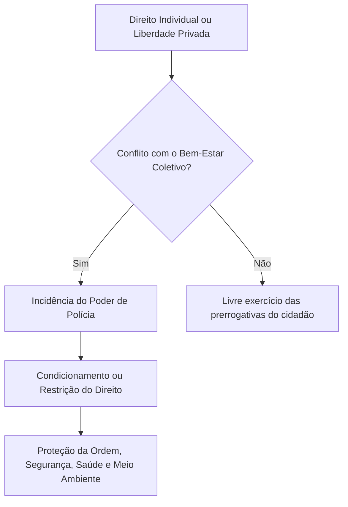
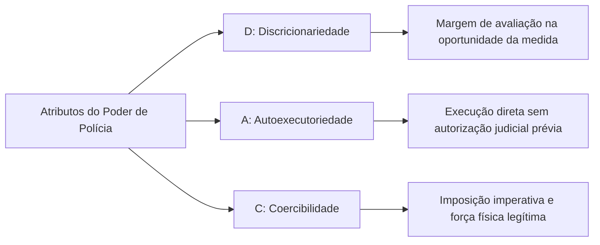
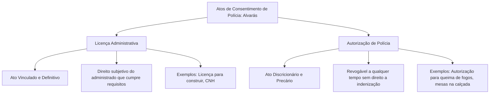

A convivência em sociedade exige que o exercício dos direitos individuais seja harmonizado com o bem-estar coletivo e com a segurança pública. O Estado desempenha essa missão por meio do poder de polícia, limitando e disciplinando o uso da propriedade, a liberdade de locomoção e o desempenho de atividades econômicas em favor do interesse público. Nas atividades de bombeiros e policiais, esse poder manifesta-se de forma permanente e indispensável. Neste capítulo, você vai estudar a definição legal do poder de polícia, a distinção entre polícia administrativa e polícia judiciária, os seus atributos clássicos e as quatro fases do ciclo de polícia.

> [!objetivos]
> - Definir o poder de polícia a partir do conceito material da doutrina e da previsão legal do art. 78 do CTN.
> - Compreender a repartição federativa de competências segundo a predominância do interesse público.
> - Distinguir com precisão a polícia administrativa da polícia judiciária em cinco aspectos práticos.
> - Caracterizar os atributos do poder de polícia: discricionariedade, autoexecutoriedade e coercibilidade.
> - Analisar as quatro etapas do ciclo de polícia: ordem, consentimento, fiscalização e sanção.

## Conceito e fundamento do poder de polícia

O **poder de polícia** é a prerrogativa do direito público que autoriza a administração a condicionar e restringir o uso de bens, o exercício de direitos e a prática de atividades individuais para proteger a segurança, a ordem, a saúde, a tranquilidade e a moralidade coletivas.

O fundamento basilar do poder de polícia repousa na supremacia do interesse público sobre o interesse privado. Nenhum direito individual possui caráter absoluto no ordenamento jurídico brasileiro. O direito de propriedade de um comerciante, por exemplo, não o autoriza a armazenar fogos de artifício em bairro residencial sem equipamentos de combate a incêndio. O Estado intervém na esfera jurídica privada para garantir a coexistência pacífica de todos os cidadãos.

A doutrina divide o poder de polícia em dois sentidos fundamentais:
- **Poder de polícia em sentido amplo**: abrange todas as formas de limitação estatal à liberdade e à propriedade, compreendendo tanto as leis restritivas editadas pelo Poder Legislativo (ordens abstratas primárias) quanto os atos administrativos executivos praticados pela administração pública.
- **Poder de polícia em sentido estrito**: alcança apenas a atuação fiscalizatória, preventiva e sancionatória desenvolvida pelos órgãos do Poder Executivo no exercício da função administrativa cotidiana.

No direito positivo nacional, a definição oficial do instituto encontra-se no art. 78 do Código Tributário Nacional (Lei 5.172/1966). Esse conceito legal foi concebido para justificar a cobrança da taxa de polícia, mas é adotado de forma unânime pelo direito administrativo.

> [!lei] CTN, art. 78
> Considera-se poder de polícia atividade da administração pública que, limitando ou disciplinando direito, interesse ou liberdade, regula a prática de ato ou abstenção de fato, em razão de interesse público concernente à segurança, à higiene, à ordem, aos costumes, à disciplina da produção e do mercado, ao exercício de atividades econômicas dependentes de concessão ou autorização do Poder Público, à tranquilidade pública ou ao respeito à propriedade e aos direitos individuais ou coletivos.

O parágrafo único do referido artigo esclarece que o exercício do poder de polícia é considerado regular quando desempenhado pelo órgão competente, nos limites da lei, com observância do devido processo legal e sem desvio de finalidade.

## Repartição de competências e a regra da predominância do interesse

O poder de polícia administrativa não é exclusividade de um único ente político. Ele é compartilhado entre a União, os Estados, o Distrito Federal e os Municípios.

A distribuição de competências fiscalizatórias segue o princípio constitucional da **predominância do interesse**:
1. **União**: exerce o poder de polícia sobre assuntos de predominante interesse nacional, a exemplo da vigilância sanitária em portos e aeroportos, fiscalização do sistema financeiro, controle de produtos controlados e armas de fogo, e proteção das fronteiras.
2. **Estados**: exercem a competência residual em matérias de interesse regional, tais como a segurança contra incêndio e pânico (atribuição típica do Corpo de Bombeiros Militar), fiscalização sanitária estadual, transporte intermunicipal de passageiros e proteção ao patrimônio histórico estadual.
3. **Municípios**: atuam sobre temas de predominante interesse local (CF, art. 30, I), tais como a expedição de alvarás de construção, ordenamento do trânsito urbano, fiscalização de feiras livres, higiene de mercados locais e posturas municipais.
4. **Distrito Federal**: acumula as atribuições fiscalizatórias estaduais e municipais em virtude de sua natureza jurídica híbrida.

A jurisprudência dos tribunais superiores fixou entendimentos célebres sobre conflitos de competência no poder de polícia que caem com enorme frequência em certames públicos:

> [!jurisprudencia] STJ, Súmula 19 e STF, Súmula Vinculante 38
> O Superior Tribunal de Justiça estabeleceu que cabe exclusivamente à esfera federal regular o expediente e a abertura das agências bancárias perante os clientes (Súmula 19). Em contrapartida, o Supremo Tribunal Federal firmou que os municípios possuem legitimidade para estipular a jornada de funcionamento dos estabelecimentos comerciais em seus territórios (Súmula Vinculante 38).

A tabela seguinte organiza a repartição das atribuições nos diferentes níveis da federação.

| Ente federativo | Âmbito de interesse | Exemplos de atuação prática | Ponto de destaque na prova |
| --- | --- | --- | --- |
| União | Predominantemente nacional | Vigilância em fronteiras, sistema bancário e armas | Súmula 19 do STJ: horário de agências bancárias |
| Estados | Predominantemente regional | Prevenção contra incêndio pelo CBM e trânsito estadual | Competência ampla residual da Constituição |
| Municípios | Predominantemente local | Alvará de funcionamento, feiras e trânsito urbano | Súmula Vinculante 38: horário de comércio local |
| Distrito Federal | Híbrido (regional e local) | Cumula competências de bombeiros, vigilância e posturas | Não pode ser dividido em municípios |

## Polícia administrativa versus polícia judiciária

Uma das distinções mais clássicas e frequentes em concursos públicos reside no confronto entre a **polícia administrativa** e a **polícia judiciária**. Ambas constituem atividades inseridas na função administrativa do Estado, mas diferem substancialmente em seus objetivos, campos de incidência e órgãos de execução.

A **polícia administrativa** incide sobre bens, direitos e atividades privadas. Ela atua de forma preventiva e repressiva para evitar que o comportamento do particular provoque prejuízos à ordem pública e à coletividade. Seu objeto principal é a apuração e o sancionamento de **ilícitos administrativos** (como a venda de remédios fora do prazo de validade ou a realização de festa sem saída de emergência). Além disso, a atividade da polícia administrativa **exaure-se no âmbito do próprio Poder Executivo**: ela inicia, tramita e termina perante órgãos da administração direta ou indireta, sem depender de provocação ao Judiciário.

Por outro lado, a **polícia judiciária** incide diretamente sobre as **pessoas** suspeitas da prática de infrações penais. Sua finalidade essencial é a apuração de **ilícitos penais** (crimes e contravenções), colhendo elementos materiais de autoria e materialidade por meio do inquérito policial. Em virtude disso, a polícia judiciária possui caráter essencialmente preparatório: ela não se exaure na esfera administrativa, mas serve de suporte probatório à futura ação penal a ser proposta pelo Ministério Público perante o Poder Judiciário.

A tabela a seguir confronta os cinco aspectos distintivos fundamentais entre os dois ramos.

| Aspecto comparativo | Polícia administrativa | Polícia judiciária |
| --- | --- | --- |
| Objeto de incidência | Bens, direitos e atividades dos cidadãos | Pessoas suspeitas de condutas criminosas |
| Natureza do ilícito | Ilícito puramente administrativo (infração a normas) | Ilícito de natureza penal (crimes e contravenções) |
| Caráter predominante | Predominantemente preventiva (evita o dano social) | Predominantemente repressiva (atua após o delito) |
| Destinação do ato | Exaure-se no âmbito da própria administração pública | Preparatória para o processo jurisdicional penal |
| Órgãos de execução | Órgãos administrativos diversos (CBM, prefeituras, Detran) | Órgãos de segurança pública especializados (PC e PF) |

É importante registrar que a distinção quanto ao caráter preventivo ou repressivo não é absoluta. A polícia administrativa também atua de modo repressivo quando aplica multas, interdita um restaurante ou apreende mercadorias contrabandeadas. Da mesma maneira, a polícia judiciária e a polícia ostensiva desenvolvem ações preventivas de patrulhamento ostensivo para desencorajar a prática de delitos nas cidades.

No âmbito da Justiça Militar estadual, cumpre destacar que os oficiais da Polícia Militar e do Corpo de Bombeiros Militar desempenham atribuições típicas de polícia judiciária militar ao instaurarem e presidirem Inquéritos Policiais Militares (IPMs) para apurar crimes militares.

## Atributos do poder de polícia

A doutrina administrativista consagra três atributos clássicos que conferem operacionalidade ao poder de polícia, sintetizados na conhecida sigla **DAC**: **discricionariedade**, **autoexecutoriedade** e **coercibilidade**.

> [!bizu] Mnemônico DAC
> Guarde a sigla **DAC** para memorizar os atributos do poder de polícia: **D**iscricionariedade, **A**utoexecutoriedade e **C**oercibilidade.

### Discricionariedade

Como regra geral, o poder de polícia é discricionário. O legislador confere à autoridade pública margem razoável de apreciação para identificar o momento oportuno de intervir, escolher a sanção mais adequada diante da gravidade da conduta e dosar a intensidade da medida administrativa.

Essa liberdade não autoriza a prática de arbitrariedades. O administrador deve respeitar os princípios da razoabilidade, da proporcionalidade e da legalidade estrita.

Existem importantes exceções em que o poder de polícia atua de forma **vinculada**. O exemplo mais expressivo é a concessão de **licença administrativa** (como a licença para dirigir veículos automotores ou a licença para edificar em terreno urbano). Uma vez comprovado pelo particular o preenchimento integral dos requisitos objetivos fixados na lei, a autoridade não pode negar a concessão do alvará de licença.

### Autoexecutoriedade

A **autoexecutoriedade** é a prerrogativa pela qual a administração pública executa suas decisões diretamente, empregando meios materiais próprios, **sem necessidade de intervenção prévia do Poder Judiciário**.

A doutrina moderna desdobra a autoexecutoriedade em duas manifestações distintas:
1. **Exigibilidade**: faculdade que o Estado possui de impor obrigações ao particular por meios indiretos de coerção, a exemplo da imposição de uma multa pecuniária para estimular o cumprimento de uma obrigação. A exigibilidade está presente em praticamente todos os atos de polícia.
2. **Executoriedade**: prerrogativa de compelir o cidadão materialmente pela via direta, como na hipótese em que a fiscalização fecha fisicamente as portas de um estabelecimento comercial, reboca um veículo estacionado em local proibido ou destrói alimentos deteriorados.

A autoexecutoriedade não está presente em todos os atos do poder de polícia. Ela só é admitida quando ocorrer uma de duas situações:
- **Expressa previsão legal**: a lei determina expressamente que a autoridade pode agir sem ordem judicial.
- **Situação de urgência**: diante de perigo iminente à saúde pública, à segurança ou à vida da coletividade, o agente público atua imediatamente para neutralizar o risco, sob pena de ineficácia da medida.

> [!atencao] Cobrança de multa não é autoexecutória
> A aplicação da penalidade de multa é ato de polícia dotado de exigibilidade. Contudo, se o particular multado recusar-se a efetuar o pagamento espontâneo, a administração pública **não pode invadir a conta bancária do cidadão para confiscar o valor**. O Estado é obrigado a inscrever o débito em dívida ativa e ajuizar a competente execução fiscal perante o Poder Judiciário, com base na Lei 6.830/1980.

### Coercibilidade

A **coercibilidade** é a imposição imperativa das medidas de polícia, que tornam o ato obrigatório para o administrado independentemente de sua concordância ou vontade pessoal.

O ato de polícia cria uma obrigação imediata para o particular. Diante da resistência injustificada do cidadão, a autoridade pública pode lançar mão do uso moderado e proporcional da força física para fazer cumprir a determinação estatal, a exemplo do isolamento forçado de uma área de risco desabamento ou do desarmamento de quem não possui porte legal.

## Meios de atuação e os atos preventivos de polícia

A administração pública exerce o poder de polícia por meio de instrumentos jurídicos gerais e concretos:
- **Atos gerais e abstratos**: manifestam-se pela edição de normas infralegais, regulamentos, instruções técnicas de segurança contra incêndio e posturas municipais que descrevem condutas vedadas ou exigidas da coletividade.
- **Atos individuais e concretos**: dirigem-se a situações ou pessoas determinadas, podendo ter natureza preventiva ou repressiva.

No campo da atuação preventiva, o poder de polícia manifesta-se tipicamente pelo **consentimento de polícia**, formalizado por meio de um **alvará**. O alvará é o documento formal que instrumentaliza a manifestação de anuência da administração pública, podendo veicular uma licença ou uma autorização.

A diferenciação entre licença e autorização é um dos temas preferidos das bancas examinadoras:

> [!pegadinha] Licença versus autorização
> Guarde a distinção que derruba candidatos:
> - **Licença**: vinculada e definitiva. Cumpridos os requisitos da lei, a administração é obrigada a conceder.
> - **Autorização**: discricionária e precária. A administração concede se julgar conveniente e oportuno, podendo revogar a qualquer tempo sem pagar indenização ao beneficiário.

A tabela comparativa a seguir consolida os elementos de distinção entre esses dois atos de consentimento.

| Elemento jurídico | Licença administrativa | Autorização administrativa |
| --- | --- | --- |
| Natureza jurídica | Ato administrativo unilateral e vinculado | Ato administrativo unilateral e discricionário |
| Estabilidade temporal | Ato definitivo; gera direito adquirido | Ato eminentemente precário |
| Revogabilidade | Não admite revogação sumária imotivada | Revogável a qualquer tempo por conveniência |
| Direito à indenização | Gera dever de indenizar se revogada sem causa | Inexiste direito a indenização pela revogação |
| Exemplos práticos | Licença de habitação (habite-se), licença para dirigir | Porte de arma de fogo, uso de espaço público para evento |

## O ciclo ou fases de polícia

A doutrina administrativista brasileira, com destaque para a formulação clássica de Diogo de Figueiredo Moreira Neto, organiza a atividade fiscalizatória estatal em um sistema estruturado de etapas conhecido como o **ciclo de polícia** ou fases de polícia.

Esse ciclo compreende quatro momentos sucessivos e interligados:
1. **Ordem de polícia (legislação)**;
2. **Consentimento de polícia**;
3. **Fiscalização de polícia**;
4. **Sanção de polícia**.

> [!esquema] Estrutura detalhada do ciclo de polícia
> - **1. Ordem de polícia**: é a norma primária que estabelece o preceito limitador ou condicionador da conduta. Encontra-se na lei em sentido formal e em seus regulamentos de execução. É fase abstrata e geral.
> - **2. Consentimento de polícia**: é a anuência prévia da administração que atesta a conformidade da atividade com as exigências normativas (alvará de licença ou de autorização). Essa fase é eventual, pois nem todas as atividades dependem de controle prévio da administração (andar a pé na rua, por exemplo, não depende de consentimento).
> - **3. Fiscalização de polícia**: é a averiguação empírica, no campo fático, do cumprimento das ordens e das condições do consentimento. Manifesta-se em vistorias, blitze de trânsito, inspeções prediais e exames de documentos.
> - **4. Sanção de polícia**: é a medida punitiva aplicada ao particular que desobedece aos preceitos da ordem ou às condições fixadas no consentimento. Compreende advertências formais, multas, interdições e apreensões de mercadorias.

> [!exemplo]
> O Corpo de Bombeiros Militar atua tipicamente em todas as fases do ciclo de polícia na fiscalização contra incêndio e pânico. A **ordem de polícia** está no Código de Segurança contra Incêndio e Pânico de Pernambuco (Lei Estadual 11.186/1994). O **consentimento de polícia** materializa-se na expedição do Atestado de Vistoria do Corpo de Bombeiros (AVCB) após a aprovação do projeto técnico. A **fiscalização de polícia** ocorre quando uma equipe de bombeiros inspeciona as instalações de uma boate para checar extintores e saídas de emergência. Por fim, a **sanção de polícia** opera quando o estabelecimento é interditado ou multado por manter rotas de fuga obstruídas durante o funcionamento noturno.

## Poder de polícia originário e delegado

A distribuição prática do poder de polícia no aparelho estatal dá origem a duas modalidades estruturais de atuação: o poder de polícia originário e o poder de polícia delegado.

O **poder de polícia originário** é aquele exercido diretamente pelos entes políticos que compõem a administração pública direta: a União, os Estados, o Distrito Federal e os Municípios. Ele decorre da soberania e da autonomia política outorgadas diretamente pela Constituição da República aos membros da federação. Quando uma Secretaria de Estado de Saúde ou um Comando do Corpo de Bombeiros fiscaliza um imóvel, atua com base no poder de polícia originário daquele ente federativo.

Por outro lado, o **poder de polícia delegado** é aquele exercido pelas entidades integrantes da administração pública indireta que receberam essa competência mediante previsão expressa em lei. Em regra, a delegação do poder de polícia realiza-se em favor de **autarquias e fundações públicas de direito público**.

Exemplos expressos de poder de polícia delegado a pessoas jurídicas públicas compreendem:
- As **agências reguladoras** (ANATEL, ANVISA, ANP, ANAC), que fiscalizam serviços públicos delegados e atividades de relevância econômica.
- A **Comissão de Valores Mobiliários (CVM)**, autarquia federal encarregada de regular e fiscalizar o mercado de capitais.
- Os **conselhos de fiscalização profissional** (Conselho Regional de Engenharia, Conselho Regional de Medicina, etc.), que possuem natureza jurídica autárquica especial. Cabe destacar a exceção da Ordem dos Advogados do Brasil (OAB), que o STF considera entidade ímpar desprovida de natureza autárquica comum.

A possibilidade de delegação de fases do poder de polícia a entidades de direito privado da administração indireta (empresas públicas e sociedades de economia mista) constitui um tema aprofundado com jurisprudência vinculante do Supremo Tribunal Federal, que será examinado detalhadamente no próximo capítulo deste volume.

## Mapa do capítulo

A tabela a seguir oferece um panorama integrado dos conceitos, espécies, atributos e ciclos do poder de polícia administrativa.

| Tópico estrutural | Conceito central | Desdobramentos fundamentais | Ponto de atenção na prova |
| --- | --- | --- | --- |
| Conceito e base | Restrição estatal a bens e liberdades em prol do coletivo | Sentido amplo (lei e ato) e estrito (atos do Executivo) | Previsão legal expressa no art. 78 do CTN |
| Competência | Segue a predominância do interesse federativo | Nacional (União), Regional (Estados) e Local (Municípios) | Horário bancário (STJ 19) versus horário de comércio (SV 38) |
| Ramos de polícia | Administrativa versus Judiciária | Administrativa incide em bens/direitos; judiciária em pessoas | Administrativa exaure-se no Executivo; judiciária vai ao Judiciário |
| Atributos | Sigla DAC: Discricionariedade, Autoexecutoriedade e Coercibilidade | Autoexecutoriedade divide-se em exigibilidade e executoriedade | Multa pecuniária não tem cobrança autoexecutória direta |
| Consentimento | Formalizado por meio de alvarás de funcionamento | Licença (ato vinculado) versus Autorização (ato discricionário) | A licença gera direito subjetivo; a autorização é precária |
| Ciclo de polícia | As quatro fases sucessivas da atividade de polícia | Ordem, Consentimento, Fiscalização e Sanção | O consentimento é a única fase facultativa do ciclo |

### Para fixar
- Poder de polícia é a faculdade que a administração possui de condicionar bens e direitos individuais em benefício da coletividade.
- O conceito legal de poder de polícia e de seu exercício regular está expressamente fixado no art. 78 do Código Tributário Nacional.
- A fixação do horário bancário é privativa da União (STJ, Súmula 19), enquanto o horário do comércio cabe ao Município (STF, Súmula Vinculante 38).
- A polícia administrativa incide sobre bens, direitos e atividades, visando apurar infrações de natureza puramente administrativa.
- A polícia judiciária incide sobre pessoas suspeitas da prática de ilícitos penais e possui caráter preparatório para o processo penal.
- Os atributos clássicos do poder de polícia sintetizam-se na sigla DAC: discricionariedade, autoexecutoriedade e coercibilidade.
- A autoexecutoriedade permite a prática direta do ato pelo Estado, mas a cobrança de multas não pagas exige execução fiscal judicial.
- A licença administrativa é ato vinculado e definitivo, ao passo que a autorização de polícia é ato discricionário e precário.
- O ciclo de polícia é composto por quatro fases sucessivas: ordem, consentimento, fiscalização e sanção.
- O poder de polícia originário pertence à administração direta, sendo admitida a delegação legal em favor de autarquias e fundações públicas.
