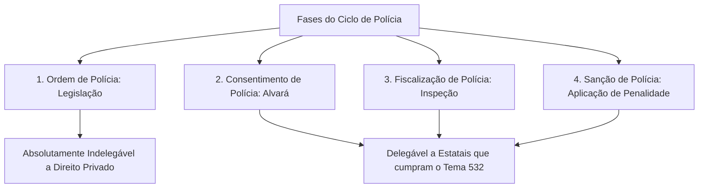
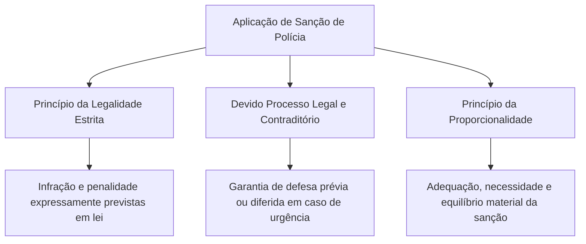
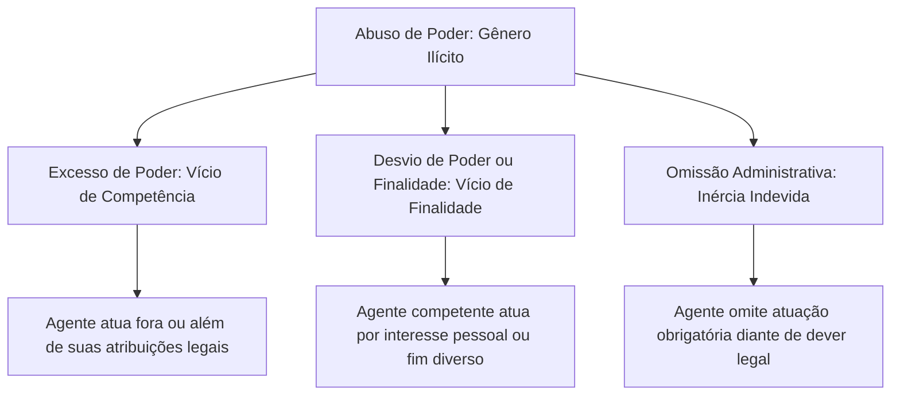

O poder de polícia estatal precisa conciliar a defesa da ordem pública com a proteção dos direitos fundamentais dos cidadãos. Para que a intervenção pública seja legítima, a atuação fiscalizatória deve observar parâmetros estritos de competência, proporcionalidade nas sanções e prazos prescricionais para a punição. Além disso, a fronteira entre o uso legítimo das prerrogativas administrativas e o abuso de poder define a responsabilidade civil, administrativa e penal das autoridades. Neste capítulo final do volume, você vai verticalizar a delegação de atos fiscalizatórios segundo a jurisprudência do Supremo Tribunal Federal, o regime das sanções e da prescrição, a teoria do abuso de poder e os principais precedentes jurisprudenciais cobrados em provas de concurso.

> [!objetivos]
> - Analisar as condições constitucionais para a transferência de etapas do ciclo de polícia a entidades estatais sob regime privado (Tema 532 do STF).
> - Identificar as espécies de sanções de polícia e seus requisitos de legalidade, proporcionalidade e contraditório.
> - Compreender o regime de prescrição punitiva, intercorrente e executória da polícia administrativa.
> - Distinguir com precisão excesso de poder, desvio de finalidade e omissão da administração.
> - Dominar a jurisprudência vinculante do STF e os enunciados sumulares do STJ aplicáveis à matéria.

## A descentralização de atribuições e o entendimento do STF

A titularidade originária do poder de polícia pertence às pessoas jurídicas de direito público que compõem a administração direta (União, Estados, Distrito Federal e Municípios). A execução prática dessas atividades, contudo, é frequentemente descentralizada para entidades da administração indireta para assegurar maior especialização técnica e eficiência na fiscalização.

A outorga de atribuições fiscalizatórias a **autarquias e fundações públicas de direito público** é pacífica no direito administrativo brasileiro. Essas entidades de direito público recebem, mediante previsão expressa em lei ordinária criadora, a totalidade das competências de polícia em sua área material, a exemplo das agências reguladoras (ANVISA, ANATEL, ANP) e dos órgãos ambientais (IBAMA). Nessas entidades públicas, a manifestação do poder de autoridade e a imposição de restrições decorrem diretamente da natureza pública de sua personalidade jurídica.

A grande polêmica jurídica, de altíssima incidência em certames públicos, envolve a transferência de atribuições punitivas e fiscalizatórias a **entidades com personalidade de direito privado**.

A evolução doutrinária e jurisprudencial desse debate passou por marcos sucessivos:
1. **Julgamento da ADI 1.717/DF pelo STF**: o tribunal assentou que o poder de polícia é indelegável a pessoas puramente privadas, declarando a inconstitucionalidade de dispositivo legal que autorizava conselhos profissionais a funcionarem sob a forma de pessoas privadas comuns. Os conselhos corporativos de profissões regulamentadas (à exceção da OAB) devem ostentar a natureza autárquica de direito público.
2. **Precedente do STJ no REsp 817.534/MG**: o Superior Tribunal de Justiça fragmentou o ciclo de polícia em quatro etapas sucessivas (legislação, consentimento, fiscalização e sanção). Estabeleceu, à época, que as estatais de direito privado só poderiam exercer atos de **consentimento** e de **fiscalização**, sendo indelegáveis a criação de ordens normativas e a imposição de sanções punitivas.
3. **Fixação do Tema 532 pelo STF (RE 633.782/MG)**: o plenário do Supremo Tribunal Federal superou a restrição do STJ quanto às penalidades e fixou tese de repercussão geral inovadora. O STF assentou que é juridicamente válido transferir por lei as etapas de consentimento, fiscalização e **sanção de polícia** a pessoas jurídicas estatais de direito privado, desde que preenchidos requisitos estritos e cumulativos.

> [!jurisprudencia] STF, RE 633.782/MG (Tema 532)
> O Supremo Tribunal Federal fixou a tese de que é legítimo transferir, mediante diploma legislativo formal, o exercício do poder de polícia a sociedades de economia mista e empresas públicas da administração indireta que possuam capital social com maioria estatal e que se dediquem com exclusividade à prestação de serviços públicos típicos em regime não concorrencial.

Para que uma empresa pública ou sociedade de economia mista possa exercer a competência de fiscalizar e multar, a decisão do STF impõe quatro requisitos simultâneos:
- **Criação ou autorização por lei em sentido formal**: a descentralização da atribuição punitiva depende de previsão expressa aprovada pelo Parlamento.
- **Integração na estrutura da administração indireta**: a instituição precisa compor formalmente o aparelho estatal, não se admitindo a delegação a associações civis ou entidades privadas sem vínculo institucional.
- **Capital social majoritariamente pertencente ao poder público**: o controle diretivo e societário da entidade deve permanecer sob as mãos do Estado.
- **Prestação de serviços públicos em regime de exclusividade não concorrencial**: a entidade deve atuar fora do mercado competitivo. Se a estatal disputar mercado com o setor privado com o objetivo de gerar lucros societários, ela não pode exercer prerrogativas sancionatórias, sob pena de utilizar o poder de autoridade para sufocar concorrentes privados.

Empresas públicas de gestão de trânsito e mobilidade urbana (como antigas autarquias convertidas em estatais prestadoras de serviço em capitais e municípios) atendem a essas balizas, podendo autuar e aplicar penalidades aos infratores das normas de tráfego.

> [!atencao] Indelegabilidade a particulares e a estatais de mercado
> O poder sancionatório de polícia jamais pode ser transferido a particulares (pessoas físicas ou empresas privadas mercantis) nem a empresas estatais exploradoras de atividade econômica em concorrência (como Petrobras e Banco do Brasil). Atividades materiais preparatórias e acessórias, a exemplo da fabricação, locação e calibragem técnica de radares de velocidade, podem ser contratadas com prestadores privados, mas a verificação formal da infração, a lavratura do auto e a aplicação da penalidade devem ser atos privativos de agentes estatais.

A tabela seguinte sistematiza a possibilidade de delegação do poder de polícia no ordenamento jurídico nacional.

| Destinatário da função | Fases admitidas pelo STF | Fundamento ou exigência legal | Exemplo prático |
| --- | --- | --- | --- |
| Administração direta | Todas as quatro fases do ciclo | Titularidade originária pela Constituição | Vistoria e interdição pelo Corpo de Bombeiros |
| Autarquias e fundações públicas | Todas as quatro fases do ciclo | Outorga legal formal de direito público | Fiscalização da ANVISA ou do IBAMA |
| Estatais prestadoras de serviço (Tema 532) | Consentimento, fiscalização e sanção | Capital público, serviço exclusivo não concorrencial | Aplicação de multas por empresa municipal de trânsito |
| Estatais exploradoras de mercado | Nenhuma fase do ciclo de polícia | Regime concorrencial de direito privado | Vedado a bancos estatais e distribuidoras de energia |
| Particulares em geral | Nenhuma fase (apenas suporte material) | Vedada qualquer atividade de império estatal | Instalação técnica e manutenção de radares de trânsito |

## Sanções de polícia e seus limites jurídicos

A **sanção de polícia** é a providência jurídica coercitiva imposta pela administração pública ao administrado que desobedece a uma ordem legal de polícia ou viola as condições fixadas em ato de consentimento. Ela busca punir a conduta pretérita e desestimular futuras infrações que coloquem em risco o bem-estar coletivo.

As sanções administrativas de polícia apresentam modalidades variadas no direito positivo:
- **Multa pecuniária**: penalidade financeira imposta em decorrência de infração administrativa, como a multa por excesso de velocidade ou por ausência de alvará sanitário.
- **Interdição de estabelecimento ou de atividade**: fechamento compulsório de local comercial ou suspensão de atividade que represente perigo à segurança, à saúde pública ou à tranquilidade dos cidadãos.
- **Apreensão de coisas e bens**: recolhimento de mercadorias adulteradas, alimentos vencidos, equipamentos sonoros desregulados ou produtos perigosos sem autorização legal.
- **Destruição ou inutilização de coisas**: incineração de substâncias ilícitas, descarte de gêneros impróprios para consumo humano ou demolição forçada de obra irregular que ofereça risco iminente de desabamento.
- **Cassação de licença ou autorização**: extinção punitiva do ato de consentimento em virtude do descumprimento grave e reiterado das normas de funcionamento pelo titular.

### Limites materiais e garantias do administrado

O exercício do poder sancionador administrativo subordina-se a limites intransponíveis fixados pela ordem constitucional:

1. **Princípio da legalidade estrita**: nenhuma sanção administrativa pode ser criada ou agravada por decreto ou ato normativo infralegal. A tipificação da infração e a cominação da penalidade correspondente exigem diploma legislativo formal.
2. **Devido processo legal, contraditório e ampla defesa** (CF, art. 5º, incisos LIV e LV): a aplicação da penalidade pressupõe a instauração de processo administrativo com a oportunidade de manifestação do interessado e a produção de provas legítimas. Em situações excepcionais de extrema urgência (como a interdição imediata de um prédio em chamas ou de um restaurante servindo comida estragada), admite-se o **contraditório diferido**, no qual a medida acautelatória é executada de pronto e o direito de defesa é exercido logo em seguida.
3. **Princípio da proporcionalidade e razoabilidade**: a sanção deve ser graduada segundo a gravidade da conduta e o risco gerado para a coletividade. A proporcionalidade desdobra-se em três subprincípios essenciais:
   - **Adequação**: a sanção escolhida deve ser apta e idônea para alcançar a finalidade pública protetiva;
   - **Necessidade (ou exigibilidade)**: a administração deve optar pela medida menos gravosa entre todas as opções eficazes disponíveis;
   - **Proporcionalidade em sentido estrito**: as vantagens trazidas para o interesse coletivo devem superar os prejuízos e restrições causados ao particular atingido.
4. **Motivação obrigatória**: a autoridade sancionadora é obrigada a demonstrar, com clareza e por escrito, os fundamentos de fato e de direito que justificam a penalidade imposta.

A doutrina ressalta a diferença crucial entre a **sanção de polícia** e a **medida acautelatória de polícia**:
- A **sanção** possui finalidade puramente punitiva e repressiva. Ela decorre da apuração definitiva de um ilícito e busca punir o infrator, como na aplicação de uma multa administrativa.
- A **medida acautelatória** possui caráter preventivo de urgência. Ela não visa castigar o indivíduo, mas afastar de pronto uma situação de perigo iminente à integridade coletiva, a exemplo da interdição emergencial de um palco antes do início de um show por falta de saídas de emergência aprovadas pelo Corpo de Bombeiros.

> [!jurisprudencia] STJ, Súmula 434
> O Superior Tribunal de Justiça firmou entendimento no sentido de que pagar a multa por infração de trânsito não impede o particular de discutir o débito em juízo.

A Súmula 434 do STJ resguarda o direito fundamental de inafastabilidade da tutela jurisdicional (CF, art. 5º, XXXV). O enunciado foi escrito para a multa de trânsito: o motorista que paga a multa para licenciar ou liberar o veículo não renuncia ao direito de questionar em juízo a validade do auto de infração lavrado.

## Regime de prescrição no poder de polícia

O Estado não pode manter a espada punitiva indefinidamente sobre o administrado. O princípio da segurança jurídica impõe prazos decadenciais e prescricionais para o exercício da atividade fiscalizatória e para a cobrança das penalidades pecuniárias impostas pela administração pública.

No âmbito federal, a matéria é disciplinada pela Lei 9.873/1999. Para Estados e Municípios sem lei própria, o STJ não estende a lei federal: aplica o prazo de cinco anos do Decreto 20.910/1932. Os prazos abaixo são os da lei federal.

O sistema jurídico consagra quatro modalidades relevantes de prescrição na polícia administrativa:

1. **Prescrição da ação punitiva (quinquenal)**: prescreve em **cinco anos** a pretensão da administração pública de apurar a infração e aplicar a sanção cabível. O termo inicial do prazo é a data da prática do ato ilícito ou, no caso de infrações permanentes ou continuadas, o dia em que a conduta ilegal cessar.
2. **Prescrição aplicável a ilícitos penais**: se a conduta praticada pelo cidadão configurar, ao mesmo tempo, infração administrativa e crime tipificado na legislação penal, o prazo prescricional da atuação de polícia não será de cinco anos, mas sim **o mesmo prazo de prescrição fixado na lei penal** para aquele delito específico.
3. **Prescrição intercorrente (trienal)**: ocorre no curso do processo administrativo já instaurado. Incide a prescrição intercorrente no procedimento paralisado por **mais de três anos**, pendente de despacho ou julgamento pela autoridade competente. Nesse caso, os autos devem ser arquivados de ofício ou a requerimento da parte interessada.
4. **Prescrição da ação executória (quinquenal)**: prescreve em **cinco anos** o direito do poder público de promover a cobrança judicial da multa pecuniária já definitivamente aplicada. Conforme o entendimento consolidado na jurisprudência sumulada do STJ, o termo inicial dessa contagem ocorre na data do encerramento regular do processo administrativo, momento em que o crédito se torna líquido e exigível.

> [!jurisprudencia] STJ, Súmula 467
> O Superior Tribunal de Justiça fixou em cinco anos, contados do término do processo administrativo, o prazo para a administração executar a multa por infração ambiental.

A tabela seguinte compara as modalidades prescricionais no exercício do poder de polícia.

| Espécie de prescrição | Prazo legal aplicável | Termo inicial de contagem | Efeito jurídico prático |
| --- | --- | --- | --- |
| Prescrição da pretensão punitiva | Cinco anos (ou prazo penal se for crime) | Data da infração ou do fim do ato contínuo | Perda do poder de instaurar processo e punir |
| Prescrição administrativa intercorrente | Três anos consecutivos | Paralisação injustificada do procedimento | Extinção e arquivamento do processo administrativo |
| Prescrição da pretensão executória | Cinco anos após decisão definitiva | Término definitivo do processo administrativo | Perda do direito de executar judicialmente a multa |

## Teoria do uso e abuso de poder

O exercício regular das prerrogativas públicas por um agente estatal denomina-se **uso do poder**. Quando a autoridade atua rigorosamente dentro dos limites legais, motivada pela busca do interesse coletivo e respeitando a proporcionalidade, sua conduta é válida e juridicamente protegida.

Em contrapartida, quando o agente público ultrapassa os limites conferidos pela lei ou desvia-se dos objetivos públicos, surge a figura patológica do **abuso de poder**.

O abuso de poder constitui uma categoria genérica que se desdobra em duas espécies tradicionais consagradas na doutrina de Hely Lopes Meirelles e no art. 2º da Lei 4.717/1965 (Lei da Ação Popular): o **excesso de poder** e o **desvio de poder** (ou desvio de finalidade). Além delas, a jurisprudência moderna reconhece a **omissão administrativa** como modalidade omissiva do abuso.

### Excesso de poder

O **excesso de poder** ocorre quando o agente público atua **fora ou além dos limites de sua competência legal**. Trata-se de um defeito centrado no elemento **competência** do ato administrativo (Lei 4.717/1965, art. 2º, parágrafo único, "a").

O excesso de poder pode manifestar-se em três formatos:
- A autoridade pratica um ato que não cabe a nenhum órgão público realizar (usurpação de função ou ato totalmente proibido em lei);
- O agente pratica um ato que compete privativamente a outra autoridade administrativa (incompetência relativa ou absoluta);
- O agente dispõe de competência para atuar, mas ultrapassa a intensidade admitida na norma, empregando violência desnecessária ou restrição desarrazoada.

Exemplo concreto de excesso de poder ocorre quando um fiscal de vigilância sanitária municipal, dotado de competência apenas para inspecionar estabelecimentos de alimentos, resolve autuar e apreender um veículo de transporte coletivo por irregularidade de emplacamento, atribuição que a lei reserva com exclusividade ao órgão executivo de trânsito.

### Desvio de poder ou desvio de finalidade

O **desvio de poder** (ou desvio de finalidade) ocorre quando o agente atua formalmente dentro dos limites de sua competência legal, mas pratica o ato buscando uma **finalidade diversa daquela prevista pela lei ou estranha ao interesse público**. O vício atinge o elemento **finalidade** do ato administrativo (Lei 4.717/1965, art. 2º, parágrafo único, "e").

No desvio de finalidade, a autoridade utiliza a capa da legalidade para camuflar propósitos impróprios, tais como:
- **Perseguição pessoal**: o chefe remove um servidor subordinado para uma cidade distante na fronteira estadual sob o pretexto oficial de "necessidade de serviço", quando a motivação real e comprovada foi punir o servidor por divergências políticas.
- **Favorecimento ilícito**: o administrador desapropria determinado imóvel pertencente a um amigo com avaliação superfaturada para que este receba vultosa indenização pública.

> [!pegadinha] Excesso versus desvio de finalidade
> Memorize para não errar na prova:
> - **Excesso de poder**: vício no elemento **competência** (o agente faz o que a lei não lhe permitiu fazer).
> - **Desvio de poder**: vício no elemento **finalidade** (o agente competente busca um fim oculto ou ilícito).

> [!bizu] Mnemônico ECO e DF
> Guarde os mnemônicos:
> - **E-CO**: **E**xcesso atinge a **CO**mpetência.
> - **D-F**: **D**esvio atinge a **F**inalidade.

A tabela comparativa a seguir destaca os pontos de distinção entre as duas espécies de abuso de poder.

| Critério comparativo | Excesso de poder | Desvio de finalidade |
| --- | --- | --- |
| Requisito do ato afetado | Elemento competência (incompetência do agente) | Elemento finalidade (fim estranho ao interesse público) |
| Postura do agente | Atua além das atribuições conferidas pelo direito | Atua dentro da competência formal, mas com fim ilícito |
| Dificuldade probatória | Mais fácil comprovação (confronto textual da lei) | Mais difícil demonstração (exige prova da intenção oculta) |
| Possibilidade de convalidação | Admite convalidação, salvo se a competência for exclusiva ou fixada em razão da matéria | Ato nulo de pleno direito; jamais admite convalidação |
| Exemplos práticos | Fiscal que interdita obra sem ter competência legal | Remoção de servidor público para punição disfarçada |

### Omissão administrativa e responsabilidade estatal

O abuso de poder também se consuma na modalidade omissiva. O administrador público não possui o direito de se calar diante de situações em que o ordenamento impõe o dever de agir.

A inércia dolosa ou negligente diante de pedidos de certidões, pleitos de concessão de alvarás de licença ou vistorias de segurança obrigatórias viola o direito subjetivo do cidadão e configura abuso de poder por omissão, ensejando a impetração de mandado de segurança para compelir a autoridade a decidir, além de responsabilidade civil do Estado pelos prejuízos decorrentes da demora injustificada.

Nos termos do art. 37, § 6º, da Constituição Federal, as pessoas jurídicas de direito público e as de direito privado prestadoras de serviços públicos respondem objetivamente pelos danos que seus agentes causarem a terceiros nessa qualidade. Quando o abuso de poder gerar lesão patrimonial ou moral a um particular, a vítima pode acionar diretamente o Estado, assegurado o direito de regresso contra o agente público nos casos comprovados de dolo ou culpa.

### Aspectos da Lei de Abuso de Autoridade (Lei 13.869/2019)

No campo do direito penal administrativo, a Lei 13.869/2019 estabelece o regime de responsabilização para agentes públicos que cometem crimes de abuso de autoridade. A norma aplica-se a servidores civis e militares de todos os Poderes e esferas da federação.

O ponto de maior relevância para provas de concurso reside no elemento subjetivo do tipo penal, estampado no art. 1º, § 1º, da referida lei:

> [!lei] Lei 13.869/2019, art. 1º, § 1º
> As condutas descritas nesta Lei constituem crime de abuso de autoridade quando praticadas pelo agente com a finalidade específica de prejudicar outrem ou beneficiar a si mesmo ou a terceiro, ou, ainda, por mero capricho ou satisfação pessoal.

Perceba que a caracterização do crime de abuso de autoridade exige cumulativamente a comprovação do **dolo genérico** (vontade livre e consciente de praticar a ação) e do **dolo específico** (finalidade especial de agir: prejudicar outrem, obter benefício pessoal ou agir por capricho). Inexiste modalidade culposa na Lei de Abuso de Autoridade.

Além disso, o art. 1º, § 2º, consagra expressamente a vedação ao chamado "crime de hermenêutica": a mera divergência razoável na interpretação da lei ou na avaliação de fatos e provas no exercício da função não configura crime de abuso de autoridade.

## Jurisprudência consolidada sobre o poder de polícia

O estudo dos poderes administrativos para concursos exige o domínio de súmulas vinculantes e precedentes emblemáticos dos tribunais superiores:

1. **Competência das Guardas Municipais no trânsito (STF, RE 658.570/MG, Tema 472)**: o plenário do Supremo Tribunal Federal fixou tese vinculante assentando que é plenamente legítimo e constitucional outorgar às corporações de guardas municipais as atribuições do poder de polícia de trânsito, autorizando os guardas a lavrarem autos e a aplicarem sanções pecuniárias de multa no tráfego urbano.
2. **Livre concorrência e distância entre estabelecimentos comerciais (STF, Súmula Vinculante 49)**: o STF pacificou que leis municipais que estipulam distâncias mínimas obrigatórias entre estabelecimentos do mesmo segmento econômico, a exemplo de farmácias ou postos de combustíveis, violam frontalmente os princípios constitucionais da livre iniciativa e da concorrência de mercado.

> [!jurisprudencia] STF, Súmula Vinculante 49
> O Supremo Tribunal Federal consolidou a diretriz de que afronta o princípio constitucional da livre iniciativa e da livre concorrência a norma local municipal que proíbe a abertura ou a instalação de estabelecimentos comerciais do mesmo setor dentro de um determinado perímetro geográfico.

3. **Extinção de conselhos e colegiados criados por lei**: o Supremo Tribunal Federal assentou que o Chefe do Poder Executivo não pode, mediante decreto autônomo, extinguir órgãos colegiados de deliberação ou controle social que tenham sido criados por lei formal (ADI 6.121/DF). O decreto do art. 84, VI, "a", veda expressamente a extinção de órgãos públicos.
4. **Fixação de prazo para regulamentação**: o Poder Legislativo não pode fixar em lei prazo obrigatório para que o Chefe do Poder Executivo expeça decretos regulamentares, sob pena de violação ao princípio da separação dos Poderes (STF, ADI 3.394/AM).

> [!exemplo]
> Em uma operação de fiscalização conjunta realizada em Olinda, policiais civis e fiscais da vigilância sanitária constatam que um galpão comercial armazena botijões de gás clandestinos ao lado de um depósito de tecidos inflamáveis. A equipe lavra auto de infração, apreende os recipientes e interdita provisoriamente o espaço físico com base no poder de polícia administrativo. O proprietário que se sentir lesado pode impetrar mandado de segurança ou acionar o Judiciário para provar eventual abuso de poder, mas não pode desobedecer sumariamente à interdição dotada de coercibilidade e autoexecutoriedade.

## Mapa do capítulo

A tabela a seguir consolida os pontos mais relevantes deste capítulo para revisão orientada a provas de concurso.

| Instituto jurídico | Regra central | Requisitos ou desdobramentos | Julgado ou dispositivo-chave |
| --- | --- | --- | --- |
| Descentralização de polícia | Permitida para autarquias e estatais de serviço público | Atuação exclusiva, regime não concorrencial e controle estatal | STF, Tema 532 (RE 633.782/MG) |
| Sanções de polícia | Exigem legalidade estrita e contraditório | Multas, interdições, apreensões e demolições | Súmula 434 do STJ (pagar a multa de trânsito não inibe ação) |
| Prescrição no poder de polícia | Quinquenal para punição e execução; trienal intercorrente | Se for crime, aplica-se a lei penal | Súmula 467 do STJ (execução da multa ambiental) |
| Excesso de poder | Vício no elemento competência | Agente atua fora ou além de suas atribuições | Lei 4.717/1965, art. 2º, parágrafo único, a |
| Desvio de finalidade | Vício no elemento finalidade | Agente competente atua por interesse alheio ao público | Lei 4.717/1965, art. 2º, parágrafo único, e |
| Abuso de autoridade penal | Exige dolo específico comprovado | Prejudicar, beneficiar ou mero capricho | Lei 13.869/2019, art. 1º, § 1º |
| Livre concorrência urbana | Proibido limitar distância entre comércios | Município não pode criar reserva de mercado | STF, Súmula Vinculante 49 |

### Para fixar
- É constitucional transferir consentimento, fiscalização e sanção de polícia a estatais prestadoras de serviço em regime não concorrencial (STF, Tema 532).
- A ordem de polícia (criação abstrata da restrição) é fase absolutamente indelegável a qualquer pessoa jurídica de direito privado.
- A aplicação de sanção de polícia exige prévia tipificação em lei formal e observância do devido processo legal e contraditório.
- O pagamento da multa de trânsito pelo infrator não impede a propositura de ação judicial para anular a penalidade (STJ, Súmula 434).
- A ação punitiva da polícia administrativa prescreve em cinco anos, incidindo a prescrição intercorrente se o processo ficar paralisado por mais de três anos.
- Prescreve em cinco anos, a contar do término do processo administrativo, a execução da multa por infração ambiental (STJ, Súmula 467).
- O excesso de poder decorre de vício de competência, caracterizando-se quando o agente ultrapassa as atribuições conferidas pela lei.
- O desvio de poder configura vício de finalidade, ocorrendo quando a autoridade competente pratica o ato por interesse privado ou vingança.
- O crime de abuso de autoridade depende indispensavelmente da comprovação de dolo específico (Lei 13.869/2019, art. 1º, § 1º).
- É inconstitucional lei municipal que fixa distância mínima entre comércios do mesmo ramo por violação à livre concorrência (STF, Súmula Vinculante 49).
