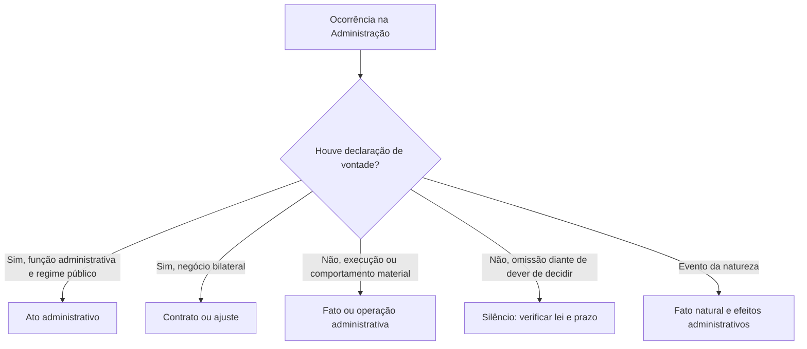

A atividade administrativa se manifesta por decisões, certificações, ordens e operações concretas. Para classificar corretamente cada ocorrência, é preciso separar a declaração que pretende produzir um efeito jurídico da execução material dessa decisão e dos acontecimentos que apenas repercutem na Administração. Essa distinção aparece em questões sobre conceito, fatos administrativos e silêncio. O capítulo apresenta critérios práticos para reconhecer cada figura, inclusive quando a Administração não atua.

> [!objetivos]
> - Definir ato administrativo e identificar seus elementos conceituais.
> - Distinguir atos administrativos de atos da Administração.
> - Reconhecer fatos administrativos voluntários e naturais.
> - Avaliar os efeitos jurídicos do silêncio administrativo.

## Ato administrativo e ato jurídico

Ato jurídico é uma manifestação humana voluntária que se dirige a produzir consequência reconhecida pelo Direito. O ato administrativo é uma espécie dessa categoria, submetida predominantemente ao direito público e praticada no exercício da função administrativa. Em síntese, é uma declaração unilateral da Administração ou de quem exerça função pública delegada, destinada a produzir efeito jurídico imediato e sujeita a controle.

“Unilateral” significa que a declaração estatal basta para formar o ato; a concordância do destinatário não é elemento necessário. Isso não impede que o ato seja provocado por requerimento. A Administração, por exemplo, pode conceder licença solicitada por servidor: a vontade juridicamente decisiva para a concessão é expressa pela autoridade competente. O ato deve ser praticado para finalidade pública, dentro da lei e no âmbito da função administrativa.

A função administrativa não pertence exclusivamente ao Poder Executivo. Quando o Legislativo nomeia servidor ou quando o Judiciário organiza uma licitação, ambos administram seus serviços e praticam atos administrativos. Ao editar lei ou julgar definitivamente um conflito, esses Poderes exercem, respectivamente, função legislativa ou jurisdicional. A natureza da função desempenhada, e não apenas o órgão que age, orienta a classificação.

Um particular também pode praticar ato administrativo quando recebe do Estado uma atribuição pública e atua com as prerrogativas correspondentes. É o caso de delegatário de serviço público que expede documento ou toma providência prevista na delegação. O mesmo particular, ao comprar material para sua empresa privada, age em regime privado e não pratica ato administrativo.

| Critério | Ato administrativo | Contrato administrativo | Ato privado da Administração |
|---|---|---|---|
| Formação da vontade | Em regra, declaração unilateral | Consenso entre partes | Em regra, negócio sujeito ao direito privado |
| Regime predominante | Direito público | Direito público, com elementos consensuais | Direito privado, sem afastar controles públicos |
| Exemplo | Aplicação de sanção funcional | Ajuste de fornecimento | Locação de imóvel pela Administração |

> [!lei] CF, art. 5º, XXXIV, a
> XXXIV - são a todos assegurados, independentemente do pagamento de taxas:
> a) o direito de petição aos Poderes Públicos em defesa de direitos ou contra ilegalidade ou abuso de poder;

> [!pegadinha]
> Nem toda manifestação estatal é administrativa: lei e sentença decorrem de funções típicas diferentes. E nem todo ato unilateral é administrativo: é necessário que se atue na função administrativa, sob regime público e com finalidade juridicamente pertinente.

## Atos da Administração e categorias próximas

“Atos da Administração” é uma expressão ampla para as manifestações e atuações provenientes da Administração. Ela inclui atos administrativos propriamente ditos, mas também negócios de direito privado, contratos, atos políticos, atos normativos, certificações e comportamentos materiais. O critério de origem, sozinho, não transforma todas essas categorias em atos administrativos.

Uma certidão normalmente atesta informação já constante de registro; um parecer apresenta opinião técnica; um voto registra posição em órgão colegiado. São manifestações documentais, mas podem não conter decisão administrativa constitutiva. O efeito e a função concreta precisam ser examinados: um documento que apenas certifica não se confunde com a decisão que concedeu um benefício.

Atos políticos decorrem diretamente da condução constitucional do Estado, como a sanção ou o veto a projeto de lei. Atos normativos administrativos, como regulamentos e resoluções, contêm comandos gerais subordinados à lei. Sua generalidade não os converte em lei formal. Já a Administração pode praticar negócio privado, como aquisição de um bem, ainda sujeita aos requisitos públicos que incidam sobre a contratação.

Exemplo: em um quartel, a autoridade publica uma ordem de serviço que distribui atribuições aos setores. A publicação é manifestação normativa interna. O almoxarife que entrega os equipamentos realiza operação material. Um relatório de vistoria descreve o estado deles; a decisão que determina sua retirada de uso é que pode constituir ato administrativo decisório.

> [!esquema]
> - Atos da Administração: expressão abrangente para manifestações estatais no âmbito administrativo.
> - Ato administrativo: declaração com efeito jurídico, emitida em função administrativa e sob regime público.
> - Atos materiais: execução ou comportamento concreto, sem declaração decisória necessária.
> - Atos políticos e negócios privados: categorias próprias, classificadas conforme função e regime.

## Fatos administrativos

“Fato administrativo” não tem emprego totalmente uniforme na doutrina. Em sentido operacional, identifica-se como atividade material da Administração, como a execução de uma ordem, ou como atuação que produz repercussão jurídica sem ter sido dirigida imediatamente a esse resultado. Há também autores que usam a expressão para acontecimentos naturais com efeitos no campo administrativo. Em prova, observe a definição adotada pelo enunciado e a natureza concreta do evento.

Os fatos voluntários podem decorrer de uma decisão formal ou de uma conduta material. Se a autoridade ordena a interdição de uma área de risco, a ordem é ato; a colocação de barreiras e a retirada de pessoas são execução material. Se uma equipe muda equipamentos de sala sem formalizar uma decisão autônoma, há comportamento administrativo material. O fato não é revogado como uma declaração: pode ser interrompido, corrigido ou reparado por providências adequadas.

Fatos naturais não dependem da vontade administrativa. Uma inundação que danifica instalações públicas, por exemplo, é evento natural com consequências para a gestão: pode exigir registro patrimonial, contratação emergencial quando cabível e reorganização do serviço. A Administração pode editar atos em resposta ao evento, mas o fenômeno em si não é uma declaração de vontade.

A colisão de veículo oficial em serviço ilustra outro uso: a conduta não tem o propósito de gerar obrigação indenizatória, mas pode produzir consequências jurídicas. A Constituição, no art. 37, § 6º, prevê a responsabilidade das pessoas jurídicas de direito público e das prestadoras de serviço público pelos danos que seus agentes, nessa qualidade, causarem a terceiros, com direito de regresso nos casos de dolo ou culpa. A incidência depende dos pressupostos jurídicos do caso concreto.

| Situação | Classificação principal | Razão |
|---|---|---|
| Ordem para evacuar prédio interditado | Ato administrativo | Declaração decisória com efeito jurídico |
| Equipe instala isolamento | Fato/atividade material | Execução concreta da providência |
| Tempestade danifica viatura pública | Fato natural | Evento sem declaração administrativa |
| Parecer recomenda providência | Ato opinativo | Expressa avaliação, não necessariamente decisão final |

> [!atencao]
> A palavra “desapropriação” pode designar, conforme o contexto, a declaração que inicia o procedimento ou a transferência concreta do bem. Em uma questão, determine se o foco está na decisão formal ou na operação executiva.

## Silêncio administrativo

Silêncio administrativo é a falta de pronunciamento quando a Administração tinha o dever de decidir ou responder. Como não há declaração de vontade, a posição doutrinária predominante não o classifica como ato administrativo; trata-o como omissão ou fato jurídico administrativo, quando a omissão repercute juridicamente. A ausência de resposta não equivale automaticamente a deferimento nem a indeferimento.

A consequência imediata depende da norma aplicável. Se a lei atribuir efeito positivo à falta de decisão depois de certo prazo, pode haver aprovação tácita nos limites legais. Se atribuir efeito negativo, o pedido será considerado rejeitado para o efeito previsto. Sem regra específica, não se deve inventar uma aprovação ficta: cabe exigir pronunciamento e, presentes os pressupostos, buscar controle judicial da mora.

No processo administrativo federal, a Lei 9.784/1999 estabelece o dever de decidir nos processos administrativos e sobre solicitações ou reclamações de sua competência (art. 48). Concluída a instrução, há prazo de até 30 dias para decisão, prorrogável por igual período mediante motivação expressa (art. 49). Essa regra federal não deve ser automaticamente aplicada a todo ente federativo sem verificar a legislação própria ou a incidência pertinente.

Se a decisão for vinculada, o Judiciário pode assegurar a observância do dever legal, sem substituir a Administração fora dos limites de controle. Se houver espaço discricionário, a ordem judicial pode exigir decisão tempestiva e motivada, mas não escolher livremente a conveniência administrativa. A omissão injustificada também pode gerar responsabilização funcional e, se houver dano e nexo nos termos aplicáveis, responsabilidade civil.

> [!lei] Lei 9.784/1999, art. 48
> Art. 48. A Administração tem o dever de explicitamente emitir decisão nos processos administrativos e sobre solicitações ou reclamações, em matéria de sua competência.

> [!pegadinha]
> Discricionariedade não dá à Administração liberdade para permanecer indefinidamente sem decidir. O controle da mora pode exigir uma resposta motivada sem que o juiz escolha o conteúdo discricionário no lugar da autoridade.

### Leituras complementares das categorias

A classificação de um acontecimento jurídico depende de identificar a vontade, o sujeito e o efeito pretendido. A maioridade, por exemplo, decorre do tempo e não de uma decisão estatal individual: é fato jurídico natural em sentido amplo, ainda que a lei associe a ele consequências administrativas. Uma autoridade que registra a maioridade em cadastro não cria o fato; apenas atualiza o registro. Já a promessa de recompensa feita por particular depende de manifestação voluntária, mas não se torna ato administrativo só porque pode ter reflexo em processo público.

A teoria geral costuma opor o fato jurídico em sentido estrito, que independe de vontade dirigida a efeitos, ao ato jurídico, que decorre de manifestação voluntária. O ato administrativo acrescenta elementos do regime público e da função administrativa. Nem todo resultado jurídico deriva de vontade humana: um temporal pode causar dano ao patrimônio estatal, e o falecimento de agente pode gerar vacância ou efeitos previdenciários previstos em lei. Nesses exemplos, a Administração registra e trata consequências de fato, sem praticar o acontecimento natural.

A distinção entre unilateral e bilateral também ajuda. Uma decisão disciplinar ou uma ordem de serviço expressa vontade administrativa unilateral; um contrato depende de acordo entre partes, embora a Administração possa dispor de prerrogativas legais específicas. A manifestação de um administrado em requerimento não forma, por si, a decisão final. Ato da Administração abrange ainda atos de direito privado, opiniões técnicas e votos, o que impede reduzir o gênero aos atos administrativos propriamente ditos.

| Manifestação | Há vontade decisória? | Efeito típico | Categoria para análise |
|---|---|---|---|
| Ordem de isolamento expedida pela autoridade | Sim | Impõe uma providência | Ato administrativo |
| Equipe instala barreiras no local | Não necessariamente | Materializa uma ordem | Fato ou operação administrativa |
| Parecer técnico | Há opinião, não decisão final necessária | Orienta a decisão | Ato opinativo da Administração |
| Compra de equipamento por contrato | Há vontades convergentes | Cria obrigações recíprocas | Contrato público |
| Enchente danifica depósito | Não há vontade humana dirigida | Gera repercussões patrimoniais | Fato natural com efeito administrativo |

> [!atencao]
> “Fato administrativo” não tem definição doutrinária única. Se o enunciado adotar um autor ou uma acepção, use-a; depois confira se o exemplo descreve execução material, atuação com efeito indireto ou evento natural.

O silêncio merece uma análise própria porque a omissão pode violar o dever de agir sem ser uma declaração tácita. O art. 5º, XXXIV, da Constituição garante o direito de petição, e a Lei 9.784/1999 determina o dever de decidir dentro do processo federal. Uma pessoa que pede acesso a registro ou resposta sobre requerimento não fica sem tutela apenas porque a autoridade não se pronunciou. A lei específica pode dar efeito positivo ou negativo ao decurso do prazo; sem essa previsão, o controle tende a buscar uma decisão expressa, e não inventar o conteúdo da resposta.

Considere um pedido de certidão necessário para defesa de direito. Se a unidade permanece inerte após prazo legal ou razoável, a omissão pode ser questionada. O efeito não é automaticamente deferir todo pedido: o Poder Público pode ter de reconhecer direito vinculado ou emitir decisão fundamentada quando houver avaliação administrativa. A omissão injustificada pode suscitar responsabilidade funcional; se causar dano juridicamente indenizável e estiverem presentes os requisitos, pode haver responsabilidade estatal.

> [!pegadinha]
> Ato da Administração não é sempre ato administrativo: a primeira expressão inclui atos privados, políticos, materiais e negociais. Uma operação administrativa não vira declaração apenas por produzir consequência jurídica.

> [!bizu]
> Primeiro pergunte “houve manifestação decisória?”; depois “qual função e qual regime?”; por último, “qual efeito jurídico se pretende ou ocorreu?”. Essa sequência separa ato, contrato, parecer, fato e omissão.

### Quadro de identificação rápida

A banca pode descrever um evento sem empregar a terminologia técnica. A pessoa candidata precisa reconstruir a classificação por sinais do caso: quem agiu, se houve vontade declarada, em qual função e qual efeito se produziu. Um ato pode ser interno, individual, discricionário e simples simultaneamente, pois cada classificação responde a eixo próprio. Um fato material pode decorrer de ato anterior, mas conserva natureza de execução.

| Enunciado menciona | Indício de classificação | O que ainda verificar |
|---|---|---|
| Autoridade “decidiu”, “ordenou” ou “concedeu” | Ato administrativo | Competência, regime e finalidade |
| Equipe “executou”, “retirou” ou “instalou” | Fato/atividade material | Existência de ato que orienta a execução |
| Órgão “atestou”, “certificou” ou “opinou” | Ato enunciativo ou opinativo | Se há decisão com efeito constitutivo |
| Administração “contratou” mediante acordo | Ato bilateral | Regime e prerrogativas do ajuste |
| Unidade “não respondeu” a requerimento | Silêncio administrativo | Dever, prazo e efeito previsto em lei |

> [!exemplo]
> A autoridade competente determina que uma área seja interditada após inspeção. O comando formal pode ser ato administrativo; os servidores que colocam fita de isolamento realizam uma operação material. Se a chuva derruba parte do muro antes da decisão, o dano é um evento natural. Se o cidadão protocola pedido e a autoridade não responde, examina-se silêncio e mora.

A classificação não deve ficar presa à forma documental. Um despacho pode conter decisão ou apenas encaminhamento; uma portaria pode ser ato individual ou regra geral; uma certidão pode apenas atestar informação ou, se a lei lhe atribuir efeito próprio, produzir consequência relevante. O efeito e a função exercida devem ser reconhecidos pelo conteúdo concreto, sem confiar apenas no nome do documento.

| Categoria próxima | Vontade direcionada a efeito jurídico? | Exemplo | Síntese |
|---|---|---|---|
| Fato jurídico | Não necessariamente | Nascimento ou decurso do tempo | O Direito associa consequência ao evento |
| Ato jurídico | Sim | Oferta unilateral de recompensa | Há manifestação voluntária |
| Ato administrativo | Sim, na função pública | Ordem de serviço decisória | Regime público e finalidade legal |
| Ato privado estatal | Sim, sob regime de direito privado | Compra sujeita a contrato | Origem estatal não define a espécie |
| Ato bilateral | Convergência de vontades | Contrato de fornecimento | Difere da declaração unilateral |

> [!esquema]
> A sequência gênero–espécie ajuda a ordenar os conceitos: fato jurídico em sentido amplo inclui eventos e atos; ato administrativo é espécie de ato jurídico praticada em função administrativa; ato da Administração é expressão ampla de origem, não um sinônimo técnico.

### Casos para distinguir ato e fato

A apreensão de mercadoria pode designar dois momentos. A decisão que determina a apreensão, fundamentada em competência e norma, é ato administrativo; a retirada física dos itens pelos agentes é atividade material. A demolição de construção interditada segue a mesma lógica: uma ordem formal pode anteceder a operação executiva. A linguagem cotidiana às vezes dá ao conjunto o nome do resultado, por isso a questão pode exigir leitura do contexto para saber se trata da vontade administrativa ou da sua concretização.

A atividade também pode decorrer de uma conduta administrativa sem ato formal antecedente. A Administração pode reorganizar mesas e equipamentos ou transferir material de uma sala para outra como atividade de gestão. Se a mudança produz consequência jurídica indireta, como alteração do local de atendimento, ainda assim não há necessariamente uma declaração com finalidade imediata de criar direito. O fato material e o ato decisório permanecem categorias distintas.

O termo “atos inominados” pode aparecer para decisões sem uma forma legal tipificada com nome específico. A tipicidade exige que o conteúdo unilateral encontre suporte jurídico, mas não significa que cada documento precise ter nomenclatura única em catálogo. A Administração pode expedir instrumentos diversos, desde que a competência, a finalidade, o procedimento e os efeitos sejam juridicamente reconhecíveis. A inversão entre nome e natureza é uma pegadinha: identifica-se pelo conteúdo.

| Caso descrito | Manifestação central | Categoria |
|---|---|---|
| Autoridade decide interditar local | Declaração decisória | Ato administrativo |
| Servidores montam barreira depois da ordem | Execução prática | Fato material |
| Agente colide viatura em serviço | Atuação sem propósito de causar dano | Fato com possível consequência jurídica |
| Particular apresenta requerimento | Manifestação do administrado | Pedido, não decisão estatal |
| Administração deixa de decidir | Omissão diante de dever | Silêncio administrativo |

> [!pegadinha]
> Nem “apreensão” nem “demolição” têm uma classificação invariável fora do contexto. A decisão é ato; sua execução é fato material.

Se a autoridade fixa que o silêncio significará deferimento tácito, esse resultado decorre da lei, não de uma manifestação subjetiva que ocorreu no pensamento do agente. Se a consequência é denegatória, também se trata de efeito atribuído pela norma. O direito administrativo pode reconhecer efeitos jurídicos sem converter toda omissão em ato expresso. A pessoa deve analisar o prazo, o dever de decidir e a possibilidade de pleitear resposta ou tutela judicial.

Uma empresa que presta serviço público pode praticar atos administrativos dentro da delegação e de suas prerrogativas públicas. Isso não significa que toda ação de seus empregados seja um ato estatal: atos internos privados sem exercício de função pública seguem outro regime. É preciso identificar a tarefa delegada e o vínculo entre decisão e prestação do serviço. Empresas privadas que apenas vendem insumo à Administração não se tornam delegatárias por esse fato.

Os conceitos relacionados podem ser comparados pela existência de vontade, pelo modo de produção e pela consequência. O fato jurídico em sentido amplo abrange eventos naturais e manifestações voluntárias. O ato jurídico depende de manifestação humana dirigida a efeito, e contrato envolve manifestação convergente de mais de uma parte. O ato administrativo está situado no campo da função pública e opera sob regras próprias. A simples origem em órgão estatal não basta para classificar negócio privado ou opinião técnica como ato administrativo.

| Termo | Elemento decisivo | Resultado |
|---|---|---|
| Fato jurídico estrito | Evento independente de vontade dirigida | Consequência jurídica atribuída pela norma |
| Ato jurídico | Manifestação humana voluntária | Mudança jurídica pretendida |
| Ato administrativo | Declaração na função administrativa | Efeito sob regime de direito público |
| Fato administrativo | Atuação ou evento com repercussão administrativa | Operação ou consequência sem declaração decisória |

> [!exemplo]
> A Administração pode registrar o nascimento de dependente, mas não causa o nascimento. Pode reconhecer efeitos funcionais depois de requerimento, e esse reconhecimento é uma decisão administrativa separada do fato natural que lhe deu origem.
## Mapa do capítulo

| Pergunta de identificação | Resposta útil |
|---|---|
| Há declaração unilateral com efeito jurídico, sob regime público? | Indício de ato administrativo |
| É apenas execução material? | Fato ou operação administrativa |
| É manifestação de órgão estatal em função típica legislativa ou judicial? | Ato legislativo ou judicial |
| A Administração deixou de responder? | Silêncio/omissão; verificar lei, prazo e dever de decidir |
| A atuação foi de delegatário em função pública? | Pode haver ato administrativo, dentro da delegação |

### Para fixar
- Ato administrativo é declaração no exercício da função administrativa, regida predominantemente pelo direito público.
- Legislativo e Judiciário também praticam atos administrativos quando administram.
- Atos da Administração é gênero mais amplo que ato administrativo.
- Ato administrativo é unilateral; contrato resulta de consenso.
- Ato material executa providência, sem necessariamente declarar vontade jurídica.
- Fato administrativo pode ser voluntário ou natural, conforme o uso doutrinário.
- Silêncio não produz automaticamente deferimento ou indeferimento.
- No processo federal, os arts. 48 e 49 da Lei 9.784/1999 tratam do dever e do prazo para decidir.

