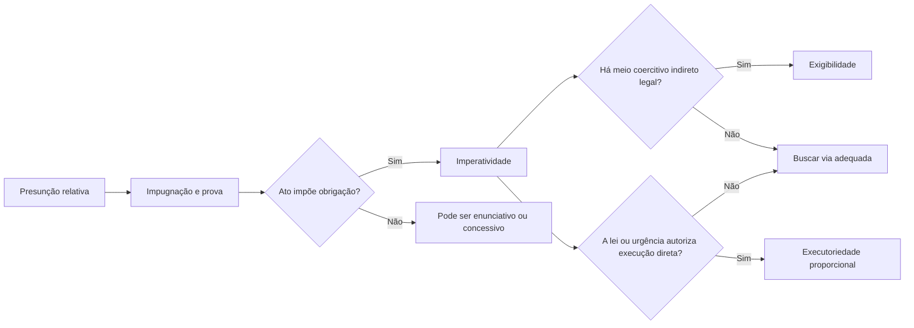
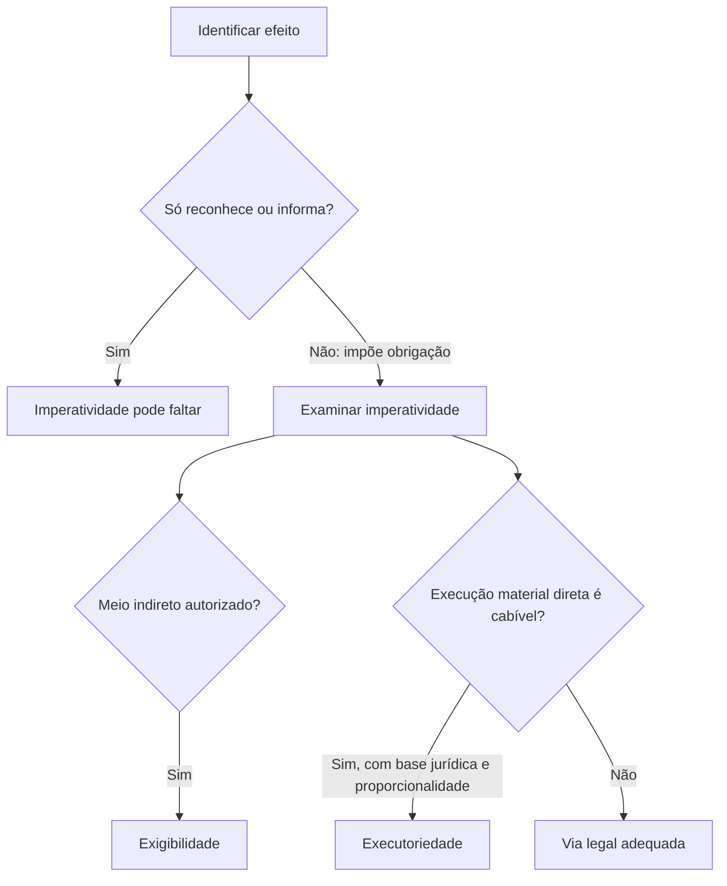

Os atributos são características que o regime jurídico associa a determinados atos administrativos para viabilizar o exercício da função pública. Eles explicam por que certas decisões produzem efeitos sem concordância do destinatário ou podem ser executadas pela própria Administração. Não são requisitos de validade, e não aparecem todos em qualquer ato. Distingui-los dos elementos do ato é essencial para evitar trocas comuns em prova.

> [!objetivos]
> - Explicar presunção de legitimidade e de veracidade.
> - Diferenciar imperatividade, exigibilidade e executoriedade.
> - Identificar tipicidade e seus limites.
> - Reconhecer quais atributos podem faltar em um ato.

## Presunção de legitimidade e de veracidade

A presunção de legitimidade indica que o ato é tido como compatível com o Direito enquanto não for invalidado. A presunção de veracidade, por sua vez, recai sobre os fatos que a Administração registra ou afirma no exercício de suas atribuições. Parte da doutrina aproxima os termos ou os trata conjuntamente; em questões que os distinguem, associe legitimidade à conformidade jurídica e veracidade à correspondência dos fatos.

A presunção é relativa, isto é, admite prova em contrário. Ela permite que a atividade administrativa prossiga sem que todo ato dependa de validação judicial prévia, mas não torna o ato imune ao controle. Em regra, quem questiona apresenta elementos para afastar a presunção; isso não elimina o dever da Administração de instruir e motivar suas decisões nem autoriza ignorar prova relevante.

Imagine que uma equipe de fiscalização registre que um estabelecimento bloqueou uma rota de saída. O auto formalizado tem presunção relativa de legitimidade e veracidade. O interessado pode contestar a descrição, apresentar imagens e pedir análise. Se demonstrar que o registro não corresponde ao que ocorreu, a Administração deve rever a conclusão; a presunção não transforma um fato falso em verdadeiro.

A presunção também não significa que todos os atos sejam executórios, imperativos ou válidos em definitivo. Ela é atributo distinto. A existência do ato e sua eficácia podem ser discutidas conforme o regime próprio, mas a Administração não precisa obter sentença declaratória de validade para cada providência ordinária.

> [!pegadinha]
> “Presunção absoluta” é afirmação errada. A presunção não impede impugnação administrativa ou judicial, nem dispensa a Administração de corrigir ilegalidades comprovadas.

## Imperatividade e exigibilidade

Imperatividade é a possibilidade de o ato impor obrigação ao destinatário independentemente de sua anuência. Uma ordem de desocupação baseada em risco, emitida por autoridade competente, pode criar dever para quem ocupa o local. O efeito impositivo decorre do poder público e dos limites legais, não de um acordo com o particular.

Nem todo ato contém imperatividade. Uma certidão que informa dado já registrado, um ato enunciativo e uma licença que reconhece situação requerida não necessariamente impõem dever a terceiro. A imperatividade é mais visível em ordens e sanções. Mesmo quando presente, precisa respeitar competência, finalidade, forma, motivo e objeto lícitos.

Exigibilidade é a possibilidade de a Administração pressionar o cumprimento por meios indiretos, como multa coercitiva quando houver autorização legal. Não se confunde com imperatividade: uma norma pode impor obrigação sem que a autoridade disponha, naquele caso, de todo meio coercitivo imaginável. A multa deve ter fundamento normativo e respeitar o procedimento e a defesa cabíveis.

Exemplo: a autoridade determina que um depósito desobstrua saída de emergência. A ordem é imperativa se válida. A previsão de multa diária legalmente autorizada pode servir como meio de exigibilidade. A Administração não pode inventar sanção ou seu valor apenas porque a ordem não foi obedecida.

> [!esquema]
> - Imperatividade: cria obrigação unilateral para o destinatário.
> - Exigibilidade: emprega coerção indireta juridicamente autorizada.
> - Presunção: atribui estabilidade inicial ao ato e aos fatos nele registrados.
> - São ideias diferentes e podem coexistir sem que uma implique automaticamente a outra.

## Autoexecutoriedade

Autoexecutoriedade é a possibilidade de a Administração executar materialmente certas decisões por seus próprios meios, sem ordem judicial prévia, quando houver autorização legal ou situação urgente que a justifique nos limites reconhecidos pelo Direito. O atributo não autoriza violência ou medida desproporcional: a execução deve respeitar os direitos fundamentais, a necessidade e o procedimento aplicável.

A doutrina costuma decompor a autoexecutoriedade em exigibilidade e executoriedade. A exigibilidade usa meios indiretos de coerção; a executoriedade permite a execução direta da medida material. Essa distinção é útil: uma multa pode pressionar o cumprimento, mas sua cobrança forçada sobre o patrimônio segue o processo legal de cobrança, não uma apreensão arbitrária de bens pela Administração.

Em uma emergência estrutural, a autoridade pode ordenar a interdição e, se houver risco concreto e competência, retirar pessoas da área para protegê-las. Já a cobrança de multa vencida não permite que agentes simplesmente retirem dinheiro do administrado. Sem hipótese de execução direta, a Administração deve recorrer aos meios legais, inclusive à via judicial quando necessária.

| Atributo | O que permite | Exemplo | Limite central |
|---|---|---|---|
| Presunção | Eficácia inicial e credibilidade relativa | Auto de fiscalização | Admite prova em contrário |
| Imperatividade | Imposição unilateral | Ordem de evacuação | Exige competência e base jurídica |
| Exigibilidade | Coerção indireta | Multa coercitiva prevista em lei | Sanção não pode ser inventada |
| Executoriedade | Execução material direta | Isolamento urgente de área perigosa | Lei ou urgência e proporcionalidade |

> [!atencao]
> Imperatividade não é sinônimo de autoexecutoriedade. A Administração pode impor um dever e, ainda assim, precisar da via judicial para obter determinada execução patrimonial.

## Tipicidade

Tipicidade significa que o ato unilateral deve corresponder a uma figura previamente admitida pelo ordenamento, com elementos e efeitos reconhecíveis. A Administração não dispõe da mesma liberdade negocial de um particular para criar, sem base normativa, uma nova espécie de comando unilateral contra alguém. O princípio protege a previsibilidade e limita o exercício do poder.

A lei pode estabelecer, por exemplo, licença, autorização, sanção ou interdição, cada qual com pressupostos e efeitos próprios. A autoridade deve enquadrar a situação na categoria adequada e observar as condições legais. A tipicidade não exige que todo ato tenha nome expresso em lei; exige que sua natureza, competência e efeitos encontrem suporte jurídico.

Os atributos são tradicionalmente apontados como presunção de legitimidade/veracidade, imperatividade, autoexecutoriedade e tipicidade. A lista é doutrinária, e certos autores classificam exigibilidade como componente da autoexecutoriedade ou como atributo autônomo. A prova pode adotar uma taxonomia: leia o comando e não transforme diferença de arrumação conceitual em contradição material.

> [!bizu]
> Para memorizar a função, pergunte: o ato é inicialmente tido como válido? (presunção); impõe dever? (imperatividade); pressiona o cumprimento? (exigibilidade); executa diretamente? (executoriedade); corresponde a figura jurídica reconhecida? (tipicidade).

### Presunção e revisão administrativa

A presunção inicial tem uma consequência prática: o destinatário pode ter de impugnar o ato e apresentar elementos que contrariem a descrição administrativa. Isso não significa que todo procedimento probatório transfira integralmente ao cidadão o ônus de provar o que a Administração deve apurar. A autoridade deve formar convicção com base em documentos, vistoria e demais provas pertinentes, e deve enfrentar os argumentos relevantes. A presunção não dispensa motivação, defesa quando cabível nem o dever de correção.

Quando a Administração constata que o ato é ilegal, deve examinar a anulação nos termos da Lei 9.784/1999; se o ato válido deixou de atender à conveniência, a categoria é revogação. A existência da presunção não impede nenhum desses caminhos. Ela também não responde se uma execução material pode ocorrer: é preciso verificar imperatividade, exigibilidade e autoexecutoriedade em separado.

Em caso de autoexecutoriedade, o meio direto precisa ser necessário e adequado à finalidade. Se a Administração pode cumprir a decisão com uma providência menos gravosa, não deve escolher a mais intensa apenas por facilidade. A urgência pode justificar atuação imediata para preservar segurança, mas a autoridade deve registrar fatos, limitar o alcance e permitir revisão posterior. A força não é atributo ilimitado nem licença geral para invadir domicílio, apreender patrimônio ou impor sanção sem processo.

| Situação prática | Atributo mais relacionado | Pergunta de cautela |
|---|---|---|
| Auto de infração é presumido regular | Presunção | Há prova capaz de afastar o registro? |
| Ordem cria dever de desocupar | Imperatividade | A norma confere competência e prevê a ordem? |
| Multa pressiona a cessação de conduta | Exigibilidade | Há lei que autoriza a medida coercitiva? |
| Equipe remove obstáculo perigoso | Executoriedade | Existe lei ou urgência e a ação é proporcional? |
| Certidão informa dado cadastral | Em regra, sem imperatividade | É declaração decisória ou apenas enunciativa? |

> [!exemplo]
> Durante inspeção de uma base, a fiscalização identifica cabo atravessando corredor de evacuação. A ordem para liberar a passagem pode impor obrigação. Multa só cabe se houver previsão e rito; remoção imediata pela equipe depende da competência e das condições de segurança. O auto de vistoria é contestável por prova, ainda que se presuma correto inicialmente.

> [!pegadinha]
> A presunção trata da posição inicial do ato; imperatividade, da imposição de dever; exigibilidade, da coerção indireta; executoriedade, da execução direta. Uma característica não prova automaticamente a presença das demais.

### Comparação dos atributos na aplicação

O enunciado pode misturar definições em uma mesma alternativa. A presunção de veracidade não é imperatividade; a primeira trata da credibilidade inicial dos fatos afirmados, enquanto a segunda impõe dever. Autoexecutoriedade não significa simplesmente que a Administração pode decidir: ela exige execução material direta em hipótese autorizada. Tipicidade tampouco é “adequação ao bom costume” em sentido livre; é correspondência do ato unilateral a figuras e efeitos reconhecidos pelo ordenamento.

| Proposição | Avaliação | Correção conceitual |
|---|---|---|
| Todo ato é imperativo | Falsa | Atos enunciativos ou favoráveis podem não impor dever |
| Todo ato é autoexecutório | Falsa | Execução direta depende de lei ou urgência reconhecida |
| Presunção torna prova impossível | Falsa | A presunção é relativa e pode ser afastada |
| Exigibilidade usa coerção indireta | Correta | Exemplo é multa coercitiva com base legal |
| Executoriedade permite execução material | Correta com limites | Deve haver hipótese autorizadora e proporcionalidade |

A Administração pode compelir um destinatário a cumprir obrigação com meios indiretos previstos em norma, mas a cobrança forçada de valores deve seguir o rito próprio. A exigibilidade não permite penhorar por conta própria patrimônio do administrado. Para medidas urgentes de segurança, a execução direta pode ser indispensável, mas a autoridade deve registrar a situação e usar a ação menos gravosa capaz de proteger pessoas e bens.

> [!lei] CF, art. 37, caput
> Art. 37. A administração pública direta e indireta de qualquer dos Poderes da União, dos Estados, do Distrito Federal e dos Municípios obedecerá aos princípios de legalidade, impessoalidade, moralidade, publicidade e eficiência (...)

> [!atencao]
> Uma decisão pode ser imperativa sem ser executória. A possibilidade de impor dever não responde, sozinha, como a obrigação será coercitivamente satisfeita.

### Atributos e efeitos sobre terceiros

A presunção de legitimidade facilita a continuidade dos serviços porque o ato administrativo não precisa aguardar ação declaratória antes de ser cumprido. Essa ideia não elimina remédios administrativos e judiciais. O interessado pode provar erro no registro, questionar a competência e discutir a norma aplicada. A Administração deve reexaminar a alegação e suspender a execução quando o ordenamento ou a autoridade competente assim determinar. A presunção organiza a posição inicial; não substitui julgamento imparcial.

Imperatividade costuma aparecer em atos extroversos, que projetam efeitos sobre pessoas fora da estrutura administrativa. Um ato interno de organização pode impor deveres a servidores, mas sua relação jurídica é distinta da obrigação dirigida ao público. Ato negocial favorável e ato enunciativo podem não conter comando imperativo. O fato de o destinatário receber documento ou ser informado de uma decisão não significa, por si, que lhe foi imposta uma obrigação.

A exigibilidade envolve medidas indiretas para que a ordem seja obedecida. Multas coercitivas dependem de base normativa, competência e procedimento. A Administração não pode criar penalidade inominada sob o pretexto de tornar seu comando efetivo. A executoriedade é mais intensa porque permite ação material direta, mas depende de previsão legal ou urgência que justifique a providência. Mesmo nesse caso, a medida deve guardar correspondência com o risco e parar quando cessar a necessidade.

> [!exemplo]
> A autoridade determina que veículos não parem em frente à saída de ambulâncias. A sinalização e a ordem dão publicidade ao dever; uma multa requer previsão e procedimento; a remoção imediata de veículo pode depender de autorização legal e circunstância concreta. Cada etapa corresponde a questão diferente de atributo e execução.

A tipicidade protege previsibilidade, mas não deve ser confundida com tipificação penal. O ato administrativo deve encontrar forma jurídica e efeito reconhecidos por lei ou pelo sistema normativo, sem que a Administração invente poder unilateral. A mesma figura pode admitir conteúdo individual ou geral se a norma permitir. Uma denominação administrativa não convalida ato que ultrapassa o poder concedido.

O destinatário pode impugnar não só o fundamento da decisão, mas também o modo de execução. Uma ordem válida pode ser cumprida de forma desproporcional; a execução excessiva pode gerar responsabilidade e dever de reparação. A guarda do bem público não autoriza agressão além do necessário. O agente deve registrar motivo, alcance, meios empregados e circunstância emergencial para que a medida seja controlável.

> [!esquema] Prerrogativas sob os princípios (CF, art. 37, caput)
> - Os atributos do ato não afastam os cinco princípios do art. 37: valem para toda a administração direta e indireta.
> - A prerrogativa de executar a decisão também se submete a legalidade, impessoalidade, moralidade, publicidade e eficiência.
> - Excesso no modo de execução é controlável e pode gerar dever de reparar.

### Escolha do meio de execução

A Administração deve identificar se a obrigação será satisfeita voluntariamente, por coerção indireta ou por execução direta. Uma ordem pode conceder prazo e prever consequência legal para o descumprimento; isso não autoriza desde logo qualquer medida de força. Se o risco for imediato, uma equipe pode agir para impedir dano, mas precisa limitar a intervenção à proteção necessária. A urgência deve ser demonstrável e não pode virar uma exceção permanente às garantias.

O rótulo “autoexecutório” não encerra a questão jurídica. A autoridade deve verificar a competência, a base normativa, a urgência, a adequação e a proporcionalidade do meio. Se for possível isolar uma zona de perigo sem destruir bens, deve preferir essa medida menos gravosa. Se a execução exigir invasão domiciliar, apreensão patrimonial ou outra intervenção especialmente protegida, é necessário observar as garantias constitucionais e o procedimento legal, inclusive ordem judicial quando exigida.

> [!exemplo]
> Um equipamento defeituoso ameaça parar o atendimento de emergência. O gestor pode determinar que a unidade retire o aparelho de uso imediatamente, se tiver competência e registrar o risco. Para impor multa ao fornecedor ou executar garantia, deve seguir contrato e legislação; autoexecutoriedade não elimina o procedimento.

| Critério de execução | Meio possível | Garantia a observar |
|---|---|---|
| Descumprimento sem urgência | Notificação e prazo | Defesa e norma aplicável |
| Resistência a dever com multa prevista | Coerção indireta | Processo e base legal da multa |
| Risco imediato à segurança | Medida direta limitada | Necessidade e registro dos fatos |
| Cobrança forçada de valor | Via própria de cobrança | Devido processo e competência legal |
Atributos são diferentes dos elementos de validade. Competência, finalidade, forma, motivo e objeto definem a validade; presunção, imperatividade, exigibilidade e executoriedade descrevem prerrogativas. Uma certidão correta pode ter presunção de veracidade sem criar dever. Uma ordem de serviço pode impor obrigação sem permitir execução direta. A classificação depende do efeito e da base jurídica do caso concreto.

| Expressão | Atributo | Limite |
|---|---|---|
| Presumem-se verdadeiros | Veracidade | Admite prova em contrário |
| Impõe obrigação | Imperatividade | Não existe em todo ato |
| Pressiona cumprimento | Exigibilidade | Requer autorização legal |
| Executa materialmente | Executoriedade | Lei ou urgência e proporcionalidade |

## Mapa do capítulo

| Questão | Atributo associado |
|---|---|
| Ato vale inicialmente até impugnação? | Presunção relativa de legitimidade |
| Fato descrito pela fiscalização é tido como verdadeiro inicialmente? | Presunção de veracidade |
| Dever independe de aceitação? | Imperatividade |
| Há coerção indireta legal para cumprir? | Exigibilidade |
| Medida pode ser executada diretamente? | Executoriedade, nos limites jurídicos |
| Ato corresponde a tipo admitido pelo ordenamento? | Tipicidade |

### Para fixar
- Presunção de legitimidade e de veracidade é relativa.
- Legitimidade se refere à conformidade jurídica; veracidade, aos fatos.
- Imperatividade impõe dever sem depender de concordância.
- Atos enunciativos nem sempre são imperativos.
- Exigibilidade é coerção indireta autorizada.
- Executoriedade é execução material direta em hipóteses admitidas.
- Autoexecutoriedade não afasta controle judicial nem proporcionalidade.
- Tipicidade vincula o ato unilateral a figuras jurídicas reconhecidas.

