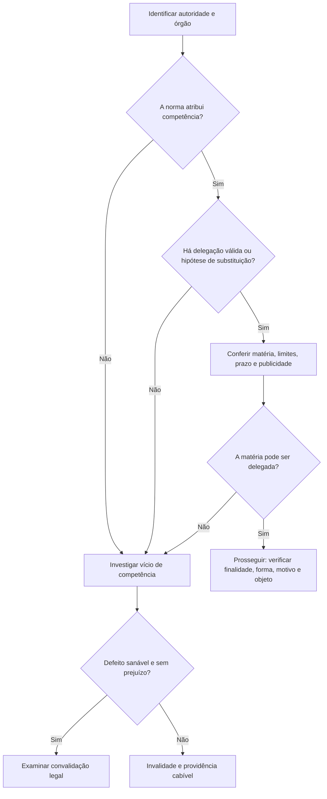

Para analisar a validade de um ato, a doutrina utiliza cinco elementos: competência, finalidade, forma, motivo e objeto. A sigla CO-FI-FO-MO-OB ajuda a recordar a lista, mas não substitui a análise de cada requisito. Este capítulo introduz o conjunto e aprofunda competência, sujeito que pratica o ato, além de forma e finalidade. Motivo e objeto serão desenvolvidos no capítulo seguinte.

> [!objetivos]
> - Enumerar e definir os cinco elementos do ato administrativo.
> - Identificar competência, delegação e avocação.
> - Diferenciar finalidade geral e finalidade específica.
> - Reconhecer a forma como exteriorização jurídica da decisão.

## Os cinco elementos

Competência é o conjunto de atribuições que a norma confere ao agente ou órgão para atuar. Finalidade é o resultado público que a lei pretende alcançar; em qualquer ato, há interesse público como finalidade geral e um objetivo específico associado à competência usada. Forma é o modo de exteriorização da vontade. Motivo corresponde aos pressupostos de fato e de direito que justificam o ato. Objeto é seu efeito jurídico imediato, isto é, o que decide, cria, altera, reconhece ou extingue.

A distinção entre motivo e objeto é recorrente: o motivo explica por que a decisão pode ser tomada; o objeto informa o que a decisão determina. Em uma licença, o motivo pode ser a comprovação de requisitos legais e o objeto é autorizar a atividade. Em uma sanção, o motivo é a infração comprovada e o objeto é a penalidade aplicada.

A doutrina costuma dizer que competência, finalidade e forma são elementos vinculados em sua estrutura básica. Motivo e objeto podem ter margem discricionária quando a lei permitir avaliação administrativa. Isso não significa que a autoridade possa escolher competência, desviar finalidade ou ignorar forma essencial. E, mesmo nos atos discricionários, há parcelas vinculadas.

| Elemento | Pergunta de controle | Exemplo |
|---|---|---|
| Competência | Quem pode praticar? | Autoridade com atribuição disciplinar |
| Finalidade | Para que a lei autorizou? | Proteger a disciplina e o serviço |
| Forma | Como a vontade se manifesta? | Decisão escrita e motivada quando exigida |
| Motivo | Quais fatos e regras sustentam? | Conduta comprovada e regra aplicável |
| Objeto | Qual efeito foi determinado? | Advertência ou outra consequência cabível |

## Competência e sujeito

A competência nasce da norma e não da vontade pessoal do agente. Ela distribui atribuições entre órgãos e autoridades, estabelecendo matéria, território, grau hierárquico e momento de atuação, entre outros critérios. Como regra, é de exercício obrigatório, irrenunciável e vinculada à lei. Um agente não pode escolher atribuir a si próprio poder que a norma não lhe concedeu.

A Lei 9.784/1999 prevê que um órgão e seu titular podem delegar parte da competência a outros órgãos ou titulares, ainda que não sejam subordinados hierarquicamente, quando não houver impedimento legal (art. 12). A delegação deve indicar matérias, poderes, limites, duração, objetivos e recurso cabível, além de ser publicada (art. 14). O ato praticado por delegação menciona essa qualidade e considera-se editado pelo delegado. A delegação é revogável a qualquer tempo pela autoridade delegante.

A própria Lei 9.784/1999 veda a delegação da edição de atos normativos, da decisão de recursos administrativos e de matérias de competência exclusiva (art. 13). A avocação é diferente: órgão superior chama temporariamente para si competência de órgão inferior, em caráter excepcional, por motivos relevantes justificados e dentro dos limites legais (art. 15). Não se presume nem delegação nem avocação.

Imagine que a norma atribua ao comandante de unidade a autorização de afastamentos curtos. Se houver delegação publicada para um substituto, este poderá decidir nos limites indicados. O substituto não pode, porém, decidir recurso reservado ou matéria exclusiva. Se o superior tomar temporariamente a decisão que cabia ao inferior, deve justificar a medida excepcional e respeitar a competência legal.

> [!lei] Lei 9.784/1999, art. 11
> Art. 11. A competência é irrenunciável e se exerce pelos órgãos administrativos a que foi atribuída como própria, salvo os casos de delegação e avocação legalmente admitidos.

O artigo resume a lógica da seção: a competência pertence ao órgão por força da lei, e só a própria lei abre as duas exceções. A delegação pode alcançar órgão não subordinado (art. 12), deve ser publicada e é revogável a qualquer tempo (art. 14).

> [!pegadinha]
> Delegação não transfere a titularidade da competência: transfere o exercício dentro de limites. A competência exclusiva e as matérias do art. 13 não podem ser delegadas.

## Finalidade pública

Finalidade limita o uso do poder administrativo. O agente deve buscar o fim que a lei definiu para a competência, bem como o interesse público correspondente. A finalidade não é uma autorização genérica para que o agente escolha qualquer resultado que lhe pareça bom. O fim específico pode ser diferente de uma fórmula abstrata como “interesse público”: uma licença, uma sanção e uma autorização servem a propósitos legais distintos.

Há desvio quando a autoridade usa competência existente para perseguir finalidade estranha à prevista, mesmo que o ato tenha aparência regular. Se uma chefia desloca servidor sem necessidade de serviço, apenas para puni-lo por crítica legítima, o problema não se resolve pela competência formal para organizar a lotação: a finalidade foi desviada. O exame pode exigir prova de circunstâncias, motivação e contexto.

Finalidade é elemento vinculado. O mérito administrativo não permite escolher o fim do ato. A conveniência e a oportunidade eventualmente existentes dizem respeito à avaliação autorizada pela lei, sem afastar finalidade legal, impessoalidade e moralidade. A Constituição, no art. 37, caput, submete a Administração aos princípios da legalidade, impessoalidade, moralidade, publicidade e eficiência.

## Forma e exteriorização

Forma é a exteriorização juridicamente adequada da decisão. A forma escrita predomina na atividade administrativa por permitir registro, motivação, publicidade e controle; podem existir meios eletrônicos e formas orais ou materiais quando a natureza do ato e a norma os admitirem. Forma não se confunde com formalidade vazia: requisito procedimental essencial protege direitos e a própria regularidade da decisão.

A Lei 9.784/1999 dispõe que os atos do processo administrativo podem adotar forma compatível com o processo, exceto quando uma lei prescrever forma específica (art. 22), e estabelece requisitos gerais de documentação, como data, local e assinatura da autoridade responsável, ressalvadas hipóteses pertinentes. A Administração deve adotar formas simples suficientes para garantir certeza e respeito aos direitos dos administrados. O processo pode ser eletrônico conforme legislação aplicável.

Nem todo defeito formal tem a mesma consequência. A falta de forma essencial pode invalidar o ato; uma irregularidade sem prejuízo e sanável pode admitir correção, se não houver impedimento legal e forem preservados direitos. Uma autorização verbal em situação em que a lei exige decisão formal e escrita não pode ser tratada como equivalente sem examinar a norma. Por outro lado, erro material corrigível não torna automaticamente nulo todo o procedimento.

> [!exemplo]
> Uma autoridade decide interdição de prédio por risco. O agente precisa ter competência; a finalidade é proteger pessoas; a forma deve observar os requisitos aplicáveis; o motivo é a situação de risco prevista nas normas; e o objeto é a interdição. Se o motivo existe, mas a decisão foi tomada por autoridade sem atribuição, ainda há vício de competência.

### Competência no cotidiano administrativo

A competência pode ser analisada por matéria, hierarquia, território e tempo. A atribuição material indica o assunto que o órgão pode decidir; a territorial delimita a área de atuação; a hierárquica distribui tarefas entre níveis; a temporal pode depender da investidura e da duração legal da atribuição. Ato praticado por servidor capaz, mas sem a competência funcional necessária, pode ser inválido. Capacidade civil e competência administrativa não são sinônimos.

A competência é irrenunciável, mas a lei permite delegar parte de seu exercício, nos limites e condições publicados. A delegação pode ocorrer entre órgãos ou titulares sem subordinação, desde que não haja impedimento legal. Não se delega a decisão de recurso administrativo, matéria de competência exclusiva nem edição de ato normativo nos termos do art. 13 da Lei 9.784/1999. Avocar não é o inverso automático da delegação: exige superioridade hierárquica, excepcionalidade, prazo temporário e motivos relevantes justificados.

As expressões “inderrogável” e “intransferível” descrevem o fato de que a competência não muda por acordo particular ou pela simples inércia do titular. Isso não apaga a delegação autorizada por lei, que permite exercício por outro agente sem alterar a titularidade. Uma autoridade pode revogar a delegação conforme as regras aplicáveis; o delegado não passa a ser titular da atribuição. Competência exclusiva e repartição legal não podem ser alteradas por conveniência interna.

O vício de competência pode ser sanável em algumas situações, por exemplo, quando não se trata de atribuição exclusiva e a lei admite ratificação pela autoridade competente, desde que a convalidação não prejudique terceiros nem o interesse público. O defeito de competência em razão da matéria ou de atribuição exclusiva tende a ser insanável. Usurpação de função, em que pessoa sem vínculo ou investidura exerce função pública, não se equipara a mera irregularidade formal que se cure por despacho posterior.

| Critério de competência | Delimita | Situação que pode revelar vício |
|---|---|---|
| Matéria | Assunto e tipo de decisão | Setor técnico aplica sanção fora da atribuição |
| Hierarquia | Nível decisório e revisão | Agente inferior assume competência exclusiva do superior |
| Território | Área de atuação | Órgão decide fora da circunscrição permitida |
| Tempo | Vigência da investidura ou delegação | Decisão depois de cessada a atribuição |

> [!atencao]
> Não trate toda incompetência como sanável. Verifique se a atribuição é exclusiva, se o defeito pode ser ratificado e se a correção preserva terceiros e o interesse público.

A forma, por sua vez, pode ser essencial ou apenas instrumental. Uma decisão de sanção costuma exigir registro formal que indique autoridade, fatos, regra e conclusão. A informalidade admitida pelo processo administrativo federal simplifica procedimentos, mas não elimina a exigência de forma prevista em lei nem permite suprimir defesa ou motivação. Meio eletrônico é forma de exteriorização, não ausência de forma.

Finalidade deve ser examinada mesmo quando competência e forma estão corretas. Um ato assinado pelo comandante adequado, na forma regular, pode continuar inválido se a medida buscou retaliação. O princípio da impessoalidade do art. 37 da Constituição impede que a função seja usada para favorecer ou prejudicar alguém por razões estranhas ao serviço. A finalidade pode ser inferida do contexto e dos efeitos, mas a conclusão deve estar apoiada em elementos objetivos.

> [!exemplo]
> Uma coordenadora regional recebe delegação escrita para autorizar afastamentos de curta duração. Ela não pode decidir recurso contra sua própria decisão nem editar norma geral se a lei reserva essas matérias. Se uma decisão ordinária foi assinada por outro servidor sem delegação, a Administração deve avaliar a natureza da atribuição e a possibilidade legal de ratificação antes de concluir pela convalidação.

| Ato ou situação | Dimensão horizontal | Dimensão vertical | Efeito sobre competência |
|---|---|---|---|
| Repartição de atribuições entre dois setores | Matérias distintas | Mesmo nível hierárquico | Cada setor fica limitado ao seu campo |
| Distribuição entre chefia e unidade | Pode haver especialização | Relação de subordinação | Superior exerce poderes nos limites normativos |
| Delegação de tarefa autorizada | Pode alcançar outro órgão | Pode haver ou não subordinação | Exercício delegado, titularidade preservada |
| Avocação excepcional | Não amplia matéria | Superior assume temporariamente tarefa inferior | Exige motivo relevante e justificativa |

A separação horizontal entre áreas evita que a disponibilidade de servidores ou equipamentos seja confundida com atribuição decisória. A chefia pode coordenar e supervisionar, mas não apagar divisão legal de competência. O fracionamento interno da execução pode ser organizacional; não pode transferir a outro órgão decisão exclusiva. Uma diretora ou coordenadora deve atuar dentro da delegação, sem criar competência por costume.

A delegação pode ser parcial e delimitar objeto, duração e recurso; a avocação é temporária. Competência é irrenunciável e, como regra, improrrogável por vontade das partes. Mesmo que uma unidade pratique atos ao longo de muitos anos, o costume não sana falta de atribuição legal. A forma de atuação deve estar pronta e documentada antes da decisão, com ciência dos agentes e publicidade quando exigida.

> [!bizu]
> “Quem exerce” e “quem é titular” são perguntas diferentes. Delegação altera o exercício por certo período; não muda a origem legal da competência.

| Decisão ou formalidade | Pergunta para o agente | Resultado do controle |
|---|---|---|
| Aprovação por autoridade superior | A aprovação completa a vontade ou apenas verifica o ato? | Complexo ou composto, conforme sua função |
| Publicação oficial | É requisito de formação ou eficácia? | Não presumir sem consultar a norma |
| Assinatura eletrônica | Identifica autoria e integridade? | Forma eletrônica pode ser válida |
| Notificação individual | O interessado precisava participar? | Omissão pode gerar prejuízo e invalidação |
| Parecer técnico | É vinculante ou opinativo? | Distinguir instrução de decisão final |

> [!exemplo]
> Uma decisão sobre segurança em área de risco atravessa setores técnico, jurídico e operacional. A equipe de engenharia pode apresentar laudo; a assessoria jurídica pode opinar; a autoridade com competência decide; a equipe operacional executa. Opinião, decisão e execução não se confundem, ainda que componham uma mesma sequência administrativa.

### Controle da investidura e da forma

A formação regular começa pela investidura do sujeito. Um agente nomeado, designado ou substituto deve exercer apenas as atribuições conferidas ao cargo e às normas de organização. Um particular pode exercer função delegada, mas precisa estar investido na atividade e respeitar seu alcance. Usurpador de função não se torna competente porque administrados obedeceram às ordens ou porque o órgão precisava agir com rapidez.

A delegação deve ser formal e publicizada de modo que o administrado saiba quem decide e possa identificar o fundamento. Ela não inclui competências que a lei exclui, nem permite delegar toda a estrutura decisória sem limites. A competência exclusiva é um limite material; recurso administrativo e ato normativo são limites específicos. A autoridade pode delegar parte da atividade, mas deve manter a possibilidade de acompanhamento e revogar a delegação quando necessário.

Na avocação, o superior chama temporariamente para si matéria que cabia ao inferior. É exceção, não instrumento de rotina para retirar toda a competência da unidade subordinada. A decisão deve indicar razões relevantes, prazo e matéria abrangida. Se a lei não admite avocação em determinado caso, a hierarquia por si só não resolve a proibição. O mesmo raciocínio vale para relações entre órgãos sem subordinação: não se presume poder hierárquico horizontal.

A forma permite conservar a memória e a rastreabilidade da decisão. Em casos de urgência, ordem verbal pode ser admissível se a regra o permitir, mas deve haver registro posterior quando a norma exigir. O rito simplificado não significa ausência de processo. Se houver risco, a Administração pode agir prontamente para evitar dano, mas deve documentar a ocorrência e submeter a providência ao controle cabível. A notificação ao afetado e o acesso aos autos preservam contraditório quando devidos.

> [!esquema]
> Para auditar um ato: confira investidura; atribuição material, territorial e hierárquica; delegação ou substituição; finalidade; forma; pressupostos; efeito. Cada etapa tem controle próprio.

| Questão | Documento ou dado útil | Possível falha |
|---|---|---|
| Quem assinou? | Ato de nomeação ou designação | Ausência de investidura |
| Qual atribuição tinha? | Lei, regulamento ou regimento | Excesso ou matéria alheia |
| Houve delegação? | Publicação com escopo e duração | Delegação inválida ou expirada |
| O administrado foi ouvido? | Notificação, defesa e decisões | Inobservância com prejuízo |
| A decisão foi formalizada? | Processo e assinatura | Forma essencial ausente |

A forma e a competência se relacionam, mas não se confundem. Uma decisão pode estar perfeitamente escrita e assinada, porém vir de agente sem atribuição. Outra pode ser emitida pela autoridade competente, mas omitir formalidade essencial que assegurava defesa. A análise pela forma deve considerar se a irregularidade é meramente instrumental, se a lei prevê nulidade e se houve prejuízo ou possibilidade de saneamento.

A forma processual protege tanto a Administração quanto o administrado. A autoridade registra o que decidiu e a pessoa afetada pode verificar os fundamentos, apresentar documentos e pedir revisão. Quando a decisão envolve grupos ou várias zonas, a descrição deve delimitar destinatários e objeto; termos vagos podem tornar impossível saber como cumprir. A notificação precisa chegar ao interessado pelos meios previstos, e a ciência deve ser documentada.

| Etapa | Garantia | Risco se omitida |
|---|---|---|
| Identificação do agente | Investidura e competência | Decisão por agente sem poder |
| Abertura e instrução | Acesso a documentos | Fato não apurado |
| Notificação | Ciência dos atos | Defesa inviabilizada |
| Motivação e assinatura | Rastreabilidade | Impossível controlar a razão |
| Publicidade pertinente | Conhecimento e eficácia | Efeito não oponível quando exigido |

A divisão de competência entre órgãos serve ao controle e à especialização. Não é mero arranjo de mesa, endereço ou conveniência. O agente deve encaminhar o processo ao foro administrativo correto, sem se apropriar de atribuições alheias. A hierarquia pode organizar revisão e supervisão, mas não autoriza modificar competência exclusiva. A decisão deve chegar à autoridade competente e só então ser editada e comunicada.

> [!pegadinha]
> A assinatura de quem dirige a unidade não corrige incompetência por si só. Verifique a norma que atribui a matéria e se há delegação publicada e vigente.
| Forma de exercício | Condição | Consequência |
|---|---|---|
| Competência própria | Atribuição prevista | Decide o órgão titular |
| Delegação | Autorização e limites publicados | Outro agente exerce parte da atribuição |
| Avocação | Excepcionalidade e justificativa | Superior assume temporariamente matéria inferior |
| Substituição | Hipótese legal | Substituto atua no período previsto |

A Administração também deve conferir a duração da delegação, férias, afastamentos e encerramento de designação. Uma decisão posterior ao fim da autorização não se valida pelo costume do setor. O agente deve verificar que está pronto para agir e se a competência segue em vigor.

Uma remoção administrativa pode ser vinculada ou discricionária conforme sua base normativa e o motivo concreto. O fato de uma chefia movimentar carteira funcional, equipamentos ou equipe não altera a distribuição de competência. Durante o recesso, o substituto só atua se a regra estiver válida. O trâmite pode usar sinais eletrônicos, mas gestos ou acordos informais não criam delegação.

A expedição de mandado de segurança é providência judicial, não delegação administrativa; a autoridade deve responder ao pedido dentro de sua atribuição. A competência pode ser reorganizada por lei, mas não se altera por escolha individual. A delimitação territorial ou zona de atuação também deve ser observada antes de decidir.
A regra evita que a organização administrativa seja confundida com aptidão pessoal: a autoridade não adquire competência apenas por conhecer a matéria, ter experiência ou ocupar mesa de chefia. É indispensável que a norma atribua o poder e que a investidura esteja vigente.

## Mapa do capítulo

| Elemento | Vinculação geral | Ponto-chave |
|---|---|---|
| Competência | Vinculada | Atribuição normativa; delegação e avocação têm limites |
| Finalidade | Vinculada | Fim legal específico e interesse público |
| Forma | Em regra vinculada quando exigida | Exteriorização e formalidades essenciais |
| Motivo | Pode conter margem legal | Pressupostos fáticos e jurídicos |
| Objeto | Pode conter margem legal | Efeito jurídico imediato |

### Para fixar
- Os elementos são competência, finalidade, forma, motivo e objeto.
- Competência é atribuída por norma, não pela vontade do agente.
- A delegação transmite exercício, dentro das condições legais.
- Edição normativa, recurso administrativo e competência exclusiva não são delegáveis pela Lei 9.784/1999.
- Avocação é excepcional, temporária e justificada.
- Finalidade tem dimensão geral e fim específico previsto em lei.
- Desvio de finalidade ocorre mesmo quando o agente possui competência formal.
- A forma é livre salvo exigência legal, sem afastar formalidades essenciais.

