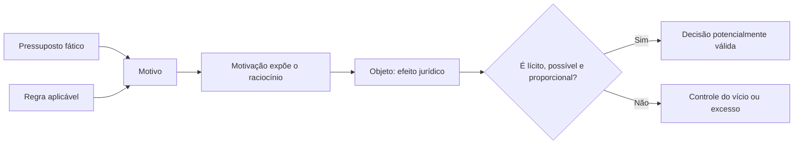

Motivo e motivação parecem palavras próximas, mas cumprem papéis diferentes na análise do ato. O primeiro é a razão fática e jurídica que sustenta a decisão; a segunda é a exposição dessas razões. O objeto, por sua vez, é a decisão ou efeito produzido. Separar esses conceitos permite identificar atos sem fundamento, motivação insuficiente e divergência entre os motivos declarados e a realidade.

> [!objetivos]
> - Distinguir motivo de motivação e de objeto.
> - Aplicar a teoria dos motivos determinantes.
> - Reconhecer os atos que exigem motivação expressa.
> - Identificar limites do mérito administrativo.

## Motivo e motivação

Motivo é o pressuposto de fato e de direito que autoriza ou exige a prática do ato. O fato é o acontecimento concreto; o direito é a regra que lhe atribui relevância. Em uma sanção disciplinar, o motivo inclui a conduta comprovada e a norma que prevê a consequência. O objeto é a penalidade aplicada. Se o fato não ocorreu ou não se enquadra na norma, o motivo pode estar ausente ou ser juridicamente inadequado.

Motivação é a explicação formal das razões da decisão. Ela conecta fatos, provas e norma ao resultado, tornando possível ao destinatário compreender e impugnar a medida. Nem sempre motivo e motivação são ambos expressos no mesmo documento: um ato pode ter pressupostos identificáveis, mas a lei exigir que a autoridade os exponha. Motivação não se confunde com mera citação de dispositivo sem explicar sua incidência.

A Lei 9.784/1999 exige motivação dos atos administrativos que neguem, limitem ou afetem direitos ou interesses; imponham ou agravem deveres, encargos ou sanções; decidam processos de seleção ou recursos; dispensem ou declarem inexigibilidade de licitação, entre outras hipóteses enumeradas no art. 50. A motivação deve ser explícita, clara e congruente. Quando adota fundamentos de parecer ou informação anterior, o ato pode incorporar esses fundamentos como parte integrante.

| Conceito | Responde a | Exemplo em decisão disciplinar |
|---|---|---|
| Motivo | Por que a lei permite ou exige agir? | Infração demonstrada e norma aplicável |
| Motivação | Como a autoridade expõe a justificativa? | Decisão relaciona prova e regra |
| Objeto | O que o ato determina? | Aplicação de sanção específica |

> [!pegadinha]
> “Motivação” não é o próprio acontecimento que levou ao ato. O motivo pode existir ou faltar; motivar é expor, de forma inteligível, os fundamentos da decisão.

## Teoria dos motivos determinantes

Quando a Administração declara os motivos de um ato, sua validade fica vinculada à existência e à adequação desses motivos, ainda que a lei não exigisse motivação expressa naquele caso. Se a autoridade afirma que removeu servidor para atender necessidade concreta do serviço, mas os fatos mostram que a razão era puni-lo informalmente, a falsidade ou inadequação dos motivos declarados pode comprometer o ato.

A teoria não transforma toda escolha discricionária em ato vinculado quanto ao resultado. A autoridade ainda pode escolher entre alternativas autorizadas, mas deve respeitar os pressupostos que ela própria apresentou. Motivo declarado inexistente, incompatível com a realidade ou juridicamente insuficiente não é salvo pela conveniência. O controle judicial pode examinar legalidade, finalidade e veracidade dos fundamentos sem substituir a Administração na escolha legítima.

Exemplo: o órgão transfere uma equipe para atender aumento de ocorrências em determinada região e registra essa justificativa. Se os registros operacionais indicarem que não havia aumento, e os elementos apontarem retaliação a um integrante, a Administração deverá demonstrar a realidade e pertinência da motivação. A simples fórmula “interesse do serviço” não afasta o exame concreto.

A decisão pública também deve considerar consequências práticas em certos contextos. Os arts. 20 a 22 da LINDB determinam, entre outros pontos, que decisões baseadas em valores abstratos considerem consequências práticas e que a motivação demonstre necessidade e adequação da medida, inclusive diante de alternativas possíveis; ao interpretar normas de gestão pública, devem ser considerados obstáculos reais e exigências das políticas públicas, sem prejuízo dos direitos dos administrados. Isso não constitui autorização genérica para descumprir a lei.

> [!lei] Lei 9.784/1999, art. 50, caput e § 1º
> Art. 50. Os atos administrativos deverão ser motivados, com indicação dos fatos e dos fundamentos jurídicos, quando: (...)
> § 1º A motivação deve ser explícita, clara e congruente, podendo consistir em declaração de concordância com fundamentos de anteriores pareceres, informações, decisões ou propostas, que, neste caso, serão parte integrante do ato.

## Objeto e mérito

Objeto é o efeito jurídico imediato do ato: conceder, negar, ordenar, certificar, punir ou extinguir determinada situação. Para ser válido, deve ser lícito, possível, determinado ou determinável, e compatível com a finalidade. Uma sanção não prevista ou uma ordem impossível revela problema no objeto, ainda que a autoridade seja competente e a infração esteja demonstrada.

Mérito é o espaço de avaliação administrativa autorizado pela lei, tradicionalmente identificado em atos discricionários com a escolha de oportunidade e conveniência. A discricionariedade não é liberdade absoluta: a escolha permanece limitada pela competência, finalidade, forma, motivo juridicamente admissível, proporcionalidade, razoabilidade e direitos fundamentais. Elementos vinculados podem coexistir com juízo discricionário.

O Judiciário pode controlar a legalidade e invalidar decisão que ultrapasse os limites jurídicos, mas não deve substituir uma escolha administrativa legítima por sua própria preferência. A Administração pode rever o mérito de ato discricionário mediante revogação, conforme regras aplicáveis; não pode revogar ato ilegal para apagar o vício, pois ilegalidade conduz à anulação. Essa distinção será retomada no estudo de invalidação.

> [!exemplo]
> Duas rotas atendem aos requisitos legais para instalar posto de atendimento. Escolher entre elas pode envolver conveniência, custo e acesso da população. A autoridade deve motivar os critérios relevantes e não pode selecionar uma rota por favorecimento pessoal. O primeiro campo é mérito; o segundo é desvio e ilegalidade.

### Pressupostos e decisão motivada

O motivo deve existir no momento relevante e guardar relação lógica com o efeito escolhido. Pode ser previsto em lei com precisão, deixando pouca margem de avaliação, ou pode exigir apreciação de circunstâncias pela autoridade. Mesmo no segundo caso, a Administração não pode inventar fatos, omitir evidência contrária ou escolher resultado incompatível com a finalidade. A margem decisória não altera a diferença entre motivo (base) e objeto (efeito).

Motivação é especialmente importante em atos que afetam direitos. O art. 50 da Lei 9.784/1999 inclui decisões que negam, limitam ou afetam direitos, impõem deveres ou sanções, decidem concursos e recursos e divergem de pareceres oficiais, entre outras hipóteses. A motivação pode adotar fundamentos de parecer ou proposta anterior, desde que os incorpore e os torne acessíveis como parte da decisão. A remissão vaga a documentos que o interessado não consegue conhecer pode não cumprir a finalidade de transparência e controle.

Há motivação aliunde quando a decisão incorpora fundamentos de manifestação anterior, como nota técnica ou parecer. “Aliunde” indica que a exposição das razões está em outro documento, que integra a decisão por remissão. Isso não equivale a ausência de motivação: os fundamentos devem ser identificáveis e congruentes com o resultado. Uma motivação concomitante é apresentada com o ato; a motivação posterior pode ser relevante em hipóteses específicas de explicitação, mas não deve servir para construir retrospectivamente um motivo inexistente.

| Pressuposto | Pergunta | Falha possível |
|---|---|---|
| Fático | O evento realmente ocorreu? | Fato inexistente ou provado de modo insuficiente |
| Jurídico | A regra atribui efeito ao evento? | Enquadramento normativo incorreto |
| Motivação | As razões foram explicitadas? | Fórmula vazia ou incongruente |
| Objeto | A consequência é permitida e possível? | Sanção sem previsão ou ordem impossível |

> [!exemplo]
> Uma autoridade de fiscalização indefere licença por risco de incêndio e cita laudo técnico identificável. Se os fundamentos do laudo forem incorporados e o processo permitir acesso, a remissão pode motivar a decisão. Se o laudo não analisa o imóvel específico ou ignora vistoria recente em sentido oposto, a existência formal de motivação não resolve o problema do motivo.

A LINDB adiciona cuidado com consequências práticas e contexto decisório. Ao decidir com base em valores abstratos, deve-se considerar o impacto prático e demonstrar necessidade e adequação da medida frente às alternativas disponíveis, nos termos do art. 20. Decisões que invalidam ato, contrato, ajuste, processo ou norma administrativa devem indicar consequências jurídicas e administrativas, observando o art. 21. O art. 22 também manda considerar obstáculos reais do gestor na interpretação de normas de gestão, sem afastar direitos dos administrados. Tais dispositivos não autorizam motivação ornamental nem dispensam legalidade.

O objeto deve ser possível fisicamente e juridicamente, lícito e determinado ou determinável. Uma ordem para realizar ação sem meios físicos ou técnicos disponíveis pode ser materialmente impossível; uma obrigação que a lei proíbe é juridicamente ilícita. O ato não pode ultrapassar a finalidade específica. Quando a lei permite mais de uma sanção, escolher a mais grave sem considerar critérios pertinentes pode revelar desproporcionalidade, ainda que o fato exista.

> [!pegadinha]
> Um ato pode ter motivação escrita e, mesmo assim, conter motivo inexistente ou inadequado. A presença de texto justificativo não prova a verdade dos fatos nem a correção do enquadramento.

### Relação entre elemento, defeito e providência

O diagnóstico deve apontar o elemento comprometido antes de recomendar a consequência. Se o ato foi praticado por agente sem atribuição, a questão inicial é de competência. Se a autoridade tinha atribuição, mas perseguiu objetivo estranho, há defeito de finalidade. Se a ocorrência não existiu ou não sustenta a decisão, o problema está no motivo. Se a consequência determinada é proibida ou impossível, o objeto é defeituoso. Se faltou formalidade essencial, deve-se examinar a forma.

Essa sequência evita soluções inadequadas. Um defeito de competência não autoriza concluir que a finalidade também foi desviada; uma decisão inconveniente não é necessariamente ilegal; e um resultado indesejado ao administrado não prova vício. A nulidade depende de fundamento jurídico, prova e análise das regras de convalidação. Quando há vários defeitos, devem ser descritos separadamente, pois alguns podem ser corrigíveis e outros não.

| Fato observado | Elemento mais provável | Próximo passo de análise |
|---|---|---|
| Assinatura por agente fora da atribuição | Competência | Verificar delegação, substituição e exclusividade |
| Ato usado para retaliação | Finalidade | Examinar finalidade legal e indícios do contexto |
| Fato descrito não ocorreu | Motivo | Conferir documentos e prova da ocorrência |
| Resultado proibido pela norma | Objeto | Identificar limite legal e efeito pretendido |
| Procedimento omitiu etapa indispensável | Forma | Apurar essencialidade, prejuízo e saneamento |

> [!pegadinha]
> O interesse público não é justificativa genérica capaz de suprir elemento ausente. Competência, finalidade, forma, motivo e objeto precisam ser examinados de maneira própria.

A competência tem dimensões vertical e horizontal. A hierarquia pode distribuir atribuições entre autoridade superior e unidade subordinada, mas órgãos situados no mesmo nível também podem ter matérias diferentes. A distribuição horizontal entre departamentos impede que uma unidade pratique ato só porque possui estrutura ou pessoal para fazê-lo. Da mesma forma, a existência de subordinação não dá autorização ilimitada para avocar toda matéria do inferior.

A delegação de parte da competência facilita a gestão e não pode esvaziar uma atribuição legal exclusiva. O ato publicado de delegação deve especificar poderes e limites; o agente deve indicar que atua nessa condição. Se a delegação é revogada ou expira, o delegado não pode continuar a decidir com base em autorização passada. A autoridade delegante conserva titularidade e pode rever ou avocar dentro das condições legais.

> [!exemplo]
> Uma diretora recebe delegação de competência para decidir férias e licenças simples, mas não para aplicar penalidade nem decidir recursos. Se encaminha ao comandante recurso contra decisão sua, atua corretamente; se julga o recurso por conta própria, há impedimento legal à delegação dessa matéria e risco de vício. Uma comissão técnica pode opinar, mas não substituir a autoridade decisória quando a lei atribui a decisão a outro órgão.

A forma deve ser proporcional ao tipo de decisão, porém todo processo precisa permitir verificar autoria, conteúdo, data e fundamentos quando exigidos. Assinatura digital pode cumprir essa função por meio admitido; a ausência de papel não significa ausência de forma. O rito simplificado não elimina notificações obrigatórias, publicidade ou oportunidade de defesa. A falta de notificação ao interessado pode comprometer a validade se impedir participação que a lei assegura.

### Categorias de motivo e efeitos no tempo

Os motivos podem se referir a fatos atuais, passados ou a condições previstas para o futuro, mas devem guardar pertinência com o ato. Uma licença pode depender de requisito comprovado; uma autorização pode considerar risco provável dentro de critérios normativos; uma sanção depende de infração apurada. Fato acidental ou superveniente pode justificar nova decisão, mas não altera retroativamente a verdade dos motivos que sustentaram o ato original.

A doutrina descreve atos condicionais, sujeitos a termo ou condição, e atos simples, cujo efeito não depende de evento futuro. A condição suspensiva posterga a eficácia; a resolutiva encerra efeitos quando ocorrer fato determinado. Isso diz respeito à eficácia e não necessariamente à validade. Uma decisão pode ser válida ao ser emitida e ainda aguardar a chegada de data ou condição para produzir efeitos.

O objeto deve ser claro o bastante para o destinatário saber o que se concedeu, negou ou ordenou. Indeterminação pode ser tolerada quando o conteúdo é determinável por critérios legais, mas não quando deixa ao agente liberdade para redefinir depois o alcance da obrigação. Uma ordem que proíbe genericamente “conduta inadequada” sem indicar o comportamento vedado pode ser incerta demais para sustentar sanção.

| Tipo de fundamento | Exemplo | Cuidado de validade |
|---|---|---|
| Fato atual | Risco constatado em vistoria | Descrever evidência e data relevante |
| Fato anterior | Infração apurada no processo | Observar procedimento e prova |
| Previsão futura | Condição que ainda precisa ocorrer | Distinguir motivo e condição de eficácia |
| Motivo declarado | Necessidade do serviço registrada | Correspondência com os fatos reais |
| Objeto condicionado | Licença válida após requisito final | Identificar termo ou condição de início |

> [!atencao]
> Um evento futuro pode ser condição de eficácia e não motivo já ocorrido. A banca pode trocar esses papéis para confundir fundamento do ato com momento em que seus efeitos começam.

Na análise de motivo, considere se a norma exige simultaneamente fato e fundamento jurídico. A existência de um acontecimento não basta quando ele não se enquadra na hipótese legal; inversamente, citar a norma não supre a ausência de prova. A motivação deve demonstrar o nexo, e não somente listar documentos. Quando há divergência entre laudo e decisão, a autoridade precisa explicar por que acolhe uma avaliação e rejeita outra.

A motivação pode ser contemporânea ao ato e pode adotar parecer ou informação técnica, desde que a remissão permita identificar os fundamentos incorporados. A justificativa posterior não deve reconstruir os motivos determinantes para encobrir ausência de razão na data da decisão. Em atos com margem discricionária, o controle não escolhe a alternativa mais conveniente, mas pode afastar a decisão por falsidade, incoerência ou desvio.

> [!bizu]
> Na questão, marque três peças diferentes: base fática e jurídica = motivo; texto que explica a base = motivação; consequência que sai da decisão = objeto. Se o enunciado troca uma delas, localize o erro antes de avaliar mérito.

| Teste de validação | Resposta esperada | Indício de problema |
|---|---|---|
| O fato ocorreu? | Prova contemporânea e verificável | Motivo inexistente ou descrição errada |
| A regra dá relevância ao fato? | Enquadramento jurídico coerente | Motivo sem suporte normativo |
| A motivação explica o vínculo? | Razões claras e compreensíveis | Citação abstrata sem aplicação |
| O objeto decorre da base? | Efeito compatível com os pressupostos | Consequência arbitrária |

> [!esquema]
> Um ato com motivo real ainda pode ser inválido se a lei não atribuir a ele o efeito escolhido. Um ato com finalidade pública também pode falhar se o motivo determinante for falso. Verifique cada etapa sem saltar direto à conclusão.

### Motivo e motivação em hipóteses concretas

Na exoneração de cargo em comissão, a lei pode permitir dispensa sem exposição de causa como regra geral. Se, porém, a Administração escolhe declarar uma causa específica, a veracidade desse motivo passa a importar. Se a justificativa registrada é inexistente, a teoria dos motivos determinantes permite questionar a validade. O ato discricionário não fica protegido da própria razão que a autoridade fez constar.

Também pode haver motivo acidental que não seja determinante para a decisão. O agente deve separar o que foi causa necessária do que é informação incidental. A prova pode mostrar que a conclusão se sustentava em fundamento independente e suficiente, mas a motivação ainda precisa ser congruente. A mera repetição de frases não transforma elemento irrelevante em razão válida.

Uma decisão sobre risco natural, como chuva intensa e possibilidade de deslizamento, pode se apoiar em dados e avaliações técnicas. A autoridade deve indicar o suporte real, inclusive quando usa estimativas ou probabilidades, e explicar por que a medida escolhida é adequada. A motivação pode considerar condições psicológicas ou circunstâncias pessoais apenas quando forem juridicamente pertinentes; não cabe expor dado íntimo sem necessidade nem tomar decisão discriminatória.

A decisão deve conectar fato, regra, alternativas e consequência. A LINDB orienta consideração de efeitos práticos, mas não exige que a Administração calcule com exatidão todos os eventos futuros. Deve explicar o que era previsível com os dados disponíveis e por que não escolheu solução menos gravosa. Se consequências econômicas ou administrativas forem relevantes, podem ser examinadas junto à proteção de direitos, sem transformar custo em justificativa absoluta.

| Ato | Dado que pode compor o motivo | Resultado a conferir |
|---|---|---|
| Interdição de imóvel | Laudo, vistoria e risco atual | Área interditada compatível com risco |
| Remoção de servidor | Necessidade comprovada da unidade | Critério impessoal e finalidade do serviço |
| Exoneração motivada | Razão expressamente registrada | Existência e congruência do fundamento |
| Sanção administrativa | Infração, prova e norma | Penalidade compatível com regra e gravidade |

> [!exemplo]
> Uma equipe é deslocada para cobrir ocorrências após alteração de demanda. A autoridade registra os dados usados, compara opções e fixa período de reavaliação. Se a demanda desaparece, pode haver nova decisão para o futuro; isso não apaga o fato de que a decisão inicial tinha suporte real quando foi adotada.

A motivação deve permitir que a pessoa atingida compreenda a razão da decisão e apresente contestação útil. Uma autoridade pode usar análise técnica, mas precisa mostrar o vínculo entre o dado e o resultado. Quando há máquinas ou equipamentos cuja condição física é relevante, a vistoria deve descrever o que foi examinado, os critérios e a conclusão; uma referência genérica a “inadequação” não explica o motivo real.

> [!esquema]
> Fato observado → norma incidente → avaliação de alternativas → decisão e objeto. Se a sequência não pode ser reconstruída, a motivação pode ser insuficiente ou incongruente.

O suporte da decisão também deve ser contemporâneo ou ao menos existente quando o ato é praticado. O relato pode considerar prova posterior para confirmar ou infirmar circunstância, mas não deve criar uma razão retroativa. Um motivo natural, como tempestade, só sustenta medida administrativa se houver nexo com risco e norma aplicável. A decisão sobre remoção ou exoneração deve separar motivo legal de impressão subjetiva e evitar inferências psicológicas sem fundamento.
Uma prova empírica pode revelar a condição real do bem, e uma avaliação média pode ajudar a justificar providência proporcional, desde que os critérios sejam adequados. A Administração pode analisar bens móveis, máquinas pesadas e documentos consecutivos de vistoria. O nascimento de pessoa e a paternidade são exemplos de fatos naturais ou pessoais com efeitos legais; a possibilidade de doar bem público depende de autorização e regime próprios. Servidor removido deve receber decisão baseada em motivo verdadeiro.

## Mapa do capítulo

| Termo | Núcleo | Controle |
|---|---|---|
| Motivo | Pressuposto fático e jurídico | Existência e adequação |
| Motivação | Exposição das razões | Clareza, congruência e hipóteses legais |
| Motivos determinantes | Vínculo aos motivos declarados | Falsidade ou inadequação pode invalidar |
| Objeto | Efeito jurídico imediato | Licitude, possibilidade e determinação |
| Mérito | Escolha permitida pela lei | Controle de juridicidade, sem substituição indevida |

### Para fixar
- Motivo é pressuposto; motivação é sua exposição; objeto é o efeito decidido.
- A Lei 9.784/1999 enumera hipóteses de motivação no art. 50.
- Motivação deve ser explícita, clara e congruente quando exigida.
- Motivos declarados vinculam a validade do ato pela teoria dos motivos determinantes.
- Discricionariedade não permite motivo falso nem finalidade desviada.
- Mérito envolve oportunidade e conveniência nos limites normativos.
- Judiciário controla legalidade e juridicidade, sem escolher no lugar da Administração por mera preferência.
- LINDB, arts. 20 a 22, orienta a consideração das consequências e do contexto da decisão pública.

