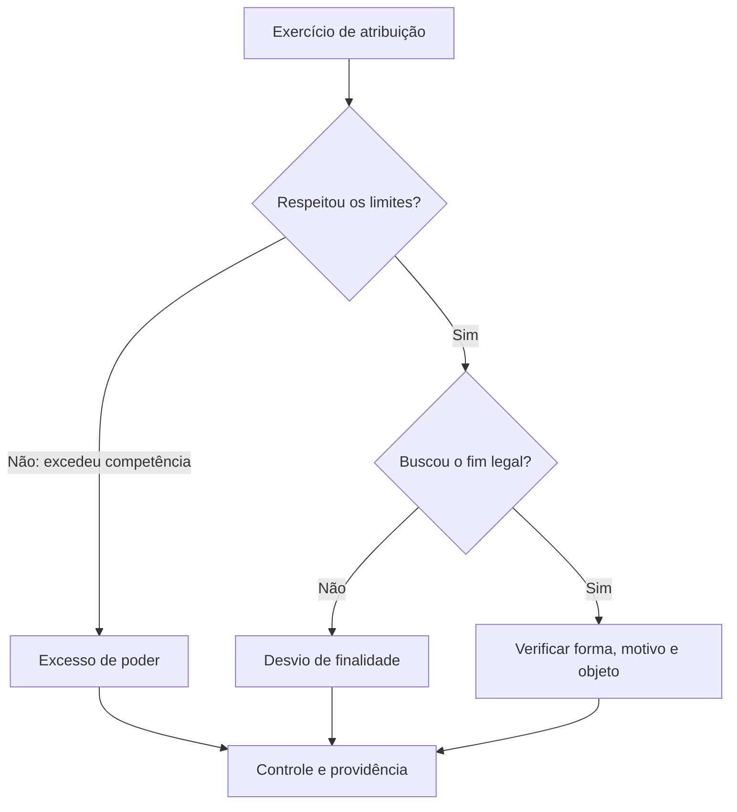

Vício é defeito jurídico que compromete a validade do ato. A classificação por elemento ajuda a identificar a causa da ilegalidade e a consequência adequada. Neste capítulo, a atenção recai sobre finalidade, motivo e objeto, além da diferença entre uso legítimo e abuso do poder. A presunção de legitimidade não impede que o interessado prove o defeito nem transforma ato ilegal em válido.

> [!objetivos]
> - Relacionar vícios aos elementos do ato administrativo.
> - Distinguir excesso de poder e desvio de finalidade.
> - Reconhecer vícios de motivo e objeto.
> - Entender presunção relativa e limites da convalidação.

## Uso, excesso e desvio de poder

Poder administrativo é instrumento jurídico conferido para cumprir uma finalidade pública. Seu uso regular respeita competência, forma, finalidade, motivo e objeto. O abuso ocorre quando o agente ultrapassa os limites da atribuição ou usa o poder para finalidade indevida. Na linguagem clássica, o abuso de poder abrange excesso de poder e desvio de finalidade.

Excesso de poder ocorre quando o agente atua além da competência que possui: por exemplo, chefe que aplica penalidade cuja imposição a norma reserva a autoridade superior. Desvio de finalidade ocorre quando a autoridade competente usa sua atribuição para alcançar fim diverso daquele previsto para o ato ou alheio ao interesse público. Uma remoção usada como punição retaliatória pode configurar desvio, mesmo que a chefia tenha atribuição para remover servidores por necessidade de serviço.

O abuso pode ser praticado por ação ou, conforme os deveres aplicáveis, por omissão. A ilegalidade não depende de a medida ser ostensivamente hostil: pode resultar de elementos objetivos e do contexto. A apuração exige analisar documentos, motivação, tratamento comparativo e circunstâncias, evitando presumir intenção ilícita apenas porque o ato prejudicou alguém.

> [!esquema]
> - Uso regular: competência exercida para finalidade legal, com pressupostos e efeitos adequados.
> - Excesso de poder: defeito na competência; o agente passa dos limites da atribuição.
> - Desvio de finalidade: defeito na finalidade; a atribuição é usada para outro objetivo.

> [!pegadinha]
> “A autoridade podia praticar algum ato sobre o servidor” não basta para validar a medida concreta. Competência formal não sana finalidade desviada.

## Vício de finalidade

A finalidade é sempre vinculada à lei. Por isso, o agente não pode invocar mérito para afastá-la. O desvio pode ocorrer quando se busca interesse particular, perseguição, favorecimento ou objetivo diferente do fim específico que justificou a competência. A Lei 4.717/1965 considera viciado o ato lesivo ao patrimônio público por desvio de finalidade, que ocorre quando a finalidade concreta não corresponde ao objetivo da atribuição conferida pela norma (art. 2º, parágrafo único, alínea “e”).

O motivo declarado pode parecer verdadeiro e, ainda assim, haver desvio. Suponha que um servidor realmente tenha sido transferido e que a unidade de origem tenha quadro completo; se a Administração usou a transferência exclusivamente para retaliá-lo, o problema está na finalidade. Inversamente, um fim legítimo não conserta a inexistência do fato que sustentaria a medida.

O desvio costuma ser demonstrado por indícios, pois raramente a decisão registra abertamente uma finalidade imprópria. A motivação, a cronologia, a falta de critério uniforme e a comparação com situações semelhantes podem compor a prova. O exame deve ser fundamentado e respeitar o contraditório nos procedimentos pertinentes.

## Vícios de motivo

Há vício de motivo quando o pressuposto fático não existe, foi descrito incorretamente ou não se enquadra na norma invocada. Também pode haver incompatibilidade entre os motivos apresentados e o resultado. Pela teoria dos motivos determinantes, a Administração fica vinculada às razões que declarou, e a falsidade ou inadequação relevante pode invalidar o ato.

Exemplo: a autoridade suspende uma licença porque afirma que houve descumprimento de condição. Se a condição foi atendida e os registros confirmam isso, o motivo fático falha. Outro caso: a norma permite determinada consequência apenas diante de risco atual, mas a decisão se baseia em fato antigo sem explicar sua relação com o risco presente. O controle verifica o suporte da medida, não a interesse particular do julgador.

O vício de motivo difere do desvio de finalidade. No primeiro, o problema está nos pressupostos que justificam o ato; no segundo, no propósito perseguido. Podem coexistir: a autoridade pode inventar uma ocorrência para encobrir perseguição, tornando problemáticos motivo e finalidade.

> [!exemplo]
> Uma vistoria registra que a saída de emergência está livre, mas a decisão aplica sanção com base em obstrução. Se o registro é confiável e não há outra prova, o suporte fático não corresponde à realidade; o ato sofre vício de motivo.

## Vícios de objeto e efeitos da ilegalidade

O objeto é viciado se for ilícito, impossível, indeterminado de modo incompatível com a norma ou incompatível com a finalidade. Uma autoridade não pode aplicar sanção inexistente no ordenamento nem ordenar prestação material impossível. Se o conteúdo ultrapassa limites legais, o defeito está no efeito que o ato pretende produzir.

A presunção de legitimidade é relativa. O ato pode produzir efeitos enquanto não suspenso ou invalidado, conforme o caso, mas a pessoa afetada pode impugná-lo administrativamente ou judicialmente. A Administração tem o dever de rever seus atos ilegais segundo a lei e o devido processo; a anulação não se confunde com revogação por conveniência. A Lei 9.784/1999 disciplina anulação e convalidação nos arts. 53 a 55.

A convalidação pode corrigir determinados defeitos sanáveis se não houver lesão ao interesse público nem prejuízo a terceiros. Não se deve supor que toda irregularidade possa ser convalidada: finalidade desviada e objeto ilícito, em regra, não são corrigidos por simples ratificação. A possibilidade depende do tipo de vício e do regime jurídico aplicável.

| Elemento | Exemplo de vício | Questão diagnóstica |
|---|---|---|
| Competência | Autoridade sem atribuição | Quem podia decidir? |
| Finalidade | Punição disfarçada de remoção | Para que foi usado o poder? |
| Forma | Omissão de formalidade essencial | Como a vontade deveria ser expressa? |
| Motivo | Fato inexistente ou inadequado | O que ocorreu e qual regra se aplica? |
| Objeto | Sanção não autorizada | Qual efeito a decisão produz? |

> [!atencao]
> A presunção de legitimidade não desloca a análise para “o ato deve ser aceito como correto”. Ela significa que há eficácia inicial relativa, sujeita a impugnação e controle.

### Nulidade, convalidação e limites de correção

Identificado um vício, a Administração deve definir se há defeito sanável e qual providência protege a legalidade e os direitos afetados. A Lei 9.784/1999, art. 53, determina a anulação de atos ilegais e permite revogação por conveniência ou oportunidade, respeitados direitos adquiridos. O art. 55 admite convalidar atos com defeitos sanáveis quando não houver lesão ao interesse público nem prejuízo a terceiros. A escolha não é um rótulo automático: depende do elemento atingido e do contexto.

Vício de competência não exclusiva pode, em certas condições, ser ratificado pela autoridade competente. Defeito de finalidade não é simples erro de assinatura: seria preciso mudar o propósito que orientou o ato, o que não se resolve por ratificação posterior. Objeto contrário à lei tampouco se torna lícito porque a autoridade o confirma. Erro material de grafia pode ser corrigido sem refazer toda a decisão, desde que a correção não altere o conteúdo essencial ou prejudique o interessado.

A Administração deve observar também segurança jurídica e proteção da confiança. No âmbito federal, o art. 54 da Lei 9.784/1999 prevê prazo decadencial de cinco anos para anular atos administrativos favoráveis, salvo comprovada má-fé, contado da prática ou, em efeitos patrimoniais contínuos, do primeiro pagamento. Há disciplina própria e exceções a considerar, e essa regra federal não deve ser generalizada sem verificar sua aplicabilidade. O prazo limita a autotutela, não transforma deliberadamente fraude em conduta lícita.

| Providência | Pressuposto | Pergunta de controle |
|---|---|---|
| Anulação | Ilegalidade | Qual elemento violou o Direito? |
| Revogação | Ato válido inconveniente ou inoportuno | Há espaço de mérito e limite legal? |
| Convalidação | Defeito sanável | Há prejuízo ou lesão ao interesse público? |
| Correção material | Erro objetivo que não altera o conteúdo | O ajuste muda o sentido decisório? |

> [!lei] Lei 9.784/1999, art. 53
> Art. 53. A Administração deve anular seus próprios atos, quando eivados de vício de legalidade, e pode revogá-los por motivo de conveniência ou oportunidade, respeitados os direitos adquiridos.

O abuso de poder também pode decorrer de omissão. Se o agente deixa de decidir para impedir, sem fundamento, que o administrado exerça direito sujeito a prazo, a inércia pode contrariar dever jurídico. O particular pode pedir resposta, provocar instâncias administrativas ou buscar tutela judicial, conforme o caso. É necessário distinguir demora justificável, que pode decorrer de instrução complexa, de mora injustificada e deliberada.

> [!pegadinha]
> Ato ilegal não se “revoga”; ato válido que perdeu conveniência não se “anula”. A convalidação não serve para alterar finalidade, legitimar objeto proibido ou apagar prejuízo de terceiro.

### Vícios que não se confundem

A incompetência absoluta ocorre quando a matéria foi reservada a órgão ou autoridade específica e não pode ser deslocada por conveniência. O simples erro sobre quem deveria assinar é diferente de usurpação de função, situação em que alguém sem investidura atua como agente público. Incapacidade do agente, impedimento e suspeição podem afetar a imparcialidade ou habilitação do responsável e devem ser examinados conforme a regra procedimental aplicável. O vocabulário não substitui a identificação do requisito violado.

Ato nulo ou anulável é uma classificação sobre consequências do defeito, mas seu uso varia conforme a norma e a doutrina. O candidato não deve afirmar que todo vício é insanável, nem que qualquer problema admite convalidação. Defeito de competência não exclusiva pode ser ratificável; desvio de finalidade e objeto contrário à lei tendem a comprometer elemento essencial e não se corrigem com mera assinatura posterior. Vício de forma requer verificar se a formalidade era indispensável e se houve prejuízo.

Uma notificação defeituosa pode impedir defesa e contaminar a sanção subsequente, ao passo que erro de digitação no número de sala pode não alterar a decisão e ser corrigido. O marco é a função da forma, o prejuízo e o regime aplicável. A imparcialidade também importa: se agente suspeito participou da instrução ou da decisão, a autoridade deve avaliar o impacto e refazer os atos necessários, sem presumir que a decisão final é válida só por ter sido assinada por superior.

> [!exemplo]
> Um agente sem competência aplica multa e, depois, a autoridade competente identifica o defeito. Se a competência não é exclusiva, a matéria é delegável e a lei admite convalidação sem prejuízo, pode-se examinar ratificação. Se o agente usurpou função sem investidura ou a atribuição era exclusiva, a situação é mais grave e não deve ser tratada como simples falha de forma.

| Sinal do caso | Classificação a investigar | Não confundir com |
|---|---|---|
| Autoridade extrapola atribuição | Excesso de poder | Desvio de finalidade |
| Agente pratica ato por motivo de vingança | Desvio de finalidade | Motivo necessariamente falso |
| Pessoa sem investidura assina como agente | Usurpação de função | Delegação regular |
| Autoridade impedida atua no processo | Impedimento ou parcialidade | Falta de competência material |
| Fato relevante não ocorreu | Vício de motivo | Objeto ilícito |

> [!atencao]
> A prova de desvio pode decorrer de conjunto de indícios e contexto, mas não se conclui apenas pelo resultado desfavorável. Diferencie suspeita de prova suficiente e examine a motivação e a finalidade legal.

A teoria dos motivos determinantes também se aplica a ato que, em princípio, poderia ser praticado sem exposição detalhada de motivos, quando a Administração decidiu declará-los. A autoridade não pode dizer que o servidor foi removido por necessidade e, depois, alegar que o motivo era dispensável quando essa necessidade não existia. A Administração fica vinculada aos fundamentos apresentados e pode ter de desfazer o ato inválido, respeitando procedimento e consequências.

Quanto à presunção, o ato inicia com aparência de legitimidade, mas a contestação pode demonstrar que o documento foi elaborado com base em observação incompleta, prova errada ou informação desatualizada. O administrado não precisa aceitar afirmação falsa como verdadeira; a presunção organiza a eficácia inicial e não impede controle, prova nem revisão.

O agente pode cometer erro de fato sem perseguir ninguém. Se a autoridade usa lista desatualizada e remove servidor que deveria permanecer, o motivo pode ser falso, embora a finalidade fosse organizar o serviço. Se utiliza fato verdadeiro como pretexto para punir crítica, a finalidade pode estar desviada. A diferença entre erro administrativo, arbitrariedade e abuso depende de prova e das circunstâncias, não só do efeito desfavorável.

> [!exemplo]
> Um servidor é transferido porque a unidade registrou déficit de efetivo, mas uma auditoria demonstra que havia equipe suficiente e que a decisão foi tomada logo após reclamação protegida. A primeira evidência questiona o motivo; a sequência pode também indicar finalidade imprópria. A Administração deve explicar e revisar o ato conforme a prova.
## Mapa do capítulo

| Defeito | Elemento atingido | Exemplo típico |
|---|---|---|
| Excesso de poder | Competência | Agente excede atribuição |
| Desvio de finalidade | Finalidade | Ato busca objetivo estranho à lei |
| Motivo falso/inexistente | Motivo | Fato declarado não aconteceu |
| Conteúdo ilícito/impossível | Objeto | Efeito não permitido ou inexequível |
| Defeito formal essencial | Forma | Requisito indispensável foi ignorado |

### Para fixar
- Abuso de poder pode ocorrer por excesso ou por desvio de finalidade.
- Excesso é problema de competência; desvio é problema de finalidade.
- Finalidade não integra o espaço de escolha discricionária.
- Motivo corresponde aos pressupostos fáticos e jurídicos.
- Motivos declarados vinculam a Administração pela teoria dos motivos determinantes.
- Objeto é ilícito se contrariar a lei ou a finalidade autorizadora.
- Presunção de legitimidade é relativa e admite impugnação.
- Convalidação depende de defeito sanável e dos requisitos legais.

