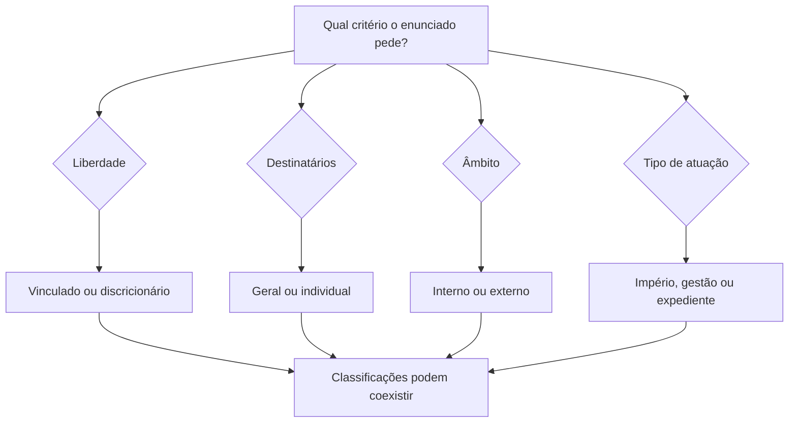
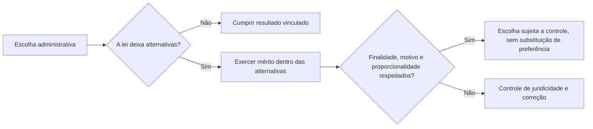

A Administração nem sempre encontra uma única solução possível na lei. Em certos casos, a norma permite escolher entre alternativas legítimas, considerando o momento e as necessidades do serviço. Esse espaço é chamado mérito administrativo. O capítulo delimita a discricionariedade, compara-a com a vinculação e apresenta classificações importantes, com atenção à incidência variável dos atributos.

> [!objetivos]
> - Diferenciar ato vinculado e discricionário.
> - Definir mérito e controle judicial.
> - Identificar atributos que podem faltar.
> - Classificar atos segundo diferentes critérios.

## Mérito administrativo

Mérito é a avaliação de conveniência e oportunidade feita pela Administração dentro do espaço que a norma lhe concedeu. Conveniência pergunta se a providência é adequada às necessidades administrativas; oportunidade considera o momento e as circunstâncias para adotá-la. A lei pode deixar escolha quanto ao motivo, ao objeto ou a ambos, mas nunca autoriza desrespeitar competência, finalidade ou limites jurídicos.

A discricionariedade não significa liberdade total. Ela opera dentro de uma moldura legal: as opções precisam ser lícitas, razoáveis e proporcionais, e a decisão deve respeitar direitos e princípios. O agente que escolhe entre duas formas legalmente aceitáveis de organizar plantões exerce avaliação administrativa. Se seleciona servidores por favorecimento indevido, a decisão deixa de ser escolha legítima.

Atos vinculados não oferecem margem de conveniência e oportunidade quanto ao resultado quando os pressupostos legais estão preenchidos. Se uma licença deve ser concedida a quem satisfaz todos os requisitos, a autoridade não pode negá-la por preferir outra solução. Mesmo nesse cenário, pode haver questões interpretativas ou de prova; isso não converte automaticamente a decisão em discricionária.

| Aspecto | Ato vinculado | Ato discricionário |
|---|---|---|
| Pressupostos legais | Definidos pela norma | Pode haver avaliação dentro da lei |
| Escolha de resultado | Sem escolha legítima quando requisitos se cumprem | Escolha entre alternativas legais |
| Controle | Legalidade e cumprimento do dever | Legalidade e limites da discricionariedade |
| Exemplo | Concessão quando requisitos objetivos estão satisfeitos | Definir prioridade operacional entre opções permitidas |

> [!pegadinha]
> A discricionariedade não existe “no ato inteiro” como imunidade. Um ato discricionário tem elementos vinculados e permanece sujeito a controle de legalidade, finalidade e proporcionalidade.

## Controle do mérito

O controle administrativo pode examinar tanto legalidade quanto conveniência, conforme a competência revisora. A própria Administração pode revogar ato válido que deixou de ser conveniente ou oportuno, observados direitos adquiridos, limites legais e efeitos já produzidos. Já o ato ilegal deve ser anulado, não revogado com fundamento em mérito.

O Poder Judiciário controla a conformidade jurídica, inclusive quando a decisão ultrapassa os limites da discricionariedade. Pode examinar se houve motivo, finalidade legítima, proporcionalidade e respeito aos princípios. Não deve, porém, trocar uma opção legal e adequadamente motivada por outra apenas porque considera a segunda mais conveniente. Controle judicial não equivale à gestão cotidiana da Administração.

Exemplo: diante de duas rotas permitidas para uma equipe de resposta, a chefia escolhe a que oferece melhor cobertura, com base em dados operacionais. O juiz não substitui a rota por sua preferência. Se, porém, a decisão ignora a norma de segurança ou discrimina sem justificativa, há questão jurídica controlável.

## Classificação e atributos variáveis

Classificações organizam atos por diferentes critérios e podem se sobrepor. Quanto à liberdade, são vinculados ou discricionários. Quanto aos destinatários, gerais ou individuais. Quanto aos efeitos, constitutivos, declaratórios ou modificativos, entre outras classificações doutrinárias. A categoria atribuída depende do critério solicitado: um ato pode ser individual e vinculado ao mesmo tempo.

As classificações também ajudam a perceber atributos que não aparecem em todos os atos. Atos gerais e atos individuais podem ambos ser vinculados ou discricionários, conforme sua base normativa; não se conclui a vinculação apenas porque o ato é geral. Atos enunciativos, como certidões, normalmente não impõem uma obrigação e por isso podem carecer de imperatividade. Atos negociais concedem ou reconhecem uma situação e não apresentam necessariamente todos os atributos.

| Critério | Categorias usuais | Pergunta |
|---|---|---|
| Liberdade | Vinculado / discricionário | Há escolha legal de conveniência? |
| Destinatário | Geral / individual | O comando alcança grupo indeterminado ou pessoa definida? |
| Alcance | Interno / externo | Produz efeito na organização ou perante administrado? |
| Efeito | Constitutivo / declaratório | Cria situação ou reconhece situação preexistente? |

> [!esquema]
> Uma mesma decisão pode ser descrita por vários eixos. Exemplo hipotético: ordem individual, externa, discricionária quanto ao momento, mas vinculada quanto aos requisitos de segurança. Não misture os critérios.

### Outros eixos de classificação

Além da vinculação, os atos podem ser classificados conforme o alcance e a relação com o destinatário. Atos gerais trazem comandos para grupo indeterminado e tendem a requerer publicidade; atos individuais alcançam uma ou mais pessoas identificadas. Atos internos ordenam o funcionamento da estrutura pública; atos externos incidem sobre administrados ou outros órgãos. Esses pares descrevem características distintas, não o grau de liberdade do agente.

Quanto à prerrogativa, parte da doutrina distingue atos de império e atos de gestão. Nos de império, a Administração atua com poderes públicos e pode impor comando unilateral nos termos da lei. Nos de gestão, administra bens e serviços em relações sem a mesma imposição vertical, embora continue submetida a controles públicos. Atos de expediente organizam e impulsionam processos sem decidir o mérito, como encaminhar autos à autoridade competente. Resoluções e portarias podem ser normativas ou individuais, conforme conteúdo e alcance; o nome formal não basta para classificá-las.

Atributos aparecem de maneira desigual. Imperatividade costuma existir quando o ato impõe obrigação e não se aplica automaticamente a certidões, pareceres ou concessões favoráveis. Autoexecutoriedade também depende de previsão legal ou urgência, não de o ato ser discricionário. Presunção de legitimidade é associada amplamente aos atos administrativos, mas não converte toda afirmação da Administração em prova incontestável. Exigibilidade e executoriedade são frequentemente tratadas como dimensões da autoexecutoriedade.

| Eixo de análise | Categorias | Exemplo de pergunta |
|---|---|---|
| Margem de escolha | Vinculado / discricionário | A lei permite avaliar oportunidade? |
| Alcance pessoal | Geral / individual | Destinatários estão determinados? |
| Relação com a estrutura | Interno / externo | O ato afeta serviço interno ou administrado? |
| Prerrogativa | Império / gestão | Há imposição vertical de poder público? |
| Papel no processo | Decisório / expediente | O ato decide ou apenas encaminha? |

> [!exemplo]
> Um despacho que envia processo para análise de engenharia é ato de expediente; a decisão que interdita ponte é decisória e externa. Uma resolução que fixa regra geral pode ser normativa; a resolução que designa pessoa para comissão tem efeito individual. Observe conteúdo e efeito, não somente o título.

A Administração pode controlar tanto legalidade quanto mérito de seus próprios atos, na extensão da competência revisora. Revogação é retirada de ato válido por mudança de conveniência ou oportunidade e opera, em regra, sem desconstituir automaticamente efeitos pretéritos de modo idêntico à anulação. A anulação afasta ato ilegal. Os limites decorrem da lei, de direitos adquiridos, de prazo, de confiança legítima e de situações já consolidadas.

O controle judicial não se limita a uma verificação mecânica de forma. Pode alcançar motivo, finalidade, proporcionalidade e razoabilidade, além de outros parâmetros jurídicos. Ainda assim, o juiz não deve valorar a política pública e escolher o meio administrativo apenas por preferir outra alternativa igualmente legal. A fronteira entre controle de juridicidade e substituição de mérito deve ser lida a partir do caso concreto.

> [!pegadinha]
> Atos gerais não são necessariamente vinculados, e atos individuais não são necessariamente discricionários. A classificação depende do critério indicado e pode combinar mais de um eixo.

### Controle, razoabilidade e revisão

O controle de mérito pela própria Administração não elimina o controle judicial de juridicidade. Legalidade em sentido amplo inclui princípios como impessoalidade, moralidade, razoabilidade e proporcionalidade. Se a autoridade usa critério que a lei não autoriza ou adota medida excessiva, há possível ilegalidade ainda que a decisão seja chamada de discricionária. O Judiciário pode controlar esses limites sem escolher, entre alternativas igualmente válidas, a que considera mais conveniente.

A conveniência precisa ser apreciada no contexto, no interior das opções legais e com fatos verdadeiros. Não há margem para sacrificar finalidade pública; a oportunidade não permite discriminar administrados ou deixar de cumprir dever vinculado. Expressões abstratas como “interesse do serviço” não encerram o juízo de controle: a motivação deve indicar relação com circunstâncias concretas, sobretudo quando afeta direitos.

A revogação extingue ato válido por razão superveniente de mérito; a anulação afasta ilegalidade. A revogação pode produzir efeitos prospectivos em regra, enquanto a anulação pode repercutir desde a origem, ressalvadas situações consolidadas e efeitos jurídicos que demandem proteção. O regime e as consequências devem ser analisados, inclusive boa-fé, prazo e terceiros. A Administração não deve usar revogação para ocultar ilegalidade nem anular ato válido apenas por mudança de preferência.

| Situação | Natureza do controle | Resultado possível |
|---|---|---|
| Fato declarado não existia | Legalidade do motivo | Anulação ou revisão cabível |
| Finalidade foi desviada | Legalidade da finalidade | Anulação e responsabilizações pertinentes |
| Escolha válida tornou-se inoportuna | Mérito administrativo | Revogação pela Administração, se cabível |
| Autoridade escolhe alternativa ilegal | Controle de juridicidade | Afastamento do excesso ou invalidação |

> [!lei] Lei 9.784/1999, art. 2º, caput
> Art. 2º A Administração Pública obedecerá, dentre outros, aos princípios da legalidade, finalidade, motivação, razoabilidade, proporcionalidade, moralidade, ampla defesa, contraditório, segurança jurídica, interesse público e eficiência.

Atos de império, gestão e expediente podem ser identificados pela função. Um ato de império impõe comando com prerrogativa pública; um ato de gestão administra recursos em relação menos vertical; um ato de expediente movimenta processo sem resolver a pretensão. A distinção tem uso doutrinário e não desonera a Administração de legalidade ou controle. Uma solicitação de documentos à autoridade que julgará o caso é expediente; a decisão de conceder ou negar é decisória.

> [!pegadinha]
> O juiz pode examinar razoabilidade, motivo e finalidade quando são limites jurídicos. O que não deve fazer é se imiscuir no mérito legítimo apenas para impor sua preferência por outra alternativa válida.

### Limites práticos da revisão

O mérito administrativo exige juízo com base nos fatos e nos critérios legais. Se a Administração escolhe entre prioridades de manutenção, deve comparar risco, recursos, tempo de resposta e interesse público. Não é suficiente dizer que a chefia “preferiu” determinada alternativa. A decisão deve permanecer dentro do campo autorizado e não pode afrontar direitos ou desconsiderar critérios obrigatórios.

A atuação discricionária também pode conter partes vinculadas. A competência, a finalidade e a forma exigida permanecem definidas; os pressupostos precisam existir; o objeto deve caber na lei. A discricionariedade pode residir apenas no momento ou na intensidade, por exemplo. Quando a lei utiliza conceitos que dependem de avaliação, ainda há controle sobre os parâmetros usados, a coerência do juízo e a ausência de arbitrariedade.

> [!exemplo]
> O comando precisa decidir qual unidade receberá equipamento de proteção primeiro. Se duas opções forem lícitas, pode escolher com base em exposição e quantidade de chamados. A escolha é mérito; ignorar ordem legal de prioridade ou favorecer unidade por motivo pessoal pode configurar ilegalidade.

A margem de escolha pode ser reduzida ou ampliada conforme os fatos mudam. Um plano operacional razoável hoje pode deixar de ser adequado após mudança de demanda; isso pode justificar nova avaliação administrativa. A revisão futura por conveniência não prova que a decisão anterior era ilegal. Da mesma forma, a preferência do gestor não basta para revogar ato favorável se houver limite legal, direito adquirido ou situação protegida.

> [!atencao]
> Controle judicial e revisão administrativa não são idênticos: a Administração pode reavaliar mérito; o Judiciário controla a juridicidade e os limites da escolha.
## Mapa do capítulo

| Conceito | Regra de prova |
|---|---|
| Mérito | Conveniência e oportunidade nos limites legais |
| Vinculação | Resultado juridicamente determinado quando os requisitos se cumprem |
| Discricionariedade | Escolha autorizada entre alternativas válidas |
| Controle judicial | Examina legalidade e limites, sem substituir escolha legítima |
| Revogação | Retira ato válido por mérito, nos limites legais |
| Anulação | Afasta ato ilegal |

### Para fixar
- Mérito é espaço legal de conveniência e oportunidade.
- Discricionariedade não equivale a arbitrariedade.
- Competência e finalidade continuam vinculadas.
- Ato vinculado não admite escolha legítima quanto ao resultado devido.
- Judiciário pode controlar limites jurídicos, sem gerir a Administração.
- A Administração pode revogar ato válido por mérito, respeitando limites.
- Ilegalidade é tratada por anulação, não por revogação.
- As classificações são eixos distintos e podem coexistir.

