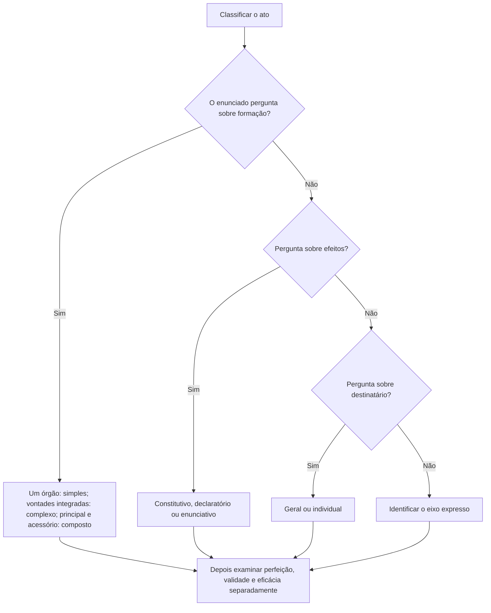

Um ato pode depender de uma ou mais manifestações de vontade, estar completo em sua formação e ainda aguardar condição para produzir efeitos. Por isso, perfeição, validade e eficácia não são sinônimos. Este capítulo compara atos simples, complexos e compostos e organiza os estágios de formação e produção dos efeitos, conceitos que aparecem juntos em questões de classificação.

> [!objetivos]
> - Distinguir ato simples, complexo e composto.
> - Separar perfeição, validade e eficácia.
> - Reconhecer atos pendentes e consumados.
> - Aplicar as classificações ao exemplo concreto.

## Formação da vontade

Ato simples resulta da manifestação de um único órgão, ainda que esse órgão seja colegiado e sua deliberação dependa de vários votos. A unidade relevante é o órgão, não o número de pessoas que participam da decisão. Exemplo: decisão colegiada tomada por conselho, conforme quórum próprio, pode constituir ato simples, pois a vontade imputada é a de um só órgão.

Ato complexo se forma pela conjugação de vontades de órgãos diferentes, que se integram para produzir um ato único. As manifestações são necessárias para a formação completa. Em exemplo clássico, a nomeação que depende de indicação por uma autoridade e aprovação de outro órgão pode exigir a conjugação desses atos institucionais, conforme a estrutura constitucional e o regime aplicável.

Ato composto reúne um ato principal e outro acessório, como aprovação ou visto, que controla ou confere eficácia ao principal sem integrar com ele uma vontade única. A distinção depende da função da manifestação adicional: se duas vontades de órgãos distintos se fundem na formação do ato único, tende a complexo; se há ato principal e ato acessório de aprovação, tende a composto.

| Tipo | Formação | Papel das manifestações | Exemplo didático |
|---|---|---|---|
| Simples | Um órgão | Uma vontade institucional, ainda que colegiada | Deliberação de conselho |
| Complexo | Mais de um órgão | Vontades se integram para ato único | Ato sujeito a aprovação constitutiva |
| Composto | Principal e acessório | Ato acessório controla ou libera eficácia do principal | Ato sujeito a visto posterior |

> [!pegadinha]
> “Colegiado” não significa automaticamente ato complexo. Se todos os votos compõem a vontade de um órgão, a classificação pode ser simples.

## Perfeição, validade e eficácia

Ato perfeito completou seu ciclo de formação. Perfeição descreve conclusão formal do processo de criação; não afirma que o conteúdo seja legal nem que já possa produzir efeitos. Um ato pode estar perfeito e ser inválido, se contrariar a lei. Também pode estar perfeito e válido, mas ainda ineficaz, se depender de publicação, aprovação, termo inicial ou condição suspensiva.

Validade é a conformidade do ato com os requisitos jurídicos: competência, finalidade, forma, motivo e objeto. Eficácia é a aptidão atual para produzir os efeitos jurídicos pretendidos. Um ato de nomeação pode estar assinado, mas a publicação exigida ainda não ocorreu; sua formação pode estar concluída, enquanto a eficácia perante terceiros aguarda publicidade. O exame deve observar a norma específica, pois os efeitos variam por categoria.

Um ato imperfeito ainda não concluiu a formação, por faltar manifestação essencial. Um ato pendente está perfeito, mas aguarda evento necessário para iniciar ou completar efeitos. Um ato consumado já produziu os efeitos a que se destinava. A classificação como consumado não impede que efeitos residuais, responsabilidades ou controle de legalidade continuem relevantes.

> [!esquema]
> - Formação concluída? Sim: ato perfeito. Não: imperfeito.
> - Está conforme a lei? Sim: válido. Não: inválido.
> - Pode produzir efeitos agora? Sim: eficaz. Não: ineficaz ou pendente de condição.
> - Efeitos já se exauriram? Sim: consumado, sem prejuízo de controle residual.

## Classificações e leitura do enunciado

A classificação pode considerar também destinatários, alcance, conteúdo ou efeitos. Atos gerais dirigem comandos a destinatários indeterminados dentro de uma categoria; atos individuais identificam pessoas ou situações concretas. Atos internos organizam a própria Administração; externos alcançam administrados ou outras pessoas. Atos constitutivos criam ou modificam uma situação jurídica; declaratórios reconhecem situação preexistente, sem necessariamente criá-la.

Não confunda essa classificação com a da formação. “Geral” responde quem recebe o comando; “complexo” responde quantas vontades institucionais participam da formação. Do mesmo modo, ato discricionário/vinculado trata da margem de escolha; perfeito/imperfeito trata da conclusão da formação; eficaz/ineficaz trata da produção de efeitos.

Exemplo: uma resolução de conselho pode ser geral quanto aos destinatários, simples quanto à formação se a vontade é de um órgão colegiado, perfeita quando sua deliberação e formalização terminam, válida se observa os requisitos e eficaz após a publicação exigida. Cada adjetivo responde a pergunta distinta.

> [!exemplo]
> A comissão de uma unidade aprova plano interno em reunião e a autoridade competente o homologa posteriormente. Primeiro determine se a homologação integra a vontade formadora ou apenas controla o ato principal. Depois verifique se a publicação é condição de eficácia. Não use o nome do documento como critério suficiente.

### Como identificar o estágio do ato

A perfeição se refere ao processo formativo: a autoridade competente completou as manifestações necessárias, assinaturas e deliberações que constituem o ato? Se falta anuência constitutiva de outro órgão, a formação ainda não se concluiu. Ato complexo não deve ser tratado como perfeito antes da integração das vontades exigidas. Já um ato simples pode ficar perfeito assim que o órgão competente termina a deliberação e formalização previstas.

Validade trata de conformidade jurídica, e eficácia de aptidão para gerar efeitos. Um ato perfeito e válido pode permanecer ineficaz enquanto não ocorrer a publicação ou aprovação que a lei prevê. Um ato perfeito pode ser inválido desde a origem, embora produza efeitos enquanto não for suspenso ou anulado. Essas categorias também ajudam a separar eficácia de exequibilidade: o ato pode produzir efeitos jurídicos, mas sua execução material depender de termo ou providência complementar.

Ato pendente costuma designar ato perfeito cujos efeitos aguardam termo, condição ou aprovação que não seja elemento de formação do ato. Ato consumado teve os efeitos típicos exauridos, mas isso não elimina automaticamente efeitos residuais, dever de indenizar, revisão ou controle judicial. Um ato extintivo pode encerrar a relação principal e ainda deixar pendente a apuração de valores ou responsabilidade.

| Situação | Perfeito? | Válido? | Eficaz? |
|---|---|---|---|
| Ato não assinado quando assinatura é essencial | Não | Ainda não se conclui | Não |
| Decisão completa, mas contrária à lei | Sim | Não | Pode ter efeitos provisórios até controle |
| Decisão regular aguardando publicação obrigatória | Sim | Sim em tese | Ainda não perante os efeitos que dependem da publicação |
| Ato com condição suspensiva não implementada | Sim | Pode ser | Não plenamente; está pendente |
| Ato que já realizou sua finalidade | Sim | Avaliável | Consumado quanto aos efeitos típicos |

> [!atencao]
> A eficácia pode depender de publicação, aprovação, condição ou termo. Primeiro veja se a manifestação adicional completa a formação (complexidade) ou apenas libera efeitos (composição/condição), conforme o instituto concreto.

### Classificações sem confusão de eixos

Quanto à produção dos efeitos, atos constitutivos criam, modificam ou extinguem uma situação jurídica; declaratórios reconhecem situação já existente; enunciativos certificam ou emitem juízo técnico sem constituir necessariamente a relação. Atos negociais consentem com atividade ou situação requerida pelo interessado, enquanto punitivos aplicam consequência administrativa por infração. Atos ordinatórios organizam o funcionamento interno; normativos expedem regras gerais subordinadas à lei. Essas espécies são categorias doutrinárias e podem variar na nomenclatura.

A classificação quanto ao destinatário não coincide com espécie ou efeito. Um ato punitivo pode ser individual; ato normativo normalmente tem conteúdo geral; ato enunciativo pode se dirigir a pessoa determinada. Ato simples pode ser geral ou individual, e ato complexo pode culminar numa nomeação individual. Sempre pergunte qual dimensão a banca quer testar: natureza do conteúdo, destinatário, liberdade, formação, eficácia ou alcance.

No critério de formação da vontade, o exemplo da nomeação que depende de manifestação de órgãos diferentes deve ser analisado conforme a norma aplicável. Se as manifestações formam conjuntamente um ato único, é complexo; se existe ato principal e aprovação acessória, é composto. A classificação não deve ser feita apenas pela ordem temporal das assinaturas. Também não confunda a aprovação que integra a formação com a publicação que apenas torna o ato oponível ou eficaz, quando assim dispuser o regime.

> [!pegadinha]
> Ato perfeito não é sinônimo de ato válido; ato válido não é sinônimo de ato eficaz; eficácia não significa que todos os efeitos já se exauriram. “Nulo”, “anulável” e “inexistente” não substituem a análise do elemento e da consequência jurídica pertinente.

> [!bizu]
> Use três perguntas em sequência: “terminou de se formar?” (perfeição); “respeitou o Direito?” (validade); “já pode produzir o efeito?” (eficácia). Para a classificação, responda antes ao eixo solicitado.

### Espécies e outros critérios usuais

As espécies normalmente apresentadas em prova incluem atos normativos, ordinatórios, negociais, enunciativos e punitivos. Normativos estabelecem comandos gerais e abstratos dentro da lei; ordinatórios distribuem funções e organizam serviços; negociais consentem com situação ou atividade do interessado; enunciativos certificam, atestam ou emitem opinião; punitivos aplicam consequência por infração. Um ato pode combinar critérios: por exemplo, punitivo e individual, interno ou externo, conforme seu alcance.

A classificação quanto aos efeitos também separa constitutivo, declaratório e extintivo. O constitutivo cria ou altera situação; o declaratório reconhece situação já existente; o extintivo encerra relação ou benefício conforme a norma. A aposentadoria concedida por ato administrativo ilustra reconhecimento/concessão de situação, mas os efeitos previdenciários dependem do regime legal e dos requisitos. A concessão de pensão também depende da lei, e não de simples registro declaratório. Sempre verifique se a Administração cria o direito ou reconhece um direito que nasce diretamente da norma.

Quanto ao alcance, atos gerais dirigem-se a destinatários não individualizados, enquanto os individuais identificam pessoa ou situação. Quanto à posição, internos orientam unidades e agentes; externos atingem pessoas fora da estrutura. Quanto à supremacia, atos de império usam prerrogativa pública, enquanto atos de gestão cuidam de bens e relações administrativas sem a mesma imposição. Atos de expediente dão andamento e não resolvem o pedido principal.

| Espécie | Função frequente | Exemplo novo |
|---|---|---|
| Normativo | Fixar comando geral subordinado à lei | Instrução com procedimento operacional |
| Ordinatório | Organizar a atividade interna | Escala ou ordem de serviço |
| Negocial | Anuir ou reconhecer situação requerida | Licença após requisitos legais |
| Enunciativo | Certificar fato ou emitir opinião | Atestado de tempo de serviço |
| Punitivo | Reprimir infração administrativa | Sanção disciplinar regular |

> [!lei] Lei 9.784/1999, art. 49
> Art. 49. Concluída a instrução de processo administrativo, a Administração tem o prazo de até trinta dias para decidir, salvo prorrogação por igual período expressamente motivada.

### Casos de validade e eficácia

Um ato pode estar pronto em sua formação e ainda não gerar efeitos externos. Publicidade oficial pode ser necessária para a eficácia ou oponibilidade; aprovação de órgão de controle pode integrar a formação ou atuar como condição, dependendo da regra aplicável. Não se deve concluir que qualquer visto posterior cria ato composto: é preciso saber se a manifestação é acessória ou necessária para formar a vontade única.

A perfeição costuma ocorrer quando o ato se aperfeiçoa por todas as manifestações exigidas. Um ato pendente espera condição ou termo; um consumado já produziu seus efeitos principais. Eficácia não se confunde com execução material. Uma determinação pode produzir efeitos jurídicos desde publicação, mas depender de equipe, prazo ou providência executiva para concretizar o objeto.

O ato tácito é expressão que algumas fontes usam para efeito atribuído por lei ao silêncio. A omissão continua sem manifestação expressa; a norma pode imputar consequência positiva ou negativa ao decurso do prazo. Não generalize: fora dos casos em que a lei disciplina o efeito, silêncio não significa que o ato se aperfeiçoou por vontade presumida.

Um ato inexistente não chegou a constituir manifestação juridicamente imputável, como hipótese extrema de usurpador sem vínculo ou investidura. Atos nulos e anuláveis, por outro lado, pressupõem algum ato formado, embora haja vício. A classificação e os efeitos variam, e não se deve confundir existência, perfeição, validade e eficácia. A presença de irregularidade processual pode levar à invalidação, saneamento ou preservação de atos conforme o prejuízo e a regra aplicável.

> [!atencao]
> A publicação pode ser requisito de eficácia sem integrar a manifestação de vontade. Uma condição suspensiva posterga os efeitos; um ato acessório pode controlar o principal; uma manifestação constitutiva de outro órgão pode completar ato complexo.

| Situação | O ato se formou? | Efeitos atuais? | Termo útil |
|---|---|---|---|
| Falta manifestação obrigatória que forma a vontade | Não | Não | Imperfeito |
| Ato completo aguardando data futura | Sim | Ainda não | Perfeito e pendente |
| Ato completo contrário a requisito legal | Sim | Pode haver efeitos até controle | Inválido |
| Ato válido publicado, mas ainda sem execução material | Sim | Jurídicos podem estar ativos | Eficaz, execução por cumprir |
| Ato que já exauriu efeitos principais | Sim | Efeitos típicos já realizados | Consumado |

> [!bizu]
> Não derive validade da perfeição nem perfeição da eficácia. Faça as perguntas em ordem: formação, conformidade jurídica, aptidão para produzir efeitos e exaurimento.

| Espécie quanto ao conteúdo | Função comum | Exemplo | Eixo distinto que pode se acumular |
|---|---|---|---|
| Normativo | Generalizar comando subordinado | Norma de procedimento | Geral, interno ou externo |
| Ordinatório | Ordenar serviço | Escala de plantão | Interno e individual |
| Negocial | Anuir a situação requerida | Autorização cabível | Individual e externo |
| Enunciativo | Declarar ou certificar fato | Certidão funcional | Individual, sem imperatividade necessária |
| Punitivo | Aplicar consequência por infração | Penalidade disciplinar | Individual, decisório e externo/interno |

> [!esquema]
> A espécie pelo conteúdo não determina a formação nem a eficácia. Um ato punitivo pode ser simples ou complexo conforme a competência; uma norma pode ser perfeita antes de sua eficácia; uma certidão pode ser individual e enunciativa.

### Nomeação e integração de manifestações

Uma nomeação que depende de escolha por autoridade e aprovação de outro órgão serve para testar ato complexo. A aprovação não é mera ciência se a Constituição a torna necessária para que a vontade estatal se complete. A autoridade que realiza a nomeação após essa etapa emite o ato resultante do procedimento conjunto. Para classificar, identifique se as duas manifestações são elementos formadores e se existe um ato único ao final.

Em outro cenário, a autoridade competente decide um ato principal e a chefia superior apenas o homologa para controle. A depender da regra, pode haver ato composto: uma manifestação principal e outra acessória. O fato de a homologação ocorrer depois não basta para concluir que seja composto; o critério é sua função jurídica. Se a aprovação integra a própria formação prevista pela norma, a classificação pode ser complexa.

A deliberação de órgão colegiado é simples quando a vontade imputada é a do próprio colegiado, embora existam diversos votos individuais. Se a regra exige um voto de um órgão e aprovação de outro independente, as vontades institucionais podem compor ato complexo. Nem toda assinatura adicional é manifestação de vontade: uma autoridade pode apenas autenticar ou publicar o que foi decidido.

| Sequência | Papel da segunda manifestação | Classificação provável |
|---|---|---|
| Conselho vota e registra decisão | Votos compõem vontade do conselho | Simples |
| Órgão A indica e órgão B aprova como condição constitutiva | Integra a formação do ato final | Complexo |
| Autoridade pratica ato e setor competente dá visto acessório | Controle posterior de ato principal | Composto, se a norma assim configurar |
| Autoridade assina decisão e servidor publica o extrato | Publicidade, sem vontade decisória adicional | Um ato com etapa de eficácia |

> [!pegadinha]
> O número de assinaturas não determina a classificação. Pergunte se as manifestações vêm de órgãos distintos e se ambas formam a decisão ou se uma delas apenas controla, certifica ou dá publicidade.

### Casos de pendência e consumação

Um ato perfeito pode ficar pendente de eficácia quando um termo inicial ainda não chegou, como data indicada para início de uma escala. Uma condição resolutiva pode encerrar efeitos quando evento previsto se realizar. A eficácia pode ser parcial: determinada obrigação começa com a publicação, enquanto providência material posterior depende de execução. O termo de início não altera a competência nem a validade do ato original, embora uma condição ilícita possa comprometer o conteúdo.

Ato consumado é aquele cujos efeitos típicos se realizaram, como uma autorização usada para uma atividade já concluída. O desfazimento posterior pode ser impossível ou inútil quanto ao resultado já exaurido, mas ainda pode haver efeitos jurídicos, revisão, restituição ou responsabilidade. Consumação não significa imunidade contra controle. Ato extintivo encerra relação continuada, mas pode depender de notificação para produzir efeitos e pode ser impugnado.

O direito pode prever efeitos tácitos quando o prazo transcorre sem manifestação expressa. Nessa hipótese, é a norma que atribui consequência; não se afirma que o agente expediu ato psicológico silencioso. Aprovação tácita, quando prevista e aplicável, pode gerar efeitos no limite do pedido e das condições legais. Sem previsão, o administrado pode pleitear decisão, e o silêncio não se transforma em aprovação geral.

> [!exemplo]
> Uma autorização é publicada em setembro, mas indica começo de validade no primeiro dia de outubro. A formação terminou em setembro, mas os efeitos só se iniciam no termo. Se a operação autorizada já ocorreu e se encerrou, o ato pode estar consumado quanto ao objetivo, ainda que uma discussão posterior sobre legalidade permaneça possível.

Os exemplos de licença, aposentadoria e pensão mostram que a palavra “concessão” não resolve sozinha a classificação. A lei define quando os requisitos se completam, quando surge o direito e quando a Administração reconhece ou constitui a situação. Um ato declaratório pode reconhecer situação que nasceu com o preenchimento dos requisitos; um ato constitutivo pode criar posição jurídica. É preciso verificar o regime previdenciário e o efeito próprio da decisão, sem generalizar por analogia.

A conclusão do ciclo de formação pode ocorrer antes da comunicação ao destinatário. A decisão é editada pela autoridade e publicada depois; a publicação não necessariamente acrescenta vontade, mas pode ser requisito para que terceiros conheçam e sofram seus efeitos. Se o ato depende de assinatura colegiada e publicação, a primeira completa a decisão, a segunda pode cumprir publicidade e eficácia. A regra específica define o ponto exato.

> [!exemplo]
> Uma ordem interna está assinada, mas aguarda data de início. Ela está formada e pode ser válida; os efeitos operacionais só começam na data indicada. Se sua publicação for requisito obrigatório, a Administração deve cumprir esse passo antes de exigir obediência externa.
## Mapa do capítulo

| Eixo | Categorias | O que examina |
|---|---|---|
| Formação | Simples / complexo / composto | Órgãos e função de cada vontade |
| Formação completa | Perfeito / imperfeito | Conclusão do ciclo de criação |
| Conformidade | Válido / inválido | Compatibilidade com requisitos jurídicos |
| Efeitos | Eficaz / ineficaz / pendente | Aptidão atual para produzir efeitos |
| Exaurimento | Consumado | Efeitos já realizados |
| Destinatários | Geral / individual | Determinação de quem é alcançado |

### Para fixar
- Ato simples deriva da vontade de um órgão, inclusive colegiado.
- Ato complexo conjuga vontades de órgãos diferentes para formar ato único.
- Ato composto tem ato principal e manifestação acessória.
- Perfeição significa formação concluída.
- Validade significa conformidade com o Direito.
- Eficácia significa aptidão para produzir efeitos.
- Ato perfeito pode ser inválido ou ainda ineficaz.
- Classificações respondem a eixos diferentes e podem coexistir.

