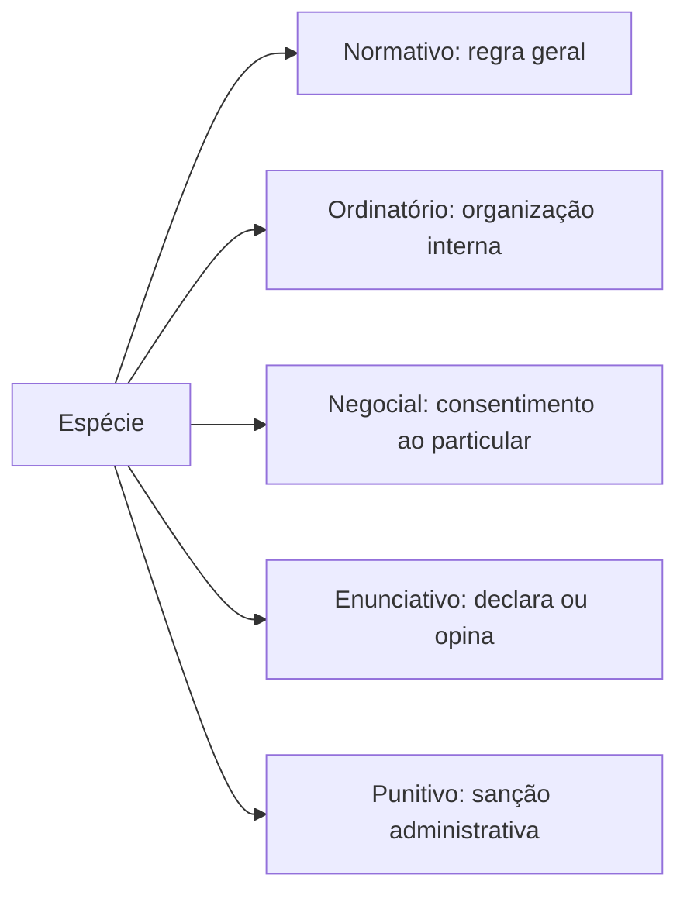

Todo ato administrativo tem uma roupa própria. O mesmo assunto pode virar decreto, resolução, portaria ou
parecer, e cada uma dessas formas tem limites, destinatários e efeitos diferentes. Saber reconhecer a espécie
é o que permite responder se o ato podia ser editado por aquela autoridade, se cria direito para o particular e
se cabe recurso administrativo. Este capítulo trata das três primeiras famílias: **normativos**, **ordinatórios**
e **enunciativos**. Os negociais e os punitivos ficam para os capítulos seguintes, porque têm regras próprias e
são muito explorados em prova.

> [!objetivos]
> - Distinguir as cinco espécies de ato administrativo pelo conteúdo e pelos destinatários.
> - Identificar o instrumento adequado para cada autoridade (decreto, resolução, regimento, portaria).
> - Explicar por que os atos normativos não inovam e como o Congresso reage quando eles excedem o limite.
> - Diferenciar certidão, atestado, parecer e apostila, inclusive quanto aos prazos e aos efeitos.
> - Reconhecer as pegadinhas de banca que trocam a espécie do ato ou o agente competente.

## Por que separar os atos em espécies

A classificação por espécie olha para o **conteúdo** do ato e para a **situação jurídica** que ele produz. Não
confunda com as outras classificações: quanto ao destinatário, o ato é geral ou individual; quanto à liberdade
da Administração, é vinculado ou discricionário; quanto à formação, é simples, complexo ou composto. A espécie
é outra pergunta: o que esse ato faz? Ele cria regra geral, organiza o serviço interno, declara um fato, consente
com um pedido ou pune alguém?

As cinco espécies cobradas no edital são as seguintes: **normativos**, **ordinatórios**, **negociais**,
**enunciativos** e **punitivos**. Uma frase resolve a dúvida na maioria das questões:

- O ato **normativo** cria regra geral e abstrata para todos os que estiverem naquela situação.
- O ato **ordinatório** organiza o trabalho interno e a conduta dos agentes, com base na hierarquia.
- O ato **negocial** atende a um pedido do particular e reconhece ou autoriza algo.
- O ato **enunciativo** apenas declara, opina ou certifica, sem decidir.
- O ato **punitivo** aplica sanção por infração administrativa.

O esquema abaixo fixa essa divisão e aponta o critério de cada família.

Há um detalhe que vale desde já. Nem todo ato praticado pela Administração é ato administrativo em sentido
**material**. Os normativos e os enunciativos, por exemplo, são atos administrativos apenas em sentido
**formal**, porque foram editados pela Administração, mas não têm o conteúdo típico de uma decisão
administrativa. Essa observação aparece em prova na forma de assertiva curta: "os atos normativos são atos
administrativos em sentido formal". A afirmação está correta.

## Atos normativos

### Conceito e limites

Ato normativo é o que contém **regra geral e abstrata**, aplicável a um número indeterminado de pessoas e a
situações futuras. Ele não resolve o caso de alguém; ele diz como os casos serão resolvidos. O decreto que
disciplina o uso de viaturas em operações, por exemplo, não determina nada a um motorista específico: fixa o
padrão para todos.

Duas consequências práticas decorrem disso.

Primeiro, **não há recurso administrativo contra o ato normativo em si**. Ele não produz efeito concreto
imediato, então não há prejuízo direto a impugnar. O interessado recorre quando o ato é aplicado a ele. O
candidato que se sente prejudicado por uma resolução de concurso só recorre depois de ser excluído por causa
dela.

Segundo, o controle judicial segue a lógica das leis, e não a dos atos individuais. Um decreto que viola
diretamente a Constituição pode ser atacado por ação direta de inconstitucionalidade, pelos legitimados do
art. 103 da Constituição. Fora desse caminho, o Judiciário examina o ato normativo no caso concreto, sem
retirá-lo do ordenamento em geral.

O limite central é a **legalidade**. Ato normativo editado pela Administração não é ato primário: ele não
inova na ordem jurídica, apenas detalha o que a lei já previu. O decreto não pode liberar o que a lei proíbe, nem
criar obrigação sem base legal.

> [!lei] CF, art. 49, V
> Compete exclusivamente ao Congresso Nacional sustar os atos normativos do Poder Executivo que exorbitem do
> poder regulamentar ou dos limites de delegação legislativa.

A sustação não é controle de legalidade comum: é uma reação política do Legislativo ao excesso do Executivo.
Ela retira a eficácia do ato, sem revogá-lo. Note também o alcance: a sustação do art. 49, V, alcança atos
normativos do Executivo, e não atos de outras autoridades, como resoluções de tribunais.

> [!atencao] Consulta pública e vinculação
> A LINDB permite que a edição de ato normativo seja precedida de consulta pública, preferencialmente
> eletrônica, dispensada nos atos de mera organização interna (art. 29). E os regulamentos, as súmulas
> administrativas e as respostas a consultas **vinculam** o órgão ou a entidade a que se destinam até revisão
> posterior (art. 30). Isso muda a vida do servidor: o entendimento publicado pela autoridade competente não é
> sugestão, é norma interna obrigatória.

### As espécies normativas

A doutrina separa os atos normativos pelo agente que os edita e pelo alcance. A tabela abaixo compara as seis
espécies que mais aparecem em prova.

| Espécie | Quem edita | Característica central |
| --- | --- | --- |
| Decreto | Chefe do Executivo (Presidente, governador, prefeito) | Regulamenta a lei ou, no caso do decreto autônomo, dispõe sobre organização interna |
| Regulamento | Quem tem poder regulamentar, por ato próprio ou aprovado por outro ato | Detalha a lei para permitir sua execução, com eficácia externa |
| Resolução | Altas autoridades que não são chefes do Executivo e órgãos colegiados | Norma geral; pode ser individual em casos previstos (aplicação de sanção) |
| Regimento | Colegiados e corporações | Efeitos internos, sobre o funcionamento do órgão |
| Instrução normativa | Ministros de Estado e órgãos superiores | Disciplina a execução de leis, decretos e regulamentos |
| Deliberação | Órgãos colegiados | Pode ser normativa (geral) ou decisória (individual) |

O **decreto** é privativo do chefe do Executivo. Ele aparece em duas formas. O decreto **regulamentar** ou de
execução detalha a lei, com base no art. 84, IV, da Constituição, e é geral e abstrato. O decreto **autônomo**
tem base no art. 84, VI, e inova na ordem jurídica, mas em hipóteses estreitas.

> [!lei] CF, art. 84, VI
> VI - dispor, mediante decreto, sobre:
> a) organização e funcionamento da administração federal, quando não implicar aumento de despesa nem criação ou extinção de órgãos públicos;
> b) extinção de funções ou cargos públicos, quando vagos;

Repare nos três limites do decreto autônomo: matéria de organização interna, ausência de aumento de despesa e
ausência de criação ou extinção de órgãos. A extinção de cargo só é possível se ele estiver **vago**. Se a
questão disser que o decreto extinguiu cargo ocupado, está errada. E cuidado com a extensão: o dispositivo
trata da administração federal. Governadores e prefeitos editam decretos com base na Constituição estadual e na
lei orgânica, em regra com o mesmo desenho, mas a literalidade cobrada em prova é a federal.

O decreto também pode ser **individual**, quando produz efeitos concretos, como o decreto de nomeação de um
ministro ou de declaração de utilidade pública para desapropriação. Nesse caso, o ato é materialmente
administrativo, ainda que a forma seja de decreto. A banca gosta dessa mistura: forma de decreto, conteúdo de
ato individual.

O **regulamento** explica e complementa a lei, sem contrariá-la e sem ultrapassá-la. Tem eficácia externa,
porque alcança os administrados. A diferença em relação ao decreto executivo é de **instrumento**: o regulamento
depende de outro ato que o aprove, em geral o próprio decreto que o aprova, e por isso costuma ser publicado como
anexo. Na prática, o decreto veicula o comando e o regulamento traz o detalhamento.

> [!exemplo] Decreto e regulamento no mesmo pacote
> O governador edita decreto que cria o programa de prevenção a incêndio em escolas e aprova o regulamento
> anexo, com prazos de vistoria e documentos exigidos. O decreto é o ato de comando; o regulamento é o anexo
> detalhado. Ambos são normativos e vinculam a corporação e as escolas alcançadas.

A **resolução** vem de autoridade que não é chefe do Executivo: altas autoridades administrativas, presidentes
de tribunais, órgãos legislativos e colegiados, como o CONTRAN e as agências reguladoras. Em regra é geral, mas
pode ser individual quando aplica sanção. Seu alcance pode ser interno ou externo. Não confunda com a resolução
do art. 59, VII, da Constituição, que é **ato legislativo** do Congresso Nacional. Mesmo nome, natureza
diferente.

O **regimento** tem efeitos internos e cuida do funcionamento de colegiados e corporações: regimento interno do
Congresso, do Supremo Tribunal Federal, de um conselho municipal de saúde. Não há hierarquia entre regimento e
lei, porque tratam de competências distintas. Ele é aprovado por um ato, em geral uma resolução, e essa
resolução não se confunde com o regimento aprovado.

A **instrução normativa** é editada por ministros de Estado ou por órgãos superiores para disciplinar a
execução de leis, decretos e regulamentos. É o instrumento típico de detalhamento operacional dentro da
Administração. A **deliberação** vem de órgão colegiado e pode ser normativa, quando fixa regra geral, ou
decisória, quando resolve um caso, como o indeferimento da habilitação de um licitante. A deliberação geral
prevalece sobre a decisória, e ambas ficam abaixo de regulamentos e regimentos.

> [!pegadinha] O chefe do Executivo não edita resolução
> A troca clássica é dizer que o governador nomeou alguém "por resolução" ou que o prefeito disciplinou o
> serviço "por resolução". O chefe do Executivo se manifesta por **decreto**. Resolução é de outras
> autoridades e de colegiados. Outra troca comum: atribuir ao Congresso a sustação de resolução de tribunal,
> quando o art. 49, V, fala de atos normativos do Poder Executivo.

## Atos ordinatórios

Atos ordinatórios disciplinam o **funcionamento interno** da Administração e a conduta funcional dos agentes.
O fundamento é o **poder hierárquico**: o superior edita para os subordinados da sua linha de comando, e o
alcance é interno. Quem está fora da hierarquia não é destinatário do ato.

Exemplos típicos: instruções, ofícios, circulares, portarias, avisos, ordens de serviço e despachos. Uma
circular que padroniza o uniforme da tropa, uma ordem de serviço que define a escala do plantão e uma portaria
que constitui a comissão de licitação são atos ordinatórios.

Eles podem ter conteúdo parecido com o de uma norma, mas não se confundem com os normativos. A circular que
padroniza procedimento interno é geral dentro da repartição, e ainda assim é ordinatória, porque não alcança
particulares e se apoia na hierarquia. A consequência é a posição na escala: os ordinatórios são inferiores a
leis, decretos, regulamentos e regimentos, e não podem contrariá-los.

Em regra, os atos ordinatórios **não criam direitos nem obrigações para particulares**. Eles podem impor
deveres e prerrogativas aos agentes e podem investir servidores em funções, como a portaria que nomeia a
comissão de concurso ou de processo disciplinar. Um particular não pode ser multado por descumprir circular
interna; a multa exige base em ato normativo ou em lei.

> [!atencao] Portaria: onde ela cai
> A portaria é o ato ordinatório mais cobrado. Ela serve para nomear, designar, instaurar procedimento,
> constituir comissão e organizar o serviço. Não serve para criar obrigação nova ao cidadão nem para
> regulamentar lei. Se a assertiva diz que "a portaria do comandante criou nova hipótese de punição", está
> errada, porque sanção depende de lei.

## Atos enunciativos

Ato enunciativo declara um fato preexistente, emite opinião ou juízo de valor, sem manifestação de vontade e
sem produzir, por si só, efeitos jurídicos imediatos. Ele informa, certifica ou opina. Também é ato
administrativo apenas em **sentido formal**, e a doutrina costuma chamá-lo de mero ato administrativo.

O mnemônico **CAPA** reúne os quatro: **C**ertidão, **A**testado, **P**arecer e **A**postila.

> [!bizu] CAPA
> Certidão, atestado, parecer e apostila. Se a questão falar de ato que "declara", "informa", "opina" ou
> "atualiza registro", pense em enunciativo antes de pensar em negocial.

### Certidão

Certidão é a cópia fiel de registro público, de processo, de livro ou de documento existente na repartição.
Autenticada, tem o mesmo valor probatório do original (CPC, art. 425, III). O direito de obter certidão é
assegurado a todos, **sem pagamento de taxa**, para defesa de direitos e esclarecimento de situações
(CF, art. 5º, XXXIV, b), e é uma das faces do princípio da publicidade.

O prazo é curto e não se estica.

> [!lei] Lei 9.051/1995, art. 1º
> As certidões para a defesa de direitos e esclarecimentos de situações, expedidas por órgãos públicos, deverão
> ser fornecidas no prazo improrrogável de 15 dias a contar do registro do pedido no órgão.

Improrrogável significa que não existe prorrogação por conveniência do órgão. Se a certidão não sai no prazo,
o interessado pode buscar o Judiciário, inclusive por mandado de segurança, porque o direito é líquido e certo.

Um detalhe que a banca explora: a Administração não pode exigir certidão além do que a lei prevê, e é ilegal
fixar prazo de validade para certidão que retrata fato imutável. Um órgão que exige "certidão de conclusão do
ensino médio com validade de 90 dias" cria exigência sem base legal, porque o fato certificado não muda.

### Atestado

O atestado declara fato ou situação de que o agente teve conhecimento, **sem registro** em livro ou documento.
É o caso do atestado de comparecimento, do atestado de saúde e da declaração de que o militar participou de
determinada instrução. Parte da doutrina separa certidão e atestado pelo objeto: certidão para situações
permanentes, com registro; atestado para situações transitórias, sem registro.

### Parecer

Parecer é a opinião técnica ou jurídica de órgão consultivo. Serve de subsídio à decisão e, em regra, não
produz efeito jurídico por si. Há três espécies, e a diferença está no grau de obrigação de pedir e de seguir.

| Espécie | A Administração é obrigada a pedir? | A conclusão vincula? |
| --- | --- | --- |
| Facultativo | Não; pede se quiser | Não |
| Obrigatório | Sim, por exigência legal | Não |
| Vinculante | Sim | Sim |

No parecer **facultativo**, a autoridade decide se consulta o órgão e não fica presa ao que ele disser. No
**obrigatório**, a lei manda ouvir o órgão, e a falta do parecer é vício de forma; a conclusão, porém, continua
sendo opinião, e a autoridade pode decidir de modo diverso, motivando a divergência. No **vinculante**, a
Administração precisa pedir o parecer e acatar a conclusão. O exemplo clássico é o parecer de junta médica na
aposentadoria por invalidez: reconhecida a incapacidade, a aposentadoria é consequência.

Quando um parecer é aprovado pela autoridade competente, ele pode ganhar conteúdo normativo. Se os efeitos são
internos, funciona como ato ordinatório. Os **pareceres normativos**, de efeitos externos, interpretam a lei,
vinculam a Administração e os particulares e dependem de publicação oficial. Em prova, a regra é tratar o
parecer como enunciativo, salvo quando o enunciado disser expressamente que se trata de parecer normativo.

### Apostila

Apostila atualiza, corrige, complementa ou emenda um documento já existente. Também é chamada de **averbação**.
Não cria situação jurídica nova: registra uma alteração que decorre da lei ou do próprio contrato. Na
contratação pública, o reajuste de preço e a atualização das penalidades financeiras podem ser registrados por
simples apostila (Lei 14.133/2021, art. 136). Na vida funcional, a averbação de tempo de contribuição na ficha
do servidor é o exemplo mais comum.

> [!atencao] Apostila não é aditivo
> Alteração de valor por reajuste previsto no contrato se registra por apostila. Mudança de objeto, de prazo
> ou de valor que não decorra de reajuste exige termo aditivo, com as formalidades do contrato. Trocar apostila
> por aditivo, e vice-versa, é erro de conteúdo.

## Como reconhecer a espécie pelo instrumento

A forma de exteriorização ajuda a identificar a espécie, mas não decide sozinha. O mesmo nome pode cobrir
conteúdos diferentes, e o mesmo conteúdo pode aparecer em instrumentos diferentes. A tabela abaixo organiza o
que a prova costuma cobrar.

| Instrumento | Autoridade típica | Espécie esperada |
| --- | --- | --- |
| Decreto | Chefe do Executivo | Normativo (ou individual, quando nomeia, desapropria) |
| Resolução | Colegiado, agência, tribunal, ministro | Normativo |
| Regimento | Colegiado | Normativo, com efeitos internos |
| Portaria | Autoridade administrativa | Ordinatório |
| Circular e ordem de serviço | Superior hierárquico | Ordinatório |
| Parecer | Órgão consultivo | Enunciativo |
| Certidão e atestado | Servidor ou setor competente | Enunciativo |

Duas confusões aparecem sempre. A primeira é chamar de normativo todo ato que tem generalidade: a circular
interna é geral dentro da repartição e continua ordinatória. A segunda é chamar de individual todo ato praticado
por decreto: existe decreto de efeitos concretos, como o de nomeação.

> [!pegadinha] Generalidade não define a espécie
> A banca escreve: "o ato que estabelece regra geral é sempre normativo". É falso. O critério é o conjunto:
> generalidade, abstração, destinatários e fundamento de competência. Ato geral dirigido apenas aos servidores
> de um setor, com base na hierarquia, é ordinatório.

## O que mais cai

O resumo do capítulo cabe em cinco ideias. Normativos criam regra e não inovam; ordinatórios organizam o
serviço interno; enunciativos declaram ou opinam; a competência e o instrumento precisam combinar; e a
consequência prática de cada espécie muda (recurso, controle, criação de direito).

Uma revisão rápida do que a banca cobra com mais frequência:

- sustação pelo Congresso dos atos normativos do Executivo que exorbitam do poder regulamentar;
- decreto autônomo restrito a organização interna, sem aumento de despesa, sem criação ou extinção de órgãos e
  com extinção de cargos apenas vagos;
- distinção entre decreto e regulamento pelo ato de aprovação;
- certidão em 15 dias improrrogáveis, sem taxa, para defesa de direitos;
- parecer obrigatório que não vincula e parecer vinculante que obriga a acatar;
- apostila para reajuste e averbação, sem mudança de objeto.

> [!esquema] Três espécies em uma linha
> - Normativo: regra geral, destinatários indeterminados, não inova, sem recurso contra o ato em si.
> - Ordinatório: hierarquia, efeitos internos, não cria obrigação para o particular.
> - Enunciativo: declara, certifica ou opina, sem efeito jurídico imediato (CAPA).

## Mapa do capítulo

| Espécie | Função | Exemplos | Limite principal |
| --- | --- | --- | --- |
| Normativo | Regra geral e abstrata | Decreto, regulamento, resolução, regimento, instrução normativa, deliberação | Não inovar; observar a lei e a competência |
| Ordinatório | Organizar o serviço e a conduta interna | Portaria, circular, ordem de serviço, aviso, ofício, despacho | Alcance interno; não cria dever para particular |
| Enunciativo | Declarar, certificar ou opinar | Certidão, atestado, parecer, apostila | Não decide nem produz efeito imediato |
| Negocial | Consentir com pedido do particular | Licença, autorização, permissão, homologação | Depende de pedido; não é contrato |
| Punitivo | Punir infração administrativa | Multa, interdição, destruição de coisas | Legalidade, contraditório e proporcionalidade |

### Para fixar

- Ato normativo é geral e abstrato, não inova e não admite recurso administrativo contra ele mesmo.
- O Congresso pode sustar atos normativos do Executivo que exorbitem do poder regulamentar (CF, art. 49, V).
- O decreto é privativo do chefe do Executivo; o regulamento depende de ato que o aprove.
- No decreto autônomo só cabe extinguir cargo vago, sem aumento de despesa e sem criar ou extinguir órgãos.
- Resolução não é ato do chefe do Executivo e não se confunde com a resolução legislativa do art. 59, VII.
- Ato ordinatório decorre da hierarquia, tem alcance interno e não cria obrigação para o particular.
- Enunciativos são CAPA: certidão, atestado, parecer e apostila.
- Certidão para defesa de direito sai em 15 dias improrrogáveis e sem taxa.
- Parecer obrigatório exige pedido, mas não vincula; parecer vinculante obriga a acatar a conclusão.
- Apostila registra reajuste e averbação; mudança de objeto ou de prazo exige termo aditivo.
