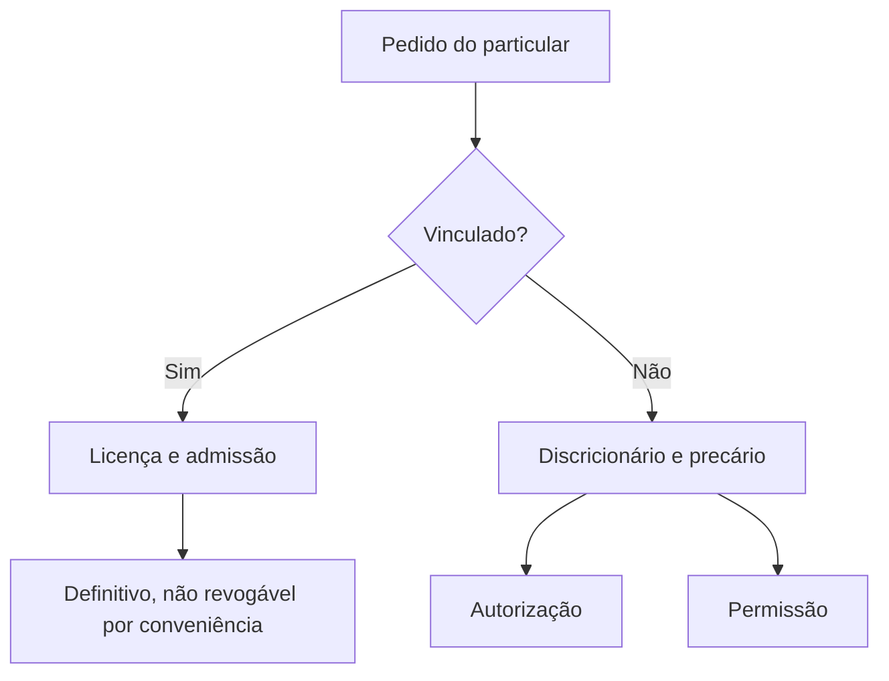

O particular pede, a Administração responde. Essa é a lógica dos **atos negociais**, a família em que o
interesse do cidadão encontra o interesse público e o Estado consente, reconhece ou autoriza. No outro extremo
estão os **atos punitivos**, com que a Administração reprime infrações. As duas famílias são muito cobradas
porque a banca gosta de trocar o grau de liberdade do administrador (vinculado ou discricionário) e o grau de
estabilidade do ato (definitivo ou precário). Este capítulo resolve essas duas confusões.

> [!objetivos]
> - Explicar o que caracteriza o ato negocial e por que ele não é contrato.
> - Comparar licença, autorização e permissão quanto à vinculação, à estabilidade e ao interesse predominante.
> - Identificar aprovação, homologação, visto, admissão, dispensa e renúncia pelo conteúdo.
> - Classificar a sanção administrativa em interna e externa e indicar seus fundamentos.
> - Reconhecer as pegadinhas que trocam ato negocial por contrato ou sanção interna por externa.

## O que é um ato negocial

Ato negocial é o que a Administração pratica para **consentir** com uma pretensão do particular ou para
**reconhecer** uma situação jurídica dele. O nome engana: não há negociação nem acordo. O ato continua sendo
unilateral, praticado pela Administração sozinha, depois de um pedido. A doutrina também chama esses atos de
**atos de consentimento**.

Três marcas aparecem na prova.

Primeiro, o ato **depende, em regra, de solicitação** do interessado. A Administração não sai concedendo licença
para dirigir nem autorizando uso de praça por conta própria.

Segundo, os efeitos são **individuais, específicos e concretos**: alcançam aquela pessoa, naquela situação.

Terceiro, o ato negocial **não tem imperatividade, autoexecutoriedade nem coercibilidade**. Ele reconhece um
direito ou autoriza uma atividade; não impõe dever e não é executado à força. Quem obtém licença para construir
não é obrigado a construir. Quem recebe autorização para adquirir arma de fogo não é obrigado a comprar.

> [!atencao] Ato negocial não é contrato
> No contrato há duas vontades que se encontram e formam um acordo, com obrigações recíprocas. No ato negocial
> existe pedido do particular, mas a decisão é unilateral da Administração. A licença de funcionamento de uma
> academia é ato negocial; o contrato de concessão de serviço público é contrato administrativo.

Quanto à liberdade, o ato negocial pode ser **vinculado** ou **discricionário**. Quanto à estabilidade, pode ser
**definitivo** ou **precário**. Essas duas classificações se combinam, e a combinação é o que a banca cobra.

| Ato | Quanto à liberdade | Quanto à estabilidade |
| --- | --- | --- |
| Licença | Vinculado | Definitivo |
| Autorização | Discricionário | Precário |
| Permissão clássica | Discricionário | Precário |

A regra que explica a tabela é simples: ato vinculado reconhece direito e não se revoga por conveniência; ato
discricionário depende de oportunidade e pode ser retirado quando o interesse público mudar. Só ato
discricionário pode ser precário.

## Licença

A licença é um ato unilateral, **vinculado**, em que a Administração confirma um **direito subjetivo** do
particular que cumpriu os requisitos legais. Como o direito já está na lei, a Administração não escolhe: se os
requisitos estão presentes, a licença deve ser concedida.

O exemplo mais claro é a habilitação para dirigir. O candidato cumpre os requisitos do Código de Trânsito,
é aprovado nos exames e recebe o documento. A autoridade não pode negar por conveniência, nem estabelecer
exigência que a lei não previu. Se negar sem motivo legal, ou se demorar além do razoável, cabe medida judicial,
inclusive **mandado de segurança**, porque o direito é líquido e certo (CF, art. 5º, LXIX).

Outros exemplos: alvará de construção, alvará de funcionamento de estabelecimento comercial, licença para
exercer profissão regulamentada, licença ambiental.

A licença é ato **definitivo**, e isso significa que não se revoga por simples conveniência. Ela pode ser
desfeita por duas vias:

- **cassação**, quando o particular descumpre condição necessária para mantê-la, como a academia que perde a
  licença de funcionamento por reiteradas falhas de segurança;
- **anulação**, quando a concessão teve ilegalidade, como a licença emitida sem o laudo exigido.

Além disso, a própria lei pode fixar **prazo de eficácia**: a habilitação para dirigir tem validade e precisa ser
renovada. Prazo de validade não é revogação; é o desenho legal do ato.

> [!atencao] Exceção da licença para construir
> A doutrina admite revogar a licença de construção se a obra ainda não foi iniciada. A justificativa é que,
> antes do início, não há investimento consolidado nem direito em exercício. Iniciada a obra, a licença não se
> revoga por conveniência. A banca cobra essa exceção como afirmação isolada.

Sobre a natureza dos efeitos, há divergência doutrinária. Di Pietro e Carvalho Filho tratam a licença como ato
**declaratório**, porque ela apenas reconhece um direito que já existe na lei. Alexandrino e Paulo a veem como
**constitutivo**, porque, antes da licença, o direito não pode ser exercido. Em prova, as duas posições são
aceitas, desde que a questão indique o autor ou peça a corrente majoritária.

> [!pegadinha] Licença não se revoga por conveniência
> A banca escreve: "a licença, por ser ato discricionário, pode ser revogada a qualquer tempo". Duas coisas
> erradas na mesma frase: a licença é vinculada e é definitiva. Outra troca comum: chamar de revogação o
> desfazimento por descumprimento de requisito, que é **cassação**.

## Autorização

Autorização é o ato unilateral, **discricionário** e **precário** pelo qual a Administração faculta ao
particular exercer uma atividade ou usar um bem público. Aqui a Administração avalia conveniência e
oportunidade, além dos requisitos legais. Por isso o pedido pode ser negado mesmo quando o particular cumpre
tudo o que a lei exige.

O interesse predominante é do **particular**: a atividade serve principalmente a quem a exerce. A autorização
para comprar arma de fogo serve ao comprador; a autorização para usar uma praça em evento de fim de semana
serve ao organizador.

O prazo costuma ser **indeterminado**, porque o ato é revogável a qualquer tempo. Nada impede que a lei ou o
próprio ato fixem prazo. As aplicações mais comuns aparecem na tabela.

| Modalidade | Objeto | Exemplo |
| --- | --- | --- |
| Polícia administrativa | Atividade que exige consentimento estatal | Compra de arma de fogo, porte para defesa |
| Uso de bem público | Uso privativo ou especial de bem público | Evento comunitário em praça pública |
| Serviço público | Delegação da prestação indireta | Exploração de serviço de táxi |

Um ponto de atualização importante vem da Constituição.

> [!lei] CF, art. 170, parágrafo único
> É assegurado a todos o livre exercício de qualquer atividade econômica, independentemente de autorização de
> órgãos públicos, salvo nos casos previstos em lei.

Em outras palavras: a regra é a liberdade, e o consentimento estatal é exceção que precisa de base legal. A Lei
13.874/2019 reforçou essa lógica ao dispensar licenças e autorizações para atividade de baixo risco. Assim, não se exige autorização para abrir a maioria dos negócios; exige-se quando a lei determina, por
razões de segurança, saúde ou ordem pública.

A regra geral é a discricionariedade, mas existe **exceção legal**: na exploração de serviços de
telecomunicações em regime privado, a autorização é vinculada pela Lei Geral de Telecomunicações (Lei
9.472/1997). Em prova, trate a autorização como discricionária, salvo se o enunciado citar expressamente esse
setor.

## Permissão

No sentido clássico, permissão é o ato unilateral, **discricionário** e **precário** pelo qual a Administração
consente ao particular uma atividade ou o **uso privativo de bem público**. O exemplo tradicional é o quiosque
instalado em praça pública: o permissionário explora o comércio, mas o interesse que predomina é o da
coletividade, que ganha o serviço no local.

A diferença em relação à autorização está no **interesse predominante**. Na permissão, predomina o interesse
público; na autorização, o interesse do particular. Todo ato administrativo atende ao interesse público, então
a comparação é sempre entre interesses predominantes.

A permissão clássica é **revogável a qualquer momento, sem indenização**. Esse desenho, porém, foi mitigado em
duas frentes.

A primeira é a **permissão de serviço público**. A Constituição determina que a prestação de serviço público por
terceiro se dá por concessão ou permissão, sempre mediante licitação (CF, art. 175). A Lei 8.987/1995 trata a
permissão de serviço público como **contrato administrativo**, bilateral e precário, precedido de licitação
(art. 2º, IV). Existem, portanto, duas figuras com o mesmo nome: a permissão como ato unilateral, para atividade
ou uso de bem, e a permissão como contrato, para delegação de serviço público.

| Critério | Permissão como ato | Permissão de serviço público |
| --- | --- | --- |
| Natureza | Ato unilateral | Contrato administrativo |
| Licitação | Não exige | Sempre exige |
| Objeto | Atividade ou uso de bem público | Delegação de serviço público |
| Estabilidade | Precária, sem indenização em regra | Precária, com prazo e condições contratuais |

A segunda mitigação é a **permissão condicionada** ou contratual. A Administração pode impor exigências ao
permissionário, como remuneração pelo uso e padrão mínimo de atendimento, e, em contrapartida, oferecer
garantias, como prazo mínimo que justifique o investimento. Nesse caso, a revogação fica limitada e, se ocorrer
antes do prazo, gera **indenização** nos termos do ato.

> [!exemplo] Quiosque na orla
> A prefeitura permite que uma cooperativa mantenha quiosque de água de coco na orla, com prazo de dois anos,
> contrapartida mensal e exigência de higiene. Se o município revogar no primeiro ano para instalar outro
> projeto, terá de indenizar o investimento não amortizado, porque a permissão foi condicionada. Na permissão
> simples, sem prazo nem contrapartida, a saída é livre e sem indenização.

## Outros atos negociais

Além de licença, autorização e permissão, a doutrina lista outros atos de consentimento. Alguns não reúnem todas
as características da família, porque ocorrem dentro de procedimento já instaurado ou sem pedido do
interessado. Ainda assim, em prova, são tratados como negociais.

| Ato | Conteúdo | Natureza | Exemplo |
| --- | --- | --- | --- |
| Aprovação | Controle de outro ato, antes ou depois de praticado | Discricionário | Senado aprova indicação para tribunal superior |
| Homologação | Reconhece a legalidade de ato já praticado | Vinculado e sempre posterior | Homologação do resultado de concurso |
| Visto | Declara ciência e regularidade formal, sem opinar | Sem manifestação de vontade | Visto do superior em requerimento |
| Admissão | Concede direito a receber serviço prestado pelo Estado | Vinculado | Matrícula em escola ou hospital público |
| Dispensa | Libera o particular de cumprir exigência legal | Discricionário | Dispensa do serviço militar obrigatório |
| Renúncia | Administração abre mão de crédito ou direito próprio | Exige autorização legal | Renúncia à cobrança de crédito prescrito |

**Aprovação** é o controle que a Administração faz sobre outro ato, próprio ou de terceiro. Pode ser prévia ou
posterior. Quando é posterior, recebe o nome de **referendo**. A aprovação é, em regra, discricionária: o Senado
aprova ou não o nome indicado para um tribunal superior, avaliando conveniência política.

**Homologação** é sempre **posterior** e é **vinculada**. Ela verifica a legalidade de um ato já praticado, como
o resultado de um concurso ou de uma licitação. Homologar não é escolher: é confirmar que o procedimento seguiu
a lei.

**Visto** é a declaração de que a autoridade tomou ciência do ato e verificou a regularidade formal, sem opinar
sobre o mérito. O visto do chefe imediato no requerimento do subordinado é o exemplo típico.

**Admissão** concede ao particular o direito de receber um serviço que o Estado presta diretamente. A diferença
em relação à licença é o protagonista: na licença, o particular exerce atividade por conta própria; na admissão,
é o Estado que presta o serviço ao admitido. Negada a admissão indevidamente, cabe mandado de segurança.

**Dispensa** libera o particular de uma obrigação legal. Não se confunde com autorização: a autorização faculta
uma atividade; a dispensa afasta uma exigência.

**Renúncia** é ato abdicativo: a Administração abre mão de um direito ou crédito próprio e, com isso, libera o
devedor. Como envolve interesse público, exige **autorização legal** e, em regra, não pode ser usada para
favorecer alguém por conveniência administrativa.

> [!bizu] Verbos que identificam o ato
> Aprovar é controlar; homologar é confirmar depois; dar visto é tomar ciência; admitir é receber no serviço;
> dispensar é liberar de obrigação; renunciar é abrir mão. Se a questão descrever um desses verbos, procure o
> ato correspondente na lista.

## Atos punitivos

Atos punitivos aplicam **sanção por infração administrativa**. São a resposta do Estado ao descumprimento de
norma administrativa, sem relação com o Direito Penal. A punição penal depende do Judiciário; a administrativa
é aplicada pela própria autoridade competente, após o devido processo.

As sanções se dividem em dois grupos, conforme a origem do vínculo.

| Grupo | Origem | Exemplos |
| --- | --- | --- |
| Interna | Regime funcional do servidor (estatuto de cada carreira) | Advertência, suspensão, demissão |
| Externa | Relação geral entre Administração e administrado | Multa de polícia, apreensão de bens, interdição, destruição de coisas |

Na esfera federal, as penalidades disciplinares estão no art. 127 da Lei 8.112/1990: advertência, suspensão,
demissão, cassação de aposentadoria ou disponibilidade, destituição de cargo em comissão e destituição de função
comissionada. Nos estados e municípios, o estatuto próprio define o catálogo. O importante, para a prova, é que
a sanção interna nasce do **vínculo funcional** e a externa nasce do **poder de polícia**.

### Fundamentos

Dois poderes sustentam a punição administrativa.

O **poder disciplinar** alcança os servidores e as pessoas com vínculo especial com a Administração, como os
contratados que atuam em suas dependências. Ele pode gerar sanções internas e também externas, como a multa
aplicada a empresa contratada por descumprir o contrato.

O **poder de polícia** alcança qualquer pessoa, sem vínculo específico, e sempre gera sanções externas. A multa
de trânsito e a interdição de estabelecimento irregular são exemplos.

### Princípios obrigatórios

A aplicação da sanção administrativa segue um pacote de garantias que a banca cobra em bloco:

- **legalidade**: a infração e a sanção precisam estar previstas em lei;
- **contraditório e ampla defesa**: o acusado deve ser ouvido antes da punição;
- **devido processo legal**: o procedimento precisa seguir o rito previsto, como sindicância e processo
  administrativo disciplinar;
- **proporcionalidade**: a sanção deve ser compatível com a gravidade da falta;
- **motivação**: a decisão precisa expor as razões de fato e de direito.

> [!atencao] Sanção sem processo é nula
> A aplicação de penalidade sem instauração de procedimento e sem defesa viola o contraditório e o devido
> processo legal. A urgência não autoriza punição sumária. Em caso de risco grave, a Administração pode afastar
> preventivamente o agente, mas isso não substitui o processo nem equivale a punição.

> [!pegadinha] Multa administrativa não é pena criminal
> A banca escreve: "a multa aplicada pelo órgão ambiental configura pena de multa, aplicada pelo poder punitivo
> do Estado". Errado. Pena é aplicada pelo Judiciário, em processo penal. A multa administrativa é sanção
> aplicada por autoridade administrativa, com fundamento no poder de polícia. Também é erro dizer que o
> particular sem vínculo com a Administração só pode sofrer sanção interna: sanção interna pressupõe vínculo
> funcional.

## Comparando as duas famílias

Ato negocial e ato punitivo ocupam posições opostas na relação com o particular. No primeiro, a Administração
atende a um pedido e amplia a esfera jurídica de quem solicitou: reconhece um direito, autoriza uma atividade ou
entrega um serviço. No segundo, ela reage a um comportamento e restringe essa esfera, impondo advertência,
multa, interdição ou demissão. A diferença de sentido explica por que o procedimento também muda. O ato
negocial pode ser praticado com base em requerimento e documentos, sem contraditório prévio amplo, porque não
há acusação. O ato punitivo exige apuração, ciência do acusado, possibilidade de resposta e decisão motivada,
porque há sanção em jogo. A tabela abaixo resume o contraste que a banca mais explora.

| Critério | Ato negocial | Ato punitivo |
| --- | --- | --- |
| Origem | Pedido do particular | Infração administrativa |
| Efeito | Consente ou reconhece | Reprime e sanciona |
| Imperatividade | Não tem | Tem, porque impõe consequência |
| Contraditório prévio | Em regra não exige | Obrigatório |
| Exemplo | Licença, autorização, permissão | Multa, interdição, demissão |

Há ainda uma consequência sobre o controle. O indeferimento de ato negocial vinculado, como a licença, é
controlado pelo Judiciário quanto à existência dos requisitos, porque o direito é subjetivo. O indeferimento de
ato discricionário, como a autorização, só é anulado quando houver ilegalidade ou desvio de finalidade, pois a
conveniência é do administrador. Já a sanção é controlada quanto à legalidade, à proporcionalidade e à
motivação, e a ausência de qualquer desses elementos retira o fundamento do ato.

> [!esquema] Roteiro de decisão em prova
> 1. Pergunte quem pediu: se houve pedido e consentimento, é negocial.
> 2. Verifique se a lei obriga a conceder: vinculado é licença ou admissão; discricionário é autorização ou
>    permissão.
> 3. Veja o interesse predominante: particular, autorização; coletivo, permissão.
> 4. Se a consequência é punição, procure o vínculo: funcional, sanção interna; geral, sanção externa.

## Mapa do capítulo

| Instituto | Marca decisiva | Pegadinha frequente |
| --- | --- | --- |
| Licença | Vinculada e definitiva, reconhece direito | Dizer que se revoga por conveniência |
| Autorização | Discricionária e precária, interesse do particular | Chamar de vinculada fora das exceções legais |
| Permissão | Discricionária e precária, interesse público | Confundir ato com contrato de serviço público |
| Aprovação | Controle prévio ou posterior | Dizer que é sempre vinculada |
| Homologação | Vinculada e posterior | Dizer que pode ser prévia |
| Visto | Ciência formal, sem opinião | Atribuir juízo de mérito ao visto |
| Admissão | Estado presta o serviço | Confundir com licença |
| Dispensa | Afasta obrigação legal | Confundir com autorização |
| Renúncia | Abre mão de crédito, exige lei | Tratar como ato livre |
| Punitivo interno | Vínculo funcional | Aplicar a particular sem vínculo |
| Punitivo externo | Poder de polícia | Chamar de pena criminal |

### Para fixar

- Ato negocial é unilateral, atende a pedido do particular e não se confunde com contrato.
- Licença é vinculada e definitiva; só se desfaz por cassação, anulação ou prazo legal de validade.
- Autorização é discricionária e precária, com interesse predominante do particular.
- Permissão clássica é discricionária e precária, com interesse predominante público.
- A permissão de serviço público é contrato e exige licitação (CF, art. 175; Lei 8.987/1995, art. 2º, IV).
- Aprovação é discricionária; homologação é vinculada e sempre posterior; visto é só ciência formal.
- Admissão é vinculada e o Estado presta o serviço; dispensa afasta obrigação legal; renúncia exige lei.
- Sanção interna decorre do vínculo funcional; sanção externa decorre do poder de polícia.
- Toda sanção exige legalidade, contraditório, devido processo, proporcionalidade e motivação.
- Multa administrativa não é pena criminal e não se aplica sem processo regular.
