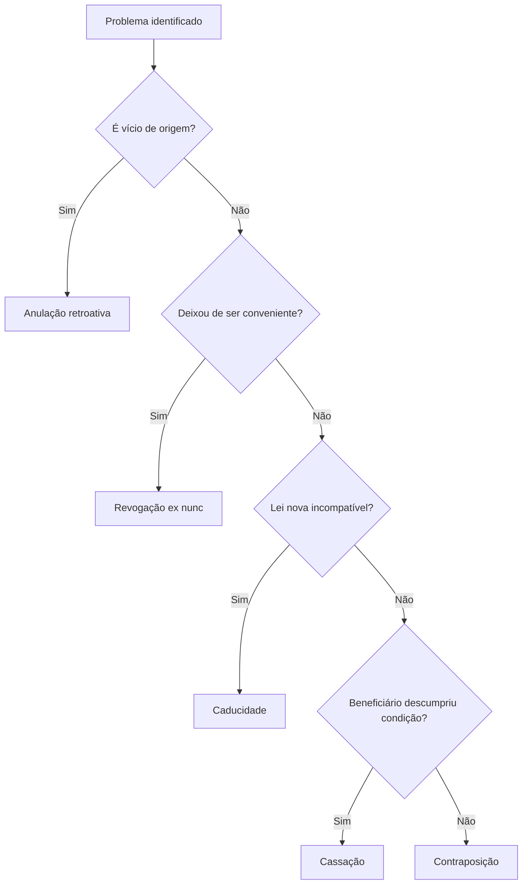

Um ato administrativo nasce, produz efeitos e um dia deixa de existir. A saída pode ser natural, quando o
conteúdo se esgota, ou provocada, quando a própria Administração retira o ato. Aqui aparece o tema mais
recorrente da disciplina: a **autotutela**. A Administração revê os próprios atos sem pedir licença ao
Judiciário, mas esse poder tem limites, forma e consequências. Este capítulo monta o quadro geral da extinção
e aprofunda a **anulação**. A revogação e a decadência ficam para o capítulo seguinte, e a convalidação para o
último, porque cada uma tem prazos e efeitos próprios.

> [!objetivos]
> - Listar as formas de extinção do ato e distinguir extinção natural de retirada.
> - Diferenciar caducidade, contraposição, cassação, anulação e revogação pelo fato que provoca a saída.
> - Explicar a autotutela com as Súmulas 346 e 473 do STF e seus limites.
> - Apontar quando o desfazimento exige contraditório, motivação e observância da LINDB.
> - Reconhecer os efeitos típicos, atípicos e impróprios e o alcance retroativo da anulação.

## Como um ato deixa de existir

Extinguir é encerrar os efeitos do ato. A doutrina separa as causas em dois grupos: as que decorrem do próprio
funcionamento do ato e as que resultam de uma decisão de retirada.

No primeiro grupo está a **extinção natural**, pelo cumprimento dos efeitos. Ela aparece de três maneiras: pelo
esgotamento do conteúdo jurídico, como as férias depois de gozadas; pela execução material, como a demolição
determinada que foi realizada; e pelo termo final ou condição resolutiva, como o benefício previsto para vigorar
até a disponibilização de um medicamento na rede pública.

Ainda nesse grupo ficam duas situações ligadas às pessoas e ao objeto. A **extinção subjetiva** ocorre quando
desaparece o beneficiário de ato personalíssimo: a autorização de porte de arma se extingue com a morte do
titular, embora a arma em si seja transmitida aos herdeiros. A **extinção objetiva** ocorre quando desaparece o
objeto: a permissão para banca de jornal cai se a praça deixar de existir, e a interdição de estabelecimento
perde objeto se o estabelecimento foi desativado.

Há também a **renúncia**, em que o próprio beneficiário abre mão da vantagem, como o servidor que renuncia à
aposentadoria já concedida para continuar na ativa.

O segundo grupo é a **retirada**: o Estado encerra o ato antes do esgotamento natural. É aqui que entram as
cinco figuras que a prova cobra. A tabela compara pelo fato que provoca a retirada.

| Figura | Fato que provoca | O ato anterior era válido? |
| --- | --- | --- |
| Caducidade | Lei nova incompatível com a situação | Sim |
| Contraposição | Novo ato de efeitos opostos | Sim |
| Cassação | Descumprimento de condição pelo beneficiário | Sim |
| Anulação | Ilegalidade na edição | Não |
| Revogação | Perda de conveniência e oportunidade | Sim |

**Caducidade** é a extinção por **lei superveniente** que torna impossível manter a situação antes consentida.
A nova lei não anula o ato: ela retira o fundamento para sua continuidade. Se o município aprova lei proibindo
uso privativo de calçada, a permissão de mesa de bar na calçada caduca. Trata-se de uma ilegalidade posterior,
porque o ato era legal quando foi editado. Em ato precário, como a permissão, não há direito adquirido a
oportunizar.

**Contraposição**, também chamada de derrubada, é a retirada por **novo ato de efeitos contrários**. A
exoneração desfaz a nomeação; a dispensa desfaz a designação. Não há vício nem inconveniência: há um ato novo
que produz o efeito inverso.

**Cassação** desfaz ato **válido** porque o beneficiário **descumpriu as condições** necessárias para mantê-lo.
É, em regra, vinculada e sancionatória: a autoridade não escolhe aplicar, se a hipótese legal está configurada.
Exemplos: cassação da habilitação para dirigir por infração gravíssima, cassação de licença de funcionamento
por descumprimento de exigência sanitária, cassação de aposentadoria por falta grave comprovada em processo.

Nem toda cassação nasce de infração. A perda das condições pessoais também produz o mesmo efeito: o motorista
que perde a visão exigida não cometeu falta, mas perde o direito de dirigir. O ponto comum é a quebra do
requisito de manutenção.

> [!pegadinha] Cassação não é anulação
> Anulação pressupõe ato ilegal desde o início. Cassação pressupõe ato legal que perdeu a condição de
> continuidade. A banca troca as duas com frequência: "a cassação da licença por vício de competência" está
> errada, porque vício de origem leva à anulação.

> [!bizu] Cinco retiradas, cinco gatilhos
> Lei nova: caducidade. Ato oposto: contraposição. Quebra de condição: cassação. Ilegalidade: anulação.
> Inconveniência: revogação.

## Autotutela

A Administração controla os próprios atos. Não precisa de autorização judicial para corrigir ou retirar o que
fez, e pode agir de ofício ou a pedido de quem tenha interesse.

> [!jurisprudencia] STF, Súmula 473
> Respeitados os direitos adquiridos, a Administração pode revogar o próprio ato por conveniência e
> oportunidade, e anular o ato ilegal, porque deste não nascem direitos. Em qualquer dos casos, fica ressalvada
> a apreciação judicial.

A Súmula 346 do STF completa a ideia: a Administração pode declarar nulos os atos que ela mesma praticou.
Juntas, as duas súmulas sustentam o princípio da **autotutela**, que é a capacidade de rever os próprios atos
sem intervenção do Judiciário.

Quatro características precisam ficar claras.

A autotutela é **autoexecutória**: a decisão administrativa produz efeitos sem ordem judicial prévia. Isso não
afasta o controle posterior pelo Judiciário.

Ela é exercida **de ofício ou por provocação**. Um servidor prejudicado pode pedir a revisão, mas a
Administração também pode agir por conta própria.

Ela alcança **legalidade e mérito**. Ao anular, examina vício; ao revogar, examina conveniência. Já o
Judiciário, quando provocado, examina apenas a legalidade, porque não lhe cabe substituir a escolha
administrativa.

Ela **não é ilimitada**. Existem prazos, direitos adquiridos, boa-fé, segurança jurídica e a necessidade de
processo. O capítulo seguinte trata do prazo de cinco anos para anular atos favoráveis.

> [!atencao] Autotutela não é poder absoluto
> A Administração não pode anular ou revogar quando a lei fixa prazo e ele já passou, quando a manutenção se
> consolidou pela boa-fé do beneficiário ou quando o desfazimento causa prejuízo desproporcional. O poder existe
> para realizar o interesse público, não para corrigir toda irregularidade a qualquer tempo.

## Contraditório, motivação e LINDB

Retirar um ato que já entrou na vida das pessoas não é operação neutra. Por isso o desfazimento vem cercado de
garantias.

**Contraditório e ampla defesa.** O ato que repercute sobre a esfera de interesses do cidadão exige processo
prévio, com ciência e oportunidade de manifestação. Na anulação de uma promoção irregular, o servidor
beneficiado precisa ser ouvido antes de perder a promoção. Na revogação de licitação já homologada ou
adjudicada, a jurisprudência também exige contraditório, porque o licitante vencedor já tem expectativa
qualificada. O roteiro prático é: autuação, notificação, prazo para manifestação, decisão motivada.

**Motivação.** O ato que anula, revoga, suspende ou convalida precisa dizer por quê. Na esfera federal, a
exigência está na Lei 9.784/1999.

> [!lei] Lei 9.784/1999, art. 50, VIII
> Os atos administrativos deverão ser motivados, com indicação dos fatos e dos fundamentos jurídicos, quando
> importem anulação, revogação, suspensão ou convalidação de ato administrativo.

Motivação não é frase de estilo. É a exposição do fato e do direito que sustentam a decisão. Sem ela, o ato de
desfazimento é nulo, e o prejudicado não consegue exercer defesa.

**LINDB.** A Lei 13.655/2018 acrescentou regras que valem para todas as esferas e mudaram o jeito de invalidar.

> [!lei] LINDB, art. 21
> A decisão que decretar, em processo judicial ou administrativo, a invalidação de ato, contrato, ajuste,
> processo ou norma administrativa deverá indicar de modo expresso suas consequências jurídicas e
> administrativas.

A mesma lei determina que a decisão indique as condições para regularização, quando cabível, de modo
proporcional e equânime, sem impor às partes ônus ou perdas anormais ou excessivos. E o art. 24 manda considerar
as **orientações gerais da época** ao revisar situação já consumada: a jurisprudência então dominante, os atos
normativos vigentes e a prática reiterada. Mudança posterior de entendimento não serve para invalidar o que foi
feito conforme a orientação de então.

> [!exemplo] Aposentadoria antiga e orientação da época
> Um órgão concede aposentadoria especial a servidor em 2010, seguindo o entendimento então firmado em sua
> consultoria. Em 2026, um órgão de controle muda a interpretação e quer anular. A LINDB obriga a considerar a
> orientação da época e as consequências da invalidação. Se o servidor agiu de boa-fé e a situação se
> consolidou, a anulação pode ser evitada ou vir acompanhada de medidas que não lhe imponham perda
> desproporcional.

## Efeitos dos atos

Para entender o que o desfazimento atinge, é preciso separar os efeitos. A primeira distinção que a banca cobra
é entre o alcance temporal (retroativo ou não) e o alcance material (o que o ato produziu).

A comparação abaixo fixa as duas figuras que mais confundem, ainda que a revogação seja estudada em detalhe no
capítulo seguinte.

| Critério | Anulação | Revogação |
| --- | --- | --- |
| Pressuposto | Ilegalidade | Conveniência e oportunidade |
| Ato anterior | Inválido | Válido |
| Efeito no tempo | Retroativo (ex tunc) | A partir da decisão (ex nunc) |
| Quem pratica | Administração ou Judiciário provocado | Somente a Administração |
| Direito adquirido | Não gera direito | Não pode atingir direito adquirido |

**Efeitos típicos** ou próprios são os pretendidos pelo ato: a demissão encerra o vínculo funcional; a licença
autoriza a atividade.

**Efeitos atípicos** aparecem em duas formas. Os **preliminares** ou prodrômicos surgem entre a edição e a
produção dos efeitos, como o dever do superior de apreciar o ato do subordinado quando há controle por visto ou
homologação. Os **reflexos** atingem terceiros fora da relação principal: a desapropriação do imóvel locado
extingue a locação, ainda que o locatário não tenha participado do ato.

**Efeitos impróprios** são consequências indiretas, não queridas pelo ato, como o dano causado ao imóvel durante
a obra de desapropriação.

A distinção tem uma aplicação prática. O desfazimento atinge os efeitos próprios, e os impróprios podem
permanecer. Se a desapropriação é anulada, o dever de reparar os danos causados ao imóvel durante a ocupação
continua, porque esse efeito não depende da validade do ato principal.

| Efeito | Definição | Exemplo |
| --- | --- | --- |
| Típico | O que o ato pretende produzir | Demissão encerra o vínculo |
| Preliminar | Surge antes dos efeitos principais | Dever de apreciar ato sujeito a visto |
| Reflexo | Atinge terceiro fora da relação | Desapropriação extingue a locação |
| Impróprio | Consequência indireta, não querida | Dano ao imóvel na execução da obra |

### O que acontece com quem confiou no ato

A retirada de um ato raramente atinge só o destinatário. Um contrato celebrado com base na licença anulada, um
serviço já prestado ao cidadão, uma obra executada por terceiro de boa-fé: tudo isso precisa de resposta. A
resposta jurídica combina três ferramentas.

A primeira é a **modulação de efeitos**. O ato é inválido, mas a decisão pode limitar a retroatividade para
preservar situações consolidadas, sobretudo quando a boa-fé de terceiros está presente.

A segunda é a **responsabilidade civil do Estado**. Se a anulação causar dano a quem não participou do vício, a
reparação segue as regras da responsabilidade objetiva, com direito de regresso contra o agente que deu causa
à ilegalidade.

A terceira é o **reequilíbrio das prestações**. Em contrato atingido pela invalidação, a LINDB orienta que a
regularização seja proporcional e equânime, sem impor perdas anormais ou excessivas. O contrato não é
simplesmente ignorado: a decisão indica o que acontece com o que já foi executado.

Esse conjunto explica por que a anulação, embora retroativa na definição, é frequentemente dosada na prática.
A prova cobra as duas faces: o efeito retroativo como regra e a possibilidade de limitação como exceção
fundamentada.

## Anulação

Anulação, ou invalidação, é a retirada do ato **ilegal**. O vício existe desde a edição, e por isso os efeitos
são **retroativos** (*ex tunc*): as coisas voltam, em regra, ao estado anterior.

A ilegalidade aqui é ampla. Não se limita à contrariedade a uma lei formal. Alcança a Constituição, os
regulamentos e os princípios. Um ato que ofende a moralidade administrativa é anulável, ainda que nenhum
dispositivo específico tenha sido violado. É por isso que se fala em **juridicidade**, e não apenas em
legalidade estrita.

Quem anula:

- a **Administração**, por autotutela, de ofício ou por provocação;
- o **Judiciário**, apenas quando provocado, nunca de ofício.

O Judiciário não pode anular ato administrativo por conta própria. A provocação vem por ação própria, e o
controle é de legalidade.

Anular é poder ou dever? A doutrina majoritária fala em **poder-dever**: constatada a ilegalidade, a
Administração deve anular, porque a legalidade é o fundamento de sua atuação. A Súmula 473 usa "pode", e a Lei
9.784/1999 usa "deve". O contexto da questão decide qual aparece. Em prova, a formulação mais segura é:
constatada a ilegalidade, a regra é anular, com limites de segurança jurídica e boa-fé.

Esses limites são reais. Pode-se deixar de anular quando os prejuízos da anulação superam os da manutenção, ou
quando a situação se consolidou pela boa-fé. É o caso da aposentadoria concedida com erro há muitos anos, sem
participação do servidor no vício. Por isso a lei fixa prazos, e o principal deles é o de cinco anos do art. 54
da Lei 9.784/1999, que o próximo capítulo detalha.

> [!atencao] Anulação tem limite temporal
> A regra geral de que "a Administração pode anular a qualquer tempo" não vale para ato que gerou efeito
> favorável ao destinatário. Nesse caso, o prazo é de cinco anos, salvo má-fé (Lei 9.784/1999, art. 54). O
> prazo conta da edição do ato, e não da descoberta do vício.

A consequência da anulação merece atenção. O efeito retroativo não é automático em todos os casos. Quando a
retroatividade atinge terceiros de boa-fé ou serviços já prestados, a decisão deve modular as consequências,
como exige a LINDB. O ato ilegal deixa de valer, mas a decisão explica o que acontece com o que já foi
praticado.

## Mapa do capítulo

| Instituto | Pergunta que responde | Efeito no tempo |
| --- | --- | --- |
| Extinção natural | O conteúdo se esgotou? | Encerramento normal |
| Extinção subjetiva ou objetiva | Desapareceu a pessoa ou o objeto? | Encerramento normal |
| Renúncia | O beneficiário abriu mão? | Encerramento a pedido |
| Caducidade | Lei nova impediu a continuidade? | Em regra, sem retroatividade |
| Contraposição | Houve ato novo de efeito oposto? | A partir do novo ato |
| Cassação | O beneficiário quebrou a condição? | Em regra, sem retroatividade |
| Anulação | O ato era ilegal? | Retroativo, com modulação possível |
| Revogação | O ato deixou de ser conveniente? | A partir da decisão |

### Para fixar

- A extinção pode ser natural, subjetiva, objetiva, por renúncia ou por retirada estatal.
- Caducidade vem de lei nova; contraposição, de ato oposto; cassação, de quebra de condição.
- Anulação ataca ato ilegal; revogação ataca ato válido que perdeu conveniência e oportunidade.
- Súmula 473 do STF: a Administração anula atos ilegais e revoga por conveniência, respeitados direitos
  adquiridos e ressalvado o controle judicial.
- A autotutela é autoexecutória, pode ser exercida de ofício ou por provocação e não depende do Judiciário.
- O desfazimento que atinge direitos exige contraditório, ampla defesa e decisão motivada.
- Pela LINDB, a decisão de invalidação deve indicar suas consequências e considerar a orientação da época.
- A anulação produz efeitos retroativos, e a decisão pode modular as consequências já consumadas.
- Efeitos típicos são os pretendidos; atípicos podem ser preliminares ou reflexos; impróprios são indiretos.
- O desfazimento atinge os efeitos próprios, e os efeitos impróprios podem subsistir, como o dever de reparar.
