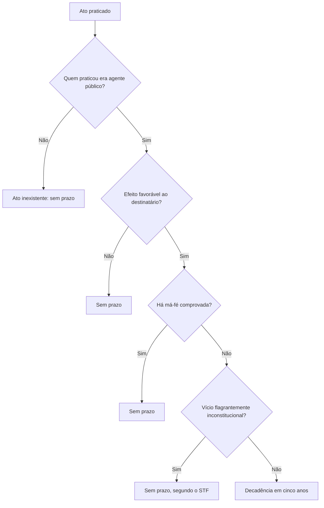
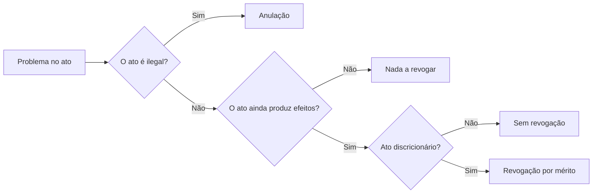

O tempo resolve muita coisa na Administração. Passados anos, o ato ilegal pode não ser mais anulável, e o ato
válido pode deixar de interessar ao serviço público. São dois fenômenos diferentes que a prova mistura: a
**decadência**, que fecha a porta da anulação, e a **revogação**, que retira o ato válido por conveniência. Este
capítulo fecha o estudo da anulação iniciado no capítulo anterior e entrega o regime completo da revogação, com
seus limites e suas espécies.

> [!objetivos]
> - Aplicar o prazo decadencial de cinco anos ao caso concreto e identificar as hipóteses sem prazo.
> - Explicar por que os efeitos já produzidos para terceiros de boa-fé sobrevivem à anulação.
> - Reconhecer ato inexistente e por que ele não se consolida com o tempo.
> - Justificar quando cabe revogação e listar os atos que não podem ser revogados.
> - Distinguir ab-rogação de derrogação e explicar o que acontece com os efeitos impróprios.

## O dever de anular e os limites do tempo

A Administração está presa à legalidade, e por isso a anulação de ato ilegal é, em regra, um **dever**. A
questão é que esse dever convive com outro valor: a confiança de quem recebeu o ato e organizou a vida em cima
dele.

Duas situações desarmam o dever. A primeira é o **decurso do tempo**, quando a lei fixa prazo para anular e ele
passou. A segunda é a **sanabilidade do vício**, quando o defeito pode ser corrigido pela convalidação, tema do
último capítulo.

Em prova, se o enunciado obriga a escolher entre poder e dever, a resposta segura é **dever**. A palavra "pode",
usada na Súmula 473 do STF, descreve a competência, não a liberdade de manter o ato ilegal por conveniência.

### Segurança jurídica e proporcionalidade

A tensão entre legalidade e confiança não é resolvida por uma regra única. A lei e a jurisprudência combinam
quatro filtros.

O primeiro é o **tempo**: passado o prazo decadencial, o ato favorável se consolida.

O segundo é a **boa-fé**: quem participou do vício ou dele se beneficiou com fraude não recebe proteção.

O terceiro é a **proporcionalidade das consequências**: a LINDB exige que a decisão de invalidação indique os
efeitos que produz e evite ônus anormais ou excessivos. Anular uma nomeação antiga pode ser possível e, ao
mesmo tempo, exigir medidas de transição para não punir quem não deu causa ao erro.

O quarto é a **possibilidade de corrigir sem destruir**. Quando o vício é sanável, a convalidação preserva o
ato e resolve a irregularidade. Anular é a última saída, não a primeira.

Esses filtros explicam por que a autotutela, embora ampla, é dosada. A banca costuma cobrar a regra (dever de
anular) e, logo depois, a exceção (prazo, boa-fé, convalidação).

Mesmo quando a anulação acontece, os efeitos já produzidos perante **terceiros de boa-fé** são preservados. Não
se trata de direito adquirido, porque do ato ilegal não nasce direito. Trata-se de proteção à confiança.

> [!exemplo] Servidor nomeado irregularmente
> Um servidor assume cargo de fiscal sem atender ao requisito de escolaridade. Durante dois anos, assina
> certidões de vistoria que empresas apresentam em processos de licenciamento. Descoberto o vício, a nomeação é
> anulada e o servidor deixa o cargo. As certidões expedidas continuam válidas para as empresas que as
> receberam, porque elas confiaram na aparência de regularidade do agente. O prejuízo do servidor e a
> responsabilidade de quem o nomeou são tratados em outra esfera.

## Decadência administrativa

Decadência é a **perda do próprio direito** pelo decurso do tempo. Aqui o objeto é um só: o direito de a
Administração anular o ato ilegal.

### Decadência, prescrição e caducidade

Três institutos usam o tempo como elemento e vivem sendo trocados nas alternativas. A comparação abaixo fixa o
que cada um atinge.

| Instituto | O que se perde | Exemplo |
| --- | --- | --- |
| Decadência | O próprio direito | Direito de anular o ato favorável após cinco anos |
| Prescrição | A pretensão, o direito de exigir | Prazo para cobrar crédito ou instaurar processo disciplinar |
| Caducidade do ato | A eficácia do ato por lei nova | Nova lei proíbe o uso privativo do bem |

Na decadência, o direito desaparece: a Administração não pode mais anular, ainda que descubra o vício. Na
prescrição, o direito existe, mas não pode ser exigido em juízo ou em procedimento. Na caducidade, o ato perde
eficácia porque uma norma posterior tornou impossível mantê-lo. São três portas de saída diferentes, e a prova
explora justamente a troca entre elas.

### A regra dos cinco anos

> [!lei] Lei 9.784/1999, art. 54
> O direito da Administração de anular os atos administrativos de que decorram efeitos favoráveis para os
> destinatários decai em cinco anos, contados da data em que foram praticados, salvo comprovada má-fé.

Três informações estão no dispositivo e precisam ser lidas juntas.

O prazo é de **cinco anos**. Conta da **prática do ato**, e não da descoberta do vício. A exceção é a **má-fé
comprovada**, que afasta o prazo.

O § 1º traz uma regra de contagem própria para efeitos patrimoniais contínuos, como o pagamento mensal de um
benefício: o prazo conta da **percepção do primeiro pagamento**. O § 2º esclarece que o direito de anular é
exercido com qualquer medida da autoridade que impugne a validade do ato, como a instauração de processo de
revisão. Basta a medida, não a conclusão do processo.

### Quando não há prazo

A regra dos cinco anos não é universal. A tabela reúne as hipóteses em que a Administração pode desfazer o ato
a qualquer tempo.

| Situação | Prazo para desfazer |
| --- | --- |
| Ato com efeitos favoráveis, sem má-fé | Cinco anos |
| Ato com efeitos desfavoráveis ao administrado | Sem prazo |
| Má-fé comprovada | Sem prazo |
| Flagrante inconstitucionalidade reconhecida pelo STF | Sem prazo |
| Ato inexistente | Sem prazo |

A primeira linha de exceção é o ato de efeito **desfavorável**, como a sanção aplicada indevidamente. Quem
sofre a punição não pode perder o direito de vê-la revista pelo simples passar dos anos. O mesmo raciocínio
justifica a revisão do processo disciplinar a qualquer tempo, quando surgem fatos novos ou se mostra inadequada
a penalidade aplicada (Lei 9.784/1999, art. 65; Lei 8.112/1990, art. 174).

A segunda é a **má-fé** do beneficiário, que o dispositivo menciona expressamente. Quem obtém vantagem por
fraude não ganha estabilidade pelo tempo.

A terceira é a **flagrante inconstitucionalidade**. O STF entende que o prazo decadencial não protege situações
como a investidura em cargo efetivo sem concurso público. Nesse caso, a nulidade é evidente e não se consolida.

A quarta é o **ato inexistente**, estudado a seguir.

> [!atencao] Estados e municípios
> A Lei 9.784/1999 é federal, mas o STJ aplica suas regras de forma subsidiária aos estados e municípios que não
> tenham lei própria de processo administrativo (Súmula 633). Na prática, isso estende o prazo de cinco anos a
> muitos entes. Se a questão não indicar lei local específica, responda com cinco anos.

### Ato inexistente

Ato inexistente é o praticado por quem **não é agente público**, o usurpador de função. Falta a manifestação de
vontade do Estado, então não há ato administrativo para anular: há aparência de ato.

A consequência é prática e cai em prova. O ato inexistente **não se estabiliza com o tempo**. Ele nunca se
torna válido, não é convalidado e não se submete a prazo decadencial. A autorização emitida por um falso
fiscal, ainda que ninguém descubra por dez anos, continua sem valor. O mesmo raciocínio vale para o ato
praticado por autoridade que já havia perdido o cargo: se não havia investidura, não há vontade estatal a
preservar. Já o ato praticado por agente regularmente investido, mas incompetente, é ato viciado, e não
inexistente, e por isso pode se consolidar pelo prazo decadencial se for favorável ao destinatário.

## Revogação

Revogação é a retirada de um ato **válido** porque um interesse público posterior o tornou inconveniente ou
inoportuno. O juízo é de **mérito**: a Administração não diz que o ato está errado, diz que ele já não serve.

Daí decorrem três requisitos sobre o ato revogado. Ele precisa ser **válido**, sem vício de legalidade. Precisa
ser, em regra, **eficaz**, porque a revogação impede a continuidade dos efeitos; um ato que ainda não começou a
produzir efeitos pode ser revogado em situações excepcionais, mas um ato **exaurido** não. E precisa ser
**discricionário**, porque só existe juízo de conveniência onde há margem de escolha.

| Requisito | Consequência se faltar |
| --- | --- |
| Ato válido | Se houver vício, o caminho é anulação ou convalidação |
| Ato ainda não exaurido | Ato consumado não se revoga |
| Ato discricionário | Ato vinculado não se revoga; eventual descumprimento leva à cassação |

Os efeitos são **ex nunc**, ou seja, valem da decisão em diante. O que foi praticado até a revogação permanece
válido. É a diferença estrutural em relação à anulação, que retroage.

> [!bizu] Ex nunc e ex tunc
> **N**unc começa com **N** de "não volta": a revogação não retroage. Tunc lembra "então", o passado: a anulação
> volta ao momento da edição. Outra imagem útil: a anulação empurra o ato para trás, a revogação o empurra para
> a frente.

### Quem pode revogar

A competência é de quem editou o ato ou de autoridade hierarquicamente superior. Nenhum Poder revoga o ato
administrativo de outro, e o Judiciário não revoga ato da Administração no exercício da função jurisdicional. O
Judiciário revoga os próprios atos administrativos quando administra, mas esse caso só interessa se o enunciado
o mencionar expressamente.

A lei pode atribuir a competência a autoridade fora da linha hierárquica, mas isso só acontece quando há
previsão expressa. E a competência precisa ser **atual**: a autoridade ainda deve poder apreciar a matéria.

> [!atencao] Competência esgotada
> Se o interessado recorreu e o recurso já subiu à autoridade superior, quem editou o ato não pode mais
> revogá-lo. A autoridade que proferiu a decisão pode reconsiderar no prazo de cinco dias; passado o prazo, o
> recurso é encaminhado ao superior (Lei 9.784/1999, art. 56, § 1º). Reconsideração e revogação são coisas
> distintas: a primeira ocorre dentro do recurso, a segunda é decisão autônoma de mérito.

### Limites ao poder de revogar

A revogação é mais limitada que a anulação, porque incide sobre ato que já produziu efeitos legítimos. Os casos
de impedimento aparecem em lista.

O primeiro grupo é de **atos inválidos**, que se anulam ou se convalidam, nunca se revogam. O erro clássico de
prova é dizer que a Administração revoga ato ilegal.

O segundo é de **atos vinculados**, em que não há conveniência a reapreciar. Se o ato é ilegal, anula-se; se o
beneficiário deixa de cumprir requisito, cassa-se.

O terceiro é de **atos exauridos**, que já esgotaram os efeitos. A revogação não tem o que interromper. A
autorização para usar a praça no fim de semana passado não pode ser revogada na segunda-feira.

O quarto é de **atos cuja competência já se esgotou**, como no caso do recurso já encaminhado.

O quinto é de **meros atos administrativos**: certidões, atestados, votos e pareceres. Eles apenas registram
uma realidade ou emitem opinião. Se a informação registrada é falsa, o caminho é a anulação, não a revogação.
Quando se fala em revogar parecer normativo, o que se revoga é o ato que o aprovou.

O sexto é de **atos que integram procedimento**, pela preclusão administrativa. Assinado o contrato, não se
revoga mais a licitação que o antecedeu.

O sétimo é de **atos que geraram direito adquirido**, protegido pela Constituição (art. 5º, XXXVI). Nem a lei
prejudica o direito adquirido, quanto menos um ato administrativo.

| Não se revoga | Motivo |
| --- | --- |
| Ato inválido | Cabe anulação ou convalidação |
| Ato vinculado | Não há mérito a reapreciar |
| Ato exaurido | Não há efeito a interromper |
| Ato com competência esgotada | A autoridade não pode mais apreciar |
| Mero ato administrativo | Declara ou opina, não decide |
| Ato de procedimento | Preclusão administrativa |
| Ato que gerou direito adquirido | Garantia constitucional |

> [!pegadinha] Ato vinculado e a licença para construir
> A regra é que ato vinculado não se revoga. O STJ, porém, já admitiu revogar a licença de construir quando a
> obra não foi iniciada e o interesse público recomenda outra destinação para a área, como a mudança no traçado
> de uma via. Parte da doutrina trata o caso como expropriação, com indenização. Em prova, mantenha a regra
> geral e reconheça a exceção apenas quando o enunciado descrever obra não iniciada.

> [!pegadinha] Licença do estatuto não é licença da doutrina
> Os estatutos de servidores usam "licença" para afastamentos que podem ser discricionários, como a licença para
> tratar de interesses particulares. Nesse caso, a palavra não traz o regime do ato vinculado que reconhece
> direito subjetivo. Leia o contexto antes de aplicar a regra de irretratabilidade.

### Espécies de revogação

Quanto à abrangência, a revogação pode ser total ou parcial.

| Espécie | Alcance | Exemplo |
| --- | --- | --- |
| Ab-rogação | Revogação total | Cancelar todas as autorizações de uso da praça |
| Derrogação | Revogação parcial | Cancelar apenas parte das autorizações |

A distinção parece simples, mas a prova cobra a consequência. A revogação, total ou parcial, desfaz apenas os
**efeitos próprios**, aqueles que a Administração quis produzir. Os **efeitos impróprios**, reflexos e
indiretos, permanecem.

> [!exemplo] Revogação da desapropriação
> O município revoga o decreto que declarou um terreno de utilidade pública para construir um centro de
> treinamento. Durante a ocupação, a prefeitura danificou o muro e o poço do imóvel. A revogação total encerra a
> desapropriação, mas não apaga o dever de indenizar os danos causados. O efeito próprio cai; o impróprio
> permanece.

O mesmo raciocínio vale para efeitos reflexos. Uma autorização de uso de área pública revogada não desfaz, por
si, os contratos que o autorizado celebrou com terceiros para explorar o local: esses vínculos são resolvidos
entre as partes, conforme o caso, e a Administração responde apenas na medida em que tenha dado causa ao
prejuízo. Por isso a frase "a revogação apaga todos os efeitos do ato" é errada. Ela interrompe a produção de
efeitos próprios e preserva o que já se incorporou à realidade, inclusive o dever de reparar.

### Revogação na licitação e nos contratos

O regime da revogação aparece também na contratação pública, com regras próprias. A Lei 14.133/2021 trata da
revogação da licitação e da extinção do contrato, e a diferença de vocabulário não é acidente: contrato não se
revoga, extingue-se.

> [!lei] Lei 14.133/2021, art. 71, II e § 2º
> Art. 71. Encerradas as fases de julgamento e habilitação, e exauridos os recursos administrativos, o processo licitatório será encaminhado à autoridade superior, que poderá: (...)
> II - revogar a licitação por motivo de conveniência e oportunidade;
> (...)
> § 2º O motivo determinante para a revogação do processo licitatório deverá ser resultante de fato superveniente devidamente comprovado.

Três consequências vêm com o dispositivo.

A revogação da licitação exige **fato superveniente comprovado**, e não simples mudança de humor da
Administração. O fato precisa ser posterior ao início do procedimento e estar demonstrado nos autos.

A revogação alcança o procedimento, e o § 3º do mesmo artigo garante a **prévia manifestação dos interessados**
nos casos de anulação e de revogação. O contraditório, portanto, não é opcional.

Se o contrato já foi assinado, a saída não é revogar a licitação, mas extinguir o contrato pelos motivos do
art. 137, entre eles o interesse público justificado pela autoridade máxima do órgão (inciso VIII). A extinção
unilateral é ato de outra natureza, com consequências próprias, como a assunção imediata do objeto e a execução
da garantia.

| Situação | Instrumento | Fundamento |
| --- | --- | --- |
| Licitação em andamento perdeu utilidade | Revogação | Lei 14.133/2021, art. 71, II |
| Licitação com ilegalidade insanável | Anulação | Lei 14.133/2021, art. 71, III |
| Contrato assinado e interesse público mudou | Extinção unilateral | Art. 137, VIII, e art. 138, I |

> [!pegadinha] Revogar contrato não existe
> A banca escreve: "a Administração revogou o contrato por interesse público". A palavra correta é **extinção
> unilateral**. Revogação é figura do ato administrativo; contrato se extingue, se rescinde ou se resolve,
> conforme o regime aplicável.

### Revogação e anulação lado a lado

A tabela que mais rende pontos é a comparação direta entre as duas figuras.

| Critério | Anulação | Revogação |
| --- | --- | --- |
| Fundamento | Ilegalidade | Conveniência e oportunidade |
| Ato atingido | Inválido | Válido |
| Efeito no tempo | Retroativo | Prospectivo |
| Quem pratica | Administração ou Judiciário provocado | Só a Administração |
| Prazo | Cinco anos, se o efeito é favorável | Sem prazo, respeitados os limites |
| Direito adquirido | Não há direito em ato ilegal | Impede a revogação |

> [!esquema] Cinco perguntas antes de revogar
> 1. O ato é válido? Se não, anule ou con vale.
> 2. O ato ainda não se exauriu? Se já se exauriu, não há o que revogar.
> 3. O ato é discricionário? Se é vinculado, a saída é outra.
> 4. A autoridade ainda tem competência? Recurso já encaminhado fecha a porta.
> 5. Há direito adquirido? Se há, a revogação é barrada.

## Mapa do capítulo

| Instituto | Pergunta central | Resposta curta |
| --- | --- | --- |
| Decadência | Quanto tempo para anular? | Cinco anos, se o efeito é favorável e não há má-fé |
| Contagem especial | Efeito patrimonial contínuo? | Do primeiro pagamento |
| Sem prazo | Efeito desfavorável, má-fé, inconstitucionalidade flagrante | Anula a qualquer tempo |
| Ato inexistente | Praticado por usurpador? | Nunca se consolida |
| Revogação | O ato válido perdeu utilidade? | Retirada por mérito, efeito ex nunc |
| Competência | Quem revoga? | Quem editou ou o superior, com competência atual |
| Limites | O que não se revoga? | Ato inválido, vinculado, exaurido, mero ato, de procedimento, com direito adquirido |
| Espécies | Total ou parcial? | Ab-rogação e derrogação |
| Efeitos | O que permanece? | Os impróprios, como o dever de indenizar |

### Para fixar

- A anulação é dever, em regra; cede ao prazo decadencial e à convalidação.
- Os efeitos produzidos para terceiros de boa-fé sobrevivem à anulação, por proteção à confiança.
- O prazo do art. 54 da Lei 9.784/1999 é de cinco anos, contados da prática do ato (ou do primeiro pagamento,
  no efeito patrimonial contínuo), salvo má-fé.
- Não há prazo para desfazer ato de efeito desfavorável, ato obtido com má-fé, nulidade flagrante e ato
  inexistente.
- A Súmula 633 do STJ estende a Lei 9.784/1999, de forma subsidiária, a estados e municípios sem lei própria.
- Revogação exige ato válido, ainda não exaurido e discricionário, e produz efeitos ex nunc.
- Só revoga quem editou o ato ou o superior hierárquico, enquanto a competência não estiver esgotada.
- Não se revogam atos inválidos, vinculados, exauridos, meros atos, atos de procedimento e atos com direito
  adquirido.
- Ab-rogação é total e derrogação é parcial; as duas atingem só os efeitos próprios.
- Revogar licitação exige fato superveniente comprovado e prévia manifestação dos interessados; contrato não se
  revoga, extingue-se.
