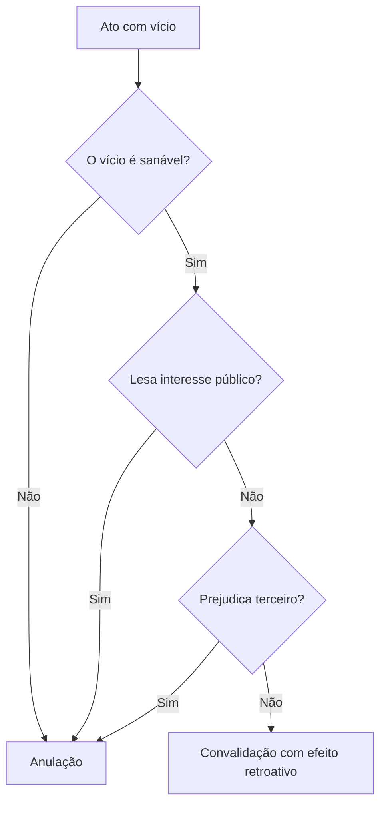

Nem todo ato irregular precisa ser destruído. Quando o defeito é corrigível e ninguém foi prejudicado, a
Administração pode manter o ato, corrigir o vício e preservar os efeitos já produzidos. Essa é a **convalidação**,
também chamada de saneamento ou aperfeiçoamento. Ela fecha o estudo do desfazimento por outro caminho: em vez de
anular, a Administração conserta. Aqui aparecem as duas perguntas que a banca cobra: quais vícios podem ser
sanados e quem tem competência para sanar.

> [!objetivos]
> - Explicar a diferença entre as teorias monista e dualista das nulidades e a posição adotada no Brasil.
> - Definir convalidação e seus efeitos retroativos.
> - Aplicar as três condições do art. 55 da Lei 9.784/1999.
> - Classificar os vícios em sanáveis e insanáveis pela regra da competência e da forma.
> - Indicar quem pode convalidar e quando a convalidação é dever ou faculdade.

## A teoria das nulidades

O ponto de partida é uma escolha teórica. Se todo ato inválido fosse necessariamente nulo, sem possibilidade de
correção, a convalidação não existiria. A doutrina apresenta dois modelos.

Na **teoria monista**, o ato é válido ou nulo. Não há meio-termo, e o ato inválido não pode ser aproveitado.

Na **teoria dualista**, os atos inválidos se dividem em **nulos**, quando o vício é **insanável**, e
**anuláveis**, quando o vício é **sanável**. O Brasil adota a teoria dualista, e é por isso que a convalidação
existe no nosso ordenamento. A tabela resume a diferença.

| Teoria | Consequência | Convalidação |
| --- | --- | --- |
| Monista | Ato válido ou nulo | Não é admitida |
| Dualista | Ato nulo ou anulável | Admitida para o vício sanável |

A adoção da teoria dualista aparece na própria Lei 9.784/1999, que autoriza a correção de atos com defeitos
sanáveis. Se o Brasil fosse monista, essa autorização seria incompatível com o sistema.

> [!bizu] Dualista é a casa
> Duas categorias, duas saídas: vício insanável leva à anulação; vício sanável permite a convalidação. Se a
> questão perguntar qual teoria o direito brasileiro adota, a resposta é dualista.

## Conceito e efeitos

Convalidação é a correção de um vício **sanável**, com a manutenção do ato e dos efeitos já produzidos. Ela não
é forma de desfazimento: é o oposto. A anulação retira o ato; a convalidação o conserva, depois de eliminar o
defeito.

Os efeitos são **retroativos** (*ex tunc*). A correção vale desde a edição do ato, e não a partir da decisão que
a promoveu. O exemplo ajuda a enxergar o alcance prático.

> [!exemplo] Férias concedidas por autoridade incompetente
> Um chefe de setor sem delegação concede 15 dias de férias a uma servidora, que viaja na data marcada. Duas
> semanas depois, a autoridade competente ratifica a concessão. A ratificação retroage: os dias já gozados são
> considerados regulares desde o início, e não há falta ao serviço nem desconto. Sem a convalidação, o período
> teria de ser anulado, com devolução dos dias e eventuais prejuízos.

Note a diferença de vocabulário. **Ratificação** é a convalidação feita pela própria autoridade que deveria ter
praticado o ato, ou por seu superior. **Reforma** é a correção que altera parte do ato, sem mudar seu sentido. A
**conversão** aproveita um ato inválido como outro ato válido, quando este existe em forma legal. Esses
instrumentos aparecem em detalhe no capítulo seguinte.

## As três condições legais

A convalidação não é livre. O ordenamento exige que a correção não crie novos problemas.

> [!lei] Lei 9.784/1999, art. 55
> Em decisão na qual se evidencie não acarretarem lesão ao interesse público nem prejuízo a terceiros, os atos
> que apresentarem defeitos sanáveis poderão ser convalidados pela própria Administração.

São, portanto, três condições cumulativas:

- **ausência de lesão ao interesse público**;
- **ausência de prejuízo a terceiros**;
- **defeito sanável**.

Se qualquer uma faltar, a saída é a anulação. Uma licença concedida a duas empresas para explorar o mesmo ponto
não se convalida em favor de uma delas, porque a correção prejudicaria a outra. Um ato que beneficiou o
particular às custas do erário não se convalida, porque o interesse público foi lesado.

> [!atencao] Convalidar não é ignorar o vício
> A convalidação exige decisão expressa e motivada que identifique o defeito e a forma de correção. Não existe
> convalidação automática pelo simples passar do tempo. O que o tempo pode produzir, no ato favorável, é a
> decadência do direito de anular, que é fenômeno diferente e não corrige o vício.

## Vícios sanáveis e insanáveis

A corrente mais adotada no Brasil usa uma regra de memória simples: são sanáveis os vícios de **competência** e
de **forma**; são insanáveis os de **finalidade**, **motivo** e **objeto**. O mnemônico é **FoCo**: **Fo**rma e
**Co**mpetência.

| Elemento do ato | Vício | Sanável? |
| --- | --- | --- |
| Competência | Autoridade sem delegação pratica ato não exclusivo | Sim, em regra |
| Competência | Ato privativo de autoridade específica | Não |
| Forma | Instrumento diverso do previsto, sem prejuízo à garantia | Sim |
| Forma | Ausência de forma essencial ou de garantia de defesa | Não |
| Finalidade | Desvio de finalidade | Não |
| Motivo | Motivo inexistente ou falso | Não |
| Objeto | Objeto ilícito ou impossível | Não |

### Competência

O vício de competência é sanável na maioria dos casos. Se um subordinado pratica ato que poderia ter sido
praticado pelo superior, e não há reserva legal de competência, o superior pode ratificar. A ratificação
conserta a origem do ato.

Há duas exceções que a prova cobra. A primeira é a **competência exclusiva**, aquela que a lei atribui a uma
autoridade específica e que não admite delegação. A segunda é a **competência em razão da matéria**, quando o
órgão não tem atribuição sobre aquele assunto, como um órgão de educação editando ato sanitário. Nesses casos,
o vício é insanável.

### Forma

A forma também é sanável quando não é essencial. Trocar a ordem de serviço pela portaria, quando a lei não exige
instrumento específico, não prejudica ninguém. O mesmo vale para o requerimento apresentado em uma via, quando o
edital pedia duas e a segunda pode ser juntada.

A forma é **insanável** quando a lei a define como indispensável ou quando ela protege garantia individual. A
falta de defesa no processo disciplinar não se corrige depois da punição, porque a garantia já foi perdida. A
ausência do edital na licitação não se convalida com a publicação posterior, porque o edital é o instrumento que
assegura a competitividade. Nesses casos, a forma está ligada ao próprio conteúdo da garantia.

> [!pegadinha] Forma essencial não se convalida
> A banca escreve: "o vício de forma sempre pode ser sanado pela ratificação". Errado. A regra é a sanabilidade
> da forma não essencial. Forma essencial, ligada a garantia de direitos ou exigida expressamente pela lei,
> contamina o ato de modo insanável.

### Motivo, objeto e finalidade

O motivo é a situação de fato e de direito que autoriza o ato. Se ele não existe, o ato nasce sem base. A
suspensão aplicada a servidor que não cometeu a infração tem vício de motivo, e não há correção possível: o fato
não pode ser inventado depois. O caminho é a anulação.

O objeto é o conteúdo do ato. Objeto ilícito ou impossível não se salva. A finalidade é o interesse público que
o ato deve perseguir. O desvio de finalidade, quando o agente usa o ato para fim diverso do previsto na lei,
também é insanável.

## Quem pode convalidar

A regra é que a convalidação compete à **Administração**, e não ao Judiciário. O juiz, quando provocado, pode
anular o ato inválido, mas não pode corrigi-lo em nome da Administração. A exceção teórica é o Judiciário
convalidando os próprios atos administrativos, no exercício da função atípica de administrar.

Existe, porém, uma hipótese que surpreende: o **particular** pode sanar o vício quando o ato dependia da sua
manifestação e ela faltou. Se a lei exigia a oitiva do interessado antes da autorização e ele não foi ouvido, o
próprio interessado pode concordar depois, suprindo a falha. O mesmo ocorre na exoneração a pedido cujo
requerimento é apresentado depois do ato. A concordância posterior do destinatário elimina o vício de
procedimento.

| Quem | Pode convalidar? | Observação |
| --- | --- | --- |
| Administração | Sim | Regra geral, por decisão motivada |
| Judiciário | Não, em regra | Só os próprios atos administrativos |
| Particular | Sim, em caso específico | Quando a manifestação dele era necessária e faltou |
| Terceiro estranho ao ato | Não | Não tem competência nem interesse legítimo para sanar |

### Tópicos aprofundados de convalidação

Alguns pontos finos separam o candidato que decorou a regra do que entendeu o instituto.

O primeiro é o nome técnico da convalidação feita pelo particular. Quando o administrado supre, depois, a
manifestação de vontade que deveria existir antes do ato, a doutrina chama o fenômeno de **saneamento**. Não é
um tipo novo de ato: é a mesma convalidação, praticada por quem tem legitimidade para suprir a falha.

> [!pegadinha] "Só a Administração convalida"
> A assertiva "a convalidação não pode ser feita por quem não pertence aos quadros da Administração" é falsa.
> O particular pode sanar o ato quando a manifestação dele era pressuposto e faltou. Errada também é a versão
> oposta, que transforma a exceção em regra: a convalidação pelo particular só existe nessa hipótese.

O segundo ponto é o **ato complexo**. Se o ato depende da manifestação de dois órgãos, a convalidação exige a
concordância dos dois. A ratificação de um só não elimina o vício do outro, e o ato continua inválido na parte
que depende da vontade ausente.

O terceiro é a **ordem das operações**. Não se convalida ato já anulado, porque não existe mais ato a conservar.
Também não se convalida ato cujo vício foi reconhecido por decisão definitiva. A convalidação pressupõe ato
existente e ainda sujeito a correção.

O quarto é a **convalidação parcial**. É possível sanar a parte corrigível e anular o restante, desde que a
divisão não altere o sentido do ato nem prejudique terceiros. Em um ato com dois beneficiários, sendo apenas um
deles atingido por vício insanável, a solução pode ser manter a parte válida e retirar a inválida.

O quinto é a relação com o **controle judicial**. O juiz não convalida, mas pode reconhecer que a convalidação
feita pela Administração foi regular e negar a anulação pedida. O controle recai sobre a legalidade da própria
convalidação, inclusive sobre a motivação e a ausência de prejuízo a terceiros.

## Dever ou faculdade

A Lei 9.784/1999 usa "poderão ser convalidados", o que sugere faculdade. A doutrina majoritária, porém, entende
que a convalidação é, em regra, **dever**: se o vício é sanável e ninguém será prejudicado, a Administração deve
corrigir o ato, porque a legalidade se realiza melhor com a correção do que com a destruição de efeitos
legítimos.

A exceção é precisa e cai em prova. A convalidação é **facultativa** quando o vício é de **competência** e o ato
original era **discricionário**. Nesse caso, o superior que recebe o ato do subordinado incompetente pode
convalidar ou não, porque poderia, desde o início, conceder ou negar o ato. A escolha é dele.

Em ato vinculado, a lógica se inverte. Se a licença para construir preenche todos os requisitos e foi assinada
por autoridade incompetente, o superior é obrigado a convalidar. Se pudesse simplesmente anular, a Administração
poderia provocar o vício de propósito para fugir do dever de conceder.

> [!esquema] Roteiro rápido
> 1. Identifique o vício: competência, forma, motivo, objeto ou finalidade.
> 2. Se for motivo, objeto ou finalidade: anulação.
> 3. Se for competência ou forma: verifique se é essencial ou exclusiva. Se for, anulação.
> 4. Verifique interesse público e terceiros. Se houver lesão ou prejuízo: anulação.
> 5. Se passou por todos os filtros: convalidação, com efeito retroativo.

## Mapa do capítulo

| Pergunta | Resposta |
| --- | --- |
| Qual teoria o Brasil adota? | Dualista: ato nulo e ato anulável |
| O que a convalidação faz? | Corrige o vício e mantém o ato |
| Qual o efeito no tempo? | Retroativo, desde a edição |
| Quais são as condições legais? | Sem lesão ao interesse público, sem prejuízo a terceiro, vício sanável |
| Quais vícios são sanáveis? | Competência, em regra, e forma não essencial |
| Quais são insanáveis? | Finalidade, motivo e objeto; competência exclusiva; forma essencial |
| Quem convalida? | A Administração; o particular, quando sua manifestação era necessária |
| É dever ou faculdade? | Dever, em regra; faculdade no vício de competência de ato discricionário |

### Para fixar

- O Brasil adota a teoria dualista: vício insanável gera nulidade, vício sanável permite convalidação.
- Convalidar é corrigir e manter o ato, não desfazê-lo, com efeitos retroativos.
- As condições do art. 55 da Lei 9.784/1999 são cumulativas: sem lesão ao interesse público, sem prejuízo a
  terceiro e vício sanável.
- São sanáveis, em regra, os vícios de competência e de forma não essencial.
- Competência exclusiva e competência em razão da matéria tornam o vício insanável.
- Vícios de finalidade, motivo e objeto não se convalidam.
- O Judiciário não convalida ato da Administração; o particular pode sanar quando sua manifestação era
  necessária.
- A convalidação é dever em regra e faculdade no vício de competência de ato discricionário.
- Convalidação exige decisão expressa e motivada; não existe convalidação automática pelo tempo.
