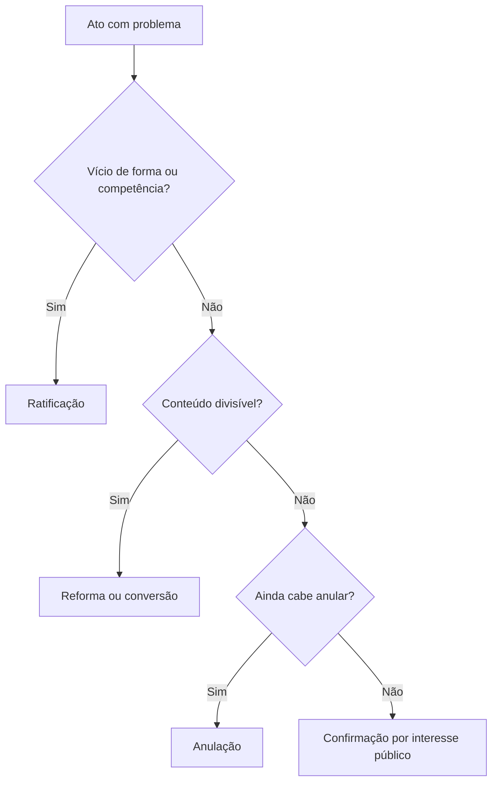

A convalidação tem hora e jeito. Não se corrige qualquer vício, nem se corrige depois de o interessado reagir, nem
se corrige quando o tempo já fechou a porta. E existem instrumentos diferentes para objetivos diferentes:
ratificar, reformar, converter, confirmar. Este capítulo separa cada um e termina com as súmulas que a banca
costuma juntar ao tema.

> [!objetivos]
> - Apontar as barreiras à convalidação, além das três condições legais.
> - Distinguir ratificação, reforma, conversão e confirmação pelo que cada uma faz com o ato.
> - Explicar o tratamento do ato com objeto plúrimo.
> - Reconhecer as posições de Carvalho Filho e de Di Pietro sobre reforma e conversão.
> - Aplicar as súmulas sobre anulação, aposentadoria aprovada por tribunal de contas e controle do processo
>   disciplinar.

## Barreiras à convalidação

O capítulo anterior apresentou as três condições do art. 55 da Lei 9.784/1999: vício sanável, sem lesão ao
interesse público e sem prejuízo a terceiros. Duas outras barreiras aparecem na prática e em prova.

> [!lei] Lei 9.784/1999, art. 55
> Em decisão na qual se evidencie não acarretarem lesão ao interesse público nem prejuízo a terceiros, os atos
> que apresentarem defeitos sanáveis poderão ser convalidados pela própria Administração.

A primeira é a **impugnação do interessado**. Se o destinatário impugnou o ato, discutindo sua legalidade em
ação judicial ou em recurso administrativo, a convalidação fica barrada. A razão é lógica: quem pediu a
invalidação não pode receber, como resposta, a conservação do ato com correção de bastidor. A impugnação pode
ser **expressa** ou resultar de **resistência**, como a obra que continua depois de o licenciamento ter sido
cassado. A resistência, porém, deve ser analisada com cautela, porque o ato administrativo goza de presunção de
legalidade e o particular não é obrigado a adivinhar a invalidade.

> [!atencao] Exceção da motivação
> Quando a única falha apontada é a falta de motivação, admite-se, em situações excepcionais, que a motivação
> posterior complete o ato. A jurisprudência aceita essa correção porque a motivação pode ser apresentada depois,
> desde que exista o suporte fático e não haja prejuízo à defesa. O cuidado é não transformar a exceção em regra:
> vício de motivo, com fato inexistente, não se conserta com texto novo.

A segunda barreira é o **decurso do tempo**. Passado o prazo para anular, a Administração não pode mais
desfazer o ato. Se não pode anular, também não pode convalidar, porque a convalidação pressupõe um ato ainda
sujeito a correção. A estabilidade que o tempo trouxe não é resultado de um conserto: é resultado da decadência.

| Barreira | Efeito |
| --- | --- |
| Vício insanável | Impede a convalidação |
| Lesão ao interesse público | Impede a convalidação |
| Prejuízo a terceiros | Impede a convalidação |
| Impugnação do interessado | Impede a convalidação |
| Decurso do prazo para anular | Impede a convalidação e a anulação |

> [!pegadinha] Impugnou, não convalida
> A banca descreve um vício de competência não exclusiva, que normalmente se convalida, e acrescenta que o
> interessado recorreu pedindo a anulação. Nesse caso, a convalidação **não** é possível. O vício era sanável,
> mas a reação do interessado fechou a porta.

## Ratificação

Ratificação é a correção dos vícios de **forma** e de **competência**, aqueles que a doutrina chama de
extrínsecos, porque não atingem o conteúdo do ato. Pode ser feita pela própria autoridade ou pelo superior
hierárquico.

Carvalho Filho inclui forma e competência no conceito. Di Pietro restringe a ratificação ao vício de
competência e não dá nome próprio à correção da forma. Em prova, as duas posições costumam ser aceitas: se a
questão falar de ratificação de vício de forma, a afirmação é compatível com a linha de Carvalho Filho.

A ratificação tem efeito retroativo. O ato passa a valer desde a edição, e não desde a correção. É por isso que
o exemplo das férias concedidas por autoridade incompetente funciona: a ratificação posterior salva os dias já
gozados.

## Reforma

Reforma é o instrumento que suprime o trecho inválido e conserva o trecho válido. Ela serve para atos com
conteúdo divisível, em que um pedaço pode cair sem levar o resto.

Aqui existe divergência relevante. Para Carvalho Filho, a reforma é espécie de convalidação: corrige o ato,
retirando o que é inválido. Para Di Pietro, a reforma não é convalidação nem desfazimento: é alteração de ato
válido por conveniência e oportunidade, com efeitos apenas futuros.

A diferença de efeitos é o que a prova cobra. Na linha de Carvalho Filho, a reforma mantém o ato e retroage. Na
linha de Di Pietro, a reforma produz efeitos a partir da decisão.

> [!exemplo] Ato que concedeu férias e licença
> Um único ato concedeu 20 dias de férias e 30 dias de licença para tratar de assunto particular. A apuração
> mostra que havia direito apenas às férias. Na reforma, um novo ato retira a licença e mantém as férias. O
> servidor não perde os dias de férias já gozados, e a parte inválida desaparece sem derrubar o restante.

## Conversão

Conversão é a substituição da parte inválida por outra parte válida. O ato não é apenas reduzido: ele é
transformado, aproveitando o que existia como outro ato permitido em lei.

Para Carvalho Filho, a conversão integra a convalidação, com efeito retroativo à data do ato original. Para Di
Pietro, ela não é convalidação: é substituição de um ato por outro de categoria diferente, com efeitos
retroativos, mas sem corrigir o primeiro.

O exemplo ajuda a separar reforma de conversão. No mesmo ato que concedeu férias e licença sem direito, a
conversão retira a licença e a substitui por um afastamento legal, mantendo as férias. A reforma apenas retira a
licença; a conversão coloca outra figura no lugar.

| Instituto | O que faz | Efeitos |
| --- | --- | --- |
| Ratificação | Corrige vício de forma ou competência | Retroativos |
| Reforma | Corta o conteúdo inválido e conserva o restante | Retroativos (Carvalho Filho) ou futuros (Di Pietro) |
| Conversão | Troca o conteúdo inválido por outro permitido | Retroativos à data do original |
| Confirmação | Mantém o ato ilegal sem corrigir o vício | Sem correção; o ato permanece como está |

> [!bizu] Quatro verbos, quatro ações
> Ratificar é consertar a origem. Reformar é cortar o que não presta. Converter é trocar o que não presta por
> algo permitido. Confirmar é decidir conviver com o vício.

## Objeto plúrimo

Ato de objeto plúrimo é o que tem mais de um conteúdo, como o ato que concede dois benefícios distintos. Como
regra, o vício de objeto é insanável. A exceção aparece justamente no objeto plúrimo: a parte inválida pode ser
retirada por reforma ou substituída por conversão, preservando-se a parte válida.

O limite é a divisibilidade. Se o conteúdo não pode ser separado sem mudar o sentido do ato, não há reforma nem
conversão possíveis. Um ato que concede um único benefício com valor errado não tem parte válida a preservar: ou
se anula, ou se refaz.

O critério prático é perguntar se o beneficiário receberia a mesma coisa se o ato tivesse sido editado
corretamente desde o início. Se a resposta é sim para uma parte do conteúdo, a reforma serve. Se, além de
retirar a parte inválida, for preciso enquadrar o que sobra em outra figura jurídica, a conversão serve.

> [!exemplo] Dois servidores, um ato
> Uma portaria concede licença-prêmio a dois servidores e, por erro, inclui um terceiro que ainda não completou
o período exigido. A portaria é divisível: reforma-se para retirar o terceiro e manter os dois primeiros. Se o
ato tivesse concedido um afastamento com nome errado, o caso poderia pedir conversão para a figura correta,
como licença para capacitação, desde que os requisitos existissem na data.

Separe, por fim, o objeto plúrimo da pluralidade de destinatários. Vários beneficiários não tornam o objeto
divisível se cada um deles recebe a mesma prestação indivisível. O que importa é a possibilidade de separar o
conteúdo sem alterar a natureza do ato, e não o número de pessoas atingidas.

## Confirmação

Confirmação é a decisão de **manter o ato ilegal**, sem corrigir o vício e sem anulá-lo. Na formulação de Di
Pietro, a Administração renuncia ao poder de anular por razões de interesse público. Não é convalidação, porque
o vício permanece, e não é desfazimento, porque o ato continua.

Ela só é admitida sem prejuízo a terceiros, que mantêm o direito de impugnar. Duas hipóteses aparecem na
doutrina.

A primeira é o **interesse público na manutenção**. A ilegalidade existe, mas o desfazimento causa prejuízo
maior. O exemplo clássico é o loteamento irregular ocupado por famílias há muitos anos: anular o ato e remover
as famílias produziria dano social superior ao da irregularidade.

A segunda é a **impossibilidade jurídica de desfazer**, pela decadência ou prescrição. Nesse caso, a
estabilidade vem da lei, e não de uma escolha administrativa.

Bandeira de Mello usa a palavra em outro sentido: confirmação seria a convalidação praticada por autoridade
diferente da que editou o ato, em geral o superior. Em prova, verifique o autor citado no enunciado.

A comparação com as figuras vizinhas evita a troca mais comum, que é tratar confirmação como convalidação.

| Critério | Convalidação | Confirmação | Anulação |
| --- | --- | --- | --- |
| O vício | É corrigido | Permanece | É reconhecido e o ato cai |
| O ato | Continua, agora válido | Continua ilegal | Deixa de existir |
| Base | Art. 55 da Lei 9.784/1999 | Interesse público e segurança jurídica | Legalidade |
| Efeito | Retroativo | Sem alteração da situação | Retroativo, com possível modulação |

> [!atencao] Confirmação não apaga o vício
> O ato confirmado continua ilegal. Ele não se torna válido, e a decisão que o mantém precisa ser motivada, com
> a demonstração do interesse público e da ausência de prejuízo a terceiros. Se a situação mudar, a anulação
> pode voltar à mesa, respeitados os prazos.

## O que a jurisprudência acrescenta

Algumas súmulas aparecem com frequência ao lado do tema.

> [!jurisprudencia] STF, Súmula 6
> Se o Executivo pretende desfazer aposentadoria ou outro ato que o Tribunal de Contas já aprovou, o efeito do
> desfazimento só começa depois de o próprio tribunal concordar, salvo a revisão judicial cabível.

O sentido é o do ato complexo: quando a validade depende da manifestação de dois órgãos, o desfazimento também
depende. O Executivo não retira sozinho o efeito de um ato que só se completou com a aprovação do tribunal de
contas.

A Súmula 473 do STF, já estudada, sustenta a autotutela e o limite dos direitos adquiridos. A Súmula 665 do STJ
fecha o conjunto ao tratar do controle judicial do processo disciplinar: o Judiciário examina a regularidade do
procedimento e a legalidade do ato, sem substituir a valoração administrativa, salvo ilegalidade flagrante ou
sanção manifestamente desproporcional.

> [!jurisprudencia] STJ, Súmula 665
> O controle judicial do processo administrativo disciplinar limita-se ao exame da regularidade do procedimento
> e da legalidade do ato, sem incursão no mérito administrativo, ressalvadas a ilegalidade flagrante e a
> desproporcionalidade manifesta da sanção.

No processo disciplinar, admite-se ainda a **fundamentação por remissão**, em que a autoridade adota como razão
de decidir o parecer ou o relatório que instruiu o processo, desde que ele esteja acessível ao interessado. A
prática reduz repetição e não viola a motivação, porque o fundamento existe e pode ser conhecido.

Por fim, a jurisprudência do STF sobre a decadência já foi registrada: situações flagrantemente
inconstitucionais não se consolidam pelo prazo do art. 54 da Lei 9.784/1999. A regra vale para a investidura em
cargo efetivo sem concurso e para casos de igual evidência.

## Mapa do capítulo

A leitura do mapa resolve a maior parte das questões pelo nome do instrumento. Se o enunciado fala de corrigir a
competência, procure ratificação. Se descreve o corte da parte inválida com manutenção do resto, procure reforma.
Se troca a parte inválida por outra figura permitida, procure conversão. Se mantém o ato ilegal sem consertar nada,
procure confirmação. E, quando o autor é citado, confira a linha doutrinária antes de marcar.

| Instituto | Quando se usa | Efeito | Observação de prova |
| --- | --- | --- | --- |
| Ratificação | Vício de forma ou competência | Retroativo | Carvalho Filho inclui forma; Di Pietro, só competência |
| Reforma | Parte inválida divisível | Retroativo ou futuro, conforme o autor | Di Pietro a vê como alteração de ato válido |
| Conversão | Parte inválida substituível | Retroativo | Di Pietro a vê como substituição de ato |
| Confirmação | Manter ato ilegal por interesse público | Sem correção do vício | Exige ausência de prejuízo a terceiros |
| Impugnação | Interessado reage | Barra a convalidação | Vale para vício sanável |
| Decadência | Prazo de anulação vencido | Barra anulação e convalidação | Estabilidade vem da lei |

### Para fixar

- A convalidação é barrada por vício insanável, lesão ao interesse público, prejuízo a terceiros, impugnação do
  interessado e decurso do prazo para anular.
- Ratificação corrige forma e competência, conforme Carvalho Filho; para Di Pietro, só competência.
- Reforma corta o que é inválido e conserva o resto; conversão põe no lugar uma figura permitida.
- Para Di Pietro, reforma e conversão não são convalidação; a reforma tem efeitos futuros e a conversão,
  retroativos.
- Objeto plúrimo admite reforma ou conversão; fora dessa hipótese, vício de objeto é insanável.
- Confirmação mantém o ato ilegal sem corrigi-lo, por interesse público ou por impossibilidade de desfazer.
- Pela Súmula 6 do STF, a anulação de ato aprovado por tribunal de contas não produz efeito antes da aprovação
  do tribunal.
- A Súmula 665 do STJ limita o controle judicial do processo disciplinar à regularidade e à legalidade.
- A fundamentação por remissão é admitida no processo disciplinar, se o parecer ou relatório está acessível.
- Nulidade flagrante não se consolida pelo prazo decadencial, segundo o STF.
