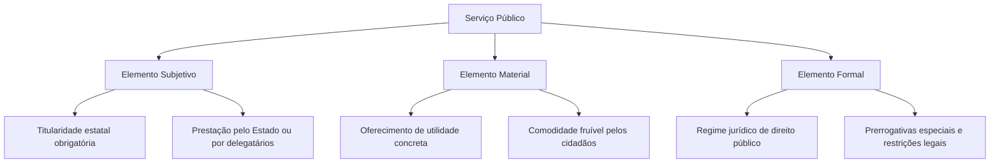
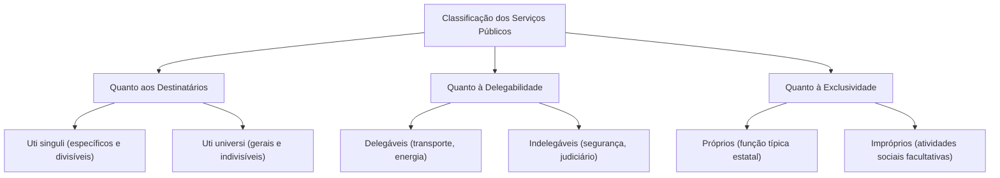
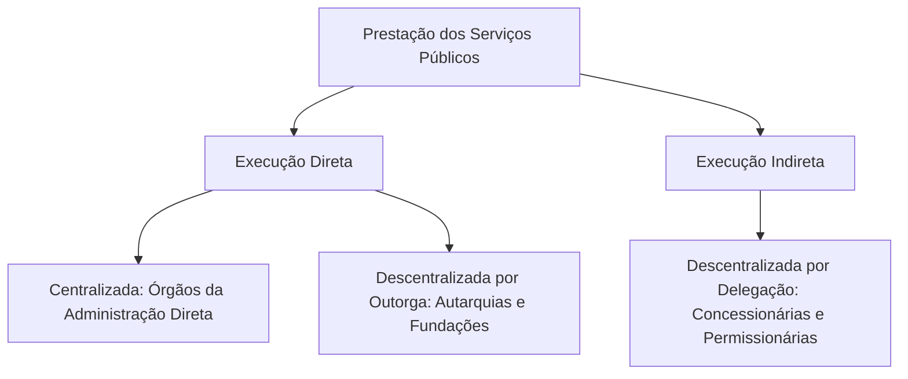
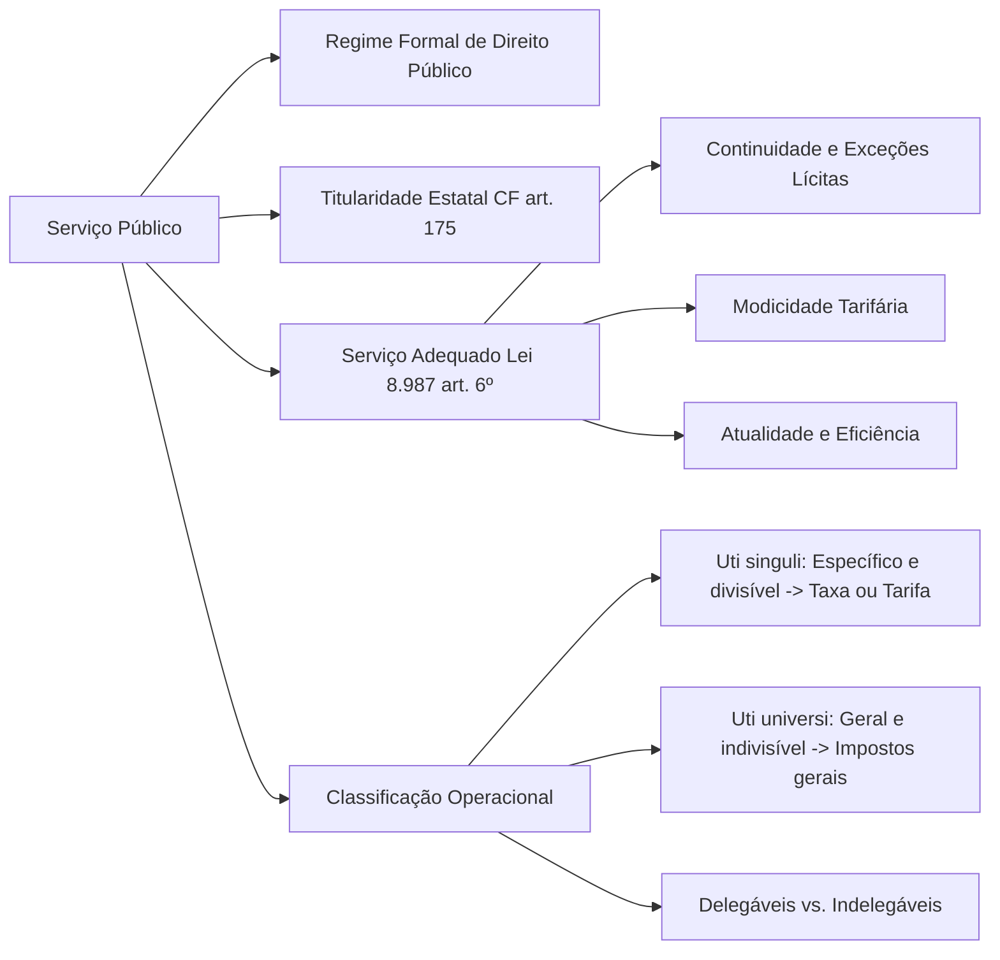

A prestação de serviços públicos é a forma mais direta pela qual o Estado satisfaz as necessidades da coletividade. Por meio de ações materiais concretas, o Poder Público garante utilidades essenciais, como transporte urbano, energia elétrica, água encanada, saneamento básico e comunicações. Nas provas de concursos públicos, esse tema apresenta incidência expressiva, exigindo do candidato o domínio exato dos elementos conceituais, do regime jurídico de direito público, dos princípios setoriais e das repercussões práticas na remuneração por taxa ou tarifa. Este capítulo inaugura o estudo da matéria, construindo os alicerces teóricos para a análise das concessões e permissões.

> [!objetivos]
> - Definir serviço público a partir das correntes doutrinárias e do critério formal adotado no direito brasileiro.
> - Identificar os três elementos constitutivos do serviço público: subjetivo, material e formal.
> - Aplicar os princípios reitores do serviço público, com destaque para a continuidade e a modicidade tarifária.
> - Distinguir os serviços *uti singuli* e *uti universi*, reconhecendo as consequências para a cobrança de tributos.
> - Diferenciar execução direta e indireta, centralizada e descentralizada.

## Fundamentos constitucionais e conceito de serviço público

O ponto de partida para o estudo dos serviços públicos no Brasil está no art. 175 da Constituição Federal. O texto constitucional determina que a prestação de serviços essenciais à sociedade é dever primário do Estado. O ente público pode atuar por meios próprios ou delegar a execução por meio de concessões e permissões, sendo indispensável a realização prévia de certame licitatório. A norma deixa claro que a titularidade originária pertence sempre ao Estado. O Poder Público pode escolher prestar a atividade por sua própria estrutura ou transferir a execução contratual a terceiros da iniciativa privada, mas a titularidade jamais sai das mãos públicas.

> [!lei] CF, art. 175
> Incumbe ao Poder Público, na forma da lei, diretamente ou sob regime de concessão ou permissão, sempre através de licitação, a prestação de serviços públicos.
> Parágrafo único. A lei disporá sobre:
> I - o regime das empresas concessionárias e permissionárias de serviços públicos, o caráter especial de seu contrato e de sua prorrogação, bem como as condições de caducidade, fiscalização e rescisão da concessão ou permissão;
> II - os direitos dos usuários;
> III - política tarifária;
> IV - a obrigação de manter serviço adequado.

A Constituição insere o art. 175 no título da Ordem Econômica e Financeira. Trata-se de serviços que envolvem utilidades econômicas e cuja prestação pela iniciativa privada exige delegação estatal formal. Por outro lado, existem serviços situados no título da Ordem Social, em especial a saúde (art. 199 da CF) e a educação (art. 209 da CF). Essas atividades sociais essenciais são consideradas abertas à livre iniciativa privada. Quando o Estado as desempenha, elas configuram serviços públicos em sentido amplo. Quando executadas por entidades particulares (como escolas privadas ou hospitais particulares), constituem serviços privados, sujeitos apenas à regulação e à fiscalização do poder de polícia do Estado, sem necessidade de concessão ou permissão.

A doutrina administrativista estruturou três correntes ou escolas para conceituar o serviço público:

1. **Escola essencialista ou materialista**: considera serviço público qualquer atividade cuja matéria seja de importância vital ou fundamental para a sociedade, independentemente de quem a preste ou do regime legal aplicável. Essa escola não foi acolhida no Brasil. Se fosse adotada, a medicina privada seria serviço público e a exploração de loterias não seria.
2. **Escola subjetivista**: sustenta que serviço público é toda atividade desempenhada pelo Estado ou por suas entidades da Administração Indireta. Essa corrente também foi afastada pelo direito brasileiro. Por um lado, particulares podem prestar serviços públicos mediante concessão ou permissão. Por outro lado, empresas estatais podem exercer atividade econômica em sentido estrito (CF, art. 173), como bancos e petrolíferas, sem que isso represente serviço público.
3. **Escola formalista ou legalista**: afirma que serviço público é aquela atividade que a Constituição ou a lei define como tal, submetendo-a a um regime jurídico preponderantemente de direito público. É a **escola adotada no direito brasileiro**. Não importa a essência intrínseca da atividade, mas a escolha normativa feita pelo legislador constituinte ou ordinário de consagrar a titularidade ao Estado sob tutela jurídica especial.

Na clássica síntese da doutrina nacional, serviço público é toda atividade material prestada pelo Estado ou por seus delegatários, voltada a proporcionar uma utilidade ou comodidade concreta aos administrados, sob regime jurídico de direito público instituído em benefício do interesse coletivo.

> [!exemplo]
> Em determinado município do interior pernambucano, a prefeitura organiza a coleta domiciliar de resíduos sólidos e o abastecimento de água potável por meio de uma concessão administrativa. Ambas as atividades possuem previsão legal e constituem serviços públicos típicos. Por outro lado, farmácias e clínicas médicas particulares instaladas na mesma cidade atendem a necessidades fundamentais de saúde, mas atuam sob regime de direito privado e livre iniciativa, submetendo-se unicamente à vigilância sanitária municipal.

## Elementos constitutivos do serviço público

A definição analítica de serviço público desdobra-se em três elementos essenciais que operam em conjunto: o elemento subjetivo, o elemento material e o elemento formal. O domínio desses três componentes permite resolver com rapidez questões que tentam confundir serviços públicos com funções estatais soberanas ou com mera intervenção econômica.

O esquema acima detalha a articulação dos três pilares, descritos a seguir:

1. **Elemento subjetivo**: refere-se à presença necessária do Estado como titular da atividade. A criação do serviço público decorre de opção legislativa, e a gestão incumbe ao Poder Público. O Estado pode atuar por seus próprios órgãos e entidades ou delegar a execução a pessoas privadas. Contudo, a presença do Estado na condição de titular, regulador e fiscalizador é permanente.
2. **Elemento material**: corresponde ao conteúdo da atividade. O serviço público traduz-se no fornecimento de uma utilidade material ou comodidade prática aos cidadãos. Essa característica afasta do conceito as funções estatais puramente normativas, legislativas e jurisdicionais. Elaborar leis ou julgar litígios são funções estatais soberanas, mas não serviços públicos em sentido técnico. Do mesmo modo, o exercício isolado do poder de polícia (como aplicar multas ou fiscalizar o trânsito) não é serviço público, embora com ele conviva.
3. **Elemento formal**: define o regime jurídico aplicável. A atividade deve ser regida preponderantemente pelo direito público. Esse regime confere à Administração prerrogativas de supremacia (como a alteração unilateral de contratos e o poder de intervenção) e impõe restrições especiais (como o dever de licitar, a prestação de contas e a responsabilidade civil objetiva por danos causados a terceiros).

> [!atencao] Exploração econômica não é serviço público
> Quando o Estado intervém no domínio econômico como agente empresarial (CF, art. 173), sujeita-se ao regime jurídico próprio das empresas privadas (direito civil, comercial e trabalhista). Sociedades de economia mista e empresas públicas exploradoras de atividade comercial competem no mercado e visam ao lucro sem desfrutar dos privilégios do regime de serviço público.

## Princípios reitores dos serviços públicos

O regime jurídico dos serviços públicos apoia-se em princípios fundamentais que asseguram a proteção dos usuários e a prevalência do interesse público. O legislador reuniu as principais diretrizes no conceito de **serviço adequado**, previsto no art. 6º da Lei nº 8.987/1995.

De acordo com a Lei de Concessões, a adequada prestação do serviço requer o atendimento cumulativo de um conjunto de exigências operacionais: regularidade no fornecimento, ausência de interrupções injustificadas, eficiência técnica, segurança operacional, constante modernização, alcance geral aos usuários, tratamento cortês e tarifas compatíveis com a renda dos cidadãos.

### Princípio da continuidade

O princípio da continuidade impõe que os serviços públicos não podem sofrer interrupções imprevistas ou injustificadas. Como atendem a necessidades fundamentais da coletividade, a sua paralisação acarreta prejuízos graves à vida em sociedade. Esse princípio fundamenta a proibição de abandono do serviço pela concessionária, veda a greve irrestrita de servidores em serviços essenciais e autoriza a ocupação provisória de bens pelo poder concedente.

A própria Lei nº 8.987/1995 reconhece que a continuidade não é absoluta. O art. 6º, § 3º, diz que **não é descontinuidade** a interrupção feita em situação de emergência ou após prévio aviso. As situações são estas:

- **Situação de emergência**: evento imprevisível ou urgente que exige reparo imediato na rede (ex.: rompimento de adutora de água ou queda de poste de energia elétrica). Dispensa aviso prévio.
- **Razões de ordem técnica ou de segurança das instalações** (inciso I): manutenção programada, reforma ou expansão da rede. Exige aviso prévio aos usuários.
- **Inadimplemento do usuário, considerado o interesse da coletividade** (inciso II): corte do fornecimento de serviço mensurável, depois de aviso prévio sobre o débito.

O § 4º do mesmo artigo, incluído pela Lei nº 14.015/2020, limita o corte por inadimplemento. É vedado iniciar a suspensão nas sextas-feiras, nos fins de semana, em feriados civis ou religiosos e nas vésperas dessas datas.

> [!pegadinha] Interrupção por inadimplemento não viola a continuidade
> As bancas costumam afirmar que cortar o serviço por falta de pagamento fere o princípio da continuidade. Isso está errado. Com aviso prévio, o corte é legítimo e está previsto no art. 6º, § 3º, II, da Lei nº 8.987/1995. A armadilha inversa é dizer que o corte vale em qualquer dia: o § 4º proíbe início em fim de semana, feriado e véspera de feriado.

### Princípio da mutabilidade do regime jurídico ou da atualidade

Também chamado de princípio da adaptabilidade, prevê que a execução do serviço público deve acompanhar a modernização tecnológica, as novas exigências sociais e a evolução das normas regulamentares. O poder concedente tem a faculdade de impor novas técnicas e exigir investimentos em equipamentos mais modernos para aprimorar a prestação, assegurando o equilíbrio econômico-financeiro da contratada quando houver encargos novos.

### Princípio da modicidade das tarifas

As tarifas cobradas dos usuários devem ser fixadas em valores razoáveis e acessíveis à população em geral. O acesso a serviços essenciais, como transporte urbano e saneamento, não pode ser inviabilizado pelo poder aquisitivo limitado dos cidadãos. Para viabilizar a modicidade tarifária sem comprometer a viabilidade da empresa delegatária, o Estado pode conceder subsídios orçamentários ou autorizar receitas alternativas e projetos associados (como publicidade em ônibus ou exploração de pontos comerciais em estações de metrô).

### Princípios da generalidade, igualdade e impessoalidade

O serviço público deve estar disponível ao maior universo possível de usuários (universalidade ou generalidade), sem qualquer discriminação arbitrária entre os cidadãos que se encontrem em idênticas condições técnicas e jurídicas (igualdade formal e impessoalidade). Admitem-se tarifas diferenciadas apenas quando fundamentadas em critérios objetivos e justificados, como faixas de consumo ou características técnicas do atendimento.

> [!bizu] Mnemônico do serviço adequado
> Para lembrar os oito atributos legais do serviço adequado previstos no art. 6º, § 1º, da Lei nº 8.987/1995, memorize a sigla **REC AS GM**:
> - **R**egularidade
> - **E**ficiência
> - **C**ontinuidade
> - **A**tualidade
> - **S**egurança
> - **G**eneralidade
> - **M**odicidade das tarifas (+ Cortesia)

## Classificação dos serviços públicos e repercussões práticas

A doutrina classifica os serviços públicos a partir de diferentes critérios. Cada classificação gera reflexos diretos na forma de prestação, nas prerrogativas estatais e no modelo de financiamento tributário ou tarifário.

### Quanto aos destinatários: serviços *uti singuli* e serviços *uti universi*

Essa é a divisão mais frequente e relevante em concursos, sobretudo pela repercussão direta no direito tributário:

- **Serviços singulares ou *uti singuli***: são aqueles que têm usuários determinados ou determináveis. A utilização é individualizada e a quantidade usufruída por cada administrado pode ser mensurada. Exemplos: fornecimento residencial de água e esgoto, energia elétrica domiciliar, telefonia e coleta domiciliar de lixo. Por serem específicos e divisíveis, esses serviços podem ser remunerados por **taxa** (tributo vinculado, previsto no art. 145, II, da CF) ou por **tarifa / preço público** (remuneração contratual).
- **Serviços gerais ou *uti universi***: são aqueles prestados à coletividade como um todo, de forma indistinta, sem que seja possível mensurar o consumo individual de cada cidadão. Exemplos: segurança pública prestada pelas polícias e bombeiros militares, defesa nacional pelas Forças Armadas, diplomacia e iluminação pública nas vias urbanas. Esses serviços **não podem ser custeados por taxas**, devendo ser financiados pelas receitas gerais dos **impostos**.

A distinção gerou importantes entendimentos consolidados no Supremo Tribunal Federal:

> [!jurisprudencia] STF, Súmula Vinculante 19
> O STF consolidou que a cobrança de taxa municipal vinculada às atividades de recolhimento, transporte e destinação final de resíduos domiciliares é perfeitamente legítima, harmonizando-se com o art. 145, II, da Carta da República.

> [!jurisprudencia] STF, Súmula Vinculante 41
> É inconstitucional instituir taxas para remunerar os serviços de iluminação de vias públicas, tendo em vista seu caráter geral e indivisível.

A Súmula 670 do STF reforça o mesmo teor da Súmula Vinculante 41. Como a iluminação pública é serviço geral e indivisível (*uti universi*), a cobrança de taxa violava o art. 145, II, da Constituição. Para contornar esse obstáculo orçamentário dos municípios, a Emenda Constitucional nº 39/2002 introduziu o art. 149-A na Constituição Federal, criando uma espécie tributária própria: a contribuição para o custeio do serviço de iluminação pública (COSIP ou CIP).

A tabela a seguir sistematiza as diferenças entre as duas categorias de serviços:

| Critério de distinção | Serviços *uti singuli* (singulares) | Serviços *uti universi* (gerais) |
| --- | --- | --- |
| Identificação do usuário | Determinada ou determinável | Indeterminada (coletividade indistinta) |
| Mensuração do consumo | Individual e quantificável | Impossível individualizar o uso |
| Forma de financiamento | Taxa (art. 145, II) ou tarifa/preço | Impostos gerais (ou COSIP no art. 149-A) |
| Natureza do serviço | Específico e divisível | Geral e indivisível |
| Exemplos típicos | Água, esgoto, coleta domiciliar de lixo | Segurança pública, bombeiros, iluminação |

### Quanto à delegabilidade: serviços delegáveis e indelegáveis

- **Serviços indelegáveis**: correspondem às atividades exclusivas e típicas do Estado, que envolvem manifestação direta da soberania, coerção ou aplicação de penalidades. Não podem ser transferidos à iniciativa privada. São exemplos a segurança pública, a atividade judiciária, a fiscalização tributária e o poder de polícia restritivo em sua dimensão coercitiva.
- **Serviços delegáveis**: são serviços de conveniência material ou utilidade econômica que, embora assumidos pelo Estado, podem ter a sua execução transferida a particulares sob controle público. Exemplos: transporte rodoviário, ferrovias, aeroportos, fornecimento de gás canalizado e saneamento básico.

### Quanto à essencialidade e exclusividade: serviços próprios e impróprios

Na lição clássica de Hely Lopes Meirelles, serviços próprios são aqueles ligados às funções tradicionais e indelegáveis da Administração Pública, prestados diretamente pelo Poder Público para atender a necessidades imperiosas da comunidade. Serviços impróprios seriam aqueles que apenas proporcionam comodidades secundárias e podem ser delegados a particulares.

Na visão contemporânea difundida por Maria Sylvia Zanella Di Pietro, a classificação ganha outro enfoque:
- **Serviços públicos próprios**: são aqueles que representam comodidade para a população e são regidos pelo direito público, executados pelo Estado diretamente ou mediante delegação (concessão ou permissão).
- **Serviços impróprios ou virtuais**: são as atividades de relevância social (saúde, previdência e educação) que a Constituição declarou livres à iniciativa privada. Quando executadas por particulares, funcionam sob o regime de direito privado, sem delegação, sob fiscalização do poder de polícia estatal.

## Formas de prestação e meios de execução

A organização do Estado para a entrega dos serviços públicos articula dois binômios complementares: a distinção entre centralização e descentralização, e a diferenciação entre execução direta e execução indireta.

### Centralização e descentralização

- **Prestação centralizada**: o serviço é executado pelo próprio ente político federativo (União, Estados, Distrito Federal ou Municípios), utilizando os órgãos despersonalizados da Administração Direta (ex.: ministérios, secretarias estaduais e comandos militares).
- **Prestação descentralizada**: a atividade é transferida para pessoa jurídica distinta. A descentralização pode ocorrer por dois caminhos:
  - **Descentralização por outorga (ou por serviços)**: o Estado cria, mediante lei específica, entidades da Administração Indireta (autarquias, fundações públicas, empresas públicas e sociedades de economia mista). A outorga transfere a titularidade e a execução do serviço, com vigência em regra por prazo indeterminado.
  - **Descentralização por delegação (ou por colaboração)**: o Estado transfere unicamente a execução material do serviço a pessoas jurídicas ou consórcios privados, por meio de contrato (concessão) ou ato/contrato adesivo (permissão e autorização). A titularidade do serviço permanece sempre com o Poder Público, e a delegação dá-se obrigatoriamente por prazo determinado.

### Execução direta e indireta

No modelo acolhido pela maioria da doutrina e pela jurisprudência com amparo no art. 175 da Constituição:
- **Execução direta**: compreende a prestação realizada pela estrutura estatal, abrangendo tanto a Administração Direta quanto a Administração Indireta (em especial autarquias prestadoras de serviço, como autarquias de saneamento ou previdência).
- **Execução indireta**: compreende a prestação confiada à iniciativa privada por meio de delegação de serviços públicos (concessionárias e permissionárias).

Em qualquer modalidade de prestação, incide a regra da responsabilidade civil objetiva consagrada no art. 37, § 6º, da Constituição Federal. Tanto as pessoas jurídicas de direito público quanto as pessoas jurídicas de direito privado prestadoras de serviços públicos respondem objetivamente pelos danos que seus agentes causarem a terceiros, bastando ao ofendido provar a conduta, o dano e o nexo de causalidade. A culpa ou o dolo do agente só é relevante em posterior ação regressiva promovida pelo ente público ou pela concessionária contra o servidor ou funcionário causador do dano.

## Mapa do capítulo

### Para fixar

- O serviço público no Brasil segue o critério formal: é a atividade material definida pela lei ou Constituição e submetida a regime de direito público.
- A titularidade do serviço público pertence sempre ao Poder Público (CF, art. 175); a iniciativa privada recebe apenas a delegação da execução.
- Os três elementos constitutivos são o subjetivo (titularidade estatal), o material (utilidade concreta para o administrado) e o formal (regime de direito público).
- Saúde e educação são serviços sociais livres à iniciativa privada (CF, arts. 199 e 209), configurando serviços privados sob regulação de polícia quando prestados por particulares.
- Serviço adequado é o que reúne regularidade, continuidade, eficiência, segurança, atualidade, generalidade, cortesia e modicidade tarifária (Lei nº 8.987/1995, art. 6º).
- A interrupção de serviço por emergência ou com prévio aviso (ordem técnica, segurança ou inadimplemento do usuário) não configura descontinuidade ilícita (art. 6º, § 3º).
- Serviços *uti singuli* atendem a usuários determinados e mensuráveis; são passíveis de remuneração por taxa ou tarifa (CF, art. 145, II).
- Serviços *uti universi* beneficiam a coletividade indeterminada e são remunerados por impostos gerais, sendo vedada a cobrança de taxa (STF, Súmula Vinculante 41).
- A taxa de coleta domiciliar de lixo é constitucional (STF, Súmula Vinculante 19) porque o serviço é específico e divisível.
- A prestação descentralizada por delegação transfere apenas a execução a particulares, por prazo determinado, preservada a responsabilidade civil objetiva (CF, art. 37, § 6º).
