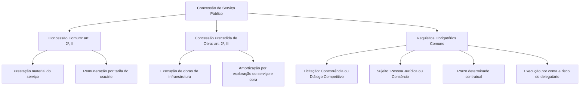
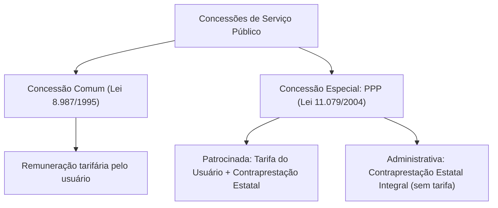
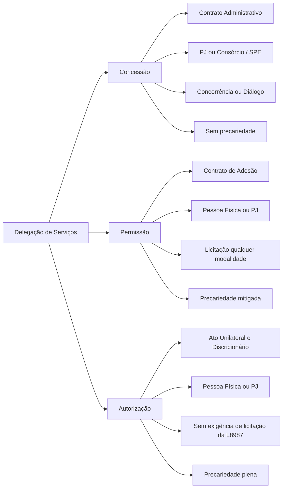

A descentralização por delegação é o principal mecanismo pelo qual a Administração Pública transfere a particulares a execução material de serviços públicos essenciais. Em vez de imobilizar recursos orçamentários vultosos na operação direta, o Estado atrai investimentos privados para construir rodovias, sanear municípios, gerar e distribuir energia e operar redes de transporte coletivo. Para compreender esse modelo, é fundamental distinguir com exatidão as três espécies de outorga negocial previstas no ordenamento: a concessão, a permissão e a autorização. Este capítulo aprofunda os requisitos legais, os instrumentos de formalização, as exigências licitatórias e os limites da precariedade de cada instituto.

> [!objetivos]
> - Definir a concessão de serviço público comum e a concessão precedida de obra pública.
> - Compreender a permissão de serviço público como contrato de adesão e suas diferenças em relação à concessão.
> - Analisar a autorização de serviço público e sua natureza jurídica de ato administrativo discricionário e precário.
> - Identificar as regras sobre consórcios de empresas e formação de Sociedade de Propósito Específico (SPE).
> - Comparar os regimes quanto a prazos, modalidades de licitação, sujeitos delegatários e prerrogativas rescisórias.

## Regime jurídico da concessão de serviços públicos

A concessão de serviço público é o instrumento contratual mais abrangente e complexo do direito administrativo econômico. Por meio dela, o Estado transfere a um agente privado a prestação de uma utilidade pública por prazo longo e determinado, exigindo vultosos aportes de capital, os quais serão amortizados mediante cobrança de tarifas pagas pelos usuários ou contraprestações públicas.

O art. 2º da Lei nº 8.987/1995 divide as concessões em duas categorias fundamentais:

1. **Concessão de serviço público comum**: negócio jurídico pelo qual o ente estatal transfere a uma pessoa jurídica ou consórcio societário, após certame licitatório (concorrência ou diálogo competitivo), a responsabilidade de executar determinada utilidade sob regime de prazo certo, suportando a delegatária as áleas ordinárias da atividade (art. 2º, inciso II).
2. **Concessão precedida de obra pública**: ajuste contratual em que o parceiro privado assume o encargo prévio de edificar, reformar, duplicar ou restaurar bens de infraestrutura pública, recuperando os custos despendidos e obtendo o retorno financeiro por meio da posterior gestão e cobrança de tarifas vinculadas à fruição do serviço e da própria obra ao longo do período pactuado (art. 2º, inciso III).

> [!lei] Lei 8.987/1995, art. 4º
> A concessão de serviço público, precedida ou não da execução de obra pública, será formalizada mediante contrato, que deverá observar os termos desta Lei, das normas pertinentes e do edital de licitação.

A concessão ostenta natureza jurídica de **contrato administrativo bilateral, oneroso, comutativo e personalíssimo (*intuitu personae*)**. Por se tratar de contrato administrativo típico, caracteriza-se pela presença de cláusulas exorbitantes, garantindo ao poder concedente prerrogativas de fiscalização, alteração unilateral das cláusulas regulamentares do serviço e intervenção corretiva.

### Características fundamentais da concessão

Quatro características definem a estrutura da concessão e aparecem com frequência em questões de concurso:

1. **Execução por conta e risco da concessionária**: a empresa assume os riscos ordinários do empreendimento (risco de demanda, flutuações de custos operacionais e inadimplência dos usuários). Em contrapartida, tem direito à preservação do equilíbrio econômico-financeiro diante de fatos extraordinários, imprevisíveis ou de medidas unilaterais do poder público.
2. **Prazo determinado**: não se admite concessão por prazo indeterminado ou perpétuo. O prazo contratual deve ser suficiente para viabilizar a amortização dos investimentos realizados e proporcionar o retorno financeiro legítimo do capital investido.
3. **Sujeito contratado**: a concessão só pode ser formalizada com **pessoa jurídica** ou com **consórcio de empresas**. É absolutamente vedada a celebração de concessão com pessoa física ou pessoa natural.
4. **Ausência de precariedade**: a concessão confere à concessionária direito subjetivo ao cumprimento do prazo contratado. O contrato não pode ser revogado sumariamente por conveniência administrativa. Caso o Estado decida retomar o serviço por interesse público antes do termo final (encampação), dependerá de lei autorizativa específica e pagamento prévio de indenização.

> [!atencao] Modalidades de licitação após a Lei nº 14.133/2021
> Com a promulgação da Nova Lei de Licitações (Lei nº 14.133/2021), o art. 2º da Lei nº 8.987/1995 foi atualizado para admitir duas modalidades: **concorrência** e **diálogo competitivo**. Além disso, o art. 27 da Lei nº 9.074/1995 permite a utilização do **leilão** nas hipóteses de privatização de estatais conjugada com a concessão de serviço público. Portanto, a afirmativa de que a concessão exige sempre e exclusivamente a modalidade concorrência tornou-se incorreta.

### Consórcios de empresas e a formação da SPE

Para empreendimentos de grande porte que demandam investimentos bilionários e capacidades técnicas complementares (como construção de usinas hidrelétricas, rodovias pedagiadas e linhas de metrô), a Lei nº 8.987/1995 autoriza expressamente a participação de consórcios de licitantes.

As regras do art. 19 da Lei de Concessões impõem condições rigorosas para resguardar o interesse público na contratação de consórcios:

- **Comprovação de compromisso público ou particular de constituição de consórcio**, subscrito por todas as consorciadas, já na fase de apresentação de propostas.
- **Indicação da empresa líder**, que será responsável pelo consórcio perante o poder concedente, devendo ser obrigatoriamente uma **empresa brasileira** nos consórcios formados conjuntamente por empresas brasileiras e estrangeiras.
- **Responsabilidade solidária** de todas as empresas consorciadas pelas obrigações decorrentes da licitação e do contrato, impedindo que uma consorciada transfira culpas a outra em caso de inadimplemento.
- **Proibição de participação cruzada**: uma mesma empresa consorciada não pode participar de mais de um consórcio na mesma licitação, nem disputar o certame de forma isolada concorrendo contra seu próprio consórcio.

Após o julgamento e a homologação da licitação, o poder concedente pode exigir a constituição de uma **Sociedade de Propósito Específico (SPE)** antes da celebração do contrato de concessão, conforme prevê o art. 20 da Lei nº 8.987/1995. A SPE é uma sociedade anônima criada com a finalidade exclusiva de explorar aquele serviço concedido, possuindo contabilidade própria, patrimônio segregado e governança corporativa transparente, o que facilita a fiscalização e viabiliza financiamentos estruturados do tipo *project finance*.

## Permissão de serviço público

A permissão de serviço público sofreu profunda alteração conceitual com a Constituição de 1988 e a edição da Lei nº 8.987/1995. No direito administrativo anterior, a permissão era tratada pela doutrina clássica como mero ato administrativo unilateral, discricionário e precário. O art. 175 da Constituição, porém, determinou que a lei disciplinasse o regime especial de seu contrato, aproximando a permissão do campo contratual.

No modelo traçado pelo art. 2º, inciso IV, da legislação de regência, a permissão configura outorga vinculada ao regime da precariedade, viabilizada obrigatoriamente por licitação pública e concedida a pessoas físicas ou sociedades empresárias que reúnam aptidão operacional e financeira para executar o serviço assumindo os riscos da gestão.

Complementando a definição, o art. 40 da Lei estabelece:

> [!lei] Lei 8.987/1995, art. 40
> A permissão de serviço público será formalizada mediante contrato de adesão, que observará os termos desta Lei, das demais normas pertinentes e do edital de licitação, inclusive quanto à precariedade e à revogabilidade unilateral do contrato pelo poder concedente.

### Traços distintivos da permissão

A leitura do regime legal da permissão revela características singulares que costumam surpreender quem estuda apenas pela doutrina tradicional:

1. **Natureza contratual (contrato de adesão)**: a permissão de serviço público não é ato administrativo unilateral, mas sim um contrato de adesão. O particular adere às cláusulas pré-estabelecidas pelo edital licitatório sem margem para negociações bilaterais de cláusulas econômicas.
2. **Sujeito delegatário**: pode ser delegada à **pessoa física ou pessoa jurídica**. Esta é uma distinção essencial em provas: a permissão admite pessoa física (como no transporte escolar intermunicipal ou linhas de transporte complementar), enquanto a concessão exige pessoa jurídica ou consórcio. Por outro lado, a lei não prevê permissão outorgada a consórcio de empresas.
3. **Modalidade licitatória**: ao contrário da concessão (que exige concorrência ou diálogo competitivo), a Lei nº 8.987/1995 exige licitação prévia para a permissão, mas **não fixa uma modalidade específica**. A Administração deve aplicar a modalidade compatível da lei geral de licitações em função do valor ou complexidade do objeto.
4. **Precariedade e revogabilidade unilateral**: a precariedade é mantida expressamente pela lei (art. 40). O poder concedente detém a prerrogativa de revogar unilateralmente o vínculo por conveniência e oportunidade pública. Todavia, como adverte a doutrina moderna e a jurisprudência, a fixação de prazo na permissão atenua a precariedade absoluta: se a rescisão unilateral ocorrer antes do término sem culpa do permissionário, haverá direito à indenização dos investimentos não depreciados.

> [!pegadinha] Permissão de serviço público não é ato administrativo
> Uma das armadilhas mais repetidas em provas é afirmar que a permissão de serviço público é ato administrativo unilateral e discricionário. Sob a vigência do art. 40 da Lei nº 8.987/1995, a permissão tem **natureza contratual** (contrato de adesão precedido de licitação). Quem permanece como ato unilateral é a autorização, não a permissão.

> [!bizu] Sujeito delegado: quem pode ser concessionário e permissionário
> Guarde esta distinção direta para não errar em prova:
> - **Concessão**: apenas Pessoa Jurídica ou Consórcio de empresas (nunca pessoa física).
> - **Permissão**: Pessoa Jurídica ou Pessoa Física (não prevê consórcio).
> - **Autorização**: Pessoa Física ou Pessoa Jurídica (não há consórcio).

## Autorização de serviço público

A autorização de serviço público é a terceira modalidade de delegação de utilidades públicas prevista no ordenamento brasileiro. Diferentemente da concessão e da permissão, a autorização não foi disciplinada detalhadamente pela Lei nº 8.987/1995, encontrando fundamento direto em normas setoriais e na própria Constituição Federal (ex.: art. 21, XI e XII, que trata dos serviços federais de telecomunicações, energia e transportes).

A autorização de serviço público possui **natureza jurídica de ato administrativo unilateral, discricionário e precário**. O Poder Público outorga ao particular a faculdade de prestar determinada atividade no interesse preponderante do próprio administrado ou para atender a demandas transitórias, extraordinárias ou de pequena monta.

Principais características da autorização:

- **Ato unilateral e discricionário**: não decorre de contrato administrativo. O Estado avalia a oportunidade e conveniência do deferimento.
- **Precariedade qualificada**: o ato pode ser revogado a qualquer tempo pela autoridade competente, sem gerar, como regra geral, direito à indenização por perdas e lucros cessantes.
- **Inexigibilidade de licitação obrigatória da Lei nº 8.987/1995**: por se tratar de ato administrativo discricionário, a autorização de serviços não segue o rito formal da concessão. Todavia, quando houver múltiplos interessados disputando autorizações limitadas (como frequências de rádio ou rotas de táxi), o princípio da impessoalidade e da moralidade impõe a adoção de procedimento seletivo objetivo.
- **Sujeito beneficiário**: pode ser conferida a pessoas físicas ou jurídicas.

> [!exemplo]
> O serviço de táxi em municípios brasileiros é exemplo clássico de serviço de utilidade pública outorgado mediante autorização administrativa a motoristas autônomos credenciados. Outro exemplo contemporâneo reside na outorga de serviços de transporte terrestre interestadual regular de passageiros sem exploração de infraestrutura, cuja outorga por simples autorização sem licitação formal foi declarada constitucional pelo STF (ADIs 5.549 e 6.270).

## Comparativo sistemático: concessão, permissão e autorização

Para consolidar as diferenças estruturais que decidem questões de prova, a tabela abaixo confronta os três institutos em todos os aspectos fundamentais:

| Aspecto de comparação | Concessão de serviço público | Permissão de serviço público | Autorização de serviço público |
| --- | --- | --- | --- |
| **Natureza jurídica** | Contrato administrativo bilateral | Contrato administrativo de adesão | Ato administrativo unilateral |
| **Instrumento formal** | Termo de contrato administrativo | Contrato de adesão formal | Portaria, termo ou alvará |
| **Exigência de licitação** | Obrigatória (concorrência ou diálogo) | Obrigatória (sem modalidade fixa) | Não exigida pela Lei 8.987/1995 |
| **Sujeito delegado** | Pessoa jurídica ou consórcio | Pessoa física ou pessoa jurídica | Pessoa física ou pessoa jurídica |
| **Consórcio admitido?** | Sim, expressamente (art. 19) | Não previsto em lei | Não admitido |
| **Prazo** | Sempre determinado | Determinado (com precariedade) | Determinado ou indeterminado |
| **Grau de precariedade** | Inexistente (vínculo estável) | Mitigada pelo prazo contratual | Plena (revogabilidade discricionária) |
| **Rescisão antecipada** | Encampação exige lei e prévia paga | Revogação unilateral pelo concedente | Revogação sumária sem indenização |
| **Investimentos pesados** | Típico de grandes infraestruturas | Serviços de menor vulto econômico | Serviços transitórios ou utilidade |

## Parcerias Público-Privadas (PPPs) e a concessão especial

A Lei nº 11.079/2004 introduziu no ordenamento brasileiro as **Parcerias Público-Privadas (PPPs)**, que representam a espécie qualificada de **concessão especial**. Enquanto a concessão comum da Lei nº 8.987/1995 é remunerada preponderantemente ou exclusivamente pelas tarifas pagas pelos usuários (como no pedágio de rodovias com alto fluxo), a concessão especial é concebida para projetos em que a tarifa do usuário não é suficiente para cobrir os custos ou quando o serviço é fruído diretamente pela própria Administração.

A Lei nº 11.079/2004 consagra duas modalidades de PPP:

1. **Concessão patrocinada**: é a concessão de serviços públicos ou de obras públicas de que trata a Lei nº 8.987/1995, quando envolver, adicionalmente à tarifa cobrada dos usuários, **contraprestação pecuniária do parceiro público ao parceiro privado** (art. 2º, § 1º). Aplica-se quando a atividade tem cobrança de tarifa, mas o valor módico suportado pelo cidadão precisa de um complemento do Estado para remunerar o investimento.
2. **Concessão administrativa**: é o contrato de prestação de serviços de que a Administração Pública seja a **usuária direta ou indireta**, ainda que envolva a execução de obra ou o fornecimento e instalação de bens (art. 2º, § 2º). Não há cobrança de tarifa dos cidadãos: quem remunera integralmente o concessionário é a própria Administração contratante (ex.: construção e gestão predial de complexos prisionais, hospitais públicos ou centros administrativos).

### Limitações e vedações legais das PPPs

O art. 2º, § 4º, da Lei nº 11.079/2004 estabelece três proibições expressas de contratação de PPP, que são objeto recorrente de cobrança em provas:

- **Valor do contrato**: é vedada a celebração de parceria público-privada cujo valor do contrato seja **inferior a R$ 10.000.000,00 (dez milhões de reais)** (redação atualizada pela Lei nº 12.766/2012; o piso original era de vinte milhões).
- **Prazo de vigência**: o período de prestação do serviço não pode ser **inferior a 5 (cinco) anos**, nem **superior a 35 (trinta e cinco) anos**, já incluída eventual prorrogação.
- **Objeto isolado**: é vedado celebrar PPP que tenha por objeto único o fornecimento de mão de obra, a prestação de serviços sem investimentos em ativos ou a mera execução de obra pública desvinculada da operação continuada.

> [!pegadinha] Diferença entre concessão comum e concessão patrocinada
> Na concessão comum regida pela Lei nº 8.987/1995, a contraprestação estatal é inexistente ou meramente residual (como em subsídios de passagens sociais). Quando houver contraprestação pecuniária regular da Administração Pública combinada com a tarifa do usuário, o contrato assume a natureza de **concessão patrocinada** e deve obrigatoriamente submeter-se às regras rígidas da Lei de PPPs (Lei nº 11.079/2004).

## Direitos e garantias dos usuários de serviços públicos

O regime de concessões confere ao usuário uma posição jurídica de destaque, superando a visão antiga de mero consumidor para alcançar o status de titular de direitos fundamentais perante os delegatários estatais. O art. 7º da Lei nº 8.987/1995 e a Lei nº 13.460/2017 (Código de Defesa do Usuário de Serviços Públicos) detalham essa proteção:

- **Direito a serviço adequado**: receber o serviço satisfazendo plenamente as exigências de eficiência, regularidade, continuidade, segurança e atualidade.
- **Direito de informação e transparência**: obter do poder concedente e da concessionária informações atualizadas para a defesa de interesses individuais ou coletivos, bem como conhecer as normas e regulamentos do serviço.
- **Livre escolha da data de vencimento**: nos termos do art. 7º-A da Lei nº 8.987/1995, a concessionária de serviço público deve oferecer ao consumidor e ao usuário, no mínimo, **seis opções de datas no mês** para o vencimento de suas faturas e débitos tarifários.
- **Direito à certidão ampla**: conforme o art. 22 da Lei de Concessões, qualquer pessoa tem o direito de obter certidões administrativas a respeito de documentos, deliberações, editais e termos contratuais pertinentes às licitações e às delegações, sem necessidade de justificar interesse pessoal nem comprovar a condição de usuário.
- **Deveres correlatos do usuário**: a legislação exige que o usuário utilize os serviços com racionalidade, mantenha atualizados seus dados cadastrais, pague pontualmente as faturas recebidas e preserve o patrimônio público e os equipamentos concedidos.

## Mapa do capítulo

### Para fixar

- A concessão de serviço público comum (art. 2º, II, da Lei nº 8.987/1995) é delegada a pessoa jurídica ou consórcio por licitação e prazo determinado.
- A concessão precedida de obra pública (art. 2º, III) remunera os investimentos em infraestrutura por meio da exploração econômica posterior da obra e do serviço.
- A Nova Lei de Licitações autorizou a licitação de concessões nas modalidades de concorrência e diálogo competitivo, admitido o leilão na Lei nº 9.074/1995.
- A concessão é personalíssima e veda contratação de pessoa física, exigindo pessoa jurídica ou consórcio com empresa líder (art. 19).
- A formação de Sociedade de Propósito Específico (SPE) pode ser exigida pela Administração antes da assinatura do contrato de concessão (art. 20).
- A permissão de serviço público é formalizada por contrato de adesão (art. 40 da Lei nº 8.987/1995) e admite contratação de pessoa física ou jurídica.
- A autorização de serviço público é ato administrativo unilateral, discricionário e precário, vocacionada a situações transitórias ou de interesse predominante do particular.
- As PPPs (Lei nº 11.079/2004) dividem-se em patrocinada e administrativa, com piso de 10 milhões de reais e vigência de 5 a 35 anos.
- As concessionárias devem ofertar ao usuário no mínimo seis opções de datas no mês para o vencimento de suas contas (art. 7º-A).
