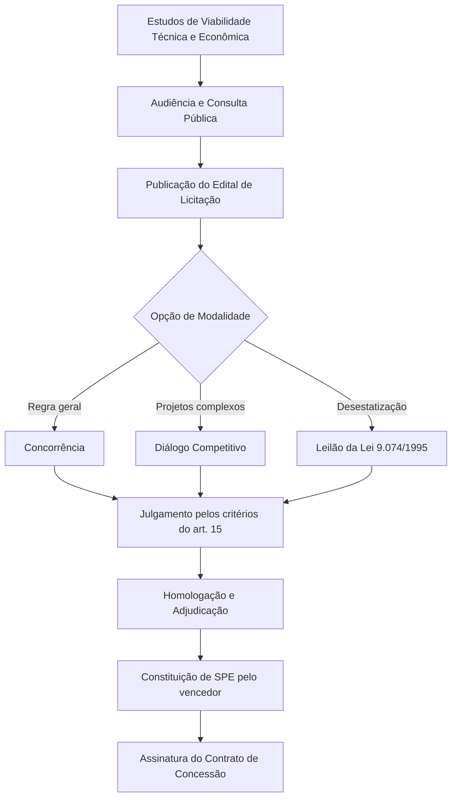
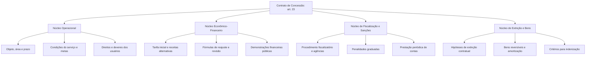
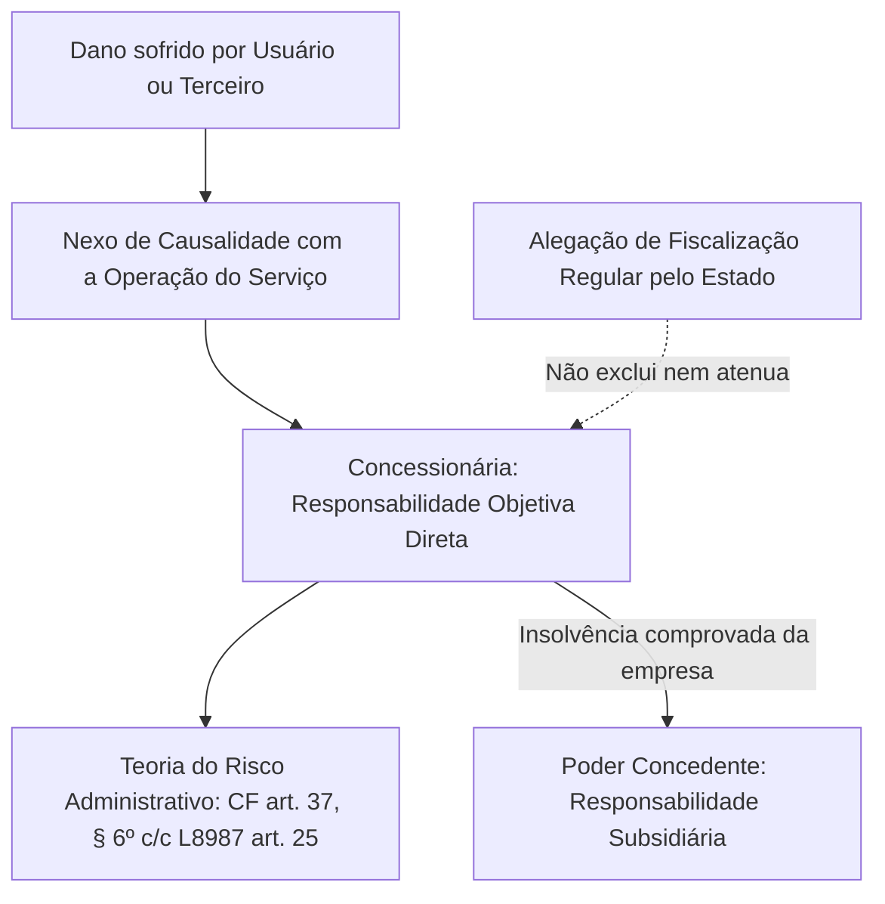
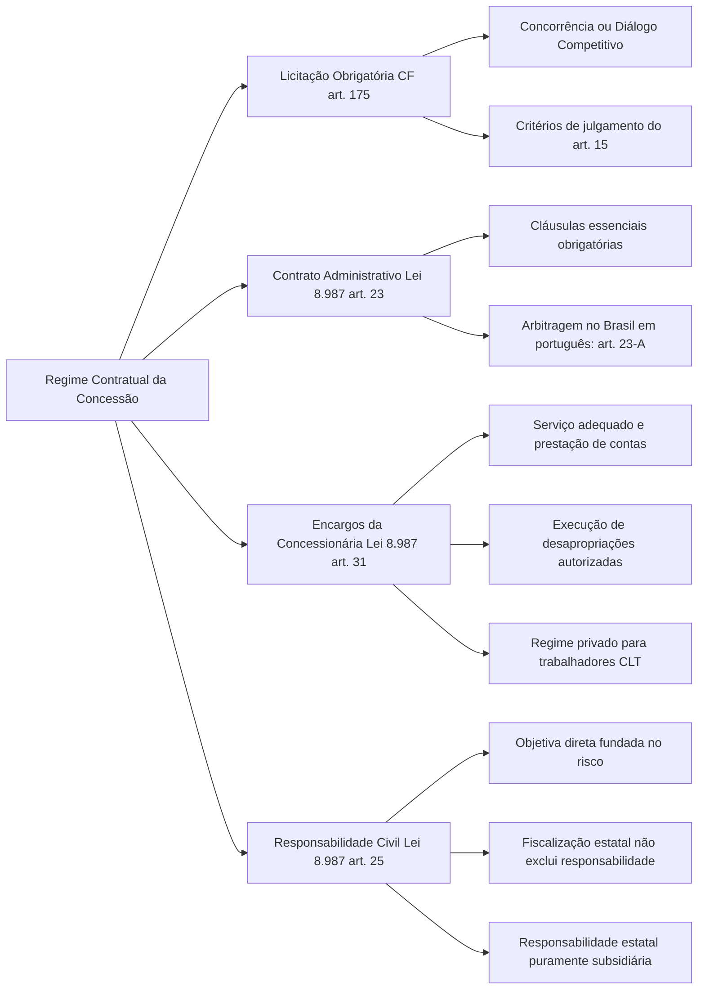

A outorga de uma concessão de serviço público exige um procedimento prévio rigoroso para selecionar o parceiro privado e disciplinar a relação contratual decorrente. O art. 175 da Constituição Federal impõe a licitação prévia obrigatória, afastando qualquer hipótese de dispensa ou contratação direta sem concorrência para tais delegações. Uma vez homologado o resultado do certame, formaliza-se o contrato administrativo de concessão, instrumento complexo que fixa os direitos dos usuários, as prerrogativas do poder público e os pesados encargos da concessionária. Neste capítulo, estudamos as regras do edital, as modalidades e critérios de julgamento, as cláusulas essenciais do pacto e a responsabilidade civil da delegatária.

> [!objetivos]
> - Compreender a obrigatoriedade da licitação prévia nas concessões e as modalidades aplicáveis.
> - Analisar os critérios legais de julgamento de propostas previstos no art. 15 da Lei nº 8.987/1995.
> - Identificar as cláusulas essenciais do contrato de concessão e o cabimento de métodos privados de solução de disputas.
> - Detalhar os encargos atribuídos à concessionária e o regime jurídico de suas contratações de pessoal e terceiros.
> - Explicar a responsabilidade civil objetiva da concessionária perante terceiros e o papel subsidiário do Estado.

## Procedimento licitatório da concessão

A prestação de serviços públicos mediante concessão não admite outorga graciosa ou negociação direta entre o Estado e empresários. O art. 175 da Carta Magna traz a expressão categórica "sempre através de licitação". Ao contrário das compras e serviços comuns da Administração em geral (onde a Lei nº 14.133/2021 autoriza a dispensa e a inexigibilidade de licitação), a delegação de serviços públicos por concessão exige obrigatoriamente a disputa pública concorrencial.

### Modalidades aplicáveis

A Lei nº 8.987/1995, atualizada pelos comandos da Nova Lei de Licitações (Lei nº 14.133/2021), estabelece as opções de procedimentos para licitar a concessão:

- **Concorrência**: modalidade ordinária de licitação aberta a qualquer interessado que comprove os requisitos de qualificação técnica, econômico-financeira e jurídica estabelecidos no instrumento convocatório.
- **Diálogo competitivo**: modalidade concebida para contratações de alta complexidade técnica, em que a Administração Pública dialoga previamente com os licitantes pré-selecionados com o intuito de desenvolver alternativas e soluções técnicas inovadoras antes de colher as propostas finais.
- **Leilão**: admitido excepcionalmente com base no art. 27 da Lei nº 9.074/1995, exclusivamente quando a outorga da concessão ou sua prorrogação ocorrer concomitantemente com a privatização ou desestatização de empresa estatal detentora originária da infraestrutura.

### Critérios de julgamento da licitação

O julgamento das propostas na concessão de serviços públicos deve obedecer a um dos critérios objetivos previstos no art. 15 da Lei nº 8.987/1995, devendo o edital especificar com precisão a fórmula adotada. A tabela abaixo sintetiza os sete critérios legais:

| Critério legal (art. 15) | Mecanismo de seleção | Aplicação prática preferencial |
| --- | --- | --- |
| **Menor valor da tarifa** | Vence a proposta que oferta o menor preço cobrado do usuário | Serviços de massa e grande demanda (transporte urbano) |
| **Maior valor da outorga** | Vence quem paga o maior valor aos cofres públicos pela concessão | Infraestruturas maduras e altamente lucrativas |
| **Melhor técnica** | Vence a melhor proposta técnica, sendo a tarifa fixada previamente no edital | Serviços de alta especialização com preço tabelado |
| **Combinação: Menor tarifa + Melhor técnica** | Ponderação entre menor custo ao usuário e qualidade técnica da oferta | Projetos que exigem soluções operacionais avançadas |
| **Combinação: Maior outorga + Melhor técnica** | Ponderação entre arrecadação estatal e excelência do projeto | Concessões aeroportuárias ou portuárias de grande porte |
| **Combinação: Menor tarifa + Maior outorga** | Avaliação conjunta do ganho para o usuário e para o poder concedente | Projetos com margem orçamentária equilibrada |
| **Maior outorga após qualificação técnica** | Propostas técnicas são pontuadas; entre as qualificadas, vence a maior oferta | Concessões complexas com exigência de patamar mínimo técnico |

Nas licitações em que se adota o critério do menor valor da tarifa, a Administração não pode aceitar propostas com preços vis ou manifestamente inexequíveis que comprometam a continuidade futura da prestação do serviço.

## O edital de licitação da concessão

O edital convocatório vincula os participantes e a Administração, fixando as diretrizes contratuais futuras. O art. 18 da Lei nº 8.987/1995 enumera as matérias de inclusão obrigatória no edital:

- **Objeto, área geográfica de atuação e prazo da concessão**.
- **Metas de desempenho e parâmetros de serviço adequado**.
- **Fontes de receitas complementares, alternativas ou acessórias**: nos termos do art. 11 da lei, o edital pode autorizar a exploração de projetos associados (como publicidade, shoppings em terminais ou antenas) com o objetivo expresso de reduzir a tarifa e favorecer a modicidade. Essas receitas devem ser computadas no equilíbrio inicial.
- **Identificação precisa dos bens reversíveis**: rol dos bens que passarão ao patrimônio do poder concedente ao término da concessão para garantir a não interrupção da atividade.
- **Critérios de reajuste ordinário e fórmulas de revisão tarifária**.
- **Indicação do responsável pelas desapropriações**: o edital deve definir expressamente quem arcará com as indenizações decorrentes de desapropriações e instituição de servidões administrativas.
- **Minuta do contrato**: documento prévio indispensável, contendo a íntegra das cláusulas contratuais essenciais.

## O contrato de concessão e suas cláusulas essenciais

O contrato administrativo de concessão constitui o instrumento formal definitivo da relação entre o poder concedente e a empresa vencedora. Por sua própria natureza de contrato administrativo, estabelece uma relação vertical em que o Estado goza de prerrogativas unilaterais para salvaguardar o interesse da coletividade.

O art. 23 da Lei nº 8.987/1995 enumera as chamadas **cláusulas essenciais** que devem figurar no contrato:

1. Objeto, delimitação da área geográfica e prazo de vigência contratual.
2. Modo, forma e condições operacionais de prestação do serviço.
3. Indicadores, parâmetros, fórmulas e metas definidoras da qualidade técnica.
4. Valor da tarifa, com especificação detalhada dos critérios para o reajuste anual e para as revisões periódicas ou extraordinárias.
5. Direitos, garantias e obrigações do poder concedente e da empresa delegatária, incluindo previsões sobre expansão futura da infraestrutura.
6. Direitos e deveres dos usuários para a fruição regular da atividade.
7. Forma e metodologia de fiscalização das instalações, equipamentos e métodos de execução, com a indicação dos órgãos ou agências competentes.
8. Penalidades contratuais e administrativas cominadas às infrações e o respectivo procedimento sancionador.
9. Condições e modalidades de extinção contratual (advento do termo, encampação, caducidade, rescisão, anulação e falência).
10. Relação minuciosa dos bens reversíveis.
11. Critérios objetivos para o cálculo e a forma de pagamento de indenizações devidas à concessionária.
12. Condições e requisitos para eventual prorrogação do ajuste.
13. Periodicidade e formato da obrigatória prestação de contas contábil e operacional ao poder concedente.
14. Exigência de publicação anual e periódica de demonstrações financeiras da concessionária, auditadas de forma independente.
15. Foro e modo amigável de solução das controvérsias contratuais.

Nas concessões precedidas de obra pública, o parágrafo único do art. 23 exige duas cláusulas adicionais: o **cronograma físico-financeiro** detalhado de execução das obras e a prestação de **garantia de fiel cumprimento** limitada ao valor dos empreendimentos de engenharia.

### Arbitragem e meios adequados de solução de controvérsias

Historicamente, controvérsias entre a Administração Pública e empresas privadas dependiam unicamente do Judiciário, demandando décadas para resolução de litígios contratuais complexos. Visando modernizar a gestão de concessões, a Lei nº 11.196/2005 acrescentou o art. 23-A à Lei nº 8.987/1995:

> [!lei] Lei 8.987/1995, art. 23-A
> O contrato de concessão poderá prever o emprego de mecanismos privados para resolução de disputas decorrentes ou relacionadas ao contrato, inclusive a arbitragem, a ser realizada no Brasil e em língua portuguesa, nos termos da Lei nº 9.307, de 23 de setembro de 1996.

A arbitragem na concessão vincula-se estritamente aos **direitos patrimoniais disponíveis** decorrentes do vínculo contratual (como discussões sobre cálculo de reequilíbrio econômico-financeiro, indenizações de bens reversíveis ou aplicação de multas pecuniárias). Decisões de soberania e juízos discricionários de conveniência e oportunidade pública não podem ser submetidos a árbitros privados.

> [!bizu] Requisitos da arbitragem na concessão
> Para a arbitragem ser válida na concessão de serviço público:
> 1. Deve versar apenas sobre direitos patrimoniais disponíveis;
> 2. O procedimento deve realizar-se necessariamente em território brasileiro;
> 3. O idioma oficial da arbitragem deve ser a língua portuguesa;
> 4. O procedimento deve respeitar o princípio da publicidade administrativa (CF, art. 37, *caput*), não se admitindo sigilo arbitral contra o interesse público.

## Encargos legais da concessionária

O art. 31 da Lei nº 8.987/1995 estabelece o estatuto de deveres da delegatária. O descumprimento injustificado de quaisquer dessas obrigações acarreta sanções administrativas e pode justificar a intervenção ou a declaração de caducidade do contrato:

> [!lei] Lei 8.987/1995, art. 31
> Incumbe à concessionária:
> I - prestar serviço adequado, na forma prevista nesta Lei, nas normas técnicas aplicáveis e no contrato;
> II - manter em dia o inventário e o registro dos bens vinculados à concessão;
> III - prestar contas da gestão do serviço ao poder concedente e aos usuários;
> V - permitir aos encarregados da fiscalização livre acesso às obras, aos equipamentos e a seus registros contábeis;
> VI - promover as desapropriações e constituir servidões autorizadas pelo poder concedente;
> Parágrafo único. As contratações, inclusive de mão-de-obra, feitas pela concessionária serão regidas pelas disposições de direito privado e pela legislação trabalhista, não se estabelecendo qualquer relação entre os terceiros contratados pela concessionária e o poder concedente.

### Desapropriação e servidão administrativa: repartição de funções

O inciso VI do art. 31 traz uma das regras mais cobradas em concursos públicos sobre o papel da concessionária nas desapropriações necessárias à expansão das redes de serviço.

A doutrina e a lei dividem com exatidão a competência expropriatória em duas fases:

1. **Fase declaratória (indelegável)**: ato pelo qual o Poder Público manifesta a utilidade pública ou o interesse social do imóvel a ser desapropriado. Essa declaração dá-se privativamente por decreto do Chefe do Executivo ou por lei, sendo absolutamente indelegável a particulares ou concessionárias.
2. **Fase executória e indenizatória (delegável)**: conjunto de atos materiais e judiciais voltados à efetiva imissão na posse, negociação do valor ou ajuizamento da ação de desapropriação em juízo. Esta fase pode ser expressamente outorgada à concessionária, desde que prevista em edital e contrato. A delegatária arcará integralmente com o pagamento das indenizações devidas aos proprietários expropriados.

A tabela a seguir evidencia a repartição das atribuições:

| Etapa expropriatória | Atos envolvidos | Competência legal |
| --- | --- | --- |
| **Declaração de utilidade pública** | Edição de decreto expropriatório | Exclusiva do Poder Público (indelegável) |
| **Execução material da desapropriação** | Vistoria, avaliação e negociação amigável | Delegável à concessionária por contrato |
| **Ajuizamento da ação expropriatória** | Demanda judicial de imissão e depósito | Delegável à concessionária |
| **Pagamento da indenização ao dono** | Custos financeiros da desapropriação | Suportado pela concessionária com suas receitas |

> [!atencao] Declaração expropriatória versus execução
> Lembre-se: concessionária privada **jamais declara utilidade pública**. Ela apenas executa a desapropriação autorizada pelo poder público e paga a indenização correspondente aos expropriados.

### Regime jurídico dos trabalhadores da concessionária

O parágrafo único do art. 31 deixa expresso que as relações de trabalho entre a concessionária e seus empregados são regidas pela Consolidação das Leis do Trabalho (CLT) e pelo direito privado comum. O ingresso de funcionários na concessionária não exige concurso público (salvo se a concessionária for empresa estatal dependente).

Ademais, não se estabelece nenhuma espécie de vínculo jurídico, funcional ou trabalhista entre os empregados ou terceiros contratados pela concessionária e o poder concedente. Eventuais débitos trabalhistas, previdenciários ou fiscais da delegatária não podem ser cobrados da Administração Pública de forma direta.

## Responsabilidade civil da concessionária

A concessionária opera o serviço por sua conta e risco. O art. 25 da Lei nº 8.987/1995 disciplina a responsabilidade patrimonial da empresa delegatária em consonância com o art. 37, § 6º, da Constituição Federal.

O dispositivo legal consagra que a responsabilidade patrimonial recai diretamente sobre a pessoa jurídica delegatária. Ela responde integralmente pelos danos materiais e morais causados ao poder público, aos usuários ou a terceiros, sendo irrelevante alegar que sua atuação se submeteu ao controle ou à supervisão dos agentes fiscalizadores estatais.

### Características da responsabilidade da delegatária

1. **Responsabilidade objetiva direta**: fundada na teoria do risco administrativo. O lesado (seja ele usuário do serviço ou terceiro não usuário atingido pelas operações da concessionária, como pedestre atropelado por ônibus de linha concedida) não precisa comprovar culpa ou dolo da empresa. Basta demonstrar a conduta administrativa, o dano e o nexo causal.
2. **Inoponibilidade da fiscalização estatal**: a concessionária não pode esquivar-se de indenizar afirmando que cumpriu as ordens da fiscalização do poder público ou que a agência reguladora aprovou suas rotinas técnicas. A fiscalização estatal não diminui nem afasta seu dever jurídico de reparação.
3. **Excludentes admitidas**: como decorre da teoria do risco administrativo (e não do risco integral), a concessionária exonera-se da obrigação de indenizar se comprovar culpa exclusiva da vítima, caso fortuito externo, força maior ou fato exclusivo de terceiro imprevisível e estranho ao risco da atividade.
4. **Responsabilidade subsidiária do Estado**: o poder concedente não responde solidariamente com a concessionária pelos danos causados a terceiros. A responsabilidade da pessoa federativa é **subsidiária**: a vítima deve acionar e executar prioritariamente a concessionária. Apenas no caso de esgotamento das forças financeiras ou falência da concessionária é que o patrimônio estatal poderá ser executado para garantir a reparação do prejuízo, tendo em vista seu dever de vigilância (*culpa in vigilando*).

> [!pegadinha] Fiscalização não atenua nem divide a culpa
> As bancas costumam afirmar que a responsabilidade civil da concessionária será atenuada ou dividida com a Administração caso se demonstre que a conduta foi expressamente fiscalizada e tolerada pelos fiscais do poder concedente. Essa alegação é expressamente vedada pelo art. 25 da Lei nº 8.987/1995. A responsabilidade da empresa permanece integral e objetiva.

> [!exemplo]
> Em uma rodovia estadual concedida que liga Recife ao interior, um caminhão da concessionária, durante obras de recapeamento, deixa resíduos de óleo na pista sem a devida sinalização de emergência. Minutos depois, um veículo de passeio derrapa e colide contra a mureta, ferindo o condutor. A concessionária responde civilmente de forma objetiva perante o motorista, independentemente de demonstração de culpa de seus funcionários. A concessionária não pode afastar o dever de indenizar alegando que a agência reguladora estadual havia vistoriado o trecho na véspera. O Estado de Pernambuco somente responderá de forma subsidiária se a empresa for judicialmente executada e se comprovar sua insolvência total.

## Prerrogativas do poder concedente

Embora a concessionária assuma os encargos da operação cotidiana, o poder concedente conserva prerrogativas irrenunciáveis para assegurar a supremacia do interesse público. O art. 29 da Lei nº 8.987/1995 elenca as principais atribuições e prerrogativas públicas:

- Regulamentar de modo contínuo a prestação do serviço e fiscalizar permanentemente as instalações e práticas operacionais.
- Aplicar as penalidades contratuais e regulamentares cominadas às faltas funcionais da delegatária (advertência, multa, suspensão temporária e caducidade).
- Intervir na prestação do serviço nos casos e condições especificados em lei (instituto examinado no capítulo subsequente).
- Extinguir a concessão nas hipóteses previstas em lei e nos termos do contrato.
- Homologar os reajustes anuais de tarifas e promover as revisões periódicas ou extraordinárias das cláusulas financeiras.
- Fiscalizar o atendimento às queixas e reclamações dos usuários, obrigando-se a cientificar o cidadão sobre as providências adotadas no prazo máximo de até trinta dias.
- Estimular o aumento da qualidade, produtividade e proteção ao meio ambiente, incentivando a concorrência e a formação de associações de usuários.

## Mapa do capítulo

### Para fixar

- A concessão de serviço público exige sempre prévia licitação (CF, art. 175), nas modalidades de concorrência ou diálogo competitivo.
- O leilão pode ser utilizado excepcionalmente quando a concessão for associada à privatização de estatal (Lei nº 9.074/1995, art. 27).
- O art. 15 da Lei nº 8.987/1995 traz sete critérios de julgamento, combinando menor tarifa, maior outorga e melhor proposta técnica.
- As receitas complementares ou acessórias devem ser estimadas no edital para favorecer a modicidade da tarifa (Lei nº 8.987/1995, art. 11).
- O contrato de concessão contém cláusulas essenciais obrigatórias sobre prazo, área, bens reversíveis, tarifas, penalidades e fiscalização (Lei nº 8.987/1995, art. 23).
- É lícita a previsão de arbitragem para dirimir conflitos patrimoniais disponíveis, realizada no Brasil e em língua portuguesa (Lei nº 8.987/1995, art. 23-A).
- A concessionária pode promover atos materiais de desapropriação e pagar indenizações, mas a declaração de utilidade pública é privativa do Estado (Lei nº 8.987/1995, art. 31, VI).
- Os empregados da concessionária submetem-se ao regime da CLT e do direito privado, sem vínculo funcional com o poder concedente (Lei nº 8.987/1995, art. 31, parágrafo único).
- A concessionária responde civilmente de forma objetiva perante poder concedente, usuários e terceiros (Lei nº 8.987/1995, art. 25 c/c CF, art. 37, § 6º).
- A fiscalização pelo poder público não exclui nem atenua a responsabilidade civil da concessionária, cabendo ao Estado responsabilidade subsidiária.
