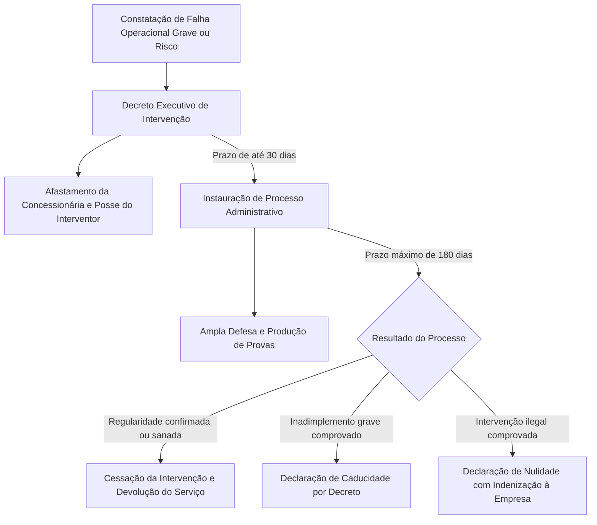
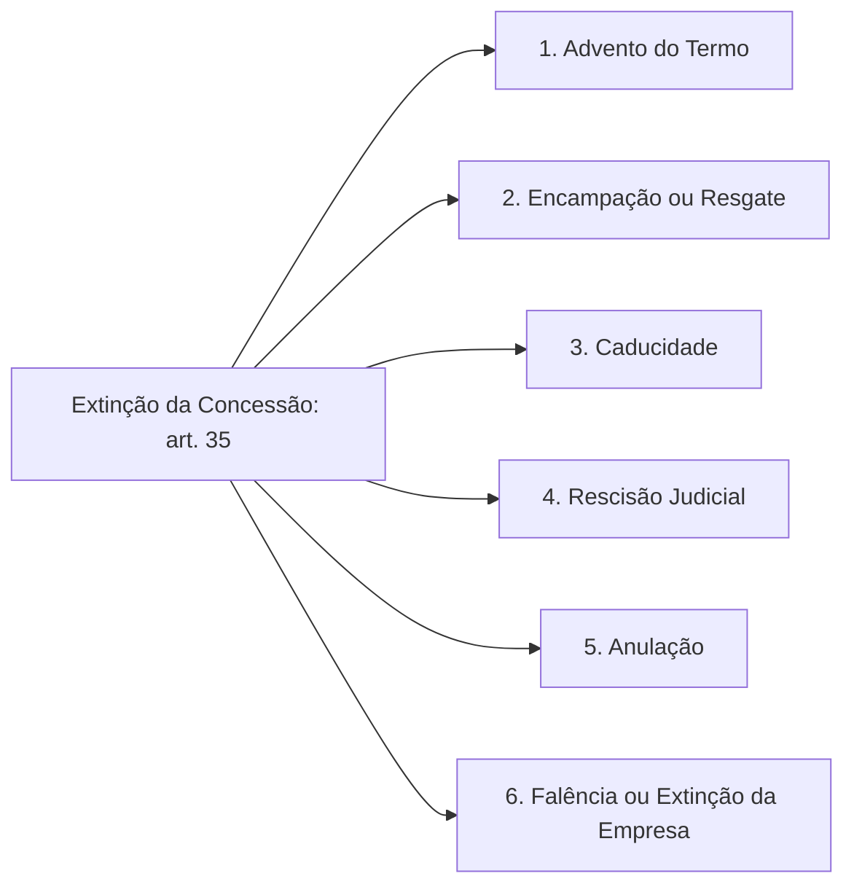
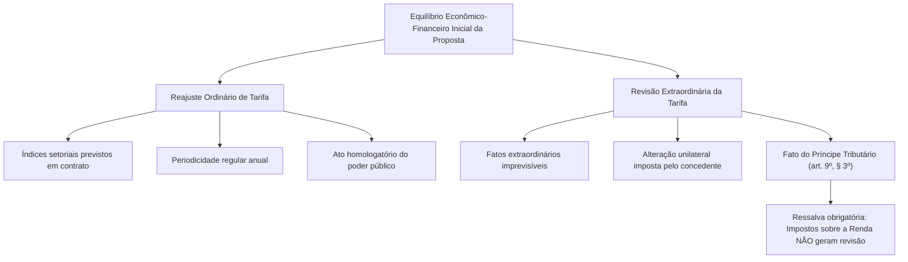
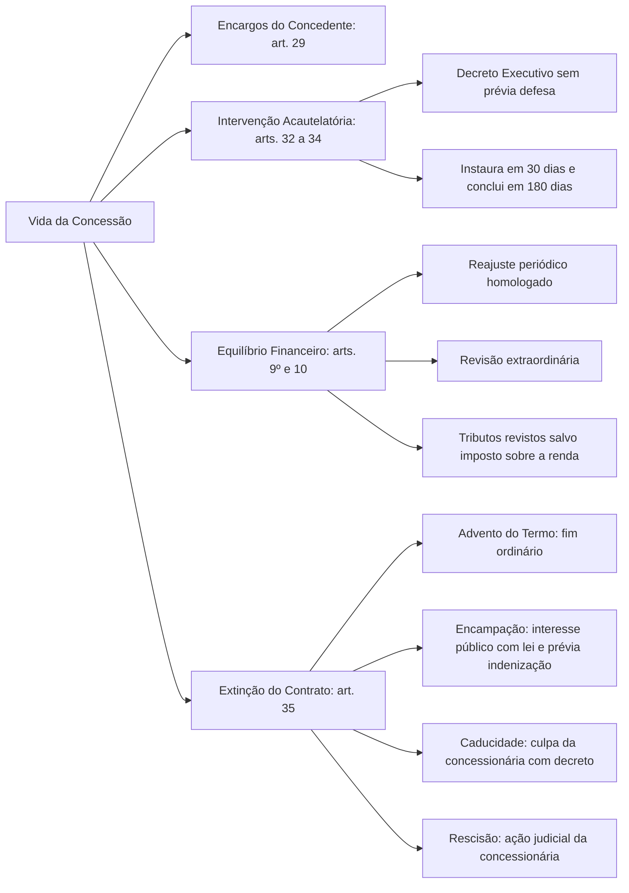

A celebração de uma concessão de serviço público não encerra o papel do Estado, mas inaugura uma fase de contínua vigilância administrativa. O poder concedente tem a missão permanente de fiscalizar a qualidade da prestação, zelar pela modicidade das tarifas e garantir a integridade dos bens reversíveis. Caso ocorram falhas operacionais graves que coloquem em risco o atendimento à população, a lei autoriza a intervenção estatal direta. Ademais, como todo vínculo por prazo determinado, a concessão submete-se a hipóteses estritas de encerramento, cada qual com rito, pressupostos e reflexos patrimoniais próprios. Neste capítulo, estudamos as prerrogativas do poder público, a disciplina da intervenção, as seis causas de extinção contratual e a proteção ao equilíbrio econômico-financeiro.

> [!objetivos]
> - Identificar os principais encargos e prerrogativas regulatórias do poder concedente.
> - Compreender o procedimento de intervenção na concessão, seus prazos e a natureza do contraditório.
> - Distinguir as seis modalidades legais de extinção da concessão de serviço público.
> - Comparar os requisitos da encampação e da caducidade, destacando o momento da indenização.
> - Diferenciar os mecanismos de reajuste ordinário e revisão das tarifas para manutenção do equilíbrio financeiro.

## Encargos regulatórios e de fiscalização do poder concedente

O poder concedente é o ente da Federação (União, Estados, Distrito Federal ou Municípios) detentor da competência constitucional para prestar determinado serviço público. Ao delegar a operação material, a Administração mantém a titularidade e assume encargos inafastáveis previstos no art. 29 da Lei nº 8.987/1995:

1. **Regulamentação e controle**: expedir normas complementares e fiscalizar permanentemente as instalações, os equipamentos e a prestação do serviço.
2. **Poder punitivo**: aplicar penalidades regulamentares e contratuais à concessionária por infrações cometidas durante a execução.
3. **Intervenção e extinção**: assumir temporariamente a gestão em casos excepcionais e decretar a extinção do pacto quando configuradas as hipóteses legais.
4. **Política tarifária**: homologar os reajustes contratuais periódicos e processar a revisão das tarifas para assegurar a modicidade e o equilíbrio econômico-financeiro.
5. **Proteção dos usuários**: apurar reclamações e queixas dos usuários, cientificando o interessado sobre as providências tomadas no prazo de até trinta dias.
6. **Prerrogativas expropriatórias**: declarar a utilidade pública de bens necessários ao serviço, permitindo que a concessionária execute os atos materiais e pague as indenizações devidas.

O art. 30 da legislação estabelece que a fiscalização pode ser exercida diretamente por órgãos técnicos estatais, por agências reguladoras ou por entidades conveniadas. Além disso, a lei impõe a realização periódica de fiscalização participativa, por intermédio de comissão mista integrada por representantes do poder público concedente, da empresa delegatária e dos próprios usuários.

## Regime de intervenção na concessão de serviços públicos

A intervenção é a medida administrativa drástica pela qual o poder concedente afasta temporariamente a diretoria da concessionária e assume a gestão operacional do serviço. O objetivo primordial da intervenção não é punir a empresa, mas sim salvaguardar a continuidade e a regularidade do atendimento à sociedade.

Os arts. 32 a 34 da Lei nº 8.987/1995 regulam minuciosamente os pressupostos e o procedimento interventivo:

- **Motivação legal**: a intervenção é cabível para assegurar a adequação na prestação do serviço público ou para garantir o fiel cumprimento das normas contratuais, legais e regulamentares pertinentes (art. 32).
- **Instrumento formal**: deve ser decretada privativamente por **decreto do Chefe do Poder Executivo**. O decreto deve indicar nominalmente o interventor, o prazo determinado da medida e os limites de atuação na gestão.
- **Inexistência de contraditório prévio**: a decretação da intervenção prescinde de prévia defesa da concessionária. Como possui natureza investigatória e acautelatória, a notificação prévia poderia inviabilizar a preservação das instalações ou permitir a ocultação de provas. O contraditório é **diferido** (exercido no curso do processo administrativo subsequente).

### Dinâmica temporal e desfecho da intervenção

A validade da intervenção depende da observância estrita de dois prazos legais fixados no art. 33 da Lei nº 8.987/1995:

1. **Prazo para instauração do processo (30 dias)**: após a edição do decreto interventivo, a Administração tem o prazo improrrogável de até 30 (trinta) dias para instaurar o processo administrativo destinado a comprovar as causas determinantes e apurar as responsabilidades da empresa.
2. **Prazo para conclusão do processo (180 dias)**: o processo administrativo deve ser concluído no prazo de até 180 (cento e oitenta) dias, sob pena de a intervenção ser considerada formalmente inválida.

Caso o processo comprove que a intervenção ocorreu sem amparo legal ou regulamentar, será declarada a sua nulidade, restituindo-se imediatamente a administração do serviço à concessionária, com direito a indenização pelos prejuízos suportados. Se a intervenção foi legítima e as falhas forem corrigidas sem justificar a extinção, a gestão retorna à empresa delegatária após obrigatória prestação de contas do interventor, que responde pessoalmente pelos atos praticados durante sua administração (art. 34). Se as faltas forem gravíssimas e insanáveis, o poder concedente decretará a caducidade do contrato.

## Modalidades de extinção da concessão

O contrato de concessão vincula-se à transitoriedade: a titularidade estatal impõe que, cedo ou tarde, o vínculo contratual chegue ao fim. O art. 35 da Lei nº 8.987/1995 consagra seis modalidades de extinção contratual, cada uma decorrente de circunstâncias fáticas e jurídicas distintas.

Com a extinção da concessão, ocorre a imediata assunção do serviço pelo poder concedente, operando-se a **reversão de bens**: todos os bens reversíveis, direitos e privilégios transferidos à delegatária retornam ao patrimônio público para viabilizar a continuidade do serviço (art. 35, §§ 1º e 2º).

### Advento do termo contratual

É o término natural, normal ou ordinário da concessão em razão do esgotamento do prazo de vigência estipulado em contrato. O vínculo extingue-se de pleno direito, sem necessidade de imputação de faltas às partes. Os bens reversíveis incorporam-se ao Poder Público, assegurada a devida indenização para ressarcir os valores investidos em bens reversíveis que ainda não tenham sido totalmente amortizados no curso ordinário da concessão (art. 36).

### Encampação ou resgate

A encampação consiste na retomada coativa do serviço público pelo poder concedente durante a vigência do contrato, fundamentada exclusivamente em **razões de interesse público superveniente**. Na encampação, a concessionária não praticou qualquer falta ou infração contratual: o Estado decide reassumir a atividade por conveniência e oportunidade administrativa.

> [!lei] Lei 8.987/1995, art. 37
> Considera-se encampação a retomada do serviço pelo poder concedente durante o prazo da concessão, por motivo de interesse público, mediante lei autorizativa específica e após prévio pagamento da indenização.

> [!atencao] Três requisitos cumulativos da encampação
> A encampação exige, obrigatoriamente:
> 1. Existência de motivo legítimo de interesse público;
> 2. Autorização expressa em **lei específica** editada pelo Poder Legislativo competente;
> 3. **Pagamento prévio de indenização** à concessionária, cobrindo os investimentos em bens reversíveis ainda não amortizados e eventuais danos decorrentes da ruptura antecipada.

### Caducidade

A caducidade é a extinção do contrato decorrente de **inexecução total ou parcial do contrato por culpa da concessionária**. Diferentemente da encampação (que não envolve culpa), a caducidade é a penalidade máxima aplicada quando a delegatária descumpre reiteradamente suas obrigações funcionais.

O art. 38 da lei prevê as hipóteses em que a autoridade pode declarar a caducidade:
- Prestação de serviço inadequado ou deficiente de forma contínua;
- Descumprimento injustificado de normas contratuais, legais ou regulamentares;
- Paralisação injustificada do serviço público fora dos casos de força maior;
- Perda das condições financeiras, técnicas ou operacionais para prestar adequadamente o serviço;
- Não atendimento a intimações estatais para regularizar o serviço ou apresentar documentação de regularidade fiscal no prazo de 180 dias.

Além das hipóteses discricionárias do art. 38, o art. 27 da Lei nº 8.987/1995 prevê uma hipótese vinculada obrigatória: a transferência da concessão ou do controle societário da concessionária sem a prévia anuência do poder concedente implicará, de forma impositiva, a declaração de caducidade.

O rito de decretação da caducidade exige notificação detalhada com prazo para a concessionária sanar as irregularidades. Persistindo as faltas, instaura-se processo administrativo com ampla defesa. Comprovada a inadimplência, a caducidade é declarada por **decreto do poder concedente**. A indenização devida pelas parcelas não amortizadas de bens reversíveis não precisa ser prévia: é calculada no curso do processo, descontando-se o valor das multas contratuais e dos prejuízos causados pela concessionária (art. 38, §§ 4º e 5º).

### Rescisão contratual

A rescisão é a extinção provocada por **inadimplemento do poder concedente**. Ocorre quando a Administração Pública deixa de cumprir suas obrigações essenciais, como atrasar sistematicamente repasses de subsídios, recusar reajustes tarifários devidos ou impor modificações contratuais desarrazoadas que inviabilizem a operação.

> [!pegadinha] Rescisão de concessão exige via judicial e veda paralisação
> Na Lei nº 14.133/2021, o contratado comum pode suspender a execução após dois meses de inadimplência estatal (art. 137, § 2º, IV). Nas concessões regidas pela Lei nº 8.987/1995, a regra é mais rigorosa: a rescisão **só pode ocorrer por iniciativa da concessionária mediante ação judicial** e o serviço **não pode sofrer paralisação ou descontinuidade antes do trânsito em julgado da sentença judicial resolutória** (art. 39, parágrafo único). A paralisação unilateral constitui falta grave e autoriza a caducidade.

### Anulação

A anulação ocorre quando se constata vício de ilegalidade insanável originário no certame licitatório ou na formalização do próprio contrato de concessão (art. 35, inciso V). Opera com efeitos retroativos (*ex tunc*), desconstituindo o pacto desde a origem. O concessionário de boa-fé tem direito a receber indenização pelos serviços comprovadamente executados e pelos investimentos em bens reversíveis incorporados ao patrimônio estatal.

### Falência ou extinção da concessionária

Por se tratar de contrato personalíssimo (*intuitu personae*), a morte ou incapacidade do titular (em empresa individual) ou a decretação de falência e dissolução societária da pessoa jurídica delegatária acarreta a extinção automática da concessão (art. 35, inciso VI). O Poder Público assume de imediato as operações para garantir que os cidadãos não fiquem desassistidos.

A tabela a seguir compara sistematicamente as seis causas de encerramento da concessão:

| Modalidade de extinção | Causa determinante | Iniciativa da extinção | Instrumento formal | Momento da indenização |
| --- | --- | --- | --- | --- |
| **Advento do termo** | Esgotamento natural do prazo | Decorre do contrato | Automática com termo | Após levantamento e avaliações |
| **Encampação** | Interesse público superveniente | Poder Concedente | Lei específica + Decreto | **Prévia obrigatória** |
| **Caducidade** | Inadimplemento da concessionária | Poder Concedente | Decreto (após processo) | Posterior (descontadas as multas) |
| **Rescisão** | Inadimplemento da Administração | Concessionária | **Sentença judicial transitada** | Conforme determinado em juízo |
| **Anulação** | Ilegalidade congênita do ato/pacto | Concedente ou Judiciário | Decreto ou Decisão judicial | Posterior para o particular de boa-fé |
| **Falência/Extinção** | Dissolução da empresa delegatária | Fato jurídico da empresa | Reconhecimento executivo | No juízo universal da falência |

## Remuneração da concessionária e equilíbrio econômico-financeiro

A sustentabilidade dos serviços delegados repousa na correta remuneração da concessionária. Como a prestação dá-se por conta e risco do particular, as receitas arrecadadas devem permitir a cobertura de todos os custos de operação, a manutenção preventiva dos ativos, a amortização dos investimentos realizados e a obtenção de um lucro razoável.

### Estrutura da remuneração e receitas alternativas

A fonte primária de remuneração da concessionária comum é a **tarifa** paga diretamente pelos usuários em decorrência da fruição do serviço (art. 9º). A tarifa diferencia-se juridicamente da taxa: tem natureza de preço público contratual, decorre de vínculo voluntário e não se submete ao regime estrito da legalidade tributária e da anterioridade anual.

O art. 13 da Lei nº 8.987/1995 autoriza expressamente a criação de **tarifas diferenciadas**, desde que fundamentadas em características técnicas objetivas e em custos específicos derivados do atendimento a diferentes segmentos de usuários (como tarifas sociais para famílias de baixa renda ou tarifas horárias para consumo fora dos horários de pico).

Para evitar que o usuário arque sozinho com custos elevados de infraestrutura, o art. 11 da legislação estimula a previsão de **fontes de receitas alternativas, complementares, acessórias ou de projetos associados**. A concessionária pode explorar comercialmente espaços vinculados ao serviço (lojas de conveniência em rodovias, publicidade em vagões de metrô, aluguel de dutos para fibra óptica). Tais receitas extras reduzem a necessidade de reajustes tarifários, favorecendo diretamente a modicidade.

### Reajuste tarifário versus revisão tarifária

A doutrina e o art. 29, inciso V, da Lei nº 8.987/1995 distinguem com rigor o reajuste e a revisão tarifária:

- **Reajuste tarifário**: consiste na mera atualização matemática do valor da tarifa em períodos regulares (ordinariamente a cada doze meses), aplicando-se os índices de inflação ou de custos setoriais previstos expressamente no edital e no contrato. O reajuste não altera a equação econômica original do pacto: apenas recompõe a perda do poder aquisitivo da moeda causada pela inflação. Cabe ao poder concedente apenas homologar o reajuste.
- **Revisão tarifária**: decorre de eventos imprevistos, extraordinários ou extracontratuais que alterem profundamente a relação entre encargos e remuneração da concessionária, rompendo a equação econômico-financeira original. A revisão analisa a estrutura de custos do negócio e modifica os parâmetros da tarifa para restabelecer o equilíbrio inicial.

> [!bizu] Reajuste versus revisão
> Memorize a regra simples:
> - **Reajuste**: compensa a inflação ordinária; segue índices e fórmulas matemáticas contratuais; o poder público apenas homologa.
> - **Revisão**: restaura o equilíbrio quebrado por fatos extraordinários, alterações unilaterais do projeto ou novos tributos; exige renegociação e novo cálculo tarifário.

### Áleas extraordinárias e a regra dos tributos

O direito ao reequilíbrio econômico-financeiro protege a concessionária contra a **álea extraordinária** (fatos imprevisíveis ou previsíveis de consequências incalculáveis, força maior e imposições unilaterais do poder público). Por outro lado, a **álea ordinária empresarial** (riscos mercadológicos comuns, oscilações rotineiras de demanda, imperícia de gestão ou projeções de receitas acessórias frustradas) é assumida integralmente pela concessionária e não justifica recomposição tarifária (art. 10).

O art. 9º, § 3º, da Lei nº 8.987/1995 consagra regra clássica de direito administrativo sobre o impacto de novas normas fiscais:

> [!lei] Lei 8.987/1995, art. 9º, § 3º
> Ressalvados os impostos sobre a renda, a criação, alteração ou extinção de quaisquer tributos ou encargos legais, após a apresentação da proposta, quando comprovado seu impacto, implicará a revisão da tarifa, para mais ou para menos, conforme o caso.

Se o governo criar um novo tributo incidente sobre a receita do serviço (como nova alíquota de ISS ou PIS/COFINS), a tarifa deverá ser revista para cima. Se extinguir um tributo incidente, a tarifa deverá ser revista para baixo em benefício dos usuários. A única exceção legal recai sobre os **impostos sobre a renda** (IRPJ e CSLL), cuja flutuação não autoriza revisão contratual por traduzirem capacidade contributiva pessoal do concessionário.

> [!exemplo]
> Determinada concessionária de fornecimento de água e esgotamento sanitário em Pernambuco sofre elevação imprevista de custos após o Estado decretar a redução da tarifa de esgoto por razões sociais e, simultaneamente, exigir a extensão da rede de tratamento para novos bairros não previstos na licitação originária. Trata-se de alteração unilateral contratual promovida pelo poder público concedente. Nessa situação, o art. 9º, § 4º, da Lei nº 8.987/1995 impõe que o Estado restabeleça o equilíbrio econômico-financeiro concomitantemente à alteração, seja concedendo reajuste na tarifa média, seja estendendo o prazo da concessão ou aportando verbas públicas indenizatórias.

## Mapa do capítulo

### Para fixar

- O poder concedente exerce regulação contínua, aplica sanções e deve solucionar queixas de usuários em até trinta dias (Lei nº 8.987/1995, art. 29).
- A intervenção é decretada pelo Chefe do Executivo para assegurar a prestação adequada e o cumprimento das normas (art. 32).
- A decretação da intervenção independe de prévia defesa da empresa, operando contraditório diferido (STJ, RMS 66.794/AM).
- O processo administrativo da intervenção deve ser instaurado em até 30 dias e concluído em 180 dias sob pena de nulidade (art. 33).
- A encampação retoma o serviço por interesse público superveniente, exigindo lei específica e indenização prévia (art. 37).
- A caducidade extingue o contrato por inadimplência culposa da concessionária, sendo declarada por decreto executivo após processo administrativo (art. 38).
- A transferência de controle societário sem anuência do poder concedente acarreta a declaração impositiva de caducidade (art. 27).
- A rescisão motivada por falta da Administração exige ação judicial da concessionária, vedada a interrupção do serviço até o trânsito em julgado (art. 39).
- O reajuste tarifário apenas recompõe a inflação mediante índices contratuais, enquanto a revisão repactua o equilíbrio rompido por fatos extraordinários.
- A criação ou extinção de tributos enseja a revisão da tarifa, ressalvados expressamente os impostos sobre a renda (art. 9º, § 3º).
