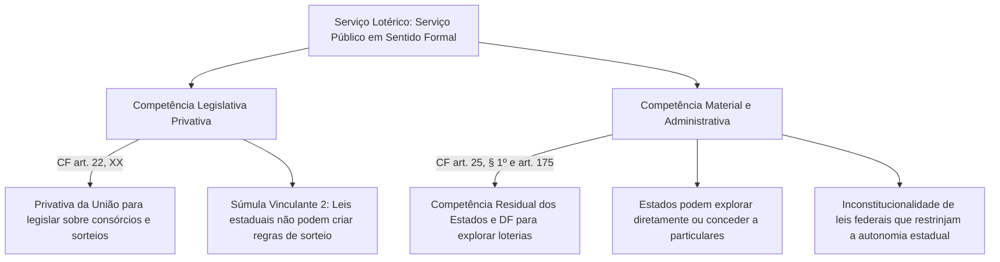
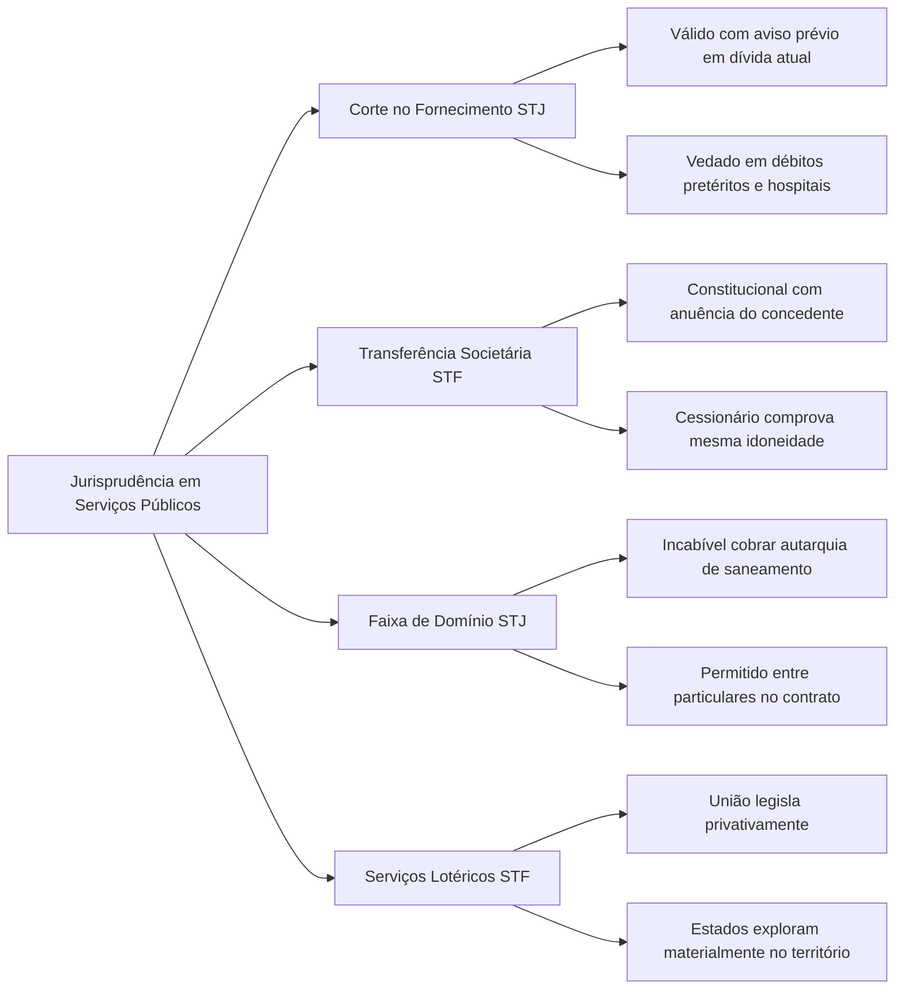

A aplicação concreta do regime dos serviços públicos suscita intensos litígios entre o Poder Público, empresas concessionárias e a sociedade. Para pacificar essas controvérsias, o Supremo Tribunal Federal (STF) e o Superior Tribunal de Justiça (STJ) consolidaram uma jurisprudência rica e detalhada, que redefine os limites da continuidade do serviço, a legalidade do corte de fornecimento por inadimplemento, a transferência societária de delegatárias e a repartição federativa de competências. Em provas de concursos, o conhecimento desses precedentes é indispensável para responder a questões práticas que ultrapassam a mera letra da lei. Neste capítulo, examinamos os principais julgados, súmulas e teses repetitivas que moldam o direito administrativo contemporâneo.

> [!objetivos]
> - Compreender os limites jurisprudenciais para a interrupção de serviços públicos essenciais por inadimplemento.
> - Analisar a validade da transferência de controle societário em concessionárias perante a exigência de licitação.
> - Identificar a tese do STJ (IAC 8) sobre a gratuidade da faixa de domínio de rodovias concedidas para entidades de saneamento.
> - Diferenciar a natureza jurídica do táxi daquela do transporte coletivo regular de passageiros.
> - Distinguir as competências legislativa privativa da União e material dos Estados quanto à exploração de loterias.

## Corte de fornecimento de serviços essenciais: jurisprudência do STJ

Um dos temas de maior relevância prática reside na suspensão do fornecimento de utilidades públicas essenciais (como água e energia elétrica) em razão de débitos do usuário. O STJ consolidou seu entendimento na Edição nº 13 da ferramenta *Jurisprudência em Teses*, fixando balizas protetivas que condicionam a atuação das concessionárias.

A corte superior pacificou que o corte por inadimplemento é legítimo com fundamento no art. 6º, § 3º, II, da Lei nº 8.987/1995, sob a premissa de que a gratuidade generalizada comprometeria a viabilidade econômico-financeira do sistema em prejuízo de toda a coletividade. Contudo, essa prerrogativa submete-se a restrições intransponíveis:

- **Necessidade de aviso prévio e formal**: a suspensão exige notificação prévia, clara e comprovada ao consumidor, assegurando prazo razoável para a quitação do débito antes da interrupção.
- **Vedação de corte por débitos pretéritos**: a interrupção só é admitida para a fatura de consumo atual e regular (relativa ao mês do consumo). Contas antigas e pretéritas não autorizam a suspensão forçada do fornecimento, devendo ser cobradas pela via judicial executiva ou de cobrança ordinária.
- **Natureza pessoal da dívida (*propter personam*)**: a tarifa tem natureza de obrigação pessoal e não de obrigação real (*propter rem*). É ilícito interromper o fornecimento a novo ocupante ou inquilino em razão de débitos deixados pelo usuário anterior.
- **Proteção a unidades de saúde e hospitais**: prevalece o direito à vida e à saúde sobre o interesse financeiro da concessionária. Hospitais, prontos-socorros e clínicas com pacientes dependentes de aparelhos não podem ter o fornecimento interrompido por inadimplência.
- **Fraude apurada unilateralmente**: caso a concessionária aponte irregularidade no medidor de consumo (gato de energia ou água), não pode efetuar o corte sumário com base apenas em laudo produzido por seus próprios funcionários, sendo imperiosa a oportunidade de ampla defesa e perícia técnica imparcial.
- **Débito irrisório**: suspender o serviço por quantia ínfima configura abuso de direito e viola os postulados da razoabilidade e proporcionalidade, gerando dever de indenizar por dano moral.
- **Imóvel diverso**: a interrupção só pode atingir a unidade de consumo que originou o inadimplemento, sendo vedado cortar a luz ou água de outro imóvel de propriedade do mesmo devedor.

A tabela abaixo resume as regras aplicadas pelo STJ nas ações contra concessionárias:

| Situação fática de cobrança | Licitude do corte | Fundamento jurisprudencial consolidado |
| --- | --- | --- |
| **Inadimplemento de conta atual com aviso** | Lícito | Art. 6º, § 3º, II, da Lei 8.987/1995 |
| **Inadimplemento de débitos pretéritos antigos** | Ilícito | Exige cobrança por vias judiciais próprias |
| **Dívida contraída por usuário anterior** | Ilícito | Obrigação pessoal (*propter personam*); novo usuário não responde |
| **Unidades de saúde e hospitais públicos** | Ilícito | Primazia absoluta do direito à vida e à integridade física |
| **Irregularidade em medidor apurada unilateralmente** | Ilícito | Violação ao contraditório; necessidade de perícia isenta |
| **Débito de valor irrisório** | Ilícito | Abuso de direito; enseja reparação por dano moral |
| **Corte aplicado em outro imóvel do usuário** | Ilícito | A suspensão deve restringir-se à unidade inadimplente |

> [!pegadinha] Cobrança de conta antiga versus corte do fornecimento
> O corte de serviço público essencial não pode ser utilizado como meio coercitivo para cobrar contas atrasadas de meses ou anos anteriores. Para essas faturas pretéritas, a concessionária dispõe da cobrança judicial comum. A interrupção imediata restringe-se estritamente à falta de pagamento da fatura corrente.

## Transferência da concessão e do controle societário

A concessão é um contrato personalíssimo firmado com quem venceu a licitação pública. Diante disso, questionou-se durante anos perante o STF se o art. 27 da Lei nº 8.987/1995 — que admite a transferência da concessão ou do controle societário da concessionária mediante prévia anuência do poder concedente — violaria a regra constitucional da obrigatoriedade de licitação (CF, art. 175) e os princípios da isonomia e impessoalidade.

Ao julgar a **ADI 2.946/DF**, o Plenário do STF declarou a plena constitucionalidade do art. 27:

> [!lei] Lei 8.987/1995, art. 27
> A transferência de concessão ou do controle societário da concessionária sem prévia anuência do poder concedente implicará a caducidade da concessão.

> [!jurisprudencia] STF, ADI 2.946/DF
> É constitucional a norma que autoriza a transferência da concessão e a cessão do controle acionário da concessionária, desde que haja prévia e expressa anuência do poder concedente e que a nova empresa comprove capacidade técnica, idoneidade financeira e regularidade jurídica e fiscal idênticas às exigidas na licitação originária.

O STF esclareceu que a licitação original cumpriu a finalidade constitucional de selecionar a proposta mais vantajosa para o interesse público. No mundo empresarial moderno, fusões, aquisições e reestruturações societárias são instrumentos legítimos de captação de recursos e eficiência econômica. Como o novo controlador deve satisfazer todas as condições de habilitação e manter rigorosamente as cláusulas contratuais já pactuadas, não ocorre prejuízo à Administração nem favorecimento pessoal.

Por outro lado, a realização da operação societária sem a prévia anuência estatal acarreta a aplicação vinculada da pena máxima: a declaração compulsória de caducidade do contrato.

## Cobrança por uso da faixa de domínio de rodovias: Tema IAC 8 do STJ

As rodovias concedidas à iniciativa privada possuem faixas marginais de terra (chamadas faixas de domínio) indispensáveis à segurança viária e à expansão futura de pistas. Concessionárias de rodovias frequentemente buscavam cobrar valores de concessionárias ou autarquias de outros setores (como água, esgoto, energia ou gás) que precisavam instalar tubulações, dutos ou postes ao longo da via.

No julgamento do **Incidente de Assunção de Competência nº 8 (Tema IAC 8 - REsp 1.817.302/SP)**, a Primeira Seção do STJ fixou tese vinculante sobre a matéria:

> [!atencao] STJ, Tema IAC 8
> A corte superior firmou a impossibilidade jurídica de concessionária privada que administra rodovia cobrar retribuição financeira de autarquia pública de saneamento pela passagem de canalizações na faixa de domínio da estrada.

O fundamento do STJ apoia-se na natureza jurídica dos bens públicos. As rodovias constituem bens de uso comum do povo afetados ao interesse da coletividade. A cessão do trecho viário à concessionária privada não retira o caráter público do bem. Portanto, é ilegítimo exigir remuneração pela passagem de dutos quando a beneficiária é pessoa jurídica de direito público que presta serviço de saneamento sem intuito de lucro, sob regime não concorrencial.

Em contrapartida, caso a relação envolva duas empresas estritamente privadas operando em ambiente de exploração econômica e mercado concorrencial (como operadoras privadas de telecomunicações que utilizam os postes de uma rodovia privada), a cobrança é lícita, desde que haja expressa previsão no edital e no contrato de concessão a título de receita acessória ou alternativa (art. 11 da Lei nº 8.987/1995).

## Regimes de transporte de passageiros: concessão versus autorização

A jurisprudência do STF consolidou critérios para definir quando o transporte coletivo exige licitação formal e quando pode ser operado sob regime simplificado de autorização:

- **Serviço de táxi e transporte individual**: no Agravo Regimental no RE 1.002.310, o STF firmou que o serviço de táxi qualifica-se como serviço de utilidade pública prestado por particulares no exercício de atividade privada aberta, não se enquadrando no conceito estrito de serviço público do art. 175 da Constituição. Por conseguinte, é inexigível a licitação pública comum, bastando a concessão de mera autorização administrativa individual pela autoridade municipal competente.
- **Transporte rodoviário interestadual desvinculado de obras**: ao julgar as ADIs 5.549 e 6.270, o STF declarou constitucional norma de lei federal que permitiu a outorga do serviço regular de transporte terrestre coletivo interestadual de passageiros mediante autorização administrativa sem licitação prévia, desde que desvinculado da exploração de obras de infraestrutura e cumpridos os requisitos regulatórios da agência competente.
- **Vedação de prorrogações automáticas**: na ADI 7.241, o STF reafirmou que são inconstitucionais leis estaduais que prorroguem automaticamente permissões ou concessões de transporte coletivo vencidas sem a realização de novo procedimento licitatório, pois tal prática burla a regra inegociável do art. 175 da Constituição Federal.

## Exploração de serviços lotéricos e autonomia federativa

A atividade lotérica no Brasil gerou importante debate constitucional sobre federalismo e serviços públicos. Nas **ADPFs 492 e 493** e na **ADI 7.640/SP**, o STF assentou que as loterias possuem natureza jurídica de serviço público em sentido formal, submetendo-se ao regime de direito público.

O STF estabeleceu uma distinção precisa entre competência legislativa e competência material no setor de apostas e sorteios:

A Súmula Vinculante 2 do STF considera inconstitucional qualquer ato normativo emanado de assembleias estaduais ou distritais que pretenda regulamentar modalidades lotéricas, sorteios ou consórcios. Essa vedação, porém, refere-se unicamente à **competência para legislar** sobre a matéria, privativa da União (CF, art. 22, XX).

Por outro lado, a **competência material para explorar e prestar** o serviço de loteria pertence conjuntamente à União e aos Estados. Com amparo no art. 25, § 1º, e no art. 175 da Constituição, os Estados-membros possuem competência administrativa autônoma para criar suas loterias estaduais, operá-las diretamente ou concedê-las a particulares dentro de seus territórios. Por essa razão, o STF declarou inconstitucionais normas federais que tentavam restringir as concessões estaduais a apenas uma por grupo econômico ou proibir a publicidade regional dos serviços lotéricos dos Estados.

> [!bizu] Loterias em duas frases
> - **Legislar sobre sorteios e loterias**: competência privativa da União (CF, art. 22, XX; Súmula Vinculante 2).
> - **Explorar e conceder serviços lotéricos**: competência material compartilhada com os Estados e DF (CF, art. 25, § 1º, e art. 175; ADPFs 492 e 493).

## Processos sancionadores, publicidade e garantias procedimentais

A atividade fiscalizatória e punitiva do Poder Público sobre as concessionárias desenvolve-se por meio de processos administrativos sancionadores conduzidos por órgãos da administração direta ou agências reguladoras autárquicas. No julgamento da **ADI 5.371**, o Supremo Tribunal Federal assentou que esses expedientes sancionatórios devem observar com rigor o postulado da **ampla publicidade** em todas as suas fases. O sigilo constitui exceção estreita, admissível unicamente em situações excepcionais de segurança da sociedade ou proteção comprovada de segredo industrial.

De forma complementar, o Superior Tribunal de Justiça, ao apreciar o **RMS 66.794/AM**, examinou a dinâmica do contraditório nas medidas emergenciais de intervenção contratual. O STJ pacificou que a edição do decreto de intervenção na concessionária dispensa notificação ou defesa prévia da delegatária. Por se tratar de providência acautelatória voltada a garantir a continuidade operacional imediata e colher dados sobre a gestão, o contraditório e a ampla defesa são plenamente exercidos no processo administrativo que deve ser aberto nos 30 dias posteriores (art. 33 da Lei nº 8.987/1995).

## Mapa do capítulo

### Para fixar

- O corte no fornecimento por inadimplemento é legítimo com prévio aviso, mas não pode atingir débitos pretéritos (STJ, Jurisprudência em Teses 13).
- É ilícito interromper serviços públicos essenciais a hospitais e unidades de saúde em virtude da prevalência do direito à vida.
- A obrigação tarifária é pessoal (*propter personam*), sendo ilegítimo o corte decorrente de dívida de antigo ocupante do imóvel.
- É constitucional a transferência da concessão ou do controle societário mediante prévia anuência do poder concedente (STF, ADI 2.946/DF).
- É vedada a cobrança de retribuição financeira contra entidade pública de saneamento pelo uso de faixa marginal em rodovia concedida (STJ, Tema IAC 8).
- O serviço de táxi qualifica-se como atividade de utilidade pública outorgada por autorização, não exigindo licitação pública (STF, RE 1.002.310).
- Leis estaduais que prorrogam permissões de transporte coletivo vencidas sem nova licitação são inconstitucionais (STF, ADI 7.241).
- A decretação de intervenção estatal em concessionária prescinde de prévia defesa, aplicando-se contraditório diferido (STJ, RMS 66.794/AM).
- A competência para legislar sobre loterias é privativa da União (CF, art. 22, XX; Súmula Vinculante 2), mas os Estados possuem competência material para explorá-las (ADPFs 492 e 493).
- Os processos sancionadores em agências reguladoras submetem-se ao princípio da publicidade em toda a tramitação (STF, ADI 5.371).
