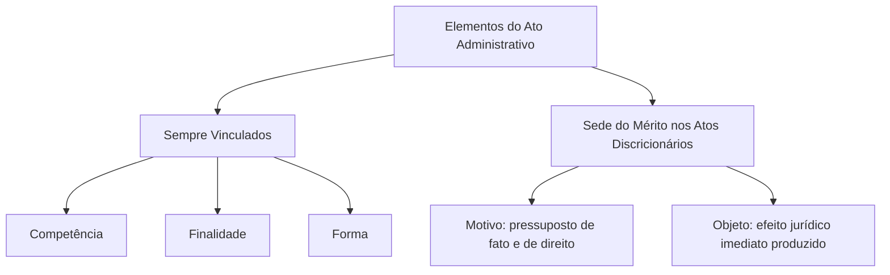
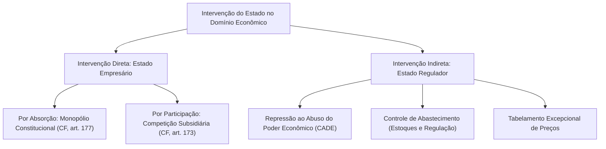
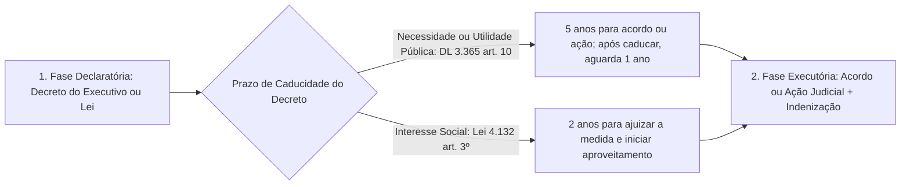
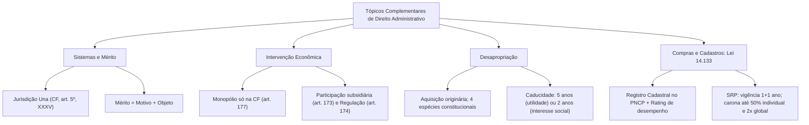

O estudo avançado do Direito Administrativo exige compreender como a função administrativa se articula com os demais ramos jurídicos. Também demanda conhecer o sistema de controle jurisdicional adotado pelo Estado brasileiro e os limites da liberdade decisória do gestor público. Além disso, é preciso dominar a intervenção estatal no domínio econômico, o regime da desapropriação e as compras compartilhadas da Lei nº 14.133/2021.

Neste capítulo, reunimos esses cinco eixos temáticos. O foco recai sobre as distinções conceituais, os prazos processuais e as travas numéricas exigidas pelas bancas examinadoras.

> [!objetivos]
> - Compreender as relações do Direito Administrativo com os demais ramos jurídicos e distinguir o contencioso francês da jurisdição una adotada no Brasil.
> - Diferenciar a tutela administrativa da autotutela, aplicar a presunção de legitimidade e delimitar o mérito do ato administrativo.
> - Analisar a intervenção direta (monopólio e participação) e indireta (defesa da concorrência, abastecimento e tabelamento) do Estado na economia.
> - Dominar as modalidades constitucionais de desapropriação, as fases declaratória e executória, a desapropriação indireta, a tredestinação e a retrocessão.
> - Identificar as regras do Registro Cadastral Unificado no PNCP, da avaliação de fornecedores (*rating*) e do Sistema de Registro de Preços (SRP) na Lei nº 14.133/2021.

## Relações interdisciplinares e sistemas administrativos

O Direito Administrativo integra o tronco do **Direito Público Interno**. Ele mantém diálogo permanente com outras disciplinas jurídicas para viabilizar o funcionamento concreto do Estado.

### Relações do Direito Administrativo com outros ramos do Direito

As conexões mais cobradas em provas de concursos envolvem seis áreas:

- **Direito Constitucional**: estabelece a matriz política do Estado, a tripartição de Poderes, os direitos fundamentais e as bases da Administração Pública (CF, arts. 37 a 42). Enquanto o Direito Constitucional desenha a anatomia estática do Estado, o Direito Administrativo disciplina a fisiologia dinâmica de seus órgãos, agentes e serviços.
- **Direito Tributário e Direito Financeiro**: derivam historicamente de um tronco comum com o Direito Administrativo. O Direito Tributário regula a arrecadação compulsória de tributos, que é atividade administrativa plenamente vinculada. Já o Direito Financeiro disciplina o orçamento público, a receita e a despesa, condicionando a validade de licitações, contratos e criação de cargos.
- **Direito Penal e Direito Penal Militar**: tipificam infrações funcionais graves contra a Administração Pública comum e militar. Vigora como regra a independência relativa entre as instâncias penal, civil e administrativa. Contudo, a absolvição criminal fundada em **inexistência material do fato** ou **negativa de autoria** comunica-se obrigatoriamente à esfera administrativa e afasta a punição disciplinar.
- **Direito Processual Civil e Penal**: disciplinam as ações constitucionais e ordinárias de controle judicial da Administração, como mandado de segurança, ação popular e ação civil pública. Suas normas também têm aplicação supletiva e subsidiária aos processos administrativos e aos procedimentos disciplinares militares.
- **Direito Civil e Empresarial**: fornecem categorias gerais, como obrigações, contratos privados da Administração, posse, propriedade e responsabilidade civil. Também disciplinam a modelagem societária das empresas públicas e sociedades de economia mista (Lei nº 13.303/2016).
- **Direito do Trabalho**: rege a relação jurídica dos empregados públicos submetidos à Consolidação das Leis do Trabalho (CLT) nas entidades empresariais do Estado. Esse regime sofre derrogações publicísticas do art. 37 da CF, como a exigência de concurso público, o teto remuneratório e a vedação de acumulação ilícita.

### Sistemas administrativos: contencioso francês versus jurisdição una

Denomina-se **sistema administrativo** o modelo institucional adotado por um país para controlar a legalidade e a legitimidade dos atos da Administração Pública. No direito comparado, contrapõem-se dois sistemas clássicos:

1. **Sistema francês (contencioso administrativo ou dualidade de jurisdição)**: caracteriza-se pela existência de duas ordens jurisdicionais autônomas e paralelas. Ao lado da Justiça Comum (encarregada dos litígios entre particulares), opera uma **Jurisdição Administrativa** própria. Sua cúpula é o Conselho de Estado (*Conseil d'État*). As decisões proferidas pelos tribunais administrativos franceses formam **coisa julgada material** definitiva e não podem ser revistas pelo Poder Judiciário comum. Mesmo na França, reservam-se ao Judiciário comum as causas sobre estado e capacidade das pessoas, repressão penal, propriedade privada e ilegalidades grosseiras (*voie de fait*).
2. **Sistema inglês (*Rule of Law*, sistema judiciário ou jurisdição una)**: concentra o monopólio da jurisdição definitiva em um único Poder — o **Poder Judiciário**. Todos os litígios, envolvam particulares ou a Administração Pública, podem ser submetidos ao controle judicial. A Administração decide conflitos em âmbito interno, mas suas decisões produzem apenas preclusão administrativa ("coisa julgada administrativa"). Assim, permanecem sempre passíveis de revisão judicial quanto à legalidade e à juridicidade.

O **Brasil adota o sistema inglês da jurisdição una** desde a primeira Constituição Republicana de 1891. Na Constituição Federal de 1988, esse modelo está consagrado como cláusula pétrea no princípio da inafastabilidade da jurisdição:

> [!lei] CF, art. 5º, XXXV
> A lei não excluirá da apreciação do Poder Judiciário lesão ou ameaça a direito.

A tabela a seguir confronta os dois modelos de controle:

| Critério de comparação | Sistema Francês (Contencioso Administrativo) | Sistema Inglês (Jurisdição Una) |
| --- | --- | --- |
| **Estrutura jurisdicional** | Dualidade: Justiça Administrativa e Justiça Comum | Unidade: monopólio jurisdicional do Poder Judiciário |
| **Órgão de cúpula administrativa** | Conselho de Estado (*Conseil d'État*) | Não há tribunal administrativo com força jurisdicional |
| **Força das decisões administrativas** | Coisa julgada material definitiva e imutável | Preclusão interna (revisível pelo Poder Judiciário) |
| **Adoção no direito brasileiro** | Não adotado no Brasil | Adotado no Brasil (CF, art. 5º, XXXV) |

> [!atencao] Hipóteses de condicionamento do acesso ao Judiciário no Brasil
> Vigora no Brasil a regra geral de que o cidadão pode acionar o Poder Judiciário diretamente sem precisar esgotar a instância administrativa. Contudo, a Constituição e a jurisprudência do STF admitem quatro exceções pontuais que exigem prévia provocação ou exaurimento administrativo:
> 1. **Justiça Desportiva (CF, art. 217, §§ 1º e 2º)**: o ingresso no Judiciário depende do prévio esgotamento das instâncias da justiça desportiva, que dispõe do prazo máximo de 60 dias para proferir decisão final;
> 2. **Reclamação ao STF contra ato administrativo que contrarie Súmula Vinculante**: exige o prévio esgotamento das vias administrativas, nos termos da Lei nº 11.417/2006;
> 3. **Habeas Data (Súmula 2 do STJ)**: exige prova de prévia recusa ou omissão da autoridade administrativa em fornecer ou retificar a informação;
> 4. **Concessão de benefício previdenciário perante o INSS (STF, RE 631.240)**: exige prévio requerimento administrativo para configurar o interesse de agir, sem necessidade de esgotar recursos internos.

## Tutela, presunção de legitimidade, boa administração e mérito

O regime jurídico-administrativo confere à Administração prerrogativas instrumentais e mecanismos de controle interno e finalístico essenciais à proteção do interesse público.

### Tutela administrativa, presunção de legitimidade e boa administração

A doutrina distingue com rigor três princípios fundamentais exigidos nos itens 3.2 e 3.3 do edital:

1. **Princípio da tutela administrativa (supervisão ministerial ou controle finalístico)**: consiste no poder-dever de fiscalização externa e finalística exercido pela Administração Direta (Ministério ou Secretaria de Estado) sobre as entidades da Administração Indireta a ela vinculadas. Como não existe subordinação hierárquica entre a Administração Direta e a Indireta, a tutela administrativa depende de previsão legal expressa. Ela se limita a verificar se a entidade descentralizada cumpre as finalidades institucionais para as quais foi criada. Não se confunde com a **autotutela**, que é o controle interno amplo pelo qual a própria Administração anula seus atos ilegais ou revoga seus atos inconvenientes (Súmulas 346 e 473 do STF).
2. **Princípio da presunção de legitimidade e de veracidade**: desdobra-se em duas faces complementares. A **presunção de legitimidade (ou legalidade)** indica que os atos administrativos nascem presumidamente compatíveis com a lei e a Constituição. Já a **presunção de veracidade** refere-se aos fatos: as declarações fáticas atestadas pelo agente público gozam de fé pública e presumem-se verdadeiras. Trata-se de presunção **relativa (*juris tantum*)**, que admite prova em contrário pelo administrado. Seus dois efeitos práticos imediatos são a **operatividade imediata do ato** (que já produz efeitos enquanto não suspenso ou invalidado) e a **inversão do ônus da prova** (cabe ao particular demonstrar eventual ilegalidade ou falsidade).
3. **Princípio da boa administração**: evolução contemporânea do princípio da eficiência (CF, art. 37, *caput*) combinado com a moralidade, a transparência, a motivação e a participação social. Impõe ao administrador público o dever jurídico de escolher não apenas uma solução formalmente legal, mas aquela que concretize da maneira mais íntegra, célere, econômica e eficaz os direitos fundamentais dos cidadãos.

### O mérito do ato administrativo e seus limites

O **mérito administrativo** é o núcleo de valoração subjetiva conferido pela lei ao agente público para aferir a **conveniência e a oportunidade** da prática de um ato administrativo discricionário. Por meio dele, o gestor escolhe o conteúdo do ato ou o momento adequado de sua edição.

Regras essenciais sobre o mérito administrativo em provas:

- **Localização restrita ao motivo e ao objeto**: o mérito administrativo reside exclusivamente nos elementos **motivo** e **objeto**. Os elementos **competência, finalidade e forma** são sempre vinculados, mesmo nos atos discricionários.
- **Inexistência de mérito nos atos vinculados**: quando a lei predefine objetivamente todos os cinco elementos do ato sem deixar margem de liberdade ao agente, não há mérito administrativo nem cabe revogação. São exemplos a concessão de aposentadoria compulsória e o lançamento tributário.
- **Controle jurisdicional da discricionariedade**: ao Poder Judiciário é vedado invadir o mérito administrativo legítimo para substituir o juízo de conveniência e oportunidade do gestor pelo do juiz, em respeito à separação de Poderes (CF, art. 2º). Todavia, o Judiciário exerce amplo controle de **legalidade e juridicidade** sobre qualquer ato discricionário. Assim, pode **anular** (nunca revogar) o ato quando constatar vício nos elementos vinculados, falsidade dos motivos invocados (teoria dos motivos determinantes), desvio de finalidade ou violação aos princípios da razoabilidade, proporcionalidade e moralidade.

> [!bizu] Quem anula e quem revoga
> - **Administração Pública**: anula atos ilegais (vício de legalidade, efeito *ex tunc*) e revoga atos discricionários válidos que se tornaram inconvenientes ou inoportunos (juízo de mérito, efeito *ex nunc*).
> - **Poder Judiciário**: no exercício da função jurisdicional sobre atos de outros Poderes, **apenas anula** atos ilegais ou ilegítimos; jamais revoga ato administrativo alheio.

## Intervenção do Estado no domínio econômico

A ordem econômica brasileira (CF, arts. 170 a 181) funda-se na valorização do trabalho humano e na livre iniciativa. Em regra, a exploração de atividades econômicas cabe ao setor privado, atuando o Estado sob duas modalidades de intervenção: direta e indireta.

### Intervenção direta: absorção (monopólio) e participação

Na **intervenção direta**, o próprio Estado atua como agente econômico empresarial por meio de empresas públicas e sociedades de economia mista:

1. **Intervenção por absorção (monopólio estatal — CF, art. 177)**: ocorre quando a própria Constituição Federal reserva exclusivamente à União a exploração de determinada atividade econômica estratégica. No direito brasileiro, **não existe monopólio criado por lei ordinária**: todo monopólio estatal decorre obrigatoriamente do texto constitucional. O art. 177 da CF concentra na União o monopólio sobre:
   - Pesquisa, lavra, refino, importação, exportação e transporte marítimo ou por condutos de petróleo, gás natural e outros hidrocarbonetos fluidos. A União pode contratar empresas estatais ou privadas para executar essas atividades, nos termos do art. 177, § 1º, da CF;
   - Pesquisa, lavra, enriquecimento, reprocessamento, industrialização e comércio de minérios e minerais nucleares e seus derivados. Fica ressalvada a permissão a particulares para produção, comercialização e utilização de radioisótopos para usos médicos, agrícolas e industriais, conforme o art. 177, inciso V, alíneas *b* e *c*, da CF.
2. **Intervenção por participação (regime de competição — CF, art. 173)**: fora das hipóteses de monopólio, a exploração direta de atividade econômica pelo Estado é excepcional e subsidiária. Ela só é permitida quando necessária aos **imperativos da segurança nacional** ou a **relevante interesse coletivo**, conforme definidos em lei. Nessa hipótese, a empresa estatal atua em regime de livre concorrência com as empresas privadas. Submete-se ao regime jurídico próprio das sociedades privadas (inclusive quanto aos direitos e obrigações civis, comerciais, trabalhistas e tributários) e não pode gozar de privilégios fiscais não extensivos ao setor privado (CF, art. 173, §§ 1º, II, e 2º).

### Intervenção indireta: regulação, concorrência, abastecimento e preços

Na **intervenção indireta**, regulada pelo art. 174 da CF, o Estado não produz nem comercializa bens diretamente. Ele atua como **agente normativo e regulador** da atividade econômica, exercendo as funções de fiscalização, incentivo (fomento) e planejamento. O planejamento estatal é **determinante para o setor público** e meramente **indicativo para o setor privado**.

Os três instrumentos de intervenção indireta destacados no edital são:

- **Repressão ao abuso do poder econômico (CF, art. 173, § 4º, e Lei nº 12.529/2011)**: a lei reprime o abuso do poder econômico que vise à dominação dos mercados, à eliminação da concorrência (formação de cartéis, divisão ilícita de mercado, preços predatórios) e ao aumento arbitrário dos lucros. A atuação administrativa cabe ao **Conselho Administrativo de Defesa Econômica (CADE)**. Essa autarquia federal exerce controle preventivo (aprovação prévia de fusões e aquisições) e repressivo (aplicação de multas e sanções antitruste).
- **Controle de abastecimento**: compreende medidas normativas e materiais destinadas a assegurar a oferta regular de alimentos, combustíveis e insumos vitais à população. Seu objetivo é prevenir crises de escassez ou retenção especulativa de estoques (açambarcamento).
- **Tabelamento de preços**: medida interventiva excepcional pela qual o Poder Público fixa limites máximos para os preços praticados por agentes privados em setores sensíveis.

> [!pegadinha] Tabelamento de preços e responsabilidade civil do Estado
> O Supremo Tribunal Federal reconhece a constitucionalidade do tabelamento de preços quando instituído temporariamente nos termos da lei para conter abusos econômicos. Contudo, se a fixação estatal de preços obrigar as empresas privadas a venderem seus produtos ou serviços **abaixo do custo real de produção**, gerando prejuízo comprovado (dano especial e anormal), o Estado responde civilmente de forma **objetiva** (CF, art. 37, § 6º) e fica obrigado a indenizar os particulares lesados.

## Regime jurídico da desapropriação

A **desapropriação** é o procedimento administrativo (e, na ausência de acordo, judicial) pelo qual o Poder Público ou seus delegatários autorizados retiram compulsoriamente a propriedade de um bem pertencente a outrem. Ela se fundamenta em necessidade pública, utilidade pública ou interesse social e ocorre mediante indenização, que como regra geral deve ser prévia, justa e em dinheiro (CF, art. 5º, XXIV).

Trata-se da forma mais drástica de intervenção supressiva do Estado na propriedade privada e constitui **modo originário de aquisição da propriedade**. Por ser aquisição originária, o bem ingressa no patrimônio público livre de quaisquer ônus reais, hipotecas, penhoras ou dívidas tributárias anteriores. Tais encargos ficam sub-rogados no preço da indenização depositada (Decreto-Lei nº 3.365/1941, art. 31).

### Modalidades constitucionais de desapropriação

A Constituição de 1988 prevê uma modalidade ordinária geral e três modalidades especiais (sancionatórias ou confiscatórias). A tabela a seguir sintetiza os requisitos de cada espécie:

| Modalidade de desapropriação | Base constitucional e legal | Competência declaratória | Forma de pagamento da indenização |
| --- | --- | --- | --- |
| **Comum ou ordinária** (necessidade ou utilidade pública e interesse social) | CF, art. 5º, XXIV; DL 3.365/1941; Lei 4.132/1962 | União, Estados, DF, Municípios (e ANEEL / DNIT por lei) | **Prévia, justa e em dinheiro** |
| **Urbanística sancionatória** (solo urbano não edificado, subutilizado ou não utilizado) | CF, art. 182, § 4º, III; Estatuto da Cidade | **Exclusiva do Município** (e DF), após parcelamento compulsório e IPTU progressivo por 5 anos | **Títulos da dívida pública** aprovados pelo Senado, resgatáveis em **até 10 anos**, em parcelas anuais e sucessivas |
| **Rural para reforma agrária** (imóvel rural que descumpre a função social) | CF, arts. 184 a 186; LC 76/1993; Lei 8.629/1993 | **Exclusiva da União** (INCRA). Imunes: pequena e média propriedade rural única e propriedade produtiva | **Títulos da Dívida Agrária (TDA)** resgatáveis em **até 20 anos** (a partir do 2º ano). **Benfeitorias úteis e necessárias em dinheiro** |
| **Confiscatória** (cultivo ilegal de plantas psicotrópicas ou exploração de trabalho escravo) | CF, art. 243; Lei 8.257/1991 | **Exclusiva da União** (bens destinados à reforma agrária e a programas de habitação popular) | **Sem qualquer indenização** ao proprietário (confisco sancionatório) |

### Fases do procedimento expropriatório e prazos de caducidade

O procedimento da desapropriação desenvolve-se em duas fases sucessivas:

1. **Fase declaratória**: o Poder Público manifesta formalmente que determinado bem é de utilidade pública ou de interesse social. Essa declaração é feita por **decreto do Chefe do Poder Executivo** (Presidente, Governador ou Prefeito — Decreto-Lei nº 3.365/1941, art. 6º) ou por **lei editada pelo Poder Legislativo** (Decreto-Lei nº 3.365/1941, art. 8º, cabendo ao Executivo praticar os atos de execução). Concessionárias privadas jamais podem expedir a declaração expropriatória.
2. **Fase executória**: compreende as providências concretas para avaliar o bem, negociar o valor com o proprietário (pela via administrativa, mediação ou arbitragem — Decreto-Lei nº 3.365/1941, arts. 10-A e 10-B) ou propor a ação judicial de desapropriação e pagar a indenização. Além dos entes federativos, podem promover a fase executória as entidades da Administração Indireta e as **concessionárias ou delegatárias de serviços públicos** ou contratadas de obras públicas, desde que expressamente autorizadas em lei ou contrato (Decreto-Lei nº 3.365/1941, art. 3º).

Regras processuais e federativas de alta incidência no Decreto-Lei nº 3.365/1941:

- **Desapropriação de bens públicos (Decreto-Lei nº 3.365/1941, art. 2º, § 2º)**: bens públicos podem ser desapropriados segundo uma hierarquia federativa descendente, mediante **prévia autorização legislativa** do parlamento do ente expropriante. A União pode desapropriar bens dos Estados, do Distrito Federal e dos Municípios. Os Estados podem desapropriar bens dos Municípios situados em seu território. Os Municípios jamais podem desapropriar bens dos Estados ou da União.
- **Imissão provisória na posse (Decreto-Lei nº 3.365/1941, art. 15)**: permite que o expropriante ingresse na posse do bem logo no início da ação judicial, antes da perícia definitiva. Exige dois requisitos cumulativos: **alegação de urgência** (que deve ser requerida em juízo no prazo improrrogável de **120 dias**, sem possibilidade de renovação) e **depósito judicial prévio** do valor arbitrado segundo os critérios legais.
- **Limitação da matéria de defesa na contestação (Decreto-Lei nº 3.365/1941, art. 20)**: na ação de desapropriação, a contestação do proprietário só pode versar sobre **vício do processo judicial ou impugnação do preço ofertado**. Qualquer discussão sobre ausência de utilidade pública ou desvio de finalidade do decreto deve ser proposta em **ação direta autônoma**.

### Desapropriação por zona, indireta, tredestinação e retrocessão

Cinco institutos específicos completam o estudo da desapropriação:

- **Desapropriação por zona (Decreto-Lei nº 3.365/1941, art. 4º)**: abrange a área contígua necessária ao desenvolvimento futuro da obra a que se destina, bem como as zonas que se valorizarem extraordinariamente em consequência da realização do serviço, para posterior revenda. Para ser válida, a declaração de utilidade pública deve discriminar expressamente quais áreas se destinam à continuidade da obra e quais serão objeto de revenda.
- **Direito de extensão**: é o direito do proprietário que sofreu desapropriação parcial de exigir que o Poder Público desaproprie e indenize a **totalidade do imóvel**, quando a área remanescente se tornar inaproveitável ou esvaziada de valor econômico.
- **Desapropriação indireta (esbulho administrativo)**: ocorre quando o Estado se apossa materialmente de um bem particular e o afeta em definitivo a uma obra ou serviço público sem o devido processo legal expropriatório e sem prévia indenização. Pelo princípio da **intangibilidade da obra pública** (Decreto-Lei nº 3.365/1941, art. 35), o bem incorporado ao patrimônio público não pode ser retomado por ação reivindicatória ou possessória. Resta ao proprietário pleitear indenização pecuniária em ação de reparação patrimonial, cujo prazo prescricional é de **10 (dez) anos** (STJ, Tema 1.019).
- **Tredestinação lícita e ilícita**: tredestinação significa dar ao bem desapropriado uma destinação diferente daquela originalmente prevista no decreto expropriatório. Se o Poder Público altera a finalidade específica, mas **mantém o atendimento ao interesse público**, configura-se a **tredestinação lícita**, que é plenamente válida e não gera direito de devolução ao ex-proprietário. Se o Estado desvia o bem para interesse privado ou transfere-o a terceiros sem utilidade pública, ocorre a **tredestinação ilícita**.
- **Retrocessão**: é a consequência jurídica da tredestinação ilícita ou do desinteresse superveniente do Estado pelo bem não utilizado. Ela garante ao ex-proprietário o direito de preferência para readquirir o bem pelo seu valor atual ou pleitear perdas e danos (Decreto-Lei nº 3.365/1941, art. 35).

> [!exemplo] Tredestinação lícita na prática bombeiro militar
> Suponha que o Estado de Pernambuco desaproprie um terreno urbano com o fim declarado no decreto de construir uma escola estadual. Dois anos depois, diante da inauguração de outra unidade escolar próxima, o Governo decide erguer naquele terreno um novo Quartel Operacional do Corpo de Bombeiros Militar. Houve mudança da finalidade específica, mas preservou-se o interesse público: trata-se de **tredestinação lícita**, perfeitamente legítima e que não autoriza o antigo proprietário a pedir a retrocessão do imóvel.

| Instituto | Conceito essencial | Consequência jurídica |
| --- | --- | --- |
| **Desapropriação por zona** | Expropriação de área vizinha para expansão da obra ou por valorização extraordinária | Exige menção expressa no decreto declaratório |
| **Direito de extensão** | Pedido do particular para incluir a fração remanescente inútil na desapropriação | Expropriante passa a adquirir e indenizar o imóvel inteiro |
| **Desapropriação indireta** | Ocupação definitiva do bem pelo Estado sem decreto nem prévia indenização | Gera apenas direito à indenização (prescrição em 10 anos) |
| **Tredestinação lícita** | Mudança da destinação original mantendo outra finalidade pública | Ato válido; afasta qualquer pedido de retrocessão |
| **Tredestinação ilícita e retrocessão** | Desvio de finalidade em favor de interesse privado | Gera direito de preferência ao ex-dono ou indenização |

## Registro cadastral e compras compartilhadas na Lei nº 14.133/2021

Os itens 10.5 e 10.6 do edital contemplam os instrumentos modernos de governança, cadastro de fornecedores e centralização de compras disciplinados pela Lei nº 14.133/2021.

### Sistema de Cadastramento Unificado (SICAF / PNCP) e *rating*

No âmbito federal, o **Sistema de Cadastramento Unificado de Fornecedores (SICAF)** historicamente concentrou os registros de habilitação jurídica, regularidade fiscal e qualificação econômico-financeira dos licitantes. Com a Lei nº 14.133/2021, o **registro cadastral** foi elevado à condição de procedimento auxiliar das licitações (Lei nº 14.133/2021, art. 78, V), operando de modo unificado no **Portal Nacional de Contratações Públicas (PNCP)** sob as regras dos arts. 87 e 88 da Lei nº 14.133/2021:

- **Obrigatoriedade e abertura permanente (Lei nº 14.133/2021, art. 87, *caput* e § 1º)**: os órgãos e entidades da Administração Pública devem utilizar o sistema de registro cadastral unificado disponível no PNCP. O sistema é público, deve ser amplamente divulgado e permanecer **permanentemente aberto** aos interessados. É obrigatória a realização de **chamamento público pela internet, no mínimo anualmente**, para atualização dos registros existentes e ingresso de novos interessados.
- **Proibição de cadastro isolado para acesso a edital (Lei nº 14.133/2021, art. 87, § 2º)**: é expressamente proibido à Administração exigir registro cadastral complementar ou local para o simples acesso ao edital e aos seus anexos.
- **Licitação restrita a fornecedores cadastrados (Lei nº 14.133/2021, art. 87, § 3º)**: a Administração pode realizar licitação restrita a fornecedores cadastrados, atendidos os critérios, as condições e os limites estabelecidos em regulamento. Porém, deve admitir a participação de qualquer interessado que apresente requerimento de cadastro até a data prevista no edital para a entrega das propostas.
- **Avaliação de desempenho e sistema de *rating* de fornecedores (Lei nº 14.133/2021, art. 88, §§ 3º e 4º)**: a atuação do contratado no cumprimento de obrigações assumidas é avaliada pelo contratante com base em **indicadores objetivamente definidos**. O atestado registra o desempenho na execução contratual e as **eventuais penalidades aplicadas**, ficando anotado no registro cadastral do licitante.

> [!bizu] Duas vantagens do atesto de desempenho (*rating*) na licitação
> Uma vez regulamentado o cadastro de atesto de cumprimento de obrigações (Lei nº 14.133/2021, art. 88, § 4º), a nota de desempenho pretérito do fornecedor gera dois efeitos diretos na Lei nº 14.133/2021:
> 1. **Pontuação na proposta técnica**: é considerada na atribuição da nota técnica nas licitações julgadas pelos critérios de melhor técnica ou de técnica e preço (Lei nº 14.133/2021, art. 37, III);
> 2. **Segundo critério legal de desempate**: funciona como segundo critério de desempate entre duas ou mais propostas empatadas, logo após a disputa final de lances (Lei nº 14.133/2021, art. 60, II).

### Contratação compartilhada e Sistema de Registro de Preços (SRP)

A **contratação compartilhada** busca ganhos de economia de escala, padronização de objetos e redução de custos transacionais por meio de três engrenagens na Lei nº 14.133/2021:

1. **Centrais de compras e consórcios de pequenos municípios (Lei nº 14.133/2021, art. 181)**: os entes federativos instituirão centrais de compras com o objetivo de realizar compras em grande escala para atender a diversos órgãos e entidades sob sua competência. No caso dos **Municípios com até 10.000 (dez mil) habitantes**, serão preferencialmente constituídos **consórcios públicos** para a realização de compras centralizadas, quando comprovada a viabilidade econômica (Lei nº 14.133/2021, art. 181, parágrafo único).
2. **Catálogo eletrônico de padronização (Lei nº 14.133/2021, art. 19, II)**: os órgãos com competências regulamentares devem criar catálogo eletrônico de padronização de compras, serviços e obras, admitida a adoção do catálogo do Poder Executivo federal por todos os entes federativos.
3. **Sistema de Registro de Preços (Lei nº 14.133/2021, arts. 6º, XLVII a XLIX, e 82 a 86)**: procedimento auxiliar aplicável a compras, serviços (inclusive de engenharia) e obras padronizadas. Seu resultado é formalizado em uma **Ata de Registro de Preços** com vigência de **1 (um) ano, prorrogável por igual período (mais 1 ano)**, desde que comprovado o preço vantajoso (Lei nº 14.133/2021, art. 84).

Na governança compartilhada do SRP atuam três figuras:

- **Órgão ou entidade gerenciadora (Lei nº 14.133/2021, art. 6º, XLVII)**: conduz o conjunto de procedimentos para registro de preços e gerencia a ata dele decorrente. Na fase preparatória, deve realizar procedimento público de **Intenção de Registro de Preços (IRP)** pelo prazo mínimo de **8 (oito) dias úteis** para possibilitar a participação de outros órgãos ou entidades na respectiva ata (Lei nº 14.133/2021, art. 86, *caput*). A IRP só é dispensável quando o gerenciador for o único contratante (§ 1º).
- **Órgão ou entidade participante (Lei nº 14.133/2021, art. 6º, XLVIII)**: órgão ou entidade da Administração que participa dos procedimentos iniciais da contratação para registro de preços e integra a ata desde a origem.
- **Órgão ou entidade não participante ("carona" — Lei nº 14.133/2021, art. 6º, XLIX, e art. 86, §§ 2º a 8º)**: órgão ou entidade que não participou dos procedimentos iniciais da licitação e solicita adesão posterior à ata de registro de preços.

> [!atencao] Três travas da adesão ("carona") na Lei nº 14.133/2021
> Memorize os limites numéricos e federativos do art. 86, §§ 4º, 5º e 8º, da Lei nº 14.133/2021:
> - **Teto individual por carona**: até **50%** do quantitativo registrado na ata para o gerenciador e participantes;
> - **Teto global acumulado de todas as adesões**: até o **dobro (200%)** do quantitativo de cada item registrado para o gerenciador e participantes;
> - **Vedação à União**: órgãos e entidades da Administração Pública **federal não podem aderir** a atas gerenciadas por Estados, Distrito Federal ou Municípios.

| Regra legal sobre adesão à ata ("carona") | Limite ou vedação na Lei nº 14.133/2021 | Dispositivo da Lei nº 14.133/2021 |
| --- | --- | --- |
| **Limite individual por órgão aderente** | Não pode exceder **50% (cinquenta por cento)** dos quantitativos registrados na ata | Art. 86, § 4º |
| **Limite global de todas as adesões somadas** | O total de todas as adesões não pode exceder o **dobro (200%)** do quantitativo de cada item | Art. 86, § 5º |
| **Regra de direção federativa (União)** | Órgãos e entidades da **Administração Pública federal são proibidos de aderir** a atas estaduais, distritais ou municipais | Art. 86, § 8º |
| **Adesão por Estados, DF e Municípios** | Estados, DF e Municípios podem aderir a atas federais e estaduais/distritais; Municípios podem aderir a atas municipais licitadas eletronicamente e integradas ao PNCP | Art. 86, § 3º, I e II |

## Mapa do capítulo

### Para fixar

- O Brasil adota o sistema inglês de jurisdição una (CF, art. 5º, XXXV), no qual apenas o Poder Judiciário profere decisões com força de coisa julgada material definitiva.
- A tutela administrativa é o controle finalístico exercido pela Administração Direta sobre a Indireta, exigindo previsão legal por não haver hierarquia entre elas.
- A presunção de legitimidade e veracidade dos atos administrativos é relativa (*juris tantum*), autorizando a execução imediata do ato e invertendo o ônus da prova.
- O mérito administrativo consiste no juízo de conveniência e oportunidade restrito aos elementos motivo e objeto dos atos discricionários.
- O monopólio estatal (intervenção direta por absorção) depende exclusivamente de previsão na Constituição Federal (CF, art. 177), sendo vedada sua criação por lei ordinária.
- Na intervenção indireta (CF, art. 174), o planejamento estatal é determinante para o setor público e indicativo para o setor privado.
- O tabelamento de preços que force a venda abaixo do custo de produção enseja a responsabilidade civil objetiva do Estado pelos prejuízos comprovados.
- A desapropriação é forma originária de aquisição da propriedade; seu decreto declaratório caduca em 5 anos na utilidade pública e em 2 anos no interesse social.
- Na desapropriação indireta, a prescrição da pretensão indenizatória ocorre em 10 anos (STJ, Tema 1.019), e a tredestinação lícita afasta a retrocessão.
- No Sistema de Registro de Preços da Lei nº 14.133/2021, a ata vigora por 1 ano (prorrogável por mais 1), e a adesão de não participantes ("carona") limita-se a 50% por órgão e ao dobro no total, sendo vedado à União aderir a atas de outros entes.
