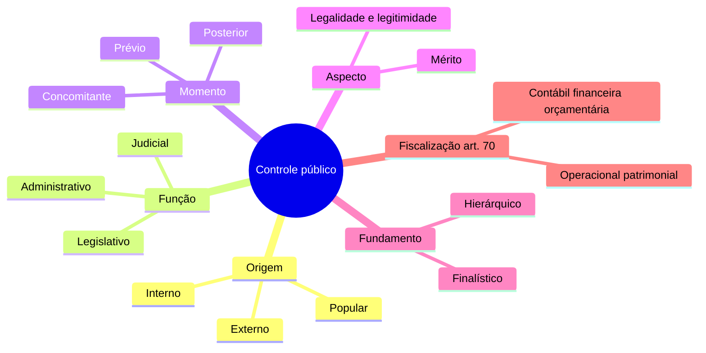

O controle da Administração Pública reúne mecanismos de fiscalização e correção da atuação estatal. Ele protege a legalidade e os princípios administrativos, mas também permite avaliar resultados, custos e a guarda de recursos. Para a prova, é essencial classificar o controle por mais de um critério: o mesmo ato pode ser, ao mesmo tempo, interno, posterior e de legalidade. Este capítulo apresenta os critérios básicos, o alcance da fiscalização previsto na Constituição e a distinção entre controle hierárquico e finalístico.

> [!objetivos]
> - Classificar o controle segundo sua origem, seu fundamento e o órgão que o exerce.
> - Diferenciar as dimensões de fiscalização do art. 70 da Constituição.
> - Distinguir controle de legalidade, legitimidade e economicidade.
> - Comparar controle hierárquico e controle finalístico.

## O que significa controlar a Administração

Controle é o poder-dever de acompanhar a atuação administrativa, verificar sua conformidade e, quando houver competência, corrigir falhas. É poder porque a ordem jurídica atribui instrumentos ao órgão controlador; é dever porque a fiscalização não é uma escolha livre quando os pressupostos legais estão presentes. O objeto não se limita a atos do Poder Executivo. Legislativo e Judiciário também administram seus órgãos e, nessa função, submetem-se a controles internos.

A fiscalização pode verificar tanto a observância das normas quanto a qualidade da gestão. Legalidade significa conformidade com a lei e com as demais normas aplicáveis. Legitimidade acrescenta a compatibilidade com os princípios e valores jurídicos, como impessoalidade, moralidade e finalidade pública. Eficiência considera a relação entre recursos empregados e resultados; eficácia observa o cumprimento das metas; efetividade considera os efeitos concretos da política ou serviço na realidade social.

> [!exemplo]
> Uma unidade pública adquire equipamentos para resposta a emergências. A conferência de notas fiscais e lançamentos examina a regularidade contábil; a confirmação de que o gasto estava autorizado no orçamento examina a dimensão orçamentária; a comparação entre preço, qualidade e vida útil examina economicidade; e a avaliação de redução no tempo de resposta mede resultados operacionais.

Não se deve confundir controle de gestão com substituição automática do administrador. O controlador atua dentro de sua competência e dos parâmetros legais. Em regra, pode invalidar uma ilegalidade, exigir correção ou recomendar providências; não escolhe livremente a política pública em lugar do gestor. Já a fiscalização de desempenho pode apontar desperdício ou metas não cumpridas sem transformar o órgão de controle em autoridade executora.

## Classificações que podem coexistir

A classificação pela origem pergunta onde está o órgão controlador em relação ao controlado. Controle interno é feito no âmbito da própria estrutura ou Poder a que pertence a atividade examinada. Controle externo é exercido por órgão independente em relação à estrutura controlada, frequentemente situado em outro Poder. Controle popular é a participação da sociedade, individual ou coletiva, na fiscalização de serviços, atos e recursos públicos. A classificação deve olhar a relação concreta, e não apenas o nome do órgão.

Pelo órgão que exerce a atividade, fala-se em controle administrativo, legislativo e judicial. O controle administrativo ocorre no desempenho de função administrativa, inclusive quando Legislativo ou Judiciário revisam atos de sua própria estrutura. O controle legislativo é exercido no quadro das competências constitucionais de fiscalização, diretamente pelo Parlamento ou com auxílio dos Tribunais de Contas. O controle judicial é realizado pelo Judiciário quando provocado, dentro dos limites da jurisdição.

Quanto ao momento, o controle é prévio se antecede a conclusão ou eficácia do ato; concomitante se acompanha sua formação ou execução; e posterior se ocorre depois da prática ou conclusão. A aprovação técnica antes de iniciar uma obra pode ser prévia; a inspeção durante o serviço, concomitante; a auditoria das despesas já executadas, posterior. Os três Poderes podem ter atribuições de controle prévio, conforme a Constituição e a lei.

Quanto ao aspecto examinado, o controle de legalidade e legitimidade verifica aderência às normas e princípios. O controle de mérito avalia conveniência e oportunidade de ato discricionário válido, sobretudo pela própria Administração que o praticou ou por superior competente. A distinção não autoriza o Judiciário a reexaminar a escolha administrativa como se fosse gestor. Contudo, discricionariedade não significa imunidade: desvio de finalidade, falta de motivação exigida ou desproporção podem tornar o ato ilegal e permitir controle judicial.

| Critério | Modalidades | Pergunta útil |
| --- | --- | --- |
| Origem | Interno, externo, popular | Qual é a relação entre controlador e controlado? |
| Órgão/função | Administrativo, legislativo, judicial | Em que função o controle é exercido? |
| Momento | Prévio, concomitante, posterior | Quando a fiscalização ocorre? |
| Aspecto | Legalidade/legitimidade, mérito | O que está sendo avaliado? |
| Fundamento | Hierárquico, finalístico | Há subordinação ou vinculação legal? |

> [!pegadinha]
> As classificações não são excludentes. A inspeção do órgão central de auditoria do Executivo em uma compra já concluída pode ser interna, administrativa, posterior e voltada à legalidade e à economicidade ao mesmo tempo.

## Natureza e aspectos da fiscalização constitucional

O art. 70, caput, da Constituição enumera cinco naturezas de fiscalização: contábil, financeira, orçamentária, operacional e patrimonial. A enumeração define campos de exame, não cinco órgãos distintos. O dispositivo também prevê que a fiscalização da União e de suas entidades diretas e indiretas avalie aderência às normas, legitimidade, racionalidade de custos, destinação de auxílios e incentivos que reduzam arrecadação, mediante controle externo do Congresso Nacional e sistema de controle interno de cada Poder. O dever de prestar contas alcança pessoas e organizações de qualquer natureza que movimentem ou conservem recursos da União, ou assumam compromissos financeiros por ela garantidos.

| Natureza | Foco da verificação | Exemplo de pergunta de auditoria |
| --- | --- | --- |
| Contábil | Escrituração, registros e demonstrações | A despesa foi registrada na conta correta? |
| Financeira | Arrecadação e execução de receitas e despesas | O pagamento corresponde ao valor devido? |
| Orçamentária | Previsão e execução do orçamento | Havia dotação e classificação compatíveis? |
| Operacional | Desempenho de programas e processos | A ação alcançou as metas com qualidade? |
| Patrimonial | Bens, direitos, guarda e conservação | O inventário identifica os bens adquiridos? |

Legalidade e legitimidade se relacionam, mas não são sinônimos perfeitos. Um procedimento pode observar formalmente uma regra e ainda contrariar princípios, por exemplo ao favorecer indevidamente um interessado. Economicidade busca uma relação adequada entre custo e qualidade. Não significa comprar sempre pelo menor preço: uma opção mais barata pode ser antieconômica se falhar cedo e gerar despesa superior de manutenção ou reposição.

Subvenção é transferência destinada a cobrir despesas de custeio de entidade beneficiária, nos termos da Lei 4.320/1964. A lei distingue subvenções sociais, destinadas a instituições de caráter assistencial ou cultural sem finalidade lucrativa, e econômicas, destinadas a empresas de caráter industrial, comercial, agrícola ou pastoril. O destinatário deve aplicar os recursos conforme a finalidade e sujeitar-se à prestação de contas. O controle acompanha a concessão e a aplicação, sem presumir que toda transferência tem a mesma natureza.

Renúncia de receita é benefício que reduz ou deixa de arrecadar receita que seria exigível em condições ordinárias, como certas isenções, remissões e incentivos. A fiscalização examina fundamento, estimativa, finalidade e resultados do benefício, conforme as normas fiscais. A existência de autorização legal não elimina o dever de avaliar se o incentivo foi executado de forma regular e produziu resultado justificável.

> [!lei] Constituição, art. 70
> A fiscalização alcança áreas contábil, financeira, orçamentária, operacional e patrimonial e considera legalidade, legitimidade, economicidade, subvenções e renúncia de receitas.

## Controle interno e controle externo

Controle interno é realizado por unidades inseridas na própria estrutura a que pertence a atividade controlada. No Executivo, auditorias e corregedorias fiscalizam atos e agentes do próprio Poder; os órgãos administrativos do Legislativo e do Judiciário também controlam internamente suas atividades administrativas. O art. 74 exige que Legislativo, Executivo e Judiciário mantenham sistemas integrados de controle interno. Entre as finalidades estão avaliar metas do plano plurianual, programas e orçamentos; comprovar legalidade e avaliar resultados da gestão; controlar operações de crédito, avais, garantias, direitos e haveres; e apoiar o controle externo.

O responsável pelo controle interno que toma conhecimento de irregularidade ou ilegalidade deve comunicá-la ao Tribunal de Contas competente; no plano federal, o art. 74, § 1º, menciona o TCU e prevê responsabilidade solidária em caso de omissão. A regra estimula cooperação entre sistemas de controle, mas não torna as unidades internas subordinadas ao Tribunal de Contas.

Controle externo é exercido por órgão que não integra a estrutura controlada. A fiscalização parlamentar com auxílio de Tribunal de Contas é exemplo constitucional. Também se enquadra, em sentido orgânico, o controle judicial de ato administrativo do Executivo. A doutrina discute a classificação do controle que a Administração Direta exerce sobre entidades da indireta: pode ser chamado externo por envolver pessoas jurídicas distintas, ou interno exterior segundo uma corrente. Em questão objetiva, observe o critério conceitual explicitado no enunciado.

Controle popular permite que cidadãos e organizações acompanhem o uso dos recursos e a qualidade dos serviços. A Constituição assegura acesso a informações públicas, participação dos usuários e ação popular nos casos previstos. Também confere legitimidade, na forma da lei, para denunciar irregularidades perante o Tribunal de Contas da União. A Lei de Responsabilidade Fiscal determina que as contas do chefe do Executivo fiquem disponíveis durante todo o exercício no Legislativo e no órgão técnico responsável para consulta e apreciação por cidadãos e instituições.

> [!pegadinha]
> O art. 31, § 3º, da Constituição prevê exposição anual das contas municipais por sessenta dias para exame de qualquer contribuinte. A regra da LRF, art. 49, estabelece disponibilidade durante todo o exercício das contas apresentadas pelo chefe do Executivo. Não troque os prazos nem os sujeitos dos dispositivos.

## Controle hierárquico e finalístico

Controle hierárquico decorre da relação de subordinação entre órgãos e agentes dentro de uma mesma pessoa jurídica. Permite ao superior orientar, fiscalizar, rever e, quando houver competência, avocar atribuições do subordinado. Seu alcance pode envolver legalidade e mérito, mas sempre respeita competências exclusivas e limites legais. É característico da organização escalonada: uma chefia regional pode supervisionar unidades subordinadas, por exemplo. Como nasce da estrutura de subordinação, não depende de uma norma específica para cada ato ordinário de supervisão, embora a própria organização e as competências devam ter base jurídica.

Controle finalístico ocorre entre Administração Direta e entidade da Administração Indireta vinculada. Vinculação não é hierarquia: a entidade tem personalidade e autonomia próprias, e o órgão supervisor não pode dar ordens gerais como se fosse superior hierárquico. O controle deve estar previsto em lei e se limita a verificar se a entidade cumpre as finalidades para as quais foi criada e se observa os limites legais. Também recebe os nomes tutela e, em certos contextos federais, supervisão ministerial.

| Ponto de comparação | Hierárquico | Finalístico |
| --- | --- | --- |
| Relação | Subordinação | Vinculação entre pessoas administrativas distintas |
| Abrangência | Ampla, dentro da competência | Limitada às hipóteses legais e às finalidades institucionais |
| Fundamento imediato | Estrutura hierárquica | Lei que prevê tutela ou supervisão |
| Mérito | Pode ser revisto pelo superior competente | Não há livre substituição das escolhas da entidade |
| Exemplo | Secretaria revisa ato de unidade subordinada | Ministério acompanha finalidade legal de autarquia vinculada |

> [!bizu]
> Hierarquia gera subordinação e supervisão ampla; finalidade gera vinculação e controle limitado por lei. A entidade vinculada não é subordinada ao ministério.

### Como cruzar as classificações na prática

A classificação correta começa por identificar o fato que o enunciado destaca. Se pergunta quem pode rever uma decisão dentro da mesma estrutura, pense no controle administrativo e na autotutela. Se pergunta qual é o momento, classifique como prévio, concomitante ou posterior. Se destaca o órgão que analisa as contas, a resposta pode ser controle legislativo com atuação técnica de Tribunal de Contas. Um mesmo caso pode satisfazer todas essas descrições sem contradição.

Considere a compra de viaturas por órgão estadual. A área de auditoria interna, que integra o próprio Poder Executivo, pode analisar o procedimento antes do pagamento: controle interno, administrativo, prévio e de legalidade. Se acompanha a entrega, o exame é concomitante. Se revisa a prestação de contas depois do pagamento, é posterior. Se o Tribunal de Contas estadual faz uma auditoria independente, o controle é externo e técnico. Se um cidadão consulta as despesas e formula denúncia, há controle popular, ainda que a apuração posterior seja feita por órgão estatal.

> [!exemplo]
> Uma associação de moradores identifica que o município pagou por uma praça que não foi entregue. A associação pode divulgar documentos e apresentar notícia aos órgãos competentes. A fiscalização técnica e eventual cobrança serão realizadas por autoridades que tenham competência legal; a participação popular provoca e acompanha o controle, mas não substitui o processo de contas.

O direito de participação dos usuários da Administração não se resume a votar em eleições. O art. 37, § 3º, prevê que a lei discipline formas de participação do usuário, inclusive reclamações sobre serviços, acesso a registros e representação contra exercício negligente ou abusivo de função pública. O acesso à informação tem limites constitucionais, como sigilos legalmente protegidos e dados pessoais. A ação popular exige cidadania e ato lesivo, enquanto a denúncia ao Tribunal de Contas pode ser feita pelos sujeitos que a Constituição e a lei reconhecem. Não misture os requisitos dessas formas de participação.

As contas municipais ilustram a diferença entre transparência e julgamento. A Constituição determina que permaneçam disponíveis anualmente por sessenta dias para exame de contribuintes. A Lei de Responsabilidade Fiscal, por sua vez, exige disponibilidade durante todo o exercício das contas apresentadas pelo chefe do Executivo. O cidadão pode comparar despesas, receitas e resultados; a Câmara Municipal exerce a competência de julgamento político das contas anuais com auxílio do Tribunal de Contas. A disponibilização facilita o controle social, mas não transforma cada contribuinte em julgador formal das contas.

A economicidade também precisa ser avaliada com dados comparáveis. Uma proposta de menor preço pode parecer vantajosa, mas ter especificações inferiores, baixa durabilidade ou custo elevado de operação. O controle deve examinar se houve pesquisa adequada, critérios objetivos, justificativa e relação razoável entre gasto e resultado. Se a autoridade agiu dentro de uma faixa legítima de escolhas, o controlador não deve impor a alternativa que pessoalmente prefere. Se houve desperdício demonstrável ou violação de parâmetro jurídico, há base para apontamento ou correção.

> [!pegadinha]
> Controle popular não é sinônimo de controle externo legislativo. O cidadão pode provocar mecanismos de fiscalização, mas o órgão que examina o caso pode exercer controle administrativo, técnico ou judicial conforme sua competência.

> [!atencao]
> O art. 74 trata de sistema de controle interno integrado entre os Poderes; isso não cria subordinação entre os órgãos de controle interno e o Tribunal de Contas. O sistema interno coopera e comunica irregularidades, preservadas as competências constitucionais.
## Mapa do capítulo

### Para fixar
- Controle público é poder-dever de fiscalização e correção conforme o Direito.
- O art. 70 lista cinco naturezas: contábil, financeira, orçamentária, operacional e patrimonial.
- O mesmo ato pode ser classificado por origem, órgão, momento e aspecto simultaneamente.
- Economicidade compara custos e qualidade; não equivale ao menor preço isolado.
- Os três Poderes mantêm sistemas próprios de controle interno e devem apoiar o controle externo.
- O controle popular inclui acesso à informação, participação dos usuários e denúncia de irregularidades.
- Controle hierárquico decorre de subordinação; controle finalístico, de vinculação prevista em lei.
- A entidade da Administração Indireta não se subordina hierarquicamente ao órgão supervisor.

