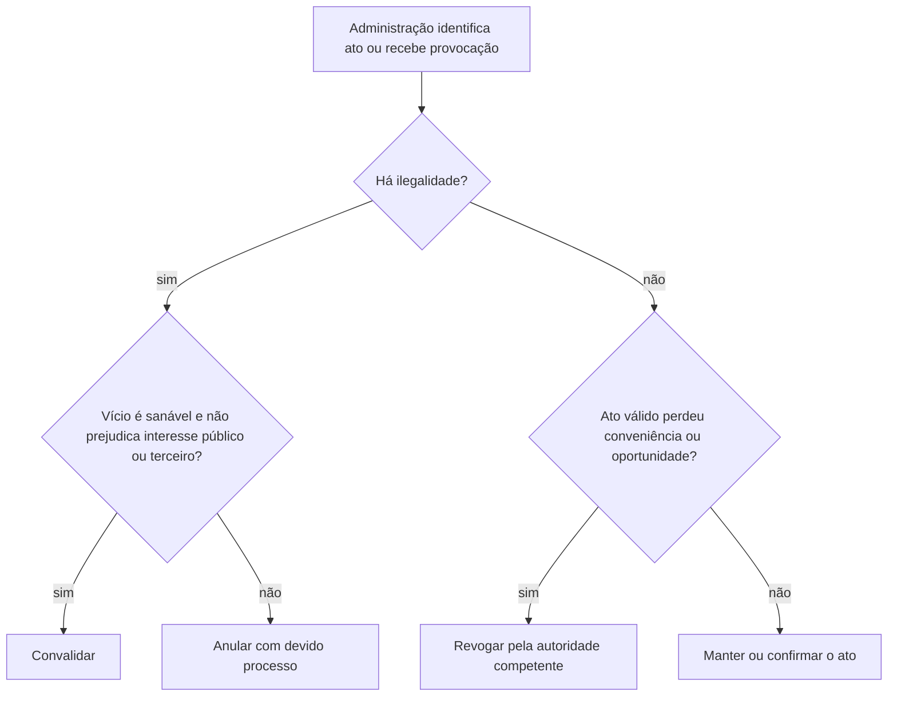

O controle administrativo é a fiscalização que a Administração exerce sobre a própria atividade, inclusive quando realizada por unidades administrativas do Legislativo ou do Judiciário. Ele permite corrigir ilegalidades e rever escolhas de mérito dentro dos limites de competência. Este capítulo articula três eixos que costumam aparecer juntos: momento e aspecto do controle, instrumentos de autotutela e recursos administrativos. Também diferencia prescrição, decadência e preclusão, pois a passagem do tempo pode limitar poderes diferentes e não se resume a um único prazo geral.

> [!objetivos]
> - Distinguir controle prévio, concomitante e posterior.
> - Identificar quem pode rever legalidade e mérito administrativo.
> - Diferenciar as principais formas de recurso administrativo.
> - Separar prescrição, decadência e preclusão no processo administrativo.

## Momento e aspecto do controle

O controle prévio ocorre antes de o ato produzir seus efeitos finais ou antes da conclusão do procedimento. Uma análise de projeto técnico antes do início de uma obra previne que a Administração comece um serviço incompatível com normas de segurança. O controle concomitante acompanha a formação do ato ou sua execução, como inspeções durante a obra ou o monitoramento de um contrato enquanto o serviço é prestado. O controle posterior examina uma atividade já concluída, para confirmar sua validade, corrigir defeitos ou apurar responsabilidade. A homologação de resultado de concurso e a auditoria de pagamentos realizados são exemplos de controle posterior.

Os três Poderes podem, conforme sua competência, atuar antes da conclusão de um ato. Uma autorização constitucional do Senado para nomeação de autoridade é controle prévio legislativo; uma decisão judicial urgente pode impedir lesão iminente a direito; uma unidade administrativa pode exigir aprovação antes que uma despesa avance. Portanto, o controle prévio não pertence exclusivamente à Administração que executa a atividade. A Constituição assegura a apreciação judicial tanto de lesão quanto de ameaça a direito, mas o Judiciário age mediante provocação e dentro do processo cabível.

Quanto ao aspecto, o controle de legalidade ou legitimidade verifica se o ato obedece às normas e aos princípios que limitam a atuação estatal. Quando a Administração constata vício, pode anulá-lo, respeitado o devido processo e os direitos eventualmente protegidos. O controle de mérito incide sobre conveniência e oportunidade de ato discricionário válido. Em regra, a própria Administração pode revogá-lo quando uma nova avaliação justifique a retirada, observados direitos adquiridos e limites legais.

O Judiciário não substitui a avaliação administrativa de conveniência por sua preferência pessoal. Isso não impede o exame de atos discricionários: competência, finalidade, forma, motivo e objeto continuam sujeitos à lei. Uma decisão sem motivação quando exigida, baseada em fato inexistente ou desproporcional pode ser anulada por ilegalidade. A fronteira é entre controlar o respeito ao Direito e fazer uma segunda escolha administrativa sem fundamento jurídico.

> [!pegadinha]
> “Discricionário” não quer dizer “imune ao Judiciário”. O juiz pode verificar a legalidade dos elementos do ato e os limites da discricionariedade; não pode revogá-lo por simples juízo próprio de conveniência.

## Autotutela e instrumentos de controle

Autotutela é o dever-poder de a Administração reexaminar seus próprios atos. A Súmula 473 do STF sintetiza duas respostas diferentes: anulação para atos ilegais e revogação para atos válidos que deixaram de ser convenientes ou oportunos. A anulação cuida de vício; a revogação cuida de mérito. Em ambos os casos, a apreciação judicial permanece possível. A Súmula 346 também reconhece que a Administração pode declarar a nulidade dos próprios atos.

| Medida | Pressuposto | Efeito básico | Limite central |
| --- | --- | --- | --- |
| Anulação | Ilegalidade ou ilegitimidade | Retira ato inválido | Processo, segurança jurídica e direitos de terceiros devem ser considerados |
| Revogação | Ato válido que se tornou inconveniente ou inoportuno | Retira efeitos para o futuro, em regra | Só autoridade competente; não atinge direito adquirido |
| Convalidação | Vício sanável, sem lesão ao interesse público nem prejuízo a terceiros | Corrige o defeito e preserva o ato | Não cabe para qualquer vício ou situação |

A Lei 9.784/1999 disciplina o processo administrativo federal e oferece referências importantes para o estudo, sem substituir a legislação própria de outros entes. Seu art. 53 determina que a Administração anule atos com vício de legalidade e pode revogá-los por conveniência ou oportunidade, respeitados direitos adquiridos. O art. 55 permite convalidar defeitos sanáveis se não houver lesão ao interesse público nem prejuízo a terceiros. Exemplo comum de vício sanável é uma falha formal que não compromete competência exclusiva, finalidade ou conteúdo essencial; vício de finalidade não se corrige com simples ratificação.

A lei federal prevê decadência de cinco anos para anular atos administrativos dos quais decorram efeitos favoráveis aos destinatários, contada da prática do ato, salvo comprovada má-fé. Em prestações de efeitos patrimoniais contínuos, a contagem começa na percepção do primeiro pagamento. Esse prazo diz respeito à revisão administrativa de atos favoráveis, não é regra universal para toda pretensão de ressarcimento nem se aplica automaticamente a todos os entes. A Administração deve ponderar legalidade e segurança jurídica, especialmente quando sua própria demora consolidou situação de boa-fé.

O controle administrativo pode começar de ofício ou por provocação. A Constituição garante a qualquer pessoa o direito de peticionar aos Poderes Públicos para defender direitos ou combater ilegalidade e abuso, sem pagamento de taxa. O direito de petição pode iniciar reclamação, representação, pedido de revisão ou outro processo, mas não dispensa a pessoa de observar requisitos de legitimidade e procedimento previstos para cada instrumento. A Administração tem dever de decidir expressamente as solicitações de sua competência.

> [!lei] Lei 9.784/1999, art. 53
> Art. 53. A Administração deve anular seus próprios atos, quando eivados de vício de legalidade, e pode revogá-los por motivo de conveniência ou oportunidade, respeitados os direitos adquiridos.

## Recursos e outros pedidos de reexame

“Recurso administrativo” pode ser usado em sentido amplo para indicar pedidos que buscam revisão interna. A Lei 9.784/1999 prevê recurso contra razões de legalidade e de mérito. Em regra, dirige-se à autoridade que proferiu a decisão; se ela não reconsiderar no prazo legal, encaminha à autoridade superior. Salvo exigência legal específica, a apresentação não depende de depósito ou caução. A exigência de depósito prévio como condição de admissibilidade é incompatível com a garantia de acesso à instância administrativa, conforme a Súmula Vinculante 21 do STF.

Os instrumentos de reexame não são intercambiáveis. A reclamação administrativa é manifestação de inconformismo de quem entende que uma decisão atingiu direito ou interesse seu. A representação comunica uma irregularidade para que a autoridade apure, ainda que o denunciante não seja titular do direito afetado. O pedido de reconsideração é apresentado à própria autoridade que decidiu. Recurso hierárquico próprio é dirigido ao superior inserido na mesma cadeia de subordinação. Já o recurso hierárquico impróprio chega a órgão que não é superior hierárquico, e por isso depende de previsão legal que delimite competência e alcance.

A revisão é pedido para reabrir processo sancionador quando surgem fatos novos ou circunstâncias relevantes que indiquem inadequação da penalidade. No processo federal, o art. 65 da Lei 9.784/1999 admite revisão a qualquer tempo, de ofício ou a pedido, mas veda o agravamento da sanção na revisão. Isso não significa que todos os outros recursos sejam sempre cabíveis sem prazo: a lei do processo ou norma setorial pode fixar prazo e requisitos.

| Instrumento | Quem inicia em geral | Para quem vai | Ponto distintivo |
| --- | --- | --- | --- |
| Reclamação | Interessado diretamente afetado | Administração competente | Inconformismo com lesão a interesse próprio |
| Representação | Pessoa que noticia irregularidade | Autoridade fiscalizadora | Não exige titularidade do direito lesado |
| Reconsideração | Interessado | Autoridade que decidiu | Reexame pela mesma autoridade |
| Recurso hierárquico próprio | Interessado | Autoridade superior na hierarquia | Fundado na subordinação administrativa |
| Recurso hierárquico impróprio | Interessado | Órgão sem relação hierárquica | Exige base legal específica |
| Revisão | Interessado ou Administração | Autoridade revisora competente | Fato novo em processo sancionador; não agrava a sanção federal |

O recurso administrativo federal, segundo o art. 56, pode discutir legalidade e mérito. A regra geral da Lei 9.784/1999 estabelece prazo de dez dias para interposição, salvo disposição legal específica, contado da ciência ou divulgação oficial da decisão; a Administração tem até trinta dias para decidir, prorrogáveis por igual período mediante justificativa expressa (arts. 59 e 49). Não use esses prazos como se fossem comuns a todo processo brasileiro: legislação estadual, municipal e regimes especiais podem estabelecer disciplina própria.

> [!exemplo]
> Uma servidora recebe decisão que nega contagem de tempo de serviço. Ela pode pedir reconsideração à unidade decisora e, se mantida a decisão, recorrer à autoridade superior, conforme as regras do processo aplicável. Um colega que não foi prejudicado diretamente pode, em separado, representar sobre indício de fraude documental, sem se tornar titular do direito discutido.

## Prescrição, decadência e preclusão

Prescrição limita a pretensão de exigir judicial ou administrativamente uma prestação depois de certo tempo, segundo o regime jurídico aplicável. Decadência extingue um poder ou direito potestativo pelo decurso do prazo previsto. Preclusão é a perda da possibilidade de praticar determinado ato dentro de um processo, por já ter passado o prazo, por incompatibilidade com ato anterior ou porque a oportunidade foi consumida. São conceitos diferentes: a preclusão organiza o procedimento; a prescrição e a decadência podem afetar posições jurídicas fora de uma etapa processual específica.

Não existe um prazo único de prescrição para toda atuação administrativa. A cobrança de multa administrativa, o ressarcimento, a revisão de ato favorável, o processo disciplinar e as pretensões de servidores podem seguir normas diferentes. No âmbito federal, a Lei 9.873/1999 estabelece prazo de cinco anos para a ação punitiva da Administração Pública Federal direta e indireta no exercício do poder de polícia, contado da prática do ato ou, em infração permanente ou continuada, do dia em que cessar. O diploma prevê causas interruptivas e disciplina a prescrição intercorrente quando o processo fica paralisado por mais de três anos pendente de julgamento ou despacho. A aplicação depende do campo da lei e não deve ser transportada sem exame para sanções disciplinares ou entes estaduais.

Na Lei 9.784/1999, o prazo de cinco anos do art. 54 é decadencial e se refere à anulação de atos favoráveis, ressalvada má-fé. O prazo recursal de dez dias da lei federal, por sua vez, é processual: ultrapassado sem justificativa admitida, pode ocorrer preclusão administrativa. Antes de afirmar que o silêncio fez um direito prescrever, identifique: quem exerce a pretensão, qual é sua natureza, qual norma rege o caso e se houve causa de interrupção ou suspensão.

> [!atencao]
> O prazo de cinco anos aparece em regimes distintos, com objetos e marcos próprios. Não confunda a decadência para anular ato favorável (Lei 9.784, art. 54) com a prescrição da ação punitiva federal no poder de polícia (Lei 9.873).

### Como a revisão se organiza no processo

A revisão administrativa deve observar competência, procedimento e participação do interessado. Se o ato puder afetar situação individual favorável, a Administração deve oportunizar manifestação antes de desfazê-lo quando a decisão exige contraditório. Isso permite esclarecer fatos, juntar documentos e discutir a interpretação aplicada. Não é suficiente invocar autotutela em abstrato para cancelar benefício sem examinar boa-fé, prazo decadencial, direitos de terceiros e procedimento previsto em lei.

A Lei 9.784/1999 prevê que o processo pode começar por iniciativa da Administração ou a pedido de interessado, com princípios como legalidade, finalidade, motivação, razoabilidade, proporcionalidade, ampla defesa e segurança jurídica. A lei federal também manda a Administração emitir decisão explícita em processos e solicitações de sua competência. A demora injustificada pode ser questionada por meios administrativos e judiciais, mas o silêncio não deve ser tratado automaticamente como deferimento, salvo previsão legal específica.

No processo federal, a autoridade que recebe recurso pode reconsiderar a decisão e, se mantê-la, encaminhar à autoridade superior. Esse desenho evita que o recurso seja mero protocolo sem possibilidade de revisão inicial. Quando o recurso discute aplicação de súmula vinculante, a Lei 9.784 exige que a autoridade explicite por que a súmula se aplica ou não antes de remeter o caso à instância superior. O recorrente tem direito a uma resposta fundamentada, mas não necessariamente a uma decisão favorável.

> [!exemplo]
> Uma técnica administrativa questiona desconto salarial e apresenta recurso dentro do prazo, juntando contracheques e escala de serviço. A autoridade pode rever seu ato. Se mantiver a decisão, deve encaminhar o recurso conforme a hierarquia e explicar os fundamentos, inclusive por que os documentos não alteram a conclusão.

Antes de elaborar a decisão, convém usar quatro perguntas: quem tem competência para rever; qual aspecto está em discussão; qual norma estabelece prazo e rito; e quem poderá ser afetado pela conclusão. No recurso próprio, a hierarquia costuma fornecer a instância superior. No recurso impróprio, não há superior comum e é a lei que deve indicar o órgão revisor. Na representação, o foco é apurar irregularidade, sem necessariamente conceder ao representante uma pretensão individual. No pedido de revisão, o fato novo deve ter aptidão para modificar a adequação da sanção, e não apenas repetir argumento que já foi apreciado.

A convalidação merece cautela porque preserva efeitos de ato que nasceu com vício corrigível. A autoridade deve demonstrar que a falha é sanável, que não há prejuízo ao interesse público ou a terceiro e que a correção não mascara desvio de finalidade nem invasão de competência exclusiva. Se houver dúvida sobre os efeitos já produzidos, sobre a boa-fé dos beneficiários ou sobre a necessidade de instrução, a solução precisa ser motivada. Anulação e convalidação não são atalhos para evitar defesa.

> [!lei] Lei 9.784/1999, art. 56, caput e § 2º
> Art. 56. Das decisões administrativas cabe recurso, em face de razões de legalidade e de mérito.
> (...)
> § 2º Salvo exigência legal, a interposição de recurso administrativo independe de caução.

A revisão de legalidade e a revisão de mérito podem ocorrer no mesmo processo, mas cada uma precisa de fundamento próprio. Se um agente recorre dizendo que o ato não tem base legal, a autoridade avalia a validade. Se afirma que a decisão, embora possível, não é a melhor para a Administração, questiona mérito. Uma decisão pode ser mantida no mérito e anulada por ilegalidade, ou permanecer válida apesar de a autoridade revisora preferir outra solução. Separar os fundamentos ajuda a formular recurso claro e a compreender a resposta.
## Mapa do capítulo

### Para fixar
- O controle prévio antecede a conclusão; o concomitante acompanha a execução; o posterior examina ato concluído.
- A Administração pode controlar legalidade e mérito; o Judiciário controla juridicidade, sem substituir a escolha de mérito.
- Anulação corrige ilegalidade; revogação retira ato válido por mérito; convalidação corrige vício sanável nos limites legais.
- No processo federal, a Lei 9.784/1999 prevê decadência de cinco anos para anular atos favoráveis, salvo má-fé.
- O recurso administrativo pode questionar legalidade e mérito; depósito ou caução prévia não pode ser condição geral de acesso.
- Representação noticia irregularidade; reclamação expressa inconformismo de interessado diretamente afetado.
- Recurso hierárquico impróprio depende de autorização legal; revisão sancionadora exige fato novo e não pode agravar a sanção federal.
- Prescrição, decadência e preclusão têm objetos diferentes; o prazo aplicável depende do regime jurídico específico.

