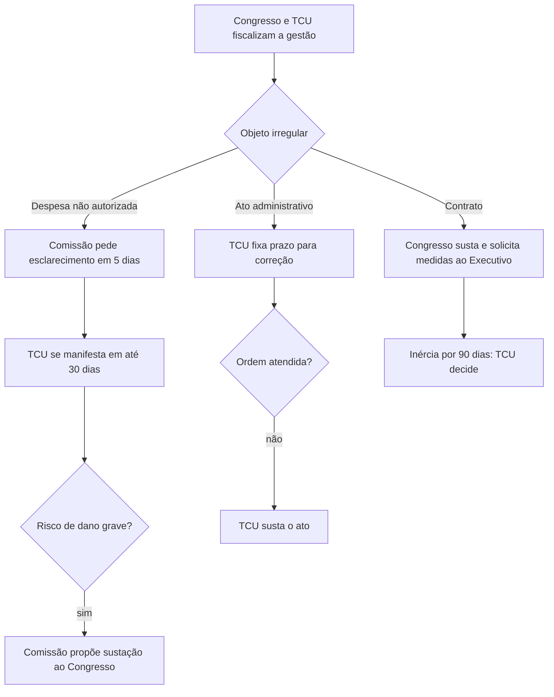

O controle legislativo é uma das formas pelas quais o Parlamento fiscaliza a Administração Pública. Ele se distingue do controle administrativo que o próprio Legislativo exerce sobre seus servidores e atos internos. Aqui, o foco está na função típica de fiscalização: controle político direto pelas Casas, comissões e parlamentares, e controle técnico realizado pelos Tribunais de Contas. A Constituição distribui competências entre Parlamento e Cortes de Contas; compreender quem é titular, quem decide e quais atos cada órgão pode sustar evita erros frequentes.

> [!objetivos]
> - Distinguir controle parlamentar direto e controle técnico dos Tribunais de Contas.
> - Identificar competências constitucionais de fiscalização do Congresso e do Senado.
> - Comparar as atribuições próprias do TCU com as do Congresso.
> - Explicar as regras constitucionais sobre atos, contratos e despesas não autorizadas.
> - Reconhecer o alcance da simetria e a atualização do art. 75 da Constituição.

## Controle legislativo direto

O controle legislativo ocorre quando o Poder Legislativo exerce sua função típica de fiscalizar a atuação administrativa dos demais Poderes. Ele existe em todos os níveis federativos, dentro das competências da respectiva Constituição. O Congresso Nacional, suas Casas e comissões realizam controle político direto. Os Tribunais de Contas executam o exame técnico com competências constitucionais próprias. Quando a Câmara dos Deputados revê uma contratação de seus próprios serviços, age administrativamente; quando fiscaliza atos do Executivo, age como Legislativo.

Entre as competências do Congresso, o art. 49, V, permite sustar atos normativos do Executivo que ultrapassem o poder regulamentar ou os limites de delegação legislativa. O poder regulamentar serve para dar execução à lei; não autoriza o Executivo a contrariá-la ou criar obrigação sem base jurídica adequada. O controle pode alcançar ato normativo infralegal em diferentes formas, desde que se enquadre nos pressupostos constitucionais. A sustação corrige excesso normativo e não permite que o Congresso substitua o Executivo na escolha de mérito dentro da lei.

O Congresso também julga anualmente as contas prestadas pelo Presidente da República e aprecia relatórios referentes ao cumprimento das diretrizes governamentais (art. 49, IX). O Tribunal de Contas da União emite parecer prévio sobre as contas presidenciais, em até sessenta dias do recebimento, mas não é o julgador final dessas contas. Para os administradores e demais responsáveis por recursos públicos, a Constituição atribui julgamento técnico ao Tribunal. Essa diferença entre parecer e julgamento é estrutural, e não apenas terminológica.

O art. 49, X, autoriza o Congresso e cada uma de suas Casas a fiscalizar e controlar diretamente os atos do Executivo, inclusive da Administração Indireta. Isso não cria hierarquia entre Poderes nem autoriza interferência ilimitada: cada Poder permanece sujeito à Constituição, à separação funcional e às competências legalmente definidas. A fiscalização pode abranger autarquias, empresas estatais e órgãos da Administração direta, não se restringindo ao Executivo central.

A Câmara, o Senado ou suas comissões podem convocar Ministros de Estado e titulares de órgãos diretamente subordinados à Presidência para prestar pessoalmente informações sobre assunto previamente determinado. As Mesas das duas Casas também podem enviar pedidos escritos de informação. A recusa, a ausência sem justificativa, o não atendimento no prazo constitucional de trinta dias ou o fornecimento de informação falsa podem configurar crime de responsabilidade nas hipóteses previstas no art. 50. As comissões podem receber petições e reclamações, solicitar depoimentos e apreciar planos e programas públicos.

As comissões parlamentares de inquérito têm poderes de investigação próprios das autoridades judiciais, além dos previstos nos regimentos. Para sua criação, exige-se requerimento de um terço dos membros da Casa ou das Casas reunidas, fato determinado e prazo certo. Suas conclusões podem ser encaminhadas ao Ministério Público para que promova as responsabilidades cabíveis. A CPI investiga; não profere condenação criminal nem substitui o processo judicial.

> [!pegadinha]
> Uma CPI pode investigar e encaminhar conclusões, mas não julga criminalmente os investigados. A apuração parlamentar não elimina a competência do Ministério Público para agir nem a do Judiciário para decidir.

## Congresso, TCU e competências compartilhadas

No controle externo da gestão pública federal, o Congresso é titular e o Tribunal de Contas da União exerce competências que a própria Constituição lhe atribui. “Com auxílio” não significa subordinação. Algumas tarefas são políticas e cabem ao Congresso; outras são técnicas e privativas do Tribunal; há ainda procedimentos que articulam ambos. O Tribunal não é mero departamento parlamentar, e suas decisões técnicas não são submetidas a recurso político para o Congresso.

| Categoria | Exemplo | Quem decide |
| --- | --- | --- |
| Política | Julgamento das contas anuais do Presidente | Congresso Nacional |
| Técnica | Julgamento de contas de gestores federais | TCU, com possibilidade de controle judicial de legalidade |
| Compartilhada | Sustação de despesa não autorizada ou de contrato irregular | Parlamento e TCU em etapas constitucionais distintas |

Se a comissão mista permanente de orçamento identifica indício de despesa não autorizada, pode solicitar esclarecimentos à autoridade responsável, que tem cinco dias para prestá-los. Se a resposta não for suficiente, a comissão pede pronunciamento conclusivo do Tribunal, que deve ocorrer em trinta dias. Se o Tribunal considerar a despesa irregular e a comissão avaliar que há risco de dano irreparável ou grave lesão à economia pública, propõe ao Congresso a sustação. A sequência combina apuração técnica com decisão parlamentar e não deve ser resumida como poder unilateral de qualquer dos órgãos.

Os contratos ilegais têm procedimento próprio. O Tribunal não os susta diretamente como se fossem atos administrativos simples. O Congresso adota o ato de sustação e solicita ao Executivo que tome as medidas pertinentes. Se Congresso ou Executivo não efetivarem providências em noventa dias, o Tribunal decide a respeito. Para ato administrativo ilegal que não seja contrato, o Tribunal pode assinar prazo para correção e, se a determinação não for atendida, sustar a execução do ato e comunicar as Casas do Congresso.

O Senado tem competências exclusivas que também interferem na Administração. Entre elas estão aprovar previamente determinadas indicações presidenciais, após arguição, como dirigentes do Banco Central e ministros do TCU indicados pelo Presidente, além de autorizar operações externas de natureza financeira nos termos constitucionais. Também compete ao Senado processar e julgar autoridades em crimes de responsabilidade previstos na Constituição. Não confunda essas competências com o julgamento técnico de contas pelo Tribunal.

## Competências centrais do Tribunal de Contas

O art. 70 disciplina a auditoria de registros fiscais, orçamentários, operacionais e de bens da União e de sua Administração direta e indireta, segundo parâmetros de legalidade, legitimidade e economicidade, abrangendo subvenções e renúncias de receita. A obrigação de prestar contas alcança pessoas públicas e privadas que administrem recursos ou bens federais, assumam obrigações em nome da União ou guardem valores pelos quais ela responda. Assim, não é necessário que o responsável seja servidor público para haver dever de prestar contas.

O art. 71 separa a apreciação das contas presidenciais do julgamento das contas de gestores. Para o Presidente da República, o TCU examina as contas anuais e emite parecer prévio conclusivo dentro de sessenta dias do recebimento; o Congresso julga. Aos administradores e demais responsáveis por recursos públicos federais cabe julgamento pelo Tribunal, inclusive se o responsável deu causa a perda, extravio ou outra irregularidade com dano ao erário. Empresas públicas e sociedades de economia mista federais também se sujeitam à fiscalização, ainda que explorem atividade econômica, como reconheceu o STF no MS 25.092.

| Competência do TCU | Alcance prático | Cuidado de prova |
| --- | --- | --- |
| Apreciar contas anuais do Presidente | Emite parecer prévio em até 60 dias do recebimento | Não julga as contas presidenciais |
| Julgar contas de administradores | Gestores, responsáveis por bens e valores e causadores de dano | Não se limita à Administração direta |
| Apreciar atos de pessoal para registro | Admissões e concessões de aposentadoria, reforma e pensão | Excetuadas nomeações em comissão e melhorias sem mudança de fundamento |
| Fiscalizar recursos transferidos | Convênios, acordos e instrumentos congêneres com recursos federais | A origem do recurso orienta a competência |
| Realizar auditorias e inspeções | Unidades e entidades alcançadas pela Constituição | Pode atuar por iniciativa própria ou por provocação constitucionalmente prevista |
| Aplicar sanções e multas | Irregularidade de despesa e contas | Multa é sanção; débito recompõe o erário |
| Fixar prazo e sustar atos | Exige correção e, se descumprida, pode sustar execução | Contratos seguem fluxo especial |

A apreciação para registro dos atos de pessoal abrange admissões na Administração direta e indireta, excetuadas nomeações para cargos em comissão, e concessões de aposentadorias, reformas e pensões. Melhorias posteriores que não mudam o fundamento jurídico da concessão ficam fora dessa apreciação inicial. A Constituição também prevê fiscalização de recursos federais repassados por convênio, acordo ou instrumento equivalente a Estados, Distrito Federal e Municípios. A competência segue o dinheiro federal transferido, ainda que o ente beneficiário execute o objeto.

O Tribunal pode aplicar sanções previstas em lei, inclusive multa proporcional ao dano. A multa tem caráter punitivo. Já a imputação de débito busca recompor os cofres públicos. As decisões que imputam débito ou aplicam multa têm eficácia de título executivo, nos termos do art. 71, § 3º. O Tribunal forma o título, mas não passa a exercer atividade jurisdicional de execução. A cobrança judicial compete ao ente público que detenha o crédito, conforme a natureza e a titularidade do valor.

O Tribunal também presta informações ao Congresso, a qualquer uma das Casas ou às comissões competentes sobre auditorias, inspeções e fiscalização. Um pedido individual de parlamentar não equivale ao pedido de uma Casa ou comissão e não aciona automaticamente a mesma obrigação constitucional. É importante reconhecer o sujeito solicitante ao avaliar itens sobre dever de informar.

> [!atencao] Súmula 347 e controle de constitucionalidade
> O STF mantém a possibilidade de o Tribunal de Contas afastar incidentalmente a aplicação de norma em situação delimitada, quando houver jurisprudência do Supremo sobre a matéria. Não é autorização para o Tribunal declarar uma lei inválida com eficácia geral nem para substituir o controle concentrado. No MS 25.888, o STF condicionou esse afastamento à existência de orientação da própria Corte.

## Simetria e permanência dos Tribunais de Contas

O art. 75 estende, no que couber, regras da seção constitucional sobre o TCU à organização, composição e fiscalização dos Tribunais de Contas estaduais e distrital e dos Tribunais e Conselhos de Contas dos Municípios. Essa exigência de simetria impede que Estados atribuam a suas Cortes competências incompatíveis com o modelo constitucional federal. A Constituição estabelece diferenças expressas: o TCU tem nove Ministros; os Tribunais de Contas estaduais são integrados por sete Conselheiros.

A Emenda Constitucional 139/2026 alterou o art. 75 para qualificar os Tribunais de Contas como instituições permanentes e essenciais ao controle externo, vedando sua extinção, criação ou instalação. A redação atual também se aplica, no que couber, às Cortes estaduais e distritais e aos Tribunais e Conselhos municipais. A alteração deve ser lida com o art. 31, que disciplina o controle externo municipal. O art. 31, § 4º, já proibia a criação de novos Tribunais, Conselhos ou órgãos de contas municipais; os Tribunais de Contas dos Municípios existentes são órgãos estaduais que fiscalizam municípios, o que não se confunde com Tribunal de Contas criado por um município para sua própria fiscalização.

> [!lei] Constituição, arts. 71 e 75
> O controle externo federal é exercido pelo Congresso com auxílio do TCU, que possui competências constitucionais próprias. As regras de organização e fiscalização são estendidas às Cortes de Contas subnacionais, observada a permanência institucional prevista no art. 75.

> [!pegadinha]
> Os Tribunais de Contas são essenciais ao exercício do controle externo. A Constituição não os define como órgãos essenciais à função jurisdicional do Estado; essa expressão se relaciona a outras instituições.

### Como as competências parlamentares se materializam

A convocação de Ministro de Estado não é uma pergunta informal sobre qualquer assunto. O pedido deve indicar tema ligado ao exercício da função e ser feito por uma das Casas ou por comissão competente. O comparecimento pessoal permite esclarecimentos públicos e registro das respostas. Já o pedido escrito é encaminhado pelas Mesas, e a autoridade deve responder no prazo constitucional de trinta dias. O não atendimento sem justificativa, a recusa e a informação falsa podem configurar crime de responsabilidade. A previsão fortalece a transparência política, mas não transforma cada parlamentar isoladamente em órgão de auditoria.

As comissões também funcionam como canal de controle social: podem receber petições e reclamações de qualquer pessoa sobre atos e omissões de autoridade ou entidade pública. A comissão pode ouvir cidadãos e autoridades, apreciar planos e programas e formular pareceres. Uma reclamação recebida não equivale a uma decisão judicial ou a uma condenação de contas; ela é informação que pode iniciar investigação, encaminhamento ou debate parlamentar.

No controle de ato normativo, o Congresso examina se o Executivo permaneceu dentro da autorização constitucional e legal. Regulamento que apenas detalha modo de execução da lei não deve ser sustado só porque o Parlamento escolheria técnica diferente. Se o regulamento cria obrigação sem suporte legal ou ultrapassa delegação legislativa, a questão passa a ser de juridicidade. A sustação preserva a competência de cada Poder: o Legislativo retira eficácia do excesso, sem redigir no lugar do Executivo um ato regulamentar de sua preferência.

> [!exemplo]
> Uma lei delega ao Presidente a edição de lei delegada sobre organização de determinado serviço e fixa limites expressos. Se o texto delegado incluir matéria alheia à autorização, o Congresso pode sustar o excesso. Se o regulamento se mantém dentro da autorização e há apenas divergência sobre a política escolhida, a sustação não deve funcionar como revisão de mérito.

> [!atencao]
> Controle político não significa ausência de limites. A Constituição confere competências de fiscalização específicas, que devem ser exercidas sem romper a separação e a harmonia entre os Poderes.

### Prestação de contas e alcance subjetivo

A obrigação de prestar contas decorre da relação com recursos públicos, não apenas do vínculo funcional. Uma entidade privada que recebe e administra verba federal por convênio deve demonstrar como aplicou os valores. Uma pessoa física que guarda bem público ou assume obrigação pecuniária em nome da União também pode ser chamada a prestar contas. A existência de contrato privado não elimina a fiscalização sobre a parcela de recursos públicos administrada.

A origem da verba ajuda a determinar qual Corte de Contas fiscaliza a aplicação. Se a União repassa recursos por convênio a Estado ou Município, o Tribunal de Contas da União pode examinar a parcela federal e a aplicação vinculada ao ajuste. Isso não retira a competência do controle local sobre recursos próprios ou sobre a gestão global do ente. Quando há fontes misturadas, é necessário identificar a regra de transferência, o objeto do convênio e as atribuições dos órgãos de controle envolvidos.

Tribunais de Contas podem realizar auditorias por iniciativa própria e atender a solicitações feitas pelo Congresso, por uma das Casas ou por comissão. Uma auditoria pode examinar regularidade e desempenho: a legalidade verifica se os procedimentos observam o Direito; a fiscalização operacional pode comparar metas, recursos e resultados. O órgão de controle pode apontar falhas, fixar prazo para correção e aplicar sanções previstas em lei, mas deve assegurar processo regular ao responsável, inclusive defesa quando a decisão tiver potencial de retirar situação favorável fora da exceção reconhecida na SV 3.

> [!lei] Constituição, art. 71
> A Constituição atribui ao TCU o exame das contas presidenciais para parecer, o julgamento das contas de gestores, o registro de certos admissões e concessões funcionais, auditorias, sanções, prazos corretivos e sustação de atos nos limites definidos no próprio artigo.

### Atos, contratos e a força dos julgamentos técnicos

A diferença entre sustar um ato e sustar um contrato costuma ser cobrada como sequência. Para um ato ilegal, o Tribunal determina medidas corretivas e assina prazo. Se o órgão não cumprir, o Tribunal pode sustar a execução e comunica a decisão às Casas. Para contrato, o Congresso adota a sustação e solicita ao Executivo medidas imediatas. Se o Legislativo e o Executivo permanecem inertes durante noventa dias, a Constituição permite que o Tribunal decida a respeito. O prazo não transforma a regra contratual numa autorização para o Tribunal sustar automaticamente o contrato desde a primeira constatação.

As decisões do Tribunal que impõem débito ou multa têm eficácia de título executivo. A Corte de Contas apura tecnicamente a responsabilidade e fixa o valor, mas a cobrança judicial é ajuizada pelo ente que detém o crédito, por seus procuradores. Essa separação é coerente com o princípio de que o credor, e não o órgão que formou o título, promove a execução. Decisão sem débito nem multa pode ter efeitos administrativos e corretivos, mas não recebe a qualidade de título executivo por esse dispositivo.

> [!pegadinha]
> “Título executivo” não significa que a Corte de Contas execute judicialmente sua própria decisão. A decisão pode instruir a cobrança, mas o credor público legitimado ajuíza a execução.

> [!exemplo]
> Um contrato de manutenção apresenta cláusula contrária à lei. O Tribunal de Contas identifica o vício e comunica o Congresso. A sustação constitucional é deliberada pelo Congresso, que pede providências ao Executivo. Se ambos deixam de agir no prazo previsto, o Tribunal passa a decidir a respeito conforme o art. 71, § 2º.

### Simetria após a Emenda Constitucional 139

A redação de 2026 do art. 75 dá status expresso de instituições permanentes às Cortes de Contas e veda sua extinção, criação ou instalação, ao mesmo tempo que mantém a extensão do modelo federal aos Tribunais de Contas estaduais e distrital e aos órgãos de contas dos Municípios. O art. 31 trata da fiscalização das contas municipais e mantém a vedação à criação de novos órgãos municipais de contas. Não se deve confundir os Tribunais de Contas dos Municípios, que são órgãos estaduais de fiscalização dos municípios de um Estado, com um Tribunal municipal criado pela própria prefeitura ou Câmara.

A regra de permanência exige que se leia o texto constitucional atual, não apenas decisões formadas sob a redação anterior. Antes da EC 139, o STF admitiu a extinção de determinado Tribunal de Contas dos Municípios por interpretação da proibição de criação. Com a alteração expressa, o art. 75 passou a incluir também a vedação de extinguir ou instalar Corte de Contas. A consequência é que os julgados anteriores continuam relevantes para explicar o quadro histórico, mas a conclusão normativa atual depende da emenda vigente.

A simetria não significa identidade absoluta de todos os detalhes entre TCU e órgãos subnacionais. A Constituição prevê composição diversa e nomes distintos para Ministros e Conselheiros. Também podem existir regras locais de organização que não alterem o núcleo do modelo federal. A questão de concurso costuma explorar se lei estadual ampliou competência, criou subordinação inexistente ou modificou composição fora das margens constitucionais.

> [!bizu]
> Use três perguntas para estudar o art. 75: qual norma federal se estende; qual diferença a Constituição permite; e se a emenda de 2026 mudou a regra de existência da Corte local.

O papel dos Tribunais de Contas não é apenas procurar fraude depois que o dinheiro foi gasto. O exame pode contribuir para prevenir dano, recomendar ajustes e melhorar transparência. Ainda assim, recomendação, determinação corretiva e sanção têm efeitos distintos. Uma recomendação orienta a gestão; uma determinação vinculante exige providência nos termos da competência legal; multa ou imputação de débito depende da apuração e do processo de contas. A autoridade deve identificar o efeito jurídico do pronunciamento, em vez de tratar qualquer relatório como condenação definitiva.

Quando a questão menciona auxílio do Tribunal ao Congresso, a expressão descreve cooperação constitucional e divisão de tarefas. O Congresso define a atuação política nos assuntos que lhe competem; o Tribunal faz análises técnicas, emite pareceres, julga contas de gestores e exerce outras atribuições próprias. O art. 71 não autoriza o Congresso a reformar por conveniência uma decisão que a Constituição reservou ao Tribunal, embora a pessoa atingida possa buscar controle judicial de legalidade.

A prestação de contas também protege o agente responsável, porque formaliza o objeto examinado, os documentos considerados e as razões da conclusão. A decisão deve identificar a conduta atribuída, o nexo com eventual prejuízo e a norma aplicada. Sem individualização, fica difícil exercer defesa e distinguir erro formal de dano efetivo. A atividade fiscalizatória deve buscar responsabilização fundamentada, não presumir culpa apenas pelo cargo ocupado.
## Mapa do capítulo

### Para fixar
- O controle legislativo é função típica de fiscalização; a gestão interna do Legislativo é controle administrativo.
- O Congresso pode sustar ato normativo executivo que extrapole o poder regulamentar ou delegação legislativa.
- Contas do Presidente recebem parecer prévio do TCU, mas são julgadas pelo Congresso.
- O Tribunal de Contas possui competências constitucionais próprias, sem subordinação ao Congresso.
- Para despesas não autorizadas, há pedido de esclarecimento em cinco dias e pronunciamento do TCU em trinta dias.
- Contratos têm procedimento de sustação distinto dos atos administrativos; após noventa dias de inércia, o Tribunal decide.
- Empresas estatais e gestores privados de recursos públicos também podem ser fiscalizados pelo TCU.
- A EC 139/2026 declara os Tribunais de Contas instituições permanentes e veda extinção, criação e instalação nos termos do art. 75.

