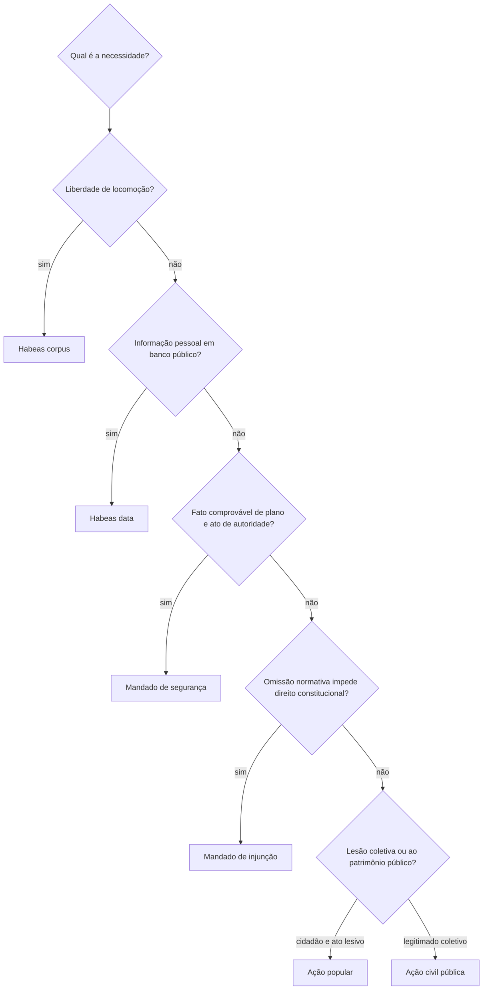

O controle judicial oferece uma via para proteger direitos contra ilegalidade e abuso de poder na Administração. Ele não transforma o juiz em gestor: a atuação jurisdicional verifica se a decisão respeita a Constituição, as leis e os princípios, sem substituir a escolha legítima de conveniência administrativa. Entre seus instrumentos, o mandado de segurança merece atenção especial por exigir prova documental pronta, ter hipóteses próprias de cabimento e não servir como ação de cobrança. O capítulo também diferencia a ação popular, a ação civil pública, o mandado de injunção, o habeas data e a ação de improbidade.

> [!objetivos]
> - Definir os limites do controle judicial de atos administrativos.
> - Identificar os pressupostos, legitimados e hipóteses de não cabimento do mandado de segurança.
> - Distinguir mandado de segurança individual e coletivo.
> - Escolher entre os principais instrumentos judiciais de controle.

## Alcance do controle judicial

O controle judicial dos atos administrativos depende de provocação: o Judiciário não inicia, por conta própria, a revisão de todo ato que considere irregular. Uma vez provocado, pode examinar legalidade e legitimidade, o que inclui observância de moralidade, razoabilidade, proporcionalidade, finalidade e devido processo. Ato discricionário também se sujeita a essa análise. O que o juiz não pode fazer é substituir, sem vício jurídico, a avaliação de conveniência e oportunidade atribuída à autoridade competente.

Atos políticos, legislativos e interna corporis têm tratamento próprio. Atos políticos decorrem diretamente de competências constitucionais de alta direção e admitem controle judicial quando ultrapassam limites jurídicos, não apenas por discordância com sua conveniência. A validade de lei se discute pelos meios de controle de constitucionalidade apropriados; uma ação comum não vira ação direta. Atos interna corporis são decisões internas das Casas Legislativas, como eleição de mesa, e em regra não são reexaminados quanto à interpretação regimental, salvo ofensa à Constituição, à lei ou às próprias regras regimentais que autorize controle.

> [!pegadinha]
> Não são corretas as afirmações de que todo ato discricionário escapa ao Judiciário ou de que o juiz pode refazer o mérito administrativo. O controle alcança juridicidade e limites da discricionariedade.

## Mandado de segurança individual

O mandado de segurança protege direito líquido e certo diante de ilegalidade ou abuso de poder praticado por autoridade pública ou por agente de pessoa jurídica no exercício de atribuição pública. A Constituição o torna residual: não cabe quando a tutela adequada for habeas corpus, que protege liberdade de locomoção, ou habeas data, que permite conhecer ou retificar dados pessoais em registros públicos. A Lei 12.016/2009 disciplina o procedimento.

Direito líquido e certo é aquele cujos fatos relevantes podem ser comprovados desde o início por prova pré-constituída. Não há fase ampla de instrução para ouvir testemunhas ou produzir perícia. A exigência se refere à prova dos fatos, não à simplicidade do debate jurídico: controvérsia de direito não impede o mandado, conforme a Súmula 625 do STF. Se documento essencial estiver em órgão público ou em poder de autoridade que se recuse a fornecê-lo, a Lei do Mandado de Segurança prevê que o juiz determine sua exibição, com prazo legal de dez dias (art. 6º, § 1º).

Abuso de poder é atuação administrativa além dos limites jurídicos e pode aparecer como excesso de poder, quando o agente extrapola sua competência, ou desvio de poder, quando usa competência formal para finalidade incompatível com a lei. Os requisitos essenciais são: ato ou omissão de autoridade, ilegalidade ou abuso, ameaça ou lesão a direito subjetivo e possibilidade de demonstrar os fatos documentalmente. Se o caso depende de instrução probatória extensa, a ação comum tende a ser adequada.

O mandado repressivo busca afastar lesão já produzida, como invalidar punição ilegal ou fazer cessar restrição indevida. Também pode combater omissão que viola direito comprovável, com pedido para que a autoridade decida ou pratique ato devido. O mandado preventivo visa impedir ameaça concreta e iminente: não basta receio abstrato; devem existir elementos que indiquem probabilidade de lesão. Em ambas as formas, a ordem judicial pode determinar que a autoridade faça ou deixe de fazer algo. Descumprir decisão concessiva pode configurar crime de desobediência, nos termos da Lei 12.016/2009, art. 26.

> [!exemplo]
> Uma bombeira reúne certidão de tempo de serviço e comprovante de protocolo, mas a autoridade deixa de analisar pedido que, por norma, deveria ser apreciado. Se os fatos estão documentados, ela pode pedir que a autoridade profira decisão; a ordem não obriga o juiz a conceder o benefício sem examinar os requisitos.

O prazo para impetrar é decadencial de cento e vinte dias, contado da ciência do ato impugnado, conforme art. 23 da Lei 12.016/2009. A regra deve ser aplicada à impugnação do ato concreto e não converte mandado de segurança em recurso administrativo. O prazo é importante mesmo quando há pedido de reconsideração: não presuma que a provocação administrativa suspenda ou reinicie a contagem sem base legal.

> [!atencao]
> O prazo de 120 dias é decadencial para o uso do mandado de segurança. Não confunda com o prazo de recurso administrativo, nem conte automaticamente da resposta a pedido de reconsideração.

## Legitimidade e autoridade coatora

Pode impetrar quem sofre ou teme sofrer violação a direito próprio, pessoa física ou jurídica. A lei também reconhece a legitimidade de universalidades sem personalidade jurídica plena em certas situações, como espólio e massa falida, para defender direito próprio. Órgãos públicos independentes ou autônomos podem usar o mandado para proteger suas competências e prerrogativas, e agentes políticos podem fazê-lo para defender atribuições institucionais. Havendo vários titulares do mesmo direito, qualquer um pode impetrar nos termos da lei.

Autoridade coatora é quem praticou o ato ou de quem emanou a ordem para sua prática, com poder de decisão. O mero executor material não é, em regra, a autoridade a apontar. Se o ato foi praticado por delegação, a Súmula 510 do STF indica como responsável a autoridade delegada. Em ato complexo, podem figurar as autoridades cujas manifestações formaram a decisão; em ato de órgão colegiado, deve-se observar quem o representa segundo a lei e a jurisprudência aplicável.

A lei equipara a autoridade os representantes de partido político e dirigentes de autarquia também são equiparados à autoridade, assim como dirigentes de pessoas jurídicas ou pessoas naturais quando exerçam atribuições do Poder Público. Isso não significa que qualquer ato de empresa estatal ou concessionária possa ser impugnado por mandado de segurança. A Lei 12.016/2009, art. 1º, § 2º, exclui atos de gestão comercial de empresas públicas, sociedades de economia mista e concessionárias. O mandado é possível quando a atuação se liga a função pública delegada, como procedimento de licitação, e não quando se trata de relação comercial comum.

| Situação | Pode caber MS? | Razão |
| --- | --- | --- |
| Autoridade decide direito funcional com prova pré-constituída | Sim, em tese | Há ato público e direito individual demonstrável |
| Empregado de estatal contesta negativa comercial de financiamento | Em regra, não | Ato de gestão comercial excluído pela lei |
| Concessionária pratica ato relacionado ao serviço delegado | Pode caber | O ato precisa decorrer da atribuição pública delegada |
| Servidor apenas cumpre ordem de superior | Contra o decisor | O executor sem poder decisório não é coator |
| Ato por competência delegada | Contra o delegado | Súmula 510 do STF |

> [!pegadinha]
> A natureza pública ou privada do empregador não resolve, sozinha, o cabimento. O ponto é se o agente estava exercendo atribuição pública e se o ato não está na exclusão de gestão comercial.

## Vedações ao mandado de segurança

A Lei 12.016/2009 impede mandado de segurança contra ato passível de recurso interno que suspenda seus efeitos, ainda que não haja caução; decisão judicial sujeita a recurso com efeito suspensivo; e decisão judicial transitada em julgado. No primeiro caso, a vedação busca evitar uso simultâneo de duas vias com efeito suspensivo, não exige esgotar todos os recursos administrativos. Nos casos judiciais, a existência de recurso suspensivo ou a coisa julgada delimitam a via adequada. Terceiro prejudicado, que não integrou a relação processual, pode ter situação própria.

Também não cabe mandado de segurança contra lei em tese (Súmula 266 do STF), porque norma geral e abstrata não é, por si, ato concreto que viole direito individual. A constitucionalidade pode ser discutida incidentalmente quando houver ato concreto e o pedido principal proteger direito subjetivo; não se usa o mandado como substituto de ação direta. Se um ato tiver forma de decreto mas efeitos concretos e individualizados, a análise é outra: a natureza material do ato, e não o rótulo, orienta o cabimento.

O mandado não substitui ação de cobrança. Pelas Súmulas 269 e 271 do STF, a segurança não funciona como ação para receber parcelas vencidas antes da impetração; valores pretéritos devem ser buscados em via própria. Tampouco substitui ação popular (Súmula 101) para tutela geral do patrimônio público. O mandado protege direito líquido e certo do impetrante e produz ordem mandamental; a ação popular permite ao cidadão questionar ato lesivo a bens públicos ou outros interesses constitucionalmente protegidos.

> [!exemplo]
> Se uma agente pede em agosto que cesse uma retenção ilegal e ganha o mandado, o provimento não converte automaticamente o processo em ação de cobrança de todas as parcelas desde janeiro. Os atrasados exigem requerimento e ação próprios, conforme o caso.

> [!bizu]
> Para checar cabimento: direito individual + ato concreto + autoridade + prova pronta + residualidade. Depois procure as vedações: recurso suspensivo, coisa julgada, lei em tese, gestão comercial e pedido de cobrança.

## Mandado de segurança coletivo

A Constituição autoriza mandado coletivo por partido político com representação no Congresso Nacional, organização sindical, entidade de classe e associação constituída e em funcionamento há pelo menos um ano, para defesa de interesses de seus integrantes ou associados. O requisito anual é expresso para a associação. A Lei 12.016/2009 delimita os direitos coletivos e individuais homogêneos que podem ser defendidos: direitos indivisíveis de grupo ou categoria ligados por relação jurídica básica e direitos individuais de origem comum ligados à atividade ou situação do conjunto ou de parte dos membros.

O legitimado atua como substituto processual: apresenta a ação em nome próprio para defender direitos alheios pertencentes ao grupo representado. Isso distingue o mandado coletivo da representação processual comum. A entidade de classe não depende de autorização expressa de cada associado para impetrar em defesa da categoria (Súmula 629). Também pode defender apenas parte da categoria quando a pretensão não atingir todos os integrantes (Súmula 630). Os demais requisitos do mandado, como direito líquido e certo e prova pré-constituída, continuam relevantes.

| Legitimado coletivo | Requisito central | Alcance típico |
| --- | --- | --- |
| Partido político | Representação no Congresso Nacional | Direitos relacionados ao grupo político, nos limites legais |
| Sindicato | Organização sindical | Direitos de membros da categoria |
| Entidade de classe | Representação da categoria | Direito comum da categoria ou de parte dela |
| Associação | Constituição e funcionamento por ao menos um ano | Interesses de associados nos limites de sua finalidade |

> [!pegadinha]
> A exigência de um ano não deve ser estendida automaticamente a sindicatos e entidades de classe. A súmula do STF também afasta a exigência de autorização individual dos associados.

## Ação popular e ação civil pública

A ação popular pode ser proposta por cidadão, isto é, pessoa em gozo de direitos políticos, para pedir que se invalide ato prejudicial às finanças públicas, às entidades com participação estatal, à probidade, à natureza ou aos bens históricos e culturais. O autor, salvo comprovada má-fé, fica isento de custas e do ônus da sucumbência. Seu objeto é a tutela de interesses públicos enumerados constitucionalmente; não exige que o cidadão demonstre direito individual próprio violado.

A ação civil pública permite responsabilização por danos morais e patrimoniais a interesses difusos e coletivos indicados na Lei 7.347/1985, incluindo meio ambiente, consumidor, patrimônio público e social, ordem econômica e urbanística, e bens de valor artístico, estético, histórico, turístico e paisagístico. A lei confere legitimidade ao Ministério Público, Defensoria, entes federativos e entidades da Administração Indireta; associações podem atuar quando cumpridos os requisitos legais de tempo de constituição e finalidade institucional. A legitimidade é coletiva e não se confunde com a legitimidade individual do mandado de segurança.

> [!lei] Constituição, art. 5º, LXXIII
> A ação popular é instrumento do cidadão para pedir anulação de ato lesivo a bens e valores públicos indicados na Constituição; salvo má-fé, não o sujeita a custas e sucumbência.

## Outros instrumentos judiciais

Mandado de injunção é cabível quando falta norma regulamentadora e essa omissão torna inviável exercer direito ou liberdade constitucional ou prerrogativa ligada à nacionalidade, soberania ou cidadania. A Lei 13.300/2016 disciplina o processo e prevê que a decisão pode estabelecer condições para o exercício do direito enquanto persistir a omissão, conforme os limites do caso e a eficácia subjetiva prevista na lei.

Habeas data dá acesso a informações relativas à própria pessoa em registros ou bancos de dados governamentais ou de caráter público e permite retificação de dados. Para ajuizar, é necessário demonstrar recusa ou demora administrativa nos casos definidos em lei; não é exigido percorrer todos os recursos administrativos. Ação de improbidade administrativa é instrumento judicial de responsabilização por atos definidos na Lei 8.429/1992, observada sua redação atual após a Lei 14.230/2021. A lei exige conduta dolosa para os atos de improbidade e prevê categorias de enriquecimento ilícito, dano ao erário e atentado contra princípios, com tipos e sanções próprios. A improbidade não é rótulo para qualquer irregularidade ou ilegalidade administrativa.

| Instrumento | O que protege | Legitimidade ou requisito que diferencia |
| --- | --- | --- |
| Mandado de segurança | Direito líquido e certo individual ou coletivo | Prova pré-constituída; autoridade ou função pública |
| Ação popular | Patrimônio público, moralidade, ambiente e patrimônio cultural | Cidadão; ato lesivo; salvo má-fé, sem custas e sucumbência |
| Ação civil pública | Interesses difusos e coletivos da Lei 7.347/1985 | Legitimados legais, como MP, Defensoria, entes e associações qualificadas |
| Mandado de injunção | Exercício de direito inviabilizado por omissão normativa | Falta de norma regulamentadora com nexo de inviabilidade |
| Habeas data | Informação ou retificação sobre o próprio impetrante | Recusa ou demora administrativa demonstrada |
| Ação de improbidade | Responsabilização por ato doloso tipificado em lei | Ato definido na Lei 8.429/1992, com requisitos e sanções vigentes |

> [!atencao]
> Após a Lei 14.230/2021, a improbidade administrativa exige dolo nos termos da lei vigente. Ilegalidade ou falha administrativa, sem o elemento subjetivo e os demais requisitos do tipo, não basta para caracterizar improbidade.

### Como escolher a via e delimitar o pedido

A escolha do instrumento começa pela natureza do interesse e pela prova disponível. O mandado de segurança é adequado quando alguém tem direito demonstrável por documentos e precisa impedir ou corrigir ato de autoridade. A ação popular é adequada quando cidadão busca desconstituir ato lesivo a bens e valores coletivos indicados pela Constituição. A ação civil pública tem legitimados próprios e tutela direitos difusos ou coletivos. O mandado de injunção enfrenta omissão normativa que impede o exercício de direito constitucional; não serve para impugnar qualquer atraso administrativo. O habeas data se volta a dados do próprio impetrante e pressupõe resistência ao pedido.

Um pedido bem delimitado identifica o ato ou a omissão, a autoridade responsável, o direito que se busca proteger e o resultado judicial pretendido. No mandado de segurança, não basta afirmar que o procedimento foi injusto: é preciso indicar fato comprovável de plano e explicar como a norma gera a posição jurídica do impetrante. Se a controvérsia depende de testemunhas, perícia ou reconstrução de fatos complexos, o rito mandamental pode não permitir solução adequada. Uma ação comum pode oferecer a fase de prova necessária.

> [!exemplo]
> Uma servidora recebe ordem escrita de remoção para localidade que a norma protege contra transferência durante determinado tratamento, e já possui laudos e ato de remoção. O mandado de segurança pode ser considerado se os documentos demonstrarem os fatos e a regra aplicável. Se a controvérsia depender de perícia sobre a condição médica e de depoimentos para reconstruir a motivação, pode ser necessária ação com instrução probatória.

O caráter preventivo exige ameaça objetiva. Uma previsão legal que talvez venha a ser aplicada, sem fato individual que indique risco atual, pode ser apenas lei em tese. Em sentido contrário, quando uma autoridade anunciou formalmente que praticará ato obrigatório ao constatar situação concreta, o risco pode ser iminente. O impetrante precisa distinguir receio subjetivo de ameaça baseada em fatos, atos preparatórios ou procedimento já em curso.

A omissão administrativa requer cuidado parecido. Em regra, o Judiciário pode ordenar que a Administração examine pedido dentro de prazo razoável, mas isso não significa que o juiz deva decidir o conteúdo discricionário da solicitação. Se a lei prevê que o pedido será deferido automaticamente ao cumprir condições objetivas, a análise pode ter conteúdo diferente; ainda assim, a ordem judicial deve respeitar a competência administrativa e os documentos do processo.

> [!atencao]
> Direito líquido e certo não é uma etiqueta para direito que parece justo. É necessário que os fatos essenciais possam ser provados na inicial; a discussão jurídica pode ser complexa, mas não deve depender de instrução sobre fatos.

### Alcance dos instrumentos coletivos

A substituição processual no mandado de segurança coletivo simplifica a defesa de direitos comuns, mas não dispensa a correspondência entre o legitimado e o grupo protegido. O partido deve atender ao requisito constitucional de representação no Congresso. Sindicato e entidade de classe defendem interesses relacionados às categorias. Associação atua dentro dos interesses de seus associados e de sua finalidade, observando o requisito de funcionamento anual previsto na Constituição. A lei determina o alcance subjetivo da coisa julgada e os procedimentos de habilitação quando necessários.

A ação civil pública também depende de legitimidade legal e pertinência temática. Associação não pode ajuizar ação sobre qualquer assunto apenas por ser pessoa jurídica: deve satisfazer os requisitos de constituição e ter finalidade institucional relacionada à tutela buscada. Ministério Público, Defensoria, entes federativos e determinadas entidades públicas têm legitimidade prevista em lei. A escolha do autor importa porque a demanda pode atingir direitos de pessoas que não assinaram a petição inicial.

A ação popular pertence ao cidadão, não a qualquer residente ou pessoa jurídica. A condição de cidadania se comprova pelos meios adequados, e o objetivo deve ter relação com os bens protegidos. O cidadão não precisa provar prejuízo individual: o interesse é coletivo. A isenção de custas e sucumbência protege quem age de boa-fé; comprovada má-fé, a exceção constitucional permite responsabilização por despesas.

> [!pegadinha]
> Na ação popular, a legitimidade é do cidadão e o interesse protegido é coletivo. Na ação civil pública, a legitimidade segue a lista legal e os requisitos específicos de cada autor; não se exige cidadania individual.

O mandado de injunção recebeu disciplina legal que permite ao juiz fixar condições para exercício do direito enquanto não houver norma, quando isso for indispensável e na extensão adequada ao caso. A decisão pode estabelecer prazo para elaboração da norma e prever consequências se a omissão persistir. Essa solução não equivale a o Judiciário legislar em caráter geral: a lei define o modo de concretizar a proteção e o alcance dos efeitos. Para identificar cabimento, pergunte se há omissão normativa, se existe direito constitucional inviabilizado e se a falta da norma é causa da impossibilidade de exercício.

> [!bizu]
> Segurança: direito comprovável e ato de autoridade. Popular: cidadão e lesão a bem coletivo. Civil pública: legitimado legal e dano difuso ou coletivo. Injunção: direito constitucional travado por falta de norma. Habeas data: dado pessoal e recusa de acesso ou correção.

### Revisão judicial e limites da prova

O juiz pode invalidar um ato quando a Administração ignora competência, finalidade, forma essencial, pressuposto fático ou norma aplicável. Em sanção disciplinar, também pode verificar se houve defesa e se a pena mantém proporcionalidade manifesta. O Judiciário não reabre o processo para escolher a sanção que lhe parece ideal sem vício relevante. A Súmula 665 do STJ resume essa contenção, admitindo intervenção em situações excepcionais de ilegalidade evidente, teratologia ou desproporcionalidade manifesta.

Em concurso, o controle judicial pode corrigir afronta direta ao edital ou à Constituição, mas não reavaliar respostas como uma banca recursal. Na heteroidentificação, o candidato pode questionar falta de contraditório e ampla defesa, e a comissão deve seguir parâmetros previamente divulgados e respeitar dignidade. A revisão judicial não deve substituir, sem ilegalidade, a avaliação factual feita pela comissão conforme o edital.

A autoridade coatora é importante também para a competência judicial: o cargo e a esfera a que pertence podem indicar qual órgão do Judiciário deve processar o caso. Por isso, identifique quem praticou ou ordenou a conduta e verifique se agiu em nome próprio, por delegação ou como membro de órgão colegiado. A indicação errada pode gerar correção do polo passivo ou extinção, conforme a situação processual. O advogado deve examinar o ato, o processo administrativo e as normas de delegação antes de protocolar.

O pedido deve buscar providência compatível com a natureza da lesão. Contra ato concreto lesivo, pode-se pedir sua invalidação; contra omissão, que a autoridade aprecie o requerimento ou pratique ato vinculado; diante de ameaça concreta, que se abstenha de realizar a conduta ilegal. Não se deve pedir ao juiz que conceda vantagem sem verificar seus requisitos ou que substitua escolha administrativa válida. A adequação do pedido evita que uma tese juridicamente correta fracasse por tentar obter resultado incompatível com o instrumento escolhido.

> [!atencao]
> Mandado de segurança não é recurso universal contra toda decisão desfavorável. Prazo decadencial, prova pré-constituída, indicação da autoridade e natureza do pedido precisam ser verificados conjuntamente.
## Mapa do capítulo

### Para fixar
- Controle judicial exige provocação e examina legalidade e legitimidade, inclusive dos atos discricionários.
- Mandado de segurança protege direito líquido e certo com prova pré-constituída e é residual a habeas corpus e habeas data.
- Controvérsia jurídica não impede MS se os fatos estiverem comprovados (Súmula 625 do STF).
- O prazo para impetração é decadencial de 120 dias, da ciência do ato (Lei 12.016, art. 23).
- Autoridade coatora é quem decide ou ordena; em competência delegada, aponta-se o delegado (Súmula 510).
- Não cabe MS contra lei em tese, como cobrança, nem nas hipóteses de recurso suspensivo e coisa julgada.
- No mandado coletivo, associação precisa de um ano; entidade de classe não precisa de autorização individual (Súmula 629).
- A ação popular é do cidadão; a ação civil pública é proposta pelos legitimados da Lei 7.347/1985.
- Improbidade exige dolo conforme a Lei 8.429/1992 vigente após a Lei 14.230/2021.

