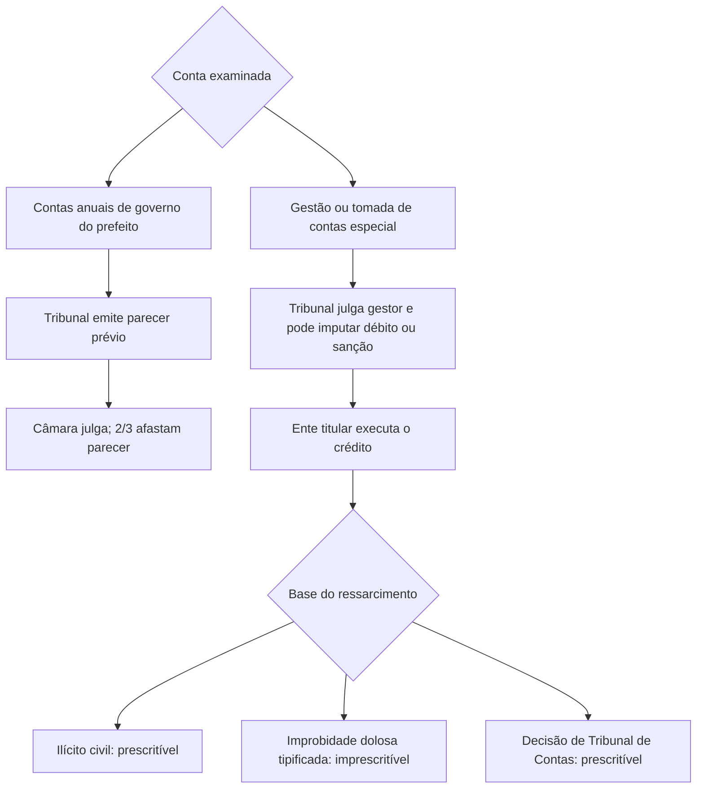

Este capítulo reúne teses judiciais que refinam as regras gerais de controle administrativo, especialmente a competência dos Tribunais de Contas e os limites da revisão judicial. Para estudar, separe os temas por pergunta: quem julga as contas do prefeito, quem executa a decisão do Tribunal, quando a pretensão prescreve e até onde o Judiciário pode intervir. A jurisprudência recente também trata de acesso prévio à via administrativa, heteroidentificação e organização das Cortes de Contas estaduais.

> [!objetivos]
> - Distinguir contas de governo e contas de gestão de prefeito.
> - Identificar quem julga contas, executa multas e débitos e em que hipóteses há prescrição.
> - Reconhecer quando a Administração pode exigir provocação administrativa prévia.
> - Aplicar limites judiciais a políticas públicas, concursos e controle disciplinar.
> - Conhecer regras de composição e autonomia institucional dos Tribunais de Contas.

## Enunciados sobre garantias e controle

A Súmula Vinculante 3 do STF assegura contraditório e ampla defesa em processos no Tribunal de Contas da União quando a decisão puder cancelar ou retirar ato que beneficie o interessado. A ressalva é o exame da legalidade da concessão inicial de aposentadoria, reforma ou pensão. A Súmula Vinculante 21 impede condicionar recurso administrativo a depósito ou arrolamento prévios. A primeira trata de garantias em processo de controle; a segunda garante acesso ao recurso sem garantia pecuniária antecipada.

A Súmula 347 do STF reconhece que Tribunais de Contas podem apreciar constitucionalidade no exercício de suas atribuições. Após o julgamento do MS 25.888, a compreensão deve ser delimitada: a Corte de Contas pode afastar incidentalmente aplicação de norma em caso concreto quando houver jurisprudência do STF que oriente o tema. Não pode retirar a validade da lei em abstrato nem estabelecer decisão geral vinculante.

A Súmula 473 do STF resume autotutela: anulação de ato ilegal, revogação de ato válido por conveniência e oportunidade, respeito aos direitos adquiridos e ressalva da apreciação judicial. A Súmula 665 do STJ afirma que o controle judicial do processo administrativo disciplinar examina a regularidade do procedimento e a legalidade da decisão, sem reavaliar ordinariamente o mérito administrativo; há exceção diante de ilegalidade flagrante, teratologia ou sanção manifestamente desproporcional.

> [!pegadinha]
> Súmula Vinculante 3 não elimina o contraditório em toda situação de registro inicial de benefício. A exceção recai sobre a apreciação inicial de legalidade da aposentadoria, reforma ou pensão; não abrange qualquer revisão posterior de ato favorável.

## Contas de governo e contas de gestão de prefeitos

Contas de governo são anuais e retratam a atuação global do chefe do Executivo: orçamento, metas, limites fiscais e resultados gerais. O Tribunal de Contas examina e emite parecer prévio; a Câmara Municipal julga. Para fins eleitorais, o parecer só deixa de prevalecer por decisão de dois terços dos vereadores (RE 848.826, Tema 835). O parecer tem natureza opinativa e não há julgamento ficto por decurso de prazo (RE 729.744, Tema 157). Se o Tribunal se omite e não emite parecer no prazo, a omissão não impede a Câmara de exercer a competência de julgamento (ADPF 366/AL, 2025).

Contas de gestão se relacionam com atos concretos de administração de recursos, como empenhar, liquidar, pagar ou fiscalizar contrato. Se o prefeito atua como ordenador de despesas, o Tribunal de Contas pode julgar essas contas, imputar débito e aplicar sanções administrativas, sem necessidade de ratificação pela Câmara. A competência municipal da Câmara permanece para a finalidade eleitoral da Lei Complementar 64/1990. A ADPF 982, julgada em 2025, consolidou essa divisão entre responsabilização técnica por atos de gestão e julgamento político para efeitos eleitorais.

| Tipo de conta | Conteúdo típico | Tribunal de Contas | Câmara Municipal |
| --- | --- | --- | --- |
| Governo | Execução anual, metas e equilíbrio geral | Emite parecer prévio | Julga; decisão de 2/3 afasta o parecer para fins eleitorais |
| Gestão | Atos de ordenação e aplicação de recursos | Julga; pode imputar débito e aplicar sanção | Mantém competência eleitoral nos limites constitucionais |

O Tribunal também pode condenar administrativamente chefes do Executivo em tomada de contas especial relacionada a convênio interfederativo quando demonstrada responsabilidade pessoal. No Tema 1.287 (ARE 1.436.197), o STF afastou a exigência de aprovação posterior pelo Legislativo para que o Tribunal impute débito ou multa. Essa hipótese não deve ser confundida com o parecer anual sobre contas de governo.

> [!exemplo]
> Se a prefeita entrega relatório anual de execução orçamentária, trata-se de contas de governo, sujeitas a parecer técnico e julgamento pela Câmara. Se ela ordenou pagamentos irregulares em convênio e a fiscalização apura sua responsabilidade individual, a tomada de contas especial pode ser julgada pelo Tribunal, sem votação posterior de ratificação.

> [!atencao]
> O parecer prévio não é sentença de Tribunal de Contas e não torna o julgamento da Câmara dispensável para a consequência eleitoral. Por outro lado, a competência da Câmara para contas de governo não imuniza o prefeito que, como gestor, responde por atos concretos de aplicação de recursos.

## Contas de outras autoridades e registro de pessoal

Como regra, o Tribunal de Contas julga contas dos administradores e responsáveis por recursos públicos. O STF afastou a leitura da Lei de Responsabilidade Fiscal que previa parecer prévio para contas de outros Poderes e órgãos autônomos, para além do chefe do Executivo (ADI 2.238). A lei estadual pode atribuir ao Legislativo o julgamento das contas do próprio Tribunal de Contas que o auxilia, observada a Constituição (ADI 1.175); não pode deslocar para o Legislativo o julgamento técnico das contas dos demais Poderes.

No registro inicial de aposentadoria, reforma ou pensão, o Tribunal de Contas dispõe de cinco anos desde a chegada do processo à Corte para apreciar a legalidade, conforme Tema 445 do STF (RE 636.553). Decorrido esse período, a segurança jurídica e a confiança legítima limitam a revisão tardia. A negativa de registro de admissão de pessoal é competência técnica e não se subordina à revisão pela Assembleia Legislativa (Tema 47, RE 576.920).

> [!bizu]
> Chefe do Executivo anual: parecer do Tribunal e julgamento político. Gestores, dirigentes e demais responsáveis: julgamento pelo Tribunal. Registro inicial de inatividade: prazo de cinco anos desde a chegada do processo à Corte.

## Execução de decisões e prescrição

Decisão de Tribunal de Contas que imputa débito ou multa tem eficácia de título executivo, mas não é o próprio Tribunal que ajuíza a execução. O ente público beneficiário cobra o crédito por seus procuradores; nem o Tribunal nem o Ministério Público de Contas têm legitimidade para propor a cobrança em nome próprio (RE 223.037). Essa separação preserva a titularidade do crédito e segue o modelo constitucional de controle externo.

Quando Tribunal de Contas estadual aplica sanção a agente municipal, a origem do crédito define o legitimado. Se houve dano ao erário municipal e a decisão impôs ressarcimento e multa proporcional ao dano, o Município é o beneficiário e propõe a execução. Se se trata de multa simples por violação a deveres de direito financeiro ou de colaboração com fiscalização estadual, a cobrança compete ao Estado. A ADPF 1.011/PE fixou essa distinção.

As pretensões de ressarcimento não são todas imprescritíveis. O STF assentou que reparação de dano causado por ilícito civil é prescritível (Tema 666). A imprescritibilidade reconhecida pelo Tema 897 fica restrita a ressarcimento fundado em ato doloso de improbidade tipificado na Lei 8.429/1992. Já a pretensão de ressarcimento apoiada em decisão de Tribunal de Contas prescreve (Tema 899, RE 636.886), pois o processo de contas apura tecnicamente o dano, sem julgar se houve improbidade dolosa. O prazo e os marcos de cobrança devem ser avaliados segundo a Lei de Execução Fiscal e a situação processual concreta.

| Fundamento do ressarcimento | Regra de prescrição fixada pelo STF |
| --- | --- |
| Ilícito civil | Prescritível (Tema 666) |
| Ato doloso de improbidade tipificado em lei | Imprescritível (Tema 897) |
| Acórdão de Tribunal de Contas | Prescritível (Tema 899) |

> [!pegadinha]
> Não basta haver dano ao erário para invocar imprescritibilidade. É necessário que a pretensão esteja fundada em ato doloso de improbidade nos termos estritos do Tema 897; débito imputado em julgamento de contas é prescritível.

## Acesso ao Judiciário e limites de revisão

A Constituição adota como regra que lesão ou ameaça a direito pode ser levada diretamente ao Judiciário, sem esgotamento da via administrativa. Há exceções expressas ou jurisprudenciais delimitadas. A Justiça desportiva deve ser acionada antes da Justiça comum nos litígios da disciplina e competições desportivas, nos limites do art. 217, § 1º. Reclamação ao STF por violação a súmula vinculante contra ato administrativo exige esgotamento das vias administrativas (Lei 11.417/2006, art. 7º, § 1º). Em matéria previdenciária, o requerimento prévio é necessário para caracterizar resistência administrativa, ressalvadas situações em que a posição do órgão já demonstra negativa ou demora relevante (RE 631.240). O STJ aplicou raciocínio semelhante à cobrança de DPVAT (REsp 1.987.853/PB).

No habeas data, o interessado deve demonstrar recusa ou demora da Administração em conhecer ou retificar dados, conforme a Lei 9.507/1997, art. 8º; não precisa esgotar recursos. A exigência é de resistência administrativa comprovável, e não de percorrer toda a cadeia hierárquica.

O Judiciário pode intervir em política pública quando houver ausência ou deficiência grave na prestação de direito fundamental, sem ofensa automática à separação de Poderes. No Tema 698 (RE 684.612), o STF indicou que, em regra, a decisão deve estabelecer finalidade a alcançar e determinar que a Administração apresente plano ou meios adequados, em vez de escolher medidas pontuais sem consideração técnica. Em saúde, falta de profissionais pode ser enfrentada por concurso, remanejamento ou formas legais de contratação.

Em concursos, o Tema 485 impede que o juiz substitua banca para reexaminar respostas e critérios de correção, salvo ilegalidade ou inconstitucionalidade, como cobrança fora do edital. Na heteroidentificação, o Tema 1.420 reconheceu controle judicial para assegurar contraditório e ampla defesa, sem reabrir livremente o juízo de fato e os critérios aplicados pela comissão. A ADC 41 reconheceu a constitucionalidade da reserva de vinte por cento das vagas e de critérios subsidiários de heteroidentificação, com respeito à dignidade e às garantias processuais.

> [!exemplo]
> Se candidato demonstra que foi eliminado sem acesso aos fundamentos ou sem oportunidade de contestação, o Judiciário pode corrigir a violação ao contraditório. Se ele apenas discorda da avaliação fática feita conforme edital e procedimento regular, o juiz não refaz a banca.

## Organização e garantias de conselheiros

Em 2025, o STF admitiu análise prévia de seletividade de denúncias por Tribunal de Contas local, desde que os critérios observem o modelo do TCU e a simetria constitucional (ADI 7.459/ES). A seletividade ajuda a priorizar riscos, relevância, materialidade, gravidade, urgência e tendência. Não elimina dever de controle: organiza o uso de recursos de fiscalização segundo critérios normativos objetivos.

O controle externo e os sistemas de controle interno são horizontais e cooperativos. É inconstitucional norma que permita ao Tribunal de Contas dar ordens hierárquicas aos órgãos internos de outros Poderes para que façam auditorias (ADI 5.705/SC). As unidades internas apoiam o controle externo, mas permanecem vinculadas à estrutura de cada Poder.

A composição do TCU segue o art. 73: nove Ministros, dos quais um terço é escolhido pelo Presidente da República com aprovação do Senado, e dois terços pelo Congresso. Das três vagas presidenciais, duas são preenchidas, alternadamente, por auditores e por membros do Ministério Público junto ao Tribunal, a partir de lista tríplice elaborada pelo TCU; os Estados têm sete Conselheiros e observam a distribuição constitucional e jurisprudencial das vagas. Pela Súmula 653 do STF, quatro são escolhidos pela Assembleia Legislativa e três pelo governador, sendo uma vaga de livre escolha do governador e as demais destinadas a auditor e membro do Ministério Público de Contas.

O STF invalidou exigências locais de tempo mínimo de serviço no próprio Tribunal ou ausência de punição disciplinar para auditor substituir conselheiro, por falta de amparo no modelo federal (ADI 5.587/BA). Também afastou escolha secreta de lista tríplice em empate entre candidatos mais antigos quando incompatível com simetria e impessoalidade (ADI 5.276/PE). A Constituição estadual não pode criar infrações administrativas de conselheiro julgadas pela Assembleia com afastamento do cargo: a matéria invade competência da União sobre crimes de responsabilidade e processo e viola a vitaliciedade. O STJ tem competência para julgar conselheiros estaduais nos crimes comuns e de responsabilidade nos termos da Constituição (ADI 4.190/RJ; SV 46).

> [!atencao]
> As Cortes de Contas não são subordinadas aos órgãos de controle interno de outros Poderes, nem podem comandá-los como chefias. A cooperação decorre da Constituição; a hierarquia não.

### Instância administrativa de curso forçado

A garantia de acesso à Justiça significa que a Administração não pode, como regra, obrigar a pessoa a esgotar recursos internos antes de ajuizar ação. Requerimento prévio e esgotamento não são a mesma coisa: em algumas situações basta pedir inicialmente que o órgão reconheça a pretensão, sem percorrer todos os níveis recursais. Na matéria previdenciária, o requerimento prévio demonstra que existe resistência administrativa; não se exige novo requerimento quando o próprio órgão já firmou posição notória contrária ou quando o pedido se limita à revisão de benefício já concedido conforme os parâmetros do STF no RE 631.240.

A Constituição estabelece exceção para controvérsias disciplinares e competições desportivas: a Justiça comum só recebe a demanda depois das instâncias da justiça desportiva, observado o prazo constitucional de sessenta dias para decisão final (Constituição, art. 217, §§ 1º e 2º). A reclamação ao Supremo Tribunal Federal por violação de súmula vinculante exige esgotar as vias administrativas quando o ato questionado é administrativo. O habeas data requer demonstração de recusa ou demora no acesso, retificação ou anotação de informação; a lei não exige esgotamento recursal. O STJ também exige requerimento administrativo anterior em demandas de cobrança do seguro DPVAT, como regra, ressalvadas particularidades do caso.

| Hipótese | Exigência administrativa | Limite |
| --- | --- | --- |
| Ação judicial em geral | Nenhuma como regra | Ameaça ou lesão deve permitir tutela jurisdicional |
| Justiça desportiva | Esgotamento da instância desportiva | Prazo máximo constitucional de 60 dias para decisão final |
| Reclamação por violação de súmula vinculante | Esgotar a via administrativa contra ato administrativo | Regra legal sobre reclamação vinculante |
| Benefício previdenciário | Requerimento prévio, em regra | Resistência conhecida ou demora pode satisfazer a condição |
| Habeas data | Pedido e recusa ou demora comprovada | Não exige recorrer até a última instância |
| Cobrança de DPVAT | Requerimento prévio, em regra | Jurisprudência do STJ admite análise de peculiaridades |

> [!lei] Constituição, art. 217, § 1º
> Litígios sobre disciplina e competições desportivas devem passar primeiro pela justiça desportiva; o acesso ao Judiciário fica aberto depois de esgotada essa instância.
## Mapa do capítulo

### Para fixar
- SV 3 garante defesa em processo no TCU diante de retirada de ato favorável, ressalvado o registro inicial de aposentadoria, reforma ou pensão.
- Contas anuais do prefeito: parecer do Tribunal e julgamento da Câmara; parecer não gera julgamento ficto por silêncio.
- Prefeito ordenador de despesas pode ter contas de gestão julgadas pelo Tribunal, com débito e sanção fora da esfera eleitoral.
- O ente beneficiário executa o débito ou multa; multa simples aplicada a agente municipal beneficia o Estado.
- Ressarcimento por ilícito civil e decisão de Tribunal de Contas prescreve; improbidade dolosa tipificada é a exceção imprescritível.
- Pedido prévio é excepcional: justiça desportiva, reclamação contra ato administrativo que viole SV, previdência e DPVAT.
- O Judiciário controla garantias de heteroidentificação e legalidade de concurso, mas não substitui avaliação fática regular.
- Auditor pode substituir conselheiro sob os critérios constitucionais; Tribunal não comanda hierarquicamente controles internos de outros Poderes.
- Tribunal de Contas estadual tem sete conselheiros, com quatro indicações da Assembleia e três do governador.

