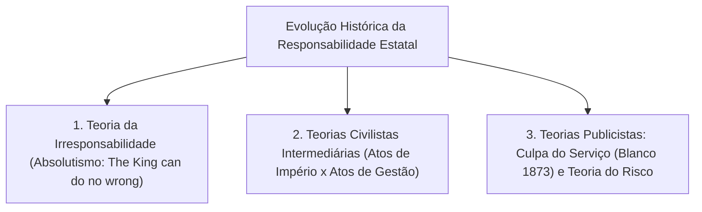
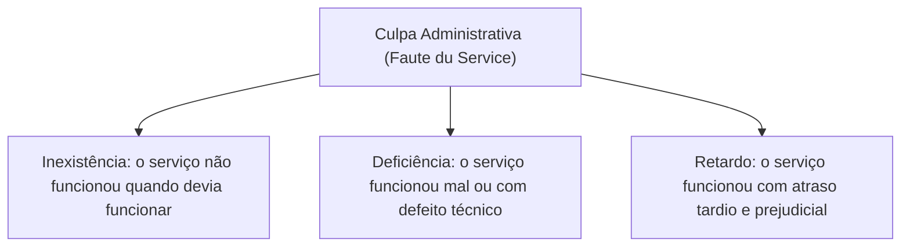
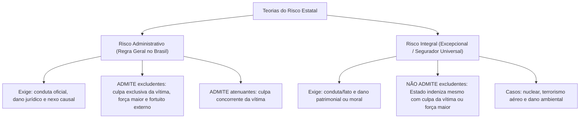
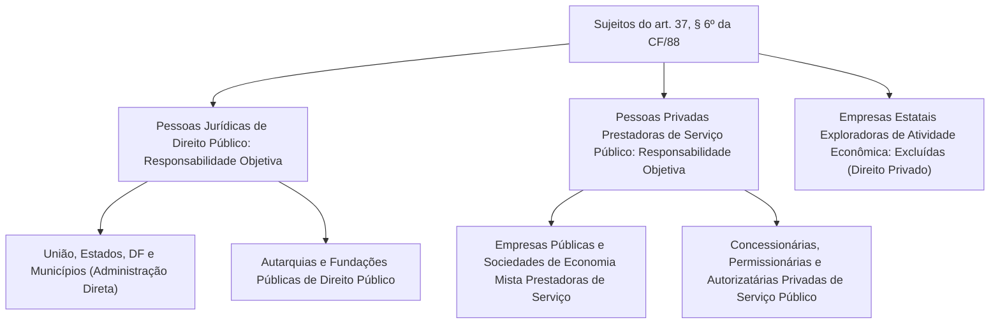

A responsabilidade civil extracontratual do Estado define a obrigação jurídica que compele a Administração Pública a reparar prejuízos econômicos e morais causados a particulares em decorrência de condutas lícitas ou ilícitas praticadas por seus agentes públicos no desempenho da função pública. O tema reflete a consagração do princípio da legalidade e a submissão do Estado de Direito à igualdade perante os encargos públicos.

> [!objetivos]
> - Compreender a evolução histórica da responsabilidade estatal, desde o absolutismo monárquico até o Estado Democrático.
> - Analisar as teorias civilistas e a superada distinção entre atos de império e atos de gestão.
> - Identificar a teoria da culpa administrativa (*faute du service*) e as três modalidades de falha do serviço.
> - Dominar a distinção dogmática entre a teoria do risco administrativo e a teoria do risco integral.
> - Delimitar a abrangência subjetiva do art. 37, § 6º, da CF/88, separando prestadoras de serviço público e empresas estatais econômicas.

## A evolução histórica da responsabilidade extracontratual estatal

O dever do Poder Público de indenizar os administrados por danos decorrentes de suas atividades é fruto de uma longa maturação política e jurídica. A doutrina clássica identifica três fases sucessivas ao longo da história:



### A fase da irresponsabilidade estatal

No Estado Absolutista dos séculos XVII e XVIII, vigorava o princípio da irresponsabilidade do soberano. Expressões consagradas na época traduziam essa imunidade régia, como *the King can do no wrong* (o rei não erra) na Inglaterra e *le Roi ne peut mal faire* na França. 

A soberania monárquica era considerada ilimitada e de origem divina. O monarca personificava a própria lei e a justiça. Qualquer lesão suportada pelo súdito decorrente de ordens reais era considerada uma fatalidade inevitável, inexistindo direito subjetivo à reparação pecuniária pelo erário.

### As teorias civilistas e a distinção entre império e gestão

Com a consolidação do Estado Liberal após a Revolução Francesa, a ideia de irresponsabilidade total tornou-se incompatível com as liberdades civis. Os juristas do século XIX buscaram construir fórmulas indenizatórias importando institutos do Direito Civil comum baseados na culpa subjetiva do agente.

Para harmonizar a autoridade pública com o dever de indenizar, a doutrina criou a distinção entre duas categorias de atos estatais:

| Categoria de Ato | Conceito e Natureza Jurídica | Regime de Responsabilidade Civil |
|---|---|---|
| **Atos de Império** (*jure imperii*) | Atos praticados pelo Estado com supremacia e prerrogativas soberanas coercitivas (ex.: desapropriação e segurança pública). | **Irresponsabilidade estatal**. O soberano não podia ser acionado civilmente. |
| **Atos de Gestão** (*jure gestionis*) | Atos negociais praticados pela Administração em pé de igualdade com os particulares (ex.: locação e alienação de bens). | **Responsabilidade subjetiva**. O Estado respondia se a vítima provasse a culpa do funcionário. |

Essa teoria revelou-se ineficaz e injusta na prática. Era extremamente difícil definir se determinado ato pertencia ao império ou à gestão. Ademais, exigir que a vítima identificasse o servidor público culpado em meio à engrenagem burocrática estatal gerava frequente impunidade.

### A teoria da culpa administrativa ou falta do serviço

O abandono definitivo das teorias civilistas ocorreu na França a partir do célebre **Caso Blanco**, julgado pelo Tribunal de Conflitos francês em 1873. A menina Agnès Blanco foi atropelada por um vagonete da fábrica estatal de tabaco em Bordeaux. O tribunal assentou que a responsabilidade estatal não pode ser regida pelos preceitos do Código Civil aplicáveis às relações entre particulares, reclamando normas autônomas de Direito Público.

Nasceu a teoria da **culpa administrativa**, também denominada *faute du service* ou culpa anônima do serviço público. A responsabilidade do Estado decorre da deficiência no funcionamento do serviço público, dispensando a identificação do agente individualmente causador do evento.

A doutrina divide a culpa do serviço em três modalidades:



1. **Omissão total**: o serviço não funcionou quando o ordenamento jurídico impunha a sua atuação.
2. **Deficiência operacional**: o serviço funcionou, porém de forma falha, perigosa ou defeituosa.
3. **Mora administrativa**: o serviço foi prestado com atraso tardio, acarretando lesão que teria sido evitada pela atuação oportuna.

> [!atencao]
> **Natureza subjetiva da culpa administrativa:** a teoria da culpa administrativa é de natureza **subjetiva**. Não se exige a prova do dolo ou da culpa pessoal de um funcionário específico, mas a vítima tem o ônus processual de provar a falha do serviço público prestado pelo Estado. Essa teoria é a regra adotada no Brasil para os danos decorrentes de **omissão genérica** da Administração.

## As teorias publicistas fundadas no risco

O desenvolvimento de atividades estatais complexas e a multiplicação de riscos para a coletividade impulsionaram o surgimento das teorias objetivas fundadas na ideia de **risco**.

A teoria objetiva dispensa por completo a investigação de dolo ou culpa. O dever indenizatório nasce do risco intrínseco gerado pelas atividades administrativas em benefício da comunidade. O fundamento moral repousa no **princípio da igualdade perante os encargos públicos**: se a atuação estatal beneficia toda a coletividade, as perdas extraordinárias sofridas por um cidadão específico devem ser rateadas por toda a sociedade mediante indenização suportada pelo erário.

A doutrina diferencia duas vertentes do risco: a teoria do risco administrativo e a teoria do risco integral.



### A teoria do risco administrativo: a regra geral brasileira

A teoria do risco administrativo condiciona o dever estatal de reparar à presença concomitante de três elementos objetivos:

- **Conduta estatal**: ação comissiva praticada por agente público atuando nessa qualidade.
- **Dano efetivo**: lesão patrimonial ou moral certa, anormal e específica a direito protegido da vítima.
- **Nexo de causalidade**: liame fático direto e imediato entre o comportamento do agente e o resultado lesivo.

A característica marcante do risco administrativo é que ele **admite causas excludentes e atenuantes de responsabilidade civil**. O Estado não atua como segurador universal. Se o Poder Público comprovar que o evento lesivo decorreu de culpa exclusiva da vítima, fato exclusivo de terceiro ou força maior inevitável, o nexo causal rompe-se, afastando o dever de indenizar. Havendo culpa concorrente da vítima, a indenização é reduzida proporcionalmente.

> [!bizu]
> **Mnemônico dos Elementos do Risco Administrativo:**
> Lembre-se do trinômio **C-D-N**:
> - **C**onduta oficial (ação do agente público nessa qualidade).
> - **D**ano efetivo (lesão patrimonial ou moral a direito juridicamente tutelado).
> - **N**exo causal (relação direta de causa e efeito entre a conduta e o dano).
> Demonstrados esses três elementos pelo lesado, nasce a obrigação estatal de indenizar, cabendo ao Poder Público o ônus de provar eventuais excludentes.

### A teoria do risco integral: modalidade extremada

A teoria do risco integral consagra a responsabilidade objetiva em sua forma mais rigorosa. O Estado obriga-se a indenizar o dano mesmo diante da ocorrência de caso fortuito, força maior ou culpa exclusiva do lesado. O nexo causal não pode ser elidido por nenhuma causa justificadora.

No ordenamento jurídico brasileiro, a teoria do risco integral é **excepcionalíssima**, incidindo apenas nas hipóteses expressamente fixadas na Constituição Federal e em leis especiais:

1. **Danos nucleares**: o art. 21, inciso XXIII, alínea *c*, da CF/88 estabelece que a responsabilidade civil por danos nucleares independe da existência de culpa, vigorando a teoria do risco integral.
2. **Atentados terroristas contra aeronaves brasileiras**: a Lei Federal nº 10.744/2003 assumiu a responsabilidade da União por danos a bens e pessoas decorrentes de atos de guerra ou atentados terroristas contra aeronaves de matrícula brasileira operadas por empresas nacionais.
3. **Danos ambientais**: a jurisprudência pacificada do Supremo Tribunal Federal e do Superior Tribunal de Justiça aplica a teoria do risco integral à reparação por degradação ao meio ambiente, com fundamento no art. 225, § 3º, da Carta Magna e no art. 14, § 1º, da Lei nº 6.938/1981.

> [!pegadinha]
> **Risco administrativo versus risco integral em provas:** as bancas examinadoras frequentemente afirmam que o Brasil adota a teoria do risco integral como regra geral. Essa afirmação é incorreta. A regra geral do ordenamento pátrio é a **teoria do risco administrativo**, consagrada no art. 37, § 6º, que admite excludentes de nexo de causalidade. O risco integral é restrito às hipóteses taxativas nucleares, ambientais e bélicas.

## A regra constitucional brasileira: o art. 37, § 6º, da CF/88

O art. 37, § 6º, da Constituição da República Federativa do Brasil de 1988 estabelece o preceito básico da responsabilidade extracontratual pública:

> [!lei] CF, art. 37, § 6º
> "§ 6º As pessoas jurídicas de direito público e as de direito privado prestadoras de serviços públicos responderão pelos danos que seus agentes, nessa qualidade, causarem a terceiros, assegurado o direito de regresso contra o responsável nos casos de dolo ou culpa."

A leitura desse dispositivo constitucional consagra postulados indispensáveis:



### Abrangência subjetiva das entidades responsáveis

A responsabilidade objetiva baseada no risco administrativo alcança duas categorias distintas de pessoas jurídicas:

- **Pessoas jurídicas de direito público**: abrange todas as entidades da administração pública direta (União, Estados-membros, Distrito Federal e Municípios) e as autarquias e fundações públicas de direito público da administração indireta.
- **Pessoas jurídicas de direito privado prestadoras de serviços públicos**: engloba tanto as entidades da administração indireta (empresas públicas e sociedades de economia mista que prestam serviços públicos, como a Empresa Brasileira de Correios e Telégrafos) quanto os delegatários particulares de serviços públicos (concessionárias de rodovias, empresas privadas de transporte coletivo urbano e distribuidoras de energia elétrica).

Por outro lado, as **empresas estatais exploradoras de atividade econômica** (empresas públicas e sociedades de economia mista que competem no mercado financeiro ou industrial, a exemplo do Banco do Brasil, Caixa Econômica Federal e Petrobras) **não se submetem à responsabilidade objetiva do art. 37, § 6º**. Conforme preceitua o art. 173, § 1º, inciso II, da Carta da República, essas empresas sujeitam-se ao regime jurídico próprio das empresas privadas, respondendo civilmente com base na teoria da culpa comum do Código Civil.

### O princípio da oficialidade da conduta

O preceito constitucional impõe que o dano seja praticado por agentes públicos **nessa qualidade**. A oficialidade da conduta significa que o servidor deve estar agindo no exercício de suas atribuições institucionais ou a pretexto de exercê-las. 

Se o agente público praticar a conduta em sua vida estritamente privada, desvinculado do cargo e sem utilizar recursos, armas ou prerrogativas estatais (por exemplo, disparar contra um desafeto pessoal por motivo fútil fora do horário de serviço e com arma particular), o Estado não responde pelo dano, recaindo a responsabilidade exclusivamente sobre a pessoa física do autor.

| Teoria da Responsabilidade | Exige Prova de Culpa? | Admite Excludentes? | Aplicação no Brasil |
|---|---|---|---|
| **Irresponsabilidade** | Não indeniza em hipótese alguma. | Não se aplica. | Fase absolutista superada no século XIX. |
| **Culpa Civilista** | Exige prova de culpa do agente. | Sim (regras do Código Civil). | Superada no Direito Administrativo moderno. |
| **Culpa Administrativa** | Exige prova de falha do serviço (*faute du service*). | Sim (caso fortuito e força maior). | Adotada nos danos por **omissão genérica** do Estado. |
| **Risco Administrativo** | **Não exige culpa**. Basta nexo e dano. | **Sim** (culpa da vítima, fortuito externo e força maior). | **Regra geral** das condutas comissivas (art. 37, § 6º). |
| **Risco Integral** | **Não exige culpa**. | **Não admite excludentes**. | Casos excepcionais: nuclear, ambiental e terrorismo aéreo. |

## Mapa do capítulo

```mermaid Síntese do Capítulo: Teorias da Responsabilidade Civil do Estado
flowchart TD
    M1["Evolução das Teorias"] --> M1A["Irresponsabilidade (Absolutismo)"]
    M1 --> M1B["Civilista da Culpa (Atos de Império x Gestão)"]
    M1 --> M1C["Culpa do Serviço (Blanco 1873: Falta do Serviço)"]

    M2["Teoria Objetiva do Risco"] --> M2A["Risco Administrativo: Regra Geral (art. 37, § 6º)"]
    M2 --> M2B["Admite excludentes (vítima, fortuito externo e força maior)"]
    M2 --> M2C["Risco Integral: Exceção Absoluta (Nuclear, Ambiental e Terrorismo)"]

    M3["Abrangência Subjetiva"] --> M3A["Direito Público: Direta, Autarquias e Fundações"]
    M3 --> M3B["Direito Privado: Prestadoras de Serviços Públicos"]
    M3 --> M3C["Estatais Econômicas: Regime Civil Subjetivo Comum"]
```

### Para fixar

1. **Evolução histórica**: o Estado transitou da irresponsabilidade totalitária (*The King can do no wrong*) para as teorias civilistas da culpa, à teoria da falta do serviço e, finalmente, às teorias objetivas do risco.
2. **Caso Blanco (1873)**: marco inicial da autonomia do Direito Administrativo, consagrando que a responsabilidade civil do Estado não se rege pelo Código Civil, mas por normas publicistas de direito público.
3. **Culpa administrativa (*faute du service*)**: modalidade subjetiva que prescinde da identificação do servidor faltoso, exigindo da vítima a comprovação de que o serviço não funcionou, funcionou mal ou funcionou com atraso prejudicial.
4. **Teoria do risco administrativo**: regra geral da Carta Magna de 1988 (art. 37, § 6º). Responsabilidade objetiva que exige ação estatal, dano patrimonial ou moral e nexo causal, admitindo excludentes e atenuantes de responsabilidade.
5. **Teoria do risco integral**: não admite excludentes de nexo de causalidade. No Brasil, incide apenas em danos nucleares (art. 21, XXIII, *c*), atentados terroristas contra aeronaves brasileiras (Lei 10.744/2003) e danos ambientais.
6. **Abrangência do art. 37, § 6º**: vincula pessoas de direito público e pessoas privadas prestadoras de serviços públicos (inclusive concessionárias privadas). Empresas estatais que exploram atividade econômica em sentido estrito respondem pelas regras subjetivas do direito privado comum.
7. **Oficialidade da conduta**: a responsabilidade objetiva do Estado depende de que o agente público tenha agido nessa qualidade funcional ou a pretexto de exercer as funções públicas.
