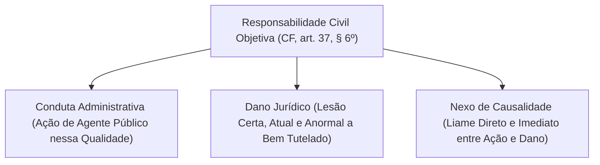
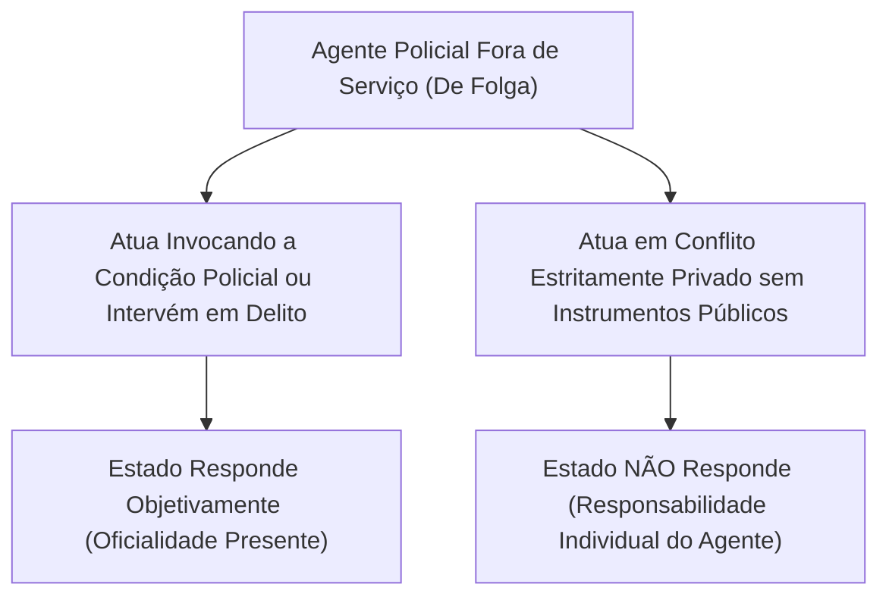
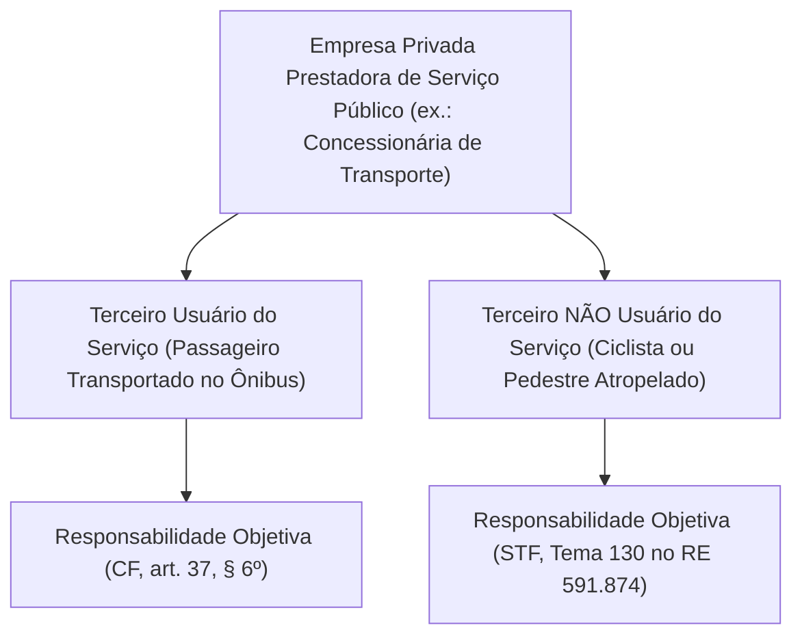
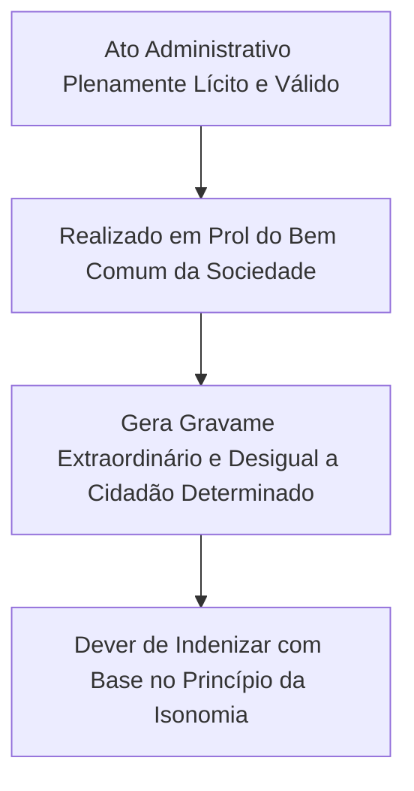
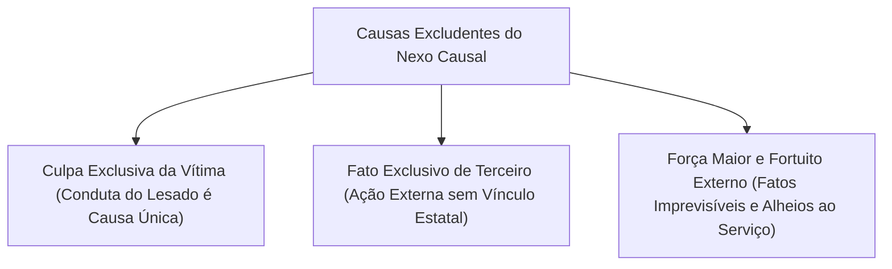
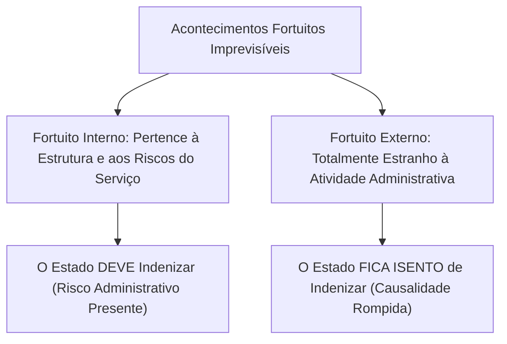
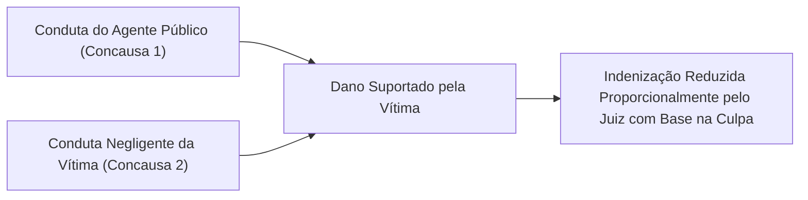

A responsabilidade civil objetiva do Estado traduz a garantia protetiva do administrado perante a força do aparato governamental. A Constituição Federal de 1988 consagrou expressamente a teoria do risco administrativo no art. 37, § 6º. Nessa sistemática, a obrigação estatal de reparar os prejuízos independe de dolo ou culpa do servidor. Por outro lado, essa obrigação ressarcitória não é ilimitada. Se o Poder Público demonstrar que houve ruptura da cadeia causal por motivo externo, a obrigação de indenizar fica afastada.

> [!objetivos]
> - Identificar os três elementos essenciais da responsabilidade objetiva: conduta oficial, dano jurídico e nexo causal.
> - Compreender a tese vinculante do Tema 130 do STF sobre a responsabilidade perante terceiros não usuários.
> - Analisar a oficialidade da conduta e os reflexos de disparos efetuados por policiais militares em período de folga.
> - Compreender os fundamentos jurídicos da indenização por atos administrativos estritamente lícitos.
> - Diferenciar as causas excludentes do nexo causal, a distinção entre fortuito interno e externo e a culpa concorrente.

## Requisitos constitutivos da responsabilidade civil objetiva

A caracterização da responsabilidade extracontratual objetiva sob a teoria do risco administrativo exige a presença simultânea de três pressupostos dogmáticos: conduta administrativa oficial, dano jurídico e nexo causal.



> [!lei] CF, art. 37, § 6º
> As pessoas jurídicas de direito público e as de direito privado prestadoras de serviços públicos responderão pelos danos que seus agentes, nessa qualidade, causarem a terceiros, assegurado o direito de regresso contra o responsável nos casos de dolo ou culpa.

> [!lei] CC, art. 43
> As pessoas jurídicas de direito público interno são civilmente responsáveis por atos dos seus agentes que nessa qualidade causem danos a terceiros, ressalvado direito regressivo contra os causadores do dano, se houver, por parte destes, culpa ou dolo.

### Conduta administrativa oficial

A conduta estatal consiste na manifestação de vontade ou atuação comissiva emanada de um indivíduo que atua em nome do Poder Público. A doutrina confere ao termo agente público uma abrangência ampla:

- **Agentes administrativos em geral**: inclui servidores estatutários efetivos, empregados públicos celetistas, ocupantes de cargos em comissão e agentes políticos.
- **Particulares em colaboração**: abrange cidadãos que exercem funções públicas transitórias, como jurados do tribunal do júri, mesários eleitorais e pessoas convocadas para prestar serviços em requisições civis.
- **Agentes de fato**: envolve aqueles cidadãos que exercem a função pública sem uma investidura formal perfeita (agentes putativos) ou que atuam em situações calamitosas de emergência (agentes necessários). Sob a égide da teoria da aparência e do princípio da segurança jurídica, os atos praticados por agentes de fato ensejam a responsabilização civil do Estado em relação aos particulares de boa-fé.

### Dano jurídico indenizável

O dano traduz a perda ou lesão patrimonial ou moral suportada pela vítima em virtude da atuação estatal. Para ensejar indenização, o dano deve atender a três critérios fundamentais:

- **Certeza e atualidade**: o prejuízo deve ser efetivo, demonstrável e real. O ordenamento jurídico brasileiro não acolhe pedidos de indenização fundados em danos hipotéticos, meramente possíveis ou eventuais.
- **Lesão a interesse juridicamente protegido**: alcança tanto os danos patrimoniais (danos emergentes e lucros cessantes) quanto os danos extrapatrimoniais (dano moral puro e dano estético). O dano emergente traduz aquilo que a vítima efetivamente perdeu no momento do sinistro. Os lucros cessantes correspondem à frustração do ganho patrimonial que a vítima legitimamente esperava auferir caso o ato lesivo não tivesse ocorrido.
- **Anormalidade e especialidade**: o prejuízo não pode consistir em simples aborrecimento suportado de maneira uniforme por toda a sociedade. A lesão deve impor um sacrifício desproporcional e individualizado a um cidadão ou a um grupo determinado.

> [!jurisprudencia] STJ, Súmula 387 (Cumulação de Dano Estético e Moral)
> O Superior Tribunal de Justiça consolidou o entendimento segundo o qual é juridicamente viável cumular verbas indenizatórias por dano estético e por dano moral decorrentes do mesmo evento lesivo. Uma lesão corporal provocada por viatura oficial autoriza a condenação estatal conjunta pelo abalo psíquico suportado e pela alteração corporal definitiva sofrida pela vítima.

### Nexo de causalidade

O nexo de causalidade estabelece a conexão necessária entre o comportamento do agente público e o dano sofrido pela vítima. O Direito Civil e o Direito Administrativo brasileiros acolheram a **teoria do dano direto e imediato** (teoria da interrupção do nexo causal), expressa no artigo 403 do Código Civil.


Conforme a jurisprudência consolidada pelo Supremo Tribunal Federal desde o julgamento do RE 130.764, relatado pelo Ministro Moreira Alves, o Estado responde apenas pelas consequências lesivas que decorrerem direta e imediatamente de sua atividade. Não se adota no ordenamento pátrio a teoria da equivalência das condições (conditio sine qua non). Por essa razão dogmática, causas supervenientes autônomas ou fatos remotos desprovidos de conexão direta e necessária não autorizam a condenação da Fazenda Pública.

A teoria da causalidade adequada, construída pela doutrina alemã, também recebe prestígio doutrinário como critério de valoração: considera-se causa a conduta que, segundo as regras ordinárias de experiência, seja idônea e apta a produzir o evento danoso concreto. No confronto jurisprudencial, porém, o STF e o STJ reafirmam a incidência do artigo 403 do Código Civil, exigindo liame direto entre a ação administrativa e o dano experimentado.

## A oficialidade da conduta e os servidores fora da escala de serviço

A Constituição impõe que o ato lesivo seja praticado pelos agentes **"nessa qualidade"**. Esse requisito dogmático consagra o princípio da oficialidade da conduta estatal.

Para que se estabeleça a responsabilidade do Estado, não é imprescindível que o servidor esteja no local de trabalho ou usando uniforme oficial. Importa verificar se o agente se prevaleceu da função pública para praticar o ato, invocando a autoridade de seu cargo ou empregando instrumentos fornecidos pela Administração.



A jurisprudência construiu uma diferenciação nítida nos casos de servidores armados fora do expediente:

- **Atuação funcional do servidor de folga**: quando o policial militar, civil ou bombeiro militar intervém em uma situação de flagrante delito para salvar vidas, impedir roubo ou efetuar prisão, ele atua no estrito cumprimento do dever legal. Em caso de disparos que atinjam terceiros inocentes, o Estado responde de modo objetivo, visto que a intervenção decorreu da qualidade funcional do servidor.
- **Utilização da arma de fogo da corporação**: o STF firmou tese no sentido de que, se o policial de folga causa lesão corporal ou homicídio utilizando a arma pertencente à corporação militar, o Estado responde objetivamente. A entrega do armamento institucional ao agente gera um risco assumido pela Administração perante a comunidade.
- **Conflito estritamente particular sem armas públicas**: se o servidor desferir disparos com arma particular e por motivações puramente privadas (como desavenças familiares ou brigas de vizinhança), sem invocar o cargo, o liame causal com a função pública é inexistente. O ilícito possui natureza estritamente subjetiva do indivíduo, respondendo o agente exclusivamente na esfera civil comum.

> [!jurisprudencia] STF, RE 160.401 (Policial de Folga com Arma Funcional)
> O Supremo Tribunal Federal pacificou que o ente público responde de forma objetiva pela morte de cidadão decorrente de disparo efetuado por policial de folga com a arma da corporação. A guarda e o porte de equipamento letal fornecido pelo Estado configuram extensão da atividade pública, vinculando o ente aos danos produzidos pelo seu uso.

## A responsabilidade perante usuários e terceiros não usuários do serviço

O comando do art. 37, § 6º, da Carta Política estendeu a responsabilidade objetiva às pessoas jurídicas de direito privado prestadoras de serviços públicos. Durante anos, parte da doutrina defendia que essa garantia alcançaria unicamente os usuários diretos do serviço (relação contratual).

Essa discussão doutrinária foi resolvida com repercussão geral pelo Supremo Tribunal Federal no julgamento do **Tema 130 (RE 591.874)**:



> [!jurisprudencia] STF, Tema 130 (RE 591.874)
> O Plenário do STF fixou a seguinte tese vinculante: a responsabilidade civil das concessionárias e permissionárias de serviço público é de natureza objetiva tanto em relação aos usuários do serviço quanto aos cidadãos não usuários que sofrerem prejuízos causados pela prestação daquela atividade coletiva, com amparo no art. 37, § 6º, da Constituição da República.

Se um veículo de transporte coletivo urbano pertencente a uma concessionária privada colidir contra um automóvel estacionado ou atropelar um pedestre na calçada, a empresa de ônibus responde de forma objetiva perante essa vítima. O pedestre lesionado não precisa demonstrar negligência ou imperícia do motorista. Basta comprovar o prejuízo patrimonial suportado e o nexo causal direto com o deslocamento do coletivo na via pública. Essa diretriz prestigia o princípio da isonomia e assegura ampla tutela jurídica à coletividade.

## Responsabilidade do Estado decorrente de atos lícitos

O dever estatal de ressarcir o particular não decorre exclusivamente de infrações jurídicas ou condutas ilícitas. A Administração Pública também tem a obrigação jurídica de reparar prejuízos oriundos de atos plenamente legais e legítimos.



Para que o ato estatal lícito justifique o pagamento de indenização pecuniária, o gravame experimentado pelo particular deve apresentar dois traços cumulativos:

1. **Dano anormal**: a lesão não pode consistir em mero desconforto decorrente do convívio comunitário. Deve se tratar de gravame patrimonial severo que excede os limites da razoabilidade social.
2. **Dano específico**: o impacto desfavorável não pode incidir sobre a totalidade da população. A lesão incide de forma pontual e individualizada sobre uma pessoa ou um grupo restrito de administrados.

A doutrina destaca as seguintes situações paradigmáticas de indenização por conduta lícita:

- **Obras públicas impactantes**: o bloqueio total e duradouro de uma rua comercial para escavação de túneis ou galerias subterrâneas que suprime o acesso físico aos comércios, provocando perdas severas e individualizadas aos comerciantes daquele quarteirão.
- **Desapropriação indireta**: o apossamento administrativo de gleba particular para implantação de rodovia, parque público ou área militar sem o devido processo prévio de expropriação e desprovido de indenização justa.
- **Revogação justificada de autorização remunerada**: a cessação unilateral e antecipada de permissão ou concessão administrativa que acarreta a inutilização de investimentos custosos realizados pelo administrado com expressa concordância do Poder Público.
- **Proibição sanitária de atividade outrora lícita**: medidas sanitárias emergenciais que determinem o sacrifício compulsório de rebanho sadio com o escopo de conter epidemia grave, impondo perda extraordinária e individualizada ao produtor rural em favor de toda a saúde pública regional.

> [!bizu]
> **Fundamento Constitucional do Ato Lícito:** o alicerce dogmático é o **princípio da igualdade perante os encargos públicos** (isonomia material). Se determinada atividade beneficia a sociedade inteira, não é admissível que o ônus financeiro dessa conquista seja suportado isoladamente pelo bolso de um único indivíduo. A sociedade, representada pelo erário, deve redistribuir o custo do prejuízo por meio da indenização.

## Causas excludentes da responsabilidade civil estatal

Como o Brasil adota a teoria do risco administrativo e não a teoria do risco integral, a obrigação do Estado de ressarcir prejuízos cessa quando a Administração demonstra o rompimento integral do nexo causal.



### Culpa exclusiva da vítima

A culpa exclusiva da vítima ocorre quando o desfecho danoso é desencadeado de modo único pela conduta imprudente, imperita ou intencional da própria pessoa lesada. A conduta do cidadão atua como causa exclusiva do evento.

- Exemplo: o transeunte que pula uma cerca de segurança e corre intencionalmente para a frente de uma viatura policial que transita devagar com sirene e luzes de emergência ligadas.
- **Ônus probatório**: o encargo de provar a culpa exclusiva da vítima compete integralmente ao Estado. Como a responsabilidade objetiva milita em favor do cidadão, cabe ao ente público demonstrar o comportamento culposo da vítima para se desincumbir da condenação.

### Fato exclusivo de terceiro

Verifica-se quando o resultado decorre da atuação de uma pessoa completamente desvinculada da estrutura e dos quadros do Poder Público, sem que o Estado pudesse razoavelmente impedir o evento com as medidas regulares de segurança.

- Exemplo: assalto a mão armada perpetrado por criminosos no interior de uma composição ferroviária pertencente a empresa pública. O Superior Tribunal de Justiça assentou que o roubo mediante violência armada em transporte coletivo constitui fato exclusivo de terceiro, apto a afastar a obrigação da concessionária.

### Força maior e caso fortuito externo

Consiste em acontecimentos extraordinários e inevitáveis que superam as forças de previsão e contenção do ser humano:

- **Força maior**: relaciona-se a eventos violentos da natureza, como terremotos, tempestades severas e tornados com proporções climáticas incontroláveis.
- **Caso fortuito externo**: consubstancia fato humano imprevisível e irresistível que não guarda relação com os riscos próprios do serviço público prestado, como uma declaração de guerra ou um atentado terrorista indiscriminado.

## A distinção fundamental entre fortuito interno e fortuito externo

A distinção teórica entre caso fortuito interno e fortuito externo orienta a jurisprudência dos tribunais pátrios:

| Categoria do Fortuito | Relação com a Atividade Estatal | Efeito sobre o Nexo Causal | Exemplos Práticos Típicos |
|---|---|---|---|
| **Fortuito Interno** | Vincula-se aos riscos próprios da atividade e da máquina pública. | **NÃO rompe** o nexo causal. O Estado permanece obrigado a indenizar. | Estouro de pneu de viatura militar; pane mecânica de freios de ambulância; curto-circuito em tomadas de hospital. |
| **Fortuito Externo** | Consiste em acontecimento totalmente estranho e alheio à atividade do Estado. | **ROMPE** o nexo causal. O Estado fica isento de indenizar. | Desabamento de montanha por terremoto; raio que atinge pedestre em parque; assalto a mão armada com reféns. |



> [!pegadinha]
> **Defeitos mecânicos e estouro de pneus em viaturas:** as bancas examinadoras costumam tentar confundir o candidato afirmando que o estouro repentino de um pneu ou a falha imprevista no freio de uma viatura militar configurariam caso fortuito apto a excluir o dever de indenizar do Estado. Cuidado: trata-se de hipótese incontroversa de **fortuito interno**! Como o desgaste mecânico e as imperfeições de peças integram a rotina e os riscos da atividade administrativa de transporte e patrulhamento, a causalidade não é rompida e o Poder Público permanece plenamente obrigado a reparar os prejuízos causados aos cidadãos atingidos.

## A causa atenuante: a culpa concorrente da vítima

A culpa concorrente surge no momento em que a conduta comissiva do agente estatal e a conduta imprudente da própria vítima convergem para a deflagração do prejuízo. As duas condutas atuam como concausas.

Ao revés da culpa exclusiva da vítima (que elimina a causalidade e concede isenção total ao Estado), a culpa concorrente funciona como **causa redutora e atenuante do valor indenizatório**:



> [!lei] CC, art. 945
> Se a vítima tiver concorrido culposamente para o evento danoso, a sua indenização será fixada tendo-se em conta a gravidade de sua culpa em confronto com a do autor do dano.

Se restar evidenciado em juízo que tanto o condutor da viatura pública quanto o motorista do veículo particular trafegavam acima do limite de velocidade ao cruzarem o semáforo defeituoso, o magistrado reconhecerá a culpa concorrente. A condenação pecuniária imposta à Fazenda Pública será reduzida em proporção correspondente ao grau de contribuição culposa do particular para a ocorrência do sinistro.

## Fenômenos da natureza e depredações de multidões

A apreciação dos danos derivados de temporais torrenciais, transbordamento de canais fluviais e quedas de árvores na malha viária, ou de depredações perpetradas por aglomerações violentas, rege-se por critérios consolidados:

1. **Regra geral de isenção**: os fenômenos catastróficos da natureza e os tumultos populares anônimos configuram, ordinariamente, casos de força maior ou fatos de terceiros. A Administração Pública não possui o encargo de ser onipresente em todas as áreas territoriais.
2. **Exceção fundada na falta do serviço**: o Poder Público responde perante a vítima caso reste comprovado que o órgão estatal agiu com omissão culposa diante de um dever jurídico de intervenção preventiva. Trata-se da teoria da culpa administrativa:
   - Alagamento severo de residências urbanas decorrente da ausência sistemática de desobstrução das bocas de lobo e galerias, embora a corporação de bombeiros e a comunidade tenham formalizado avisos sucessivos sobre o risco.
   - Queda de galhos ou tronco podre de árvore sobre veículo em movimento em via arterial, cuja remoção havia sido requisitada pelos munícipes meses antes sem providências pelo setor competente.
   - Destruição de estabelecimentos comerciais em protesto anunciado previamente, quando o comando da segurança pública deixou de disponibilizar efetivo policial preventivo para a contenção da massa.

Nessas hipóteses de omissão administrativa diante de forças da natureza ou distúrbios coletivos, a responsabilidade estatal ostenta **caráter subjetivo**. Incumbe à vítima comprovar que o serviço público foi inexistente, tardio ou ineficiente.

| Causa de Modificação da Reparação | Natureza Dogmática | Efeito Processual | Distribuição do Ônus Probatório |
|---|---|---|---|
| **Culpa Exclusiva da Vítima** | Excludente de Causalidade | Isenção total da Administração. | Compete integralmente ao Poder Público. |
| **Fato Exclusivo de Terceiro** | Excludente de Causalidade | Isenção total da Administração. | Compete integralmente ao Poder Público. |
| **Força Maior / Fortuito Externo** | Excludente de Causalidade | Isenção total da Administração. | Compete integralmente ao Poder Público. |
| **Fortuito Interno** | Risco Operacional da Atividade | Não afasta o dever de indenizar. | Não exime o ente de ressarcir o cidadão. |
| **Culpa Concorrente** | Causa de Atenuação | Redução proporcional da verba. | Cabe à Administração provar a culpa do particular. |
| **Fenômenos Naturais com Omissão** | Falta do Serviço (Omissão) | Responsabilidade de índole subjetiva. | Incumbe à vítima provar a falha do serviço. |

## Mapa do capítulo

```mermaid Síntese Geral da Responsabilidade Objetiva e suas Causas Modificadoras
flowchart TD
    R1["Requisitos da Responsabilidade Objetiva"] --> R1A["Conduta administrativa oficial praticada por agente nessa qualidade"]
    R1 --> R1B["Dano jurídico certo, presente e com sacrifício anormal"]
    R1 --> R1C["Nexo causal pela teoria do dano direto e imediato (artigo 403 da Lei Civil)"]

    R2["Hipóteses Especiais de Incidência"] --> R2A["Tema 130 do STF: Alcança terceiros usuários e cidadãos não usuários"]
    R2 --> R2B["Atos administrativos lícitos que causem dano anormal e especial"]
    R2 --> R2C["Policiais de folga: Estado responde se houver uso da arma funcional"]

    R3["Excludentes e Atenuantes"] --> R3A["Excludentes integrais: culpa da vítima, fato de terceiro e força maior"]
    R3 --> R3B["Fortuito interno mantém dever de indenizar; fortuito externo afasta"]
    R3 --> R3C["Culpa concorrente: mitiga e divide a condenação (artigo 945 da Lei Civil)"]
```

### Para fixar

1. **Requisitos dogmáticos da responsabilidade objetiva**: a obrigação estatal independe de dolo ou culpa do servidor, requerendo a demonstração de conduta comissiva de agente nessa qualidade, dano certo e nexo causal direto.
2. **Princípio da oficialidade**: o ente público responde quando o servidor atua no exercício de suas atribuições ou a pretexto de exercê-las. Disparos realizados por policial militar em período de folga geram a responsabilidade objetiva do Estado caso comprovado o uso de arma de fogo pertencente à corporação militar.
3. **Tema 130 do STF (RE 591.874)**: as empresas concessionárias de serviços públicos respondem objetivamente tanto perante os usuários diretos quanto em relação aos terceiros não usuários atingidos pelo evento.
4. **Indenização por ato lícito**: ancora-se no princípio da igualdade perante os encargos públicos, exigindo a demonstração cumulativa de dano anormal e específico suportado pelo particular em proveito da coletividade.
5. **Causas excludentes**: eliminam o nexo causal e liberam a Fazenda Pública do dever indenizatório. Compreendem a culpa exclusiva da vítima, o fato exclusivo de terceiro e a força maior ou caso fortuito externo. O ônus da demonstração cabe ao Estado.
6. **Fortuito interno versus externo**: o fortuito interno vincula-se aos riscos próprios da atividade e do maquinário público (estouro de pneus e falhas mecânicas), não afastando o dever de indenizar. O fortuito externo consiste em fato absolutamente alheio ao serviço, rompendo a causalidade.
7. **Culpa concorrente**: constitui circunstância atenuante que enseja a redução proporcional do valor da indenização devida pela Fazenda Pública, conforme o artigo 945 do Código Civil.
8. **Danos por eventos naturais**: temporais e enchentes excluem a responsabilidade civil por força maior, ressalvada a comprovação pela vítima de omissão culposa do ente público diante de um dever específico de prevenção.