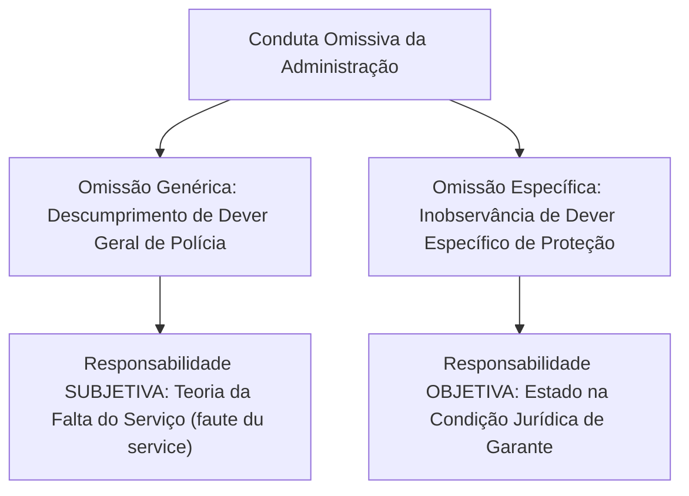
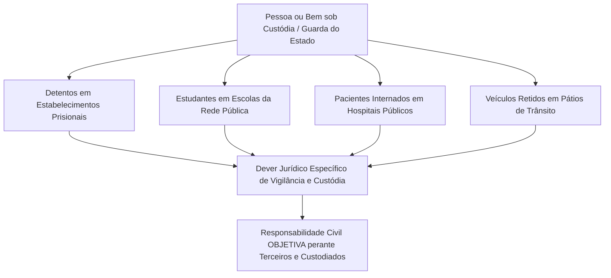
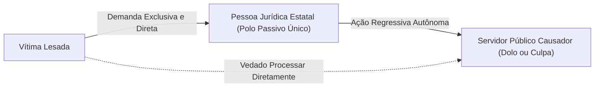
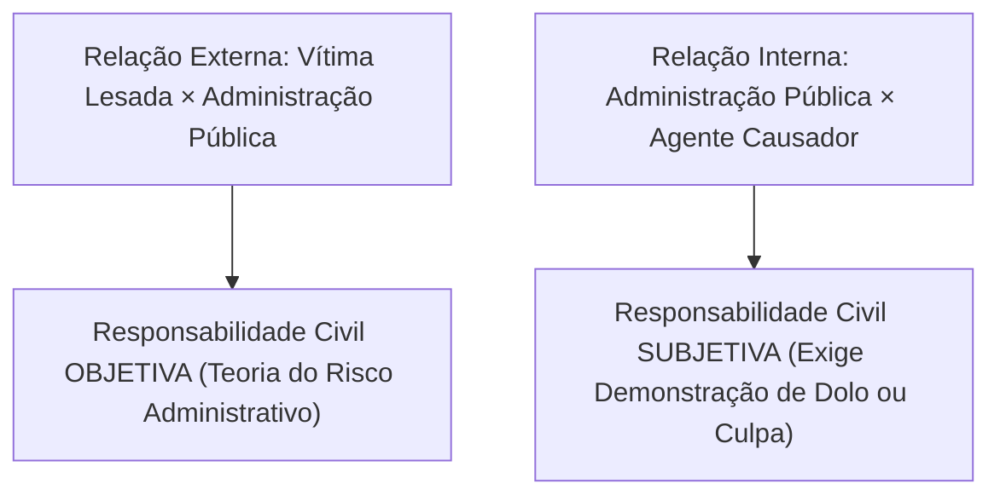
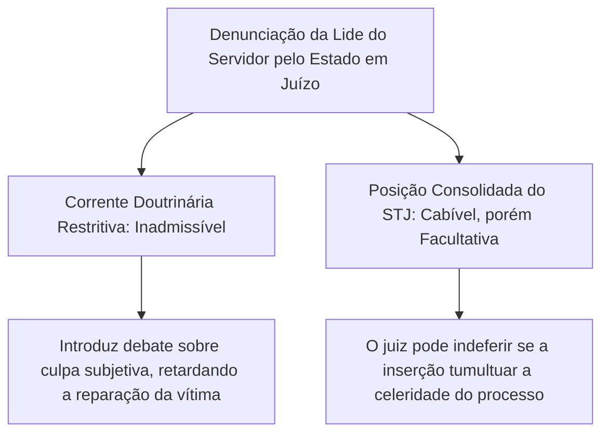
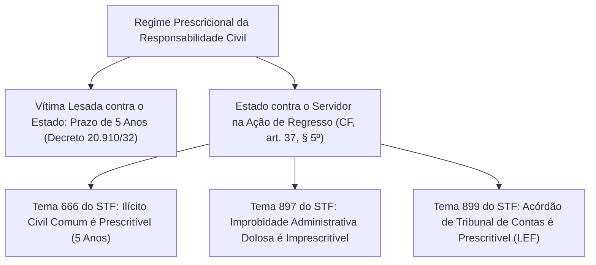

A concretização da responsabilidade patrimonial da Administração Pública não decorre unicamente de atos comissivos. O ordenamento jurídico confere idêntica relevância às lesões causadas pela inação estatal. Disciplina com rigor o dever de custódia sobre indivíduos e coisas sob custódia oficial. Em harmonia com esse modelo, a ordem constitucional estabelece diretrizes para a legitimidade passiva processual, o exercício do direito de regresso contra o funcionário causador e os prazos de prescrição.

> [!objetivos]
> - Diferenciar a responsabilidade subjetiva na omissão genérica da responsabilidade objetiva na omissão específica.
> - Compreender a tese do Tema 940 do STF sobre a legitimidade passiva exclusiva da pessoa jurídica.
> - Dominar os requisitos de admissibilidade e a transmissibilidade patrimonial da ação regressiva.
> - Avaliar o cabimento facultativo da denunciação da lide e seus reflexos na celeridade processual.
> - Conhecer os prazos prescricionais contra o Estado e as teses de repercussão geral nos Temas 666, 897 e 899 do STF.

## A responsabilidade civil do Estado por atos omissivos

A conduta comissiva atrai a responsabilidade objetiva expressa no art. 37, § 6º, da Constituição da República. Em contrapartida, a omissão estatal enseja um regime jurídico dual. A doutrina e a jurisprudência consolidada dos Tribunais Superiores separam a omissão genérica da omissão específica.

### Omissão genérica e a teoria da culpa administrativa

A omissão genérica manifesta-se quando o Poder Público descumpre um dever legal difuso. São obrigações que recaem sobre a sociedade como um todo. Exemplos clássicos englobam o patrulhamento ostensivo de segurança, a fiscalização rotineira do trânsito e a manutenção preventiva das vias.

Nesse cenário, o Estado não criou de forma direta a situação concreta de risco que vitimou o administrado. O gravame resulta de forças da natureza ou de delitos perpetrados por delinquentes anônimos. Em razão disso, a responsabilidade estatal assume **natureza subjetiva**, subordinando-se à doutrina da **falta do serviço** (*faute du service*):

- **Culpa do serviço (culpa anônima)**: a vítima não precisa individualizar nem provar a culpa particular de um funcionário público específico. Basta comprovar que a máquina pública funcionou mal, com atraso injustificado ou permaneceu inerte quando a prestação era juridicamente exigível.
- **Pressupostos da reparação**: o particular deve provar o dano experimentado, o liame causal e a falha operacional da estrutura administrativa (negligência, imperícia ou imprudência do serviço).
- **A reserva do possível e a razoabilidade**: o Poder Público não opera como segurador universal dos riscos sociais. A indenização por omissão genérica pressupõe que o serviço estivesse ao alcance material e orçamentário do ente público diante das circunstâncias concretas. Não se pode exigir dos cofres municipais a instalação imediata de diques intransponíveis para conter chuvas bíblicas e sem precedentes históricos. A responsabilidade depende da verificação do padrão médio esperado de eficiência administrativa. O administrado deve provar que a omissão violou um dever concreto e factível que a Administração tinha condições de cumprir com os recursos disponíveis.

### Omissão específica e a posição de garante do Estado

A omissão específica ocorre quando a Administração Pública ostentava o **dever jurídico concreto de atuar** para evitar a lesão. Trata-se de salvaguardar pessoas ou bens sob sua custódia, vigilância ou guarda direta.

Ao assumir o controle físico sobre indivíduos ou patrimônios, o Estado assume a **posição de garante**. Por força desse dever estrito de vigilância, a responsabilidade por omissão específica é de **natureza objetiva**, com base na teoria do risco administrativo.

A posição de garante projeta-se em esferas cotidianas da Administração:

1. **Integridade de detentos no sistema prisional**: o art. 5º, XLIX, da Carta Magna impõe ao Estado a garantia da integridade física e moral dos reclusos. O homicídio de um preso praticado por outros internos em rebelião enseja a responsabilidade objetiva da Fazenda Pública.
2. **Suicídio de custodiado em estabelecimento penal (Tema 592 do STF)**: a morte por suicídio de interno em cela atrai a responsabilidade objetiva estatal. Todavia, sob o prisma do risco administrativo, o Estado exime-se do dever ressarcitório se demonstrar que a morte decorreu de circunstâncias imprevisíveis e repentinas, sem histórico prévio de desequilíbrio psíquico, e que os protocolos de vigilância foram atendidos pelos agentes penitenciários.
3. **Incolumidade de estudantes em escolas públicas**: durante as atividades acadêmicas, a escola assume o dever de vigilância sobre a segurança dos discentes. Se um aluno sofre agressão física por parte de colegas no recreio, a responsabilidade estatal é de índole objetiva.
4. **Pacientes em hospitais públicos e clínicas psiquiátricas**: a evasão sem contenção ou o ataque violento suportado por paciente internado em hospital público caracteriza descumprimento do dever específico de assistência médica, gerando reparação objetiva.

> [!jurisprudencia] STF, Tema 592 (RE 841.526)
> A Corte Suprema assentou que o ente estatal responde objetivamente pelo falecimento de detentos sob custódia prisional sempre que descumprir a obrigação constitucional de salvaguardar a integridade física dos reclusos. Trata-se de responsabilidade fundada no risco administrativo, facultando-se ao Poder Público comprovar a total imprevisibilidade do óbito para elidir o liame causal.

O quadro a seguir compara as particularidades das duas modalidades de inércia:

| Critério Dogmático | Omissão Genérica | Omissão Específica |
|---|---|---|
| **Natureza da Responsabilidade** | **Subjetiva** (fundada na culpa). | **Objetiva** (fundada no risco). |
| **Teoria Adotada** | Teoria da falta do serviço (*faute du service*). | Teoria do risco administrativo (Estado garante). |
| **Dever Violado** | Dever geral de proteção da segurança coletiva. | Dever concreto e individualizado de custódia. |
| **Ônus da Vítima** | Provar negligência ou defeito na prestação. | Provar o dano e a relação de custódia institucional. |
| **Exemplos Típicos** | Furto em via pública; alagamento de canal pluvial. | Morte violenta de preso; agressão física em colégio. |

## O princípio da dupla garantia e a legitimidade passiva processual

A quem a vítima deve processar perante o Poder Judiciário para pleitear indenização? A Constituição Federal estabeleceu no art. 37, § 6º, o **princípio da dupla garantia**.

Esse mandamento constitucional desdobra-se em duas proteções complementares:
- **Garantia em favor do administrado**: faculta à vítima lesada demandar contra um devedor com ampla higidez financeira (o ente estatal ou a concessionária privada), com recursos bastantes para garantir a quitação do crédito.
- **Garantia em favor do agente público**: resguarda o servidor contra ações indenizatórias diretas movidas por particulares. Garante-lhe que sua conduta oficial será defendida e respondida pelo órgão para o qual exercia suas atribuições.

Durante anos vigorou dissonância interpretativa entre o STF e o STJ. O STJ admitia que a vítima escolhesse entre demandar o Estado, o servidor ou ambos simultaneamente.

Essa divergência histórica foi superada pelo Plenário do Supremo Tribunal Federal no julgamento vinculante do **Tema 940 da Repercussão Geral (RE 1.027.633)**.

> [!jurisprudencia] STF, Tema 940 (RE 1.027.633)
> O Plenário do STF firmou tese vinculante dispondo que a pretensão reparatória por atos de funcionários públicos deve ser direcionada com exclusividade em face do ente estatal ou da entidade privada delegatária. O servidor público que praticou a conduta não possui legitimidade para figurar como réu na ação proposta pelo administrado, restando vedada a sua convocação conjunta em litisconsórcio passivo.

As implicações processuais decorrentes do Tema 940 do STF são pacíficas:
1. **Ilegitimidade passiva do funcionário público**: o servidor causador do dano não pode figurar no polo passivo da ação reparatória ajuizada pelo administrado. A petição inicial ajuizada diretamente contra o funcionário deve ser extinta sem julgamento do mérito.
2. **Inadmissibilidade de litisconsórcio passivo facultativo**: veda-se incluir o servidor ao lado da Fazenda Pública na petição inaugural. A lide processual compõe-se estritamente entre a vítima lesada e a pessoa jurídica.
3. **Ausência de obrigação solidária perante a vítima**: a relação jurídica obrigacional estabelece-se exclusivamente entre o administrado e a Administração. Não subsiste solidariedade passiva entre o Estado e o funcionário em favor do terceiro lesado.

> [!pegadinha]
> **Ação direta contra o servidor público:** as bancas de concurso tentam induzir o candidato ao erro afirmando que a vítima pode escolher entre acionar o policial militar condutor ou mover ação contra o Estado e o militar conjuntamente. Fique atento: com base na tese vinculante do **Tema 940 do STF**, o policial é **parte passiva manifestamente ilegítima**! O cidadão só pode processar a pessoa jurídica estatal. O servidor apenas responderá em momento ulterior perante o erário, no âmbito da ação regressiva.

## Ação regressiva contra o agente público causador do dano

A Constituição Federal de 1988 assegura o equilíbrio das contas públicas ao assegurar, no art. 37, § 6º, o direito de regresso contra o funcionário responsável.

Essa previsão engendra dois planos jurídicos distintos:

### Requisitos indispensáveis para a propositura do regresso

Para que o ente público promova legitimamente a ação regressiva em face do seu servidor, exigem-se dois pressupostos inafastáveis:

1. **Condenação judicial transitada em julgado contra o Estado (ou pagamento administrativo efetivo)**: a Fazenda Pública não pode pleitear o ressarcimento antes de solvida ou definitivamente reconhecida a sua própria obrigação indenizatória perante o terceiro. A pretensão ressarcitória do erário pressupõe o desembolso financeiro formal.
2. **Demonstração cabal de dolo ou culpa do servidor público**: enquanto a vítima desfruta da via objetiva para receber a verba indenizatória, o regresso promovido pela Administração ostenta cariz estritamente **subjetivo**. Caso o funcionário tenha atuado com diligência regular e o evento decorra de acidente imprevisto sem imprudência, o Poder Público não tem respaldo jurídico para reaver os valores despendidos.

### Características e regras operacionais da ação de regresso

A instauração do procedimento regressivo sujeita-se a princípios cogentes:

- **Dever irrenunciável da Administração (ato vinculado)**: o ajuizamento da demanda ressarcitória contra o agente culposo não consubstancia juízo de conveniência política. É providência vinculada ao princípio da indisponibilidade do patrimônio público. A autoridade administrativa que deliberadamente abdica de cobrar o funcionário culpado comete desvio funcional. No plano federal, a Lei nº 4.619/1965 estabelece o prazo de 60 dias para a propositura da ação regressiva após o trânsito em julgado da condenação.
- **Transmissibilidade patrimonial aos sucessores**: a obrigação de reparar os cofres públicos possui índole meramente financeira. Com o falecimento do agente responsável, o débito transmite-se aos herdeiros, respondendo estes unicamente até as forças da herança deixada (art. 5º, XLV, da Constituição da República).
- **Independência do vínculo funcional**: a ruptura definitiva do vínculo com o Estado (em caso de exoneração, demissão ou aposentadoria) não apaga o dever ressarcitório do indivíduo. A Fazenda Pública permanece legitimada a ajuizar ação regressiva autônoma na esfera cível ordinária contra o ex-servidor.

> [!lei] CF, art. 5º, XLV
> Nenhuma pena passará da pessoa do condenado, podendo a obrigação de reparar o dano e a decretação do perdimento de bens ser, nos termos da lei, estendidas aos sucessores e contra eles executadas, até o limite do valor do patrimônio transferido.

## O instituto da denunciação da lide e a jurisprudência do STJ

A denunciação da lide é modalidade de intervenção de terceiros regulada no artigo 125, II, do Código de Processo Civil. Permite ao réu trazer para o processo o responsável por indenizá-lo em regresso caso sucumba na demanda principal.

Nas ações indenizatórias movidas contra o Estado, a aplicação da denunciação da lide provocou amplo confronto doutrinário e pretoriano:

O Superior Tribunal de Justiça (em julgados paradigmáticos nos Recursos Especiais REsp 313.886 e REsp 1.089.955) assentou as seguintes diretrizes:

1. **Facultatividade da denunciação**: a denunciação da lide pelo Poder Público em face do servidor causador não tem caráter compulsório. A omissão do ente público em denunciar a lide durante a contestação não prejudica o direito material de regresso.
2. **Poder discricionário do juízo processual**: o magistrado tem o poder de recusar o pedido de denunciação caso constate que a apuração de culpa ou dolo do agente acarretará dilação probatória penosa, violando a razoável duração do processo e postergando injustamente a indenização devida à vítima.
3. **Preservação de ação regressiva autônoma**: caso a denunciação seja indeferida ou sequer manifestada pela Procuradoria do ente na defesa, a Fazenda Pública mantém íntegra a pretensão de ajuizar ação autônoma de regresso após o encerramento do litígio com a vítima.

> [!bizu]
> **Denunciação da lide em síntese:** conforme o posicionamento firme do STJ, a denunciação da lide do agente público pelo Estado **é admitida, mas é meramente facultativa**. A Fazenda Pública não decai de seu direito regressivo caso decida não denunciar o funcionário. Se o chamamento ameaçar a rapidez do julgamento, o juiz deve indeferi-lo para tutelar o administrado lesado.

## O regime jurídico da prescrição contra o Estado e no direito de regresso

O instituto da prescrição opera a extinção da exigibilidade judicial em decorrência da inércia prolongada do credor. No Direito Administrativo, convém diferenciar o prazo prescricional que favorece a Fazenda Pública das regras que balizam a ação regressiva.

### Prescrição da pretensão indenizatória da vítima contra a Fazenda Pública

A demanda indenizatória proposta pelo administrado lesado em face da União, dos Estados, do Distrito Federal, dos Municípios ou de suas autarquias e fundações sujeita-se à **prescrição quinquenal (cinco anos)**.

A regra geral está disposta no artigo 1º do Decreto nº 20.910/1932, acompanhado pelo artigo 1º-C da Lei nº 9.494/1997.

> [!lei] Decreto nº 20.910/1932, art. 1º
> As dívidas passivas da União, dos Estados e dos Municípios, bem assim todo e qualquer direito ou ação contra a Fazenda federal, estadual ou municipal, seja qual for a sua natureza, prescrevem em cinco anos contados da data do ato ou fato do qual se originarem.

O Superior Tribunal de Justiça já assentou que a disciplina especial do Decreto nº 20.910/1932 prevalece sobre a regra trienal do artigo 206, § 3º, V, do Código Civil. Prevalece em favor do administrado e do Estado a contagem uniforme do lapso de cinco anos.

**Exceção de imprescritibilidade por atos de repressão política:** a jurisprudência uniformizada dos Tribunais Superiores firmou entendimento no sentido de que são **imprescritíveis** as pretensões indenizatórias decorrentes de perseguições, prisões arbitrárias e torturas ocorridas durante o regime militar autoritário. Por envolverem atentados diretos aos direitos humanos fundamentais mais elementares, essas lesões não sucumbem ao decurso do tempo.

### Prescrição da pretensão de ressarcimento do Estado contra o servidor

O texto constitucional reservou à legislação infraconstitucional a tarefa de fixar os lapsos prescricionais para infrações de agentes que provoquem desfalques aos cofres públicos, ressalvando expressamente as demandas voltadas à recomposição do erário.

> [!lei] CF, art. 37, § 5º
> A lei estabelecerá os prazos de prescrição para ilícitos praticados por qualquer agente, servidor ou não, que causem prejuízos ao erário, ressalvadas as respectivas ações de ressarcimento.

A amplitude dessa ressalva constitucional foi delimitada pelo Supremo Tribunal Federal por meio de três julgamentos de repercussão geral:

1. **Ilícito civil comum (Tema 666 do STF no RE 669.069)**: a pretensão ressarcitória do erário decorrente de ilícitos estritamente civis (como colisões culposas de veículos públicos ou danos acidentais ao patrimônio governamental) é **prescritível**, operando-se a prescrição no prazo de **cinco anos**. A ressalva do art. 37, § 5º, não alcança ilícitos civis desprovidos de desonestidade qualificada.
2. **Atos de improbidade administrativa dolosa (Tema 897 do STF no RE 852.475)**: não se sujeitam a prazo prescricional algum as pretensões de ressarcimento deduzidas contra atos intencionais de improbidade administrativa previstos na Lei nº 8.429/1992. O dolo qualificado contra as finanças públicas afasta qualquer blindagem temporal.
3. **Execução de decisões proferidas por Tribunais de Contas (Tema 899 do STF no RE 636.886)**: subordina-se ao fluxo prescricional a cobrança executiva de débitos quantificados e impostos em acórdãos dos Tribunais de Contas, os quais constituem títulos executivos extrajudiciais nos termos do art. 71, § 3º, da Lei Maior. A execução fiscal movida pela Procuradoria sujeita-se às diretrizes da Lei nº 6.830/1980, operando-se a prescrição em cinco anos caso reste caracterizada a inércia fazendária.

O quadro analítico a seguir sumariza a disciplina das ações ressarcitórias:

| Hipótese Jurídica | Prazo Aplicável | Fundamento Jurisprudencial | Consequência Prática |
|---|---|---|---|
| **Vítima contra a Fazenda Pública** | **5 anos** | Decreto nº 20.910/1932, art. 1º | Afasta a prescrição trienal civilista comum. |
| **Tortura e Repressão na Ditadura** | **Imprescritível** | STF e STJ (Súmulas e Teses) | Proteção irrestrita da dignidade da pessoa humana. |
| **Regresso por Ilícito Civil Comum** | **5 anos (Prescritível)** | STF, Tema 666 (RE 669.069) | Danos patrimoniais comuns causados por servidores. |
| **Regresso por Improbidade Dolosa** | **Imprescritível** | STF, Tema 897 (RE 852.475) | Atos de corrupção ou lesão desonesta ao erário. |
| **Execução de Decisão do Tribunal de Contas** | **5 anos (Prescritível)** | STF, Tema 899 (RE 636.886) | Cobrança fiscal nos moldes da Lei nº 6.830/1980. |

## Mapa do capítulo

```mermaid Síntese Geral: Omissão, Regresso e Prescrição
flowchart TD
    M1["Responsabilidade por Omissão"] --> M1A["Genérica: Subjetiva com culpa do serviço (faute du service)"]
    M1 --> M1B["Específica: Objetiva pelo dever de garante (presos, alunos, pacientes)"]

    M2["Polo Passivo e Princípio da Dupla Garantia"] --> M2A["Tema 940 do STF: Ação proposta exclusivamente contra o Estado"]
    M2 --> M2B["Servidor público é parte ilegítima no polo passivo da ação da vítima"]

    M3["Ação Regressiva Estatal"] --> M3A["Exige condenação prévia e prova de culpa ou dolo do agente"]
    M3 --> M3B["Dever obrigatório da Administração; transmite aos herdeiros até a herança"]

    M4["Prazos Prescricionais Relevantes"] --> M4A["Contra o Estado: 5 anos pelo Decreto 20.910/32 (salvo tortura)"]
    M4 --> M4B["Regresso por ilícito civil: prescreve em 5 anos (Tema 666 do STF)"]
    M4 --> M4C["Improbidade administrativa dolosa: imprescritível (Tema 897 do STF)"]
```

### Para fixar

1. **Omissão genérica versus omissão específica**: na omissão genérica, a responsabilidade estatal é subjetiva, fundada na culpa anônima do serviço (*faute du service*). Na omissão específica, em que o Estado atua como garante de indivíduos ou coisas sob sua guarda e custódia (presos, alunos e pacientes), a responsabilidade civil é objetiva.
2. **Suicídio de detento (Tema 592 do STF)**: a morte de preso em unidade carcerária atrai a responsabilidade objetiva do Estado em razão do dever específico de proteção (art. 5º, XLIX, da CF/88), liberando-se a Administração caso demonstre a total imprevisibilidade e inevitabilidade do sinistro.
3. **Tema 940 do STF (RE 1.027.633)**: o particular lesado deve propor a ação indenizatória unicamente contra o Estado ou a concessionária de serviços públicos. O servidor público é parte passiva ilegítima, sendo inadmissível o litisconsórcio passivo facultativo.
4. **Fundamento da ação de regresso**: a Administração Pública tem o dever vinculado de ajuizar demanda regressiva subjetiva em face do agente que atuou com dolo ou culpa, exigindo-se a prévia condenação judicial ou quitação indenizatória pelo ente público.
5. **Transmissibilidade patrimonial do regresso**: com o óbito do servidor responsável, a obrigação de indenizar estende-se aos sucessores até a proporção econômica dos bens herdados (art. 5º, XLV, da Carta Magna).
6. **Denunciação da lide do servidor**: segundo a jurisprudência pacificada do Superior Tribunal de Justiça, a denunciação da lide pelo ente estatal em face do funcionário causador é admissível, mas meramente facultativa, podendo ser indeferida pelo juízo para preservar a celeridade processual.
7. **Prescrição contra a Fazenda Pública**: rege-se pelo prazo especial de cinco anos estatuído no Decreto nº 20.910/1932, afastando-se o prazo civil trienal. As pretensões indenizatórias decorrentes de atos de perseguição política e tortura no regime militar são imprescritíveis.
8. **Prescrição no ressarcimento ao erário**: os danos ao erário derivados de ilícitos civis comuns prescrevem no prazo de cinco anos (Tema 666 do STF). A imprescritibilidade do art. 37, § 5º, da CF/88 alcança exclusivamente as ações ressarcitórias decorrentes de improbidade administrativa dolosa (Tema 897 do STF). As decisões com imputação de débito proferidas por Tribunais de Contas prescrevem conforme a Lei de Execução Fiscal (Tema 899 do STF).