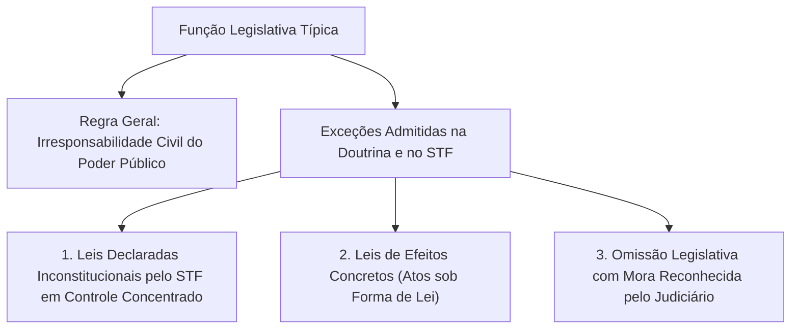
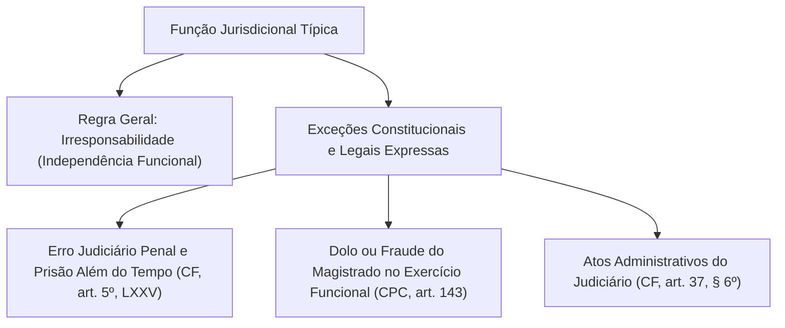
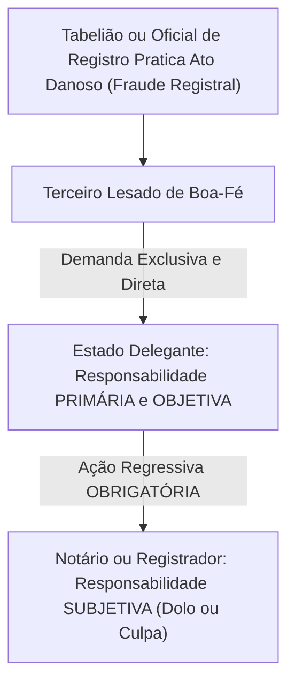
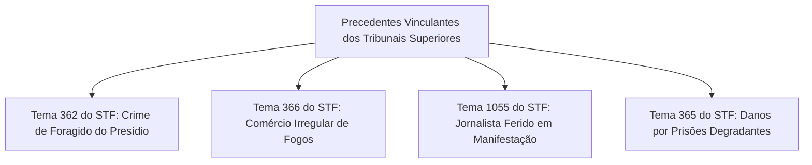

O estudo da responsabilidade patrimonial extracontratual do Estado alcança sua vertente mais técnica nas funções legislativa e jurisdicional. Também se destaca na atuação de agentes privados por delegação constitucional. Nesses âmbitos, a regra tradicional de imunidade sofre mitigações necessárias. A ordem jurídica exige a identificação das hipóteses excepcionais consagradas pela jurisprudência do Supremo Tribunal Federal e do Superior Tribunal de Justiça.

> [!objetivos]
> - Compreender a regra de irresponsabilidade por atos legislativos e suas três exceções consolidadas.
> - Dominar o regime dos atos jurisdicionais, o erro judiciário penal e a disciplina das prisões cautelares.
> - Analisar a responsabilidade primária e objetiva do Estado por atos de notários e registradores (Tema 777).
> - Conhecer as teses vinculantes sobre delitos de presos foragidos, comércio de fogos e cobertura jornalística.
> - Diferenciar as excludentes penais de ilicitude da responsabilidade civil estatal perante terceiros inocentes.

## Responsabilidade civil por atos legislativos

A elaboração de normas jurídicas consubstancia ato típico da soberania popular. As leis expressam a vontade geral dos cidadãos com características de abstração e generalidade. Por essa razão basilar, a **regra geral é a irresponsabilidade civil do Estado por atos legislativos típicos**.

A promulgação de uma nova lei tributária ou a imposição de restrições de polícia a determinadas atividades mercantis não gera dever indenizatório. A submissão aos ditames da lei compõe o regime normal de vida em sociedade.



A doutrina e o Supremo Tribunal Federal consagram três exceções em que a atividade legislativa gera o dever de reparar:

### Leis declaradas inconstitucionais pelo Supremo Tribunal Federal

A declaração de nulidade de uma lei pelo STF em controle concentrado (em Ação Direta de Inconstitucionalidade) opera efeitos retroativos. Desconstitui o ato normativo viciado desde sua origem.

Se a aplicação dessa norma causou prejuízo patrimonial anormal e individualizado a um cidadão, o Estado deve responder civilmente. Essa obrigação funda-se na teoria do risco administrativo. Exige-se que o gravame resulte de forma direta e necessária da aplicação da lei viciada.

### Leis de efeitos concretos

As leis de efeitos concretos seguem o rito formal de aprovação parlamentar. Contudo, são desprovidas de generalidade e abstração. Elas atingem destinatários individualizados ou provocam alterações jurídicas imediatas. Na prática, funcionam como verdadeiros atos administrativos individuais.

- Exemplo: diploma legal municipal que revoga concessão específica ou declara a desapropriação de um determinado imóvel urbano.
- Caso essa lei imponha sacrifício lesivo ao patrimônio particular, a Administração responde de modo objetivo, exatamente como ocorre nos atos administrativos comuns.

### Omissão legislativa inconstitucional

Verifica-se quando o texto da Constituição da República impõe ao parlamento o dever de regulamentar determinado dispositivo, mas o Poder Legislativo permanece inerte.

A caracterização dessa exceção indenizatória sujeita-se a balizas estritas:
- Depende do reconhecimento formal da mora legislativa pelo Poder Judiciário em Mandado de Injunção ou em Ação Direta de Inconstitucionalidade por Omissão.
- Requer a existência de prazo constitucional expresso violado ou a comprovação de que a falta da norma inviabilizou o exercício de direito fundamental, gerando lesão patrimonial concreta. Se o Executivo encaminhou tempestivamente projeto de lei, a omissão ilícita do ente público resta afastada.

## Responsabilidade civil por atos jurisdicionais

A atividade judicante busca pacificar litígios sociais com a autoridade da coisa julgada. Em respeito à independência técnica da magistratura e à estabilidade das decisões definitivas, a **regra geral é a irresponsabilidade civil do Estado por pronunciamentos judiciais**.

Não obstante essa premissa, o ordenamento constitucional e as leis processuais agasalham exceções delimitadas:



> [!lei] CF, art. 5º, LXXV
> O Estado indenizará o condenado por erro judiciário, assim como o que ficar preso além do tempo fixado na sentença.

### Erro judiciário penal e excesso de execução carcerária

A ordem constitucional impõe a responsabilização objetiva nos casos de condenações criminais equivocadas ou excessos de prisão:
- **Condenação por erro judiciário**: ocorre quando o réu sofre condenação penal injusta e obtém o reconhecimento de sua inocência em revisão criminal.
- **Prisão além do tempo fixado na sentença**: o recolhimento prisional prolongado além da pena privativa fixada gera dever de indenizar. Trata-se de falha no cômputo da pena ou inércia no cumprimento do alvará de soltura.

### Prisão cautelar legal seguida de absolvição penal

O tema das prisões preventivas e temporárias exige diferenciação precisa nos certames públicos:

- **Regra geral de ausência de indenização**: a prisão cautelar decretada por juízo competente, fundamentada em indícios sérios da época, constitui exercício regular da persecução penal. A superveniente absolvição por ausência de provas suficientes não torna ilícita a custódia pretérita.
- **Hipóteses excepcionais com dever de indenizar**: a reparação financeira pelo Estado só é devida se a prisão cautelar decorreu de abuso de autoridade, ausência manifesta de suporte fático ou quando a absolvição criminal comprovar cabalmente a inexistência do fato ou a negativa incontroversa de autoria.

> [!pegadinha]
> **Absolvição criminal e indenização por prisão cautelar:** as bancas de concurso afirmam com frequência que todo cidadão absolvido após cumprir prisão preventiva faz jus à indenização do Estado. Isso está incorreto! A simples absolvição por falta de provas não gera ressarcimento. A indenização pressupõe a demonstração inequívoca de que a ordem de prisão preventiva foi manifestamente abusiva ou atingiu cidadão manifestamente estranho à prática delituosa.

### Dolo, fraude ou desídia injustificada do magistrado

O estatuto processual civil estipula em seu artigo 143 que o magistrado responde perante o Estado, de forma regressiva, pelos prejuízos causados se agir motivado por dolo ou desvio intencional. Da mesma forma, responde se deixar de despachar ou procrastinar sem motivo providência solicitada pelos litigantes, desde que provocado e decorrido o prazo legal de dez dias sem pronunciamento.

Nessas situações pontuais, o administrado lesado move a demanda indenizatória unicamente contra o ente público ao qual o juiz pertence. Posteriormente, a Fazenda Pública ajuíza ação regressiva contra o magistrado faltoso.

### Atos puramente administrativos praticados pelo Judiciário

Quando o tribunal realiza licitações de obras, celebra contratos de serviços ou seus motoristas envolvem viaturas oficiais em acidentes de trânsito, a atuação ostenta caráter puramente administrativo. Incide o regime comum do art. 37, § 6º, da Constituição da República, com responsabilidade objetiva da Fazenda Pública.

## O regime jurídico de notários e oficiais registradores

Os cartórios de notas e de registros operam em regime privado mediante delegação oficial, nos moldes do art. 236 da Constituição Federal. O provimento dos titulares dá-se por meio de concurso público de provas e títulos.

> [!lei] CF, art. 236
> Os serviços notariais e de registro são exercidos em caráter privado, por delegação do Poder Público. § 1º Lei regulará as atividades, disciplinará a responsabilidade civil e criminal dos notários, dos oficiais de registro e de seus prepostos, e definirá a fiscalização de seus atos pelo Poder Judiciário.



A disciplina da reparação de danos praticados em serventias extrajudiciais foi fixada pelo Plenário do Supremo Tribunal Federal no **Tema 777 da Repercussão Geral (RE 842.846)**:

> [!jurisprudencia] STF, Tema 777 (RE 842.846)
> O Supremo Tribunal Federal pacificou que incumbe ao Poder Público delegante responder de maneira direta e objetiva pelas lesões causadas à população no exercício da atividade registral ou notarial. Ao ente estatal cumpre deflagrar compulsoriamente a cobrança de regresso contra o titular que procedeu com dolo ou culpa, sob cominação de responsabilização funcional.

As conclusões do Tema 777 do STF estruturam o regime da atividade notarial:
- **Responsabilidade primária e objetiva do Estado**: o cidadão prejudicado por falha cometida em cartório propõe a demanda reparatória diretamente contra o Estado delegante. O administrado não precisa provar dolo ou negligência do oficial do cartório.
- **Obrigatoriedade da ação de regresso**: após arcar com a indenização, o ente federado tem a obrigação jurídica indeclinável de acionar o tabelião. A inércia da Procuradoria enseja responsabilização funcional e enquadramento em improbidade administrativa.
- **Responsabilidade subjetiva do delegatário no regresso**: no processo regressivo interno, a cobrança contra o notário exige a comprovação inequívoca de dolo ou culpa. Essa solução harmoniza o artigo 22 da Lei nº 8.935/1994 com as balizas da Constituição.

| Ator Envolvido | Modalidade de Responsabilidade | Polo Processual | Exigência Probatória |
|---|---|---|---|
| **Estado Delegante** | **Primária e Objetiva** | Réu perante o cidadão lesado. | Demonstração do dano e do ato cartorário lesivo. |
| **Notário ou Registrador** | **Subjetiva (no regresso)** | Réu na ação de regresso do Estado. | Demonstração cabal de dolo ou culpa do tabelião. |

## Teses vinculantes e controvérsias de alta relevância jurisprudencial

A jurisprudência do STF e do STJ consagrou teses vinculantes fundamentais para a atuação dos órgãos de segurança pública:



### Crimes cometidos por presos foragidos e a causalidade direta

Quando um detento foge da unidade prisional e comete crimes contra pedestres ou motoristas, o Estado deve indenizar as vítimas?

A solução definitiva foi assentada no **Tema 362 da Repercussão Geral do STF**:

> [!jurisprudencia] STF, Tema 362 (RE 608.880)
> A Suprema Corte consolidou o entendimento de que os delitos cometidos por pessoas evadidas dos presídios não geram a responsabilidade objetiva da Fazenda Pública, a menos que se comprove um liame de causalidade direto e imediato entre a evasão carcerária e o resultado ilícito produzido.

Sob a teoria do dano direto e imediato, examina-se a proximidade do crime:
- **Inexistência de dever indenizatório**: se o delito ocorre dias, semanas ou meses após o rompimento carcerário, não há nexo causal direto com a evasão. A conduta do foragido decorre de sua autonomia criminosa individual. O Poder Público não pode ser considerado fiador universal de todas as ações de foragidos.
- **Configuração de responsabilidade estatal**: o dever indenizatório apenas surge se houver conexão contínua e imediata entre a fuga e o crime. É o que ocorre quando o foragido, perseguido logo após a fuga, toma um pedestre como refém ou furta veículo no quarteirão vizinho ao presídio.

### Comércio irregular e fiscalização de fogos de artifício

O dever de indenizar do Estado por explosão em estabelecimento que comercializava fogos de artifício foi examinado no **Tema 366 do STF (RE 136.861)**:
- A caracterização do dever ressarcitório requer a demonstração de um **dever jurídico específico de agir**.
- A Fazenda Pública responde pelos prejuízos se for demonstrado que os órgãos fiscalizadores tinham conhecimento formal da irregularidade do estabelecimento e se omitiram, ou se concederam a licença de operação sem observar as normas legais de segurança.

### Jornalistas feridos por forças de segurança em manifestações públicas

O Plenário do STF assegurou ampla proteção aos profissionais de imprensa no **Tema 1055 da Repercussão Geral (RE 1.209.429)**:
- A responsabilidade civil do Estado por lesões corporais causadas a repórteres e cinegrafistas por policiais em manifestações de rua é de **natureza estritamente objetiva**.
- A responsabilidade do Poder Público só pode ser afastada mediante comprovação de **culpa exclusiva do jornalista**. O Estado deve provar que o profissional descumpriu ordem formal, ostensiva e inequívoca da tropa para deixar o perímetro de confronto armado.

> [!jurisprudencia] STF, Tema 1055 (RE 1.209.429)
> O Plenário do STF estabeleceu a incidência da teoria objetiva para reparar repórteres ou cinegrafistas atingidos pela atuação policial no acompanhamento de distúrbios de rua. A obrigação do Estado somente será elidida se a Administração demonstrar que o comunicador ignorou expressamente determinações claras de segurança emitidas pelas autoridades no local.

### Condições degradantes de encarceramento e superlotação

No julgamento do **Tema 365 da Repercussão Geral (RE 580.252)**, o Supremo Tribunal Federal firmou que o detento mantido em ambiente prisional degradante e superlotado faz jus à reparação pecuniária por danos morais. O tribunal rechaçou a escusa da reserva do possível para afastar o núcleo essencial da dignidade da pessoa humana.

## Excludentes penais e responsabilidade civil do Estado

A relação entre a jurisdição penal e a jurisdição civil reflete a independência entre os ramos jurídicos. Esse postulado é essencial nas operações de segurança pública.

```mermaid Confronto entre Excludente Penal e Responsabilidade Civil Estatal
flowchart LR
    ATU["Policial Atua em Legítima Defesa Real ou Estrito Cumprimento do Dever"] --> PEN["Esfera Penal: Reconhece Excludente de Ilicitude (Policial Absolvido)"]
    ATU --> CIV["Esfera Civil: Tiro Ricocheteia e Atinge Pedestre Inocente"]
    CIV --> INDEN["Estado Responde Objetivamente perante a Vítima Inocente"]
```

O reconhecimento de uma excludente de ilicitude no juízo criminal produz efeitos distintos no campo cível:

- **Perante o agressor injusto**: se a tropa alveja um criminoso que disparava armas de fogo contra os agentes, a legítima defesa afasta a ilicitude penal. A vítima do revide agiu com culpa exclusiva, não subsistindo indenização estatal em favor de seus herdeiros.
- **Perante terceiro inocente atingido por bala perdida**: se o disparo defensivo desferido pelo policial ricocheteia e atinge um pedestre inocente, a conduta penal do servidor é lícita, mas **o Estado permanece obrigado a indenizar a vítima civilmente**.

> [!bizu]
> **Autonomia das esferas civil e criminal:** se o policial militar atua licitamente em legítima defesa, mas atinge acidentalmente um pedestre inocente, o crime é excluído pela legítima defesa, contudo **a responsabilidade civil objetiva do Estado perante a vítima inocente subsiste intacta**. O risco decorrente da atuação armada do Estado deve ser suportado pela coletividade por meio do erário, e não pelo cidadão inocente.

## Mapa do capítulo

```mermaid Síntese Geral: Atos Legislativos, Judiciais e Regimes Especiais
flowchart TD
    E1["Atos Legislativos"] --> E1A["Regra: Irresponsabilidade estatal"]
    E1 --> E1B["Exceções: Leis inconstitucionais pelo STF, efeitos concretos e mora legislativa"]

    E2["Atos Jurisdicionais"] --> E2A["Regra: Irresponsabilidade (independência funcional)"]
    E2 --> E2B["Exceções: Erro judiciário penal e prisão além do tempo (art. 5º, LXXV)"]
    E2 --> E2C["Prisão cautelar: só indeniza se for ilegal ou sobre inocente evidente"]

    E3["Regimes Especiais e Notários"] --> E3A["Tema 777 do STF: Estado responde primária e objetivamente por cartórios"]
    E3 --> E3B["Regresso do Estado contra tabelião é subjetivo e obrigatório"]

    E4["Teses Vinculantes Relevantes"] --> E4A["Tema 362 do STF: Crime de foragido exige nexo direto no momento da fuga"]
    E4 --> E4B["Tema 1055 do STF: Jornalista ferido em tumulto gera responsabilidade objetiva"]
    E4 --> E4C["Excludente penal em confronto armado não anula indenização a terceiro inocente"]
```



### Para fixar

1. **Responsabilidade por atos legislativos**: vigora a regra geral de irresponsabilidade. Admite-se indenização em três hipóteses excepcionais: leis declaradas inconstitucionais pelo STF em controle concentrado, leis de efeitos concretos e omissão legislativa inconstitucional em mora reconhecida pelo Judiciário.
2. **Responsabilidade por atos jurisdicionais**: a regra geral é a irresponsabilidade da função judicante. O art. 5º, LXXV, da Carta Magna impõe responsabilidade objetiva unicamente para o erro judiciário penal e a prisão mantida além do tempo estipulado na condenação penal definitiva.
3. **Prisão cautelar e absolvição posterior**: a prisão preventiva legal seguida de absolvição penal por insuficiência probatória não gera indenização civil. O dever indenizatório requer demonstração de erro grosseiro, abusividade formal da medida ou cabal comprovação de negativa incontroversa de autoria.
4. **Dolo ou desídia do juiz**: nos termos do artigo 143 do CPC, o magistrado responde civil e regressivamente por dolo ou fraude, demandando a vítima a Fazenda Pública, que promove o regresso correspondente.
5. **Tema 777 do STF (RE 842.846)**: o Estado responde de forma primária e objetiva perante terceiros pelos danos causados por tabeliães e oficiais de registro. Tendo suportado a condenação, o ente público tem o dever funcional obrigatório de ajuizar demanda regressiva subjetiva contra o delegatário.
6. **Delitos praticados por presos foragidos (Tema 362 do STF)**: a responsabilização civil do Estado por crimes praticados por foragidos do sistema penitenciário pressupõe nexo causal direto no momento da evasão. Inexiste responsabilidade estatal quando o crime é cometido longo tempo após a fuga.
7. **Jornalistas feridos por policiais (Tema 1055 do STF)**: a responsabilidade do Estado por lesões provocadas contra profissionais de imprensa durante manifestações públicas é de natureza objetiva, cabendo excludente somente se comprovado que o jornalista descumpriu aviso claro para desocupar área de confronto armado.
8. **Excludentes penais versus responsabilidade civil**: a legítima defesa do policial militar afasta o crime penal perante o agressor, mas não exonera o Estado de indenizar integralmente os prejuízos causados a terceiro inocente atingido involuntariamente durante o confronto armado.