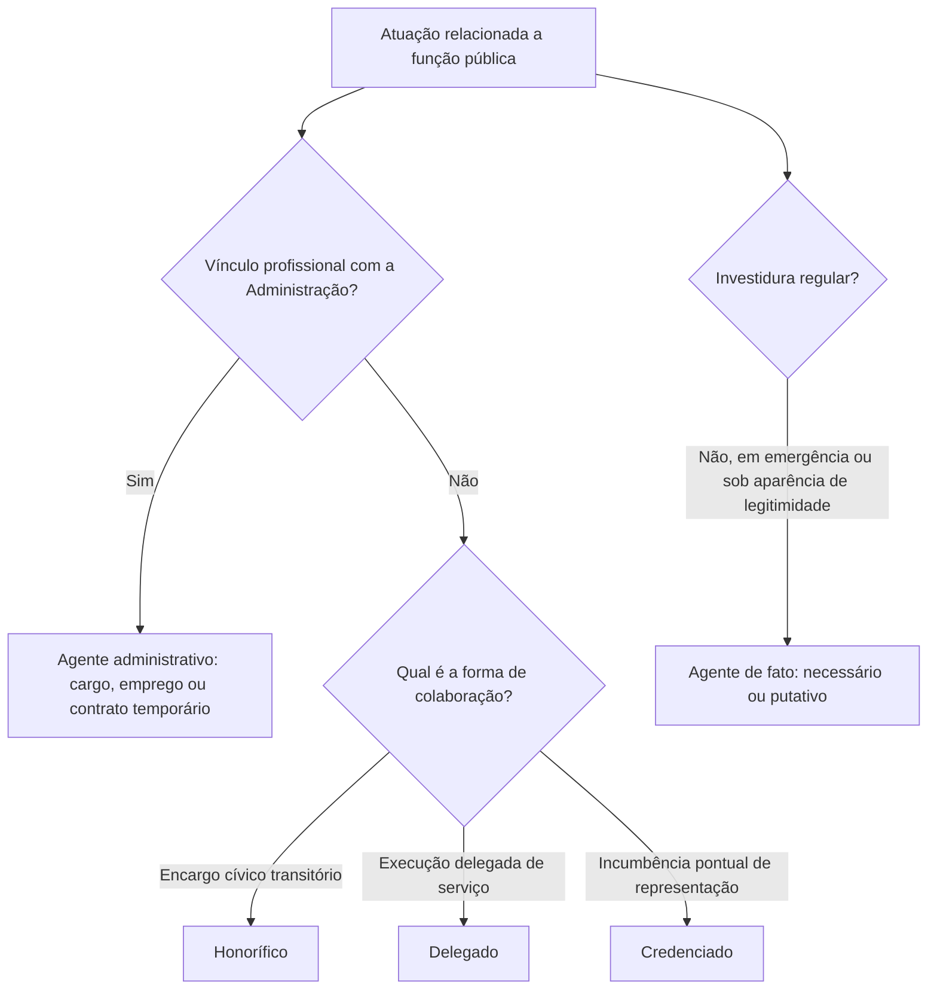

Agente público é a pessoa física que exerce uma função atribuída ao Estado ou a outra entidade da Administração. A expressão é ampla: inclui quem ocupa cargo permanente, quem presta serviço por período curto e até quem atua sem remuneração. O capítulo organiza as categorias mais frequentes em prova e mostra por que a classificação depende do critério doutrinário adotado. Também distingue o agente regularmente investido daquele que atua em situação excepcional ou sob investidura irregular.

> [!objetivos]
> - Definir agente público em sentido amplo.
> - Distinguir agentes políticos, administrativos e particulares em colaboração.
> - Reconhecer agentes honoríficos, delegados e credenciados.
> - Explicar as espécies e os efeitos da atuação do agente de fato.

## Conceito amplo de agente público

O Estado é uma pessoa jurídica e precisa de pessoas naturais para praticar atos e manifestar sua vontade. Pela teoria do órgão, a atuação do agente, quando dentro das atribuições, é imputada à pessoa jurídica pública. A Lei de Improbidade Administrativa também alcança quem, com ou sem pagamento e por período curto ou duradouro, atua em nome das entidades nela previstas após escolha eleitoral, nomeação, designação, contratação ou outra forma de ingresso para exercer mandato, cargo, emprego ou função (Lei 8.429/1992, art. 2º).

Assim, a duração e a forma do vínculo não decidem sozinhas se alguém é agente público. Uma pessoa convocada para atuar numa mesa eleitoral exerce função pública embora não seja servidora de carreira. Um empregado de empresa concessionária também desempenha função pública enquanto executa o serviço delegado, ainda que seu vínculo de emprego seja privado. O estagiário que auxilia uma unidade estatal, por sua vez, atua em colaboração com a Administração, mas isso não o transforma em titular de cargo efetivo.

As classificações organizam situações diferentes para facilitar o estudo. Não há uma única taxonomia doutrinária universal. Alguns autores agrupam particulares colaboradores; outros separam honoríficos, delegados e credenciados. Em concurso, identifique a categoria pelo modo de ingresso, pela natureza da atividade e pelo vínculo, sem supor que todo agente público seja servidor estatutário.

> [!pegadinha]
> “Agente público” é gênero. “Servidor público estatutário” é apenas uma das espécies. A ausência de remuneração ou a curta duração do serviço não exclui automaticamente a condição de agente público.

## Agentes políticos

Agentes políticos exercem funções de direção superior do Estado e participam da formação ou execução das decisões fundamentais de governo. A categoria clássica inclui chefes do Executivo e seus auxiliares imediatos, além de parlamentares. O modo de investidura varia: titulares do Executivo e legisladores são eleitos; ministros e secretários são nomeados; magistrados e integrantes do Ministério Público ingressam, em regra, mediante concurso, embora algumas posições superiores tenham forma diversa de escolha.

A expressão não significa que essas pessoas estejam fora da Constituição ou imunes a controle. Suas competências, responsabilidades e garantias são definidas constitucionalmente e em lei. A remuneração por subsídio é comum em diversas dessas funções, mas a forma remuneratória, isoladamente, não determina a classificação. A doutrina diverge sobre incluir magistrados, membros do Ministério Público, diplomatas e integrantes dos Tribunais de Contas. Em decisões relacionadas à vedação ao nepotismo, o STF distinguiu cargos de natureza política de cargos administrativos, e não se deve presumir que todo cargo de alto escalão receba o mesmo tratamento.

Exemplo: uma governadora define prioridades de governo e escolhe os titulares das secretarias. A governadora e os secretários integram o núcleo político-administrativo de direção; o analista concursado que prepara relatórios para uma secretaria é agente administrativo, embora contribua para a decisão.

> [!lei] CF, art. 12, § 2º
> § 2º A lei não poderá estabelecer distinção entre brasileiros natos e naturalizados, salvo nos casos previstos nesta Constituição.

A regra ilustra que a categoria constitucional não depende apenas da posição hierárquica. Também por isso, a classificação funcional deve ser lida com cautela: o vínculo e as atribuições concretas indicam a categoria, e a Constituição prevê expressamente as exceções de nacionalidade.

> [!atencao]
> A banca pode apresentar a classificação de um autor específico. A resposta deve seguir o recorte indicado no enunciado; sem indicação, prefira a composição clássica e reconheça que a inclusão de carreiras jurídicas e de controle varia entre autores.

## Agentes administrativos

Agentes administrativos prestam serviços profissionais à Administração, geralmente com remuneração e sujeição a uma organização hierárquica. O grupo abrange servidores titulares de cargo público, empregados públicos e contratados temporários. A diferença principal está no tipo de vínculo, não na importância do trabalho prestado.

O servidor estatutário ocupa cargo criado por lei e se submete ao estatuto aplicável ao ente e à carreira. O empregado público ocupa emprego e mantém vínculo contratual regido pela legislação trabalhista, sem prejuízo das regras constitucionais próprias do setor público. O temporário é contratado para atender necessidade temporária de excepcional interesse público, nos casos previstos em lei; sua contratação não serve para ocupar de modo permanente posto de provimento efetivo. As forças militares têm regime constitucional e estatutário próprio, que não se confunde com o dos servidores civis.

No sentido penal, o Código Penal utiliza a expressão “funcionário público” com alcance próprio: para efeitos penais, abrange todo aquele que desempenha cargo, emprego ou função pública, ainda que de modo transitório ou sem receber retribuição pecuniária. Essa equiparação penal não altera automaticamente o regime administrativo da pessoa. Um empregado de concessionária pode ser equiparado em hipóteses legais para fins penais sem adquirir, por isso, vínculo estatutário.

| Categoria | Vínculo típico | Exemplo | Ponto de distinção |
| --- | --- | --- | --- |
| Servidor | Cargo e regime estatutário | Analista de secretaria | Vínculo definido por lei |
| Empregado público | Emprego e regime celetista | Empregado de empresa estatal | Vínculo contratual, com exigências públicas |
| Temporário | Contrato por prazo determinado | Profissional contratado em emergência de saúde | Necessidade temporária prevista em lei |

## Particulares em colaboração com o Estado

Particulares em colaboração não integram necessariamente os quadros permanentes da Administração. Atuam em tarefas públicas por convocação, delegação ou credenciamento. A categoria geral pode ser subdividida em agentes honoríficos, delegados e credenciados.

Agentes honoríficos são cidadãos chamados a colaborar de modo transitório em razão de dever cívico, capacidade ou reconhecimento público. Jurados e mesários eleitorais são exemplos usuais. Em regra não têm vínculo empregatício ou estatutário, nem remuneração ordinária; a lei pode prever compensação ou vantagem pelo encargo. O serviço é um múnus público, isto é, um dever ou encargo de interesse coletivo. Por não ocuparem cargo ou emprego remunerado, não se aplica a eles automaticamente a vedação constitucional de acumulação remunerada de cargos.

Agentes delegados são particulares que recebem do Poder Público a execução de serviço ou atividade, em nome próprio e sob fiscalização estatal. Concessionários e permissionários de serviço público e titulares de serviços notariais e de registro exemplificam a categoria. A concessão não os integra ao quadro de servidores: eles atuam em nome próprio, dentro das condições do ajuste e das normas de fiscalização. A delegação não transforma o particular em órgão estatal: ele executa atividade pública segundo o regime legal e responde pelos atos que pratica. A Constituição responsabiliza objetivamente as entidades privadas que prestem serviço público pelos prejuízos causados por seus agentes durante a execução. Após indenizar a vítima, a entidade pode cobrar do responsável quando este agiu com dolo ou culpa (CF, art. 37, § 6º). A Lei do Mandado de Segurança inclui entre as autoridades os representantes ou órgãos de partidos políticos e os administradores de entidades autárquicas, bem como dirigentes de pessoas jurídicas no exercício de atribuições do Poder Público, no que disser respeito a essas atribuições (Lei 12.016/2009, art. 1º, § 1º).

Agentes credenciados recebem incumbência para representar ou executar atividade específica em nome da Administração, conforme os limites do credenciamento. Imagine que uma secretaria credencie uma especialista para representar o Estado em reunião técnica internacional e pague as despesas e a remuneração pactuadas. A missão delimitada não cria vínculo de servidor nem delega, por si só, a prestação geral de um serviço público.

| Espécie colaboradora | Como atua | Exemplo típico |
| --- | --- | --- |
| Honorífico | Encargo transitório de caráter cívico ou relevante | Jurado ou mesário |
| Delegado | Executa atividade pública por delegação, sob fiscalização | Concessionária de transporte |
| Credenciado | Recebe incumbência específica de representação ou atuação | Especialista designado para missão técnica |

> [!bizu]
> Honorífico: convocação cívica. Delegado: execução delegada em nome próprio. Credenciado: missão específica em nome da Administração.

## Agente de fato e proteção da confiança

Agente de fato é quem exerce função pública sem investidura regular, em circunstância excepcional. A doutrina costuma distinguir o agente necessário e o putativo. O necessário intervém diante de urgência ou calamidade para proteger pessoas ou bens quando a atuação estatal regular não está disponível. O putativo aparenta estar investido de modo legítimo, embora exista defeito na investidura que não era evidente para terceiros.

Suponha que, durante uma enchente em área isolada, uma bombeira da reserva organize voluntariamente o abrigo municipal até a chegada da equipe oficialmente responsável. Sua intervenção urgente caracteriza, em tese, atuação necessária. Em outro caso, um candidato nomeado e empossado inicia o trabalho, mas a nomeação é depois anulada por vício no concurso que ele desconhecia: durante o período de aparência de regularidade, sua atuação se aproxima da figura do agente putativo.

A teoria da aparência e a proteção da boa-fé justificam preservar, em regra, efeitos externos dos atos praticados perante terceiros que confiaram legitimamente na investidura aparente. Isso não significa validar qualquer ato, dispensar controle de legalidade ou assegurar ao agente irregular permanência no cargo. A solução deve considerar a natureza do vício, a boa-fé dos terceiros, o interesse público e o regime remuneratório aplicável. A Administração não deve obter trabalho sem pagar a contraprestação correspondente, mas cada caso exige exame dos fatos e da base legal.

> [!pegadinha]
> O agente de fato não é agente regularmente investido. A preservação de efeitos perante terceiros de boa-fé protege a segurança das relações; não convalida automaticamente a investidura nem todos os atos internos.

## Mapa do capítulo

| Grupo | Elemento central | Exemplo | Atenção de prova |
| --- | --- | --- | --- |
| Político | Direção superior e decisões de governo | Chefe do Executivo | Alcance doutrinário variável |
| Administrativo | Prestação profissional à Administração | Servidor, empregado, temporário | Distinguir vínculo e regime |
| Honorífico | Encargo cívico transitório | Jurado | Em regra sem vínculo |
| Delegado | Atividade pública delegada e fiscalizada | Concessionário | Responsabilidade conforme CF, art. 37, § 6º |
| Credenciado | Missão individual delimitada | Representante em evento | Não confundir com concessão |
| Militar | Regime constitucional próprio | Bombeiro militar estadual | Não confundir com servidor civil |
| De fato | Exercício sem investidura regular em situação excepcional | Atuação em calamidade | Boa-fé pode preservar efeitos externos |

A remuneração não é o critério isolado para classificar um colaborador. Um mesário pode receber compensação prevista em lei e continuar no grupo honorífico; uma empresa delegatária pode receber tarifa dos usuários conforme o contrato e não se tornar órgão estatal. Já o credenciamento delimita uma tarefa específica, sem transferir em bloco a execução de um serviço. Em questão objetiva, observe quem convocou ou autorizou a atuação, qual atividade foi atribuída e por quanto tempo.

A expressão “agente de fato” também não deve servir como rótulo genérico para qualquer ilegalidade administrativa. A figura descreve uma atuação funcional sem investidura regular, mas o regime de cada ato exige avaliação própria. A aparência da investidura pode proteger o terceiro que confiou no ato; o agente continua sujeito a apuração e a Administração deve corrigir a situação para o futuro. Não se presume estabilidade nem direito à permanência no posto.

O quadro pode ser memorizado por três perguntas. Primeiro: a pessoa ocupa uma função estatal ou participa da execução de atividade pública? Se sim, pode estar no conceito amplo de agente. Segundo: qual é o vínculo? Cargo estatutário, emprego celetista e contrato temporário conduzem a regimes diferentes. Terceiro: se não há vínculo profissional permanente, a atuação decorre de encargo cívico, delegação de serviço ou missão específica? Essa sequência evita que a nomenclatura formal substitua a análise funcional.

O esquema não substitui as categorias constitucionais nem cria uma hierarquia entre elas. Ele funciona como roteiro de classificação. Em provas, a descrição pode misturar sinais: um particular pode receber valores e, ainda assim, não manter vínculo trabalhista com o Estado; uma pessoa convocada por prazo curto pode exercer encargo público sem integrar o quadro. A pergunta relevante é a natureza jurídica da relação e da tarefa.

Quando as categorias se sobrepõem na linguagem comum, o candidato deve evitar um atalho equivocado: “trabalha para o governo, logo é servidor”. A pessoa jurídica estatal também contrata empregados, utiliza temporários, delega serviços e convoca particulares para encargos cívicos. Cada relação tem fonte normativa, forma de seleção, direitos e responsabilização próprios. A categoria pode ainda mudar ao longo do tempo: um indivíduo pode deixar de exercer um cargo e, posteriormente, atuar em outra condição. Analise a situação no momento do fato, identificando qual função era exercida e com que título.

Um exemplo prático ajuda a fixar: a pessoa que integra conselho municipal como representante da comunidade não se torna automaticamente servidora estatutária. É preciso verificar a lei de criação do conselho, o modo de designação, o eventual pagamento e a natureza da participação. Se ela participa de reuniões periódicas por encargo cívico, a classificação honorífica pode ser pertinente. Se uma profissional é contratada por prazo certo para atividade transitória, o enquadramento como temporária depende da lei e do contrato, não do nome informal usado pela chefia. Se uma entidade privada recebe concessão para transportar passageiros, a relação é de delegação, sujeita à fiscalização do poder concedente.

Em resumo, a pergunta “quem é agente público?” deve ser respondida pelo papel exercido e pela norma que disciplina a atuação. A pessoa pode estar sujeita a dever público sem integrar o quadro permanente; de modo inverso, trabalhar em uma entidade que presta serviço de interesse público não basta, sem mais, para atribuir a alguém o mesmo vínculo dos servidores. Essa distinção permite compreender por que a expressão ampla convive com categorias de pessoal mais estreitas.

Essa cautela é especialmente útil quando a questão pede a aplicação de uma regra dirigida a “agente público”. O alcance da expressão pode variar de ramo para ramo. A lei de improbidade possui definição ampla para seu próprio campo; a legislação penal traz uma equiparação funcional; e o regime de pessoal define categorias de servidores, empregados e temporários. Portanto, uma resposta correta precisa indicar o contexto jurídico e não importar automaticamente a definição de uma lei para outro tema.

### Para fixar

- Agente público é expressão ampla e pode incluir atuação transitória ou sem remuneração.
- Servidor estatutário, empregado público e temporário têm vínculos distintos.
- Agentes políticos exercem direção superior, mas a lista doutrinária não é uniforme.
- Honoríficos colaboram por encargo cívico transitório.
- Delegados executam atividade pública por delegação e sob fiscalização.
- Credenciados recebem missão específica de representação ou atuação.
- Agente necessário atua em emergência; o putativo aparenta investidura regular.
- A proteção de terceiros de boa-fé não torna regular a investidura viciada.
