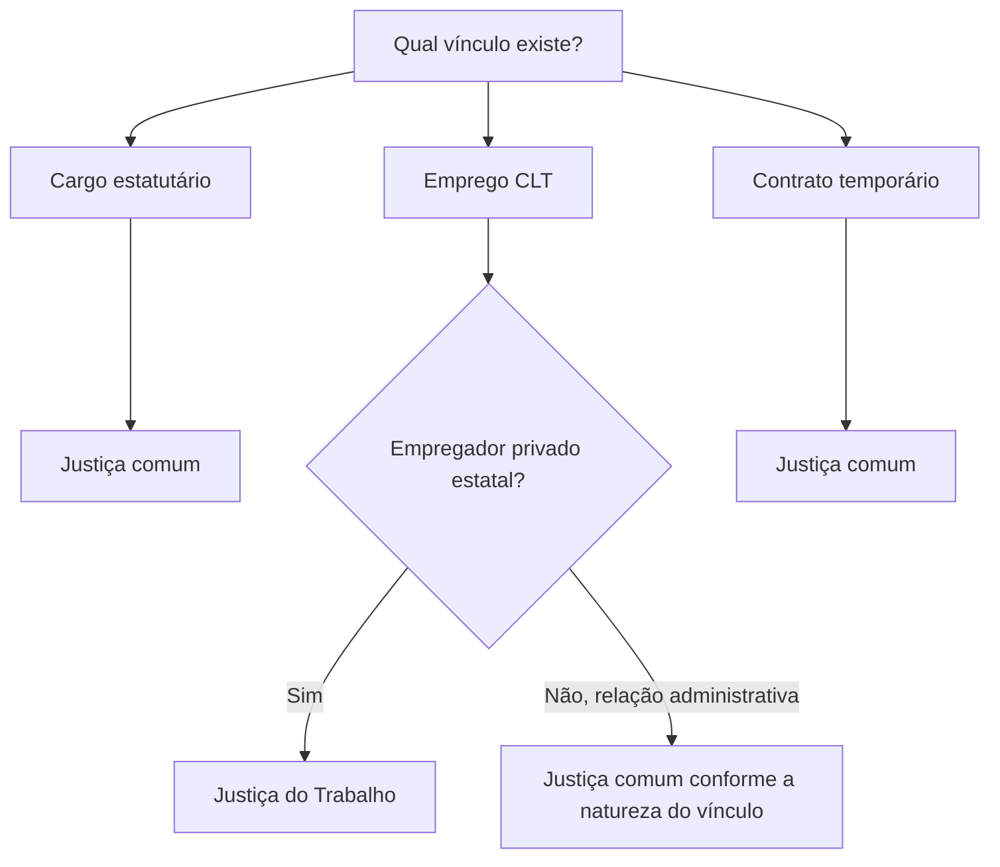

Este capítulo distingue três noções que aparecem juntas nos editais: cargo, emprego e função pública. A diferença importa porque define o vínculo da pessoa com a Administração, as regras aplicáveis e, em certas situações, a Justiça competente para julgar o conflito. Também são comparados o regime estatutário e o celetista. A Constituição continua a exigir concurso para a investidura em cargo ou emprego, mas o tipo de vínculo e a natureza do ente público não devem ser confundidos.

> [!objetivos]
> - Diferenciar cargo, emprego e função pública.
> - Identificar função de confiança, cargo em comissão e contratação temporária.
> - Comparar os regimes estatutário, celetista, temporário e militar.
> - Aplicar as regras gerais de competência jurisdicional.

## Cargo, emprego e função

Cargo público é um conjunto de atribuições e responsabilidades criado por lei, com denominação e remuneração próprias. Seu titular é servidor público submetido a regime estatutário. O cargo pode ser efetivo, provido após concurso e sujeito a estágio probatório, ou em comissão, de livre nomeação e exoneração nos limites constitucionais. O cargo em comissão não pode servir para atribuições burocráticas comuns: a Constituição restringe sua finalidade a direção, chefia e assessoramento (art. 37, V).

Emprego público é posto de trabalho cujo vínculo é contratual e regido principalmente pela CLT. Seu ocupante é empregado público. Empresas públicas e sociedades de economia mista contratam, em regra, por emprego, mas a distinção não depende exclusivamente de a entidade ter personalidade de direito privado: o ordenamento também prevê vínculos de emprego em certas entidades e situações específicas.

Função pública descreve as tarefas exercidas por um agente. Todo cargo ou emprego envolve funções; porém, há funções autônomas, atribuídas sem a criação de cargo ou emprego permanente. São exemplos relevantes a função de confiança e a função temporária. Função de confiança só pode ser exercida por ocupante de cargo efetivo e destina-se a direção, chefia ou assessoramento. Cargo em comissão, por sua vez, pode ser ocupado por pessoa sem vínculo efetivo, observados os percentuais e condições legais de reserva para servidores de carreira.

| Elemento | Cargo | Emprego | Função |
| --- | --- | --- | --- |
| Conceito | Posição com atribuições e responsabilidades | Posto sob vínculo contratual trabalhista | Tarefas atribuídas ao agente |
| Ocupante típico | Servidor estatutário | Empregado público | Pode haver cargo, emprego ou função autônoma |
| Regime comum | Estatuto legal | CLT e contrato | Varia conforme o vínculo de origem |
| Exemplo | Analista de órgão estadual | Empregado de sociedade de economia mista | Chefia designada a servidor efetivo |

## Cargos em comissão e funções de confiança

As duas figuras se destinam às atividades de direção, chefia e assessoramento, mas não têm o mesmo regime de investidura. A função de confiança pressupõe que a pessoa já ocupe cargo efetivo. O cargo em comissão é um cargo público para o qual a escolha é livre, nos limites da lei, e a exoneração pode ocorrer sem as garantias de permanência próprias do cargo efetivo. A lei deve estabelecer os casos, condições e percentuais mínimos em que cargos em comissão serão preenchidos por servidores de carreira.

Imagine que um órgão estadual designe uma analista concursada para coordenar equipe, sem criar novo cargo: trata-se de função de confiança. Se o órgão nomeia uma pessoa para o posto de diretor criado em lei, de livre nomeação e exoneração, trata-se de cargo em comissão. Em nenhum dos casos se autoriza usar a estrutura de confiança para manter atividades técnicas ordinárias sem concurso.

> [!pegadinha]
> Função de confiança é exclusiva de servidor titular de cargo efetivo. Cargo em comissão admite nomeação de pessoa sem cargo efetivo, mas sua finalidade constitucional é restrita e a lei deve prever percentuais de ocupação por servidores de carreira.

## Regime estatutário

O regime estatutário é formado por normas legais que organizam a relação entre o ente público e o titular de cargo. Cada ente federativo pode instituir o estatuto de seus servidores, respeitadas a Constituição e as normas nacionais aplicáveis. Na União, a Lei 8.112/1990 disciplina os servidores civis federais da administração direta, das autarquias e das fundações públicas federais abrangidas por ela; estados e municípios possuem legislação própria.

Por ser uma relação legal, direitos e deveres decorrem da lei, e sua alteração legislativa não exige consentimento individual do servidor. Isso não significa que o Poder Público possa violar a Constituição, retroagir livremente ou retirar vantagens cujos requisitos já se completaram, segundo a disciplina aplicável. A jurisprudência constitucional não reconhece direito adquirido à imutabilidade de todo o regime jurídico, mas protege situações juridicamente consolidadas.

O servidor efetivo pode adquirir estabilidade após três anos de efetivo exercício e avaliação especial de desempenho, conforme o art. 41 da Constituição. Estabilidade é garantia de permanência no serviço público sob condições constitucionais; não é sinônimo de vitaliciedade, nem impede a perda do cargo nas hipóteses constitucionais. O servidor em cargo exclusivamente comissionado não adquire estabilidade pelo simples decurso do tempo.

## Regime celetista

O regime celetista se baseia em contrato de trabalho submetido à Consolidação das Leis do Trabalho. A Administração não pode tratar o vínculo como se fosse um contrato privado comum em todos os aspectos: a admissão depende de concurso público, salvo exceção constitucional, e incidem princípios administrativos, regras de teto e restrições constitucionais à acumulação, conforme o caso.

Empregado público não adquire estabilidade do art. 41, reservada a servidores nomeados para cargo efetivo. Ainda assim, o STF decidiu que a dispensa de empregado concursado de empresa pública ou sociedade de economia mista deve ser formalmente motivada em fundamento razoável. A exigência de motivação não equivale a estabilidade, não impõe necessariamente justa causa trabalhista e não converte a demissão em processo administrativo disciplinar (RE 688.267, julgamento concluído em 2024). A razão apresentada fica sujeita ao controle judicial de legalidade.

Exemplo: uma empresa estatal de transporte decide encerrar o vínculo de uma empregada concursada. Não precisa demonstrar falta grave nos moldes da justa causa, mas deve formalizar uma justificativa razoável. A simples afirmação de que a dispensa é livre, sem explicação, não atende à tese firmada pelo STF.

## Temporários e militares

A Constituição permite contratação por tempo determinado para atender necessidade temporária de excepcional interesse público, nos casos estabelecidos em lei (art. 37, IX). O contratado temporário exerce função pública sob regime especial de direito administrativo, disciplinado pela lei do respectivo ente. Não é servidor efetivo e a contratação não pode ser usada para suprir, indefinidamente, a necessidade normal e permanente de pessoal. Na esfera federal, a Lei 8.745/1993 trata de hipóteses específicas.

Os militares submetem-se a regime próprio, distinto do estatuto civil. As Forças Armadas e os militares dos estados, do Distrito Federal e dos Territórios têm normas constitucionais específicas, inclusive sobre hierarquia, disciplina, direitos e deveres. Assim, a referência genérica a “servidor público” pode não resolver a questão: o enunciado pode exigir que se reconheça um regime constitucional especial.

| Vínculo | Base principal | Estabilidade do art. 41? | Exemplo |
| --- | --- | --- | --- |
| Cargo efetivo estatutário | Estatuto do ente | Pode adquirir após os requisitos constitucionais | Oficial administrativo estadual |
| Cargo em comissão | Lei de criação e regime estatutário | Não decorre da comissão | Diretor nomeado |
| Emprego público | CLT e contrato | Não | Empregado de estatal |
| Temporário | Lei local e contrato especial | Não | Reforço temporário em calamidade |
| Militar | Constituição e estatuto militar | Não se aplica o modelo civil do art. 41 | Bombeiro militar |

## Regime jurídico único e competência

A redação original da Constituição previa um regime jurídico único para os servidores da administração direta, das autarquias e das fundações públicas de cada ente. A Emenda Constitucional 19/1998 alterou o art. 39 e retirou essa exigência. Em medida cautelar, o STF suspendeu a eficácia dessa alteração; no julgamento de mérito da ADI 2.135, concluído em 2024, reconheceu a validade da mudança, com efeitos prospectivos. Assim, a Constituição não impõe hoje que toda administração direta, autárquica e fundacional mantenha apenas uma espécie de vínculo. A decisão não converte automaticamente vínculos já existentes nem elimina a necessidade de lei para criar cargos ou empregos.

> [!atencao]
> O fim da obrigatoriedade de regime único não aboliu o regime estatutário. Os entes podem organizar seus quadros conforme a Constituição, a lei e a natureza das funções. Regras consolidadas e vínculos existentes não mudam automaticamente por causa da decisão do STF.

A competência judicial depende do tipo de vínculo e, também, da natureza jurídica da entidade. Em linhas gerais, litígios de servidor estatutário e de contratado temporário são julgados pela Justiça comum. Conflitos trabalhistas de empregado de empresa estatal de direito privado são da Justiça do Trabalho. Para empregados vinculados a pessoa jurídica de direito público, a competência pode ser da Justiça comum, conforme a orientação do STF que afasta a competência trabalhista quando se discute relação jurídico-administrativa. A fase pré-contratual de concurso também costuma ser examinada pela Justiça comum, pois ainda não há contrato de emprego.

| Situação discutida | Justiça em regra | Razão central |
| --- | --- | --- |
| Servidor estatutário | Comum | Vínculo jurídico-administrativo |
| Contratado temporário | Comum | Relação administrativa especial |
| Empregado de empresa estatal privada | Trabalho | Relação de emprego celetista |
| Concurso antes da contratação | Comum | Controvérsia de acesso ao serviço público |

> [!esquema]
> Identifique o vínculo (cargo, emprego ou função); localize a fonte normativa (estatuto, CLT, lei temporária ou regime militar); depois determine os efeitos relevantes, como estabilidade e competência judicial. A personalidade da entidade e o momento da controvérsia podem alterar a resposta sobre a Justiça competente.

## Regime e direitos do agente

A afirmação de que o vínculo é estatutário não resolve todas as perguntas sobre direitos. O estatuto disciplina ingresso, exercício, vantagens, deveres e desligamento, mas cada lei pode estabelecer condições diferentes, desde que compatíveis com a Constituição. Uma alteração legislativa pode reorganizar parcelas remuneratórias ou requisitos para o futuro, mas deve respeitar irredutibilidade e situações já consolidadas nos termos jurídicos aplicáveis. O empregado, por sua vez, tem relação celetista e direitos trabalhistas, sem deixar de obedecer às exigências constitucionais próprias da Administração.

> [!lei] CF, art. 37, II
> II - a investidura em cargo ou emprego público depende de aprovação prévia em concurso público de provas ou de provas e títulos, de acordo com a natureza e a complexidade do cargo ou emprego, na forma prevista em lei, ressalvadas as nomeações para cargo em comissão declarado em lei de livre nomeação e exoneração;

A regra alcança tanto cargos estatutários quanto empregos públicos. A forma contratual não permite a uma estatal contratar livremente sem concurso. A exceção de cargo em comissão deve ser prevista em lei e não pode servir para contornar a exigência em postos técnicos ordinários. A contratação temporária também tem fundamento próprio e não deve ser tratada como um emprego público permanente.

A estabilidade precisa ser distinguida do estágio probatório. Estágio probatório é o período de avaliação do servidor recém-ingresso em cargo efetivo; estabilidade é a garantia constitucional adquirida depois de três anos de efetivo exercício e avaliação especial. O servidor pode ser avaliado antes de alcançar estabilidade e pode ser exonerado se não cumprir os requisitos legais. A Lei 8.112/1990 ainda menciona prazo textual de 24 meses no art. 20, mas o STF consolidou o período de três anos em razão da alteração constitucional. O estudante deve conhecer essa divergência entre letra da lei e regra constitucional aplicada.

> [!exemplo]
> Uma agente administrativa toma posse em cargo efetivo federal e inicia o exercício. Durante o estágio probatório, sua frequência, disciplina, iniciativa, produtividade e responsabilidade são avaliadas. A avaliação não transforma o período em vínculo temporário: ela já é servidora efetiva, mas ainda não adquiriu estabilidade.

## Reorganização administrativa e competência

A extinção da exigência de regime jurídico único não elimina o dever de organizar os quadros em lei. Um ente pode manter apenas servidores estatutários em determinado órgão; o que não pode é ignorar a lei que criou os postos, o concurso aplicável ou os limites constitucionais. A coexistência de regimes também pode elevar a complexidade de gestão, pois pessoas que realizam tarefas semelhantes podem ter direitos e procedimentos distintos, conforme o vínculo de origem.

Para identificar a Justiça competente, evite memorizar somente o nome do cargo. Pergunte: existe contrato de trabalho regido pela CLT? Qual é a natureza jurídica do empregador? A disputa é sobre concurso antes do vínculo ou sobre direitos do contrato já existente? O STF limita a competência trabalhista quando a demanda envolve relação jurídico-administrativa, mesmo que o trabalhador tenha sido contratado por pessoa estatal. Já a reclamação de empregado de sociedade de economia mista por verbas trabalhistas, em regra, segue à Justiça do Trabalho.

### Regime militar e função temporária

Militares estaduais e distritais não seguem integralmente o estatuto dos servidores civis. A Constituição trata de bombeiros e policiais militares em dispositivos próprios e autoriza disciplina específica de hierarquia, disciplina, direitos e deveres. Isso afeta, por exemplo, a forma de ingresso, o regime previdenciário e os deveres funcionais. Não se deve aplicar automaticamente ao militar uma regra de estabilidade civil do art. 41. A terminologia “cargo” pode aparecer em questões sobre estrutura militar, mas o regime constitucional é próprio.

Na função temporária, a relação termina com o prazo ou com a necessidade que justificou a contratação, conforme a lei. Se o mesmo órgão contrata sucessivamente pessoas para executar atribuição permanente, isso pode indicar uso irregular da exceção, mas não converte automaticamente o contratado em titular de cargo efetivo. A irregularidade pode gerar controle e responsabilização, enquanto o ingresso regular em cargo permanente exige concurso.

A questão sobre função deve ser lida com precisão: a palavra pode designar tanto as tarefas gerais vinculadas a cargo ou emprego quanto a função autônoma atribuída sem um posto permanente. Por isso, dizer “todo agente exerce função” não permite concluir que todos ocupem “função pública” no sentido técnico de função de confiança ou contratação temporária.

## Mapa do capítulo

| Instituto | Regra de identificação | Consequência cobrável |
| --- | --- | --- |
| Cargo efetivo | Criação legal e provimento por concurso | Regime estatutário; estabilidade possível |
| Cargo em comissão | Nomeação e exoneração livres nos termos legais | Direção, chefia ou assessoramento |
| Função de confiança | Atribuição a servidor efetivo | Direção, chefia ou assessoramento |
| Emprego público | Vínculo contratual trabalhista | Sem estabilidade do art. 41; dispensa motivada em estatal |
| Temporário | Necessidade transitória prevista em lei | Regime especial, sem efetividade |
| Regime jurídico único | Não é exigência constitucional atual | Cargos e empregos podem coexistir, observada a lei |

### Para fixar

- Cargo é vínculo estatutário; emprego é vínculo celetista; função corresponde às tarefas exercidas.
- Função de confiança é exclusiva de ocupante de cargo efetivo.
- Cargo em comissão destina-se apenas a direção, chefia e assessoramento.
- Estabilidade depende de cargo efetivo, três anos de exercício e avaliação especial.
- Empregado público não tem estabilidade, mas estatal deve motivar formalmente a dispensa.
- Contratação temporária exige necessidade transitória excepcional e hipótese legal.
- Militares têm regime próprio e não se confundem com servidores civis.
- Desde a decisão de 2024, a Constituição não exige regime jurídico único geral.
- Litígio celetista de estatal privada é da Justiça do Trabalho; vínculo estatutário é da Justiça comum.
No atendimento ao público, por exemplo, duas pessoas podem executar tarefas parecidas e ainda ter vínculos diferentes; a lei de criação do posto e o ato de ingresso esclarecem o regime.
 Essa comparação evita confusão em prova.
