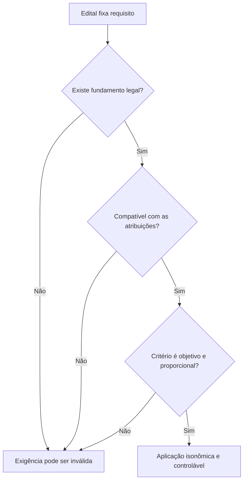

O concurso público concretiza a igualdade de acesso aos cargos e empregos e seleciona candidatos por critérios previamente conhecidos. A regra geral está na Constituição, mas a aplicação exige atenção a quem pode concorrer, quais requisitos podem ser cobrados, quando devem ser comprovados e como se organizam as etapas. Este capítulo examina também cláusulas eliminatórias e de barreira, que parecem semelhantes, mas produzem efeitos diferentes na classificação.

> [!objetivos]
> - Aplicar a regra constitucional de acessibilidade a brasileiros e estrangeiros.
> - Avaliar a validade de exigências de idade, sexo, altura ou tatuagem.
> - Indicar o momento de comprovação dos requisitos de posse.
> - Distinguir concurso, promoção e outras formas de provimento.
> - Diferenciar prova eliminatória de cláusula de barreira.

## Quem pode acessar o serviço público

A Constituição prevê que cargos, empregos e funções públicas são acessíveis a brasileiros que atendam às exigências estabelecidas em lei e a estrangeiros, conforme a lei (art. 37, I). Para brasileiros, a regra é ampla, sem afastar requisitos legais relacionados à função. Para estrangeiros, a expressão constitucional “na forma da lei” condiciona o acesso às hipóteses disciplinadas no ordenamento. A Constituição também reserva determinados postos a brasileiros natos: chefia do Executivo federal, presidência das Casas do Congresso, ministros do STF, carreira diplomática, oficiais das Forças Armadas e Ministro da Defesa (art. 12, § 3º).

Na administração federal, a Lei 8.112/1990 admite que universidades e instituições federais de pesquisa científica e tecnológica provejam cargos com docentes, técnicos e cientistas estrangeiros, conforme as regras do próprio estatuto (art. 5º, § 3º). O STF reconheceu, no Tema 1.032, a possibilidade de nomeação de estrangeiro aprovado para essas posições, ressalvada restrição justificada e expressa no edital para proteger o interesse público. Não se deve generalizar essa abertura a todo cargo público: a lei e as atribuições da função continuam relevantes.

## Requisitos e limites ao edital

Requisitos de investidura devem ter base legal. O edital detalha a seleção, mas não pode criar por conta própria uma restrição substantiva que o legislador não instituiu. Além da reserva legal, a condição precisa ser compatível com as atribuições do cargo e respeitar igualdade e razoabilidade. Regras de saúde, aptidão física ou idade podem variar entre cargos quando a natureza real das tarefas justificar a diferença.

O STF consolidou que ato administrativo não pode, sem lei, limitar por idade a inscrição em concurso (Súmula 14). A Súmula 683 admite limite etário quando justificado pela natureza das atribuições. A idade mínima federal para investidura prevista na Lei 8.112/1990 é de 18 anos (art. 5º, V), sem prejuízo de requisitos específicos válidos. Para carreiras militares, a Constituição permite à lei estabelecer requisitos próprios; a exigência deve ter fundamento legal e relação com o serviço. Um limite pensado para uma função operacional pode não ser adequado a uma especialidade técnica da mesma instituição.

Exigências de estatura ou sexo também dependem de lei e de relação demonstrável com as atividades. Uma regra que exclua indistintamente candidatos de um grupo, sem explicar por que a função exige aquela condição, pode violar igualdade. Quanto às tatuagens, o Tema 838 do STF veda restrição genérica: a limitação exige previsão legal e só se justifica por conteúdo que viole valores constitucionais. Tatuagem discreta, por si só, não demonstra falta de aptidão para o serviço.

| Requisito | Condição geral | Erro frequente |
| --- | --- | --- |
| Idade | Lei e justificativa ligada às atribuições | Edital inventar limite sem lei |
| Sexo | Diferença legalmente sustentada e adequada | Exclusão automática sem relação funcional |
| Estatura | Lei e compatibilidade concreta com o cargo | Usar padrão físico genérico para qualquer carreira |
| Tatuagem | Regra legal; conteúdo ofensivo a valores constitucionais pode justificar restrição | Proibir qualquer tatuagem por edital |

> [!pegadinha]
> “Está no edital” não basta para validar um requisito. O edital deve respeitar a lei, a Constituição e a conexão entre a exigência e as atribuições do cargo.

## Momento de comprovação dos requisitos

O momento ordinário para provar requisitos de investidura é a posse, e não a inscrição no concurso. A Súmula 266 do STJ estabelece que o diploma ou habilitação legal para exercer o cargo deve ser exigido na posse. A regra permite que estudantes participem do certame e concluam a formação durante suas etapas, desde que estejam habilitados quando o vínculo se aperfeiçoar. A lei pode prever exceções ligadas a condições que precisem existir desde a inscrição, mas a Administração não deve antecipar sem base a comprovação de requisito que só é necessário para assumir o cargo.

Exemplo: um candidato cursa o último semestre de formação exigida para um posto técnico. Se o edital exigir o diploma na inscrição sem previsão legal que imponha essa antecipação, há fundamento para questionamento. Se ele é aprovado e conclui o curso antes da posse, atende ao momento ordinário de comprovação. Diferente é a situação em que a lei exige registro profissional válido para o exercício e o candidato não o obtém até a posse.

## Concurso e provimento derivado

A investidura em cargo ou emprego público depende, em regra, de aprovação prévia em concurso de provas ou de provas e títulos (CF, art. 37, II). O concurso deve avaliar conhecimentos e aptidões pertinentes à natureza e à complexidade do posto. A Constituição excepciona a escolha para cargo comissionado cuja lei preveja provimento e exoneração sem concurso. Essa exceção fica limitada às tarefas de direção, chefia e assessoramento. Função de confiança não é cargo ou emprego autônomo e só cabe a servidor efetivo.

Concurso de títulos sem prova não atende à regra geral. Os títulos podem compor a seleção, mas a avaliação de experiência, diplomas e produção acadêmica não pode, sozinha, substituir a aferição por provas, nem a etapa de títulos deve eliminar candidato quando seu papel for apenas classificatório. A lei de determinada carreira pode definir etapas compatíveis com as atribuições, inclusive curso de formação, teste físico e avaliação psicológica sob condições constitucionais e legais.

Provimento é o ato que ocupa um cargo. O provimento originário não depende de vínculo anterior com a Administração e ocorre, tipicamente, pela nomeação após concurso. As formas derivadas movimentam ou reinvestem pessoa já vinculada, dentro das hipóteses constitucionais. Não é possível usar provimento derivado para levar alguém a cargo de carreira distinta sem concurso. A Súmula Vinculante 43 considera inconstitucional modalidade que permita investidura em cargo que não integra a carreira de origem sem aprovação prévia no concurso correspondente.

| Forma | Em que consiste | Compatibilidade constitucional |
| --- | --- | --- |
| Nomeação após concurso | Ingresso inicial no cargo efetivo | Regra para cargo e emprego |
| Promoção na carreira | Ascensão a classe superior da mesma carreira conforme lei | Admitida dentro da carreira |
| Transposição para carreira diferente | Mudança sem concurso para outro conjunto de atribuições | Vedada sem concurso próprio |

## Provas e cláusulas de corte

A Constituição admite seleção por provas ou por provas e títulos. Provas eliminatórias fixam um patamar de desempenho: quem não alcança a nota mínima é excluído, ainda que haja poucas pessoas com nota inferior. A cláusula de barreira limita o número de concorrentes que segue para outra etapa; candidatos podem atingir a nota mínima e, mesmo assim, ficar abaixo do ponto de corte definido no edital. A cláusula deve estar prevista de forma clara e obedecer à lei e aos princípios constitucionais.

Exemplo: num teste objetivo, a nota mínima de 60 pontos é eliminatória. Se 500 candidatos alcançam essa nota, mas o edital permite que só os 120 mais bem classificados avancem ao teste físico, o limite de 120 atua como barreira. Um candidato com 62 pontos passou pela nota mínima, mas pode não prosseguir por sua posição relativa. Uma cláusula eliminatória mede aptidão mínima; a barreira organiza as fases seguintes.

> [!exemplo]
> Na seleção para operador de sala de emergência, a prova técnica exige mínimo de 70 pontos. A prova de títulos soma pontos depois da aprovação. Se o edital convocar apenas os 80 mais bem classificados para a fase seguinte, haverá um corte de convocação, que não se confunde com nota mínima.

Cláusulas de barreira podem reduzir o número de candidatos em fases de alto custo, como exame médico, avaliação psicológica ou investigação social. Sua validade pressupõe previsão anterior, critérios objetivos e aplicação isonômica. A Administração não pode modificar o corte depois de conhecer os resultados para favorecer candidatos específicos. A classificação se faz pelas regras anunciadas e pela ordem de notas; o controle judicial verifica legalidade e não substitui a banca na avaliação técnica ordinária, salvo ilegalidade ou erro evidente.

## Requisitos gerais de investidura

A Lei 8.112/1990 indica requisitos básicos para investidura em cargo federal: nacionalidade brasileira, gozo dos direitos políticos, quitação eleitoral e militar quando cabível, escolaridade exigida, idade mínima de 18 anos e aptidão física e mental (art. 5º). A própria lei permite requisitos adicionais quando as atribuições do cargo os justificarem. A regra não significa que todo requisito listável em edital seja válido: a condição deve estar amparada em norma apropriada e guardar relação com a atividade.

O momento da posse é central para a escolaridade. Diploma e habilitação profissional devem existir quando a pessoa assume, como regra. O candidato pode participar do certame enquanto termina o curso, se o edital não estiver aplicando condição legal que precise ser atendida antes. A aprovação, por si só, não dispensa habilitação: se a pessoa chega à posse sem diploma ou registro indispensável, pode perder a nomeação nos termos legais.

> [!lei] CF, art. 37, I
> I - os cargos, empregos e funções públicas são acessíveis aos brasileiros que preencham os requisitos estabelecidos em lei, assim como aos estrangeiros, na forma da lei;

A Constituição ainda enumera cargos privativos de brasileiro nato. A lista abrange Presidente e Vice-Presidente da República, presidências da Câmara e do Senado, integrante do STF, carreira diplomática, oficial das Forças Armadas e titular da pasta da Defesa (art. 12, § 3º). Não se pode ampliar essa reserva por edital. Também não se deve confundir a nacionalidade brasileira, necessária em certas carreiras, com a exigência de ser brasileiro nato, que só cabe nos casos constitucionais.

| Requisito federal básico | Base | Exemplo de aplicação |
| --- | --- | --- |
| Idade mínima | Lei 8.112, art. 5º, V | Ter 18 anos no momento exigido |
| Escolaridade | Lei e edital | Apresentar formação na posse |
| Aptidão | Lei e atribuições | Avaliação relacionada à tarefa |
| Direitos políticos | Lei 8.112, art. 5º | Estar no gozo dos direitos políticos |

## Acessibilidade e igualdade

A ampla acessibilidade não impede que carreiras tenham etapas físicas, médicas ou de formação. A questão é se a etapa mede aptidão necessária e foi instituída corretamente. Exame que afere força ou resistência pode ser pertinente a atividade operacional; o mesmo parâmetro pode ser inadequado para função exclusivamente técnica. A Administração precisa demonstrar a conexão entre requisito e tarefas, não apenas repetir que o cargo exige “perfil adequado”.

Tatuagem ilustra o limite à discricionariedade do edital. A vedação geral à pessoa tatuada é incompatível com a igualdade; a restrição só pode apoiar-se em lei e em conteúdo que viole valores constitucionais, conforme Tema 838 do STF. A avaliação deve examinar a mensagem efetivamente veiculada, não presumir conduta ou personalidade a partir da existência de tatuagem. Também não é suficiente reprovar por desenhos que a banca considere esteticamente inadequados.

Ações afirmativas e reserva de vagas são compatíveis com o princípio da igualdade material. A Administração precisa dar publicidade aos critérios, aplicar regras consistentes e permitir recurso quando a lei prevê etapa de confirmação. Isso não autoriza critérios discriminatórios. Uma exigência de altura que exclua pessoas sem demonstrar a necessidade para as atribuições pode violar isonomia; uma regra associada a tarefa física essencial precisa ser proporcional, prevista em lei e aplicada sem distinções arbitrárias.

> [!atencao]
> Isonomia não é tratar sempre todas as pessoas de modo idêntico. A diferenciação é legítima quando a Constituição ou a lei a autoriza e quando ela corrige desigualdade ou corresponde às atribuições do posto.

| Restrição | Teste constitucional | Exemplo de análise |
| --- | --- | --- |
| Idade máxima | Lei formal e relação com atribuições | Carreira operacional pode ter necessidade diversa de função médica |
| Estatura | Previsão legal e proporcionalidade | Medir requisito real da atividade, não estereótipo |
| Tatuagem | Lei e conteúdo incompatível com valores constitucionais | Não excluir pela simples presença de desenho |
| Formação | Escolaridade exigida em norma | Momento ordinário de comprovação é a posse |

## Concursos e fases de avaliação

A Administração deve desenhar as provas conforme natureza e complexidade do cargo. A seleção pode ter provas ou provas e títulos. Prova objetiva, discursiva e prática podem medir conhecimentos e habilidades; teste físico e avaliação médica podem ser adequados quando as tarefas assim exigirem. Etapas devem ter critérios claros, pontuação verificável e regras de recurso. A escolha de questões e a correção técnica não são refeitas livremente pelo Judiciário, mas ilegalidade, erro material ou violação ao edital podem ser controlados.

A prova de títulos não deve ser tratada como substituto de prova de conhecimento. Ela acrescenta pontos dentro dos limites anunciados, em caráter classificatório. Certificados, experiência, especialização ou produção acadêmica só contam se a regra do edital os reconhecer e se o candidato demonstrar a titularidade conforme os prazos. O edital deve dizer se a pontuação é máxima e como documentos equivalentes serão avaliados; critérios genéricos abrem espaço a discricionariedade indevida.

A cláusula eliminatória e a de barreira têm efeitos diferentes. A primeira fixa uma nota mínima ou aptidão indispensável; a segunda restringe o número que avança, mesmo que outros tenham atingido o mínimo. Uma pessoa pode tirar 70 pontos e ser aprovada na prova objetiva, mas não entrar entre os 300 primeiros chamados ao exame discursivo. Se o mínimo era 60, ela não foi eliminada pela nota; ficou fora da fase seguinte por barreira de classificação.

| Regra de corte | O que mede | Resultado de quem não avança |
| --- | --- | --- |
| Nota mínima | Conhecimento ou aptidão mínima | Eliminação por insuficiência |
| Número máximo para próxima etapa | Posição relativa no grupo | Não convocação mesmo com nota suficiente |
| Pontuação de títulos | Qualificação adicional | Altera a ordem, sem substituir aprovação nas provas |

> [!exemplo]
> No certame de uma equipe de resgate, a etapa escrita exige 60 pontos e até 300 pessoas podem seguir para o teste físico. Quem faz 58 é eliminado pela nota. Quem faz 75, mas termina em 320º, atingiu o mínimo e fica fora da convocação por cláusula de barreira, se ela estava clara no edital.

## Concurso e promoção na carreira

Concurso é requisito para a investidura inicial em cargo ou emprego, com as exceções constitucionais. Depois do ingresso, a promoção pode permitir ascensão a classe superior dentro da mesma carreira, segundo critérios legais de antiguidade, merecimento ou avaliação. Não se trata da mesma situação que transpor o servidor a outra carreira, com atribuições, formação ou quadro próprios. A Súmula Vinculante 43 veda modalidade de provimento que permita investidura em cargo que não integra a carreira de origem sem aprovação em concurso destinado a esse cargo.

> [!pegadinha]
> Promoção na mesma carreira, com critérios legais, não autoriza acesso a carreira distinta sem concurso. Uma mudança de nome ou reestruturação administrativa não afasta a necessidade de comparar atribuições, requisitos e estrutura dos cargos.

Exemplo: agente de apoio pode progredir de classe dentro da carreira, se o estatuto assim prevê. Não pode ser transformado em analista de sistemas sem concurso próprio só porque trabalhou alguns anos numa área de tecnologia. A experiência adquirida pode ser valorizada em processo seletivo quando a lei permitir, mas não substitui o requisito constitucional de ingresso.

> [!bizu]
> Para cada restrição, pergunte: lei? pertinência? proporcionalidade? O edital não substitui nenhuma das três.

## Recurso e controle das etapas

A possibilidade de recurso deve acompanhar o desenho da seleção. Se o candidato é eliminado por exame psicológico, teste físico ou verificação documental, é relevante conhecer o fundamento e a regra aplicada. A resposta administrativa deve indicar o critério, os fatos que levaram ao resultado e o meio de revisão disponível. Sem informação suficiente, fica comprometido o controle da legalidade e a própria possibilidade de corrigir erro material.

Isso não significa que toda discordância do candidato provoque nova avaliação por órgão judicial. A banca tem espaço técnico para corrigir provas e aferir aptidões dentro das regras. O controle se dirige a ilegalidade, ausência de motivação quando exigida, desrespeito ao edital, erro aritmético, aplicação desigual ou critério incompatível com a lei. Uma avaliação de aptidão não pode ser usada para encobrir discriminação, e o recurso não pode ser negado com fórmula genérica que apenas repita “inapto”.

Nos concursos com várias etapas, a aprovação em uma fase não garante a convocação até o fim quando o edital prevê barreira válida. A pessoa pode contestar a regra se ela não estava publicada, foi alterada depois ou não foi aplicada igualmente. Já a mera frustração com a posição obtida não basta para desconstituir a classificação. O candidato precisa apontar qual regra foi violada e demonstrar como a falha afetou sua situação.

O candidato também deve acompanhar publicações oficiais enquanto o concurso está em andamento. Convocação, retificação e resultado podem trazer prazo curto para apresentação de documentos ou interposição de recurso. A falta de leitura pode levar à perda de oportunidade, embora a Administração continue obrigada a dar publicidade adequada aos atos. O edital serve como regra do certame, mas não substitui a lei, e alterações posteriores não podem surpreender candidatos com mudança arbitrária das condições.

## Mapa do capítulo

| Tema | Regra principal | Exceção ou limite |
| --- | --- | --- |
| Acesso | Brasileiros e estrangeiros na forma constitucional e legal | Cargos reservados a brasileiros natos |
| Requisito do edital | Base legal e pertinência com atribuições | Condição não pode ser criada apenas pelo edital |
| Diploma | Comprovação ordinária na posse | Exigência legal específica válida |
| Investidura | Concurso de provas ou de provas e títulos | Cargo em comissão previsto em lei |
| Provimento derivado | Permitido dentro da carreira nos termos legais | Vedada transposição sem concurso |
| Etapa eliminatória | Exige nota ou desempenho mínimo | Reprova quem não alcança o patamar |
| Barreira | Limita classificados para etapa posterior | Deve estar prevista e ser objetiva |

### Para fixar

- Acesso a cargos por estrangeiros depende de lei e do regime constitucional aplicável.
- Cargos privativos de brasileiro nato estão enumerados no art. 12, § 3º, da Constituição.
- Requisitos de acesso precisam de lei e de compatibilidade com as tarefas do cargo.
- Limite etário exige lei e justificativa ligada às atribuições.
- A Súmula 266 do STJ aponta a posse como momento de comprovação do diploma.
- Concurso público é a regra para investidura em cargo ou emprego.
- Promoção dentro da carreira não se confunde com transposição para carreira distinta.
- Prova de títulos não substitui a etapa de provas da regra constitucional.
- Nota mínima é cláusula eliminatória; número máximo de classificados configura barreira.
