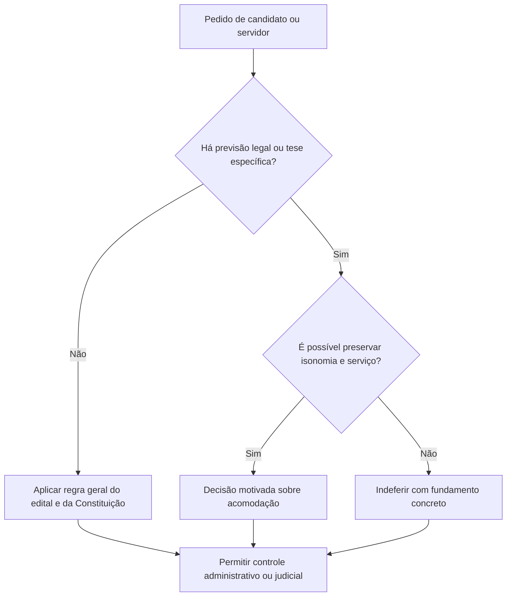

Nem toda controvérsia de concurso se resume à nota obtida. Há situações em que o candidato pede uma nova data para etapa física, invoca liberdade religiosa, questiona exame psicológico ou discute a abertura de novo certame enquanto ainda há aprovados. Este capítulo reúne essas regras e separa o tratamento do candidato daquele aplicável ao servidor que já exerce função pública. O objetivo é reconhecer a regra geral, localizar a exceção e identificar o fundamento jurídico exigido.

> [!objetivos]
> - Distinguir cláusulas eliminatórias e de barreira.
> - Aplicar as regras de remarcação de prova física e de adaptação religiosa.
> - Identificar os requisitos legais do exame psicotécnico.
> - Reconhecer exceções constitucionais ao concurso.
> - Aplicar o prazo de validade e a preferência entre aprovados.

## Remarcação de teste físico

Como regra, o candidato não tem direito a remarcar o teste de aptidão física por circunstância pessoal ou força maior, quando o edital não autorizar a alteração. No RE 630.733, o STF assentou que fatores pessoais, inclusive fisiológicos, não geram por si só uma segunda chamada. A uniformidade do calendário protege a isonomia entre concorrentes. A própria regra editalícia pode permitir remarcação em situações delimitadas e deve então ser aplicada de modo igual a todos que se encontrem nas mesmas condições.

Há exceção constitucional para candidata grávida à época do teste. No Tema 973, o STF reconheceu a possibilidade de nova data mesmo sem autorização expressa no edital. O adiamento preserva a saúde da gestante e do nascituro, sem dispensar a avaliação física: a candidata realiza o teste em momento apropriado. O direito não decorre de qualquer impedimento individual, mas da proteção específica à maternidade e à igualdade material.

Exemplo: um candidato sofre uma lesão esportiva na véspera do teste. Se o edital não previr nova oportunidade, a regra geral não lhe assegura remarcação. Já uma candidata que esteja grávida no dia marcado pode requerer a realização em outra data, conforme os parâmetros firmados pelo STF, mesmo que o edital seja omisso.

## Liberdade religiosa e obrigações funcionais

A liberdade de consciência e crença pode exigir acomodação razoável de data, horário ou forma de cumprir deveres públicos. O Tema 386 do STF trata do candidato que pede etapa em horário diferente por motivo religioso. O Tema 1.021 (ARE 1.099.099) aborda servidor que pede critério alternativo para cumprir dever funcional, inclusive durante o estágio probatório. Em ambos, a Administração deve ponderar a liberdade religiosa e a organização do serviço, sem presumir que toda solicitação seja automaticamente deferida ou recusada.

Para o candidato, a mudança deve preservar igualdade entre os participantes, não impor ônus desproporcional à Administração e ser decidida de forma fundamentada. O procedimento alternativo deve permitir avaliação equivalente, sem acesso privilegiado ao conteúdo da prova. Para servidor, a adaptação não pode inviabilizar as atribuições essenciais do cargo. Um ajuste de escala pode ser possível; a dispensa permanente de tarefa central da função pode não ser.

| Pedido | Tema STF | Condições relevantes |
| --- | --- | --- |
| Candidato realiza prova em horário ou dia alternativo | 386 | Igualdade dos concorrentes, razoabilidade e ausência de ônus desproporcional |
| Servidor adapta modo de cumprir dever funcional | 1.021 | Decisão motivada e preservação das tarefas essenciais |
| Candidata gestante remarca teste físico | 973 | Gravidez na época do teste; independe de previsão editalícia |

> [!pegadinha]
> A proteção religiosa não significa que a Administração deva aceitar toda acomodação pedida. O pedido exige análise individual, decisão motivada e compatibilidade com o serviço e com a isonomia.

## Exame psicotécnico

O exame psicológico, também chamado psicotécnico, só pode ser exigido quando houver previsão em lei e critérios objetivos, com possibilidade de revisão do resultado. A Súmula Vinculante 44 estabelece que a avaliação psicológica para habilitação de candidato a cargo público depende de lei. A exigência não pode surgir apenas de edital ou regulamento interno.

O exame deve avaliar características relevantes para o desempenho do cargo, e não a personalidade segundo preferências vagas da banca. É necessário que o candidato saiba quais critérios serão usados e possa conhecer as razões de eventual inaptidão. Um resultado secreto, sem motivação ou sem mecanismo de recurso, impede controle e contraditório. O Judiciário pode examinar a legalidade do procedimento, mas não substitui avaliação técnica regular por uma preferência pessoal.

Suponha que a lei de uma carreira operacional preveja avaliação psicológica para verificar aptidão relacionada às tarefas, e o edital descreva critérios e via recursal. A etapa pode ser válida. Se o edital inventar por conta própria um teste eliminatório, sem lei autorizadora, a previsão não supre a reserva legal. Tampouco basta que a lei mencione “perfil adequado” se o procedimento aplicado não oferecer critérios controláveis.

> [!lei] CF, art. 37, II
> II - a investidura em cargo ou emprego público depende de aprovação prévia em concurso público de provas ou de provas e títulos, de acordo com a natureza e a complexidade do cargo ou emprego, na forma prevista em lei (...)

Na análise de etapas, pergunte: existe autorização legal? O critério é relacionado às atribuições? O candidato teve acesso às razões do resultado e possibilidade de contestá-lo? A falta de uma dessas garantias pode comprometer a validade da eliminação.

## Exceções à exigência de concurso

A exceção mais conhecida corresponde aos cargos em comissão — de livre provimento e desligamento conforme definido em lei —, restritos às atribuições de direção, chefia e assessoramento (CF, art. 37, II e V). A contratação temporária não é ingresso em cargo efetivo: ela atende necessidade transitória de excepcional interesse público, nas hipóteses fixadas em lei (art. 37, IX). A escolha precisa respeitar os princípios administrativos e os critérios estabelecidos para a contratação.

Há funções públicas exercidas por particulares em colaboração com o Estado, como jurados e mesários, sem provimento em cargo efetivo. A delegação de serviço público também não é forma de ingresso de empregado do Estado: a Administração seleciona delegatário nos termos legais, e este organiza seus trabalhadores segundo o regime próprio. Na esfera constitucional, agentes comunitários de saúde e agentes de combate às endemias admitem processo seletivo público específico (art. 198, § 4º); isso não deve ser confundido com autorização geral para contratar pessoal sem seleção.

Um ponto de partida seguro é que a exceção precisa ser reconhecível na Constituição e em lei. A Administração não pode chamar de temporária uma necessidade contínua para escapar do concurso, nem classificar atividade técnica rotineira como assessoramento a fim de justificar livre nomeação. A denominação do posto não substitui o exame das tarefas concretas.

## Validade e nulidade do provimento

O texto constitucional fixa para o certame validade máxima de dois anos, admitindo uma única prorrogação por idêntico intervalo (art. 37, III). O prazo concreto vem indicado no edital e não pode ultrapassar o limite constitucional. A prorrogação é decisão administrativa, mas só pode ocorrer uma vez e pelo mesmo período definido originalmente. Se o edital previu validade de um ano, a única prorrogação possível é de até mais um ano.

Enquanto durar esse prazo, o candidato aprovado no certame mais antigo goza de preferência em face de concursados mais recentes para o provimento de cargo ou emprego na carreira, segundo a ordem de classificação e as regras constitucionais (art. 37, IV). A preferência não autoriza nomeação fora de ordem nem afasta, por si só, o direito subjetivo à nomeação que possa surgir pelas hipóteses reconhecidas pelo STF. A abertura de novo concurso deve observar a Lei 14.965/2024 no seu campo de incidência e as normas específicas aplicáveis.

Investidura efetiva sem o concurso exigido viola o art. 37, II, e não gera efetivação. O vício pode levar à nulidade do ato e à responsabilização dos agentes que o praticaram, sem que isso apague automaticamente o trabalho efetivamente prestado nem dispense a análise de boa-fé e das parcelas devidas. A nulidade do vínculo não converte o trabalhador em servidor estável.

| Regra constitucional | Conteúdo | Limite |
| --- | --- | --- |
| Validade | Até dois anos | Prazo do edital não pode exceder esse teto |
| Prorrogação | Uma única vez | Pelo mesmo período inicialmente fixado |
| Prioridade | Aprovados do certame anterior durante sua vigência | Respeito à classificação e às vagas/cargos da carreira |
| Provimento sem concurso | Nulo quando a Constituição o exige | Não gera efetivação |

## Escusa de consciência na prática

A objeção religiosa não equivale a uma dispensa geral de cumprir deveres públicos. A Constituição protege a liberdade de crença e também prevê consequências quando alguém invoca convicção para fugir a obrigação legal sem cumprir prestação alternativa prevista em lei. Em concurso, a adaptação busca permitir que a pessoa participe sem revelar conteúdo da prova antes dos demais candidatos. A Administração pode, por exemplo, manter o candidato incomunicável durante o intervalo e aplicar a mesma prova em horário posterior, com controle de segurança.

Considere um candidato que observa o sábado como dia de repouso religioso e pede para iniciar a avaliação após o pôr do sol. A comissão precisa verificar a viabilidade operacional, a igualdade com os outros concorrentes e o risco de acesso ao conteúdo. Não é suficiente responder que “o edital fixou a data”; tampouco o candidato pode exigir qualquer solução que torne impossível fiscalizar a prova. A decisão deve explicar a ponderação. O mesmo raciocínio não se transporta sem ajustes ao servidor: a escala pode ser adaptada se a função puder continuar sendo exercida, mas não se deve aceitar mudança que elimine tarefa indispensável ou transfira de forma permanente o ônus aos colegas.

> [!exemplo]
> Um servidor de plantão requer trocar a escala de sábado por turno equivalente em outro dia. Se a equipe mantém cobertura, a troca pode ser acomodada. Se o posto exige operação contínua e a mudança deixaria o serviço sem cobertura, a chefia deve explicar por que não há alternativa razoável e documentar a decisão.

A jurisprudência usa critérios de razoabilidade, ausência de ônus desproporcional e motivação. A banca pode trocar “ônus desproporcional” por “qualquer ônus” ou afirmar que a crença, isoladamente, garante deferimento. Ambas as generalizações são incorretas. Acomodação razoável admite custo administrativo ordinário; o limite está em prejuízo excessivo, desorganização relevante ou comprometimento das atribuições essenciais.

## Seleção pública e provimento

Nem todo procedimento seletivo é concurso para cargo efetivo. A Constituição prevê processo seletivo público para agentes comunitários de saúde e agentes de combate às endemias, com regime e exigências próprios, conforme art. 198, § 4º. A contratação temporária, por outro lado, atende necessidade transitória excepcional, não gera estabilidade e deve encontrar fundamento em lei. Concessão de serviço público seleciona o particular que executará a atividade delegada, e não o torna servidor público do concedente.

Há cargos constitucionais cuja forma de escolha não segue o concurso ordinário, a exemplo de determinados mandatos eletivos e cargos em comissão. Isso não autoriza criar exceções por simples conveniência. Em toda hipótese é necessário apontar a norma constitucional ou legal que dá suporte ao modo de ingresso. Processo seletivo público não é expressão intercambiável com concurso: seu conteúdo e seus efeitos dependem da previsão constitucional ou legal que o institui.

| Procedimento | Finalidade | Resultado típico |
| --- | --- | --- |
| Concurso público | Provimento de cargo ou emprego permanente | Nomeação ou contratação conforme classificação |
| Processo seletivo público de ACS/ACE | Seleção especial prevista na Constituição | Admissão na forma legal própria |
| Seleção temporária | Necessidade transitória excepcional | Contrato por prazo determinado |
| Licitação/concessão | Escolha de delegatário de serviço | Contrato de delegação, sem cargo público |

> [!esquema]
> Para classificar o ingresso, identifique o posto e a norma: cargo/emprego permanente → concurso; encargo temporário excepcional → seleção legal temporária; ACS/ACE → processo seletivo público constitucional; execução delegada → seleção do particular segundo o regime da concessão.

## Validade, prorrogação e preferência

A Constituição estabelece teto de dois anos para o prazo de validade. O edital pode escolher prazo menor, como um ano, mas não pode prever validade superior a dois anos. Uma única prorrogação pode estender a validade por período igual ao inicialmente fixado. Se o prazo original é de 18 meses, a prorrogação deve respeitar o mesmo período; não cabe prorrogar duas vezes em parcelas menores para alcançar o limite.

Durante a vigência, candidatos aprovados no concurso anterior têm prioridade sobre os aprovados em concurso posterior para assumir cargo ou emprego na mesma carreira, observada a classificação. Essa garantia não transforma o candidato em servidor antes da nomeação e não significa que todo classificado será convocado. Ela impede que a Administração dê preferência a lista posterior enquanto há aprovado do certame anterior com prioridade. O edital e as normas do concurso podem organizar listas por especialidade, região ou área, e a comparação deve respeitar essas divisões.

A Lei 14.965/2024 traz normas gerais para concursos públicos abrangidos por seu âmbito, incluindo regras para realização de novo certame quando ainda há concurso anterior válido. A lei prevê exceções e exige demonstração de que candidatos remanescentes não bastam à necessidade pública. Não se deve citar a lei como proibição absoluta: verifique se o órgão e o concurso se encontram no âmbito do diploma e se o caso se enquadra em alguma exclusão.

> [!lei] CF, art. 37, III e IV
> III - o prazo de validade do concurso público será de até dois anos, prorrogável uma vez, por igual período;
> IV - durante o prazo improrrogável previsto no edital de convocação, aquele aprovado em concurso público de provas ou de provas e títulos será convocado com prioridade sobre novos concursados para assumir cargo ou emprego, na carreira;

O provimento em desconformidade com a regra constitucional pode ser declarado nulo. A nulidade não dá ao nomeado direito à efetivação, mas tampouco apaga automaticamente o trabalho recebido pela Administração. O agente que praticou a irregularidade pode responder nas esferas cabíveis. A pessoa que trabalhou poderá discutir remuneração devida pelo serviço prestado, conforme o vínculo e as circunstâncias, sem confundir esse crédito com estabilidade ou efetivação.

## Como analisar um caso de concurso

O raciocínio pode ser organizado em uma sequência que evita conclusões apressadas. Primeiro, localize a etapa discutida: prova objetiva, teste físico, exame psicotécnico ou convocação. Segundo, procure a norma que dá suporte à regra e verifique se o edital apenas a detalhou ou tentou criar condição sem lei. Terceiro, identifique a tese jurisprudencial aplicável, sem transferir a resposta de uma situação a outra. O tratamento da candidata grávida não se estende automaticamente a toda doença; a acomodação religiosa no concurso não é idêntica à adaptação do servidor em exercício. O ajuste não deve acarretar privilégio nem o desvirtuamento da avaliação ou da atividade funcional.

| Pergunta | Verificação | Consequência possível |
| --- | --- | --- |
| Qual etapa está em discussão? | Exame, prova, convocação ou nomeação | Seleciona a regra específica |
| Há previsão legal? | Lei formal e norma constitucional | Edital sozinho pode ser insuficiente |
| O pedido afeta terceiros ou o serviço? | Isonomia, segurança e continuidade | Pode exigir ajuste ou justificar indeferimento |
| A decisão foi motivada? | Razões registradas e passíveis de controle | Protege contra arbitrariedade |

Em concursos com prova de títulos, também é importante distinguir pontuação e habilitação. Os títulos comprovam formação, experiência ou qualificação, mas na regra constitucional compõem concurso de provas e títulos, não uma seleção exclusivamente documental. Os critérios de pontuação devem ser públicos e iguais. Se um certificado não constava da lista de documentos aceitos, a banca não pode atribuir-lhe pontuação por preferência pessoal. Se o edital exige diploma na posse, o candidato não deve ser eliminado na inscrição apenas por ainda concluir o curso, salvo base normativa específica que determine outro momento.

A declaração de nulidade de provimento irregular também exige cuidado. A ilegalidade pode atingir o ato de nomeação e exigir desligamento, mas as consequências para o serviço já prestado são analisadas separadamente. O candidato prejudicado por falha da Administração pode buscar a tutela adequada, porém a nulidade da nomeação irregular não converte automaticamente a pessoa em servidor de carreira. Suponha que uma autoridade convoque um quinto colocado fora da ordem sem motivo e deixe de nomear os quatro primeiros. A situação pode configurar preterição e exige correção, mas não assegura ao nomeado irregular o direito de permanecer no cargo. A Administração deve corrigir o quadro, respeitar o concurso válido e apurar responsabilidades quando houver indícios de dolo ou fraude.

> [!atencao]
> A validade do concurso não se confunde com o direito de ser nomeado: o prazo define até quando a Administração pode convocar e até quando podem surgir fatos relevantes, mas a posição na lista e a existência de preterição definem o direito individual.

> [!bizu]
> Etapa → base legal → igualdade e serviço → motivação. Se uma resposta faltar, reexamine o caso antes de concluir.

Uma banca pode misturar prova de títulos, pontuação de experiência e avaliação de aptidão para induzir o candidato a tratar todas as etapas como classificatórias. Leia o edital separando habilitação e classificação: um requisito eliminatório precisa de base normativa e critério previamente definido; uma pontuação adicional ordena candidatos que já permanecem habilitados. Se a cláusula for de barreira, o candidato ainda pode ter atingido a nota mínima e mesmo assim não estar entre os convocados ao próximo estágio.

A distinção também importa quando a Administração muda datas. Em regra, a data publicada vincula a comissão e os concorrentes. A alteração geral do calendário pode ser necessária por fato relevante e deve ser comunicada em condições isonômicas. Já a mudança individual depende de fundamento próprio, como a proteção da gestante ou a acomodação religiosa admitida pelas teses do STF. Candidato que organiza sua preparação conforme o edital não pode exigir reabertura ilimitada de fases por qualquer impedimento pessoal; de igual modo, a Administração não pode usar a regra geral para ignorar exceção reconhecida constitucionalmente.

Os precedentes sobre religião têm parâmetros próprios: o Tema 386, no RE 611.874, examina candidato que pede data ou horário alternativo; o Tema 1.021, no ARE 1.099.099, discute servidor que requer forma alternativa de cumprir deveres. Ambos exigem ponderação. Assim, a convicção religiosa deve ser respeitada sem que isso acarrete quebra da igualdade, risco de vazamento de provas, prejuízo excessivo ou desvirtuamento das tarefas do cargo. A resposta deve demonstrar esse equilíbrio e não se limitar a invocar o edital.

## Mapa do capítulo

| Situação | Regra | Limite ou garantia |
| --- | --- | --- |
| Teste físico e doença | Sem remarcação individual automática | Edital pode prever; gravidez é exceção constitucional |
| Candidato por motivo religioso | Adaptação pode ser solicitada | Igualdade, segurança, razoabilidade e fundamentação |
| Servidor por motivo religioso | Acomodação de dever funcional é possível | Não pode eliminar tarefa essencial nem impor ônus excessivo |
| Avaliação psicológica | Exige lei | Critérios objetivos, motivação e recurso |
| Acesso excepcional | Só hipóteses constitucionais ou legais | Nome não pode ocultar necessidade permanente |
| Prazo do certame | Até dois anos, com uma prorrogação igual | Prazo concreto indicado no edital |
| Concurso anterior | Tem preferência durante a validade | Respeito à ordem da lista pertinente |

### Para fixar

- Teste físico não é remarcado por motivo individual salvo previsão do edital, com exceção da gestante.
- A gestante pode remarcar o teste físico mesmo sem previsão editalícia (Tema 973).
- A adaptação religiosa exige ponderação, decisão motivada e proteção da isonomia.
- Servidor pode ter critério alternativo de cumprimento de dever, inclusive no estágio probatório.
- Exame psicotécnico exige lei, critérios objetivos e possibilidade de recurso.
- Cargo em comissão limita-se a direção, chefia e assessoramento.
- Contratação temporária não substitui concurso para necessidade permanente.
- O concurso vale até dois anos e pode ser prorrogado uma vez pelo mesmo período.
- A lista anterior tem prioridade sobre novos concursados durante a validade.
- Provimento irregular não gera efetivação.
