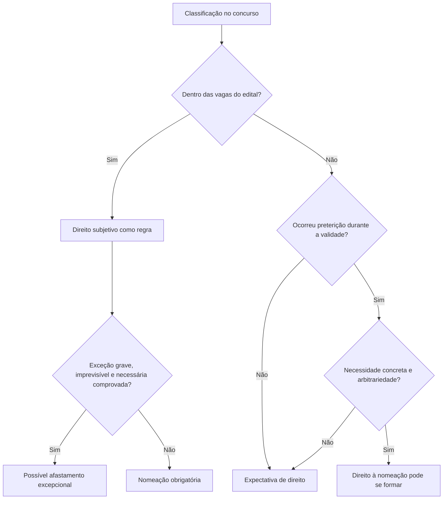

Ser aprovado em concurso nem sempre produz o mesmo efeito jurídico. A posição na classificação, o número de vagas anunciado e o que acontece durante a validade do certame podem transformar uma expectativa em direito subjetivo à nomeação. O capítulo apresenta as situações reconhecidas pelo STF e separa esse direito de uma promessa genérica de contratação. Também explica a preferência dos aprovados do concurso anterior e a possibilidade excepcional de a Administração deixar de nomear, ainda que existam vagas.

> [!objetivos]
> - Distinguir expectativa de direito e direito subjetivo à nomeação.
> - Reconhecer as hipóteses de nomeação obrigatória.
> - Aplicar o Tema 784 às novas vagas e à preterição arbitrária.
> - Identificar quando o fato deve ocorrer para gerar o direito.
> - Explicar a exceção por situação extraordinária superveniente.

## Aprovado dentro das vagas

O aprovado dentro do número de vagas anunciado no edital tem, como regra, direito subjetivo à nomeação. No Tema 161 (RE 598.099), o STF assentou que a Administração deve nomear o candidato aprovado dentro das vagas durante a validade do concurso. A Administração conserva margem para escolher o momento da nomeação dentro do prazo, observadas a ordem de classificação e as condições fiscais e legais, mas não pode tratar a vaga divulgada como mera intenção sem consequência.

Exemplo: o edital oferece oito vagas para determinado cargo, e uma candidata fica em sexto lugar. Em princípio, ela está dentro do quantitativo anunciado e pode exigir nomeação durante a validade, salvo circunstância excepcional qualificada que justifique o afastamento do dever. A Administração não pode simplesmente ignorar a lista porque prefere abrir outro concurso.

O direito precisa ser exercido dentro da validade do certame. A nomeação deve ocorrer dentro do prazo de validade, inclusive eventual prorrogação válida. Expirado o concurso sem nomeação, é necessário verificar se o direito já foi reconhecido e se houve ato ilegal ou omissão que tenha impedido seu exercício tempestivo; a resposta pode depender das circunstâncias e da tutela judicial cabível.

## Preterição da ordem de classificação

Há preterição quando a Administração deixa de observar a ordem de classificação e chama candidato pior colocado antes de quem tem posição superior. A Súmula 15 do STF reconhece direito à nomeação quando o cargo é preenchido sem observância da classificação. A regra protege a objetividade do concurso e impede que a Administração escolha livremente entre candidatos aprovados.

Exemplo: duas vagas são preenchidas por nomeações do terceiro e do quarto colocados, enquanto os dois primeiros aguardam. A nomeação fora da ordem pode caracterizar preterição. A análise deve comparar o mesmo concurso, a mesma carreira ou lista pertinente e a forma de provimento efetivamente usada. Não basta que a Administração nomeie alguém para cargo diferente ou em localidade submetida a lista própria, se o edital organizou listas distintas de modo válido.

A preterição também pode ocorrer quando o candidato aprovado dentro de uma posição de convocação é substituído por contratação precária ou por comissionado que executa as mesmas atribuições permanentes do cargo, em contexto que demonstre necessidade inequívoca de nomeação. Porém, a mera existência de terceirizados em órgão público não prova automaticamente preterição: é preciso verificar a correspondência das funções, a validade do concurso, a necessidade efetiva e a conduta administrativa.

## Aprovado fora das vagas e Tema 784

Quem fica fora do número inicial de vagas tem, em princípio, expectativa de direito. O acréscimo de postos disponíveis ou a publicação de outro edital enquanto o certame está vigente não garante, isoladamente, a nomeação. No Tema 784 (RE 837.311), o STF reconheceu direito para candidato aprovado além das vagas quando houver preterição arbitrária e imotivada, revelada por comportamento expresso ou tácito da Administração que demonstre necessidade de nomear durante a validade.

A tese exige elementos combinados. Primeiro, deve haver situação reveladora de necessidade concreta de provimento; segundo, a Administração deve agir arbitrariamente, sem motivação idônea; terceiro, o fato gerador deve ocorrer durante a validade do concurso. A existência de vagas em orçamento, isoladamente, não produz direito. Tampouco basta a publicação de novo edital sem outros elementos: pode haver reorganização administrativa, cargos diferentes ou necessidade que não corresponda aos aprovados anteriores.

Exemplo: um edital previa quatro vagas, e o candidato ficou em sétimo lugar. Durante a validade, a Administração cria vagas e contrata temporários para executar permanentemente as mesmas tarefas, apesar de manter concurso válido e sem explicar por que não convocou os aprovados. Essa combinação pode evidenciar necessidade e preterição arbitrária. Já a notícia de que o órgão tem vagas desocupadas, sem prova de que pretende provê-las ou de que houve preterição, não basta.

| Situação do candidato | Regra geral | O que pode mudar a conclusão |
| --- | --- | --- |
| Dentro das vagas | Direito subjetivo à nomeação | Excepcional afastamento qualificado e comprovado |
| Fora das vagas, sem fatos novos | Expectativa de direito | Preterição arbitrária durante a validade |
| Fora das vagas e surge novo concurso | Não há nomeação automática | Prova de necessidade concreta e preterição imotivada |
| Posição melhora por desistência | Pode passar a integrar o número de vagas | Ordem de convocação e prazo para posse |

## Desistência de candidatos melhor classificados

Se candidato melhor classificado desiste ou não toma posse, a lista pode avançar. Quando a desistência faz com que o próximo aprovado passe a ocupar posição dentro do número de vagas, a situação pode converter a expectativa em direito. Exemplo: o edital prevê cinco vagas; os cinco primeiros são chamados, mas o quinto não toma posse no prazo. O sexto poderá passar a ocupar a quinta posição, conforme as regras e os atos de convocação.

Não basta supor a desistência. É preciso que o candidato anterior efetivamente renuncie, perca o direito ou deixe transcorrer o prazo previsto, e que o concurso ainda esteja válido. A Administração deve respeitar a sequência de candidatos e as regras de convocação. A desistência de um candidato pode alterar a posição relativa, mas não cria vagas além das que existem sem outro fundamento jurídico.

## Situações excepcionais que afastam a nomeação

Mesmo quando o candidato está dentro das vagas, o STF admite que a Administração deixe de nomear em quadro excepcional, desde que prove situação superveniente, imprevisível, grave e necessária. A exceção deve ser demonstrada de modo rigoroso, pois o edital criou legítima confiança. Crise financeira genérica, mudança de governo ou invocação abstrata de limite fiscal não bastam automaticamente.

O juízo deve considerar se o evento surgiu depois da publicação do edital, se não podia ser razoavelmente antecipado, se ameaça de forma grave a continuidade ou a capacidade financeira do serviço e se a não nomeação é indispensável. Também é necessário demonstrar que medidas menos gravosas não resolvem o problema. A Administração deve explicar por que aquela vaga e aquela nomeação precisam ser suspensas, em vez de invocar uma dificuldade ampla sem prova.

Uma calamidade que destrua instalações essenciais e comprometa a receita do ente pode ser relevante, mas não encerra a análise. O órgão ainda deve demonstrar o nexo entre o evento e a impossibilidade de nomear, a duração do impedimento e a necessidade da medida. Por outro lado, simples conveniência administrativa não afasta o direito já reconhecido.

> [!pegadinha]
> O Tema 784 não diz que toda vaga superveniente gera nomeação, e a exceção por grave crise não permite ao Poder Público cancelar convocação com alegação genérica de falta de recursos. Tanto o direito quanto a exceção dependem de fatos comprovados.

## Momento dos fatos e vias de proteção

Para o candidato fora das vagas, a preterição que sustenta o direito deve ocorrer durante o prazo de validade do concurso. O direito não nasce de conjectura sobre o que talvez aconteça no futuro. Reúna atos concretos: publicação de edital novo para cargo equivalente, contratação de temporários, ordem de nomeação desrespeitada, autorização de vagas ou documentos que revelem necessidade de serviço. Cada fato deve ser conectado à posição do candidato e à vigência do certame.

O controle judicial não transforma o Judiciário em gestor de pessoal. A questão é verificar se a Administração observou a Constituição, o edital, a classificação e a motivação exigida. Se houver direito subjetivo demonstrado, pode haver ordem de nomeação; se houver apenas expectativa e nenhuma preterição, o candidato não pode exigir que a Administração crie ou proveja vaga.

O concurso também deve ser lido em conjunto com a Lei 14.965/2024, que estabelece normas gerais sobre concursos públicos em seu âmbito de aplicação e disciplina as condições para novo certame quando ainda existe concurso anterior válido. O diploma prevê hipóteses e exceções próprias, de modo que não é correto resumir a regra como proibição absoluta de abrir concurso novo. Ainda assim, a prioridade constitucional da lista anterior e a necessidade de motivar a abertura de novo certame devem ser verificadas.

## Preferência entre concursos

A preferência pela lista anterior é uma regra de ordem, não uma garantia de que a Administração tenha de criar vagas. Enquanto o concurso antigo está válido, o aprovado tem prioridade sobre os novos concursados para cargo ou emprego na mesma carreira, observados o edital e a classificação (CF, art. 37, IV). A prioridade não permite chamar o candidato antigo fora de ordem, nem impede que a Administração abra outro concurso quando a lei autorizar e houver justificativa. Ela protege a lista válida contra a substituição indevida por candidatos posteriores.

A Lei 14.965/2024 estabeleceu normas gerais para concursos públicos em seu campo de aplicação e incluiu restrições à realização de certame novo quando ainda há concurso válido para os mesmos cargos e candidatos não nomeados. O diploma admite exceção se a Administração demonstrar que a quantidade de aprovados remanescentes é insuficiente para a necessidade pública. A regra não deve ser aplicada fora do âmbito do diploma nem interpretada como vedação absoluta. A lei exclui concursos para algumas instituições e carreiras e contém disposições sobre entidades estatais, de modo que o intérprete deve verificar primeiro se o concurso está abrangido.

Exemplo: um órgão federal possui concurso válido para analistas de uma mesma carreira e aprovados aguardando nomeação. A unidade não deve abrir novo certame apenas para evitar a lista anterior; se a necessidade de pessoal exceder o número de aprovados, a lei pode admitir novo processo, mas exige justificativa demonstrando a insuficiência. Em carreira diferente ou entidade excluída do âmbito da lei, a conclusão pode mudar, embora continuem aplicáveis as normas constitucionais pertinentes.

> [!lei] CF, art. 37, IV
> IV - durante o prazo improrrogável previsto no edital de convocação, aquele aprovado em concurso público de provas ou de provas e títulos será convocado com prioridade sobre novos concursados para assumir cargo ou emprego, na carreira;

A validade é, portanto, uma condição temporal relevante, mas não cria direito automático a vagas. Se a lista expirou antes de surgir a necessidade, o candidato não pode invocar a preferência constitucional do certame válido, embora ainda possa discutir ato de preterição praticado quando o concurso estava vigente. A Administração não pode esperar de propósito o prazo acabar para frustrar direito já consolidado por nomeação de pessoa pior classificada; nesse caso, o foco é a conduta ocorrida durante a validade.

| Cenário | Consequência inicial | Pergunta adicional |
| --- | --- | --- |
| Concurso anterior ainda válido | Lista antiga tem prioridade | Mesmo cargo, carreira e lista? |
| Concurso anterior expirado | Preferência temporal termina | Houve preterição antes do fim do prazo? |
| Novo concurso com aprovados antigos | Não gera nomeação automaticamente | Lei 14.965 se aplica? Remanescentes bastam? |
| Cargo diverso ou lista específica | Comparação pode não ser cabível | O edital criou carreira ou localidade distinta validamente? |

## Aprovado fora das vagas: sequência de análise

O Tema 784 exige mais do que demonstrar que o órgão ainda tem vagas. A tese firmada pelo STF preserva a discricionariedade administrativa de prover cargos, mas reconhece o direito subjetivo em caso de preterição arbitrária e imotivada, revelada por comportamento que demonstre necessidade inequívoca de nomeação durante o prazo do concurso. A prova deve conectar a necessidade ao candidato e à lista correspondente.

Uma análise em etapas evita confundir fatos distintos:

1. Confirme a validade do concurso no momento do fato apontado.
2. Verifique a posição do candidato e se o edital criou cadastro de reserva ou vagas imediatas.
3. Identifique a vaga nova, contratação, nomeação ou ato concreto que indique necessidade de provimento.
4. Compare a atividade do candidato com a do trabalhador contratado ou do cargo provido.
5. Examine a motivação da Administração e a ordem de classificação.
6. Avalie se o comportamento revela preterição clara e sem justificativa legítima.

Por exemplo, candidato classificado em cadastro de reserva descobre que o órgão contratou empresa para exercer exatamente a atribuição do cargo. Isso pode ser evidência, mas não basta a semelhança superficial do nome da função. É preciso demonstrar que o contrato substitui, de modo permanente e irregular, as tarefas do cargo e que a Administração precisava nomear. A terceirização de atividade acessória ou especializada não implica necessariamente preterição.

> [!exemplo]
> O edital oferece 10 vagas e o candidato fica em 14º. Durante a validade, quatro candidatos nomeados desistem, e a Administração convoca o 15º sem explicar por que ignorou o 14º. Há forte indicativo de violação da ordem. Em outro caso, a criação de quatro cargos sem qualquer ato de provimento pode não bastar, por si só, para transformar expectativa em direito.

> [!pegadinha]
> Novo concurso ou novas vagas não são suficientes isoladamente. Para quem está fora das vagas, é decisiva a demonstração de necessidade concreta associada a preterição arbitrária ocorrida durante a validade.

A Administração pode não nomear se provar que fato extraordinário tornou a nomeação impossível ou desnecessária? A exceção é estreita e deve ser demonstrada à luz do caso concreto. A decisão não pode se apoiar em conveniência genérica, mudança de prioridades ou simples alegação de que o novo gestor prefere outro modelo. De outro lado, o candidato não pode presumir direito apenas porque uma vaga foi autorizada ou porque consta em cadastro de reserva.

## Quando a desistência altera a posição

A desistência produz efeito sobre a ordem quando o candidato anterior formaliza renúncia, deixa de tomar posse depois de regularmente convocado ou perde a oportunidade conforme as regras do edital. O próximo da lista pode então ocupar uma das vagas disponíveis. É necessário verificar se a desistência é definitiva e se a convocação anterior observou prazos válidos. Não se deve pular a lista nem contar duas vezes a mesma vaga.

Um exemplo: quatro vagas foram oferecidas e os candidatos um a quatro são convocados. O quarto renuncia formalmente antes da posse. O quinto passa a ser o próximo da lista para aquela vaga, mas deve aguardar a convocação e atender aos requisitos. Se o segundo apenas solicita prazo para entregar documento e a lei permite a prorrogação, ainda não há desistência definitiva. Da mesma forma, a convocação para localidade diferente da opção do candidato só pode ser tratada como recusa se o edital e as listas tornarem essa consequência clara.

> [!atencao]
> A desistência deve ser real e produzir vaga disponível segundo o edital. Não conclua que houve renúncia com base em rumor ou em atraso ainda coberto por prazo legal.

## Exceção por situação extraordinária

O direito de quem ficou dentro das vagas pode ser afastado em situação excepcional, superveniente, imprevisível, grave e necessária. Os requisitos são cumulativos. “Superveniente” significa que o fato ocorreu depois da publicação do edital; “imprevisível” indica que não era razoável antecipá-lo; “grave” exige impacto relevante; “necessária” demanda que deixar de nomear seja indispensável, e não apenas mais conveniente.

A Administração deve apresentar dados verificáveis sobre o evento e demonstrar o nexo com as vagas. Um desastre natural que destrói a estrutura onde o serviço seria prestado pode impedir a instalação da equipe. Uma recessão ou pandemia mencionada de forma genérica não cancela automaticamente concursos: é preciso mostrar como a situação afeta aquelas nomeações, por que medidas alternativas não bastam e por quanto tempo a restrição é necessária. A análise também pode considerar se o cargo é essencial para responder à própria crise.

> [!bizu]
> A exceção só se sustenta se os quatro elementos aparecem no caso: fato posterior, não previsível, grave e indispensável para afastar a nomeação. Falta de um requisito fragiliza a justificativa.

O candidato não tem de provar que não existe crise; cabe à Administração, que invoca a exceção, motivar e demonstrar os fatos que justificariam afastar o edital. O controle judicial examina a veracidade e suficiência da justificativa sem substituir a gestão ordinária de pessoal. A medida precisa ser proporcional: se apenas algumas vagas foram afetadas, a Administração não deve cancelar nomeações sem examinar a situação de cada unidade.

## Momento em que nasce o direito

Para aprovado fora das vagas, o fato revelador da preterição precisa ocorrer durante a validade. Se o órgão anuncia contratação de temporários durante o prazo e a lista está vigente, o candidato poderá reunir o ato, a descrição das funções e sua classificação. Se a necessidade surge somente depois de expirado o certame, a aprovação antiga não gera, por si só, direito a nomeação; a Administração pode realizar novo concurso, respeitando as regras atuais.

Isso não autoriza manobras para aguardar a expiração e nomear pessoa de posição inferior. A validade deve ser lida com os princípios da impessoalidade e da boa-fé. A ordem de classificação é objetiva e sua violação pode ser demonstrada com listas, atos de convocação, portarias de nomeação e documentos de posse. O candidato precisa identificar o evento exato e a data, não apenas alegar que “existiam vagas”.

> [!jurisprudencia] STF, Tema 784
> A tese do Tema 784 preserva a regra de que a Administração decide sobre o provimento de vagas, mas reconhece direito quando fatos durante a validade demonstram necessidade inequívoca e preterição arbitrária e imotivada.

A palavra “preterição” significa que alguém é deixado para trás quando deveria ser chamado segundo a regra do concurso. Pode decorrer de nomeação fora de ordem ou de uso de expediente que contorne a lista válida. O candidato deve identificar a vaga ou o comportamento e mostrar como ele o alcança. A mera vacância — por aposentadoria, exoneração ou falecimento de ocupante — não substitui essa prova. Uma vaga pode permanecer sem provimento por decisão administrativa legítima, a menos que outra circunstância revele necessidade e tratamento arbitrário.

Também é preciso separar direito líquido e certo de expectativa de nomeação. A existência de prova documental robusta pode permitir mandado de segurança quando o direito é demonstrável sem produção complexa de provas; situações que exigem perícia ou apuração extensa podem demandar outra via judicial. O prazo para ajuizar depende do ato e do instrumento processual, portanto não se deve presumir que uma lista vigente mantenha indefinidamente aberta a possibilidade de questionar qualquer decisão antiga. O candidato deve guardar edital, classificação, publicações e resposta administrativa.

A crise da Covid-19, assim como recessão ou queda de arrecadação, não constitui salvo-conduto automático para frustrar aprovados. O fato precisa ser relacionado às vagas e demonstrar a impossibilidade ou necessidade excepcional. De modo semelhante, a desistência de candidato não “convola” qualquer expectativa em direito sem que a lista efetivamente avance até uma vaga disponível. Um candidato chamado que decide sair formalmente pode abrir caminho ao próximo; pessoa apenas indisponível por prazo curto pode não ter desistido.

> [!pegadinha]
> A vacância abre possibilidade de novo provimento, mas não é prova automática de que o candidato em cadastro de reserva deve ser nomeado. O ponto decisivo é a combinação de necessidade, validade e preterição.

## Mapa do capítulo

| Fundamento | Consequência típica | Prova necessária |
| --- | --- | --- |
| Aprovação dentro das vagas (Tema 161) | Direito à nomeação durante a validade | Edital, classificação e prazo vigente |
| Ordem de classificação ignorada (Súmula 15) | Direito de quem foi preterido | Ato de nomeação e posição na lista |
| Novas vagas + conduta arbitrária (Tema 784) | Direito pode surgir para aprovado fora das vagas | Necessidade, arbitrariedade e fato durante a validade |
| Desistência de melhor colocado | Lista pode avançar até a vaga | Desistência efetiva e ordem correta |
| Evento extraordinário superveniente | Pode afastar dever de nomear | Prova de imprevisibilidade, gravidade e necessidade |

### Para fixar

- Aprovado dentro do número de vagas tem, em regra, direito subjetivo à nomeação.
- A Administração deve respeitar a ordem de classificação.
- Aprovação fora das vagas normalmente gera expectativa, não nomeação automática.
- O Tema 784 exige necessidade concreta e preterição arbitrária e imotivada.
- Novas vagas ou novo concurso, isoladamente, não bastam para o candidato fora das vagas.
- Desistência efetiva de melhor colocado pode fazer avançar a lista.
- O fato gerador da preterição deve ocorrer durante a validade do concurso.
- Exceção exige fato superveniente, imprevisível, grave e necessário, demonstrado pela Administração.

