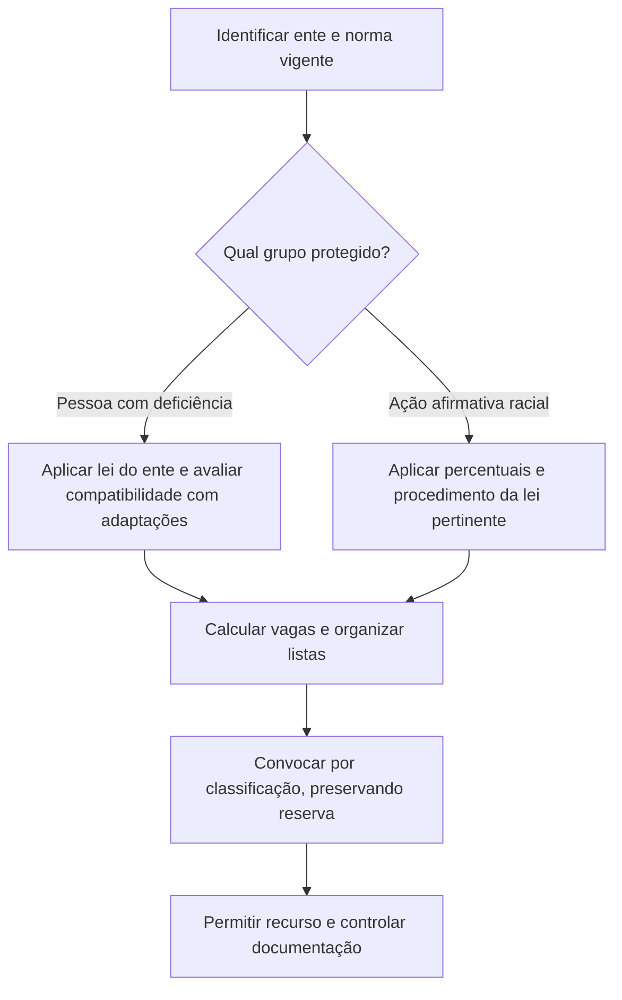

O direito à nomeação nem sempre se limita à convocação no prazo. Quando o candidato obtém posse após decisão judicial, surgem dúvidas sobre salários retroativos, tempo de serviço e progressões. O capítulo começa por esses efeitos e depois estuda a reserva de vagas para pessoas com deficiência e para grupos protegidos pela política federal de ação afirmativa. Por fim, examina a possibilidade de isenção de taxa, que depende da lei aplicável e das condições do edital.

> [!objetivos]
> - Explicar os limites da indenização e dos efeitos funcionais da nomeação tardia.
> - Distinguir reserva de vagas para pessoas com deficiência no serviço público e na iniciativa privada.
> - Aplicar o regime federal de cotas raciais vigente.
> - Identificar a base legal da isenção de taxa de inscrição.

## Nomeação tardia obtida judicialmente

Quando uma pessoa é nomeada tardiamente após decisão judicial, não há regra geral de pagamento de todas as remunerações que receberia se tivesse começado antes. O STF, no Tema 671, afastou a indenização pelo período sem exercício, salvo situação de arbitrariedade flagrante. A lógica é evitar remuneração por trabalho que não foi prestado, sem impedir reparação quando a Administração agiu de modo especialmente abusivo, por exemplo, desobedecendo ordem judicial ou atuando de má-fé.

A simples propositura de ação ou o fato de a decisão administrativa ter sido revertida depois não caracteriza automaticamente arbitrariedade flagrante. É necessário avaliar a conduta estatal, a clareza do direito e o comportamento processual. O candidato deve distinguir o reconhecimento judicial do direito de ser nomeado da pretensão de receber parcelas relativas ao período em que não exerceu o cargo.

O período sem exercício também não gera, como regra, tempo de serviço fictício para aposentadoria, promoção ou vantagens. A investidura em cargo público pressupõe nomeação, posse e início de exercício segundo o regime aplicável. O Tema 454 afastou promoções e progressões que dependeriam de tempo trabalhado e de outros requisitos, mesmo quando a decisão judicial reconhece que a nomeação deveria ter ocorrido antes. A Administração não pode atribuir experiência funcional que não foi adquirida.

| Pedido após nomeação tardia | Regra geral | Exceção ou ressalva |
| --- | --- | --- |
| Remuneração do período sem trabalho | Não é devida automaticamente | Arbitrariedade flagrante pode justificar indenização (Tema 671) |
| Contagem do tempo sem exercício | Não se computa como tempo funcional ou previdenciário | Aplicam-se as regras de contribuição e eventual decisão específica |
| Promoção e progressão retroativas | Não são automáticas | Dependem dos requisitos próprios e do alcance do julgado |

> [!pegadinha]
> A decisão judicial que reconhece direito à nomeação não transforma automaticamente o período anterior em tempo de serviço nem assegura salários retroativos. A exceção exige circunstância qualificada.

## Reserva de vagas para pessoas com deficiência

A Constituição determina que a lei reserve percentual de cargos e empregos públicos para pessoas com deficiência e defina os critérios de admissão (art. 37, VIII). A reserva é um mecanismo de igualdade material: procura reduzir barreiras de acesso, sem dispensar a compatibilidade entre a deficiência e as atribuições essenciais do cargo, inclusive com adaptações razoáveis. O edital deve informar o percentual, os critérios de avaliação e como se dará a concorrência nas listas geral e reservada.

Na Administração Pública federal, a Lei 8.112/1990 assegura inscrição em concurso para posto cujas tarefas guardem compatibilidade com a condição da pessoa portadora de deficiência (terminologia histórica da lei para pessoas portadoras de deficiência, hoje pessoas com deficiência) e limita a reserva a até 20% das vagas oferecidas (art. 5º, § 2º). O Decreto 9.508/2018 (que revogou na parte dos concursos o Decreto 3.298/1999) regulamenta a reserva no âmbito federal e prevê percentual mínimo de 5%, vedando que o arredondamento extrapole o teto legal de 20%. Essa disciplina federal não deve ser automaticamente transferida para estados e municípios: a Constituição remete a definição à lei, e cada ente pode ter normas próprias, dentro dos limites constitucionais.

A compatibilidade não significa exigir que a pessoa realize tarefas sem adaptação nem aceitar qualquer incompatibilidade sem avaliação. A Administração deve analisar as atribuições essenciais e os recursos de acessibilidade disponíveis. Se a deficiência não impede a atividade com adaptações razoáveis, a exclusão pode ser discriminatória. A Lei Brasileira de Inclusão define deficiência em interação com barreiras e determina a adoção de medidas para assegurar igualdade e participação. A Lei 14.768/2023 disciplina a definição de deficiência auditiva; a avaliação não deve reproduzir automaticamente critérios desatualizados. A surdez unilateral total passou a contar com previsão legal expressa, e a aplicação administrativa deve observar a definição atual, os critérios médicos e o contexto de participação no concurso.

Na iniciativa privada, a Lei 8.213/1991 estabelece cotas para empresas com cem ou mais empregados: de 2% a 5% do quadro, conforme a faixa de tamanho da empresa. Esse regime é distinto da reserva em concursos, pois recai sobre a composição do quadro empresarial, não sobre o número de vagas de um edital público.

| Contexto | Fonte principal | Percentual ou critério |
| --- | --- | --- |
| Cargo público federal | Lei 8.112/1990 e Decreto 9.508/2018 | Lei prevê até 20%; decreto fixa mínimo e forma de cálculo |
| Entes estaduais e municipais | Lei do respectivo ente | Deve observar art. 37, VIII, da Constituição |
| Empresa privada com 100 ou mais empregados | Lei 8.213/1991 | De 2% a 5%, conforme o total de empregados |

## Ações afirmativas raciais e sociais

As cotas em concursos concretizam políticas de ação afirmativa e precisam de previsão legal que indique destinatários, percentual e procedimentos de confirmação. No âmbito federal, a Lei 15.142/2025 instituiu reserva de 30% das vagas para pessoas pretas e pardas, indígenas e quilombolas nos concursos e processos seletivos temporários sujeitos à lei. O diploma alcança a administração pública federal direta e indireta nas condições que estabelece e também disciplina procedimentos de confirmação e distribuição das vagas. Não se deve dizer que a lei, por si só, fixa idêntica regra para todo estado ou município.

A política federal de ação afirmativa racial protege pessoas negras (pretas e pardas), indígenas e quilombolas. A lei federal aplica-se quando o edital oferece pelo menos duas vagas e prevê a repartição entre os grupos destinatários conforme os critérios legais. O cálculo e a ordem de convocação devem ser feitos segundo a lei e a regulamentação vigente, preservada a concorrência simultânea nas listas. O candidato cotista que obtiver classificação suficiente na ampla concorrência pode ser nomeado por essa lista, sem consumir vaga reservada, conforme o método legal aplicável.

Os procedimentos de heteroidentificação para pessoas negras devem respeitar dignidade, contraditório e ampla defesa. A autodeclaração é relevante, mas a lei pode prever comissão de confirmação para coibir fraude. A avaliação não deve se converter em julgamento moral nem usar características alheias ao critério legal. Para indígenas e quilombolas, a lei define formas de comprovação próprias, que não devem ser substituídas por um modelo único de avaliação fenotípica.

> [!lei] Lei 15.142/2025, art. 1º
> A lei reserva 30% das vagas de concursos e seleções temporárias federais abrangidas a pessoas pretas e pardas, indígenas e quilombolas.

O percentual de 30% é aplicado ao universo e aos destinatários definidos pelo diploma federal, não significa que cada grupo receba individualmente 30%. A distribuição entre as categorias e o cálculo de vagas devem seguir os dispositivos legais e o regulamento. Em prova, observe a data de vigência e a norma aplicável ao ente do edital; materiais anteriores podem mencionar a Lei 12.990/2014 e o percentual de 20%, que foi substituído no âmbito federal pela lei nova.

## Isenção da taxa de inscrição

Não existe uma isenção única e automática para qualquer concurso público. A gratuidade depende de lei aplicável ao ente e ao concurso, além dos requisitos previstos na norma e no edital. A Lei 8.112/1990 determina que o concurso federal pode cobrar inscrição quando indispensável ao custeio, ressalvadas as hipóteses de isenção expressamente previstas no edital (art. 11). Outras leis federais instituem isenções específicas, como as destinadas a pessoas inscritas no Cadastro Único em condições estabelecidas em lei e a doadores de medula óssea em concursos federais abrangidos.

O candidato deve formular o pedido na fase e pelo meio indicados e apresentar prova documental exigida. A Administração pode verificar os dados e indeferir pedido sem demonstração dos requisitos, com decisão fundamentada e possibilidade de recurso quando prevista. O edital não pode suprimir isenção que uma lei assegure; também não pode criar, sem autorização normativa, um benefício que altere a regra de arrecadação do certame.

Exemplo: uma candidata inscrita no CadÚnico verifica que a lei federal aplicável assegura isenção para seu perfil. Ela pede o benefício no prazo do edital e envia os documentos exigidos. Se a Administração negar apenas porque a inscrição é paga, sem analisar a documentação, a decisão pode ser contestada. Se ela deixa passar o prazo de solicitação sem justificativa e a lei não prevê exceção, não se presume deferimento automático.

## Cálculo e convocação das cotas

A aplicação da reserva exige identificar o universo de vagas, o cargo ou especialidade e a regra de arredondamento. Não se deve calcular o percentual sobre todas as vagas de um órgão se o edital abriu seleções distintas por área. A lista geral e a lista reservada coexistem: a convocação deve evitar que o mesmo candidato conte simultaneamente para os dois quantitativos, e o edital deve explicitar como a ordem será recomposta quando uma vaga reservada não puder ser preenchida.

| Regime | Universo de cálculo | Cuidado de interpretação |
| --- | --- | --- |
| Pessoa com deficiência em concurso federal | Vagas do edital, conforme a norma federal | Limite máximo previsto na Lei 8.112 e piso regulamentar |
| Pessoa com deficiência em ente subnacional | Vagas e critérios da lei local | Não importar automaticamente percentual federal |
| Reserva racial federal | Vagas e grupos alcançados pela Lei 15.142/2025 | Distribuição entre categorias e ordem seguem o diploma |
| Cota trabalhista privada | Quadro total de empregados da empresa | Não é percentual calculado por edital |

> [!atencao]
> A expressão “30% de cotas” resume o percentual global federal; não significa 30% para cada categoria protegida. Leia o cálculo e a repartição na lei aplicável ao concurso.

A classificação em lista reservada não elimina a concorrência geral. Se a pessoa alcança posição suficiente na ampla concorrência, o edital e a lei podem determinar sua convocação por essa lista, preservando a vaga reservada para quem ainda depende da ação afirmativa. A Administração deve controlar esse deslocamento para não reduzir indevidamente o percentual. Se um candidato cotista é eliminado por fraude comprovada no procedimento de confirmação, a vaga segue para o próximo classificado da lista pertinente, segundo a regra legal.

Na avaliação de deficiência, a comissão deve considerar impedimento de longo prazo e barreiras à participação em igualdade de condições, além da compatibilidade com o cargo. A deficiência não pode ser presumida por um diagnóstico sem avaliar as atribuições e as adaptações possíveis. Também não se pode negar reserva de vagas apenas porque o candidato consegue realizar algumas tarefas: a análise é funcional, individualizada e deve respeitar recursos de acessibilidade. A deficiência auditiva e a visão monocular têm enquadramento legal próprio, e o edital não deve aplicar definições desatualizadas ou incompatíveis com a lei vigente.

> [!bizu]
> Separe três perguntas: quem tem direito à reserva, quantas vagas entram no cálculo e como a convocação alterna entre listas. Misturar esses passos costuma gerar erro.

## Provimento, posse e isenção

Reserva de vagas é regra de acesso e provimento, não dispensa os requisitos gerais do cargo. A pessoa aprovada deve atender às condições legais para posse e exercício, com adaptações razoáveis quando necessárias. O fato de a Administração organizar lista reservada não permite negar a nomeação de candidato que esteja dentro das vagas e tenha cumprido as exigências. A convocação deve seguir o edital, a classificação e as normas de reserva aplicáveis.

A isenção de taxa tem lógica distinta da cota. A cota altera a forma de classificação e convocação; a isenção dispensa pagamento da inscrição para candidatos previstos em lei. Em concurso federal, a Lei 8.112 admite que o edital cobre taxa quando indispensável ao custeio e ressalva hipóteses legais expressas (art. 11). A legislação federal prevê casos como pessoas de baixa renda inscritas no CadÚnico e doadores de medula óssea, desde que cumpridos os requisitos legais. Estados e municípios podem ter hipóteses próprias.

A documentação e o prazo importam. Se o interessado não pede a isenção até a data anunciada, a Administração pode indeferir por intempestividade quando não houver exceção legal. Se apresenta os documentos e é negada sem análise, cabe recurso nos termos do edital. A isenção não dispensa as demais etapas nem garante aprovação: apenas remove o encargo financeiro dentro do procedimento previsto.

> [!exemplo]
> Um candidato a um concurso estadual pede isenção porque está inscrito no cadastro social, mas o concurso não é federal. Antes de aplicar a lei federal, é preciso localizar a lei estadual e verificar seus critérios; a mesma condição pessoal pode gerar isenção num ente e não em outro.

A ação afirmativa também deve ser acompanhada em cada edital. Mudanças legislativas podem substituir percentuais ou grupos destinatários. Por isso, não se deve copiar para o novo certame uma reserva usada em concurso anterior. A lei federal de 2025 atualizou a política para pessoas pretas e pardas, indígenas e quilombolas; em prova com data de corte posterior, a regra anterior da Lei 12.990/2014 não deve ser apresentada como norma federal vigente. Para pessoa com deficiência, a Lei 14.768/2023 atualizou a definição legal de deficiência auditiva e deve ser considerada na análise documental.

> [!esquema]
> A sequência importa: primeiro a norma, depois o grupo abrangido, o cálculo das vagas e a alternância de convocação. Só então se verifica a documentação e a eventual impugnação.

A reserva depende de edital transparente. O ato convocatório deve permitir que a pessoa compreenda como concorrer às vagas gerais e reservadas e como comprovar os requisitos. Quando o candidato opta por mais de uma lista, as regras legais de classificação e precedência organizam a convocação; a Administração não pode escolher caso a caso quem “consome” a cota. Se a lista reservada se esgota antes das vagas, a lei define se a vaga remanescente retorna à ampla concorrência ou a outra categoria.

## Mapa do capítulo

| Tema | Regra de prova | Referência principal |
| --- | --- | --- |
| Nomeação tardia | Sem remuneração automática do período sem exercício | Tema 671 |
| Efeitos funcionais | Sem tempo ou promoções retroativas automáticas | Temas 454 e RE 655.265 |
| Pessoa com deficiência | Reserva legal e compatibilidade com atribuições | CF, art. 37, VIII; Lei 8.112, art. 5º, § 2º |
| Iniciativa privada | Cota de 2% a 5% para empresas com 100 ou mais empregados | Lei 8.213/1991, art. 93 |
| Cotas federais raciais | 30% para os grupos e entidades abrangidos | Lei 15.142/2025 |
| Isenção de taxa | Depende de lei e cumprimento dos requisitos | Lei 8.112/1990, art. 11, e legislação específica |

### Para fixar

- Nomeação tardia judicial não assegura indenização pelo período sem exercício em regra.
- O Tema 671 ressalva situações de arbitrariedade flagrante.
- Promoção e contagem de tempo não são atribuídas automaticamente de forma retroativa.
- A Constituição exige reserva de vagas para pessoas com deficiência por lei.
- A Lei 8.112 prevê reserva de até 20% para concursos federais.
- A cota da Lei 8.213 aplica-se a empresas privadas com 100 ou mais empregados.
- A Lei 15.142/2025 reserva 30% das vagas federais abrangidas aos grupos definidos no diploma.
- A isenção da taxa depende da legislação e dos procedimentos do edital.
