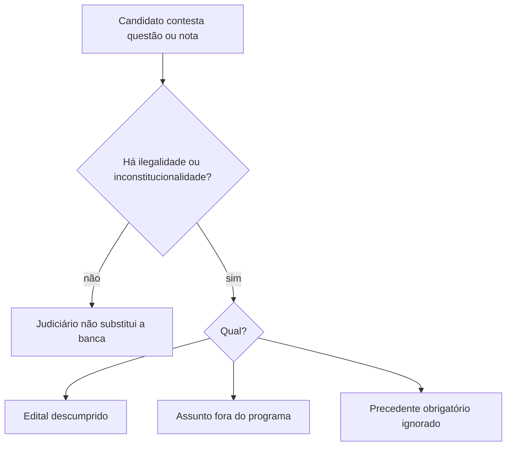

Este capítulo reúne três assuntos que costumam cair juntos na prova de Direito Administrativo, na parte de agentes públicos. O primeiro é até onde o Judiciário pode controlar um concurso público. O segundo é se uma pessoa condenada pode tomar posse em cargo público. O terceiro é a diferença entre cargo em comissão e função de confiança. Os três temas têm pouca lei e muita jurisprudência, e por isso a banca cobra as teses do STF quase palavra por palavra.

> [!objetivos]
> - Explicar o limite do controle judicial sobre a banca examinadora.
> - Aplicar a tese do STF sobre a posse de candidato condenado criminalmente.
> - Distinguir cargo em comissão de função de confiança.
> - Reconhecer as regras de exoneração e de estabilidade provisória da gestante.

## Controle judicial do concurso

A regra geral do concurso público (CF, art. 37, II) já é conhecida: para ocupar cargo ou emprego, é preciso passar em prova, ou em prova e títulos, adequadas à complexidade da função. A validade do concurso é de no máximo dois anos, com uma única prorrogação de igual duração (art. 37, III). A pergunta deste tópico é outra: o candidato reprovado pode pedir ao juiz que corrija a prova?

Para o STF, não. O Judiciário **não substitui a banca examinadora** na avaliação das respostas nem nas notas atribuídas. A razão é a separação entre o controle de legalidade, que cabe ao juiz, e o mérito da correção, que cabe a quem tem competência técnica para avaliar. Foi o que o STF decidiu no RE 632.853, com repercussão geral.

> [!jurisprudencia] STF, Tema 485
> O juiz não pode refazer o trabalho da banca, isto é, revisar o conteúdo das questões e os critérios de correção, a menos que encontre ilegalidade ou inconstitucionalidade no certame.

Note a expressão final: "salvo ocorrência de ilegalidade ou de inconstitucionalidade". É a brecha por onde o juiz pode entrar. O STJ detalhou três situações em que a brecha existe:

1. **Descumprimento das regras do edital**: prazos, etapas, cláusulas eliminatórias, reserva de vagas.
2. **Cobrança de assunto que não consta do programa** do edital.
3. **Descumprimento de precedente obrigatório**: se o STJ fixou uma interpretação em tema repetitivo, a banca não pode adotar outra.

> [!exemplo] Questão fora do edital
> O edital do concurso para tenente de bombeiro prevê o tema "Controle da Administração". A prova traz uma questão sobre "Licitações na modalidade pregão eletrônico", que não consta do programa. O candidato prejudicado pode pedir ao juiz a anulação da questão, porque o vício é de legalidade (descumprimento do edital) e não de mérito da correção.

> [!pegadinha] O juiz não corrige prova
> A alternativa errada diz que o juiz pode "refazer a correção quando a resposta da banca parece incorreta" ou que "nunca pode intervir no concurso". Nenhuma das duas está certa. O juiz não reexamina o conteúdo, mas pode anular a questão que viola o edital ou a lei.

Outras decisões do STF sobre o tema aparecem em prova e merecem registro:

- **Limite de idade** só é válido quando a natureza das atribuições do cargo o justifica (STF, Súmula 683).
- **Veto não motivado** à participação de candidato é inconstitucional (STF, Súmula 684).
- **Exame psicotécnico** só pode ser exigido por lei (Súmula Vinculante 44).
- **Taxa de inscrição**: a isenção por baixa renda é válida e funciona como medida de igualdade material. A isenção concedida a servidores, sem justificativa razoável, privilegia grupo já favorecido e é inconstitucional.
- **Títulos** só podem ser critério classificatório. Não existe concurso só de títulos: é preciso haver prova.

### Aprovado tem direito à nomeação?

Outro ponto de controle judicial é a **nomeação**. Para o STF, o candidato aprovado **dentro do número de vagas** previsto no edital tem direito subjetivo à nomeação (Tema 161). A Administração só deixa de nomear se surgir um fato novo, grave e excepcional, que não podia ser previsto quando o edital foi publicado, e se a decisão for motivada. Já quem ficou fora das vagas, no cadastro de reserva, tem apenas expectativa de direito. Essa expectativa vira direito quando o candidato é **preterido**: surge vaga e a Administração contrata temporários ou nomeia pessoa pior classificada (STF, Súmula 15).

Há também a **cláusula de barreira**, que limita o número de candidatos que passam para a fase seguinte. O STF a considera constitucional, desde que o edital a preveja e que o critério seja razoável (Tema 376). Convém separá-la da cláusula **eliminatória**, que exige pontuação mínima: a primeira funciona por posição, a segunda por nota.

> [!exemplo] Preterição
> O edital oferece dez vagas para tenente. O cadastro de reserva tem trinta nomes. Durante a validade, abre-se uma vaga e o comando contrata um oficial temporário, em vez de nomear o primeiro do cadastro. O candidato, que tinha só expectativa, passou a ter direito à nomeação, porque foi preterido.

### Teste de aptidão física

Alguns pontos do teste físico caem com frequência nas provas.

| Situação | Regra do STF |
| --- | --- |
| Segunda chamada por motivo particular, de força maior ou fisiológico | não há direito, salvo previsão expressa no edital (Tema 335) |
| Candidata gestante | pode remarcar o teste, mesmo sem previsão no edital (Tema 973) |
| Escusa de consciência por crença religiosa | pode fazer a etapa em outra data e horário, se a mudança for razoável, preservar a isonomia, não gerar ônus desproporcional e for fundamentada (Tema 386) |

A regra para o candidato comum é a falta de segunda chamada. A gestante e a crença religiosa são exceções, e a banca costuma exigir que você saiba **qual condição** cada exceção impõe.

> [!atencao] Exceção da gestante
> A remarcação do teste para a candidata gestante **não depende** de previsão no edital. Já a segunda chamada por doença ou contratempo só vale se o edital a previr.

## Condenação criminal e posse em cargo público

Na maioria dos estatutos, quem quer tomar posse precisa estar com os direitos políticos em dia (Lei 8.112/1990, art. 5º, II). Já a Constituição determina que a condenação criminal transitada em julgado suspende os direitos políticos enquanto durarem seus efeitos (CF, art. 15, III). A conta parece simples: condenado, sem direitos políticos, sem posse.

O STF não aceitou esse raciocínio. A suspensão atinge o direito de votar e de ser votado. Ela não atinge o direito de trabalhar, que é direito social, e o Estado tem o dever de favorecer a reintegração do condenado à sociedade (dignidade da pessoa humana e valor social do trabalho, CF, art. 1º, III e IV).

> [!jurisprudencia] STF, Tema 1190
> Quem foi condenado definitivamente e teve os direitos políticos suspensos pode, ainda assim, ser nomeado e tomar posse após aprovação em concurso, salvo se o cargo for incompatível com o crime cometido. Quando começa a trabalhar de fato depende do regime da pena e da avaliação do juiz da execução penal quanto aos horários.

Três cuidados mostram onde a banca costuma pegar o candidato:

1. A decisão **não elimina** a exigência de direitos políticos como requisito de investidura. Ela diz que a suspensão **por condenação penal** não impede a posse.
2. A **investigação da vida pregressa** continua possível nos concursos que a prevejam. Se o crime for incompatível com as funções do cargo, a eliminação pode ser legítima.
3. O **início do exercício** depende do regime da pena. Quem está em regime fechado não pode cumprir expediente. Quem está em regime aberto ou em livramento condicional, em geral, pode.

> [!exemplo] Aprovado em livramento condicional
> Marcos foi condenado por um crime sem relação com atividade pública. Cumpriu parte da pena e obteve livramento condicional. Em seguida foi aprovado em concurso para um cargo administrativo. Ele pode ser nomeado e tomar posse, e o exercício seguirá as condições fixadas pelo juízo da execução.

> [!pegadinha] "Sempre impede" e "nunca impede"
> As alternativas extremas estão erradas. A condenação **não impede de forma absoluta** (tese do STF) e também **não é irrelevante**: depende da compatibilidade com a infração e com o regime da pena.

## Cargo em comissão

A regra do concurso tem exceção na própria Constituição: os cargos em comissão, que a lei declara de livre nomeação e exoneração (CF, art. 37, II, parte final).

O **cargo em comissão** é um cargo público de natureza precária. A autoridade escolhe quem quiser para ocupá-lo e pode afastá-lo quando quiser. Por isso é chamado de cargo de nomeação e de exoneração *ad nutum*, expressão que quer dizer "ao arbítrio de uma só das partes".

Do caráter precário decorrem consequências importantes:

- **Não há concurso** para o provimento.
- **Não há estabilidade**: o ocupante pode ser exonerado a qualquer tempo.
- A exoneração **não exige processo administrativo** nem contraditório e ampla defesa. Mesmo a **motivação** é dispensável, pois a nomeação é livre.
- Se a autoridade resolver motivar o ato, vale a **teoria dos motivos determinantes**: motivo falso ou inexistente invalida a exoneração.
- Exoneração não é demissão. Demissão é penalidade; exoneração, não. Para o ocupante de cargo em comissão, a penalidade equivalente é a **destituição**, que exige processo disciplinar.
- O ocupante que **só** tem cargo em comissão é servidor estatutário e se submete ao estatuto, mas filia-se ao **regime geral de previdência social** (CF, art. 40, § 13), e não ao regime próprio dos servidores efetivos.

A saída do cargo em comissão também causa confusão em prova, porque existem quatro atos parecidos. A tabela mostra a diferença.

| Ato | Natureza | Exige processo? |
| --- | --- | --- |
| Exoneração *ad nutum* | livre, sem caráter punitivo | não; motivação dispensável |
| Exoneração a pedido | iniciativa do servidor | não |
| Demissão | penalidade, só para efetivos | sim |
| Destituição de cargo em comissão | penalidade equivalente à demissão | sim (processo disciplinar) |

O comissionado pode, por fim, ser punido por infração disciplinar. Aí o ato deixa de ser livre e passa a exigir contraditório e ampla defesa. Quem confunde a exoneração livre com a destituição erra a questão, porque a primeira dispensa processo e a segunda o exige.

A lei não pode criar outro método de escolha para esses cargos. O STF já declarou inconstitucional a norma de iniciativa parlamentar que impunha eleição direta para os diretores de escolas, justamente porque o texto constitucional diz que a nomeação é livre.

> [!atencao] Gestante comissionada
> A exoneração *ad nutum* tem uma limitação: a servidora gestante tem estabilidade provisória que começa quando a gravidez é confirmada e vai até cinco meses depois do parto (ADCT, art. 10, II, b). O STF decidiu que o direito vale independentemente do regime jurídico, inclusive para quem ocupa cargo em comissão ou foi contratada por prazo determinado (Tema 542).

A proteção decorre de uma causa objetiva, a gravidez. Por isso vale ainda que a servidora não tenha comunicado o fato antes da exoneração. Se a dispensa for arbitrária e extinguir o vínculo, ela tem direito à indenização equivalente ao que receberia até cinco meses após o parto. Quem detém a guarda do filho em caso de morte da mãe tem o mesmo direito (Lei Complementar 146/2014).

## Função de confiança

A **função de confiança** não é um cargo. É um conjunto de atribuições extras, de direção, chefia ou assessoramento, entregue a um servidor que **já ocupa cargo efetivo**. Ele continua no cargo e acumula a função.

Exemplo: Joana é analista de um tribunal e é designada para chefiar o setor em que trabalha. Ela segue como analista e passa a ter também as atribuições de chefia. Se, em vez disso, fosse nomeada para o cargo em comissão de diretora, deixaria de exercer o cargo de analista enquanto durasse a comissão.

Por não ser cargo, não há nomeação nem exoneração: o ato é de **designação**, e o desfazimento é a **dispensa** (ou revogação). O texto constitucional é o do art. 37, V.

> [!lei] CF, art. 37, V
> as funções de confiança, exercidas exclusivamente por servidores ocupantes de cargo efetivo, e os cargos em comissão, a serem preenchidos por servidores de carreira nos casos, condições e percentuais mínimos previstos em lei, destinam-se apenas às atribuições de direção, chefia e assessoramento;

O dispositivo diz três coisas.

- **Função de confiança**: só servidor efetivo pode exercer.
- **Cargo em comissão e função de confiança**: destinam-se apenas a **direção, chefia e assessoramento**. Cargo em comissão para atividade comum, como a de um técnico, é inválido.
- **Cargo em comissão**: a lei define os casos, as condições e os percentuais mínimos que serão ocupados por servidores de carreira. Fora desse percentual, a nomeação pode recair em qualquer pessoa, até mesmo em quem não é servidor.

A tabela compara os dois institutos.

| Aspecto | Cargo em comissão | Função de confiança |
| --- | --- | --- |
| Natureza | cargo público (atribuições mais a vaga) | conjunto de atribuições, sem vaga própria |
| Quem exerce | qualquer pessoa; percentual mínimo para servidores de carreira | exclusivamente servidor de cargo efetivo |
| Ato de entrada | nomeação | designação |
| Ato de saída | exoneração ou destituição | dispensa ou revogação |
| Finalidade | direção, chefia e assessoramento | direção, chefia e assessoramento |

Na União, não há lei geral que fixe o percentual mínimo de comissionados de carreira. O Decreto 5.497/2005 disciplina a matéria só para o Poder Executivo federal e, por ser decreto, não é a "lei" que a Constituição exige. Algumas carreiras têm lei própria, como as do Poder Judiciário da União (Lei 11.416/2006).

Uma imagem ajuda: o cargo em comissão é uma cadeira nova, que a autoridade enche com quem escolher. A função de confiança é uma tarefa extra que o servidor leva para a mesa onde já trabalha. Por isso não se "nomeia para função": apenas se "designa".

> [!pegadinha] Quem pode exercer
> A banca troca os sujeitos. Função de confiança **só para efetivos**; cargo em comissão **também para quem não é servidor** (com percentual mínimo reservado a servidores de carreira, nos termos da lei).

## Como a banca cobra estes temas

As questões costumam seguir quatro formatos. Reconhecê-los ajuda a escolher a resposta com segurança.

1. **Caso concreto com tese do STF.** O enunciado descreve uma pessoa condenada que foi aprovada, ou uma candidata grávida que perdeu o teste físico, e pede a solução. Aplique a tese: a condenação não impede a posse por si só; a gestante pode remarcar.
2. **Alternativas com generalização.** Frases como "o Judiciário nunca pode rever questão de concurso" ou "o comissionado só pode ser exonerado com processo administrativo" são falsas. As teses sempre trazem uma condição.
3. **Troca de institutos.** A questão atribui à função de confiança a nomeação ou a possibilidade de ocupação por quem não é servidor. A tabela comparativa acima resolve.
4. **Motivação do ato.** A exoneração de comissionado dispensa motivação, mas, se houver motivo declarado, ele precisa ser verdadeiro.

Em todos os formatos, leia primeiro o verbo da alternativa. Palavras como "sempre", "nunca", "somente" e "exclusivamente" costumam transformar uma regra com exceção numa regra absoluta, e a questão passa a estar errada.

> [!bizu] Tese em uma frase
> Controle judicial: "legalidade sim, correção não". Condenado: "pode tomar posse, mas o exercício espera o regime da pena". Comissão: "livre entra, livre sai". Função: "efetivo designado, nunca nomeado".

## Mapa do capítulo

O quadro abaixo reúne as regras do capítulo e a pista de prova de cada uma.

| Tema | Regra central | Pista de prova |
| --- | --- | --- |
| Controle judicial | juiz não substitui a banca; só controla legalidade | Tema 485 e as três hipóteses do STJ |
| Segunda chamada no teste físico | não há, salvo previsão no edital | exceção da gestante (Tema 973) |
| Escusa de consciência | etapa em outro dia, com razoabilidade e isonomia | Tema 386 |
| Condenado aprovado | pode tomar posse, se compatível com a infração | Tema 1190; exercício depende do regime da pena |
| Cargo em comissão | livre nomeação e exoneração; sem estabilidade | só comissionado: RGPS (CF, art. 40, § 13) |
| Função de confiança | só servidor efetivo; designação e dispensa | não é cargo |
| Gestante | estabilidade provisória em qualquer regime | até 5 meses após o parto (Tema 542) |

A leitura conjunta dos três temas dá um critério prático para a prova. Pergunte sempre: o ato é livre ou vinculado? No cargo em comissão, a escolha e a saída são livres. No concurso, a Administração está vinculada ao edital, e o juiz pode corrigir os desvios de legalidade. Na posse do condenado, a decisão não é livre nem proibida: depende da compatibilidade com o cargo e com o regime da pena.

### Para fixar
- O Judiciário não substitui a banca, mas controla ilegalidades: edital descumprido, assunto fora do programa ou precedente obrigatório ignorado (Tema 485).
- O aprovado dentro das vagas do edital tem direito à nomeação, salvo fato superveniente excepcional e motivado (Tema 161).
- Não há segunda chamada em teste físico por motivo particular, salvo previsão no edital; a candidata gestante pode remarcar sem essa previsão.
- A suspensão dos direitos políticos por condenação criminal não impede, por si só, a posse em cargo público (Tema 1190).
- O início do exercício do condenado depende do regime da pena ou da decisão do juízo da execução.
- Cargo em comissão tem livre nomeação e exoneração, sem concurso, sem estabilidade e sem exigência de motivação.
- O ocupante exclusivo de cargo em comissão contribui para o regime geral de previdência (CF, art. 40, § 13).
- Função de confiança não é cargo e só pode ser exercida por servidor efetivo; os atos são designação e dispensa.
- Cargos em comissão e funções de confiança servem apenas a direção, chefia e assessoramento (CF, art. 37, V).
- A gestante tem estabilidade provisória, inclusive em cargo em comissão, da confirmação da gravidez a cinco meses depois do parto.
