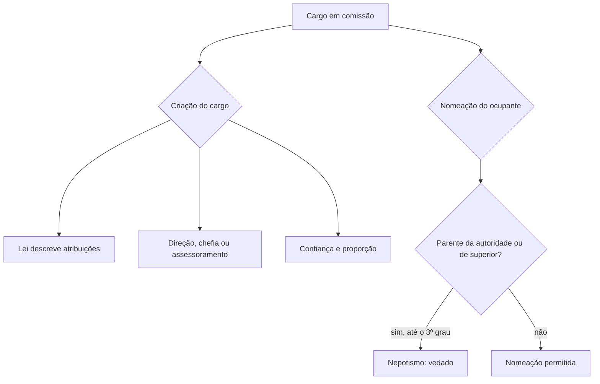

Dois temas fecham a discussão sobre cargos em comissão: quem pode ser nomeado para eles e quando a lei pode criá-los. O primeiro é o nepotismo, regulado pela Súmula Vinculante 13. O segundo é a tese de repercussão geral que fixou limites à criação de cargos comissionados. Os dois assuntos aparecem juntos em prova porque têm a mesma lógica: o cargo de livre nomeação é exceção ao concurso e não pode virar caminho para favorecer parentes nem para substituir servidores efetivos.

> [!objetivos]
> - Delimitar quem pode ser alcançado pela vedação ao nepotismo.
> - Aplicar as exceções à Súmula Vinculante 13.
> - Enumerar os requisitos para criar cargos em comissão.
> - Distinguir servidor efetivo de servidor de carreira.

## Servidor efetivo e servidor de carreira

O art. 37, V, da Constituição usa as duas expressões. Elas são próximas, mas não idênticas. **Cargo efetivo** é o que exige concurso público para o provimento. Dentro dos cargos efetivos há os **cargos de carreira**, em que o servidor pode ser promovido ou progredir, e os **cargos isolados**, que não têm essa evolução: o servidor entra em um nível e fica nele até se aposentar.

Todo servidor de carreira é efetivo, mas nem todo servidor efetivo é de carreira. Na prática, quase todos os cargos efetivos de hoje são organizados em carreira, e a prova raramente separa as duas ideias. Quando uma questão for literal, lembre que a função de confiança é reservada a "servidores efetivos" e que o percentual de cargos em comissão é reservado a "servidores de carreira".

## Vedação ao nepotismo

**Nepotismo** é o favorecimento de parentes na ocupação de cargos públicos. A Súmula Vinculante 13 proíbe que a autoridade nomeie, para cargo em comissão, cargo de confiança ou função gratificada, o cônjuge, o companheiro ou o parente de certos graus, seja dela própria, seja de servidor da mesma pessoa jurídica que ocupa cargo de direção, chefia ou assessoramento.

> [!jurisprudencia] STF, Súmula Vinculante 13
> Viola a Constituição a nomeação de cônjuge, companheiro ou parente até o terceiro grau, em linha reta, colateral ou por afinidade, da autoridade nomeante ou de servidor da mesma pessoa jurídica que ocupe cargo de direção, chefia ou assessoramento, para cargo em comissão ou de confiança ou função gratificada, em qualquer Poder e em qualquer ente da Federação. A súmula inclui o ajuste por designações recíprocas.

Os pontos da súmula, um a um:

- **Parentes alcançados**: cônjuge, companheiro e parentes em linha reta, colateral ou por afinidade **até o terceiro grau, inclusive**. O tio é parente de terceiro grau e não pode ser nomeado. O primo é de quarto grau e pode.
- **Quem é o parente**: da autoridade que nomeia, ou de outro servidor da **mesma pessoa jurídica** que ocupe cargo de direção, chefia ou assessoramento.
- **O que se veda**: nomeação para cargo em comissão ou de confiança e designação para função gratificada.
- **Onde vale**: administração direta e indireta, em todos os Poderes e em todos os entes federativos.
- **Nepotismo cruzado**: duas autoridades combinam nomear o parente uma da outra. Não há parentesco direto entre quem nomeia e o nomeado, mas o ajuste é proibido.

| Grau | Parentes na linha reta | Parentes colaterais |
| --- | --- | --- |
| 1º | pais e filhos | — |
| 2º | avós e netos | irmãos |
| 3º | bisavós e bisnetos | tios e sobrinhos |
| 4º | — | primos |

A tabela mostra o essencial para a prova: o limite da vedação é o terceiro grau, logo tios e sobrinhos estão dentro e primos estão fora. Os mesmos graus valem para os parentes por afinidade (parentes do cônjuge): sogros, cunhados, genros.

> [!exemplo] Nepotismo cruzado
> A diretora de uma autarquia nomeia o marido da secretária estadual. Em troca, a secretária nomeia o irmão da diretora para um cargo em comissão. Nenhuma das duas nomeou parente seu, mas a designação recíproca esconde o favorecimento. A súmula proíbe a prática.

### Fundamento e consequências

A proibição **não depende de lei**. Ela decorre diretamente dos princípios da moralidade e da impessoalidade do art. 37, caput, da Constituição (Tema 66). Por isso, a súmula vale mesmo que o ente federativo não tenha lei própria. As leis que tratam do assunto também não são de iniciativa exclusiva do chefe do Poder Executivo, e podem partir do Legislativo (Tema 29).

No campo da improbidade, a Lei 14.230/2021 passou a tratar o nepotismo como ato que atenta contra os princípios da administração (Lei 8.429/1992, art. 11, XI).

> [!lei] Lei 8.429/1992, art. 11, XI
> nomear cônjuge, companheiro ou parente em linha reta, colateral ou por afinidade, até o terceiro grau, inclusive, da autoridade nomeante ou de servidor da mesma pessoa jurídica investido em cargo de direção, chefia ou assessoramento, para o exercício de cargo em comissão ou de confiança ou, ainda, de função gratificada na administração pública direta e indireta [...], compreendido o ajuste mediante designações recíprocas;

O dispositivo repete a lógica da súmula e a leva para a esfera da improbidade. Como a Lei 14.230/2021 exige **dolo** para todos os atos de improbidade, a conduta só é punida quando há intenção de nomear o parente. Já a nomeação indevida, por si só, é anulável com base na súmula.

### Como se combate a nomeação nepotista

Contra o ato que descumpre uma súmula vinculante cabe **reclamação** ao STF, que pode anular o ato administrativo e determinar que outro seja praticado (CF, art. 103-A, § 3º). O servidor prejudicado, o Ministério Público e o próprio ente podem provocar a anulação. Essa via vale para a nomeação de parente, assim como para outros descumprimentos de súmula vinculante.

Para a prova, guarde a ideia de que a súmula vinculante obriga todos os órgãos do Judiciário e **a administração pública direta e indireta**, nas três esferas (CF, art. 103-A, caput). Assim, o chefe do Poder Executivo local não pode alegar que aguarda uma lei municipal para cumprir a regra.

### Exceções e limites da súmula

O STF fixou três limites que a banca explora:

1. **Cargos efetivos não entram.** A súmula alcança comissionados, funções de confiança e funções gratificadas. Um parente pode ocupar cargo efetivo se for aprovado em concurso.
2. **O parentesco com "outro servidor" exige subordinação.** Se a súmula fosse lida ao pé da letra, a esposa de um diretor da Receita não poderia ocupar cargo comissionado em nenhum órgão da União. O STF entende que só há nepotismo quando a pessoa com cargo de direção tem poder de influir na escolha, ou seja, quando há relação de hierarquia com a autoridade que nomeia.
3. **Cargos políticos têm tratamento diferente.** A súmula, em regra, não alcança cargos como ministro de Estado ou secretário estadual e municipal. A exceção é a nomeação com fraude ou sem razoabilidade, por falta manifesta de qualificação técnica ou de idoneidade moral. Há divergência entre os ministros, e o tema aguarda decisão com repercussão geral. Para a prova, vale o entendimento atual.

> [!exemplo] Parentesco com superior hierárquico
> O ministro de Estado tem uma esposa, que não é parente da diretora de um órgão subordinado ao ministério. Mesmo assim, se a diretora a nomear para cargo em comissão, há nepotismo, porque o ministro tem ascendência hierárquica sobre a diretora.

> [!pegadinha] Segundo grau, primo e concurso
> A banca troca o limite ("até o segundo grau"), inclui o primo entre os proibidos ou afirma que o filho do governador não pode ser aprovado em concurso. As três afirmações estão erradas: o limite é o terceiro grau, o primo é de quarto grau, e o concurso é a via legítima de ingresso, que a súmula não alcança.

## Criação de cargos em comissão

A Constituição fez do concurso a regra. Mesmo assim, é comum a criação excessiva de cargos comissionados para tarefas comuns. O STF respondeu a esse problema com a tese de repercussão geral do Tema 1010, que impõe quatro critérios à lei que cria esses cargos.

> [!jurisprudencia] STF, Tema 1010
> A criação de cargos em comissão só é válida quando: (a) as funções são de direção, chefia e assessoramento, e não burocráticas, técnicas ou operacionais; (b) há relação de confiança entre quem nomeia e quem é nomeado; (c) o número de cargos é proporcional à necessidade e ao quadro de efetivos do ente; (d) as atribuições vêm descritas de forma clara na própria lei.

Os critérios podem ser resumidos em uma lista de verificação:

1. **Finalidade**: direção, chefia ou assessoramento.
2. **Natureza da atividade**: não pode ser burocrática, técnica ou operacional. Um cargo de contador, por exemplo, deve ser de concursado.
3. **Confiança**: a relação entre autoridade e nomeado precisa ser de confiança pessoal.
4. **Proporcionalidade**: o número de comissionados deve guardar proporção com a necessidade que se quer atender e com o número de servidores efetivos do ente.
5. **Descrição legal**: as atribuições têm de constar da lei que cria o cargo, e não de ato posterior, como regulamento ou resolução.

Mais tarde, o STF reforçou que é inconstitucional a criação de cargos em comissão sem observar esses requisitos. Isso significa que a norma pode ser invalidada em ação própria, mesmo que o cargo exista há anos.

> [!atencao] Lei, e não decreto
> Cargos em comissão são criados por **lei**, com as atribuições descritas. A banca costuma propor que podem ser criados por decreto, ou que a lei pode deixar a definição das tarefas para regulamento. As duas alternativas estão erradas.

> [!bizu] Cinco palavras para a lista
> Direção-chefia-assessoramento, confiança, proporção, lei, atribuições claras. Se uma alternativa fala em atividade técnica ou em ausência de confiança, ela está errada.

## Mapa do capítulo

O esquema abaixo guia a análise de uma nomeação ou da criação de um cargo comissionado.

### Para fixar
- Cargo efetivo exige concurso; cargo de carreira é um cargo efetivo com evolução funcional.
- A Súmula Vinculante 13 veda nomear parente até o terceiro grau, em linha reta, colateral ou por afinidade.
- O terceiro grau inclui tios e sobrinhos; os primos estão fora, por serem de quarto grau.
- A vedação alcança cargo em comissão, função de confiança e função gratificada, em toda a administração, em todos os Poderes e entes.
- O nepotismo cruzado, por designações recíprocas, também é vedado.
- A proibição não depende de lei: decorre da moralidade e da impessoalidade (art. 37, caput).
- A súmula não alcança cargos efetivos aprovados em concurso, e em regra não alcança cargos políticos.
- O parentesco com outro servidor só configura nepotismo se ele tiver ascendência hierárquica sobre quem nomeia.
- A Lei 14.230/2021 incluiu o nepotismo entre os atos de improbidade que atentam contra os princípios (Lei 8.429/1992, art. 11, XI).
- O Tema 1010 exige lei, direção, chefia ou assessoramento, confiança, proporção e atribuições claras para criar cargos comissionados.
