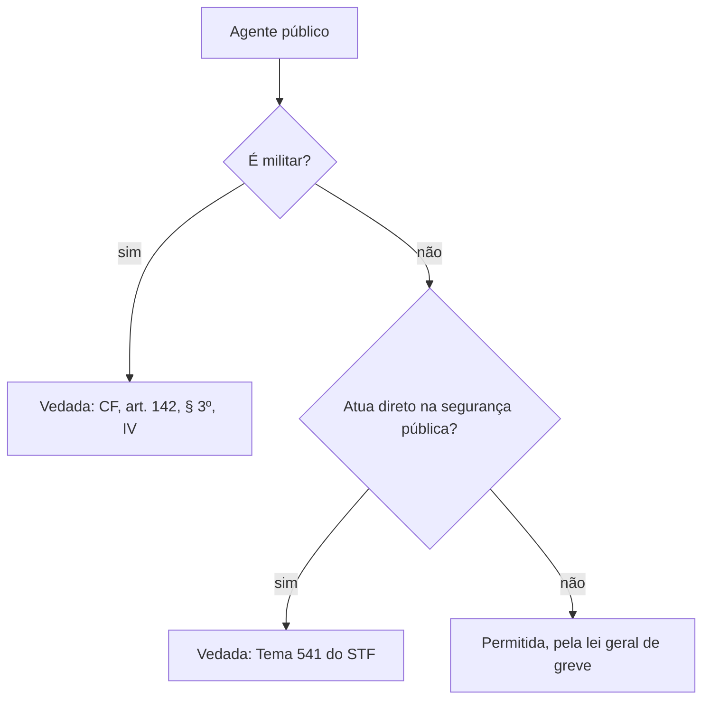

Dois direitos coletivos do servidor civil são cobrados em conjunto: a livre associação sindical e o direito de greve. O assunto tem um ponto extra: os militares estão **excluídos** dos dois. A prova cobra quem pode, quem não pode e quais são as consequências da greve para a remuneração e para o estágio probatório. A maior parte do conteúdo vem de teses do STF, de modo que o objetivo é gravá-las com suas condições.

> [!objetivos]
> - Distinguir quem pode e quem não pode se sindicalizar e fazer greve.
> - Explicar como a greve do servidor funciona sem lei específica.
> - Aplicar a regra do desconto dos dias parados e suas exceções.
> - Reconhecer que a greve, por si só, não é falta grave.

## Livre associação sindical

> [!lei] CF, art. 37, VI e VII
> VI - é garantido ao servidor público civil o direito à livre associação sindical;
> VII - o direito de greve será exercido nos termos e nos limites definidos em lei específica;

Os dois incisos aparecem lado a lado no texto constitucional, e por isso a banca os mistura. O inciso VI dá o direito de se associar. O inciso VII trata da greve e a submete a uma lei que ainda não existe. O primeiro vale de imediato; o segundo exige lei, e é essa diferença que explica toda a jurisprudência do capítulo.

A Constituição garante ao servidor público **civil** o direito à livre associação sindical (CF, art. 37, VI). É um direito de todo servidor civil: efetivo, comissionado ou em estágio probatório. A filiação, porém, é **facultativa**: ninguém é obrigado a se associar a um sindicato.

Os militares ficam de fora. A Constituição proíbe a sindicalização e a greve ao militar (CF, art. 142, § 3º, IV). A regra vale para os militares das Forças Armadas e, por força do art. 42, § 1º, também para os **militares estaduais**, como policiais e bombeiros militares. Para o candidato do corpo de bombeiros, é uma das pegadinhas mais frequentes: o direito de sindicalização é do servidor **civil**, e não do servidor público em geral.

| Categoria | Sindicalização | Greve |
| --- | --- | --- |
| Servidor civil em geral | permitida e facultativa | permitida, nos termos da lei |
| Policial civil e demais servidores da segurança pública | permitida | vedada em qualquer forma (STF) |
| Militar (federal ou estadual) | vedada (CF, art. 142, § 3º, IV) | vedada (CF, art. 142, § 3º, IV) |

### Associação e sindicato

É comum confundir associação de classe com sindicato. A Constituição proíbe ao militar a **sindicalização**, e não a união em entidades de natureza associativa e assistencial. Associações de oficiais e de praças, por exemplo, existem e podem atuar na defesa de interesses da categoria, desde que não organizem paralisações. A prova costuma pedir só a regra: o militar não pode sindicalizar-se.

### Licença para o mandato sindical

O servidor eleito dirigente de sindicato pode se afastar do trabalho? O STF entende que a função executiva em sindicato **não se confunde** com o mandato eletivo do art. 38 da Constituição. Por isso, cada ente federativo pode decidir em sua lei se o afastamento para o mandato sindical é com ou sem remuneração. As duas soluções são constitucionais (ADI 510 e ADI 7.242).

> [!pegadinha] Mandato sindical não é mandato eletivo
> A banca tenta aplicar ao dirigente sindical as regras do art. 38, como a perda de remuneração do vereador ou a opção do prefeito. Essas regras são para mandato **eletivo** (cargos políticos). O sindicato não é cargo eletivo no sentido constitucional, e a Constituição não obriga que o afastamento seja remunerado.

## Direito de greve: eficácia limitada

A Constituição diz que o direito de greve do servidor será exercido nos termos e nos limites de lei específica (CF, art. 37, VII). A norma tem **eficácia limitada**: precisa de lei para produzir todos os efeitos. Essa lei nunca foi editada.

O STF não aceitou que a omissão impedisse a greve. No mandado de injunção (MI 708), mandou aplicar aos servidores civis a **lei geral de greve** (Lei 7.783/1989), enquanto a lei específica não existir. Também decidiu que, por causa da continuidade dos serviços públicos, o tribunal competente pode impor o regime mais rígido dos **serviços essenciais** (arts. 9º a 11 da mesma lei), se o caso concreto o exigir.

Alguns pontos práticos da lei geral de greve ajudam a entender o que o STF mandou aplicar:

- A greve em serviço essencial exige que o sindicato comunique a decisão à Administração e aos usuários com antecedência mínima de **72 horas** (art. 13); nas demais greves, o aviso é de 48 horas (art. 3º, parágrafo único).
- Durante a greve, os grevistas devem manter os serviços indispensáveis ao atendimento das necessidades inadiáveis da população (arts. 9º a 11).
- A greve com abuso, como a que descumpre esses deveres, pode ser declarada ilegal.

A lei geral de greve define o que é serviço essencial e lista exemplos, como tratamento e abastecimento de água, produção e distribuição de energia, assistência médica e hospitalar, transporte coletivo, telecomunicações e controle de tráfego aéreo. Quando a greve atinge um serviço desse tipo, as entidades sindicais e o empregador devem acordar a manutenção de equipes mínimas. Se não o fizerem, o poder público pode assegurar a prestação dos serviços indispensáveis.

A competência para julgar a abusividade da greve de servidores celetistas da administração direta, autarquias e fundações é da **Justiça comum**, federal ou estadual (STF, RE 846.854), e não da Justiça do Trabalho.

> [!atencao] Falta de lei não impede a greve
> A alternativa que afirma que o servidor não pode fazer greve "enquanto a lei não for editada" está errada. O STF supriu a omissão com a lei geral de greve.

## Greve de policiais e servidores da segurança pública

Para os policiais civis e os demais servidores que atuam **diretamente na segurança pública**, o STF fixou tese diferente: o direito de greve, sob qualquer forma ou modalidade, é **vedado** (Tema 541). A razão é a necessidade de manter a segurança interna, a ordem pública e a paz social, que prevalecem sobre o interesse da categoria. Entram nessa vedação policiais civis, policiais federais, policiais rodoviários federais e policiais penais, entre outros do art. 144.

Como contrapartida, o Poder Público tem a **obrigação de participar de mediação** instaurada pelos órgãos classistas dessas carreiras, para que os interesses da categoria sejam apresentados e discutidos.

Observe a origem da proibição:

- **Militares**: a vedação é **expressa na Constituição** (art. 142, § 3º, IV).
- **Policiais civis e demais servidores da segurança pública**: a vedação decorre de **interpretação do STF**.

A banca costuma trocar essas fontes. A alternativa que diz que a Constituição proíbe expressamente a greve dos policiais civis está errada, e a que afirma que a greve deles é lícita se não tiver cunho político também.

## Desconto dos dias parados

A greve suspende o vínculo funcional: o servidor não presta o serviço e, por isso, não recebe. O STF fixou a tese do Tema 531: a administração **deve** descontar os dias de paralisação. O desconto é um dever, e não uma faculdade. Há duas ressalvas.

1. **Compensação por acordo**: as partes podem combinar que os dias parados serão repostos, por exemplo com trabalho em um recesso ou num ponto facultativo. Com a compensação, não há desconto.
2. **Greve provocada por conduta ilícita do poder público**: o desconto fica incabível.

O foco da segunda ressalva é a **causa** da greve, e não a licitude do movimento. O desconto ocorre tanto na greve lícita quanto na ilícita. Só deixa de ocorrer quando o motivo da greve é um ato ilícito da Administração.

> [!exemplo] Duas greves, duas respostas
> **Greve 1.** Os servidores entram em greve porque o governo não concedeu a revisão geral anual. O STF entende que a revisão geral anual não é obrigatória, desde que o chefe do Executivo justifique a decisão. Não há ilícito do Estado: o desconto é devido.
> **Greve 2.** Os servidores entram em greve porque o Estado atrasou os salários e o décimo terceiro. Pagar fora do prazo é conduta ilícita. O desconto é incabível.

A lógica por trás da tese é simples. Se a Administração for a responsável pela greve, seria injusto cobrar do servidor o preço da paralisação. Se a greve decorre de uma reivindicação que o Estado não tinha o dever de atender, o custo dos dias parados fica com quem parou. Esse raciocínio ajuda a resolver caso novo na prova: pergunte se o Estado descumpriu uma obrigação legal ou constitucional que motivou o movimento. Se sim, não há desconto. Se o pedido era apenas uma vantagem que o Estado podia negar, há desconto.

Dois pontos complementares vêm da jurisprudência do STJ:

- **Parcelamento**: se não houver acordo de compensação, o servidor pode pedir que o valor descontado seja parcelado. O fundamento é a aplicação analógica do art. 46 da Lei 8.112/1990, que permite parcelar reposições ao erário, com parcela de, no mínimo, 10% da remuneração. Ato que proíbe o parcelamento é desarrazoado.
- **Sem processo prévio**: o desconto dos dias de greve não exige processo administrativo prévio.

> [!pegadinha] "Em qualquer caso"
> A questão afirma que o desconto é devido "em qualquer caso" ou que é vedado o parcelamento. As duas afirmações são falsas. O Tema 531 tem exceção (greve causada por ilícito do Estado) e o STJ admite o parcelamento.

## Greve não é falta grave

Pode-se demitir o servidor em estágio probatório por ter aderido à greve? O STF respondeu que não. A adesão a uma greve **não abusiva** é o exercício de um direito constitucional e não pode ser tratada como falta grave nem como fato desabonador na avaliação do estágio probatório. A norma que previsse exoneração imediata por esse motivo seria inconstitucional (ADI 3.235).

Em outro precedente, o STF decidiu que a simples situação de estágio probatório não justifica a demissão por participação em greve com mais de 30 dias. A falta de regulamentação do direito de greve também não transforma os dias parados em faltas injustificadas (RE 226.966).

Duas ressalvas protegem a Administração:

- A proteção vale para o exercício **não abusivo** do direito. A greve com abuso pode gerar consequências.
- O servidor continua sujeito ao desconto dos dias não trabalhados, como se viu.

> [!atencao] Estágio probatório não perde proteção
> O servidor não estável também tem direito de greve. O fato de ainda estar em estágio não autoriza a exoneração pela simples adesão ao movimento.

## Três casos para treinar

**Caso 1.** O sindicato dos servidores civis de um estado convoca greve porque o governo não pagou o abono prometido em lei. O servidor Paulo pergunta se pode aderir mesmo sem lei específica de greve. Pode: a lei geral de greve supre a omissão. Quanto ao desconto, depende da causa. Se o abono era obrigatório por lei e o Estado descumpriu, a conduta é ilícita e o desconto é incabível.

**Caso 2.** Um grupo de policiais civis decide cruzar os braços por melhores salários. A greve é vedada pelo STF, qualquer que seja o formato (paralisação total, "operação padrão" ou "tartaruga"). Resta à categoria pedir ao poder público que participe da mediação, que é obrigatória.

**Caso 3.** O sargento do corpo de bombeiros militar de um estado integra uma associação de militares e participa de um movimento que paralisa o serviço. A associação não é o problema: o que a Constituição veda é a **sindicalização** e a **greve**. A paralisação é greve e constitui infração, ainda que o grupo a chame de outro nome.

Nos três casos, a pergunta correta vem em ordem: quem é o servidor (civil, policial, militar), o que ele quer fazer (associar-se, parar) e qual regra se aplica a ele.

## Mapa do capítulo

O quadro reúne as regras do capítulo para revisão rápida.

| Tema | Regra | Base |
| --- | --- | --- |
| Sindicalização do servidor civil | permitida e facultativa | CF, art. 37, VI |
| Sindicalização do militar | vedada | CF, art. 142, § 3º, IV |
| Licença para mandato sindical | pode ser com ou sem remuneração, conforme a lei de cada ente | ADI 510 e ADI 7.242 |
| Greve do servidor civil | eficácia limitada; vale a lei geral de greve | CF, art. 37, VII; MI 708 |
| Greve de policiais e segurança pública | vedada, com mediação obrigatória do poder público | Tema 541 |
| Desconto dos dias parados | devido; compensável; incabível se a causa for ilícito do Estado | Tema 531 |
| Estágio probatório | greve não abusiva não é falta grave | ADI 3.235 e RE 226.966 |

### Para fixar
- O direito à livre associação sindical é do servidor civil e a filiação é facultativa.
- Ao militar, inclusive o estadual, a Constituição veda sindicalização e greve (art. 142, § 3º, IV, aplicável pelo art. 42, § 1º).
- A licença para mandato sindical pode ser remunerada ou não, a critério da lei de cada ente.
- O direito de greve do servidor tem eficácia limitada, e a lei específica nunca foi editada.
- Enquanto não há lei específica, aplica-se a lei geral de greve (MI 708).
- Policiais civis e servidores da segurança pública não podem fazer greve, com mediação obrigatória (Tema 541).
- Os dias parados devem ser descontados, salvo compensação por acordo ou greve causada por ilícito do poder público (Tema 531).
- Sem acordo de compensação, o servidor pode pedir o parcelamento do desconto, que independe de processo prévio.
- A adesão a greve não abusiva não é falta grave e não justifica demissão em estágio probatório.
- O que importa para o desconto é a causa da greve, e não a sua licitude.
