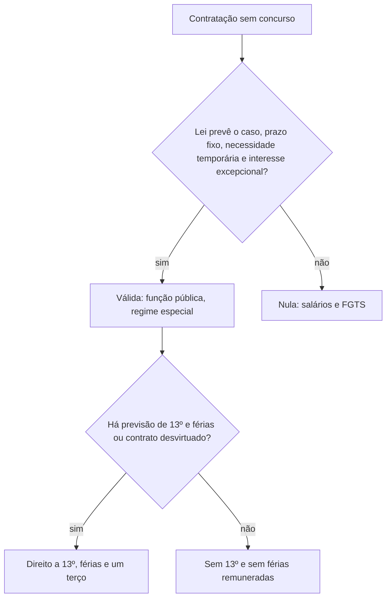

A Constituição fez do concurso a porta de entrada do serviço público. Mesmo assim, o Estado às vezes precisa de gente rápido: para uma epidemia, para substituir uma docente em licença-maternidade, para um evento que aumenta a demanda por socorro. A solução é a contratação temporária, uma exceção prevista no art. 37, IX. A prova cobra o tema por meio de teses do STF sobre requisitos, regime, direitos sociais, contratação irregular e "quarentena" para nova contratação.

> [!objetivos]
> - Listar os requisitos para a contratação temporária ser válida.
> - Explicar o regime jurídico e o foro competente do agente temporário.
> - Aplicar a regra sobre 13º salário e férias aos temporários.
> - Indicar os efeitos da contratação temporária irregular.

## Requisitos da contratação temporária

O texto constitucional é curto.

> [!lei] CF, art. 37, IX
> a lei estabelecerá os casos de contratação por tempo determinado para atender a necessidade temporária de excepcional interesse público;

O dispositivo remete tudo à **lei de cada ente**. A Constituição não diz quais são os casos nem por quanto tempo; apenas impõe que haja lei, que o prazo seja determinado, que a necessidade seja temporária e que o interesse público seja excepcional.

Como a regra é o concurso, a exceção deve ser **interpretada restritivamente**. O STF resumiu o que a lei precisa respeitar em cinco requisitos (Tema 612):

1. **Casos previstos em lei.** Uma lei do ente deve listar as situações que autorizam a contratação.
2. **Prazo predeterminado.** O contrato precisa ter início e fim definidos.
3. **Necessidade temporária.** A demanda não pode ser permanente.
4. **Interesse público excepcional.** Não basta a conveniência da Administração.
5. **Contratação indispensável.** É vedada para os serviços ordinários e permanentes do Estado, que fazem parte das contingências normais da Administração.

Há um cuidado de leitura: o serviço pode ser **permanente** e a **necessidade** ser temporária. Contratar docentes para uma escola é, em princípio, serviço permanente. Mas contratar docente para cobrir a licença-maternidade de uma colega, por seis meses, atende a uma necessidade temporária. O mesmo vale para reforçar o atendimento de saúde durante uma epidemia.

A lei também não pode ser genérica. É inconstitucional a norma que autoriza contratações temporárias em hipóteses amplas, sem especificar a situação fática que caracteriza a emergência.

> [!exemplo] Lei válida
> Uma lei estadual autoriza, por até doze meses, a contratação de docentes sem concurso, para garantir as aulas enquanto o concurso é realizado, depois de aposentadorias e falecimentos que deixaram muitos cargos vagos. Os requisitos estão cumpridos: há lei, prazo fixado, necessidade ligada ao tempo do concurso e excepcionalidade da situação.

> [!pegadinha] "Contratar até o próximo concurso"
> A banca monta lei que autoriza a contratação "por tempo indeterminado, enquanto durar a carência de docentes". Falta o prazo predeterminado, e a carência permanente não é necessidade temporária. A lei seria inválida.

### Comparação com os outros vínculos

Vale a pena colocar o temporário ao lado dos demais vínculos com a Administração. A tabela mostra as diferenças que a banca costuma trocar.

| Vínculo | Como se ingressa | Natureza | Estabilidade |
| --- | --- | --- | --- |
| Cargo efetivo | concurso público | estatutário | sim, após estágio probatório |
| Cargo em comissão | livre nomeação | estatutário | não |
| Emprego público | concurso público | celetista | não; empresas estatais devem motivar a dispensa |
| Função temporária | processo seletivo simplificado | contrato administrativo especial | não |

O processo seletivo para temporários costuma ser mais simples do que um concurso, mas isso não elimina a exigência de critérios objetivos e impessoais. O agente temporário também se submete à responsabilização por ato de improbidade e pode ser contratado só dentro da lei.

## Natureza do vínculo e foro competente

O agente temporário não ocupa **cargo** nem **emprego público**. Ele exerce uma **função pública**, chamada de função autônoma, porque não está presa a um cargo ou a um emprego.

Por isso o regime dele é **especial**, e não o estatutário nem o celetista. O vínculo nasce de um **contrato administrativo**, regido pelo direito público. Embora o contrato seja chamado de temporário e tenha prazo, ele não aplica a CLT.

Daí decorre a regra de competência: as ações entre o agente temporário e a Administração são julgadas pela **Justiça comum**, federal ou estadual. A Justiça do Trabalho é incompetente, mesmo quando o autor alega que a contratação foi desvirtuada.

Em matéria de previdência, o agente temporário filia-se ao **regime geral de previdência social**, e não ao regime próprio dos servidores efetivos. A Constituição aplica o regime geral a quem ocupa apenas cargo em comissão, outro cargo temporário ou emprego público (CF, art. 40, § 13). O ponto é útil para comparar o temporário com o servidor efetivo, que tem regime próprio. Assim, quem trabalha como temporário durante a epidemia contribui para o INSS e, ao final do contrato, conta esse tempo para fins de aposentadoria pelo regime geral.

| Aspecto | Agente temporário |
| --- | --- |
| Ocupa | função pública, sem cargo ou emprego |
| Regime | especial (nem estatutário, nem celetista) |
| Vínculo | contrato de direito público |
| Foro | Justiça comum, federal ou estadual |
| Estabilidade | não tem; o contrato termina com o prazo |

O agente temporário é **agente público**. A prova pergunta com frequência se ele é agente público: é, mesmo sem cargo nem emprego, por exercer função pública.

### Como reconhecer o desvirtuamento

O desvirtuamento é o ponto em que a prova mais se apoia, porque dele dependem tanto os direitos sociais quanto a nulidade. Alguns sinais ajudam a identificá-lo:

- **Prorrogações sucessivas** e reiteradas do mesmo contrato, ou renovações em sequência para o mesmo agente.
- **Cargos vagos** da mesma função, sem concurso em andamento. O temporário passa a ocupar, na prática, a vaga de um servidor efetivo.
- **Atividade permanente**, típica da carreira, como a de docente da rede ou de enfermeiro de hospital, exercida sem interrupção.
- **Ausência de causa temporária**: o motivo declarado (epidemia, licença) já acabou, mas o contrato continua.

Reconhecido o desvirtuamento, a consequência para o agente é o direito às verbas que o Tema 551 reconhece. Para o gestor, o desvio pode gerar responsabilização administrativa, civil e, conforme o caso, penal. A tese não transforma o temporário em servidor efetivo: não há estabilidade nem nomeação por esse motivo.

## Direitos sociais dos temporários

Quais verbas o temporário recebe? O STF fixou uma regra e duas exceções (Tema 551).

**Regra**: o temporário **não** tem direito a décimo terceiro salário, a férias remuneradas e ao adicional de um terço sobre as férias. O regime administrativo-remuneratório dele é diferente do regime dos servidores efetivos.

**Exceções**: esses direitos são devidos se:

- houver **previsão legal ou contratual** expressa; ou
- ficar comprovado o **desvirtuamento** da contratação temporária, por renovações e prorrogações sucessivas e reiteradas.

> [!exemplo] Duas enfermeiras, duas respostas
> **Ana** foi contratada durante uma epidemia, pelo prazo exato do edital. Ao final, não recebeu 13º nem férias com um terço, porque a lei e o contrato não os previam. O pedido dela no Judiciário será improcedente.
> **Mara** foi contratada como docente e teve o contrato prorrogado por mais de cinco anos, enquanto havia cargos vagos e nenhum concurso era feito. A contratação foi desvirtuada. Ela tem direito ao 13º, às férias e ao terço.

Em decisão posterior, o STF ampliou o alcance dessa lógica: não se pode estender por decisão judicial, ao temporário, nenhuma parcela de natureza remuneratória do servidor efetivo, observado o Tema 551 (Tema 1344). Um adicional pago ao docente efetivo, por exemplo, não pode ser deferido pelo juiz ao temporário, salvo previsão legal ou contratual ou desvirtuamento do contrato.

> [!atencao] A regra é a negação, a exceção é a concessão
> Na prova, quando a questão pergunta se o temporário tem direito ao 13º "por analogia ao trabalhador da iniciativa privada" ou "por previsão da Constituição para todos os trabalhadores", a resposta é não. Só há direito nas duas exceções.

## Contratação temporária irregular

Imagine que a Administração contratou João como temporário, mas depois se reconheceu que a atividade era permanente. O contrato foi declarado **nulo**, porque contrariou o art. 37, IX.

A nulidade não deixa o trabalhador sem nada. O STF decidiu que, nesse caso, a contratação irregular não gera efeitos jurídicos válidos, **exceto**:

- o direito aos **salários do período trabalhado**; e
- o direito de **levantar os depósitos do FGTS**, nos termos do art. 19-A da Lei 8.036/1990 (Tema 916).

A lógica é a de que quem trabalhou deve receber, e que o FGTS depositado pertence ao trabalhador. Não nascem, porém, os demais direitos de um vínculo regular, como a estabilidade ou a nomeação.

> [!bizu] Nula, mas paga
> Contratação temporária nula = **salário + FGTS**. Nada mais, em regra. Se a questão acrescenta estabilidade, efetivação ou indenização por tempo de serviço, está errada.

## Quarentena para nova contratação

Uma lei pode proibir que o temporário seja contratado de novo logo em seguida? O STF disse que sim para o caso dos docentes temporários: é constitucional a lei que exige um intervalo de **24 meses**, contado do fim do contrato, antes de nova admissão (Tema 403). A finalidade é preservar a moralidade e impedir que o excepcional vire ordinário, com contratações em sequência que disfarçam o preenchimento permanente de cargos.

Não confunda essa quarentena com outra regra, que o STJ afastou. Um edital eliminava automaticamente o candidato que, em contrato anterior, tinha sido dispensado por **conveniência administrativa**. O STJ considerou a cláusula inválida, porque impede a participação por um motivo que nada diz sobre o candidato, o que viola a isonomia e a impessoalidade (RMS 67.040/ES). A diferença é a seguinte:

| Regra | Efeito | Validade |
| --- | --- | --- |
| Intervalo de 24 meses entre contratos temporários | impede nova admissão no período | constitucional (Tema 403) |
| Eliminar quem foi dispensado por conveniência administrativa | impede a participação por tempo indeterminado | inválida (STJ) |

## Como a banca cobra

As questões repetem quatro modelos. Cada um pede um raciocínio diferente, e por isso vale decorar a ordem de análise:

1. **Lei hipotética**: descreve um caso e pergunta se é constitucional. Confira os cinco requisitos um a um.
2. **Natureza do vínculo**: oferece alternativas com "cargo", "emprego" e "função". A resposta é função pública.
3. **Verbas**: pergunta se o temporário recebe 13º e férias. A regra é não, com as duas exceções.
4. **Competência**: pergunta qual Justiça julga. É a comum.

Na prática, a análise segue sempre a mesma sequência. Primeiro, pergunte se há **lei** que autorize a hipótese. Em seguida, confira o **prazo**: contrato sem prazo é nulo. Depois, avalie a **natureza da necessidade**: se o serviço é permanente e a necessidade também, falta o requisito da temporariedade. Por fim, verifique se houve **prorrogações sucessivas**, o que revela desvirtuamento e muda os direitos do contratado.

> [!pegadinha] Cargo, emprego, função
> O temporário **é agente público**, mas **não ocupa cargo nem emprego**. As alternativas que dizem que "não é agente público" ou que "ocupa emprego público" estão erradas.

## Mapa do capítulo

O fluxograma reúne a decisão sobre a contratação temporária e seus efeitos.

### Para fixar
- A contratação temporária é exceção ao concurso e deve ser interpretada de modo restritivo (CF, art. 37, IX).
- Exige previsão em lei, prazo predeterminado, necessidade temporária, interesse público excepcional e indispensabilidade.
- É vedada para serviços ordinários e permanentes; a necessidade, e não o serviço, é que precisa ser temporária.
- O temporário exerce função pública, sem cargo nem emprego, em regime especial.
- Os litígios do temporário com a Administração são julgados pela Justiça comum.
- Em regra o temporário não recebe 13º, férias nem o terço, salvo previsão legal ou contratual ou desvirtuamento do contrato (Tema 551).
- O juiz não pode estender ao temporário parcelas do servidor efetivo (Tema 1344).
- A contratação irregular só gera direito aos salários do período e ao levantamento do FGTS (Tema 916).
- É constitucional exigir 24 meses entre contratações temporárias de docente (Tema 403).
- Edital que elimina candidato dispensado antes por conveniência administrativa viola isonomia e impessoalidade (STJ).
