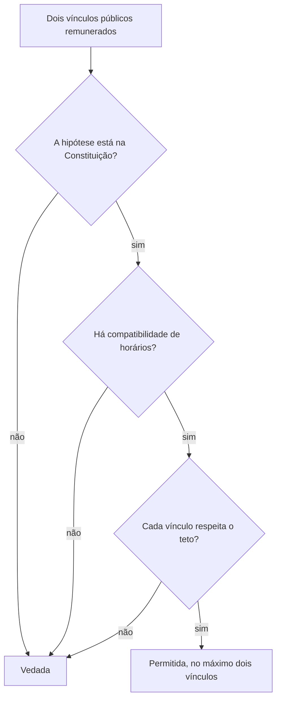

A regra é simples: ninguém recebe duas remunerações públicas ao mesmo tempo. As exceções é que dão trabalho. Elas aparecem na Constituição, são poucas e exigem compatibilidade de horários, mas mudaram em 2025, e a prova começa a cobrar a redação nova. O capítulo ainda trata de duas situações vizinhas, o servidor que exerce mandato eletivo e o sistema de subsídio, ponto que interessa muito aos policiais e bombeiros militares, porque o art. 144, § 9º, os submete a esse modelo.

> [!objetivos]
> - Enunciar a regra da vedação e seu alcance dentro da administração.
> - Listar as acumulações permitidas, com a redação atual da Constituição.
> - Aplicar o teto remuneratório em caso de acumulação.
> - Resolver os casos de servidor que exerce mandato eletivo.
> - Distinguir remuneração, vencimento, subsídio, proventos e pensão.

## A regra e seu alcance

> [!lei] CF, art. 37, XVI (redação da EC 138/2025)
> é vedada a acumulação remunerada de cargos públicos, exceto, quando houver compatibilidade de horários, observado em qualquer caso o disposto no inciso XI: [...] c) a de dois cargos ou empregos privativos de profissionais de saúde, com profissões regulamentadas;

O dispositivo combina a regra (vedação) com as exceções. As alíneas a e b, omitidas acima, tratam do magistério e são explicadas adiante. Quase todas as questões do tema giram em torno desse inciso.

A Constituição veda a acumulação **remunerada** de cargos públicos (CF, art. 37, XVI). Por isso, em geral, um agente público não pode ocupar dois cargos pagos ao mesmo tempo.

A vedação tem três características que a banca explora.

1. **Atinge cargos, empregos e funções.** A proibição se estende a empregos e funções, e não só a cargos (art. 37, XVII).
2. **Alcança toda a administração.** Vale para a direta e para a indireta, o que inclui autarquias, fundações e empresas estatais, além das subsidiárias e das sociedades que o poder público controla, direta ou indiretamente. Mesmo a estatal que não recebe recursos para custeio está dentro da regra.
3. **Só trata de vínculos públicos e remunerados.** Quem ocupa cargo público pode ter emprego em empresa privada, desde que respeitadas as demais normas, como as de conflito de interesses. O serviço gratuito, como o de mesário eleitoral, também não conta.

Só a **Constituição** pode criar exceções. Lei complementar, lei ordinária ou decreto não podem permitir acumulações novas.

> [!pegadinha] Empresa que não depende do Tesouro
> A banca monta o caso de um emprego numa sociedade de economia mista que explora atividade econômica e não recebe verbas públicas, e pergunta se a acumulação com outro emprego em estatal é livre. Não é. A vedação alcança a estatal independentemente de receber ou não recursos para custeio.

## Requisitos das exceções

A acumulação só é possível quando se cumprem, ao mesmo tempo, três requisitos:

1. **Hipótese prevista na Constituição**, como as listadas na próxima seção.
2. **Compatibilidade de horários**, verificada no caso concreto.
3. **Respeito ao teto remuneratório** do art. 37, XI.

Além disso, a Constituição admite no máximo **dois** cargos, empregos ou funções. Três não é possível.

### Compatibilidade de horários

O STF decidiu que a compatibilidade de horários é o **único** requisito de fato para as acumulações autorizadas. Mesmo que uma lei limite a jornada semanal, o que vale é verificar, no caso concreto, se os dois horários cabem (Tema 1081). Não há um teto de horas semanais fixado pela Constituição.

> [!exemplo] Carga horária alta, mas compatível
> Um médico cumpre 30 horas semanais num hospital municipal, das 7h às 12h, de segunda a sábado. Ele também cumpre 35 horas semanais num hospital estadual, das 13h às 20h, de segunda a sexta. A soma é de 65 horas, mas os horários não se sobrepõem. A acumulação é válida.

### O teto na acumulação

O art. 37, XVI, manda observar o teto do inciso XI "em qualquer caso". Há uma pegadinha clássica: **o teto é verificado separadamente em cada vínculo**, e não sobre a soma (RE 602.043 e RE 612.975). Se o teto é de 40 mil reais e alguém recebe 25 mil num cargo e 20 mil em outro, está tudo certo: cada vínculo está abaixo do teto, ainda que a soma seja de 45 mil.

Assim, a resposta correta para "a acumulação deve observar o teto?" é **sim**. A forma de verificar é que muda: por cargo, e não pela soma.

## Hipóteses de acumulação

O art. 37, XVI, autoriza três hipóteses, desde que haja compatibilidade de horários.

| Hipótese | Exemplo |
| --- | --- |
| a) dois cargos de docente | docente do ensino fundamental pela manhã e do ensino superior à tarde |
| b) um cargo de docente com outro de qualquer natureza | docente e analista; docente e oficial |
| c) dois cargos ou empregos privativos de profissionais de saúde, com profissões regulamentadas | médico e enfermeiro; dois cargos de dentista |

A alínea **b** mudou. Antes da **Emenda Constitucional 138/2025**, o outro cargo tinha de ser "técnico ou científico". Agora pode ser de **qualquer natureza**. A mudança amplia a regra a ponto de englobar a alínea a, porque o outro cargo também pode ser de magistério.

Na alínea c, só entram cargos **privativos de profissionais de saúde com profissão regulamentada** (médicos, dentistas, enfermeiros, fisioterapeutas). Um cargo meramente administrativo num hospital não serve.

> [!atencao] Redação nova, prova nova
> Provas de antes de 2025 cobram "docente com outro técnico ou científico". A redação atual é "docente com outro de qualquer natureza". Se a questão for recente e citar a Constituição vigente, use a redação nova. Se citar entendimento antigo, confirme a data.

### Outras acumulações previstas na Constituição

Fora do art. 37, XVI, há acumulações isoladas que a banca cobra menos, mas que merecem registro:

- **Vereador**: acumula com o cargo, emprego ou função se houver compatibilidade de horários (art. 38, III).
- **Juiz**: pode exercer um cargo ou função de magistério (art. 95, parágrafo único, I).
- **Membro do Ministério Público**: pode exercer uma função de magistério (art. 128, § 5º, II, d).
- **Profissional de saúde das Forças Armadas**: pode acumular com outro cargo ou emprego privativo de profissional de saúde, na forma da lei, com prevalência da atividade militar (art. 142, § 3º, VIII).
- **Militares dos Estados e do Distrito Federal**: submetem-se ao art. 37, XVI, com **prevalência da atividade militar** (art. 42, § 3º).

A última merece atenção. O militar estadual segue as mesmas hipóteses do servidor civil (dois cargos de docente, docente com outro de qualquer natureza, dois cargos de saúde), mas a atividade militar prevalece quando houver conflito. O art. 142, § 3º, VIII, que trata dos militares das Forças Armadas, não vale diretamente para ele.

> [!pegadinha] Art. 42 ou art. 142
> A regra do militar estadual vem do art. 42, § 3º, com a prevalência da atividade militar. Quem aplica ao bombeiro militar a regra do art. 142, § 3º, VIII (saúde das Forças Armadas) troca de grupo. A alternativa correta cita as regras do art. 37, XVI, com a ressalva da prevalência da atividade militar.

## Acumulação de proventos e remuneração

Até aqui, a acumulação foi de duas remunerações na ativa. Há ainda a acumulação entre **inatividade e atividade**, ou entre **duas aposentadorias**.

Os regimes de previdência importam. Há o regime geral (INSS), o regime próprio dos servidores efetivos (art. 40) e o regime dos militares. Os dois últimos são "regimes públicos". A regra diz respeito apenas a eles.

**Regra** (art. 37, § 10): é vedado receber proventos de aposentadoria de regime público e, ao mesmo tempo, a remuneração de cargo, emprego ou função pública. Há três **exceções**:

1. cargos **acumuláveis** na forma da Constituição;
2. cargos **eletivos**;
3. cargos **em comissão**, de livre nomeação e exoneração.

Quem se aposentou como docente pode assumir outro cargo de docente, porque a acumulação seria permitida na ativa. Quem se aposentou em qualquer cargo pode ser eleito senador e acumular o subsídio com os proventos. Quem se aposentou como auditor pode ser convidado para um cargo em comissão de secretário e receber as duas verbas.

Já a aposentadoria pelo regime geral **não** entra na vedação. Quem se aposentou pelo INSS como empregado de uma empresa privada pode assumir um cargo público e receber as duas verbas, sem limite constitucional por essa razão.

Também se veda receber mais de uma aposentadoria por regime próprio, salvo se decorrerem de cargos acumuláveis (art. 40, § 6º).

| Combinação | Pode? |
| --- | --- |
| Aposentadoria pública + cargo público efetivo | não, salvo cargos acumuláveis |
| Aposentadoria pública + mandato eletivo | sim |
| Aposentadoria pública + cargo em comissão | sim |
| Duas aposentadorias de regime próprio | não, salvo cargos acumuláveis |
| Aposentadoria do INSS + cargo público | sim |
| Aposentadoria do INSS + aposentadoria de regime próprio | sim |

## Servidor e mandato eletivo

O art. 38 da Constituição trata do servidor da administração direta, autárquica e fundacional que exerce mandato eletivo. A solução depende do mandato.

| Mandato | O servidor... |
| --- | --- |
| Federal, estadual ou distrital | afasta-se do cargo e recebe o subsídio do mandato |
| Prefeito | afasta-se do cargo e pode optar pela remuneração mais vantajosa |
| Vereador, com compatibilidade de horários | acumula o cargo e o mandato, recebendo os dois |
| Vereador, sem compatibilidade de horários | afasta-se do cargo e pode optar pela remuneração mais vantajosa |

Só o vereador, portanto, acumula. Nos demais casos, o servidor se afasta. Em qualquer afastamento por mandato eletivo, o tempo de serviço conta para todos os efeitos legais, **exceto para promoção por merecimento**. E o servidor segurado de regime próprio permanece filiado a ele, no ente de origem.

> [!exemplo] Opção do prefeito
> Um auditor federal que recebe 35 mil reais por mês é eleito prefeito de uma cidade pequena, onde o subsídio é de 10 mil reais. Ele se afasta do cargo, mas pode optar pela remuneração de auditor. O tempo de serviço continua a contar para tudo, menos para promoção por merecimento.

## Sistema remuneratório

Os pagamentos ao agente público têm nomes diferentes. Os conceitos básicos são estes:

- **Remuneração** (sentido amplo): tudo o que o agente recebe.
- **Remuneração** (sentido estrito): vencimento básico mais vantagens permanentes. A Lei 8.112/1990 usa esse conceito mais estreito: vencimento do cargo efetivo mais as vantagens pecuniárias permanentes (art. 41).
- **Vencimento básico**: a parcela fundamental, fixada em lei.
- **Subsídio**: valor fixado em parcela única, sem gratificação, adicional ou verba de representação.
- **Salário**: o pagamento do empregado público.
- **Proventos**: o pagamento do aposentado.
- **Pensão**: o pagamento do pensionista.

### Quem recebe por subsídio

O subsídio é **obrigatório** para:

| Grupo | Base |
| --- | --- |
| Membros de Poder, detentores de mandato eletivo, ministros de Estado, secretários estaduais e municipais | art. 39, § 4º |
| Carreiras da Advocacia-Geral da União, da Defensoria Pública e das procuradorias dos Estados e do DF | art. 135 |
| Policiais federais, rodoviários federais, ferroviários federais, policiais civis, penais, **policiais militares e bombeiros militares** | art. 144, § 9º |

Para os demais servidores de carreira, o subsídio é **facultativo** (art. 39, § 8º).

> [!atencao] Bombeiro militar recebe por subsídio
> O art. 144, § 9º, inclui o corpo de bombeiros militar entre os servidores que têm a remuneração fixada na forma do subsídio. É um ponto que pode cair em prova.

### O que o subsídio não impede

O subsídio é em parcela única, mas não é absoluto. A vedação é de parcelas **mensais** pagas pelo exercício normal das atribuições. O subsídio não impede:

- o décimo terceiro salário e o terço de férias, que são direitos sociais do art. 39, § 3º (Tema 484);
- a hora extra e o adicional noturno (ADI 5.404).

### Noções gerais sobre as parcelas

Para a prova, o ponto prático é saber **o que entra** e **o que não entra** no teto e no subsídio. As parcelas de natureza indenizatória, previstas em lei ordinária de caráter nacional, não contam para o teto (art. 37, § 11, na redação da EC 135/2024). Já as vantagens remuneratórias, como gratificações e adicionais, contam. Essa distinção explica por que um servidor de remuneração modesta pode receber valores altos sem violar o teto: parte do que ele recebe é indenização.

O servidor que não recebe por subsídio tem uma remuneração formada por várias parcelas. O bombeiro militar, que recebe por subsídio, tem uma parcela única. Assim, quando uma lei estadual cria uma "gratificação mensal" para a corporação inteira e a soma ao subsídio, a questão é saber se ela decorre do mero exercício regular do cargo. Se decorre, é vedada.

## Acumulação ilegal: o que acontece

Quando se descobre uma acumulação proibida, o estatuto federal manda **notificar o servidor** para que ele **opte** por um dos cargos em até **dez dias** improrrogáveis (Lei 8.112/1990, art. 133). Se ele não optar, abre-se um procedimento sumário de apuração.

O ponto central é a **boa-fé**. Se o servidor faz a opção até o último dia do prazo de defesa, presume-se a boa-fé e a opção vale como pedido de exoneração do outro cargo. Se a acumulação ilegal é caracterizada e a **má-fé** é provada, a pena é de **demissão** (ou de destituição ou cassação de aposentadoria, conforme o caso) em relação a todos os cargos acumulados. As entidades de vinculação são comunicadas.

O procedimento acima é o da União. Os estados e municípios têm seus próprios estatutos, que costumam seguir a mesma lógica: oportunidade de opção para quem agiu de boa-fé e penalidade grave para quem agiu de má-fé. Na prova, a regra a guardar é que a acumulação ilegal **não leva à demissão automática**: antes disso o servidor pode optar.

> [!pegadinha] Demissão imediata
> A banca afirma que o servidor que acumula ilegalmente "é demitido de ambos os cargos". A demissão só vem depois de processo e se provada a **má-fé**. Quem opta no prazo e age de boa-fé fica com o cargo de sua escolha.

## Três casos para treinar

**Caso 1.** Um enfermeiro de hospital estadual quer assumir também um cargo de técnico de enfermagem em um hospital municipal. São dois cargos privativos de profissionais de saúde com profissão regulamentada. A acumulação é possível se os horários forem compatíveis, e o teto é verificado em cada vínculo.

**Caso 2.** Um tenente do corpo de bombeiros militar é aprovado em concurso para docente de uma universidade estadual. Pela redação atual do art. 37, XVI, b, a acumulação de um cargo de docente com outro de qualquer natureza é possível. Como o militar estadual se submete a essa regra com prevalência da atividade militar (art. 42, § 3º), ele pode acumular, desde que cumpra os horários. Se houver conflito entre as escalas, a atividade militar tem prioridade.

**Caso 3.** Um servidor aposentado pelo regime próprio como analista é nomeado para um cargo efetivo de técnico. Não são cargos acumuláveis, e não se trata de mandato eletivo nem de cargo em comissão. A percepção simultânea dos proventos com a nova remuneração é vedada (art. 37, § 10).

## Mapa do capítulo

O quadro reúne a decisão em quatro perguntas que resolvem a maior parte das questões.

| Pergunta | Resposta |
| --- | --- |
| Os dois vínculos são públicos e remunerados? | se sim, é vedado por regra |
| A hipótese está na Constituição? | dois de docente, docente + qualquer cargo, dois de saúde |
| Há compatibilidade de horários e respeito ao teto, por vínculo? | se sim, é possível |
| Há mandato eletivo? | só o vereador acumula; os demais se afastam |

### Para fixar
- A acumulação remunerada é vedada e alcança cargos, empregos e funções de toda a administração direta e indireta, inclusive estatais sem verba de custeio.
- Só a Constituição pode prever exceções; no máximo dois cargos.
- A compatibilidade de horários, sem limite de horas, é o requisito das acumulações autorizadas (Tema 1081).
- O teto remuneratório é aplicado a cada vínculo separadamente, e não à soma (RE 602.043 e RE 612.975).
- As hipóteses são dois cargos de docente, docente com outro de qualquer natureza (EC 138/2025) e dois cargos privativos de profissionais de saúde.
- O militar estadual segue o art. 37, XVI, com prevalência da atividade militar (art. 42, § 3º).
- Proventos de regime público não se acumulam com remuneração, salvo cargos acumuláveis, mandato eletivo e cargo em comissão (art. 37, § 10).
- O servidor federal, estadual ou distrital eleito afasta-se do cargo; o prefeito opta pela remuneração; só o vereador acumula, se houver compatibilidade.
- O subsídio é obrigatório para os bombeiros militares (art. 144, § 9º) e não impede 13º, terço de férias, hora extra e adicional noturno.
- A aposentadoria do regime geral pode ser acumulada com cargo público.
