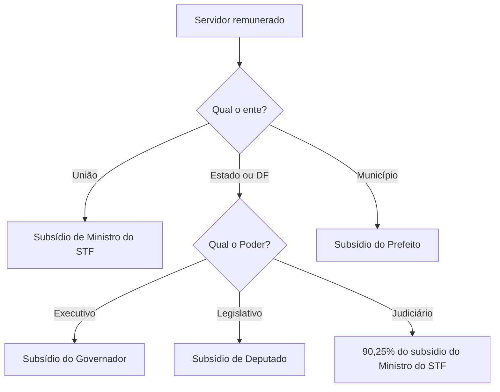

Quanto ganha o servidor público, quem decide e até onde pode chegar? Essas três perguntas dão origem a um dos blocos mais cobrados do regime dos agentes públicos. A remuneração não depende da vontade do chefe nem de um acordo individual: ela nasce de **lei**, é reajustada por regras próprias e tem um **limite máximo** fixado na Constituição. Neste capítulo você estuda como a remuneração é fixada, a diferença entre revisão geral e aumento, e como funciona o teto constitucional, com as discussões que o Supremo Tribunal Federal resolveu.

> [!objetivos]
> - Explicar que a remuneração dos agentes públicos é fixada por lei específica e distinguir remuneração, vencimento e subsídio.
> - Diferenciar revisão geral anual de aumento de remuneração.
> - Aplicar o teto constitucional por poder e por ente federativo e dizer quais verbas ficam fora dele.
> - Reconhecer a regra do teto na acumulação lícita de cargos e as súmulas sobre isonomia.

## Conceitos que a prova mistura

A Constituição usa palavras diferentes para o dinheiro que o agente recebe, e a banca troca uma pela outra.

| Termo | O que é | Observação |
| --- | --- | --- |
| Vencimento | retribuição pelo exercício do cargo, em valor fixado em lei | é a parcela básica, sem as vantagens |
| Remuneração (vencimentos) | vencimento mais as vantagens pecuniárias permanentes | é o total que o servidor recebe todo mês |
| Subsídio | parcela única, sem acréscimos de gratificações ou adicionais | obrigatório para membros de Poder, detentores de mandato, ministros e secretários |
| Proventos | valor pago ao aposentado | corresponde à remuneração na inatividade |

O subsídio é fixado em **parcela única**, sem que se some a ele qualquer gratificação, adicional, abono ou verba de representação. A Constituição permite que a lei também institua o subsídio para outras carreiras organizadas em carreira, e ele é a forma adotada por muitas carreiras policiais e militares. Mesmo no subsídio, o servidor mantém os direitos sociais do art. 7º aplicáveis ao cargo público, como o décimo terceiro e as férias com o terço constitucional, e as **verbas indenizatórias** previstas em lei.

> [!bizu] Subsídio não é sinônimo de "salário sem vantagens"
> Subsídio é parcela única, mas isso não elimina o 13º, as férias com 1/3 e as verbas de natureza indenizatória (como diárias e ajuda de custo). Elas não são "acréscimos remuneratórios" vedados, e sim direitos ou ressarcimentos.

## Fixação da remuneração: reserva de lei específica

Para o servidor receber um valor, esse valor precisa estar numa **lei específica** que respeite quem pode iniciar o projeto (art. 37, X), e a mesma lei é necessária para mudá-lo. Isso expressa o princípio da legalidade: o administrador não pode conceder aumento por decreto, portaria ou ato interno. O que a lei faz, só outra lei desfaz.

Duas consequências merecem atenção:

1. **Lei específica** significa lei que trata do assunto, e não de qualquer norma que o mencione por acaso. A lei orçamentária não vale como lei de aumento.
2. **Iniciativa privativa**: cada chefe de Poder inicia o projeto para os seus servidores. No Executivo, a iniciativa é do chefe (Presidente, Governador ou Prefeito); no Legislativo e no Judiciário, das respectivas Casas e tribunais. A iniciativa para criar cargos e fixar a remuneração dos servidores do Executivo é privativa do chefe do Poder, e a lei de iniciativa de outro agente é inconstitucional por vício formal.

> [!lei] Art. 37, X, da Constituição
> A remuneração dos servidores públicos e o subsídio de que trata o § 4º do art. 39 somente poderão ser fixados ou alterados por lei específica, observada a iniciativa privativa em cada caso, assegurada revisão geral anual, sempre na mesma data e sem distinção de índices.

### O Judiciário não aumenta vencimentos por isonomia

Uma das súmulas mais cobradas tem relação direta com essa reserva de lei: o Judiciário não pode aumentar remuneração de servidores sob o argumento de isonomia entre cargos parecidos.

> [!jurisprudencia] STF, Súmula Vinculante 37 (e Súmula 339)
> Juiz não legisla: por isso, o Judiciário não pode majorar o que o servidor recebe só porque outro cargo parecido ganha mais.

O raciocínio é o da separação dos Poderes. Se o juiz concedesse a um servidor o mesmo valor pago a outro, estaria legislando, o que a Constituição reserva ao Legislativo. A mesma lógica explica por que a Constituição veda a **vinculação ou equiparação** de espécies remuneratórias para efeito de remuneração (art. 37, XIII).

| Quem pede | Pedido | Resultado |
| --- | --- | --- |
| Servidor da carreira A | quer receber o que a carreira B recebe por ser "parecida" | negado: isonomia não é fundamento para o Judiciário aumentar vencimentos |
| Servidor que questiona erro de cálculo da própria remuneração | quer que a lei seja aplicada corretamente | possível: o Judiciário cumpre a lei, não cria aumento |

> [!pegadinha] Corrigir ilegalidade não é aumentar
> A súmula impede que o Judiciário crie aumento. Ela não impede que ele determine o pagamento de parcela que a lei já assegura e que a administração deixou de pagar. A banca troca as situações para ver se o candidato percebe a diferença.

## Revisão geral anual

A revisão geral anual é a **recomposição do poder de compra** dos vencimentos, aplicada a todos os servidores, no mesmo índice e na mesma data. Ela não é aumento real: serve para repor perdas decorrentes da inflação. As características constitucionais são:

- é **anual**, isto é, prevista para cada ano;
- vale **para todos** os servidores do ente, de forma geral, **sem distinção de índices**;
- é feita **na mesma data**;
- depende de **lei específica**, de iniciativa privativa do chefe de cada Poder.

Aumento é outra coisa: é a elevação de remuneração de uma categoria ou de um cargo específico, por razões como valorização da carreira. Pode ser concedido a um grupo só, desde que por lei.

| Aspecto | Revisão geral | Aumento |
| --- | --- | --- |
| Alcance | todos os servidores do ente | categoria ou cargo específico |
| Índice | o mesmo para todos | pode ser diferente |
| Finalidade | repor o poder de compra | valorizar carreira ou corrigir distorção |
| Fundamento | art. 37, X | lei específica de reestruturação |

### O que acontece quando o governo não envia a lei

O STF decidiu, em repercussão geral (RE 565.089), que a falta da revisão anual **não gera direito a indenização**: o servidor não pode cobrar na Justiça o índice que a administração deixou de aplicar. Mas a mesma decisão impõe um dever ao chefe do Poder: **pronunciar-se**, a cada ano, de forma fundamentada, sobre a conveniência e a oportunidade de encaminhar o projeto de lei. A omissão total, sem justificativa, é o que se censura.

> [!jurisprudencia] STF, RE 565.089 (revisão geral anual)
> Não há direito subjetivo à indenização pela ausência de revisão geral anual. Cabe ao chefe do Poder manifestar-se, todo ano, de maneira fundamentada, sobre o envio do projeto. A decisão do STF não obriga o Judiciário a conceder o índice.

> [!atencao] Mora do Executivo não vira aumento judicial
> Quem lê "a revisão anual é um direito do servidor" e marca como certa a alternativa que diz que "o Judiciário pode determinar o índice da revisão" erra. A jurisprudência distingue o dever de se pronunciar do direito ao índice.

## Teto constitucional remuneratório

O teto é o valor máximo que um agente público pode receber. A Constituição fixa como limite o **subsídio mensal dos Ministros do Supremo Tribunal Federal** (art. 37, XI), e as demais esferas têm tetos ligados a esse.

| Âmbito | Teto |
| --- | --- |
| União | subsídio mensal dos Ministros do STF |
| Estados e DF: Poder Executivo | subsídio mensal do Governador |
| Estados e DF: Poder Legislativo | subsídio mensal dos Deputados estaduais ou distritais |
| Estados e DF: Poder Judiciário | subsídio dos Desembargadores do Tribunal de Justiça, que não passa de 90,25% do valor pago a um Ministro do STF |
| Municípios | subsídio do Prefeito |

Esse mesmo corte de 90,25% vale, nos Estados, para promotores e procuradores do Ministério Público e para defensores públicos. Há ainda a faculdade, prevista no § 12, de os Estados e o Distrito Federal adotarem como **limite único** o subsídio dos Desembargadores do Tribunal de Justiça, o que exclui do regime os subsídios dos deputados e dos vereadores.

### O que entra e o que sai do teto

O teto alcança a **soma de tudo** que o agente recebe: vencimento, vantagens pessoais e de qualquer natureza, adicionais, proventos e pensões. Ficam de fora apenas as **parcelas de caráter indenizatório previstas em lei** (art. 37, § 11), como diárias e ajuda de custo. O teto atinge também as estatais, isto é, empresas públicas, sociedades de economia mista e suas controladas, quando dependem de dinheiro do ente público para pagar pessoal ou despesas de custeio (art. 37, § 9º).

> [!lei] Art. 37, § 11, da Constituição
> Não serão computadas, para efeito dos limites remuneratórios de que trata o inciso XI do caput deste artigo, as parcelas de caráter indenizatório previstas em lei.

> [!pegadinha] Nem todo "auxílio" é indenizatório
> Para ficar fora do teto, a parcela precisa **realmente indenizar** uma despesa e estar **prevista em lei**. Um "auxílio" pago de forma fixa, sem relação com gasto específico, pode ser considerado remuneração disfarçada e entrar no teto.

## Aprofundamento: teto e acumulação de cargos

Quando a Constituição permite a acumulação de dois cargos (por exemplo, dois cargos de docente, ou um de docente e um técnico), pergunta-se: o teto vale para a soma ou para cada cargo isoladamente? O STF, em julgamentos de 2017 com repercussão geral, concluiu que o teto é aplicado a cada cargo **isoladamente**, e não ao somatório do que o servidor recebe.

> [!jurisprudencia] STF, repercussão geral (2017): teto na acumulação lícita
> Quando a Constituição permite acumular dois cargos, o teto é conferido cargo por cargo, sem somar os valores.

A regra supõe acumulação **lícita**. Quem acumula cargos de forma ilícita enfrenta outro problema, o da perda de um dos vínculos, e não de limite remuneratório.

### Outras regras de limite

- O teto também alcança os **proventos** de aposentadoria e as **pensões**.
- Os vencimentos dos cargos do Legislativo e do Judiciário **não podem ser superiores** aos pagos pelo Poder Executivo (art. 37, XII), regra que convive com o teto e que o aluno deve guardar em separado dele.
- É proibida a **vinculação ou equiparação** de espécies remuneratórias (art. 37, XIII), o que reforça a súmula sobre isonomia.

> [!esquema] Resumo do bloco
> | Regra | Fundamento |
> | --- | --- |
> | Remuneração só por lei específica | art. 37, X |
> | Revisão geral anual, mesma data, sem distinção de índices | art. 37, X |
> | Teto: subsídio do Ministro do STF (e tetos derivados) | art. 37, XI |
> | Verbas indenizatórias previstas em lei ficam fora do teto | art. 37, § 11 |
> | Judiciário não aumenta vencimentos por isonomia | SV 37 e Súmula 339 |
> | Acumulação lícita: teto por cargo | STF, repercussão geral (2017) |

## O lugar do tema no regime dos cargos públicos

Remuneração é só uma das faces do vínculo. O mesmo cargo público tem forma de **provimento** (a investidura, como a nomeação após concurso), causas de **vacância** (exoneração, demissão, aposentadoria, falecimento), **direitos e deveres** previstos no estatuto, **responsabilidades** e regras de **acumulação**, **estabilidade** e **vitaliciedade**. Os capítulos seguintes completam o quadro. Em prova, a regra prática é perguntar qual é o **ato** que cria ou muda cada coisa: a nomeação cria o vínculo, a lei fixa o valor, a exoneração ou a demissão o encerra e o regime disciplinar controla a conduta no meio do caminho. Quem associa cada fase ao seu instrumento (ato administrativo ou lei) evita confundir, por exemplo, quem pode conceder um aumento com quem pode nomear o servidor. Aumento depende de lei; nomeação depende de ato do chefe do Poder, depois de concurso, e o cargo só se extingue ou se cria por lei, de iniciativa privativa. O que importa aqui é lembrar que cada uma dessas peças depende de lei e que a remuneração é a única que a Constituição protege com tantas travas (lei específica, revisão anual, teto e irredutibilidade).

## Exemplo numérico do teto

Imagine, só para raciocinar, que o subsídio de um Ministro do STF fosse de 40 mil reais. Com contas simples, os limites ficariam assim.

| Situação | Cálculo | Limite |
| --- | --- | --- |
| União | valor do subsídio do Ministro | 40 mil reais |
| Desembargador de Tribunal de Justiça (corte de 90,25%) | 40 mil x 0,9025 | 36.100 reais |
| Governador, no Executivo estadual | fixado em lei estadual | o valor do seu subsídio |
| Prefeito | fixado em lei municipal | o valor do seu subsídio |

Agora um caso prático. Um servidor estadual do Executivo recebe, em um mês, vencimento de 20 mil reais, mais 8 mil reais de gratificações, mais 3 mil reais de diárias. Se o subsídio do Governador for de 30 mil reais, o teto é conferido sobre a soma de tudo o que é remuneração, ou seja, 28 mil reais, que está abaixo do limite. As diárias, por serem indenizatórias e previstas em lei, não entram na conta. Se as gratificações fossem de 12 mil reais, a soma seria 32 mil reais e o excedente de 2 mil reais deveria ser cortado.

> [!exemplo] O corte atinge o excedente, não o servidor inteiro
> O teto não reduz o vencimento-base; ele apenas impede que o total passe do limite. Quando a soma ultrapassa o teto, a administração abate o valor que excede, e o servidor continua recebendo até o limite.

### Subtetos e a uniformização estadual

Na prática, os Estados convivem com mais de um limite. Como o texto constitucional permite adotar o subsídio dos Desembargadores como **limite único** (faculdade que cada Estado exerce por emenda à sua Constituição), alguns entes uniformizam o teto para todos os Poderes, enquanto outros mantêm os subtetos por Poder. Quando existe um limite único facultativo, deputados e vereadores ficam fora dessa regra, e seus subsídios seguem a lógica própria. Na prova, o mais comum é a pergunta que mistura os valores: quem escreve "teto estadual é sempre o subsídio do Governador" erra, porque o Governador é o limite apenas no Executivo.

A mensagem encaminhada pelo chefe do Poder ao Legislativo, com o projeto da lei de revisão, é também a ocasião em que se justifica a manifestação anual exigida pelo STF. A aprovação da lei por maioria simples dos parlamentares encerra o processo, e o projeto só vira obrigação quando sancionado.

### Pensões e juízes

O teto também limita as **pensões por morte**: o benefício pago a dependentes de servidor falecido segue o limite do cargo. E, quanto aos magistrados, o subsídio dos juízes é escalonado em lei federal, e o teto estadual de 90,25% se refere ao subsídio máximo dos Desembargadores, não ao de cada juiz. Essas variações aparecem em enunciados longos, que misturam várias carreiras; o segredo é identificar primeiro o ente e o Poder.

## Mapa do capítulo

O capítulo se organiza em três perguntas: quem fixa (a lei), quando se corrige (a revisão geral) e até onde vai (o teto).

| Pergunta | Resposta | Armadilha da prova |
| --- | --- | --- |
| Quem fixa a remuneração? | lei específica, com iniciativa privativa | decreto ou portaria não podem aumentar |
| E o Judiciário? | não aumenta por isonomia (SV 37) | pode aplicar a lei que já existe |
| O que é revisão geral? | recomposição anual, mesma data, mesmo índice | confundir com aumento de uma categoria |
| Falta de revisão gera indenização? | não, mas o chefe deve se pronunciar | achar que o Judiciário fixa o índice |
| Qual o teto? | subsídio de Ministro do STF e derivados | esquecer o limite de 90,25% no Judiciário estadual |
| O que fica fora do teto? | parcelas indenizatórias previstas em lei | tratar qualquer auxílio como indenização |

### Para fixar
- A remuneração e o subsídio só se fixam ou alteram por lei específica, com iniciativa privativa do chefe de cada Poder.
- Subsídio é parcela única, sem gratificações ou adicionais, mas mantém o 13º, as férias com terço e as verbas indenizatórias.
- A SV 37 e a Súmula 339 proíbem o Judiciário de aumentar vencimentos por isonomia.
- Revisão geral anual repõe o poder de compra de todos os servidores, na mesma data e sem distinção de índices.
- A falta de revisão não gera indenização, mas o chefe do Poder deve se pronunciar todos os anos de forma fundamentada.
- O teto é o subsídio dos Ministros do STF; nos Estados valem o Governador, os Deputados e 90,25% do STF, conforme o Poder.
- No Município, o teto é o subsídio do Prefeito.
- Parcelas indenizatórias previstas em lei não entram no teto.
- Na acumulação lícita de cargos, o teto vale para cada cargo, e não para a soma.
- Vinculação ou equiparação de espécies remuneratórias é vedada.
