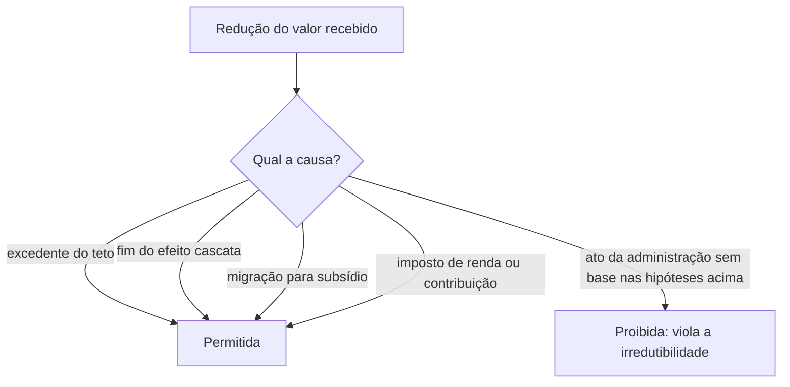
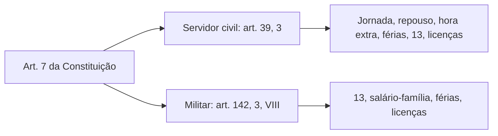

O capítulo anterior mostrou quem fixa a remuneração e até onde ela vai. Agora entram as regras que protegem o servidor depois que o valor foi fixado e as que garantem a ele direitos que o trabalhador comum conquistou: salário mínimo, décimo terceiro, férias, licenças. A prova mistura esses dois blocos num só enunciado, e o segredo é separar o que é **limite** do que é **garantia**. Você estuda o efeito cascata, a incorporação de verbas temporárias, a irredutibilidade, a prioridade das administrações tributárias e a lista dos direitos sociais que a Constituição estende ao servidor, com uma observação especial para os militares estaduais.

> [!objetivos]
> - Explicar a vedação ao efeito cascata e por que verbas temporárias não se incorporam ao vencimento.
> - Aplicar a regra da irredutibilidade e dizer onde ela cede.
> - Listar os direitos sociais do art. 7º que a Constituição estende aos servidores e quais ficam de fora.
> - Aplicar a Súmula Vinculante 16 sobre o salário mínimo e diferenciar os direitos dos militares estaduais.

## Vedação ao efeito cascata

O efeito cascata, também chamado de repique, ocorre quando uma vantagem é calculada sobre outra e esta, por sua vez, sobre uma terceira, de modo que o total cresce em degraus. A Constituição proíbe esse mecanismo: os acréscimos pecuniários que o servidor recebe **não são computados nem acumulados** para o fim de conceder acréscimos posteriores (art. 37, XIV).

Na prática, se o servidor tem um adicional por tempo de serviço de 10% sobre o vencimento e uma gratificação de 20%, a gratificação deve incidir sobre o vencimento-base e não sobre "vencimento mais adicional". Cada vantagem é calculada separadamente sobre a mesma base.

| Situação | Cálculo permitido | Cálculo proibido |
| --- | --- | --- |
| Vencimento de 1.000, adicional de 10%, gratificação de 20% | gratificação de 200 (20% de 1.000) | gratificação de 220 (20% de 1.100) |
| Total | 1.300 | 1.320 |

> [!lei] CF, art. 37, XIV
> Os acréscimos pecuniários percebidos por servidor público não serão computados nem acumulados para fins de concessão de acréscimos ulteriores.

> [!bizu] Repique é palavra-pista
> Quando o enunciado fala em vantagem calculada "sobre o total da remuneração, incluídas as demais vantagens", o caminho provável é a inconstitucionalidade. A palavra "repique" ou "cascata" aponta para o art. 37, XIV.

### Quando o cálculo cabe: a base legal

O efeito cascata é vedado, mas a lei pode escolher a **base de cálculo** de cada vantagem. Pode determinar que a gratificação incida sobre o vencimento-base, e não sobre o total. Também pode dizer que um adicional se calcula sobre a remuneração integral, desde que não haja uma acumulação em sequência sobre vantagens anteriores. A regra, então, não proíbe vantagens calculadas sobre o vencimento; proíbe a **incidência sucessiva sobre vantagens já concedidas**.

## Verbas temporárias não se incorporam

Há uma diferença entre vantagens **permanentes**, que integram o vencimento, e **temporárias** ou *propter laborem* ("pelo trabalho"), que só existem enquanto a condição que as justifica estiver presente. O servidor que recebe gratificação por exercer função de chefia, por trabalhar em local de difícil acesso ou por atuar em atividade de risco recebe o valor **enquanto durar a condição**. Terminada ela, a vantagem cessa, e o servidor não pode alegar que o direito se incorporou ao seu patrimônio.

| Tipo de vantagem | Exemplo | Incorpora? |
| --- | --- | --- |
| Permanente, ligada à pessoa ou ao tempo | adicional por tempo de serviço, quando previsto em lei | sim, enquanto a lei previr |
| Temporária, ligada ao trabalho | gratificação de função, adicional de risco, plantão extra | não, cessa com a condição |
| Eventual | horas extras, diárias | não, só existem quando realizadas |

O STF sustenta que não existe direito adquirido a regime jurídico: a lei pode modificar a forma de cálculo ou extinguir vantagem para o futuro, desde que preserve o **valor nominal** da remuneração (irredutibilidade). O que não se pode é diminuir o que o servidor já recebe.

> [!pegadinha] "Direito adquirido" não protege a gratificação de função
> A banca costuma afirmar que o servidor "incorporou" uma gratificação por ter exercido a função por muitos anos. Na ausência de lei que mande incorporar, a resposta é negativa: a vantagem acompanha a função e desaparece com ela.

## Irredutibilidade de vencimentos e subsídios

O servidor tem garantia constitucional de que o valor que recebe não pode ser reduzido (art. 37, XV). É uma proteção importante e, ao mesmo tempo, limitada: ela vale para a **redução nominal**, isto é, do valor em reais, e não para a perda do poder de compra causada pela inflação. Por isso a revisão geral anual existe como mecanismo separado.

A Constituição abre algumas exceções, que o enunciado do dispositivo lista de forma expressa. A irredutibilidade não impede:

1. **O abate do excedente do teto** (art. 37, XI).
2. **O fim do efeito cascata** (art. 37, XIV), com a redução de vantagens calculadas de forma indevida.
3. **A fixação do subsídio** em parcela única (art. 39, § 4º), com a absorção de vantagens anteriores.
4. **A incidência de tributos**, como o imposto de renda e as contribuições, porque a garantia protege o valor bruto e não os descontos legais.

> [!atencao] Nominal, não real
> A irredutibilidade protege o **valor nominal**. Se a inflação corrói o poder de compra, a Constituição não garante recomposição automática: o instrumento é a revisão geral anual, e a falta dela não gera indenização, como visto no capítulo anterior.

## Prioridade para a administração tributária

Entre as regras do art. 37 aparece uma prioridade orçamentária: as administrações tributárias da União, dos Estados, do Distrito Federal e dos Municípios são **atividades essenciais ao funcionamento do Estado**, exercidas por servidores de carreiras específicas, e terão **recursos prioritários** para o exercício das suas atividades (art. 37, XXII). Também devem atuar **de forma integrada**, o que inclui compartilhar cadastros e informações fiscais, na forma da lei ou de convênio.

A regra não concede vantagens remuneratórias especiais aos servidores desse setor. Ela trata de **recursos para o funcionamento do órgão**, ou seja, de estrutura e prioridade na alocação do orçamento, e de cooperação entre os fiscos. A banca pode afirmar que a Constituição garante "remuneração superior" aos auditores fiscais, o que é incorreto.

## Direitos sociais dos servidores públicos

O art. 7º da Constituição lista direitos dos trabalhadores urbanos e rurais. Eles valem para os celetistas, mas só alguns se aplicam aos servidores estatutários. O art. 39, § 3º diz quais, e a prova adora cobrar a lista.

| Direito (art. 7º) | Conteúdo |
| --- | --- |
| IV | salário mínimo |
| VII | garantia de salário nunca inferior ao mínimo para quem recebe remuneração variável |
| VIII | décimo terceiro salário |
| IX | remuneração do trabalho noturno superior à do diurno |
| XII | salário-família para os dependentes de baixa renda |
| XIII | jornada normal de oito horas diárias e quarenta e quatro semanais |
| XV | repouso semanal remunerado |
| XVI | serviço extraordinário com acréscimo mínimo de 50% |
| XVII | férias anuais com, pelo menos, um terço a mais |
| XVIII | licença à gestante, de 120 dias, sem prejuízo do cargo e da remuneração |
| XIX | licença-paternidade, nos termos da lei |
| XX | proteção do mercado de trabalho da mulher |
| XXII | redução dos riscos inerentes ao trabalho |
| XXX | proibição de diferença de salários e critérios de admissão por sexo, idade, cor ou estado civil |

Ficam de fora, entre outros, o **FGTS**, o **seguro-desemprego**, o **aviso prévio** e o **adicional de periculosidade, insalubridade e penosidade** como direito constitucional. Este último pode ser concedido por lei do ente, mas não decorre automaticamente da Constituição.

> [!lei] CF, art. 39, § 3º
> Aplica-se aos servidores ocupantes de cargo público o disposto no art. 7º, IV, VII, VIII, IX, XII, XIII, XV, XVI, XVII, XVIII, XIX, XX, XXII e XXX, podendo a lei estabelecer requisitos diferenciados de admissão quando a natureza do cargo o exigir.

### Direitos coletivos do servidor

Além dos direitos individuais, a Constituição garante ao servidor civil a **associação sindical** e o **direito de greve**, exercido nos termos e limites definidos em lei específica (art. 37, VI e VII). Como a lei específica ainda não foi editada, o STF determinou que se aplique, no que couber, a lei de greve do setor privado (Lei 7.783/1989), com adaptações. Os militares são diferentes: a Constituição **proíbe** a sindicalização e a greve para eles.

> [!bizu] Quem pode greve e sindicato
> Servidor civil: sim, com os limites da lei. Militar (inclusive das Forças Armadas e, por extensão, dos Estados): não. A lógica é a hierarquia e a disciplina, bases da vida militar.

## O caso dos militares estaduais

Os integrantes do Corpo de Bombeiros e da Polícia Militar são **militares dos Estados** (art. 42). A Constituição aplica a eles, por remissão, parte das regras dos militares das Forças Armadas, e a prova gosta de misturar os dois blocos. Duas remissões são decisivas.

1. O art. 42, § 1º manda aplicar aos militares estaduais as regras do art. 142, §§ 2º e 3º, além do que a lei estadual dispuser, deixando à **lei estadual específica** as matérias do art. 142, § 3º, X (ingresso, limites de idade, estabilidade, transferência para a inatividade, direitos, deveres, remuneração, prerrogativas). As patentes dos oficiais são conferidas pelos respectivos governadores.
2. O art. 142, § 3º, VIII estende aos militares certos direitos sociais (art. 7º, VIII, XII, XVII, XVIII, XIX e XXV) e parte das regras remuneratórias do art. 37 (incisos XI, XIII, XIV e XV).

Assim, para o militar estadual valem o décimo terceiro, o salário-família, as férias com terço e as licenças à gestante e paternidade, e também o teto, a proibição de vinculação, a vedação ao efeito cascata e a irredutibilidade. A **jornada de oito horas**, o **repouso semanal** e as **horas extras** do art. 7º **não** constam da lista estendida aos militares, o que reflete a natureza da atividade. Se o enunciado afirmar que o militar tem direito constitucional a hora extra, a resposta é incorreta, ainda que a lei estadual possa conceder compensações.

> [!pegadinha] Art. 42 não é art. 142
> O art. 142 trata das Forças Armadas, e o art. 42 aplica parte dele aos militares dos Estados. Quem lê "militares" e responde com o art. 142 sem passar pelo 42 troca o grupo. Para os Bombeiros e Policiais Militares, a porta de entrada é o art. 42, § 1º.

## Salário mínimo

A Constituição garante um piso: o servidor não pode receber **menos que o salário mínimo** (art. 7º, IV, estendido pelo art. 39, § 3º). A dúvida clássica é saber sobre qual valor o piso incide: o vencimento básico ou o total que o servidor recebe. O STF respondeu na Súmula Vinculante 16: o piso se refere ao **total da remuneração**, incluídas as vantagens, e não apenas ao vencimento básico.

> [!jurisprudencia] STF, Súmula Vinculante 16
> O salário mínimo vale como piso para o total que o servidor recebe, somadas as vantagens, e não só para o vencimento básico.

Isso significa que a lei pode fixar um vencimento básico abaixo do mínimo, desde que, somadas as vantagens, o servidor receba pelo menos o mínimo. Outro ponto é a Súmula Vinculante 15: se o ente paga um abono só para levar o servidor até o valor do salário mínimo, as gratificações e outras vantagens não devem ser calculadas sobre esse abono, para que o complemento não alimente outros cálculos.

Há ainda uma exceção prevista na Súmula Vinculante 6: os **praças que prestam serviço militar inicial** (conscritos) podem receber remuneração inferior ao salário mínimo. A lógica é o caráter obrigatório e formativo do serviço.

> [!resolvido] Piso e vencimento básico
> **Situação:** um Município paga vencimento básico de 80% do salário mínimo, mais uma gratificação que leva o total a 110% do mínimo.
>
> **Resposta:** é válido. A Súmula Vinculante 16 aplica o piso ao total da remuneração. Se o total ficasse em 95%, haveria violação, e o ente teria de complementar o valor.

## Equiparação e vinculação: o outro lado do efeito cascata

O efeito cascata tem um parente próximo: a **vinculação** (ou equiparação) de valores. É a regra que faz um salário "acompanhar" o de outra categoria. A Constituição proíbe a vinculação ou equiparação de quaisquer espécies remuneratórias para efeito de remuneração de pessoal do serviço público (art. 37, XIII). Se um cargo ganha 5.000 e a lei diz que outro cargo ganhará sempre 90% do primeiro, qualquer aumento no primeiro vira, sem nova lei, aumento no segundo. A vedação impede esse automatismo.

> [!exemplo] Cadeia de aumentos
> Um conselheiro de órgão colegiado recebe retribuição de 5.000 reais. Uma lei diz que o cargo B recebe 600 a menos que o conselheiro, e o cargo C recebe 1.000 a menos que o B. Se o conselheiro ganhar aumento de 500, B e C aumentariam automaticamente. Esse arranjo viola o art. 37, XIII. Cada aumento precisa ser concedido por **lei específica** para a categoria correspondente.

Dois cuidados evitam confusão. Primeiro, a vedação alcança a **remuneração**, e não impede que o legislador use uma mesma tabela para várias carreiras, desde que a tabela seja fixada em lei. Segundo, a proibição não se confunde com o direito à **isonomia** entre iguais: o STF diz que o Judiciário não pode estender aumento a quem não foi contemplado (SV 37), mas a lei pode tratar igualmente cargos que tenham atribuições idênticas.

Os aumentos, então, nascem de leis e não de vínculos automáticos. Quem ganha um aumento precisa tê-lo na lei, quem não o recebeu não pode pedir no Judiciário, e a administração não pode concedê-lo "por analogia". Em questões, a pista é a palavra "automaticamente": ela quase sempre acompanha uma situação vedada.

> [!atencao] Imposto de renda não é redução ilegal
> Quando o servidor recebe valor líquido menor por causa do imposto de renda (art. 153, III), não há violação da irredutibilidade. A garantia constitucional protege o valor bruto fixado em lei, e a tributação segue a regra geral, igual para todos os contribuintes.

## Mapa do capítulo

O capítulo traz dois grupos de regras: as que **limitam** vantagens (efeito cascata, verbas temporárias, irredutibilidade) e as que **garantem** direitos (art. 7º estendido, piso, prioridade fiscal).

| Tema | Regra | Armadilha |
| --- | --- | --- |
| Efeito cascata | acréscimo não incide sobre acréscimo (art. 37, XIV) | achar que a base de cálculo não pode ser o vencimento |
| Verbas temporárias | cessam com a condição | falar em direito adquirido à gratificação |
| Irredutibilidade | protege o valor nominal | achar que protege contra a inflação |
| Administração tributária | recursos prioritários e atuação integrada | atribuir a ela vantagens remuneratórias |
| Direitos sociais | lista do art. 39, § 3º | incluir FGTS, aviso prévio ou adicional constitucional |
| Militares estaduais | art. 42, § 1º remete ao art. 142 | trocar 42 por 142 |
| Salário mínimo | vale para a remuneração total (SV 16) | aplicar só ao vencimento básico |

### Para fixar
- O efeito cascata é proibido: acréscimo não se calcula sobre acréscimo anterior (art. 37, XIV).
- Verbas temporárias, ligadas ao trabalho, cessam com a condição e não se incorporam sem lei que mande incorporar.
- A irredutibilidade protege o valor nominal e cede ao teto, ao fim do efeito cascata, ao subsídio e aos tributos.
- As administrações tributárias têm recursos prioritários e atuação integrada, sem vantagem remuneratória constitucional.
- O art. 39, § 3º lista os direitos do art. 7º aplicáveis aos servidores; FGTS, seguro-desemprego e aviso prévio ficam de fora.
- O servidor civil tem sindicato e greve, nos limites da lei; o militar não os tem.
- Aos militares estaduais aplicam-se o art. 42, § 1º e, por remissão, o art. 142, §§ 2º e 3º.
- O art. 142, § 3º, VIII estende aos militares só alguns direitos do art. 7º e algumas regras remuneratórias do art. 37.
- O piso do salário mínimo vale para a remuneração total (SV 16), e o conscrito pode receber menos (SV 6).
- Abono que completa o salário mínimo não serve de base para outras vantagens (SV 15).
